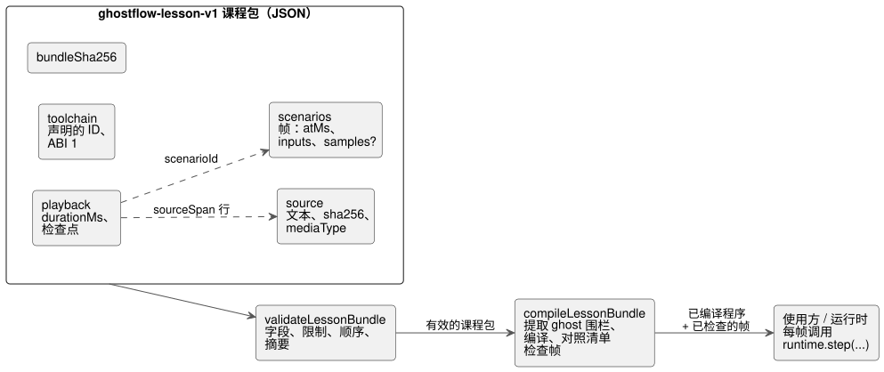

<!-- translation-source: docs/LESSON-BUNDLE.md -->
[英文原文](LESSON-BUNDLE.md)

# 课程包（Lesson bundle）v1

跟踪：https://github.com/callin2/ghostflow-language/issues/7 （TASK-58.4）。

**课程包**（lesson bundle）是一个单独的 JSON 文件，它把 GhostFlow 文学式源文件（literate）与讲解检查点、输入场景打包在一起，使课程可以在不同工具之间迁移，并在任何地方编译。
本文只涉及这一可移植制品及其编译，** 不**定义课程播放器或执行的验收标准。

下图展示了课程包包含的内容，以及在编译前和编译过程中执行哪些检查。



## 职责与 API

**`tools/lesson.mjs` 做什么。** 它校验有界的 JSON 输入，提取权威的 CommonMark GhostFlow 围栏，并调用现有的控制编译器。

**它不负责什么。** 它没有解释器、设备连接、存储或课程时钟。

**运行环境。**

- 浏览器端使用方必须在安全上下文（secure context）中提供 Web Crypto。
- v1 不支持外部媒体。

**严格提取。**

- 编译适配器会拒绝任何提取警告，包括被忽略的嵌套 GhostFlow 围栏。此类代码绝不会作为已执行课程的一部分呈现。
- 只有在存在原始源位置时，编译器诊断才会映射回源文件。

**顶层字段。** 文档包含 `format: ghostflow-lesson-v1`、lessonId、revision、title、locale、source、playback、scenarios、toolchain 和 bundleSha256。
未知字段会被拒绝，因此不受支持的指令永远不会悄悄获得含义。

- **Source** 包含原始文本、其 SHA-256 以及媒体类型
  `text/markdown; profile=ghostflow-literate`。
- **Playback** 包含 durationMs 和有序的检查点。一个检查点包含：
  - atMs；
  - sourceSpan startLine/endLine（从 1 开始，闭区间）。范围指向原始 Markdown，可以指向说明文字；
  - 纯文本讲解；
  - scenarioId。
- **Scenarios** 中每个场景都有唯一的 id、一个 title 和有序的帧。每一帧包含：
  - atMs；
  - `inputs` 映射，从软件输入名映射到 Boolean 或有限数值；
  - 可选的 `samples` 映射，用于采集输入。

  场景、帧和检查点的规则：
  - 至少必须有一个场景、一帧和一个检查点。
  - 每个数组中的时间严格递增。
  - 每一帧最多允许 128 个以标识符命名的输入。与原型（prototype）相关的名称会被拒绝。
  - 单独的 samples 映射同样最多允许 128 个以标识符命名的条目。
- **Toolchain** 记录 compilerId/compilerRevision/runtimeId/runtimeRevision 以及
  ABI 版本 1。这些标识符只是声明，并不能证明实际加载了哪些制品。

**两个独立的时钟。** 讲解时间和场景扫描时间是相互独立的域，尽管两者都使用整数毫秒。

- 重新运行场景时总是从全新的运行时开始。
- 讲解检查点绝不是 VM 快照。

**验证比较结果。** 在声称比较有效之前，执行端使用方必须验证已加载的编译器/运行时身份标识以及输入绑定的兼容性。声明的身份标识并不等于这种验证。

## 场景帧中的采集样本

对于规范的 `input` 声明，使用现有的 `ControlRuntime.step` 样本结构。** 采集样本**（acquisition sample）是对某个输入的一次观测，带有自己的身份标识、时间戳和质量。
例如，带有编写好的 `enabled |> recover(false)` 策略的
`input enabled: Bool;` 可以接收如下帧：

```json
{
  "atMs": 100,
  "inputs": {},
  "samples": {
    "enabled": { "epoch": 1, "id": 1, "timestampMs": 100, "quality": "Good", "value": true }
  }
}
```

**样本结构。** 每个样本恰好包含 `epoch`、`id`、`timestampMs`、`quality` 和 `value`。

| 字段 | 规则 |
|---|---|
| `epoch`、`id`、`timestampMs` | 非负安全整数。`timestampMs` 不能超过该帧的 `atMs`。 |
| `quality` | `NotReady`、`Good`、`Disconnected`、`Stale` 或 `Invalid`，或按此顺序对应的现有数字代码 0–4。 |
| `value` | Boolean 或有限的 JSON 数字，即使是故障观测也是如此。 |

值使用清单（manifest）中的规范单位。课程校验器从不转换单位。

**编译后的绑定检查。** `compileLessonBundle` 会对照实际清单检查每一帧：

- `inputs` 必须恰好提供全部软件输入，并符合其标量类型和边界。
- 样本名称必须对应 `manifest.sensors` 中的条目。
- Bool 样本要求 Boolean 载荷；其他标量样本要求数值载荷。

**仍由运行时负责的部分。** 数值采集的范围/质量检查、样本身份标识的顺序以及故障处理，仍由共享运行时负责。
例如，Int 载荷 `1.5` 会按原样保留在制品中，并在运行时变为 `Invalid`。课程层不会把它强制转换为整数。
故障响应在 GhostFlow 源代码中编写。

**不会凭空生成缺失的观测。** 省略 `samples`、使用空映射，或省略某个采集输入，都表示不提供新的观测。

- 课程层不会合成 Good、false、新的 ID 或时间戳。
- 从未被观测过的输入以运行时的 `NotReady` 开始。之后的保持与过期遵循其现有的运行时契约。

使用方按如下方式转发一帧：
`runtime.step({ nowMs: frame.atMs, inputs: frame.inputs, samples: frame.samples })`。
观测映射和嵌套样本都计入规范的课程包摘要，并以分离的、冻结的值返回。

**兼容性。**

- `samples` 是 `ghostflow-lesson-v1` 的可选字段。它既不改变 GFB，也不改变 WASM ABI。
- 不含 samples 的现有帧保持原有结构。
- 将源文件从普通软件值迁移到采集 Result，需要编写新的课程修订版，并显式提供样本和故障策略。现在若把传感器名称放进 `inputs`，会在编译期帧绑定校验中失败。
- 较旧的课程校验器会拒绝未知的 `samples` 字段，因此使用方必须固定（pin）一个支持该字段的语言修订版。
- 仅靠结构校验不能确立与清单的兼容性。

## 完整性与限制

**摘要。**

- **Source SHA-256** 对精确的 UTF-8 字节进行哈希，不做换行或 Unicode 规范化。
- **Bundle SHA-256** 对省略顶层 bundleSha256 后的规范 JSON 进行哈希。对象键排序；数组保持原有顺序。

摘要用于检测内容不一致，而不能识别恶意编写：任何人都可以重新计算未签名的摘要。
导出的规范化辅助函数会原样序列化它接收到的值。要计算课程包摘要，编写者必须在调用它之前移除顶层的 bundleSha256。

**硬性限制。**

| 项目 | 限制 |
|---|---|
| JSON 大小 | 1 MiB |
| 源文件大小 | 64 KiB |
| 讲解/场景时间 | 600,000 ms |
| 检查点 | 256 |
| 场景 | 16 |
| 每个场景的帧数 | 1,024 |
| 帧总数 | 4,096 |
| 每段讲解的字符数 | 4,096 |

课程包不能提高这些限制。
源位置、时间、顺序和场景引用都会在编译前检查。
编译器自身的资源检查依然适用。
Worker 执行截止时间由前端负责；本制品校验器不对其作任何保证。

## 证据边界

每一步能证明什么：

- **校验** 只证明课程包符合受支持的制品契约，并且内部一致。
- **编译**证明现有编译器接受该源文件。

两者都不能证明追踪结果匹配、浏览器播放成功、物理负载运行或已具备部署条件。
预期的追踪身份标识将由后续的第一个示例/使用方任务生成并检查。本校验器绝不会伪造它。
