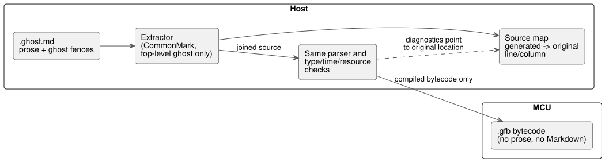

# GhostFlow literate source

**Status:** implemented. Extraction is based on CommonMark 0.31.2, and control compilation and original-location mapping work.
See the [executable tutorial](TUTORIAL.md) and the [verification record](VERIFICATION.md).

**Literate source** is a way to write the selected [control syntax](LANGUAGE-SURFACE.md) inside a Markdown document, so that explanation and executable code live in one file.
Literate is only a source packaging format. It does not change the execution model of the control language.

The diagram shows where literate source fits: the host extracts the code, the normal compiler checks it, and the MCU receives only bytecode.



## Files and extraction rules

- `.ghost.md`: the only GhostFlow product source, from which executable code blocks in Markdown are extracted.
- `.ghost`: if retained, it is only non-executable historical evidence, not compiler input or a fallback.
- An ordinary `.md` is not treated as executable GhostFlow merely because of its extension.

**What is extracted.**

- Only **top-level** fenced code blocks whose info string is exactly `ghost` are extracted, in document order.
- Fences may use Markdown backticks or tildes. The original indentation of the code inside each fence is preserved.
- The last line of each block body ends with a newline. One extra newline separates consecutive blocks, so they are joined with a blank line between them.
- Headings and prose are never inserted into the code as comments.

**What is not extracted.**

- Prose, tables, links, images, front matter, ordinary indented code blocks, and code blocks in other languages.
- Blocks nested inside lists or block quotes.
- A `ghost` fence shown as an example inside a longer fence. It is just text of the outer block.

Block recognition must follow the Markdown structure. A simple regular expression must not be used to search for nested fences.

**Diagnostics.** The following produce diagnostics:

- an executable fence that is not properly closed,
- an unknown `ghost-...` tag,
- extra attributes after `ghost`,
- a literate document with no executable code.

Diagnostics also explain that `ghost` blocks inside block quotes or lists are not executed.
The preview distinguishes the content recognized as code from the excluded content.

## Blocks are fragments of one program

One `control` scope may span several code blocks.

- Braces are never added or closed automatically. The source formed by joining all fragments must be valid ordinary syntax.
- Put block boundaries at the end of a declaration or statement, or at a brace boundary.
- Never split a token, string, comment, or expression across explanatory paragraphs.

In the example below, the first block opens the control (Korean prose: "Program name and outputs"), the second adds the latch ("Stop takes priority over start; after start, the previous state keeps it latched"), and the third connects outputs and closes the brace ("Connect the same watering intent to both outputs").

````markdown
# 관수 제어

프로그램의 이름과 출력이다.

```ghost
control Irrigation {
  input start, stop: Bool;
  output pump, valve: Bool;
  state watering: Bool = false;
```

정지가 시작보다 우선하며, 시작 후에는 이전 상태로 자기유지한다.

```ghost
  watering' = !stop && (start || watering);
```

두 출력에 같은 관수 의도를 연결한다.

```ghost
  valve <- watering';
  pump  <- watering';
  require pump => valve;
}
```
````

Document layout decides only the order in which fragments are joined.

- Blocks do not execute or re-execute independently, and they do not commit state separately.
- Every state's next value and every output follow the original tick contract.
- Observations attached to the document are never fed back automatically as program inputs.

### Extraction result of the document example

This is the code the compiler extracts from the `Irrigation` document example above.
It is an internal result, formed by joining the `ghost` blocks in document order. It is not a separate file or input format.
Prose, tables, and links in the file are excluded. The `text` fence below is for display only.

```text
control Irrigation {
  input start, stop: Bool;
  output pump, valve: Bool;
  state watering: Bool = false;

  watering' = !stop && (start || watering);

  valve <- watering';
  pump  <- watering';
  require pump => valve;
}
```

### A small example distinguishing executable and excluded fences

The following is a **display-only outer fence** that shows the contents of a `.ghost.md` file.
The outer fence itself is not executable code in this document. Inside it, only the top-level `ghost` block is a candidate for execution.
The `text` block and the quoted `ghost` block are excluded. A block with an unknown tag such as `ghost-python` would not be executed either.

````markdown
```ghost
control Demo {
  output pump: Bool;
  pump <- false;
}
```

```text
control NotExecutable { }
```

> ```ghost
> control Quoted { }
> ```
````

In this example, only the first `ghost` block would be extracted.
Within this LITERATE document, all inner fences are just text of the outer fence. Pasting an example here does not mean an extractor has been implemented.

**Prose changes do not change the program.**

- Two documents that differ only in their prose yield the same code.
- If only comments inside a `ghost` block change, the program without comments is the same. Its execution graph and executable bytecode must therefore stay the same.
- For example, change a comment in the same `control Demo` fence from `// 설명 A` to `// 설명 B` ("Explanation A" → "Explanation B"), or change only a paragraph outside the fence. The executable statements are unchanged; only the original content and the source map differ.

This is the verification criterion: literate source is not run by a separate executor; it is checked by the equivalence of the extracted code.

This rule replaces the restriction in the 0.2 comparison proposal that "each fence is a complete top-level declaration."
The change lets explanations sit naturally inside a control while keeping the ordinary language structure.

## Relationship between compilation and runtime

```text
.ghost.md → code extraction → same parser → same type/time/resource checks → .gfb
```

**What must be identical** when the extracted code is the same:

- the type graph and the execution semantics;
- the executable bytecode (excluding debug information), given the same compiler and options.

**What may differ:** the source map that holds document locations, and the content and hash of the document package.

**MCU cost.**

- As before, the MCU receives only executable bytecode.
- The MCU needs no prose, no Markdown parser, and no code extractor.
- Literate source by itself adds no tick cost and no state memory.
- The extra work happens on the host: Markdown extraction, original-location mapping, and editor integration.

**Document-only changes.** When only the document changes, it must be possible to update just the document and the source map while keeping the execution graph and the logical hash.
Signing and deployment policy for the document package are separate matters.
Saving a document or editing a code block never authorizes deployment to physical devices automatically. The existing verification and activation procedures still apply.

## Error locations and observation

The extractor maps each file/line/column of the generated source back to the file/line/column of the original `.ghost.md`.

- Syntax and type errors must point to the original Markdown location.
- If a control that spans block boundaries lacks its closing brace, the diagnostic identifies both where the control starts and the end of the document.

**Example 1: an invalid expression.** The following display-only outer fence shows an entire separate `.ghost.md` file.
Line numbers are not written inside the fence; the explanation below counts lines in the original file.

````markdown
```ghost
control Demo {
  output pump: Bool;
  require pump => ;
}
```
````

The executable fence starts at line 1, and `require pump => ;` is original line 4.
The semicolon is at line 4, column 19, so the invalid-expression diagnostic must point to that original line and column.
It must not report a line number from the joined temporary source.

**Example 2: a missing closing brace across two blocks** (the middle Korean line means "the explanation continues").
The first block's fence closes normally at line 4, but the joined source lacks the `}` of the `control`.

````markdown
```ghost
control Demo {
  output pump: Bool;
```

설명을 이어 쓴다.

```ghost
  pump <- false;
```
````

Here the diagnostic identifies both the original start of `control Demo` (line 2, column 1) and the end of the document (after line 10).
These two examples are design criteria for source maps. They are not the diagnostics that the current parser and extractor actually produce.

**Stable node IDs.** Execution node IDs are never derived from the line numbers of explanatory paragraphs.
Even if added prose pushes code further down, the same computations and state must stay identifiable on the timeline.
Preserve the original document and its source map for each code revision.

**Observation.** An editor may show current values, errors, and timelines beside the code.
This is an observation feature. It does not add a notebook-style cell execution scheduler.
Execution timing and determinism are defined by the control's tick model.

## Examples and verification criteria

An [annotated scheduled-watering document](../examples/scheduled-watering.ghost.md) is provided.
Only a literate document like this one (not a plain `.ghost` file) can be used as `ghostc` input. Markdown is interpreted only on the host; it never goes to the MCU.

Check these criteria when implementing the syntax and the extractor:

1. Two canonical documents differing only in explanation produce identical extracted source and state/output traces.
2. Changing explanation alone preserves the execution graph and executable bytecode.
3. Plain `.ghost` input, nested fences, and examples inside lists or quotations are not executed.
4. Invalid fences and split tokens or expressions are diagnosed at their original document locations.
5. A control spanning several blocks uses the same tick model and state scope.

Where the tests live:

- Extraction and location diagnostics: `tests/literate.test.mjs` and `tests/toolchain.test.mjs`.
- Canonical literate compilation and actual VM trace equivalence: `tools/tutorial.mjs`.
