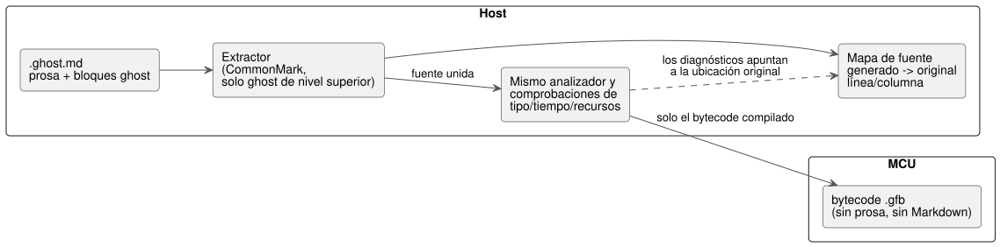

<!-- translation-source: docs/LITERATE.en.md -->
[Original en inglés](LITERATE.en.md)

# Fuente literate de GhostFlow

**Estado:** implementado. La extracción se basa en CommonMark 0.31.2, y funcionan la compilación del control y la asociación con las ubicaciones originales.
Consulte el [tutorial ejecutable](TUTORIAL.es.md) y el [registro de verificación](VERIFICATION.es.md).

La **fuente literate** (literate source) es una forma de escribir la [sintaxis de control](LANGUAGE-SURFACE.es.md) seleccionada dentro de un documento Markdown, de modo que la explicación y el código ejecutable convivan en un solo archivo.
Literate es solo un formato de empaquetado de la fuente. No cambia el modelo de ejecución del lenguaje de control.

El diagrama muestra el lugar que ocupa la fuente literate: el host extrae el código, el compilador habitual lo comprueba y la MCU recibe solo bytecode.



## Archivos y reglas de extracción

- `.ghost.md`: la única fuente de producto de GhostFlow; de ella se extraen los bloques de código ejecutables del Markdown.
- `.ghost`: si se conserva, es solo evidencia histórica no ejecutable, no una entrada del compilador ni un respaldo (fallback).
- Un `.md` ordinario no se trata como GhostFlow ejecutable solo por su extensión.

**Qué se extrae.**

- Solo se extraen los bloques de código delimitados de **nivel superior** cuya cadena de información es exactamente `ghost`, en el orden del documento.
- Los delimitadores pueden usar acentos graves o tildes de Markdown. Se conserva la sangría original del código dentro de cada bloque.
- La última línea del cuerpo de cada bloque termina en un salto de línea. Un salto de línea adicional separa los bloques consecutivos, de modo que se unen con una línea en blanco entre ellos.
- Los encabezados y la prosa nunca se insertan en el código como comentarios.

**Qué no se extrae.**

- La prosa, las tablas, los enlaces, las imágenes, el front matter, los bloques de código sangrados ordinarios y los bloques de código de otros lenguajes.
- Los bloques anidados dentro de listas o citas.
- Un bloque `ghost` mostrado como ejemplo dentro de un delimitador más largo. Es simplemente texto del bloque exterior.

El reconocimiento de bloques debe seguir la estructura de Markdown. No debe usarse una simple expresión regular para buscar bloques anidados.

**Diagnósticos.** Lo siguiente produce diagnósticos:

- un bloque ejecutable que no se cierra correctamente,
- una etiqueta `ghost-...` desconocida,
- atributos adicionales después de `ghost`,
- un documento literate sin código ejecutable.

Los diagnósticos también explican que los bloques `ghost` dentro de citas o listas no se ejecutan.
La vista previa distingue el contenido reconocido como código del contenido excluido.

## Los bloques son fragmentos de un único programa

Un mismo ámbito `control` puede abarcar varios bloques de código.

- Las llaves nunca se añaden ni se cierran automáticamente. La fuente formada al unir todos los fragmentos debe ser sintaxis ordinaria válida.
- Coloque los límites de bloque al final de una declaración o sentencia, o en un límite de llave.
- Nunca divida un token, una cadena, un comentario ni una expresión entre párrafos explicativos.

En el ejemplo siguiente, el primer bloque abre el control (prosa en coreano: «Nombre del programa y salidas»), el segundo añade el latch («Stop tiene prioridad sobre start; tras el arranque, el estado anterior lo mantiene retenido») y el tercero conecta las salidas y cierra la llave («Conectar la misma intención de riego a ambas salidas»).

````markdown
# 관수 제어

프로그램의 이름과 출력이다.

```ghost
control Irrigation {
  input start, stop: Bool;
  output pump, valve: Bool;
  state watering: Bool = false;
```

정지가 시작보다 우선하며, 시작 후에는 이전 상태로 자기유지한다.

```ghost
  watering' = !stop && (start || watering);
```

두 출력에 같은 관수 의도를 연결한다.

```ghost
  valve <- watering';
  pump  <- watering';
  require pump => valve;
}
```
````

La disposición del documento decide solo el orden en que se unen los fragmentos.

- Los bloques no se ejecutan ni se vuelven a ejecutar de forma independiente, y no consolidan el estado por separado.
- El valor siguiente de cada estado y cada salida siguen el contrato de tick original.
- Las observaciones adjuntas al documento nunca se realimentan automáticamente como entradas del programa.

### Resultado de la extracción del ejemplo del documento

Este es el código que el compilador extrae del ejemplo de documento `Irrigation` anterior.
Es un resultado interno, formado al unir los bloques `ghost` en el orden del documento. No es un archivo ni un formato de entrada aparte.
La prosa, las tablas y los enlaces del archivo quedan excluidos. El bloque `text` siguiente es solo para visualización.

```text
control Irrigation {
  input start, stop: Bool;
  output pump, valve: Bool;
  state watering: Bool = false;

  watering' = !stop && (start || watering);

  valve <- watering';
  pump  <- watering';
  require pump => valve;
}
```

### Un pequeño ejemplo que distingue bloques ejecutables y excluidos

Lo siguiente es un **bloque exterior solo para visualización** que muestra el contenido de un archivo `.ghost.md`.
El propio bloque exterior no es código ejecutable en este documento. Dentro de él, solo el bloque `ghost` de nivel superior es candidato a ejecutarse.
El bloque `text` y el bloque `ghost` citado quedan excluidos. Un bloque con una etiqueta desconocida como `ghost-python` tampoco se ejecutaría.

````markdown
```ghost
control Demo {
  output pump: Bool;
  pump <- false;
}
```

```text
control NotExecutable { }
```

> ```ghost
> control Quoted { }
> ```
````

En este ejemplo, solo se extraería el primer bloque `ghost`.
Dentro de este documento LITERATE, todos los bloques interiores son simplemente texto del bloque exterior. Pegar un ejemplo aquí no significa que se haya implementado un extractor.

**Los cambios en la prosa no cambian el programa.**

- Dos documentos que solo difieren en su prosa producen el mismo código.
- Si solo cambian los comentarios dentro de un bloque `ghost`, el programa sin comentarios es el mismo. Por tanto, su grafo de ejecución y su bytecode ejecutable deben permanecer iguales.
- Por ejemplo, cambie un comentario del mismo bloque `control Demo` de `// 설명 A` a `// 설명 B` («Explicación A» → «Explicación B»), o cambie solo un párrafo fuera del bloque. Las sentencias ejecutables no cambian; solo difieren el contenido original y el mapa de fuente.

Este es el criterio de verificación: la fuente literate no la ejecuta un ejecutor aparte; se comprueba mediante la equivalencia del código extraído.

Esta regla sustituye la restricción de la propuesta comparativa 0.2 según la cual «cada bloque es una declaración completa de nivel superior».
El cambio permite que las explicaciones se sitúen con naturalidad dentro de un control, conservando la estructura ordinaria del lenguaje.

## Relación entre la compilación y el runtime

```text
.ghost.md → extracción de código → mismo analizador → mismas comprobaciones de tipo/tiempo/recursos → .gfb
```

**Qué debe ser idéntico** cuando el código extraído es el mismo:

- el grafo de tipos y la semántica de ejecución;
- el bytecode ejecutable (excluida la información de depuración), con el mismo compilador y las mismas opciones.

**Qué puede diferir:** el mapa de fuente que contiene las ubicaciones del documento, y el contenido y el hash del paquete del documento.

**Coste en la MCU.**

- Como antes, la MCU recibe solo bytecode ejecutable.
- La MCU no necesita prosa, ni un analizador de Markdown, ni un extractor de código.
- La fuente literate por sí misma no añade coste por tick ni memoria de estado.
- El trabajo adicional ocurre en el host: extracción del Markdown, asociación con las ubicaciones originales e integración con el editor.

**Cambios solo en el documento.** Cuando solo cambia el documento, debe ser posible actualizar únicamente el documento y el mapa de fuente conservando el grafo de ejecución y el hash lógico.
La política de firma y de despliegue del paquete del documento es una cuestión aparte.
Guardar un documento o editar un bloque de código nunca autoriza automáticamente el despliegue en dispositivos físicos. Los procedimientos existentes de verificación y activación siguen aplicándose.

## Ubicación de errores y observación

El extractor asocia cada archivo/línea/columna de la fuente generada con el archivo/línea/columna del `.ghost.md` original.

- Los errores de sintaxis y de tipos deben señalar la ubicación original en el Markdown.
- Si a un control que cruza límites de bloque le falta la llave de cierre, el diagnóstico identifica tanto dónde empieza el control como el final del documento.

**Ejemplo 1: una expresión no válida.** El siguiente bloque exterior solo para visualización muestra un archivo `.ghost.md` completo e independiente.
Los números de línea no se escriben dentro del bloque; la explicación siguiente cuenta las líneas del archivo original.

````markdown
```ghost
control Demo {
  output pump: Bool;
  require pump => ;
}
```
````

El bloque ejecutable empieza en la línea 1, y `require pump => ;` es la línea original 4.
El punto y coma está en la línea 4, columna 19, por lo que el diagnóstico de expresión no válida debe señalar esa línea y columna originales.
No debe informar un número de línea de la fuente temporal unida.

**Ejemplo 2: falta la llave de cierre a lo largo de dos bloques** (la línea coreana del medio significa «la explicación continúa»).
El delimitador del primer bloque se cierra con normalidad en la línea 4, pero a la fuente unida le falta la `}` del `control`.

````markdown
```ghost
control Demo {
  output pump: Bool;
```

설명을 이어 쓴다.

```ghost
  pump <- false;
```
````

Aquí el diagnóstico identifica tanto el inicio original de `control Demo` (línea 2, columna 1) como el final del documento (después de la línea 10).
Estos dos ejemplos son criterios de diseño para los mapas de fuente. No son los diagnósticos que el analizador y el extractor actuales producen realmente.

**ID de nodo estables.** Los ID de los nodos de ejecución nunca se derivan de los números de línea de los párrafos explicativos.
Aunque la prosa añadida desplace el código hacia abajo, los mismos cálculos y el mismo estado deben seguir siendo identificables en la línea de tiempo.
Conserve el documento original y su mapa de fuente para cada revisión del código.

**Observación.** Un editor puede mostrar los valores actuales, los errores y las líneas de tiempo junto al código.
Esta es una función de observación. No añade un planificador de ejecución por celdas al estilo de un cuaderno (notebook).
El momento de ejecución y el determinismo los define el modelo de tick del control.

## Ejemplos y criterios de verificación

Se proporciona un [documento comentado de riego programado](../examples/scheduled-watering.ghost.es.md).
Solo un documento literate como este (no un archivo `.ghost` simple) puede usarse como entrada de `ghostc`. El Markdown se interpreta solo en el host; nunca llega a la MCU.

Compruebe estos criterios al implementar la sintaxis y el extractor:

1. Dos documentos canónicos que difieren solo en la explicación producen la misma fuente extraída y las mismas trazas de estado/salida.
2. Cambiar solo la explicación conserva el grafo de ejecución y el bytecode ejecutable.
3. La entrada `.ghost` simple, los bloques anidados y los ejemplos dentro de listas o citas no se ejecutan.
4. Los bloques no válidos y los tokens o expresiones divididos se diagnostican en sus ubicaciones originales del documento.
5. Un control que abarca varios bloques usa el mismo modelo de tick y el mismo ámbito de estado.

Dónde están las pruebas:

- Extracción y diagnósticos de ubicación: `tests/literate.test.mjs` y `tests/toolchain.test.mjs`.
- Compilación literate canónica y equivalencia real de trazas en la VM: `tools/tutorial.mjs`.
