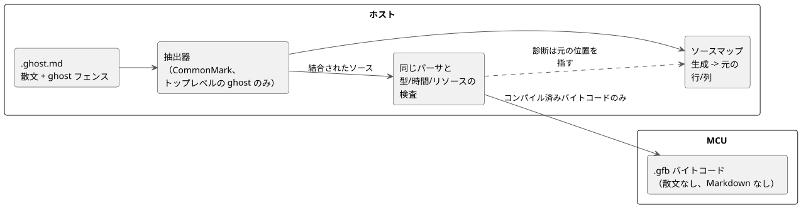

<!-- translation-source: docs/LITERATE.en.md -->
[英語の原文](LITERATE.en.md)

# GhostFlow の文芸的ソース

**状態:** 実装済み。抽出は CommonMark 0.31.2 に基づいており、制御のコンパイルと元の位置への対応付けが動作します。
[実行可能なチュートリアル](TUTORIAL.ja.md)と[検証記録](VERIFICATION.ja.md)を参照してください。

**文芸的ソース**（literate source）とは、選定された[制御構文](LANGUAGE-SURFACE.ja.md)を Markdown 文書の中に書く方法です。これにより、説明と実行可能なコードが 1 つのファイルに収まります。
literate は、ソースのパッケージ形式にすぎません。制御言語の実行モデルは変えません。

次の図は、文芸的ソースの位置付けを示しています。ホストがコードを抽出し、通常のコンパイラがそれを検査し、MCU はバイトコードだけを受け取ります。



## ファイルと抽出規則

- `.ghost.md`: 唯一の GhostFlow 製品ソースです。Markdown 内の実行可能なコードブロックはここから抽出されます。
- `.ghost`: 残っている場合でも、実行されない過去の証拠にすぎません。コンパイラの入力でもフォールバックでもありません。
- 通常の `.md` は、拡張子だけを理由に実行可能な GhostFlow として扱われることはありません。

**抽出されるもの。**

- info 文字列がちょうど `ghost` である**トップレベル**のフェンス付きコードブロックだけが、文書の順序で抽出されます。
- フェンスには Markdown のバッククォートとチルダのどちらも使えます。各フェンス内のコードの元のインデントは保たれます。
- 各ブロック本体の最終行は改行で終わります。連続するブロックの間には改行が 1 つ追加されるため、ブロックは空行を挟んで結合されます。
- 見出しや散文がコメントとしてコードに挿入されることは決してありません。

**抽出されないもの。**

- 散文、表、リンク、画像、フロントマター、通常のインデントによるコードブロック、他の言語のコードブロック。
- リストや引用の中にネストしたブロック。
- より長いフェンスの中に例として示された `ghost` フェンス。これは外側のブロックの単なるテキストです。

ブロックの認識は Markdown の構造に従わなければなりません。ネストしたフェンスの検索に単純な正規表現を使ってはなりません。

**診断。** 次のものは診断を生成します。

- 正しく閉じられていない実行可能なフェンス
- 未知の `ghost-...` タグ
- `ghost` の後に続く余分な属性
- 実行可能なコードを持たない文芸的文書

診断は、引用やリストの中の `ghost` ブロックが実行されないことも説明します。
プレビューは、コードとして認識された内容と除外された内容を区別して表示します。

## ブロックは 1 つのプログラムの断片

1 つの `control` スコープが複数のコードブロックにまたがってもかまいません。

- 波括弧が自動的に追加されたり閉じられたりすることは決してありません。すべての断片を結合して得られるソースは、通常の構文として正しくなければなりません。
- ブロックの境界は、宣言や文の終わり、または波括弧の境界に置いてください。
- トークン、文字列、コメント、式を説明の段落をまたいで分割してはなりません。

以下の例では、最初のブロックが制御を開きます（韓国語の散文: 「プログラムの名前と出力」）。2 番目のブロックはラッチを追加します（「停止は開始より優先され、開始後は前状態によって自己保持する」）。3 番目のブロックは出力を接続して波括弧を閉じます（「両方の出力に同じ灌水の意図を接続する」）。

````markdown
# 관수 제어

프로그램의 이름과 출력이다.

```ghost
control Irrigation {
  input start, stop: Bool;
  output pump, valve: Bool;
  state watering: Bool = false;
```

정지가 시작보다 우선하며, 시작 후에는 이전 상태로 자기유지한다.

```ghost
  watering' = !stop && (start || watering);
```

두 출력에 같은 관수 의도를 연결한다.

```ghost
  valve <- watering';
  pump  <- watering';
  require pump => valve;
}
```
````

文書のレイアウトが決めるのは、断片を結合する順序だけです。

- ブロックが独立して実行・再実行されることはなく、個別に状態を確定することもありません。
- すべての状態の次の値とすべての出力は、元の tick 契約に従います。
- 文書に付随する観測が、プログラムの入力として自動的にフィードバックされることは決してありません。

### 文書例の抽出結果

これは、上の `Irrigation` 文書例からコンパイラが抽出するコードです。
`ghost` ブロックを文書の順序で結合した内部的な結果であり、別のファイルや入力形式ではありません。
ファイル内の散文、表、リンクは除外されます。以下の `text` フェンスは表示専用です。

```text
control Irrigation {
  input start, stop: Bool;
  output pump, valve: Bool;
  state watering: Bool = false;

  watering' = !stop && (start || watering);

  valve <- watering';
  pump  <- watering';
  require pump => valve;
}
```

### 実行されるフェンスと除外されるフェンスを区別する小さな例

以下は、`.ghost.md` ファイルの内容を示す**表示専用の外側フェンス**です。
外側のフェンス自体は、この文書では実行可能なコードではありません。その中で実行の候補となるのは、トップレベルの `ghost` ブロックだけです。
`text` ブロックと引用内の `ghost` ブロックは除外されます。`ghost-python` のような未知のタグを持つブロックも実行されません。

````markdown
```ghost
control Demo {
  output pump: Bool;
  pump <- false;
}
```

```text
control NotExecutable { }
```

> ```ghost
> control Quoted { }
> ```
````

この例で抽出されるのは、最初の `ghost` ブロックだけです。
この LITERATE 文書の中では、内側のフェンスはすべて外側フェンスの単なるテキストです。ここに例を貼り付けたからといって、抽出器が実装されたことを意味するわけではありません。

**散文の変更はプログラムを変えません。**

- 散文だけが異なる 2 つの文書からは、同じコードが得られます。
- `ghost` ブロック内のコメントだけが変わった場合、コメントを除いたプログラムは同じです。したがって、実行グラフと実行可能なバイトコードも同じでなければなりません。
- たとえば、同じ `control Demo` フェンス内のコメントを `// 설명 A` から `// 설명 B` に変える（「説明 A」→「説明 B」）、あるいはフェンスの外の段落だけを変えるとします。実行可能な文は変わらず、異なるのは元の内容とソースマップだけです。

これが検証の基準です。文芸的ソースは別の実行器で実行されるのではなく、抽出されたコードの同等性によって検査されます。

この規則は、0.2 の比較提案にあった「各フェンスは完全なトップレベル宣言である」という制限を置き換えるものです。
この変更により、通常の言語構造を保ったまま、説明を制御の内部に自然に置けるようになります。

## コンパイルとランタイムの関係

```text
.ghost.md → コードの抽出 → 同じパーサ → 同じ型/時間/リソースの検査 → .gfb
```

抽出されたコードが同じ場合に**同一でなければならないもの**:

- 型グラフと実行のセマンティクス
- 同じコンパイラとオプションを使った場合の、実行可能なバイトコード（デバッグ情報を除く）

**異なってもかまわないもの:** 文書上の位置を保持するソースマップと、文書パッケージの内容およびハッシュ。

**MCU のコスト。**

- これまでどおり、MCU が受け取るのは実行可能なバイトコードだけです。
- MCU には散文も、Markdown パーサも、コード抽出器も必要ありません。
- 文芸的ソースそれ自体は、tick のコストも状態のメモリも追加しません。
- 追加の作業はホストで行われます: Markdown の抽出、元の位置への対応付け、エディタとの統合。

**文書だけの変更。** 文書だけが変わった場合は、実行グラフと論理ハッシュを保ったまま、文書とソースマップだけを更新できなければなりません。
文書パッケージの署名とデプロイのポリシーは別の問題です。
文書の保存やコードブロックの編集が、物理デバイスへのデプロイを自動的に許可することは決してありません。既存の検証と有効化の手順が引き続き適用されます。

## エラーの位置と観測

抽出器は、生成されたソースの各ファイル/行/列を、元の `.ghost.md` のファイル/行/列に対応付けます。

- 構文エラーと型エラーは、元の Markdown 上の位置を指さなければなりません。
- ブロック境界をまたぐ制御に閉じ波括弧がない場合、診断は制御の開始位置と文書の末尾の両方を示します。

**例 1: 不正な式。** 次の表示専用の外側フェンスは、別個の `.ghost.md` ファイル全体を示しています。
フェンス内には行番号を書いていません。以下の説明では、元のファイルの行を数えます。

````markdown
```ghost
control Demo {
  output pump: Bool;
  require pump => ;
}
```
````

実行可能なフェンスは 1 行目から始まり、`require pump => ;` は元の 4 行目です。
セミコロンは 4 行目の 19 列目にあるため、不正な式の診断はその元の行と列を指さなければなりません。
結合された一時的なソースの行番号を報告してはなりません。

**例 2: 2 つのブロックにまたがる閉じ波括弧の欠落**（中央の韓国語の行は「説明を続けて書く」という意味です）。
最初のブロックのフェンスは 4 行目で正常に閉じますが、結合されたソースには `control` の `}` がありません。

````markdown
```ghost
control Demo {
  output pump: Bool;
```

설명을 이어 쓴다.

```ghost
  pump <- false;
```
````

この場合、診断は `control Demo` の元の開始位置（2 行目、1 列目）と文書の末尾（10 行目の後）の両方を示します。
この 2 つの例はソースマップの設計基準です。現在のパーサと抽出器が実際に生成する診断ではありません。

**安定したノード ID。** 実行ノードの ID が、説明の段落の行番号から導出されることは決してありません。
散文を追加してコードが下にずれても、同じ計算と状態はタイムライン上で識別できるままでなければなりません。
コードのリビジョンごとに、元の文書とそのソースマップを保存してください。

**観測。** エディタは、現在の値、エラー、タイムラインをコードの横に表示してもかまいません。
これは観測の機能です。ノートブック形式のセル実行スケジューラを追加するものではありません。
実行のタイミングと決定性は、制御の tick モデルによって定義されます。

## 例と検証基準

[注釈付きのスケジュール灌水文書](../examples/scheduled-watering.ghost.ja.md)が用意されています。
`ghostc` の入力に使えるのは、このような文芸的文書だけです（単純な `.ghost` ファイルは使えません）。Markdown はホストでのみ解釈され、MCU に送られることは決してありません。

構文と抽出器を実装する際は、次の基準を確認してください。

1. 説明だけが異なる 2 つの正準文書は、同一の抽出ソースと、同一の状態/出力トレースを生成します。
2. 説明だけを変更しても、実行グラフと実行可能なバイトコードは保たれます。
3. 単純な `.ghost` 入力、ネストしたフェンス、リストや引用の中の例は実行されません。
4. 不正なフェンスや、分割されたトークンまたは式は、元の文書上の位置で診断されます。
5. 複数のブロックにまたがる制御は、同じ tick モデルと状態スコープを使います。

テストの場所:

- 抽出と位置の診断: `tests/literate.test.mjs` と `tests/toolchain.test.mjs`。
- 正準的な文芸的コンパイルと、実際の VM トレースの同等性: `tools/tutorial.mjs`。
