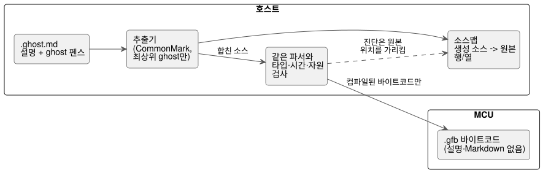

<!-- translation-source: docs/LITERATE.en.md -->
[영문 원문](LITERATE.en.md)

# GhostFlow literate source

**상태:** 구현됨. 추출은 CommonMark 0.31.2를 기반으로 하며, control 컴파일과 원본 위치 매핑이 동작합니다.
[실행 튜토리얼](TUTORIAL.ko.md)과 [검증 기록](VERIFICATION.ko.md)을 참고하세요.

**문서형 소스(literate source)**는 선택한 [control 문법](LANGUAGE-SURFACE.md)을 Markdown 문서 안에 작성해, 설명과 실행 코드를 한 파일에 담는 방식입니다.
Literate는 소스를 포장하는 형식일 뿐입니다. 제어 언어의 실행 모델을 바꾸지 않습니다.

다이어그램은 literate 소스의 위치를 보여 줍니다. 호스트가 코드를 추출하고, 일반 컴파일러가 검사하며, MCU는 바이트코드만 받습니다.



## 파일과 추출 규칙

- `.ghost.md`: Markdown 안의 실행 코드 블록을 추출하는, 유일한 GhostFlow 제품 소스입니다.
- `.ghost`: 보존하더라도 실행되지 않는 역사적 증거일 뿐이며, 컴파일러 입력이나 fallback이 아닙니다.
- 일반 `.md`는 확장자만으로 실행 가능한 GhostFlow로 취급하지 않습니다.

**추출 대상.**

- 정보 문자열이 정확히 `ghost`인 **최상위** fenced code block만 문서 순서대로 추출합니다.
- 펜스는 Markdown의 backtick이나 tilde를 쓸 수 있습니다. 각 펜스 안 코드의 원래 들여쓰기는 유지됩니다.
- 각 블록 본문의 마지막 줄은 개행으로 끝납니다. 연속된 블록 사이에는 개행 하나를 더 넣으므로, 블록은 빈 줄 하나를 사이에 두고 이어집니다.
- 제목과 설명 문단을 주석으로 코드에 삽입하는 일은 결코 없습니다.

**추출하지 않는 것.**

- 설명 문단, 표, 링크, 이미지, front matter, 일반 들여쓰기 코드 블록, 다른 언어의 코드 블록.
- 목록이나 인용문 안에 중첩된 블록.
- 더 긴 펜스 안에 예시로 적은 `ghost` 펜스. 이는 바깥 블록의 텍스트일 뿐입니다.

블록 인식은 Markdown 구조를 따라야 합니다. 단순한 정규식으로 중첩 펜스를 찾아서는 안 됩니다.

**진단.** 다음 경우에는 진단을 냅니다.

- 제대로 닫히지 않은 실행 펜스,
- 알 수 없는 `ghost-...` 태그,
- `ghost` 뒤의 추가 속성,
- 실행 코드가 없는 literate 문서.

진단은 인용문이나 목록 안의 `ghost` 블록이 실행되지 않는다는 점도 알려 줍니다.
미리보기는 코드로 인식한 내용과 제외한 내용을 구분해 보여 줍니다.

## 블록은 한 프로그램의 조각

하나의 `control` 범위가 여러 코드 블록에 걸칠 수 있습니다.

- 중괄호를 자동으로 추가하거나 닫는 일은 없습니다. 모든 조각을 이어 붙인 소스가 일반 문법으로 유효해야 합니다.
- 블록 경계는 선언이나 문장의 끝, 또는 중괄호 경계에 둡니다.
- 토큰, 문자열, 주석, 식 하나를 설명 문단 사이에 쪼개서는 안 됩니다.

아래 예에서 첫 번째 블록은 control을 열고, 두 번째 블록은 자기유지를 추가하며, 세 번째 블록은 출력을 연결하고 중괄호를 닫습니다.

````markdown
# 관수 제어

프로그램의 이름과 출력이다.

```ghost
control Irrigation {
  input start, stop: Bool;
  output pump, valve: Bool;
  state watering: Bool = false;
```

정지가 시작보다 우선하며, 시작 후에는 이전 상태로 자기유지한다.

```ghost
  watering' = !stop && (start || watering);
```

두 출력에 같은 관수 의도를 연결한다.

```ghost
  valve <- watering';
  pump  <- watering';
  require pump => valve;
}
```
````

문서의 배치는 조각을 이어 붙이는 순서만 정합니다.

- 블록이 독립적으로 실행되거나 재실행되지 않으며, 상태를 따로 확정하지도 않습니다.
- 모든 상태의 다음 값과 모든 출력은 원래의 tick 계약을 따릅니다.
- 문서에 붙인 관찰 결과가 프로그램 입력으로 자동 되먹임되는 일은 결코 없습니다.

### 문서형 예제의 추출 결과

다음은 위 `Irrigation` 문서 예제에서 컴파일러가 추출하는 코드입니다.
이는 `ghost` 블록들을 문서 순서대로 이어 붙인 내부 결과입니다. 별도의 파일이나 입력 형식이 아닙니다.
파일의 설명, 표, 링크는 제외됩니다. 아래 `text` 펜스는 표시용입니다.

```text
control Irrigation {
  input start, stop: Bool;
  output pump, valve: Bool;
  state watering: Bool = false;

  watering' = !stop && (start || watering);

  valve <- watering';
  pump  <- watering';
  require pump => valve;
}
```

### 실행 펜스와 제외 펜스를 구분하는 작은 예

다음은 `.ghost.md` 파일의 내용을 보여 주는 **표시용 바깥 펜스(outer fence)**입니다.
바깥 펜스 자체는 이 문서에서 실행 코드가 아닙니다. 그 안에서는 최상위 `ghost` 블록만 실행 후보입니다.
`text` 블록과 인용된 `ghost` 블록은 제외됩니다. `ghost-python`처럼 알 수 없는 태그를 가진 블록도 실행되지 않습니다.

````markdown
```ghost
control Demo {
  output pump: Bool;
  pump <- false;
}
```

```text
control NotExecutable { }
```

> ```ghost
> control Quoted { }
> ```
````

이 예에서는 첫 번째 `ghost` 블록만 추출됩니다.
이 LITERATE 문서 안에서는 안쪽 펜스가 모두 바깥 펜스의 텍스트일 뿐입니다. 여기에 예시를 붙여 넣었다고 해서 추출기가 구현되었다는 뜻은 아닙니다.

**설명을 바꿔도 프로그램은 바뀌지 않습니다.**

- 설명 문단만 다른 두 문서는 같은 코드를 얻습니다.
- `ghost` 블록 안의 주석만 바뀌면, 주석을 제외한 프로그램은 같습니다. 따라서 실행 그래프와 실행 바이트코드도 같아야 합니다.
- 예를 들어 같은 `control Demo` 펜스의 주석을 `// 설명 A`에서 `// 설명 B`로 바꾸거나, 펜스 밖의 문단만 바꿔 봅니다. 실행 문장은 그대로이고, 원본 내용과 소스맵만 달라집니다.

검증 기준은 이렇습니다. literate 소스는 별도의 실행기로 돌리지 않고, 추출된 코드의 동등성으로 검사합니다.

이 규칙은 0.2 비교안의 "각 펜스는 완결된 최상위 선언" 제한을 대체합니다.
이렇게 바꾸면 일반 언어의 구조를 유지하면서도 control 안에 설명을 자연스럽게 배치할 수 있습니다.

## 컴파일과 런타임의 관계

```text
.ghost.md → 코드 추출 → 같은 파서 → 같은 타입·시간·자원 검사 → .gfb
```

추출된 코드가 같을 때 **반드시 같아야 하는 것**:

- 타입 그래프와 실행 의미;
- 같은 컴파일러와 옵션에서의 실행 바이트코드(디버그 정보 제외).

**달라도 되는 것:** 문서 위치를 담는 소스맵, 그리고 문서 패키지의 내용과 해시.

**MCU 비용.**

- 이전과 마찬가지로 MCU는 실행 바이트코드만 받습니다.
- MCU에는 설명문도, Markdown 파서도, 코드 추출기도 필요하지 않습니다.
- Literate 소스 자체는 tick 비용이나 상태 메모리를 늘리지 않습니다.
- 추가 작업은 호스트에서 일어납니다. Markdown 추출, 원본 위치 매핑, 편집기 통합이 그것입니다.

**문서만 바뀐 경우.** 문서만 바뀌었다면 실행 그래프와 논리 해시는 유지한 채 문서와 소스맵만 갱신할 수 있어야 합니다.
문서 패키지의 서명과 배포 정책은 별개의 문제입니다.
문서 저장이나 코드 블록 편집이 실장치 배포를 자동으로 승인하는 일은 결코 없습니다. 기존 검증·활성화 절차가 그대로 적용됩니다.

## 오류 위치와 관찰

추출기는 생성 소스의 파일/행/열을 원래 `.ghost.md`의 파일/행/열로 다시 매핑합니다.

- 문법 오류와 타입 오류는 원래 Markdown 위치를 가리켜야 합니다.
- 블록 경계를 넘는 control에 닫는 중괄호가 없으면, 진단은 control이 시작된 위치와 문서의 끝을 함께 알려 줍니다.

**예 1: 잘못된 식.** 다음 표시용 바깥 펜스는 별도의 `.ghost.md` 파일 전체를 보여 줍니다.
행 번호는 펜스 안에 적지 않았습니다. 아래 설명은 원본 파일 기준으로 행을 셉니다.

````markdown
```ghost
control Demo {
  output pump: Bool;
  require pump => ;
}
```
````

실행 펜스는 1행에서 시작하고, `require pump => ;`는 원본 4행입니다.
세미콜론은 4행 19열에 있으므로, 잘못된 식에 대한 진단은 그 원본 행과 열을 가리켜야 합니다.
이어 붙인 임시 소스의 행 번호를 보고해서는 안 됩니다.

**예 2: 두 블록에 걸쳐 닫는 중괄호가 없는 경우.**
첫 번째 블록의 펜스는 4행에서 정상적으로 닫히지만, 이어 붙인 소스에는 `control`의 `}`가 없습니다.

````markdown
```ghost
control Demo {
  output pump: Bool;
```

설명을 이어 쓴다.

```ghost
  pump <- false;
```
````

이 경우 진단은 `control Demo`의 원래 시작 위치(2행 1열)와 문서의 끝(10행 뒤)을 함께 알려 줍니다.
이 두 예는 소스맵에 대한 설계 기준입니다. 현재 파서와 추출기가 실제로 내는 진단은 아닙니다.

**안정적인 노드 ID.** 실행 노드 ID는 설명 문단의 행 번호에서 결코 만들어지지 않습니다.
설명이 추가되어 코드가 아래로 밀려나도, 같은 계산과 상태는 타임라인에서 계속 식별될 수 있어야 합니다.
원본 문서와 그 소스맵은 코드 revision마다 보존합니다.

**관찰.** 편집기는 코드 옆에 현재 값, 오류, 타임라인을 표시할 수 있습니다.
이는 관찰 기능입니다. 노트북 방식의 셀 실행 스케줄러를 추가하지 않습니다.
실행 시점과 결정성은 control의 tick 모델이 정의합니다.

## 예제와 검증 기준

[설명이 있는 시간표 관수 문서](../examples/scheduled-watering.ghost.md)를 제공합니다.
`ghostc` 입력으로는 이와 같은 literate 문서만 사용할 수 있습니다(일반 `.ghost` 파일은 불가). Markdown은 호스트에서만 해석되며 MCU로 가지 않습니다.

문법과 추출기를 구현할 때 다음 기준을 확인합니다.

1. 설명만 다른 두 canonical 문서는 같은 추출 소스와 같은 상태·출력 trace를 만듭니다.
2. 설명만 바꾸면 실행 그래프와 실행 바이트코드가 유지됩니다.
3. 일반 `.ghost` 입력, 중첩 펜스, 목록·인용 속 예시는 실행되지 않습니다.
4. 잘못된 펜스와 쪼개진 토큰·식은 원래 문서 위치에서 진단됩니다.
5. 여러 블록에 걸친 control도 같은 tick 모델과 상태 범위를 사용합니다.

테스트 위치:

- 추출과 위치 진단: `tests/literate.test.mjs`, `tests/toolchain.test.mjs`.
- canonical literate 컴파일과 실제 VM trace 동등성: `tools/tutorial.mjs`.
