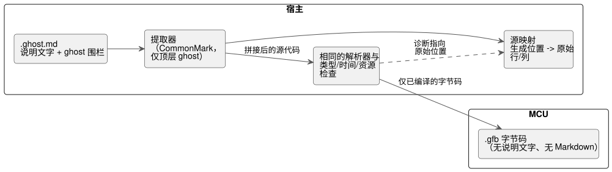

<!-- translation-source: docs/LITERATE.en.md -->
[英文原文](LITERATE.en.md)

# GhostFlow 文学式源文件

**状态：** 已实现。提取基于 CommonMark 0.31.2，控制编译和原始位置映射均可正常工作。
请参阅[可执行教程](TUTORIAL.zh.md)和[验证记录](VERIFICATION.zh.md)。

**文学式源文件**（literate source）是一种在 Markdown 文档中编写所选[控制语法](LANGUAGE-SURFACE.zh.md)的方式，使说明和可执行代码位于同一个文件中。
literate 只是一种源文件打包格式，它不会改变控制语言的执行模型。

下图展示了文学式源文件所处的位置：宿主提取代码，常规编译器对其进行检查，而 MCU 只接收字节码。



## 文件与提取规则

- `.ghost.md`：唯一的 GhostFlow 产品源文件，从其中提取 Markdown 中的可执行代码块。
- `.ghost`：如果保留，它只是不可执行的历史证据，既不是编译器输入，也不是回退（fallback）。
- 普通的 `.md` 不会仅因扩展名而被视为可执行的 GhostFlow。

**会被提取的内容。**

- 只有信息字符串（info string）恰好为 `ghost` 的**顶层** 围栏代码块才会被提取，并按文档顺序排列。
- 围栏可以使用 Markdown 反引号或波浪号。每个围栏内代码的原始缩进会被保留。
- 每个代码块正文的最后一行以换行符结尾。连续的代码块之间再多加一个换行符，因此它们以一个空行相隔拼接在一起。
- 标题和说明文字绝不会作为注释插入代码中。

**不会被提取的内容。**

- 说明文字、表格、链接、图片、front matter（前置元数据）、普通的缩进代码块，以及其他语言的代码块。
- 嵌套在列表或块引用中的代码块。
- 在更长的围栏内作为示例展示的 `ghost` 围栏。它只是外层代码块的文本。

代码块识别必须遵循 Markdown 结构。不得使用简单的正则表达式来搜索嵌套围栏。

**诊断。** 以下情况会产生诊断：

- 未正确闭合的可执行围栏，
- 未知的 `ghost-...` 标签，
- `ghost` 之后的额外属性，
- 不含任何可执行代码的文学式文档。

诊断还会说明块引用或列表中的 `ghost` 代码块不会被执行。
预览会区分被识别为代码的内容与被排除的内容。

## 代码块是同一个程序的片段

一个 `control` 作用域可以跨越多个代码块。

- 绝不会自动添加或闭合花括号。把所有片段拼接后形成的源代码必须是有效的常规语法。
- 代码块边界应放在声明或语句的末尾，或放在花括号边界处。
- 绝不要把一个词法单元（token）、字符串、注释或表达式拆分到说明段落的两侧。

在下面的示例中，第一个代码块打开 control（韩文说明：“程序的名称和输出”），第二个代码块加入锁存（“停止优先于启动；启动后通过前一状态自锁”），第三个代码块连接输出并闭合花括号（“把同一个灌溉意图连接到两个输出”）。

````markdown
# 관수 제어

프로그램의 이름과 출력이다.

```ghost
control Irrigation {
  input start, stop: Bool;
  output pump, valve: Bool;
  state watering: Bool = false;
```

정지가 시작보다 우선하며, 시작 후에는 이전 상태로 자기유지한다.

```ghost
  watering' = !stop && (start || watering);
```

두 출력에 같은 관수 의도를 연결한다.

```ghost
  valve <- watering';
  pump  <- watering';
  require pump => valve;
}
```
````

文档布局只决定片段拼接的顺序。

- 代码块不会独立执行或重新执行，也不会单独提交状态。
- 每个状态的下一个值以及每个输出都遵循原有的 tick 契约。
- 附加在文档上的观测绝不会自动作为程序输入回送。

### 文档示例的提取结果

这是编译器从上面的 `Irrigation` 文档示例中提取出的代码。
它是一个内部结果，由按文档顺序拼接 `ghost` 代码块而成，不是单独的文件或输入格式。
文件中的说明文字、表格和链接都被排除。下面的 `text` 围栏仅用于展示。

```text
control Irrigation {
  input start, stop: Bool;
  output pump, valve: Bool;
  state watering: Bool = false;

  watering' = !stop && (start || watering);

  valve <- watering';
  pump  <- watering';
  require pump => valve;
}
```

### 区分可执行围栏与被排除围栏的小示例

下面是一个**仅用于展示的外层围栏**，用来展示某个 `.ghost.md` 文件的内容。
外层围栏本身在本文档中不是可执行代码。在它内部，只有顶层的 `ghost` 代码块才是执行候选。
`text` 代码块和被引用的 `ghost` 代码块都被排除。带有未知标签（例如 `ghost-python`）的代码块同样不会被执行。

````markdown
```ghost
control Demo {
  output pump: Bool;
  pump <- false;
}
```

```text
control NotExecutable { }
```

> ```ghost
> control Quoted { }
> ```
````

在这个示例中，只有第一个 `ghost` 代码块会被提取。
在本 LITERATE 文档中，所有内层围栏都只是外层围栏的文本。在这里粘贴示例并不表示已经实现了提取器。

**修改说明文字不会改变程序。**

- 仅说明文字不同的两份文档会得到相同的代码。
- 如果只修改 `ghost` 代码块内的注释，去掉注释后的程序是相同的。因此其执行图和可执行字节码必须保持不变。
- 例如，在同一个 `control Demo` 围栏中把注释从 `// 설명 A` 改为 `// 설명 B`（“说明 A” → “说明 B”），或者只修改围栏外的某个段落。可执行语句保持不变；只有原始内容和源映射不同。

这就是验证标准：文学式源文件不由单独的执行器运行，而是通过所提取代码的等价性来检查。

此规则取代了 0.2 对比提案中“每个围栏都是一个完整的顶层声明”的限制。
这一变更使说明可以自然地出现在 control 内部，同时保持常规的语言结构。

## 编译与运行时的关系

```text
.ghost.md → 代码提取 → 相同的解析器 → 相同的类型/时间/资源检查 → .gfb
```

当提取出的代码相同时，** 必须相同的部分**：

- 类型图和执行语义；
- 在编译器和选项相同的前提下，可执行字节码（不含调试信息）。

**可以不同的部分：** 保存文档位置的源映射，以及文档包的内容和哈希。

**MCU 开销。**

- 与以前一样，MCU 只接收可执行字节码。
- MCU 不需要说明文字、Markdown 解析器或代码提取器。
- 文学式源文件本身不会增加任何 tick 开销或状态内存。
- 额外的工作发生在宿主上：Markdown 提取、原始位置映射以及编辑器集成。

**仅文档变更。** 当只有文档发生变化时，必须能够在保持执行图和逻辑哈希不变的情况下，只更新文档和源映射。
文档包的签名和部署策略是另外的问题。
保存文档或编辑代码块绝不会自动授权部署到物理设备。现有的验证和激活流程仍然适用。

## 错误位置与观测

提取器把生成源代码的每个文件/行/列映射回原始 `.ghost.md` 的文件/行/列。

- 语法错误和类型错误必须指向原始 Markdown 位置。
- 如果跨越代码块边界的 control 缺少闭合花括号，诊断会同时指出 control 的起始位置和文档末尾。

**示例 1：无效表达式。** 下面这个仅用于展示的外层围栏展示了一个完整的独立 `.ghost.md` 文件。
围栏内没有写行号；下面的说明按原始文件中的行来计数。

````markdown
```ghost
control Demo {
  output pump: Bool;
  require pump => ;
}
```
````

可执行围栏从第 1 行开始，`require pump => ;` 是原始文件的第 4 行。
分号位于第 4 行第 19 列，因此无效表达式的诊断必须指向这一原始行和列。
它不得报告拼接后的临时源代码中的行号。

**示例 2：跨两个代码块缺少闭合花括号**（中间的韩文行意为“说明继续”）。
第一个代码块的围栏在第 4 行正常闭合，但拼接后的源代码缺少 `control` 的 `}`。

````markdown
```ghost
control Demo {
  output pump: Bool;
```

설명을 이어 쓴다.

```ghost
  pump <- false;
```
````

这里的诊断会同时指出 `control Demo` 的原始起始位置（第 2 行第 1 列）和文档末尾（第 10 行之后）。
这两个示例是源映射的设计标准，并不是当前解析器和提取器实际产生的诊断。

**稳定的节点 ID。** 执行节点 ID 绝不从说明段落的行号推导而来。
即使新增的说明文字把代码往下推，相同的计算和状态在时间线上也必须保持可识别。
请为每个代码修订版保留原始文档及其源映射。

**观测。** 编辑器可以在代码旁边显示当前值、错误和时间线。
这是一项观测功能，并不会增加笔记本（notebook）式的单元格执行调度器。
执行时机和确定性由 control 的 tick 模型定义。

## 示例与验证标准

我们提供了一份[带注释的定时浇水文档](../examples/scheduled-watering.ghost.zh.md)。
只有像这样的文学式文档（而不是普通的 `.ghost` 文件）才能用作 `ghostc` 的输入。Markdown 只在宿主上解释，绝不会进入 MCU。

在实现语法和提取器时，请检查以下标准：

1. 仅说明不同的两份规范文档，产生相同的提取源代码以及相同的状态/输出追踪。
2. 仅修改说明会保持执行图和可执行字节码不变。
3. 普通 `.ghost` 输入、嵌套围栏以及列表或引用中的示例都不会被执行。
4. 无效围栏以及被拆分的词法单元或表达式会在其原始文档位置被诊断。
5. 跨越多个代码块的 control 使用相同的 tick 模型和状态作用域。

测试所在位置：

- 提取和位置诊断：`tests/literate.test.mjs` 和 `tests/toolchain.test.mjs`。
- 规范文学式编译以及实际 VM 追踪的等价性：`tools/tutorial.mjs`。
