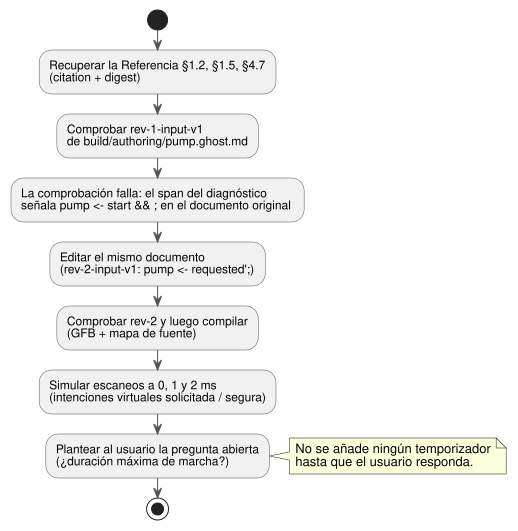

<!-- translation-source: docs/LLM-AUTHORING-WORKFLOW.md -->
[Original en inglés](LLM-AUTHORING-WORKFLOW.md)

# Flujo de autoría independiente del modelo

Consulte la [arquitectura de la cadena de herramientas](LLM-TOOLCHAIN-ARCHITECTURE.es.md) para conocer los límites entre artefacto,
escenario, runtime, consola y dispositivo que hay detrás de este ejemplo.

Este ejemplo sin conexión recorre un ciclo de autoría: recuperar las reglas exactas, comprobar un documento literate, corregirlo, compilarlo e inspeccionar sus salidas virtuales. El flujo no depende de ningún modelo en particular: no intervienen ni un proveedor de modelos ni un driver de dispositivo.

El ciclo se muestra a continuación. Cada paso se describe en las secciones siguientes.



**La solicitud.** El ejemplo parte de una solicitud ficticia de un usuario: «Start solicita la bomba. Stop la cancela. Si falta el permiso, bloquear la bomba».

**La pregunta abierta.** El usuario no ha indicado una duración máxima de marcha ni una regla de rearranque. El autor registra ese vacío como un **supuesto no confirmado** y pregunta al usuario antes de añadir cualquier temporizador o política de duración. La parte confirmada de la solicitud se puede comprobar y simular por sí sola.

**Un documento, dos revisiones.**

- El único programa editable en esta ejecución es `build/authoring/pump.ghost.md`.
- Los dos archivos de `examples/authoring/` son revisiones históricas inmutables de ese único documento literate completo.
- Ambas revisiones incluyen prosa y anclas de intención.
- No existe un programa aparte con código sin prosa.

## Recuperar las reglas exactas

Desde la raíz del repositorio, envíe solicitudes TOON para recuperar tres secciones de la Referencia:

- [§1.2, ubicaciones de la fuente y enlaces de intención](reference/01-source-and-syntax.es.md),
- [§1.5, esqueleto de declaración](reference/01-source-and-syntax.es.md),
- [§4.7, intención solicitada y segura](reference/04-sensors-constraints-control.es.md#47-requested-safe-applied-confirmed).

Los campos `citation` y `digest` de cada respuesta identifican el extracto exacto de la Referencia utilizado en una decisión.

```sh
node tools/reference-query.mjs --toon-request examples/authoring/intent-reference-request.toon
node tools/reference-query.mjs --toon-request examples/authoring/syntax-reference-request.toon
node tools/reference-query.mjs --toon-request examples/authoring/reference-request.toon
```

## Comprobar, corregir y compilar un documento

**Paso 1: comprobar la revisión 1.**

```sh
mkdir -p build/authoring
cp examples/authoring/pump-rev-1.ghost.md build/authoring/pump.ghost.md
node tools/ghostc.mjs --request examples/authoring/check-rev-1.toon
```

La primera comprobación termina con un estado distinto de cero. Para encontrar el problema:

1. Decodifique el resultado TOON.
2. Use `diagnostics[0].span` para localizar la expresión incompleta `pump <- start && ;` en el `.ghost.md` original.
3. Anote la identidad de la revisión fallida: `source.sha256`, `documentId: GF-EXAMPLE-PUMP` y `revisionId: rev-1-input-v1`.

**Paso 2: corregir el mismo documento.** La [§1.5, esqueleto de declaración](reference/01-source-and-syntax.es.md) y el diagnóstico respaldan completar la conexión de salida. La revisión 2 conecta la bomba al estado de solicitud retenido que el documento ya calcula: `pump <- requested';`.
El autor edita el **mismo** `build/authoring/pump.ghost.md`. El comando de copia siguiente reproduce esa edición a partir del fixture revisado de la revisión 2.

**Paso 3: comprobar y compilar la revisión 2.**

```sh
cp examples/authoring/pump-rev-2.ghost.md build/authoring/pump.ghost.md
node tools/ghostc.mjs --request examples/authoring/check-rev-2.toon
node tools/ghostc.mjs --request examples/authoring/compile-rev-2.toon
```

La comprobación correcta informa el mismo ID de documento, la revisión `rev-2-input-v1` y el nuevo SHA-256 del documento Markdown completo.

La compilación escribe el GFB junto con el mapa de fuente verificado. El mapa de fuente conserva:

- la prosa exacta,
- las anclas,
- los ID de documento y de revisión,
- el digest del GFB.

La revisión fallida se conserva como evidencia histórica. La revisión 2 es el artefacto candidato.

## Inspeccionar la salida virtual

```sh
cargo build --locked --offline --release -p ghostflow-core --example scenario_scan
node tools/ghostsim.mjs build/authoring/pump.gfb examples/authoring/pump-scenario.toon --format toon
```

El escenario realiza tres escaneos:

| Tiempo | Qué cambia | Bomba solicitada | Bomba segura |
|---|---|---|---|
| 0 ms | `start` es true, `permit` es false | true | false |
| 1 ms | el permiso pasa a true | true | true |
| 2 ms | `stop` pasa a true | false | false |

A los 0 ms se solicita la bomba, pero la falta de permiso la bloquea en la intención segura. A los 2 ms ambas intenciones son false.
Estas son **intenciones virtuales**. No son estados de relé aplicados ni confirmados.
El resultado identifica la revisión exacta de la fuente compilada.

**Consola ASCII opcional.** Para el mismo artefacto, ejecute `node tools/ghostsim-console.mjs build/authoring/pump.gfb --bind DI1=start --bind DI2=stop --bind DI3=permit_ok --bind RO1=pump --bind RO2=permit`.

- Sin perfil, la consola usa etiquetas virtuales de Waveshare 8DI/8RO.
- Las vinculaciones explícitas conectan esas etiquetas con los puertos lógicos de este documento. No afirman nada sobre pines físicos.

## Pregunta abierta para el usuario

> ¿Debe detenerse la bomba tras una duración máxima de marcha? Si es así, ¿qué duración y qué regla de rearranque deben aplicarse?

Hasta que el usuario responda, el autor deja ese comportamiento sin resolver. El documento no recibe ningún temporizador, ningún valor predeterminado supuesto ni ninguna sintaxis inventada.
Al preguntar al usuario, el host mantiene esta pregunta junto con la identidad del documento. El propio paquete del lenguaje no hace llamadas a modelos ni registra conversaciones.

**Ejecutar la comprobación completa.** Después de compilar `scenario_scan`, ejecute la comprobación completa de fixtures sin conexión con `node --test tests/authoring-workflow.test.mjs`. Utiliza las CLI públicas de la Referencia, del compilador y del simulador, y comprueba:

- el cambio de revisión dentro del mismo documento,
- la ubicación del diagnóstico,
- la procedencia del artefacto,
- las intenciones virtuales.
