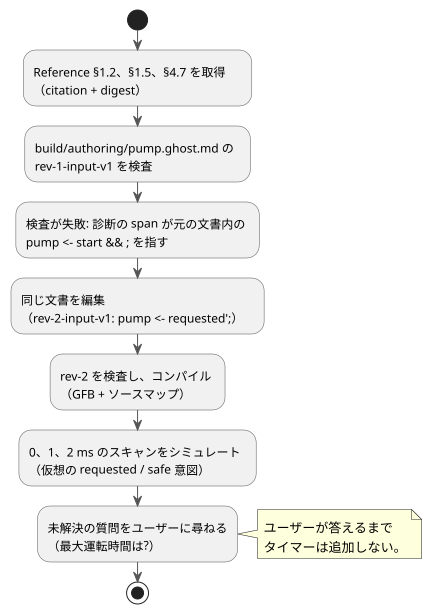

<!-- translation-source: docs/LLM-AUTHORING-WORKFLOW.md -->
[英語の原文](LLM-AUTHORING-WORKFLOW.md)

# モデルに依存しないオーサリングワークフロー

この例の背後にある成果物、シナリオ、ランタイム、コンソール、デバイスの境界については、
[ツールチェーンのアーキテクチャ](LLM-TOOLCHAIN-ARCHITECTURE.ja.md)を参照してください。

このオフラインの例では、1 回のオーサリングループを順に説明します。正確な規則を取得し、文芸的（literate）文書を検査し、修正し、コンパイルして、その仮想出力を確認します。このワークフローは特定のモデルに依存しません。モデルプロバイダもデバイスドライバも関与しません。

ループを以下に示します。各ステップは後続のセクションで説明します。



**要求。** この例は、架空のユーザー要求から始まります。「Start はポンプを要求する。Stop はそれを取り消す。許可がない場合はポンプをブロックする。」

**未解決の質問。** ユーザーは最大運転時間も再起動の規則も示していません。作成者はこの欠落を**未確認の仮定**として記録し、タイマーや継続時間のポリシーを追加する前にユーザーに尋ねます。要求のうち確定している部分は、それだけで検査とシミュレーションができます。

**1 つの文書、2 つのリビジョン。**

- この実行で編集可能なプログラムは `build/authoring/pump.ghost.md` だけです。
- `examples/authoring/` 以下の 2 つのファイルは、その 1 つの完全な文芸的文書の、変更不可の過去のリビジョンです。
- どちらのリビジョンも散文と意図アンカーを持ちます。
- 生のコードだけの別プログラムは存在しません。

## 正確な規則を取得する

リポジトリのルートから TOON リクエストを送り、Reference の 3 つのセクションを取得します。

- [§1.2、ソースと意図のリンク](reference/01-source-and-syntax.ja.md)
- [§1.5、宣言の骨格](reference/01-source-and-syntax.ja.md)
- [§4.7、要求意図と安全意図](reference/04-sensors-constraints-control.ja.md)

各応答の `citation` と `digest` は、判断に使われた Reference の抜粋を正確に特定します。

```sh
node tools/reference-query.mjs --toon-request examples/authoring/intent-reference-request.toon
node tools/reference-query.mjs --toon-request examples/authoring/syntax-reference-request.toon
node tools/reference-query.mjs --toon-request examples/authoring/reference-request.toon
```

## 1 つの文書を検査し、修正し、コンパイルする

**ステップ 1: リビジョン 1 を検査する。**

```sh
mkdir -p build/authoring
cp examples/authoring/pump-rev-1.ghost.md build/authoring/pump.ghost.md
node tools/ghostc.mjs --request examples/authoring/check-rev-1.toon
```

最初の検査は 0 以外のステータスで終了します。問題を見つけるには、次のようにします。

1. TOON の結果をデコードします。
2. `diagnostics[0].span` を使って、元の `.ghost.md` 内にある不完全な式 `pump <- start && ;` の位置を特定します。
3. 失敗したリビジョンの同一性を控えます: `source.sha256`、`documentId: GF-EXAMPLE-PUMP`、`revisionId: rev-1-input-v1`。

**ステップ 2: 同じ文書を修正する。** [§1.5、宣言の骨格](reference/01-source-and-syntax.ja.md)と診断は、出力接続を完成させることを裏付けています。リビジョン 2 は、文書がすでに計算しているラッチされた要求状態にポンプを接続します: `pump <- requested';`。
作成者は**同じ** `build/authoring/pump.ghost.md` を編集します。以下のコピーコマンドは、レビュー済みのリビジョン 2 のフィクスチャからその編集を再現します。

**ステップ 3: リビジョン 2 を検査し、コンパイルする。**

```sh
cp examples/authoring/pump-rev-2.ghost.md build/authoring/pump.ghost.md
node tools/ghostc.mjs --request examples/authoring/check-rev-2.toon
node tools/ghostc.mjs --request examples/authoring/compile-rev-2.toon
```

成功した検査は、同じ文書 ID、リビジョン `rev-2-input-v1`、および Markdown 文書全体の新しい SHA-256 を報告します。

コンパイルは GFB と、検証済みのソースマップを書き出します。ソースマップは次のものを保持します。

- 散文そのもの
- アンカー
- 文書 ID とリビジョン ID
- GFB のダイジェスト

失敗したリビジョンは過去の証拠として残ります。リビジョン 2 が候補となる成果物です。

## 仮想出力を確認する

```sh
cargo build --locked --offline --release -p ghostflow-core --example scenario_scan
node tools/ghostsim.mjs build/authoring/pump.gfb examples/authoring/pump-scenario.toon --format toon
```

シナリオは 3 回スキャンします。

| 時刻 | 変化するもの | ポンプの要求意図 | ポンプの安全意図 |
|---|---|---|---|
| 0 ms | `start` が true、`permit` が false | true | false |
| 1 ms | 許可が true になる | true | true |
| 2 ms | `stop` が true になる | false | false |

0 ms ではポンプが要求されていますが、許可がないため安全意図ではブロックされます。2 ms では両方の意図が false です。
これらは**仮想の意図**です。適用済み（applied）や確認済み（confirmed）のリレー状態ではありません。
結果は、コンパイルされたソースのリビジョンを正確に特定します。

**任意の ASCII コンソール。** 同じ成果物に対して、`node tools/ghostsim-console.mjs build/authoring/pump.gfb --bind DI1=start --bind DI2=stop --bind DI3=permit_ok --bind RO1=pump --bind RO2=permit` を実行します。

- プロファイルがない場合、コンソールは仮想の Waveshare 8DI/8RO ラベルを使います。
- 明示的なバインディングは、それらのラベルをこの文書の論理ポートに接続します。物理ピンについては何も主張しません。

## ユーザーへの未解決の質問

> ポンプは最大運転時間の経過後に停止すべきですか? そうであれば、どの継続時間と再起動の規則を適用すべきですか?

ユーザーが答えるまで、作成者はその振る舞いを未解決のままにします。文書にはタイマーも、推測による既定値も、捏造した構文も追加しません。
ユーザーに尋ねる際、ホストはこの質問を文書の同一性と一緒に保持します。言語パッケージ自体はモデルを呼び出さず、会話も記録しません。

**チェック全体を実行する。** `scenario_scan` をビルドした後、`node --test tests/authoring-workflow.test.mjs` でオフラインのフィクスチャチェック全体を実行します。これは公開の Reference、コンパイラ、シミュレータの CLI を使い、次の点を検査します。

- 同じ文書内でのリビジョンの変更
- 診断の位置
- 成果物の来歴
- 仮想の意図
