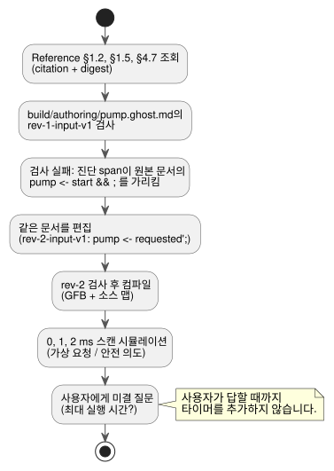

<!-- translation-source: docs/LLM-AUTHORING-WORKFLOW.md -->
[영문 원문](LLM-AUTHORING-WORKFLOW.md)

# 모델과 무관한 저작 작업 흐름

이 예제의 바탕이 되는 아티팩트, 시나리오, 런타임, 콘솔, 장치 경계는
[도구 체인 아키텍처](LLM-TOOLCHAIN-ARCHITECTURE.ko.md)를 참고하세요.

이 오프라인 예제는 한 번의 저작 루프를 따라갑니다. 정확한 규칙을 조회하고, 문서형(literate) 문서를 검사하고, 수정하고, 컴파일한 뒤, 가상 출력을 살펴봅니다. 이 작업 흐름은 특정 모델에 의존하지 않습니다. 모델 공급자나 장치 드라이버는 관여하지 않습니다.

루프는 아래와 같습니다. 각 단계는 이어지는 절에서 설명합니다.



**요청.** 예제는 가상의 사용자 요청으로 시작합니다. “시작은 펌프를 요청한다. 정지는 요청을 취소한다. 허가가 없으면 펌프를 막는다.”

**미결 질문.** 사용자는 최대 실행 시간이나 재시작 규칙을 알려 주지 않았습니다. 작성자는 이 빈틈을 **확인되지 않은 가정**으로 기록하고, 타이머나 지속 시간 정책을 추가하기 전에 사용자에게 묻습니다. 요청 중 확인된 부분은 그것만으로도 검사하고 시뮬레이션할 수 있습니다.

**문서 하나, revision 두 개.**

- 이번 실행에서 편집할 수 있는 프로그램은 `build/authoring/pump.ghost.md` 하나뿐입니다.
- `examples/authoring/` 아래의 두 파일은 그 하나의 완전한 문서형 문서의 변경 불가능한 과거 revision입니다.
- 두 revision 모두 설명 문단과 의도 앵커를 담고 있습니다.
- 별도의 원시 코드 프로그램은 없습니다.

## 정확한 규칙 조회

저장소 루트에서 TOON 요청을 보내 Reference의 세 절을 가져옵니다.

- [§1.2, 소스와 의도 연결](reference/01-source-and-syntax.md#12-원문-위치와-의도-연결),
- [§1.5, 선언 뼈대](reference/01-source-and-syntax.md#15-대표-선언-골격),
- [§4.7, 요청 의도와 안전 의도](reference/04-sensors-constraints-control.md#47-requested-safe-applied-confirmed).

각 응답의 `citation`과 `digest`는 판단에 사용한 정확한 Reference 발췌를 식별합니다.

```sh
node tools/reference-query.mjs --toon-request examples/authoring/intent-reference-request.toon
node tools/reference-query.mjs --toon-request examples/authoring/syntax-reference-request.toon
node tools/reference-query.mjs --toon-request examples/authoring/reference-request.toon
```

## 문서 하나를 검사하고 수정한 뒤 컴파일

**1단계: revision 1 검사.**

```sh
mkdir -p build/authoring
cp examples/authoring/pump-rev-1.ghost.md build/authoring/pump.ghost.md
node tools/ghostc.mjs --request examples/authoring/check-rev-1.toon
```

첫 검사는 0이 아닌 상태로 종료됩니다. 문제를 찾는 방법은 다음과 같습니다.

1. TOON 결과를 디코딩합니다.
2. `diagnostics[0].span`을 사용해 원본 `.ghost.md`에서 불완전한 `pump <- start && ;` 식을 찾습니다.
3. 실패한 revision의 식별 정보를 기록합니다: `source.sha256`, `documentId: GF-EXAMPLE-PUMP`, `revisionId: rev-1-input-v1`.

**2단계: 같은 문서 수정.** [§1.5, 선언 뼈대](reference/01-source-and-syntax.md#15-대표-선언-골격)와 진단이 출력 연결을 완성할 근거가 됩니다. revision 2는 문서가 이미 계산하고 있는 자기유지 요청 상태에 펌프를 연결합니다: `pump <- requested';`.
작성자는 **같은** `build/authoring/pump.ghost.md`를 편집합니다. 아래 복사 명령은 검토된 revision 2 픽스처로 그 편집을 재현합니다.

**3단계: revision 2 검사와 컴파일.**

```sh
cp examples/authoring/pump-rev-2.ghost.md build/authoring/pump.ghost.md
node tools/ghostc.mjs --request examples/authoring/check-rev-2.toon
node tools/ghostc.mjs --request examples/authoring/compile-rev-2.toon
```

성공한 검사는 같은 문서 ID, revision `rev-2-input-v1`, 그리고 Markdown 문서 전체의 새 SHA-256을 보고합니다.

컴파일은 GFB와 검증된 소스 맵을 기록합니다. 소스 맵은 다음을 보존합니다.

- 정확한 설명 문단,
- 앵커,
- 문서 ID와 revision ID,
- GFB 다이제스트.

실패한 revision은 과거 증거로 남습니다. revision 2가 후보 아티팩트입니다.

## 가상 출력 검사

```sh
cargo build --locked --offline --release -p ghostflow-core --example scenario_scan
node tools/ghostsim.mjs build/authoring/pump.gfb examples/authoring/pump-scenario.toon --format toon
```

시나리오는 세 번 스캔합니다.

| 시간 | 바뀌는 것 | 요청 펌프 의도 | 안전 펌프 의도 |
|---|---|---|---|
| 0 ms | `start`는 true, `permit`은 false | true | false |
| 1 ms | 허가가 true가 됨 | true | true |
| 2 ms | `stop`이 true가 됨 | false | false |

0 ms에는 펌프가 요청되지만, 허가가 없어 안전 의도에서 차단됩니다. 2 ms에는 두 의도가 모두 false입니다.
이것은 **가상 의도**입니다. 적용(applied)되었거나 확인(confirmed)된 릴레이 상태가 아닙니다.
결과는 컴파일된 정확한 소스 revision을 식별합니다.

**선택 사항: ASCII 콘솔.** 같은 아티팩트로 `node tools/ghostsim-console.mjs build/authoring/pump.gfb --bind DI1=start --bind DI2=stop --bind DI3=permit_ok --bind RO1=pump --bind RO2=permit`을 실행합니다.

- 프로필을 지정하지 않으면 콘솔은 가상 Waveshare 8DI/8RO 라벨을 사용합니다.
- 명시적 바인딩은 그 라벨을 이 문서의 논리 포트에 연결합니다. 물리 핀에 대해서는 아무것도 주장하지 않습니다.

## 사용자에게 물을 미결 질문

> 펌프는 최대 실행 시간이 지나면 정지해야 하나요? 그렇다면 지속 시간과 재시작 규칙은 무엇이어야 하나요?

사용자가 답하기 전까지 작성자는 그 동작을 미결 상태로 둡니다. 문서에는 타이머도, 추측한 기본값도, 꾸며 낸 문법도 추가하지 않습니다.
사용자에게 물을 때 호스트는 이 질문을 문서 식별 정보와 함께 보관합니다. 언어 패키지 자체는 모델을 호출하지 않고 대화를 기록하지도 않습니다.

**전체 검사 실행.** `scenario_scan`을 빌드한 뒤 `node --test tests/authoring-workflow.test.mjs`로 전체 오프라인 픽스처 검사를 실행합니다. 이 검사는 공개 Reference, 컴파일러, 시뮬레이터 CLI를 사용해 다음을 확인합니다.

- 같은 문서 안에서의 revision 변경,
- 진단 위치,
- 아티팩트 provenance(출처),
- 가상 의도.
