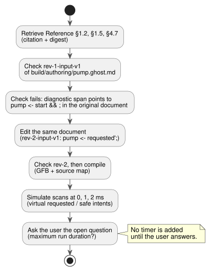

# Model independent authoring workflow

See the [toolchain architecture](LLM-TOOLCHAIN-ARCHITECTURE.md) for the artifact,
scenario, runtime, console, and device boundaries behind this example.

This offline example walks through one authoring loop: retrieve the exact rules, check a literate document, fix it, compile it, and inspect its virtual outputs. The workflow does not depend on any particular model: no model provider or device driver takes part.

The loop is shown below. Each step is described in the sections that follow.



**The request.** The example starts with a fictional user request: “Start requests the pump. Stop cancels it. If permission is absent, block the pump.”

**The open question.** The user has not supplied a maximum run duration or a restart rule. The author records that gap as an **unconfirmed assumption** and asks the user before adding any timer or duration policy. The confirmed part of the request can still be checked and simulated on its own.

**One document, two revisions.**

- The only editable program in this run is `build/authoring/pump.ghost.md`.
- The two files under `examples/authoring/` are immutable historical revisions of that one complete literate document.
- Both revisions carry prose and intent anchors.
- There is no separate raw-code program.

## Retrieve the exact rules

From the repository root, send TOON requests to retrieve three Reference sections:

- [§1.2, source and intent links](reference/01-source-and-syntax.en.md#12-original-source-locations-and-intent-links),
- [§1.5, declaration skeleton](reference/01-source-and-syntax.en.md#15-representative-declaration-structure),
- [§4.7, requested and safe intent](reference/04-sensors-constraints-control.en.md#47-requested-safe-applied-confirmed).

Each response's `citation` and `digest` identify the exact Reference excerpt used in a decision.

```sh
node tools/reference-query.mjs --toon-request examples/authoring/intent-reference-request.toon
node tools/reference-query.mjs --toon-request examples/authoring/syntax-reference-request.toon
node tools/reference-query.mjs --toon-request examples/authoring/reference-request.toon
```

## Check, correct, and compile one document

**Step 1: check revision 1.**

```sh
mkdir -p build/authoring
cp examples/authoring/pump-rev-1.ghost.md build/authoring/pump.ghost.md
node tools/ghostc.mjs --request examples/authoring/check-rev-1.toon
```

The first check exits with a nonzero status. To find the problem:

1. Decode the TOON result.
2. Use `diagnostics[0].span` to locate the incomplete `pump <- start && ;` expression in the original `.ghost.md`.
3. Note the failed revision's identity: `source.sha256`, `documentId: GF-EXAMPLE-PUMP`, and `revisionId: rev-1-input-v1`.

**Step 2: correct the same document.** [§1.5, declaration skeleton](reference/01-source-and-syntax.en.md#15-representative-declaration-structure) and the diagnostic support completing the output connection. Revision 2 connects the pump to the latched request state that the document already computes: `pump <- requested';`.
The author edits the **same** `build/authoring/pump.ghost.md`. The copy command below reproduces that edit from the reviewed revision 2 fixture.

**Step 3: check and compile revision 2.**

```sh
cp examples/authoring/pump-rev-2.ghost.md build/authoring/pump.ghost.md
node tools/ghostc.mjs --request examples/authoring/check-rev-2.toon
node tools/ghostc.mjs --request examples/authoring/compile-rev-2.toon
```

The successful check reports the same document ID, revision `rev-2-input-v1`, and the new SHA-256 of the full Markdown document.

Compilation writes GFB plus the verified source map. The source map preserves:

- the exact prose,
- the anchors,
- the document and revision IDs,
- the GFB digest.

The failed revision remains as historical evidence. Revision 2 is the candidate artifact.

## Inspect virtual output

```sh
cargo build --locked --offline --release -p ghostflow-core --example scenario_scan
node tools/ghostsim.mjs build/authoring/pump.gfb examples/authoring/pump-scenario.toon --format toon
```

The scenario scans three times:

| Time | What changes | Requested pump | Safe pump |
|---|---|---|---|
| 0 ms | `start` is true, `permit` is false | true | false |
| 1 ms | permission becomes true | true | true |
| 2 ms | `stop` becomes true | false | false |

At 0 ms the pump is requested, but the missing permission blocks it in the safe intent. At 2 ms both intents are false.
These are **virtual intents**. They are not applied or confirmed relay states.
The result identifies the exact compiled source revision.

**Optional ASCII console.** For the same artifact, run `node tools/ghostsim-console.mjs build/authoring/pump.gfb --bind DI1=start --bind DI2=stop --bind DI3=permit_ok --bind RO1=pump --bind RO2=permit`.

- With no profile, the console uses virtual Waveshare 8DI/8RO labels.
- The explicit bindings connect those labels to this document's logical ports. They make no claim about physical pins.

## Open question for the user

> Should the pump stop after a maximum run duration? If yes, what duration and restart rule should apply?

Until the user answers, the author leaves that behavior unresolved. The document gets no timer, no guessed default, and no invented syntax.
When asking the user, the host keeps this question together with the document identity. The language package itself makes no model calls and records no conversations.

**Run the whole check.** After building `scenario_scan`, run the complete offline fixture check with `node --test tests/authoring-workflow.test.mjs`. It uses the public Reference, compiler, and simulator CLIs and checks:

- the revision change within the same document,
- the diagnostic location,
- artifact provenance,
- the virtual intents.
