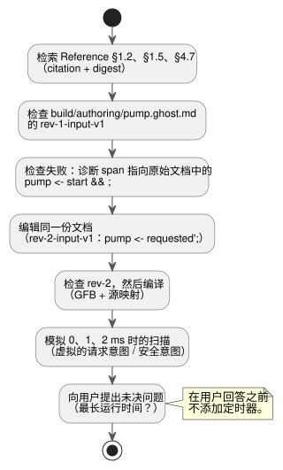

<!-- translation-source: docs/LLM-AUTHORING-WORKFLOW.md -->
[英文原文](LLM-AUTHORING-WORKFLOW.md)

# 与模型无关的编写工作流

本示例背后的制品、场景、运行时、控制台和设备边界，请参阅[工具链架构](LLM-TOOLCHAIN-ARCHITECTURE.zh.md)。

本离线示例演示一次完整的编写循环：检索准确的规则，检查一份文学式（literate）文档，修正它，编译它，并检查其虚拟输出。该工作流不依赖任何特定模型：没有模型提供方或设备驱动程序参与。

循环如下图所示。后续各节依次说明每一步。



**需求。** 示例从一个虚构的用户需求开始：“Start 请求启动泵。Stop 取消该请求。如果没有许可，则阻止泵。”

**未决问题。** 用户没有给出最长运行时间或重启规则。编写者把这一空缺记录为**未经确认的假设**，并在添加任何定时器或持续时间策略之前先询问用户。需求中已确认的部分仍然可以单独检查和模拟。

**一份文档，两个修订版。**

- 本次运行中唯一可编辑的程序是 `build/authoring/pump.ghost.md`。
- `examples/authoring/` 下的两个文件是同一份完整文学式文档的不可变历史修订版。
- 两个修订版都带有说明文字和意图锚点。
- 不存在单独的纯代码程序。

## 检索准确的规则

在仓库根目录下发送 TOON 请求，检索 Reference 中的三个章节：

- [§1.2，源文件与意图链接](reference/01-source-and-syntax.zh.md)，
- [§1.5，声明骨架](reference/01-source-and-syntax.zh.md)，
- [§4.7，请求意图与安全意图](reference/04-sensors-constraints-control.zh.md)。

每个响应中的 `citation` 和 `digest` 标识了某个决定所依据的准确 Reference 摘录。

```sh
node tools/reference-query.mjs --toon-request examples/authoring/intent-reference-request.toon
node tools/reference-query.mjs --toon-request examples/authoring/syntax-reference-request.toon
node tools/reference-query.mjs --toon-request examples/authoring/reference-request.toon
```

## 检查、修正并编译一份文档

**第 1 步：检查修订版 1。**

```sh
mkdir -p build/authoring
cp examples/authoring/pump-rev-1.ghost.md build/authoring/pump.ghost.md
node tools/ghostc.mjs --request examples/authoring/check-rev-1.toon
```

第一次检查以非零状态退出。要找出问题：

1. 解码 TOON 结果。
2. 使用 `diagnostics[0].span` 在原始 `.ghost.md` 中定位不完整的 `pump <- start && ;` 表达式。
3. 记下失败修订版的身份标识：`source.sha256`、`documentId: GF-EXAMPLE-PUMP` 和 `revisionId: rev-1-input-v1`。

**第 2 步：修正同一份文档。** [§1.5，声明骨架](reference/01-source-and-syntax.zh.md)和诊断信息都支持补全这条输出连接。修订版 2 把泵连接到文档中已经计算好的锁存请求状态：`pump <- requested';`。
编写者编辑的是**同一个** `build/authoring/pump.ghost.md`。下面的复制命令根据已审阅的修订版 2 夹具（fixture）重现这次编辑。

**第 3 步：检查并编译修订版 2。**

```sh
cp examples/authoring/pump-rev-2.ghost.md build/authoring/pump.ghost.md
node tools/ghostc.mjs --request examples/authoring/check-rev-2.toon
node tools/ghostc.mjs --request examples/authoring/compile-rev-2.toon
```

成功的检查会报告相同的文档 ID、修订版 `rev-2-input-v1`，以及完整 Markdown 文档的新 SHA-256。

编译会写出 GFB 以及经过验证的源映射（source map）。源映射保留：

- 准确的说明文字，
- 锚点，
- 文档 ID 和修订版 ID，
- GFB 摘要。

失败的修订版作为历史证据保留下来。修订版 2 是候选制品。

## 检查虚拟输出

```sh
cargo build --locked --offline --release -p ghostflow-core --example scenario_scan
node tools/ghostsim.mjs build/authoring/pump.gfb examples/authoring/pump-scenario.toon --format toon
```

该场景执行三次扫描：

| 时间 | 发生的变化 | 请求的泵状态 | 安全的泵状态 |
|---|---|---|---|
| 0 ms | `start` 为 true，`permit` 为 false | true | false |
| 1 ms | 许可变为 true | true | true |
| 2 ms | `stop` 变为 true | false | false |

在 0 ms 时泵被请求，但缺少许可使其在安全意图中被阻止。在 2 ms 时两个意图都为 false。
这些是**虚拟意图**，不是已应用（applied）或已确认（confirmed）的继电器状态。
结果标识了准确的已编译源修订版。

**可选的 ASCII 控制台。** 对同一制品，运行 `node tools/ghostsim-console.mjs build/authoring/pump.gfb --bind DI1=start --bind DI2=stop --bind DI3=permit_ok --bind RO1=pump --bind RO2=permit`。

- 不指定 profile 时，控制台使用虚拟的 Waveshare 8DI/8RO 标签。
- 显式绑定把这些标签连接到本文档的逻辑端口，并不对物理引脚作任何声明。

## 向用户提出的未决问题

> 泵是否应在达到最长运行时间后停止？如果是，应采用多长时间以及什么重启规则？

在用户回答之前，编写者让该行为保持未决。文档中不添加定时器，不猜测默认值，也不发明语法。
向用户提问时，宿主会把这个问题与文档身份标识放在一起保存。语言包本身不调用任何模型，也不记录任何对话。

**运行完整检查。** 构建 `scenario_scan` 后，使用 `node --test tests/authoring-workflow.test.mjs` 运行完整的离线夹具检查。它使用公开的 Reference、编译器和模拟器 CLI，并检查：

- 同一文档内的修订版变化，
- 诊断位置，
- 制品来源，
- 虚拟意图。
