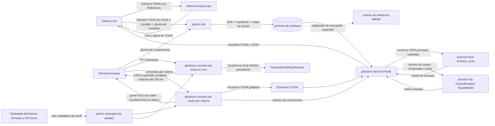
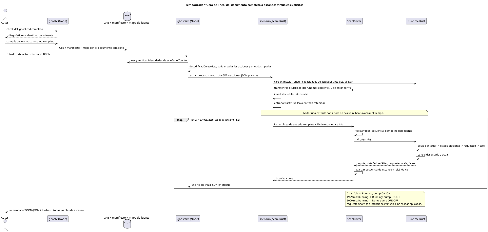
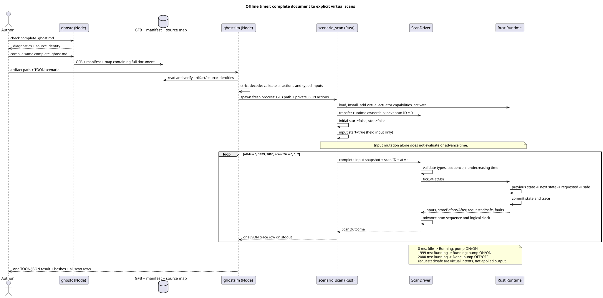
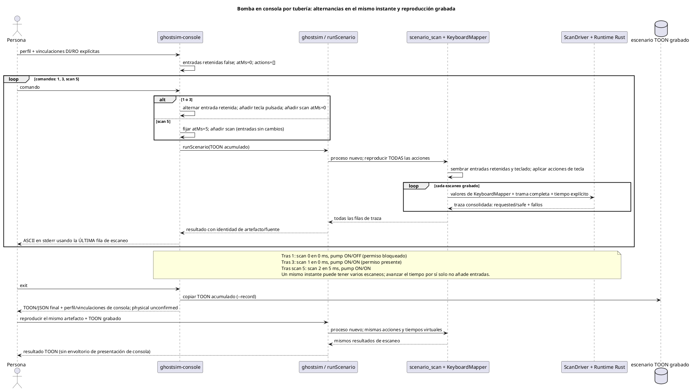
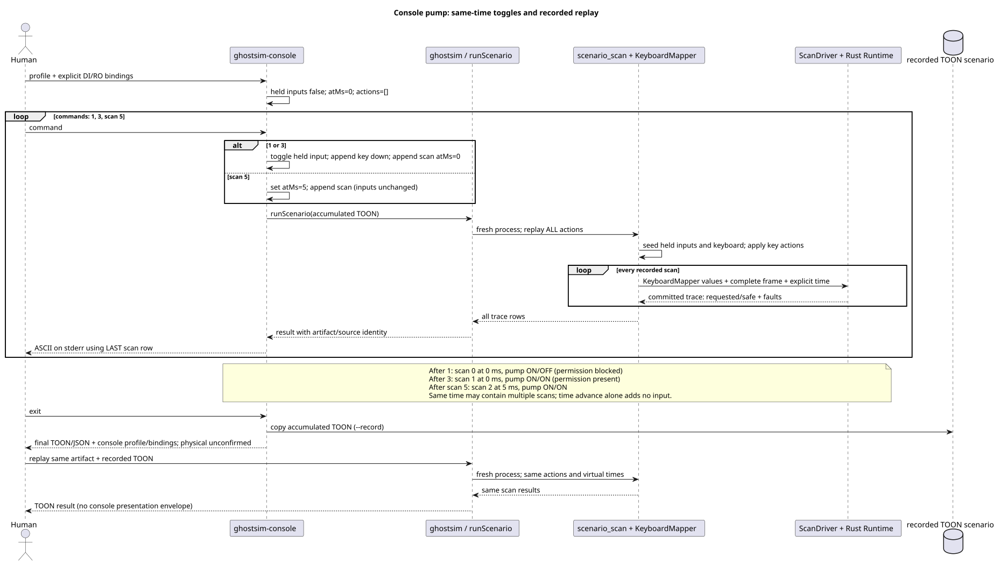
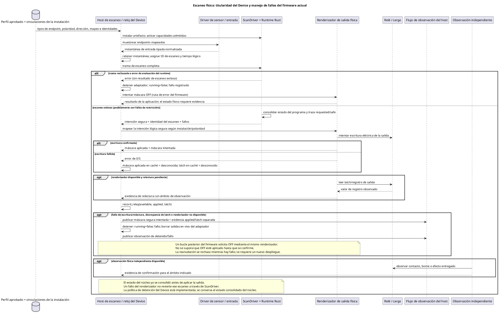
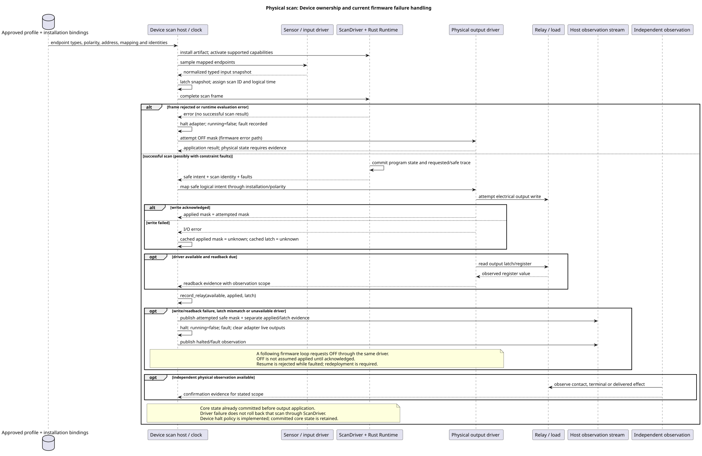
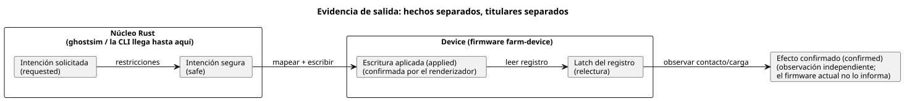

<!-- translation-source: docs/LLM-TOOLCHAIN-ARCHITECTURE.md -->
[Original en inglés](LLM-TOOLCHAIN-ARCHITECTURE.md)

# Arquitectura de autoría y simulación virtual

Este documento describe la **cadena de herramientas fuera de línea** de este
repositorio: cómo se escribe, compila y simula un programa sin un dispositivo
real. La [Referencia del lenguaje](LANGUAGE-REFERENCE.es.md) define la semántica
de los programas; este documento describe las herramientas actuales y dónde
terminan sus responsabilidades.

**En este documento**

- La cadena de herramientas en conjunto y sus dos públicos (un cliente LLM y una
  terminal humana).
- Qué componente desempeña cada rol de "driver" o de "runtime".
- Tres secuencias de ejecución representativas: un temporizador virtual, una
  sesión de consola por tubería (piped) y un escaneo físico en un Device.
- Qué demuestran las simulaciones, qué dejan abierto y los límites actuales.
- Comandos para reproducir la ruta pública.

**Un único programa canónico.** El programa canónico es un documento `.ghost.md`
completo. Su prosa, sus anclas de intención, su ID de documento y su ID de
revisión viajan con el artefacto compilado. La cadena de herramientas nunca crea
una segunda cadena de control editable por separado.

El diagrama de flujo siguiente muestra cada herramienta de la ruta fuera de línea
y lo que fluye entre ellas. Las líneas punteadas marcan rutas separadas que esta
CLI no controla.



**Formatos orientados al modelo.** La ruta del LLM usa TOON estricto (una
codificación de texto compacta para solicitudes y resultados estructurados) para:

- [consultas a la Referencia](../tools/reference-query.mjs),
- [`GhostFlow/cli-request-v1` y `cli-result-v1`](../tools/ghostc.mjs), y
- [`GhostFlow/scenario-v1` y `scenario-result-v1`](../tools/ghostsim.mjs).

`ghostc --request` devuelve diagnósticos tipados con rangos de la fuente. El
comando `ghostc` para personas recibe directamente la ruta del documento e
imprime diagnósticos de texto breves.

**Dos modos de consola.** La [consola ASCII](KEYBOARD-HOST.es.md) tiene dos modos:

- El **modo TTY interactivo** escanea inmediatamente al arrancar. Después usa un
  único runtime Rust WASM persistente y un ScanDriver con una cadencia de reloj
  de pared de 100 ms. Las teclas numéricas 1–8 alternan entradas Bool y escanean
  de inmediato; `:toggle CHANNEL` hace lo mismo.
- El **modo por tubería** lee comandos de línea deterministas, ejecuta el
  ejecutor de escenarios existente y puede grabar un escenario TOON
  reproducible.

**Comprobaciones de identidad.** El mapa de fuente contiene el documento
completo y su identidad inmutable de documento/revisión. Antes de la ejecución,
`ghostsim` comprueba el mapa frente a los bytes GFB exactos y el manifiesto. El
resultado indica:

- el SHA-256 del escenario,
- el SHA-256 del bytecode,
- el SHA-256 y el nombre de archivo del documento fuente, y
- los IDs de documento/revisión, cuando se suministran.

**Resultados de fallo.** Todos los fallos terminan con un código distinto de
cero.

| Fallo | Qué contiene el resultado |
| --- | --- |
| Solicitud malformada o activación fallida | Un resultado rechazado sin filas de escaneo. |
| Error de runtime | Solo los escaneos consolidados antes del error, más el índice de la acción que falló. |
| Fallo del host después de invocar al ejecutor | `host-error` con `traceComplete: false`. Aquí, una lista de escaneos vacía significa que las observaciones del proceso hijo no están disponibles, no que el runtime no haya realizado ningún escaneo. |

**Una reproducción, no un registro en vivo.** El resultado del escenario es un
artefacto de reproducción (replay) determinista, no un registro de observación
en vivo. Su `scanId` tiene como ámbito esa reproducción y no tiene `runId`. Un
host que publique escaneos como observaciones debe asignar su propia identidad
de ejecución (run). También debe mantener juntas las identidades del artefacto,
la fuente, el escenario y el escaneo, como exige la
[Referencia §5.4](reference/05-settings-and-observation.es.md).

**Escaneos y tiempo virtual.**

- Solo una acción `scan` evalúa el programa.
- Su `atMs` no negativo es un valor de reloj virtual. No puede retroceder.
- Las acciones de entrada y de tecla solo actualizan los valores retenidos. Un
  escaneo posterior, incluso uno que solo hace avanzar el reloj, los vuelve a
  evaluar.
- El núcleo Rust produce por separado la **intención virtual** solicitada
  (requested) y la segura (safe). Ninguno de los dos campos dice que un relé se
  haya movido.

**Dos transportes, un núcleo.** Ambas rutas ejecutan el mismo núcleo Rust
portable. El transporte no es otro lenguaje fuente.

| Tipo de escenario | Transporte | Punto de entrada del escaneo |
| --- | --- | --- |
| Entradas simples | JSON privado al proceso Rust nativo `scenario_scan` | `ScanDriver` de Rust en ese proceso |
| Casos de ventana, sensor y adaptación | Proceso hijo Rust/WASM `ControlRuntime` existente, con observaciones explícitas y perfiles de activación | Escaneos con tramas (framed) |
| Casos de intervalo certificado y Solar | El mismo proceso hijo `ControlRuntime` | Puntos de entrada WASM heredados existentes; el host asigna IDs de escaneo locales a la reproducción |

**De dónde viene el tiempo.** El tiempo del temporizador se suministra como
`atMs` monotónico. Los hechos de reloj de pared, calendario y del proveedor Solar
pertenecen a la vinculación (binding) del host, ya provengan de un RTC fuera de
línea o de una corrección NTP opcional. La semántica temporal del lenguaje es la
misma para cualquier fuente.

**El modo por tubería en detalle.** El modo de consola por tubería acumula un
escenario TOON. En cada redibujado tras un comando, reproduce ese escenario por
la misma ruta `runScenario`. Tiene tiempo virtual explícito y ningún reloj en
segundo plano. Si un comando por tubería o un tiempo de escaneo falla después de
escaneos completados, `command-error` conserva esas filas y `--record` guarda
solo el prefijo aceptado y reproducible.

**El modo interactivo en detalle.** El modo TTY interactivo es independiente. Es
titular de un único `FramedGhostFlowRuntime`/`ScanDriver` de Rust WASM
persistente y activado.

- Escanea al arrancar y cada 100 ms.
- Suministra el tiempo de pared transcurrido como tiempo lógico virtual no
  decreciente.
- Alternar una tecla también provoca un escaneo inmediato.
- El historial de visualización se limita a 120 escaneos. Los redibujados no
  reproducen acciones antiguas.

Ambos modos muestran solo entradas virtuales e intención solicitada/segura.
Ninguno aplica salidas físicas ni confirma el estado del hardware.

**Lista de canales y vinculaciones.** El
[`GhostFlow/board-profile-v1`](KEYBOARD-HOST.es.md) seleccionado, o un
descriptor de canales solo de presentación, suministra los canales ordenados de
entrada y salida de la consola.

- `--bind CHANNEL=port` conecta cada canal a un puerto lógico coincidente del
  manifiesto.
- Los perfiles de placa nunca infieren una vinculación lógica a partir del
  nombre de un endpoint.
- Sin descriptor, la consola usa una disposición **Waveshare 8DI/8RO virtual**.
  Solo se vinculan automáticamente los nombres lógicos predeterminados
  `DI`/`RO` que coinciden exactamente.
- Esa disposición no verifica pines, una placa instalada, un mapeo de la
  instalación ni una salida aplicada.
- Otros números de canales provienen del descriptor elegido.

El resultado registra el ID del perfil, la revisión cuando existe, el digest,
las vinculaciones y `physical: unconfirmed`.

**Otros hosts y titulares.**

- La [cadena de herramientas pública apta para navegador](../tools/browser-toolchain.mjs)
  y el [adaptador WASM](../runtimes/wasm/README.md) forman una ruta de host
  separada hacia la misma semántica portable de lenguaje/runtime.
- El host de la API es titular de las solicitudes al modelo, la conversación, el
  almacenamiento de documentos y la orquestación del despliegue.
- El repositorio Device es titular de los perfiles de placa, el firmware, los
  drivers reales, los pines, los relojes y la verificación física.
- Esta CLI no hace llamadas al modelo ni llamadas al dispositivo.

## Responsabilidades del driver, el runtime y el dispositivo virtual

Los componentes siguientes están implementados en la ruta fuera de línea. La
palabra **driver** siempre necesita un calificativo: un adaptador de entrada, el
`ScanDriver` del núcleo, un descriptor de consola y un driver de E/S física
tienen responsabilidades distintas.

| Componente | Responsabilidad y estado | Implementación |
| --- | --- | --- |
| Driver de entrada de escenario / teclado | Retiene entradas lógicas tipadas y el estado de teclas pulsadas/soltadas; convierte acciones explícitas en una instantánea de entrada completa. Nunca deriva nuevos valores de sensor a partir de las salidas. | [`scenario_scan.rs`](../crates/ghostflow-core/examples/scenario_scan.rs), [`KeyboardMapper`](../crates/ghostflow-core/src/keyboard.rs) |
| Host de tiempo virtual por tubería | Suministra `atMs` y oportunidades de escaneo explícitas. Los comandos de alternancia añaden una acción de entrada/tecla y un escaneo en el tiempo actual; `scan N` avanza hasta el tiempo indicado. Ningún reloj en segundo plano hace avanzar esta sesión. | [`ghostsim.mjs`](../tools/ghostsim.mjs), [`ghostsim-console.mjs`](../tools/ghostsim-console.mjs) |
| Host de escenarios de sensores y proveedores | Acondiciona muestras de sensor explícitas, acepta intervalos Bool certificados y suministra hechos de reloj/proveedor Solar. Usa perfiles de activación explícitos y nunca lee por sí mismo RTC/NTP ni un sensor físico. | [`scenario-sensors.mjs`](../tools/scenario-sensors.mjs), [`ControlRuntime`](../runtimes/wasm/control-runtime.mjs) |
| Host TTY interactivo | Es titular de un único `FramedGhostFlowRuntime` WASM/`ScanDriver` de Rust persistente; escanea de inmediato y cada 100 ms usando el tiempo de pared transcurrido, y escanea de inmediato tras alternar entradas. Retiene un historial de visualización acotado (120 escaneos). Sin E/S de dispositivo. | [`ghostsim-live.mjs`](../tools/ghostsim-live.mjs), [`ghostsim-console.mjs`](../tools/ghostsim-console.mjs) |
| Driver de escaneo con tramas | Es titular de un único runtime y valida entradas tipadas completas, IDs de escaneo secuenciales y tiempo lógico no decreciente antes de la evaluación. Los escaneos exitosos hacen avanzar su secuencia/tiempo. No realiza E/S de dispositivo. | [`ScanDriver`](../crates/ghostflow-core/src/scan.rs) |
| Runtime Rust portable | Carga GFB, activa las capacidades admitidas, evalúa expresiones, estado del programa, temporizadores y restricciones, y emite una traza con intenciones solicitadas/seguras y fallos. Los hosts nativos y WASM usan este núcleo. | [`ghostflow-core`](../crates/ghostflow-core/src/lib.rs), [adaptador WASM](../runtimes/wasm/README.md) |
| Vista de dispositivo virtual | Muestra las entradas retenidas, los bancos de salidas solicitadas/seguras y la identidad del escaneo usando la lista de canales seleccionada. El estado consta de valores de entrada simulados, el estado del programa en el núcleo y las observaciones registradas; no tiene un modelo separado de actuador ni de planta. | [Panel ASCII y reglas de perfil](KEYBOARD-HOST.es.md) |
| Perfil / descriptor de canales | Describe canales ordenados y sus tipos; las vinculaciones explícitas los conectan con puertos del manifiesto. La consola no ejecuta los metadatos de driver/dirección/polaridad del perfil de placa. | [contrato `board-profile-v1`](../contracts/integration-v1/README.md), [`console-profile-v1`](KEYBOARD-HOST.es.md) |

**Qué significa "dispositivo virtual".** Aquí, un "dispositivo virtual" es una
vista de E/S alrededor de un runtime real de GhostFlow, no una máquina emulada.

- El ejecutor nativo registra capacidades de actuador virtuales a partir de los
  tipos de salida del módulo, de modo que el runtime pueda activarse.
- No emula un controlador Waveshare, un registro de relé, un contacto, una
  bomba, el nivel de un tanque ni la respuesta de un sensor.
- En particular, `safe.pump = true` no cambia una entrada de nivel de agua. El
  escenario debe suministrar esa entrada explícitamente.
- Un modelo de planta en lazo cerrado, o una salida aplicada/confirmada
  simulada, requeriría un modelo y un contrato de evidencia separados y
  explícitos. Esta CLI no implementa ninguno de los dos.

**Estado del runtime entre escaneos, por host.**

| Host | Cómo se conserva el estado del runtime entre escaneos |
| --- | --- |
| Navegador (Farm Studio) | Persiste entre escaneos en el runtime del navegador. |
| Modo TTY interactivo | Persiste en una única sesión WASM en vivo. |
| Modo de consola por tubería | Se reconstruye reproduciendo el escenario acumulado en un proceso nativo nuevo. |

El navegador tiene su propio host de entradas y de ritmo. En Farm Studio:

- `app/src/features/playground/playgroundRuntime.ts` instancia
  `ControlRuntime.instantiateFramed`.
- `playgroundScan.ts` suministra instantáneas Booleanas con la forma del
  manifiesto y tiempo lógico explícito, y luego lee las salidas mostradas del
  banco seguro devuelto.
- `simulationPacer.ts` decide las oportunidades de escaneo para la reproducción
  interactiva.

Estos componentes de frontend no evalúan reglas de GhostFlow. El ejemplo de
teclado Rust en tiempo real más antiguo sigue siendo un host separado.

## Secuencias de ejecución representativas

### Compilar, arrancar y alcanzar el límite de un temporizador virtual

Esta ruta implementada usa el documento completo
[`virtual-timer.ghost.md`](../examples/authoring/corpus/virtual-timer.ghost.md)
y su [escenario](../examples/authoring/corpus/virtual-timer-scenario.toon).

- `phase` empieza en `Idle`; `pump` sigue a la siguiente fase calculada.
- No hay espera de reloj de pared entre los tres escaneos.
- Los nombres de fase del diagrama describen la semántica de la fuente. La traza
  real también contiene estado de temporizador generado por el compilador.





**Cómo puede fallar esta secuencia.**

- Un fallo de validación o de activación no produce filas de escaneo.
- Un error de runtime a nivel de acción detiene la ejecución. El resultado
  devuelve las filas consolidadas antes, más el índice de la acción que falló.
- Un fallo de restricción es distinto: puede ser un escaneo *exitoso* cuya
  intención segura está bloqueada. No es automáticamente un fallo del ejecutor.

Estas rutas están implementadas en [`ghostsim.mjs`](../tools/ghostsim.mjs),
[`scenario_scan.rs`](../crates/ghostflow-core/examples/scenario_scan.rs) y
[`ScanDriver`](../crates/ghostflow-core/src/scan.rs).

### Modo por tubería: alternar una entrada, inspeccionar el bloqueo por permiso y reproducir

Esta secuencia es la secuencia de comandos de consola por tubería de la sección
de reproducción más abajo. Usa `pump-rev-2.ghost.md` con vinculaciones DI/RO
explícitas.

- Este programa de bomba no tiene estado del programa ni temporizador.
- La consola es titular del escenario acumulado.
- Cada llamada a `runScenario` crea un proceso Rust nuevo, que reconstruye el
  estado del runtime desde el principio.





**Qué conserva una grabación.** Una grabación conserva las acciones lógicas de
entrada/tecla y los tiempos virtuales de escaneo. El digest del perfil y la
lista de vinculaciones DI/RO se añaden al resultado final de la consola, no al
archivo de escenario. Por lo tanto:

- reproducir la grabación reproduce los escaneos lógicos, pero
- reproducir el panel requiere además conservar su perfil y sus argumentos de
  vinculación.

## Límite entre el driver físico y el Device

**Los drivers y los renderizadores son roles.** Los **drivers** de entrada
producen entradas lógicas. Los **renderizadores** (renderers) de salida aplican
la intención de salida lógica a relés, motores, lámparas o pantallas. Son roles,
no clases de dispositivo mutuamente excluyentes:

- Un joystick USB con retroalimentación de fuerza tiene a la vez un driver de
  entrada y un renderizador de salida.
- Un codificador EC11 con una pantalla TFT combina igualmente roles de entrada y
  de salida.

Estos ejemplos definen límites, no implementaciones.

| Elemento | Titular o nombre |
| --- | --- |
| Código fuente de drivers y renderizadores | `farm-device-drivers` |
| Integración host/placa, vinculaciones, relojes, watchdogs, política de arranque/fallo | Device |
| Interfaz de operador del gabinete (distinta de un renderizador de salida) | `@ghostflow/cabinet-view` |

`ScanDriver`, los identificadores de la ABI del host y los campos `driver` de
los perfiles existentes conservan sus nombres y contratos.

La ruta física tiene responsabilidades adicionales, definidas por la
[Referencia §8](reference/08-language-runtime-and-device-boundaries.es.md) y el
[contrato de integración](../contracts/integration-v1/README.md). La secuencia
siguiente las muestra para un escaneo físico:





**Cómo leer este diagrama.** Combina el contrato de titularidad con la ruta de
fallo actual del firmware `farm-device`. No es una conexión que haga
`ghostsim` ni es una verificación de hardware.

- La confirmación física independiente es un límite del contrato. La
  observación del firmware actual solo informa la intención, la escritura
  aplicada y el latch del registro. No tiene retroalimentación del contacto del
  relé ni de la carga.
- El Device es titular del firmware, del host de drivers/renderizadores y la
  integración de la placa, de los perfiles de placa aprobados, de los relojes,
  de los watchdogs y del manejo de las salidas en el arranque o ante fallos.
- Las vinculaciones de la instalación seleccionan el endpoint real de cada
  puerto lógico.
- El validador de integración comprueba las identidades y los mapeos
  suministrados. No los instala ni realiza E/S.

**Cuatro tipos de evidencia.** La intención segura lógica, la salida aplicada
por el renderizador, la relectura del registro y la confirmación física se
mantienen separadas. El diagrama siguiente muestra quién puede producir cada
hecho; esta CLI se detiene en la intención segura.



**Código del adaptador del Device.** El código del adaptador del Device vive por
separado en `farm-device`. `rust/ghostflow-adapter/src/lib.rs` usa el
`ScanDriver` compartido y registra las máscaras aplicadas y las observaciones del
latch del relé mediante `record_relay`. El firmware es titular de la operación
de salida real.

- Esta ruta de autoría no invoca ni certifica esa implementación separada.
- Para el despliegue previsto deben comprobarse su revisión de firmware/núcleo,
  el mapeo de la instalación y la evidencia física.
- Los comandos siguientes no contienen ningún paso de despliegue de extremo a
  extremo en el dispositivo, de emulación de hardware ni de confirmación física.

**Dónde se define la cadena de evidencia.**

- La [Referencia §4.7](reference/04-sensors-constraints-control.es.md)
  ya define la cadena de evidencia de salida: la intención solicitada, la
  intención segura, el comando aplicado y la retroalimentación confirmada son
  hechos distintos.
- El [ciclo de vida del resultado del comando](reference/05-settings-and-observation.es.md)
  describe la recepción, el rechazo, el inicio, la finalización, la cancelación
  y el fallo de una solicitud. Un escaneo completado del núcleo no es prueba de
  que una acción física haya terminado.
- El [contrato Interaction v0](../contracts/interaction-v0/README.md) proyecta
  observaciones completadas del runtime y no realiza E/S.
- La Referencia
  [§8.5](reference/08-language-runtime-and-device-boundaries.es.md)
  asigna el reinicio y la restauración del estado a una política explícita y a un
  contrato de punto de control (checkpoint). No exige revertir un escaneo
  exitoso del núcleo tras un fallo de E/S.

**Política de fallo actual del Device.** La política es visible en
`farm-device/rust/firmware/src/ghostflow.rs`
(`scan_with_clock`, `set_mask`, `record_relay` y después `halt`) y
`farm-device/rust/ghostflow-adapter/src/lib.rs` (`halt`, `scan_inner`, `resume`).
Ante un fallo de salida:

1. conserva la máscara segura intentada como observación,
2. detiene la evaluación posterior del núcleo,
3. borra las intenciones de salida en vivo del adaptador,
4. solicita OFF en el siguiente bucle del firmware,
5. conserva el estado consolidado del núcleo, y
6. rechaza la reanudación mientras hay fallo.

Esta es una política implementada del Device, no una transacción del lenguaje
que falte.

**Revisión comprobada.** Esta evaluación se comprobó frente a la revisión limpia
de `farm-device`
[`6d2e97b`](https://github.com/callin2/farm-device/commit/6d2e97b243045e3b2dfbbb9bf205614e26eceba4),
incluido el caso `relay_fault_halts_clears_intent_and_trace_is_bounded` en
`rust/ghostflow-adapter/tests/adapter.rs`. Para esta revisión de la
documentación, la prueba se leyó, no se volvió a ejecutar. Inspeccione cualquier
revisión posterior del Device antes de repetir la afirmación sobre la
implementación. Ni esa prueba de host ni este diagrama demuestran que un
contacto real de relé haya llegado a OFF.

## Qué establecen las secuencias y qué dejan abierto

**Qué queda establecido.** La cadena de titularidad fuera de línea es coherente:

- los hosts suministran entradas y tiempo,
- el núcleo Rust es titular de la evaluación y del estado, y
- las vistas consumen trazas.

**Qué no.** Las secuencias no muestran que un despliegue esté completo. Los
hallazgos de la revisión que siguen califican la gravedad en relación con el
escenario que necesita el comportamiento ausente.

| Hallazgo | Consecuencia y gravedad | Evidencia o decisión requerida |
| --- | --- | --- |
| La consolidación del núcleo precede a la aplicación física de la salida; las etapas de evidencia siguen separadas. | **Límite definido, no una política ausente:** el firmware actual del Device registra la aplicación fallida, se detiene y solicita OFF en el bucle siguiente sin revertir el estado consolidado del núcleo. | Verifique la revisión de firmware prevista y la ruta de fallo en el dispositivo de destino. La simulación de la CLI no certifica el manejo de salidas ni el OFF físico. |
| En la CLI no existe un modelo de planta de salida a sensor. | **Alta para afirmaciones de lazo cerrado:** la intención segura de la bomba no puede establecer flujo de agua, cambio de nivel ni retroalimentación del sensor. | Suministre entradas de escenario explícitas o un modelo de planta especificado por separado; observe de forma independiente los efectos físicos para las afirmaciones sobre hardware. |
| El redibujado de la consola por tubería reproduce el escenario acumulado; el escenario está acotado a 256 escaneos. | **Baja para la revisión por tubería:** este modo es determinista y acotado. | Úselo para scripts de comandos y registros reproducibles. |
| La TTY interactiva escanea con una cadencia de reloj de pared de 100 ms y retiene 120 muestras de visualización. | **Límite de temporización del host:** los retrasos del planificador pueden afectar los intervalos reales de escaneo; el tiempo lógico del runtime usa el tiempo de pared transcurrido. | Es una vista de revisión virtual, no una garantía de plazos ni un host de dispositivo. |
| Una grabación de consola omite su perfil/vinculaciones de presentación; estos existen en el resultado final. | **Baja para la reproducción lógica; media para reproducir el panel:** los escaneos lógicos grabados son reproducibles, pero las etiquetas/disposición originales de los canales no pueden recuperarse solo a partir del TOON. | Conserve el resultado final de la consola y los argumentos de perfil/vinculación junto con la grabación cuando importe la identidad del panel. |

**Qué comprueba cada secuencia.**

- La secuencia de permiso de la bomba comprueba la intención solicitada frente a
  la segura.
- La secuencia del temporizador comprueba el estado anterior/siguiente del
  programa y el límite de 1999/2000 ms.

Ninguna demuestra un plazo físico. Si un host no suministra un escaneo en
2000 ms, el runtime no realiza ninguna transición autónoma en ese momento. La
cadencia real de escaneo, la frescura de las entradas y la latencia de las
salidas siguen siendo criterios de aceptación del host/Device.

El trabajo abierto del Device se sigue aquí:

- Política de depuración/salida del lado del Device:
  [farm-device #25](https://github.com/callin2/farm-device/issues/25).
- Evidencia física del contacto del relé:
  [farm-device #26](https://github.com/callin2/farm-device/issues/26).

## Reproducir la ruta pública

Ejecute estos comandos desde la raíz del repositorio del lenguaje, con las
dependencias instaladas y el ejemplo nativo `scenario_scan` compilado. Usan el
documento de ejemplo revisado y sus solicitudes TOON; no se genera ninguna copia
de control en bruto.

```sh
mkdir -p build/authoring
cp examples/authoring/pump-rev-2.ghost.md build/authoring/pump.ghost.md
node tools/ghostc.mjs --request examples/authoring/check-rev-2.toon
node tools/ghostc.mjs --request examples/authoring/compile-rev-2.toon
node tools/ghostsim.mjs build/authoring/pump.gfb examples/authoring/pump-scenario.toon --format toon
printf '1\n3\nscan 5\nexit\n' | node tools/ghostsim-console.mjs build/authoring/pump.gfb \
  --bind DI1=start --bind DI2=stop --bind DI3=permit_ok \
  --bind RO1=pump --bind RO2=permit --record build/authoring/console.toon --format json
node tools/ghostsim.mjs build/authoring/pump.gfb build/authoring/console.toon --format toon
```

Esta reproducción ejercita el **modo determinista por tubería**. Resultados
esperados:

- **Check y compile** identifican el documento `GF-EXAMPLE-PUMP`, la revisión
  `rev-2` y el mismo SHA-256 del documento completo.
- **El escenario guionizado** escanea en 0, 1 y 2 ms. Los valores
  solicitado/seguro de `pump` son `ON/OFF`, luego `ON/ON` y luego `OFF/OFF`.
- **El ejemplo de consola** escanea en 0, 0 y 5 ms. Su panel tiene ocho filas de
  entrada/salida, incluidas DI8/RO8 sin vincular, e informa el estado físico como
  no confirmado.
- **El escenario grabado** se reproduce con los mismos escaneos y la misma
  identidad de artefacto.

Pruebas relacionadas:

- Un fixture de perfil de placa 2DI/4RO seleccionado ejercita números de filas
  desiguales en
  [`ghostsim-console.test.mjs`](../tests/ghostsim-console.test.mjs).
- [`authoring-workflow.test.mjs`](../tests/authoring-workflow.test.mjs) ya
  comprueba la ruta TOON de check/compile/simulación. No se necesita un
  compilador ni un ejecutor separados para esta vista.

## Límites actuales

**Límites del ejecutor.**

| Límite | Valor |
| --- | --- |
| Texto del escenario | 256 KiB |
| Acciones | 1024 |
| Escaneos | 256 |
| Resultado codificado | 1 MiB |

**Activación.** El ejecutor usa la activación simple del runtime. Los bloques
`control` que necesitan intervalos certificados externos, vinculaciones de
programación o algún otro recurso del host se rechazan en la activación.

- El orden de los eventos del host se sigue en
  [#115](https://github.com/callin2/ghostflow-language/issues/115).
- Los recursos temporales se describen en
  [TEMPORAL-RESOURCES.es.md](TEMPORAL-RESOURCES.es.md).
- La simulación básica de tiempo virtual no suministra ninguna política
  predeterminada oculta.
