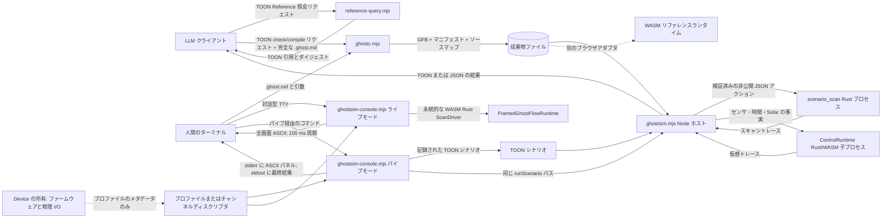
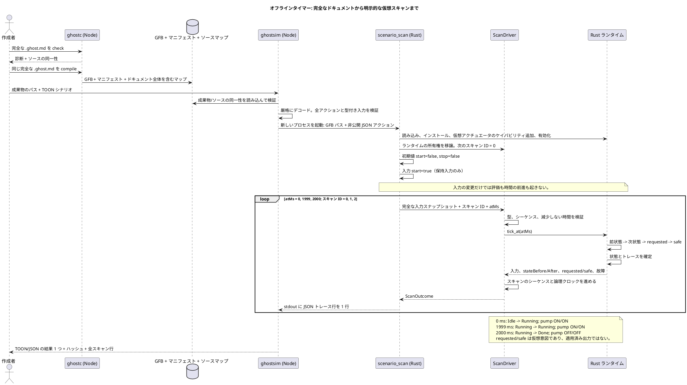
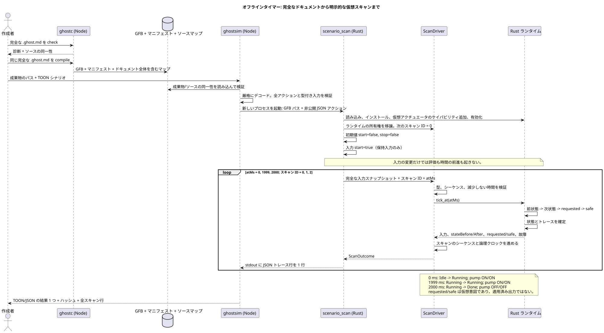
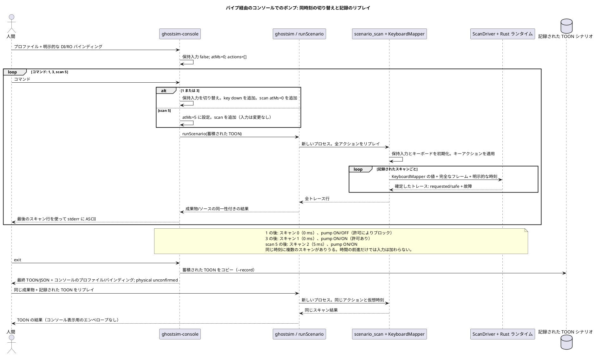
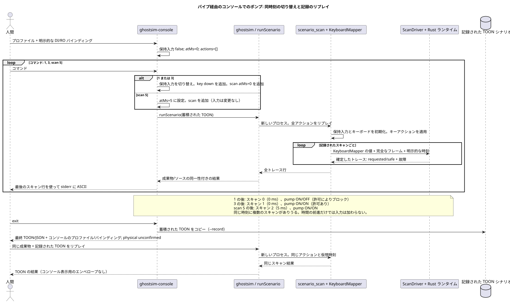
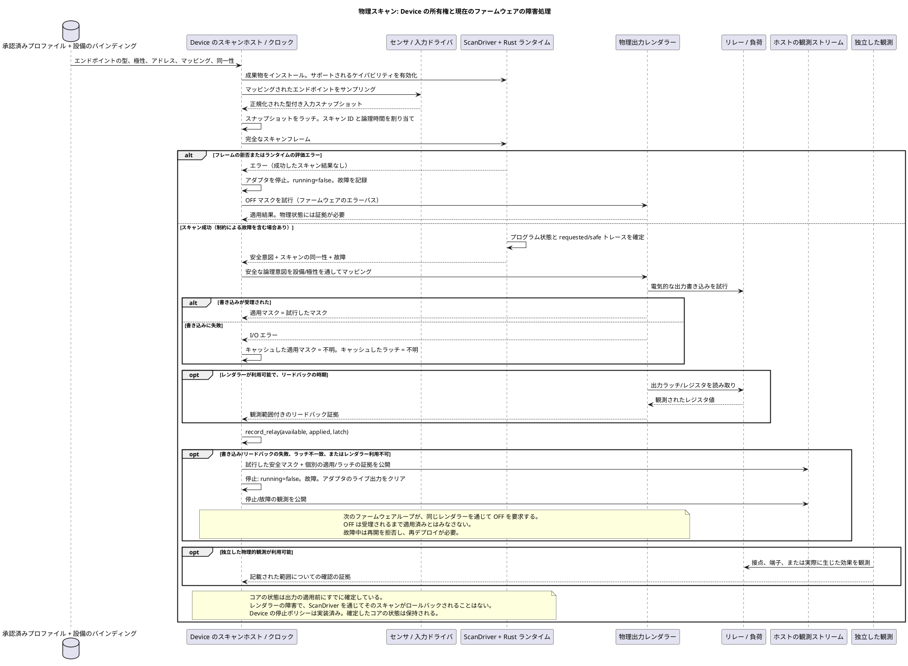
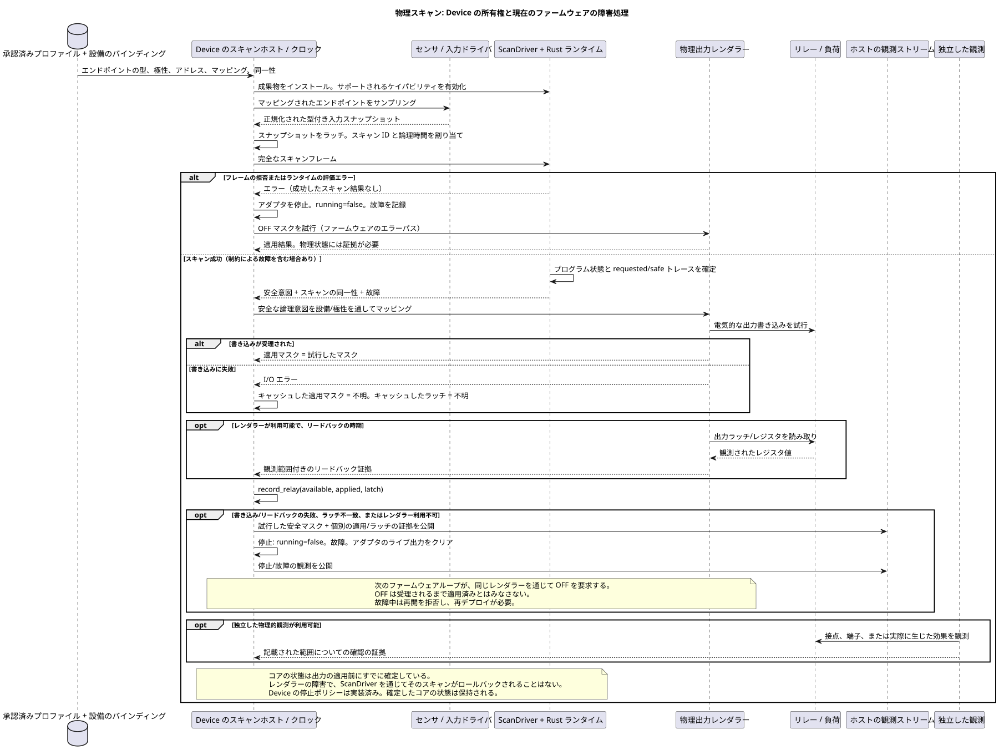
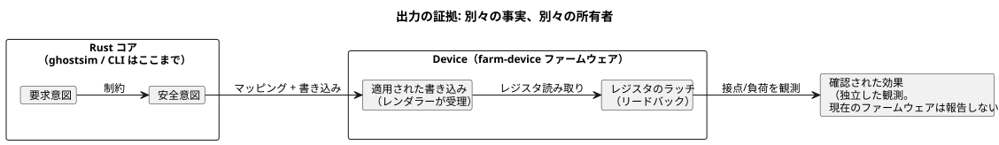

<!-- translation-source: docs/LLM-TOOLCHAIN-ARCHITECTURE.md -->
[英語の原文](LLM-TOOLCHAIN-ARCHITECTURE.md)

# 作成と仮想シミュレーションのアーキテクチャ

このドキュメントは、このチェックアウトにある**オフラインツールチェーン**の全体像を示します。実機を使わずに、プログラムを作成し、コンパイルし、シミュレーションする方法を扱います。プログラムの意味論は[言語リファレンス](LANGUAGE-REFERENCE.ja.md)が定義します。このドキュメントでは、現在のツールと、それぞれの責務がどこで終わるかを説明します。

**このドキュメントの内容**

- ツールチェーン全体と、その 2 種類の利用者（LLM クライアントと人間が使うターミナル）。
- どのコンポーネントがどの「driver」または「runtime」の役割を担うか。
- 代表的な 3 つの実行シーケンス: 仮想タイマー、パイプ経由のコンソールセッション、Device 上の物理スキャン。
- シミュレーションが証明すること、未解決のまま残すこと、現在の制限。
- 公開パスを再現するコマンド。

**唯一の正本プログラム。** 正本となるプログラムは、完全な `.ghost.md` ドキュメント 1 つです。その説明文、意図アンカー、ドキュメント ID、リビジョン ID は、コンパイル済み成果物と一緒に運ばれます。ツールチェーンが、別途編集可能な 2 つ目の制御文字列を作ることは決してありません。

次のフローチャートは、オフラインパス上のすべてのツールと、ツール間を流れるものを示します。点線は、この CLI が駆動しない別のパスです。



**モデル向けの形式。** LLM パスでは、次のものに厳格な TOON（構造化されたリクエストと結果のためのコンパクトなテキストエンコーディング）を使います。

- [Reference 照会](../tools/reference-query.mjs)
- [`GhostFlow/cli-request-v1` と `cli-result-v1`](../tools/ghostc.mjs)
- [`GhostFlow/scenario-v1` と `scenario-result-v1`](../tools/ghostsim.mjs)

`ghostc --request` は、ソース範囲付きの型付き診断を返します。人間向けの `ghostc` コマンドはドキュメントのパスを直接受け取り、短いテキストの診断を出力します。

**2 つのコンソールモード。** [ASCII コンソール](KEYBOARD-HOST.ja.md)には 2 つのモードがあります。

- **対話型 TTY モード**は起動時にすぐスキャンします。その後は、永続的な Rust WASM ランタイムと ScanDriver を 1 つずつ使い、100 ms の実時間周期で動作します。数字キー 1〜8 は Bool 入力を切り替えて即座にスキャンします。`:toggle CHANNEL` も同じ動作です。
- **パイプモード**は決定的な行コマンドを読み込み、既存のシナリオランナーを実行し、リプレイ可能な TOON シナリオを記録できます。

**同一性の検査。** ソースマップは、完全なドキュメントと、変更不能なドキュメント/リビジョンの同一性を保持します。実行前に `ghostsim` は、正確な GFB バイト列とマニフェストに対してソースマップを検査します。結果には次が記載されます。

- シナリオの SHA-256
- バイトコードの SHA-256
- ソースドキュメントの SHA-256 とファイル名
- ドキュメント/リビジョン ID（提供された場合）

**失敗時の結果。** すべての失敗は 0 以外の終了コードで終了します。

| 失敗 | 結果に含まれるもの |
| --- | --- |
| 不正な形式のリクエスト、または有効化の失敗 | スキャン行のない拒否結果。 |
| ランタイムエラー | エラー前に確定したスキャンのみと、失敗したアクションのインデックス。 |
| ランナー呼び出し後のホスト障害 | `traceComplete: false` を伴う `host-error`。ここでスキャンリストが空なのは、子プロセスの観測が得られないという意味であり、ランタイムがスキャンを一度も行わなかったという意味ではありません。 |

**リプレイであり、ライブ記録ではない。** シナリオの結果は決定的なリプレイ成果物であり、ライブの観測記録ではありません。その `scanId` はそのリプレイの範囲内でのみ有効で、`runId` は持ちません。スキャンを観測として公開するホストは、独自の実行（run）の同一性を割り当てなければなりません。また、[Reference §5.4](reference/05-settings-and-observation.ja.md) が求めるとおり、成果物、ソース、シナリオ、スキャンの同一性をまとめて保持しなければなりません。

**スキャンと仮想時間。**

- プログラムを評価するのは `scan` アクションだけです。
- その非負の `atMs` は仮想クロックの値であり、後退できません。
- 入力アクションとキーアクションは、保持値を更新するだけです。その後のスキャンは、たとえクロックを進めるだけのものでも、それらを再び評価します。
- Rust コアは、要求（requested）と安全（safe）の**仮想意図**を別々に生成します。どちらのフィールドも、リレーが動いたことを示すものではありません。

**2 つの転送、1 つのコア。** どちらのパスも同じポータブル Rust コアを実行します。転送手段は別のソース言語ではありません。

| シナリオの種類 | 転送 | スキャンのエントリポイント |
| --- | --- | --- |
| 単純な入力 | ネイティブ `scenario_scan` Rust プロセスへの非公開 JSON | そのプロセス内の Rust `ScanDriver` |
| Window、センサ、適応のケース | 明示的な観測と有効化プロファイルを伴う既存の Rust/WASM `ControlRuntime` 子プロセス | フレーム化スキャン |
| 証明付きインターバルと Solar のケース | 同じ `ControlRuntime` 子プロセス | 既存のレガシー WASM エントリポイント。ホストがリプレイ内でのみ有効なスキャン ID を割り当てる |

**時間の出どころ。** タイマーの時間は単調な `atMs` として供給されます。実時間、カレンダー、Solar プロバイダの事実は、オフラインの RTC から来るか、任意の NTP 補正から来るかにかかわらず、ホストのバインディングに属します。言語の時間の意味論は、どの供給元でも同じです。

**パイプモードの詳細。** パイプ経由のコンソールモードは、1 つの TOON シナリオを蓄積します。コマンドごとの再描画では、そのシナリオを同じ `runScenario` パスでリプレイします。仮想時間は明示的で、バックグラウンドのクロックはありません。完了したスキャンの後でパイプ経由のコマンドやスキャン時刻が失敗した場合、`command-error` はそれまでの行を保持し、`--record` は受け入れられたリプレイ可能な先頭部分だけを保存します。

**対話型モードの詳細。** 対話型 TTY モードは別物です。有効化済みの永続的な Rust WASM `FramedGhostFlowRuntime`/`ScanDriver` を 1 つ所有します。

- 起動時と 100 ms ごとにスキャンします。
- 経過した実時間を、減少しない仮想論理時間として供給します。
- キーによる切り替えでも即座にスキャンします。
- 表示履歴は 120 スキャンまでです。再描画で過去のアクションをリプレイすることはありません。

どちらのモードも、仮想入力と要求/安全意図を表示するだけです。物理出力を適用したり、ハードウェアの状態を確認したりすることはありません。

**チャンネル一覧とバインディング。** 選択した [`GhostFlow/board-profile-v1`](KEYBOARD-HOST.ja.md)、または表示専用の Channel ディスクリプタが、コンソールの入力・出力チャンネルを順序付きで提供します。

- `--bind CHANNEL=port` は、各チャンネルをマニフェスト内の対応する論理ポートに接続します。
- ボードプロファイルが、エンドポイント名から論理バインディングを推測することはありません。
- ディスクリプタがない場合、コンソールは**仮想 Waveshare 8DI/8RO** レイアウトを使います。自動的にバインドされるのは、既定の `DI`/`RO` 論理名と正確に一致するものだけです。
- このレイアウトは、ピン、取り付けられたボード、設備のマッピング、適用済み出力のいずれも検証しません。
- それ以外のチャンネル数は、選択したディスクリプタによって決まります。

結果には、プロファイル ID、リビジョン（ある場合）、ダイジェスト、バインディング、`physical: unconfirmed` が記録されます。

**その他のホストと所有者。**

- [ブラウザで安全に使える公開ツールチェーン](../tools/browser-toolchain.mjs)と [WASM アダプタ](../runtimes/wasm/README.md)は、同じポータブルな言語/ランタイム意味論に至る別のホストパスを構成します。
- API ホストは、モデルへのリクエスト、会話、ドキュメントの保存、デプロイのオーケストレーションを所有します。
- Device リポジトリは、ボードプロファイル、ファームウェア、実際のドライバ、ピン、クロック、物理的な検証を所有します。
- この CLI は、モデルの呼び出しもデバイスの呼び出しも行いません。

## Driver、ランタイム、仮想デバイスの責務

以下のコンポーネントはオフラインパス上に実装されています。**Driver** という語には常に修飾語が必要です。入力アダプタ、コアの `ScanDriver`、コンソールのディスクリプタ、物理 I/O ドライバは、それぞれ責務が異なります。

| コンポーネント | 責務と状態 | 実装 |
| --- | --- | --- |
| シナリオ/キーボード入力ドライバ | 型付きの論理入力とキーの押下/解放状態を保持し、明示的なアクションを完全な入力スナップショットに変換します。出力から新しいセンサ値を導き出すことはありません。 | [`scenario_scan.rs`](../crates/ghostflow-core/examples/scenario_scan.rs)、[`KeyboardMapper`](../crates/ghostflow-core/src/keyboard.rs) |
| パイプ経由の仮想時間ホスト | `atMs` と明示的なスキャン機会を供給します。切り替えコマンドは、入力/キーアクションと現在時刻でのスキャンを追加します。`scan N` は指定された時刻まで進めます。このセッションを進めるバックグラウンドのクロックはありません。 | [`ghostsim.mjs`](../tools/ghostsim.mjs)、[`ghostsim-console.mjs`](../tools/ghostsim-console.mjs) |
| センサとプロバイダのシナリオホスト | 明示的なセンササンプルを整え、証明付きの Bool インターバルを受け入れ、Solar のクロック/プロバイダの事実を供給します。明示的な有効化プロファイルを使い、自ら RTC/NTP や物理センサを読むことはありません。 | [`scenario-sensors.mjs`](../tools/scenario-sensors.mjs)、[`ControlRuntime`](../runtimes/wasm/control-runtime.mjs) |
| 対話型 TTY ホスト | 永続的な WASM `FramedGhostFlowRuntime`/Rust `ScanDriver` を 1 つ所有します。経過した実時間を使って即座に、また 100 ms ごとにスキャンし、入力の切り替え直後にもスキャンします。有界な表示履歴（120 スキャン）を保持します。デバイス I/O はありません。 | [`ghostsim-live.mjs`](../tools/ghostsim-live.mjs)、[`ghostsim-console.mjs`](../tools/ghostsim-console.mjs) |
| フレーム化スキャンドライバ | ランタイムを 1 つ所有し、評価の前に、完全な型付き入力、連番のスキャン ID、減少しない論理時間を検証します。成功したスキャンがそのシーケンス/時刻を進めます。デバイス I/O は行いません。 | [`ScanDriver`](../crates/ghostflow-core/src/scan.rs) |
| ポータブル Rust ランタイム | GFB を読み込み、サポートされるケイパビリティを有効化し、式、プログラムの状態、タイマー、制約を評価し、要求/安全意図と故障を含むトレースを出力します。ネイティブホストと WASM ホストはこのコアを使います。 | [`ghostflow-core`](../crates/ghostflow-core/src/lib.rs)、[WASM アダプタ](../runtimes/wasm/README.md) |
| 仮想デバイスビュー | 選択したチャンネル一覧を使って、保持された入力、要求/安全の出力バンク、スキャンの同一性を表示します。状態は、シミュレートされた入力値、コアのプログラム状態、記録された観測からなります。独立したアクチュエータモデルやプラントモデルはありません。 | [ASCII パネルとプロファイルの規則](KEYBOARD-HOST.ja.md) |
| プロファイル/チャンネルディスクリプタ | 順序付きのチャンネルと型を記述します。明示的なバインディングがそれらをマニフェストのポートに接続します。ボードプロファイルの driver/address/polarity メタデータを、コンソールが実行することはありません。 | [`board-profile-v1` 契約](../contracts/integration-v1/README.md)、[`console-profile-v1`](KEYBOARD-HOST.ja.md) |

**「仮想デバイス」の意味。** ここでいう「仮想デバイス」とは、実際の GhostFlow ランタイムを取り巻く I/O ビューのことであり、エミュレートされた機械ではありません。

- ネイティブランナーは、ランタイムを有効化できるように、モジュールの出力型から仮想アクチュエータのケイパビリティを登録します。
- Waveshare コントローラ、リレーレジスタ、接点、ポンプ、タンク水位、センサの応答はエミュレートしません。
- 特に、`safe.pump = true` が水位入力を変えることはありません。その入力はシナリオが明示的に供給しなければなりません。
- 閉ループのプラントモデルや、シミュレートされた適用済み/確認済み出力には、別途明示的なモデルと証拠の契約が必要です。この CLI はどちらも実装していません。

**ホストごとの、スキャンをまたぐランタイム状態。**

| ホスト | スキャンをまたいでランタイム状態をどう引き継ぐか |
| --- | --- |
| ブラウザ（Farm Studio） | ブラウザのランタイム内でスキャン間に保持されます。 |
| 対話型 TTY モード | 1 つのライブ WASM セッション内で保持されます。 |
| パイプ経由のコンソールモード | 蓄積したシナリオを新しいネイティブプロセスでリプレイして再構築します。 |

ブラウザには独自の入力ホストとペース制御ホストがあります。Farm Studio では次のとおりです。

- `app/src/features/playground/playgroundRuntime.ts` が `ControlRuntime.instantiateFramed` をインスタンス化します。
- `playgroundScan.ts` が、マニフェストの形をした Boolean スナップショットと明示的な論理時間を供給し、返された safe バンクから表示用の出力を読み取ります。
- `simulationPacer.ts` が、対話的な再生のためのスキャン機会を決めます。

これらのフロントエンドコンポーネントは GhostFlow のルールを評価しません。以前からあるリアルタイムの Rust キーボード例は、別のホストとして残っています。

## 代表的な実行シーケンス

### コンパイルし、開始し、仮想タイマーの境界に到達する

この実装済みのパスでは、完全な [`virtual-timer.ghost.md`](../examples/authoring/corpus/virtual-timer.ghost.md) とその[シナリオ](../examples/authoring/corpus/virtual-timer-scenario.toon)を使います。

- `phase` は `Idle` から始まり、`pump` は計算された次の phase に従います。
- 3 つのスキャンの間に実時間の待機はありません。
- 図中の phase 名はソースの意味論を表しています。実際のトレースには、コンパイラが生成したタイマー状態も含まれます。





**このシーケンスが失敗する場合。**

- 検証または有効化に失敗すると、スキャン行は出力されません。
- アクション単位のランタイムエラーは実行を停止させます。結果には、それ以前に確定した行と、失敗したアクションのインデックスが返されます。
- 制約による故障は別物です。安全意図がブロックされた*成功した*スキャンであることがあります。自動的にランナーの失敗になるわけではありません。

これらのパスは [`ghostsim.mjs`](../tools/ghostsim.mjs)、[`scenario_scan.rs`](../crates/ghostflow-core/examples/scenario_scan.rs)、[`ScanDriver`](../crates/ghostflow-core/src/scan.rs) に実装されています。

### パイプモード: 入力を切り替え、許可によるブロックを調べ、リプレイする

このシーケンスは、後述の再現手順の節にあるパイプ経由のコンソールコマンド列です。明示的な DI/RO バインディングとともに `pump-rev-2.ghost.md` を使います。

- このポンプのプログラムには、プログラム状態もタイマーもありません。
- 蓄積されたシナリオはコンソールが所有します。
- `runScenario` を呼ぶたびに新しい Rust プロセスが作られ、ランタイム状態を最初から再構築します。





**記録に残るもの。** 記録には、論理的な入力/キーアクションと仮想スキャン時刻が残ります。プロファイルのダイジェストと DI/RO バインディング一覧は、シナリオファイルではなく、コンソールの最終結果に追加されます。したがって、

- 記録をリプレイすれば論理的なスキャンは再現されますが、
- パネルを再現するには、そのプロファイルとバインディングの引数も保持しておく必要があります。

## 物理 Driver と Device の境界

**ドライバとレンダラーは役割です。** 入力**ドライバ**は論理入力を生成します。出力**レンダラー**は、論理的な出力意図をリレー、モーター、ランプ、画面に適用します。これらは役割であり、互いに排他的なデバイスの分類ではありません。

- USB フォースフィードバックジョイスティックは、入力ドライバと出力レンダラーの両方を持ちます。
- TFT 画面付きの EC11 エンコーダも同様に、入力と出力の役割を兼ね備えます。

これらの例は境界を定義するものであり、実装を定義するものではありません。

| 項目 | 所有者または名前 |
| --- | --- |
| ドライバとレンダラーのソース | `farm-device-drivers` |
| ホスト/ボードの統合、バインディング、クロック、ウォッチドッグ、起動時/障害時のポリシー | Device |
| キャビネットのオペレーター UI（出力レンダラーとは別物） | `@ghostflow/cabinet-view` |

既存の `ScanDriver`、ホスト ABI の識別子、プロファイルの `driver` フィールドは、その名前と契約を維持します。

物理パスには追加の責務があり、[Reference §8](reference/08-language-runtime-and-device-boundaries.ja.md) と[統合契約](../contracts/integration-v1/README.md)で定義されています。次のシーケンスは、1 回の物理スキャンにおけるそれらの責務を示します。





**この図の読み方。** この図は、所有権の契約と、現在の `farm-device` ファームウェアの障害パスを組み合わせたものです。`ghostsim` が行う接続ではなく、ハードウェアの検証でもありません。

- 独立した物理的確認は契約上の境界です。現在のファームウェアの観測が報告するのは、意図、適用された書き込み、レジスタのラッチだけです。リレー接点や負荷からのフィードバックはありません。
- Device は、ファームウェア、ドライバ/レンダラーのホストとボードの統合、承認済みボードプロファイル、クロック、ウォッチドッグ、起動時や障害時の出力処理を所有します。
- 設備のバインディングが、各論理ポートの実際のエンドポイントを選択します。
- 統合バリデータは、供給された同一性とマッピングを検査します。それらをインストールすることも、I/O を行うこともありません。

**4 種類の証拠。** 論理的な安全意図、レンダラーが適用した出力、レジスタのリードバック、物理的な確認は、互いに区別されたまま扱われます。次の図は、それぞれの事実を誰が生成できるかを示します。この CLI は安全意図までで止まります。



**Device アダプタのコード。** Device アダプタのコードは `farm-device` に別途あります。`rust/ghostflow-adapter/src/lib.rs` は共有の `ScanDriver` を使い、`record_relay` を通じて適用マスクとリレーラッチの観測を記録します。実際の出力操作はファームウェアが所有します。

- この作成パスは、その別実装を呼び出すことも、証明することもありません。
- 想定するデプロイについては、そのファームウェア/コアのリビジョン、設備のマッピング、物理的な証拠を確認しなければなりません。
- 以下のコマンドには、エンドツーエンドのデバイスデプロイ、ハードウェアのエミュレーション、物理的な確認の手順は含まれていません。

**証拠の連鎖が定義されている場所。**

- [Reference §4.7](reference/04-sensors-constraints-control.ja.md) は、すでに出力の証拠の連鎖を定義しています。要求意図、安全意図、適用されたコマンド、確認されたフィードバックは、それぞれ別の事実です。
- [コマンド結果のライフサイクル](reference/05-settings-and-observation.ja.md)は、リクエストの受信、拒否、開始、完了、キャンセル、失敗を説明しています。コアのスキャンが完了しても、物理的な動作が完了した証拠にはなりません。
- [Interaction v0 契約](../contracts/interaction-v0/README.md)は、完了したランタイムの観測を射影するもので、I/O は行いません。
- Reference [§8.5](reference/08-language-runtime-and-device-boundaries.ja.md) は、再起動と状態の復元を、明示的なポリシーとチェックポイントの契約に委ねています。I/O 障害の後に、成功したコアのスキャンをロールバックすることは求めていません。

**現在の Device の障害ポリシー。** このポリシーは `farm-device/rust/firmware/src/ghostflow.rs`（`scan_with_clock`、`set_mask`、`record_relay`、その後 `halt`）と `farm-device/rust/ghostflow-adapter/src/lib.rs`（`halt`、`scan_inner`、`resume`）で確認できます。出力障害が起きると、次のように動作します。

1. 試行した安全マスクを観測として保持し、
2. それ以降のコアの評価を停止し、
3. アダプタのライブ出力意図をクリアし、
4. 次のファームウェアループで OFF を要求し、
5. 確定したコアの状態を保持し、
6. 故障中は再開を拒否します。

これは実装済みの Device ポリシーであり、言語に欠けているトランザクションではありません。

**確認したリビジョン。** この評価は、クリーンな `farm-device` のリビジョン [`6d2e97b`](https://github.com/callin2/farm-device/commit/6d2e97b243045e3b2dfbbb9bf205614e26eceba4) に対して確認しました。`rust/ghostflow-adapter/tests/adapter.rs` の `relay_fault_halts_clears_intent_and_trace_is_bounded` ケースも含みます。このドキュメントのレビューでは、テストは読んだだけで再実行はしていません。実装についての主張を繰り返す前に、それ以降の Device のリビジョンを確認してください。そのホストテストもこの図も、実際のリレー接点が OFF に達したことを証明するものではありません。

## シーケンスが確立することと未解決のまま残すこと

**確立されること。** オフラインの所有権の連鎖は一貫しています。

- ホストが入力と時間を供給し、
- Rust コアが評価と状態を所有し、
- ビューがトレースを消費します。

**確立されないこと。** これらのシーケンスは、デプロイが完成していることを示すものではありません。以下のレビュー所見では、欠けている振る舞いを必要とするシナリオに対する相対的な重大度を示しています。

| 所見 | 影響と重大度 | 必要な証拠または判断 |
| --- | --- | --- |
| コアの確定は物理出力の適用より先に行われ、証拠の段階は別々のまま残る。 | **定義された境界であり、欠けたポリシーではない:** 現在の Device ファームウェアは、適用の失敗を記録して停止し、確定したコアの状態をロールバックせずに、次のループで OFF を要求する。 | 想定するファームウェアのリビジョンと障害パスを対象デバイスで検証する。CLI のシミュレーションは、出力処理や物理的な OFF を証明しない。 |
| CLI には出力からセンサへのプラントモデルがない。 | **閉ループの主張に対しては高:** 安全なポンプ意図は、水の流れ、水位の変化、センサのフィードバックを立証できない。 | 明示的なシナリオ入力、または別途仕様化されたプラントモデルを供給する。ハードウェアについて主張するには、物理的な効果を独立に観測する。 |
| パイプ経由のコンソールの再描画は蓄積したシナリオをリプレイする。シナリオは 256 スキャンまでに制限される。 | **パイプ経由のレビューに対しては低:** このモードは決定的で有界である。 | コマンドスクリプトとリプレイ可能な記録に使う。 |
| 対話型 TTY は 100 ms の実時間周期でスキャンし、120 件の表示サンプルを保持する。 | **ホストのタイミング制限:** スケジューラの遅延が実際のスキャン間隔に影響しうる。ランタイムの論理時間は経過した実時間を使う。 | これは仮想的なレビュー用ビューであり、期限の保証やデバイスホストではない。 |
| コンソールの記録には表示用のプロファイル/バインディングが含まれない。それらは最終結果にある。 | **論理的なリプレイには低、パネルの再現には中:** 記録された論理スキャンは再現できるが、元のチャンネルのラベル/レイアウトは TOON だけからは復元できない。 | パネルの同一性が重要な場合は、最終的なコンソール結果とプロファイル/バインディングの引数を記録と一緒に保持する。 |

**各シーケンスが検査するもの。**

- ポンプの許可のシーケンスは、要求意図と安全意図の違いを検査します。
- タイマーのシーケンスは、プログラムの前状態/次状態と、1999/2000 ms の境界を検査します。

どちらも物理的な期限を証明するものではありません。ホストが 2000 ms にスキャンを供給しなければ、ランタイムがその瞬間に自律的に遷移することはありません。実際のスキャン周期、入力の鮮度、出力の遅延は、引き続きホスト/Device の受け入れ基準です。

未解決の Device 側の作業は次で追跡されています。

- Device 側のデバッグ/出力ポリシー: [farm-device #25](https://github.com/callin2/farm-device/issues/25)。
- 物理的なリレー接点の証拠: [farm-device #26](https://github.com/callin2/farm-device/issues/26)。

## 公開パスを再現する

依存関係をインストールし、ネイティブの `scenario_scan` 例をビルドしたうえで、言語リポジトリのルートから次のコマンドを実行します。レビュー済みのサンプルドキュメントとその TOON リクエストを使います。生の制御コピーは生成されません。

```sh
mkdir -p build/authoring
cp examples/authoring/pump-rev-2.ghost.md build/authoring/pump.ghost.md
node tools/ghostc.mjs --request examples/authoring/check-rev-2.toon
node tools/ghostc.mjs --request examples/authoring/compile-rev-2.toon
node tools/ghostsim.mjs build/authoring/pump.gfb examples/authoring/pump-scenario.toon --format toon
printf '1\n3\nscan 5\nexit\n' | node tools/ghostsim-console.mjs build/authoring/pump.gfb \
  --bind DI1=start --bind DI2=stop --bind DI3=permit_ok \
  --bind RO1=pump --bind RO2=permit --record build/authoring/console.toon --format json
node tools/ghostsim.mjs build/authoring/pump.gfb build/authoring/console.toon --format toon
```

この再現手順は**パイプ経由の決定的モード**を実行します。期待される結果は次のとおりです。

- **check と compile** は、ドキュメント `GF-EXAMPLE-PUMP`、リビジョン `rev-2`、同じドキュメント全体の SHA-256 を識別します。
- **スクリプト化されたシナリオ**は 0、1、2 ms にスキャンします。`pump` の requested/safe の値は、順に `ON/OFF`、`ON/ON`、`OFF/OFF` です。
- **コンソールの例**は 0、0、5 ms にスキャンします。そのパネルには、バインドされていない DI8/RO8 を含む 8 行の入力/出力があり、物理的な状態は未確認（unconfirmed）と報告されます。
- **記録されたシナリオ**は、同じスキャンと成果物の同一性でリプレイされます。

関連するテスト:

- 選択された 2DI/4RO のボードプロファイルのフィクスチャが、[`ghostsim-console.test.mjs`](../tests/ghostsim-console.test.mjs) で行数が異なる場合を検査します。
- [`authoring-workflow.test.mjs`](../tests/authoring-workflow.test.mjs) は、すでに TOON の check/compile/simulate パスを検査しています。このビューのために別のコンパイラやランナーは必要ありません。

## 現在の制限

**ランナーの制限。**

| 制限 | 値 |
| --- | --- |
| シナリオのテキスト | 256 KiB |
| アクション | 1,024 |
| スキャン | 256 |
| エンコードされた結果 | 1 MiB |

**有効化。** ランナーは通常のランタイム有効化を使います。外部の証明付きインターバル、スケジュールのバインディング、その他のホストリソースを必要とする `control` は、有効化の時点で拒否されます。

- ホストのイベント順序は [#115](https://github.com/callin2/ghostflow-language/issues/115) で追跡されています。
- 時間リソースについては [TEMPORAL-RESOURCES.md](TEMPORAL-RESOURCES.ja.md) で説明しています。
- 基本的な仮想時間シミュレーションは、隠れた既定ポリシーを一切供給しません。

**スキャン周期。** パイプ経由のコンソールモードには自動のスキャン周期がありません。対話型 TTY モードは 100 ms の実時間周期で、また切り替えの直後にスキャンします。

**物理的な証明はない。** どちらのモードも物理的な振る舞いを証明しません。表示される出力は要求と安全の仮想意図であり、物理的な適用も確認もありません。
