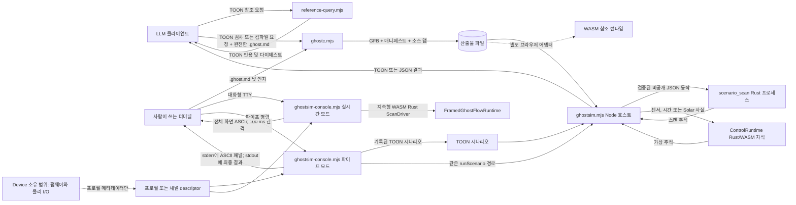
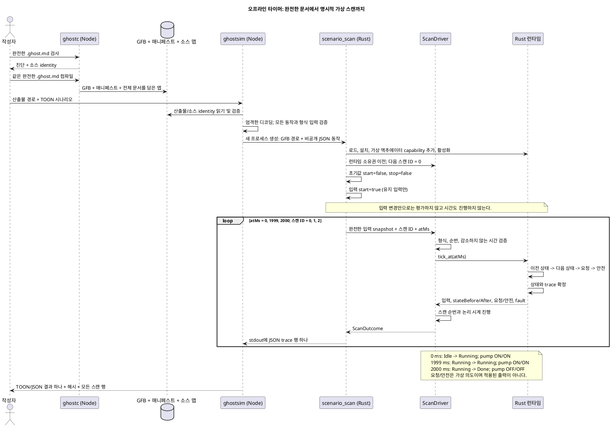
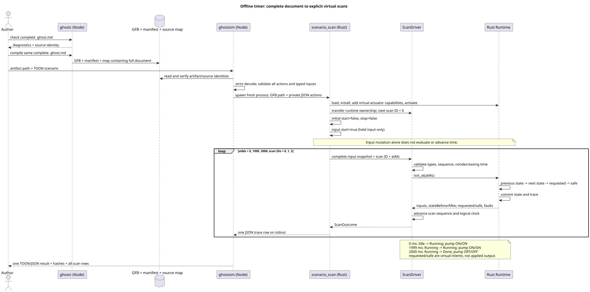
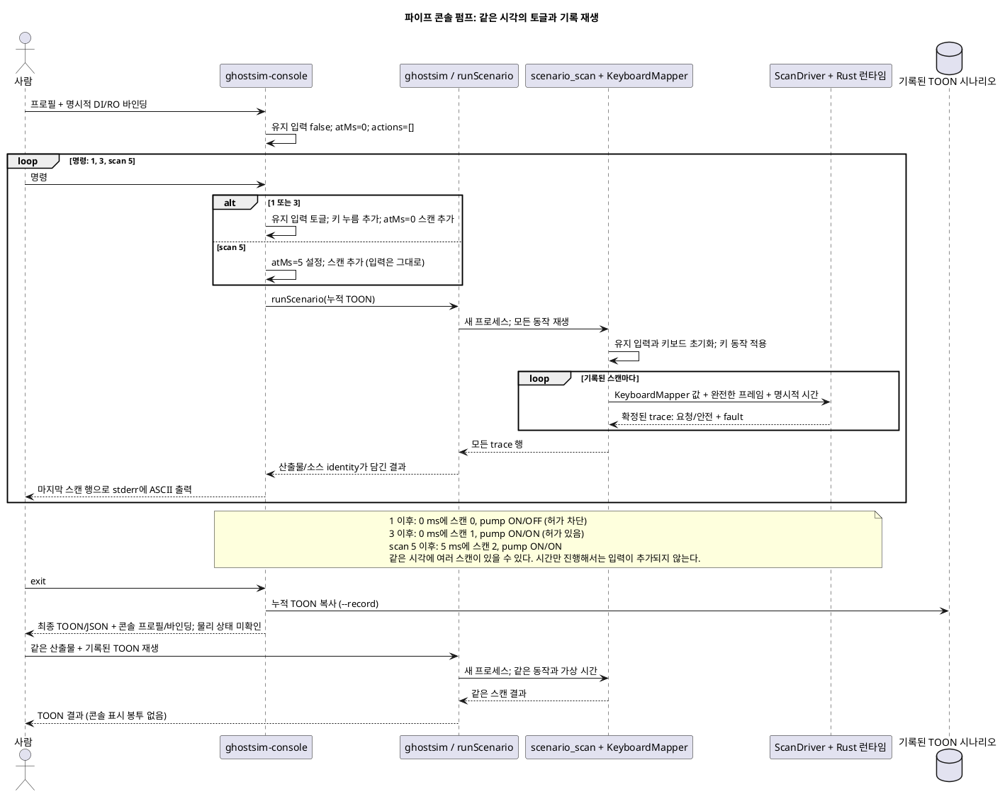
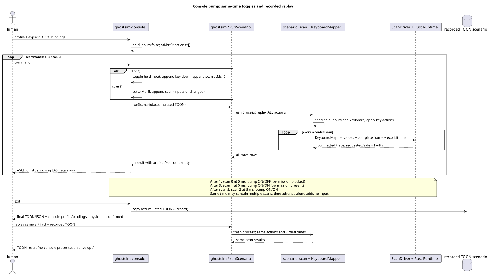
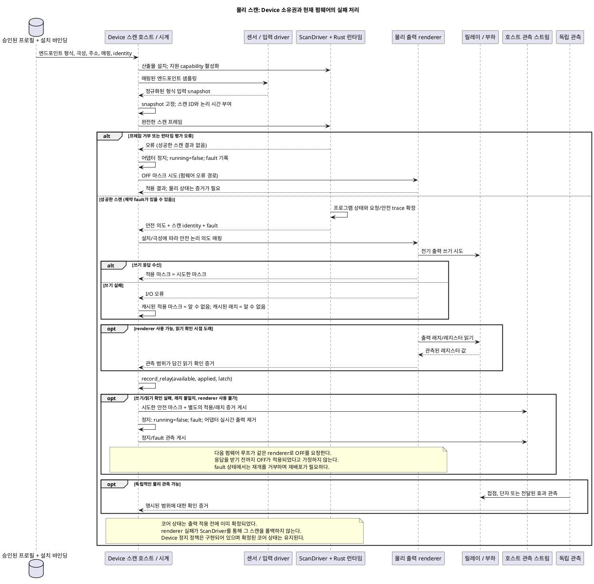
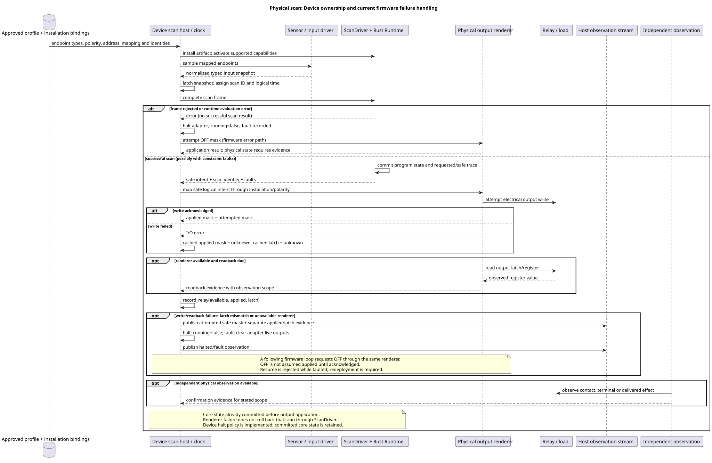
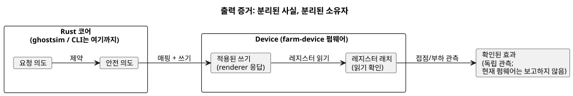

<!-- translation-source: docs/LLM-TOOLCHAIN-ARCHITECTURE.md -->
[영문 원문](LLM-TOOLCHAIN-ARCHITECTURE.md)

# 작성 및 가상 시뮬레이션 아키텍처

이 문서는 이 체크아웃에 있는 **오프라인 도구체인**을 정리합니다. 실제 장치 없이
프로그램을 작성하고, 컴파일하고, 시뮬레이션하는 방법을 다룹니다.
[언어 참조](LANGUAGE-REFERENCE.md)는 프로그램 의미를 정의합니다. 이 문서는 현재
도구와 각 도구의 책임이 어디서 끝나는지를 설명합니다.

**이 문서의 내용**

- 전체 도구체인과 두 사용 주체(LLM 클라이언트와 사람이 쓰는 터미널).
- 어떤 구성 요소가 어떤 "driver" 또는 "runtime" 역할을 맡는지.
- 대표 실행 순서 세 가지: 가상 타이머, 파이프 콘솔 세션, Device의 물리 스캔.
- 시뮬레이션이 입증하는 것, 남겨 두는 것, 현재 제한.
- 공개 경로를 재현하는 명령.

**하나의 정본 프로그램.** 정본 프로그램은 완전한 `.ghost.md` 문서 하나입니다.
설명 글, 의도 앵커, 문서 ID와 revision ID는 컴파일된 산출물과 함께 전달됩니다.
도구체인은 별도로 편집할 수 있는 두 번째 제어 문자열을 절대 만들지 않습니다.

아래 흐름도는 오프라인 경로의 모든 도구와 그 사이를 오가는 내용을 보여 줍니다.
점선은 이 CLI가 구동하지 않는 별도 경로입니다.



**모델용 형식.** LLM 경로는 다음에 엄격한 TOON(구조화된 요청과 결과를 위한
간결한 텍스트 인코딩)을 사용합니다.

- [참조 질의](../tools/reference-query.mjs),
- [`GhostFlow/cli-request-v1` 및 `cli-result-v1`](../tools/ghostc.mjs),
- [`GhostFlow/scenario-v1` 및 `scenario-result-v1`](../tools/ghostsim.mjs).

`ghostc --request`는 소스 범위가 포함된 형식화된 진단을 반환합니다. 사람이 쓰는
`ghostc` 명령은 문서 경로를 직접 받아 짧은 텍스트 진단을 출력합니다.

**두 가지 콘솔 모드.** [ASCII 콘솔](KEYBOARD-HOST.ko.md)에는 두 모드가 있습니다.

- **대화형 TTY 모드**는 시작하자마자 스캔합니다. 그 뒤 지속형 Rust WASM 런타임과
  ScanDriver 하나를 사용해 벽시계 기준 100 ms 간격으로 스캔합니다. 숫자 키 1–8은
  Bool 입력을 토글하고 즉시 스캔합니다. `:toggle CHANNEL`도 같은 동작을 합니다.
- **파이프 모드**는 결정적인 한 줄 명령을 읽고, 기존 시나리오 실행기를 돌리며,
  재생 가능한 TOON 시나리오를 기록할 수 있습니다.

**identity 검사.** 소스 맵은 완전한 문서와 변경할 수 없는 문서/revision
identity를 담습니다. `ghostsim`은 실행 전에 맵을 정확한 GFB 바이트 및 매니페스트와
대조합니다. 결과에는 다음이 기록됩니다.

- 시나리오 SHA-256,
- 바이트코드 SHA-256,
- 소스 문서 SHA-256과 파일 이름,
- 제공된 경우 문서/revision ID.

**실패 결과.** 모든 실패는 0이 아닌 종료 코드로 끝납니다.

| 실패 | 결과에 담기는 내용 |
| --- | --- |
| 잘못된 요청 또는 활성화 실패 | 스캔 행이 없는 거부 결과. |
| 런타임 오류 | 오류 이전에 확정된 스캔과 실패한 동작 인덱스만. |
| 실행기 호출 뒤의 호스트 실패 | `traceComplete: false`인 `host-error`. 이때 스캔 목록이 비어 있다는 것은 자식 프로세스의 관측을 사용할 수 없다는 뜻이며, 런타임이 스캔을 하지 않았다는 뜻이 아닙니다. |

**실시간 기록이 아니라 재생.** 시나리오 결과는 결정적 재생 산출물이며 실시간 관측
기록이 아닙니다. 그 `scanId`는 해당 재생 안에서만 유효하고 `runId`는 없습니다.
스캔을 관측으로 게시하는 호스트는 자체 실행 identity를 부여해야 합니다. 또한
[참조 §5.4](reference/05-settings-and-observation.md#54-정체성과-물리적-사실의-경계)의
요구대로 산출물, 소스, 시나리오, 스캔 identity를 함께 보존해야 합니다.

**스캔과 가상 시간.**

- 프로그램을 평가하는 것은 `scan` 동작뿐입니다.
- 음수가 아닌 `atMs`는 가상 시계 값입니다. 뒤로 갈 수 없습니다.
- 입력 동작과 키 동작은 유지되는 값만 갱신합니다. 이후의 스캔은 — 시계만
  진행시키는 스캔이라도 — 그 값으로 다시 평가합니다.
- Rust 코어는 요청 **가상 의도**와 안전 가상 의도를 따로 만듭니다. 어느 필드도
  릴레이가 움직였다는 뜻이 아닙니다.

**두 가지 전송, 하나의 코어.** 두 경로 모두 같은 이식 가능한 Rust 코어를
실행합니다. 전송 방식은 또 다른 소스 언어가 아닙니다.

| 시나리오 종류 | 전송 | 스캔 진입점 |
| --- | --- | --- |
| 일반 입력 | 네이티브 `scenario_scan` Rust 프로세스로 보내는 비공개 JSON | 그 프로세스 안의 Rust `ScanDriver` |
| 창(window), 센서, 적응 사례 | 명시적 관측과 활성화 프로필을 사용하는 기존 Rust/WASM `ControlRuntime` 자식 | 프레임 스캔 |
| 인증된 구간 및 Solar 사례 | 같은 `ControlRuntime` 자식 | 기존 레거시 WASM 진입점. 호스트가 재생 내 스캔 ID를 부여합니다 |

**시간의 출처.** 타이머 시간은 단조 `atMs`로 공급됩니다. 벽시계, 달력, Solar
provider 사실은 오프라인 RTC에서 오든 선택적 NTP 보정에서 오든 호스트 바인딩의
책임입니다. 언어의 시간 의미는 출처와 관계없이 같습니다.

**파이프 모드 상세.** 파이프 콘솔 모드는 TOON 시나리오 하나를 누적합니다. 명령마다
화면을 다시 그릴 때 그 시나리오를 같은 `runScenario` 경로로 재생합니다. 명시적
가상 시간을 쓰며 백그라운드 시계는 없습니다. 스캔이 완료된 뒤 파이프 명령이나
스캔 시간이 실패하면 `command-error`가 기존 행을 보존하고, `--record`는 수락된
재생 가능 접두부만 저장합니다.

**대화형 모드 상세.** 대화형 TTY 모드는 별개입니다. 활성화된 지속형 Rust WASM
`FramedGhostFlowRuntime`/`ScanDriver` 하나를 소유합니다.

- 시작 시와 100 ms마다 스캔합니다.
- 경과한 벽시계 시간을 감소하지 않는 가상 논리 시간으로 공급합니다.
- 키 토글도 즉시 스캔을 일으킵니다.
- 화면 기록은 스캔 120개로 제한됩니다. 다시 그릴 때 과거 동작을 재생하지 않습니다.

두 모드 모두 가상 입력과 요청/안전 의도만 표시합니다. 어느 쪽도 물리 출력을
적용하거나 하드웨어 상태를 확인하지 않습니다.

**채널 목록과 바인딩.** 선택한
[`GhostFlow/board-profile-v1`](KEYBOARD-HOST.ko.md) 또는 표시 전용 Channel
descriptor가 콘솔의 입력 채널과 출력 채널 순서를 제공합니다.

- `--bind CHANNEL=port`는 각 채널을 매니페스트에서 일치하는 논리 포트에 연결합니다.
- 보드 프로필은 엔드포인트 이름에서 논리 바인딩을 추론하지 않습니다.
- descriptor가 없으면 콘솔은 **가상 Waveshare 8DI/8RO** 배치를 사용합니다. 정확히
  일치하는 기본 `DI`/`RO` 논리 이름만 자동으로 바인딩됩니다.
- 이 배치는 핀, 설치된 보드, 설치 매핑, 적용된 출력을 검증하지 않습니다.
- 다른 채널 수는 선택한 descriptor에서 정해집니다.

결과에는 프로필 ID, 있는 경우 revision, 다이제스트, 바인딩, `physical: unconfirmed`가
기록됩니다.

**다른 호스트와 소유자.**

- [브라우저 안전 공개 도구체인](../tools/browser-toolchain.mjs)과
  [WASM 어댑터](../runtimes/wasm/README.md)는 같은 이식 가능한 언어/런타임 의미로
  가는 별도 호스트 경로입니다.
- API 호스트는 모델 요청, 대화, 문서 저장, 배포 오케스트레이션을 소유합니다.
- Device 저장소는 보드 프로필, 펌웨어, 실제 드라이버, 핀, 시계, 물리 검증을
  소유합니다.
- 이 CLI는 모델 호출도 장치 호출도 하지 않습니다.

## Driver, 런타임, 가상 장치의 책임

아래 구성 요소는 오프라인 경로에 구현되어 있습니다. **Driver**라는 말에는 항상
한정어가 필요합니다. 입력 어댑터, 코어 `ScanDriver`, 콘솔 descriptor, 물리 I/O
드라이버는 각각 책임이 다릅니다.

| 구성 요소 | 책임과 상태 | 구현 |
| --- | --- | --- |
| 시나리오/키보드 입력 드라이버 | 형식이 지정된 논리 입력과 키 누름/뗌 상태를 유지하고, 명시적 동작을 완전한 입력 snapshot으로 변환합니다. 출력에서 새 센서 값을 유도하지 않습니다. | [`scenario_scan.rs`](../crates/ghostflow-core/examples/scenario_scan.rs), [`KeyboardMapper`](../crates/ghostflow-core/src/keyboard.rs) |
| 파이프 가상 시간 호스트 | `atMs`와 명시적 스캔 기회를 공급합니다. 토글 명령은 입력/키 동작과 현재 시각의 스캔을 추가하고, `scan N`은 지정한 시각으로 진행합니다. 이 세션을 진행시키는 백그라운드 시계는 없습니다. | [`ghostsim.mjs`](../tools/ghostsim.mjs), [`ghostsim-console.mjs`](../tools/ghostsim-console.mjs) |
| 센서 및 provider 시나리오 호스트 | 명시적 센서 샘플을 조건 처리하고, 인증된 Bool 구간을 받아들이며, Solar 시계/provider 사실을 공급합니다. 명시적 활성화 프로필을 사용하며 RTC/NTP나 물리 센서를 직접 읽지 않습니다. | [`scenario-sensors.mjs`](../tools/scenario-sensors.mjs), [`ControlRuntime`](../runtimes/wasm/control-runtime.mjs) |
| 대화형 TTY 호스트 | 지속형 WASM `FramedGhostFlowRuntime`/Rust `ScanDriver` 하나를 소유합니다. 경과 벽시계 시간으로 즉시, 그리고 100 ms마다 스캔하고, 입력 토글 직후에도 스캔합니다. 제한된 화면 기록(스캔 120개)을 보관합니다. 장치 I/O는 없습니다. | [`ghostsim-live.mjs`](../tools/ghostsim-live.mjs), [`ghostsim-console.mjs`](../tools/ghostsim-console.mjs) |
| 프레임 스캔 드라이버 | 런타임 하나를 소유하며, 평가 전에 완전한 형식 입력, 순차 스캔 ID, 감소하지 않는 논리 시간을 검증합니다. 성공한 스캔은 순번/시간을 진행시킵니다. 장치 I/O는 하지 않습니다. | [`ScanDriver`](../crates/ghostflow-core/src/scan.rs) |
| 이식 가능한 Rust 런타임 | GFB를 로드하고, 지원되는 capability를 활성화하고, 식, 프로그램 상태, 타이머, 제약을 평가하며, 요청/안전 의도와 fault가 담긴 trace를 출력합니다. 네이티브 호스트와 WASM 호스트가 이 코어를 사용합니다. | [`ghostflow-core`](../crates/ghostflow-core/src/lib.rs), [WASM 어댑터](../runtimes/wasm/README.md) |
| 가상 장치 화면 | 선택한 채널 목록으로 유지 중인 입력, 요청/안전 출력 뱅크, 스캔 identity를 표시합니다. 상태는 시뮬레이션 입력 값, 코어 프로그램 상태, 기록된 관측으로 구성되며 별도의 액추에이터 모델이나 플랜트 모델은 없습니다. | [ASCII 패널 및 프로필 규칙](KEYBOARD-HOST.ko.md) |
| 프로필/채널 descriptor | 순서가 있는 채널과 형식을 기술하며, 명시적 바인딩이 이를 매니페스트 포트에 연결합니다. 보드 프로필의 driver/주소/극성 메타데이터는 콘솔이 실행하지 않습니다. | [`board-profile-v1` 계약](../contracts/integration-v1/README.md), [`console-profile-v1`](KEYBOARD-HOST.ko.md) |

**"가상 장치"의 의미.** 여기서 "가상 장치"는 실제 GhostFlow 런타임을 둘러싼 I/O
화면입니다 — 에뮬레이션된 기계가 아닙니다.

- 네이티브 실행기는 모듈의 출력 형식에서 가상 액추에이터 capability를 등록하므로
  런타임이 활성화될 수 있습니다.
- Waveshare 컨트롤러, 릴레이 레지스터, 접점, 펌프, 탱크 수위, 센서 응답을
  에뮬레이션하지 않습니다.
- 특히 `safe.pump = true`는 수위 입력을 바꾸지 않습니다. 시나리오가 그 입력을
  명시적으로 공급해야 합니다.
- 폐루프 플랜트 모델이나 시뮬레이션된 applied/confirmed 출력에는 별도의 명시적
  모델과 증거 계약이 필요합니다. 이 CLI는 둘 다 구현하지 않습니다.

**스캔 사이의 런타임 상태(호스트별).**

| 호스트 | 스캔 사이에 런타임 상태를 유지하는 방식 |
| --- | --- |
| 브라우저(Farm Studio) | 브라우저 런타임에서 스캔 사이에 유지됩니다. |
| 대화형 TTY 모드 | 하나의 실시간 WASM 세션에서 유지됩니다. |
| 파이프 콘솔 모드 | 누적 시나리오를 새 네이티브 프로세스에서 재생해 재구성합니다. |

브라우저에는 자체 입력 및 속도 조절 호스트가 있습니다. Farm Studio에서는 다음과
같습니다.

- `app/src/features/playground/playgroundRuntime.ts`는
  `ControlRuntime.instantiateFramed`를 인스턴스화합니다.
- `playgroundScan.ts`는 매니페스트 형태의 Boolean snapshot과 명시적 논리 시간을
  공급하고, 반환된 안전 뱅크에서 화면에 표시할 출력을 읽습니다.
- `simulationPacer.ts`는 대화형 재생의 스캔 기회를 정합니다.

이 프런트엔드 구성 요소는 GhostFlow 규칙을 평가하지 않습니다. 이전의 실시간 Rust
키보드 예제는 별도 호스트로 남아 있습니다.

## 대표 실행 순서

### 컴파일하고 시작한 뒤 가상 타이머 경계에 도달하기

구현된 이 경로는 완전한
[`virtual-timer.ghost.md`](../examples/authoring/corpus/virtual-timer.ghost.md)와
그 [시나리오](../examples/authoring/corpus/virtual-timer-scenario.toon)를 사용합니다.

- `phase`는 `Idle`에서 시작하고, `pump`는 계산된 다음 phase를 따릅니다.
- 세 스캔 사이에 벽시계 대기는 없습니다.
- 다이어그램의 phase 이름은 소스 의미를 설명합니다. 실제 trace에는 컴파일러가
  생성한 타이머 상태도 들어 있습니다.





**이 순서가 실패하는 방식.**

- 검증이나 활성화가 실패하면 스캔 행이 나오지 않습니다.
- 동작 수준의 런타임 오류는 실행을 멈춥니다. 결과는 그 전에 확정된 행과 실패한
  동작 인덱스를 반환합니다.
- 제약 fault는 다릅니다. 안전 의도가 차단된 *성공한* 스캔일 수 있습니다. 자동으로
  실행기 실패가 되지는 않습니다.

이 경로들은 [`ghostsim.mjs`](../tools/ghostsim.mjs),
[`scenario_scan.rs`](../crates/ghostflow-core/examples/scenario_scan.rs),
[`ScanDriver`](../crates/ghostflow-core/src/scan.rs)에 구현되어 있습니다.

### 파이프 모드: 입력을 토글하고, 허가 차단을 확인한 뒤 재생하기

이 순서는 아래 재현 절에 나오는 파이프 콘솔 명령 순서입니다.
`pump-rev-2.ghost.md`와 명시적 DI/RO 바인딩을 사용합니다.

- 이 펌프 프로그램에는 프로그램 상태도 타이머도 없습니다.
- 누적 시나리오는 콘솔이 소유합니다.
- `runScenario`를 호출할 때마다 새 Rust 프로세스가 만들어지고, 런타임 상태를
  처음부터 다시 구성합니다.





**기록에 남는 것.** 기록에는 논리 입력/키 동작과 가상 스캔 시간이 남습니다. 프로필
다이제스트와 DI/RO 바인딩 목록은 시나리오 파일이 아니라 최종 콘솔 결과에
추가됩니다. 따라서 다음과 같습니다.

- 기록을 재생하면 논리 스캔이 재현됩니다.
- 하지만 패널까지 재현하려면 프로필과 바인딩 인자도 보존해야 합니다.

## 물리 Driver와 Device 경계

**driver와 renderer는 역할입니다.** 입력 **driver**는 논리 입력을 만듭니다. 출력
**renderer**는 논리 출력 의도를 릴레이, 모터, 램프, 화면에 적용합니다. 이들은
서로 배타적인 장치 종류가 아니라 역할입니다.

- USB force-feedback 조이스틱에는 입력 driver와 출력 renderer가 함께 있습니다.
- TFT 화면이 달린 EC11 인코더도 입력 역할과 출력 역할을 함께 가집니다.

이 예시는 경계를 정의할 뿐 구현이 아닙니다.

| 항목 | 소유자 또는 이름 |
| --- | --- |
| driver 및 renderer 소스 | `farm-device-drivers` |
| 호스트/보드 통합, 바인딩, 시계, watchdog, 부팅/장애 정책 | Device |
| 캐비닛 운영자 UI(출력 renderer와 구별됨) | `@ghostflow/cabinet-view` |

기존 `ScanDriver`, 호스트 ABI 식별자, 프로필의 `driver` 필드는 이름과 계약을 그대로
유지합니다.

물리 경로에는 [참조 §8](reference/08-language-runtime-and-device-boundaries.md)과
[통합 계약](../contracts/integration-v1/README.md)이 정의하는 추가 책임이 있습니다.
아래 순서도는 물리 스캔 하나에서 그 책임을 보여 줍니다.





**이 다이어그램을 읽는 법.** 이 다이어그램은 소유권 계약과 현재 `farm-device`
펌웨어의 실패 경로를 함께 보여 줍니다. `ghostsim`이 만드는 연결이 아니며,
하드웨어 검증도 아닙니다.

- 독립적인 물리 확인은 계약상의 경계입니다. 현재 펌웨어 관측은 의도, 적용된 쓰기,
  레지스터 래치만 보고합니다. 릴레이 접점이나 부하 피드백은 없습니다.
- Device는 펌웨어, driver/renderer 호스트와 보드 통합, 승인된 보드 프로필, 시계,
  watchdog, 부팅 시나 장애 시의 출력 처리를 소유합니다.
- 설치 바인딩은 각 논리 포트의 실제 엔드포인트를 선택합니다.
- 통합 검증기는 제공된 identity와 매핑을 검사합니다. 이를 설치하지도 않고 I/O를
  수행하지도 않습니다.

**네 가지 증거.** 논리 안전 의도, renderer가 적용한 출력, 레지스터 읽기 확인값,
물리 확인은 서로 구별됩니다. 아래 다이어그램은 각 사실을 누가 만들 수 있는지
보여 줍니다. 이 CLI는 안전 의도에서 멈춥니다.



**Device 어댑터 코드.** Device 어댑터 코드는 `farm-device`에 따로 있습니다.
`rust/ghostflow-adapter/src/lib.rs`는 공유 `ScanDriver`를 사용하고, `record_relay`로
적용 마스크와 릴레이 래치 관측을 기록합니다. 실제 출력 동작은 펌웨어가 소유합니다.

- 이 작성 경로는 그 별도 구현을 호출하지도 인증하지도 않습니다.
- 의도한 배포에 대해서는 그 펌웨어/코어 revision, 설치 매핑, 물리 증거를 확인해야
  합니다.
- 아래 명령에는 종단 간 장치 배포, 하드웨어 에뮬레이션, 물리 확인 단계가 없습니다.

**증거 사슬이 정의된 곳.**

- [참조 §4.7](reference/04-sensors-constraints-control.md#47-requested-safe-applied-confirmed)은
  이미 출력 증거 사슬을 정의합니다. 요청 의도, 안전 의도, 적용된 명령, 확인된
  피드백은 서로 다른 사실입니다.
- [명령 결과 생명주기](reference/05-settings-and-observation.md#event-command-result와-alarm)는
  요청 수신, 거부, 시작, 완료, 취소, 실패를 설명합니다. 코어 스캔이 완료되었다고
  해서 물리 동작이 완료되었다는 증거가 되지는 않습니다.
- [Interaction v0 계약](../contracts/interaction-v0/README.md)은 완료된 런타임 관측을
  투영하며 I/O를 수행하지 않습니다.
- 참조
  [§8.5](reference/08-language-runtime-and-device-boundaries.md#85-변경과-재시작의-생명주기)는
  재시작과 상태 복원을 명시적 정책과 checkpoint 계약에 맡깁니다. I/O 실패 뒤에
  성공한 코어 스캔을 롤백하도록 요구하지 않습니다.

**현재 Device 실패 정책.** 이 정책은
`farm-device/rust/firmware/src/ghostflow.rs`
(`scan_with_clock`, `set_mask`, `record_relay`, 그다음 `halt`)와
`farm-device/rust/ghostflow-adapter/src/lib.rs`(`halt`, `scan_inner`, `resume`)에서 볼
수 있습니다. 출력이 실패하면 다음을 수행합니다.

1. 시도한 안전 마스크를 관측으로 보존합니다.
2. 이후의 코어 평가를 멈춥니다.
3. 어댑터의 실시간 출력 의도를 지웁니다.
4. 다음 펌웨어 루프에서 OFF를 요청합니다.
5. 확정된 코어 상태를 유지합니다.
6. fault 상태에서는 재개를 거부합니다.

이는 구현된 Device 정책이며, 언어 트랜잭션이 빠진 것이 아닙니다.

**확인한 revision.** 이 평가는 깨끗한 `farm-device` revision
[`6d2e97b`](https://github.com/callin2/farm-device/commit/6d2e97b243045e3b2dfbbb9bf205614e26eceba4)을
기준으로 확인했으며, `rust/ghostflow-adapter/tests/adapter.rs`의
`relay_fault_halts_clears_intent_and_trace_is_bounded` 사례도 포함합니다. 이번 문서
검토에서는 테스트를 읽기만 했고 다시 실행하지는 않았습니다. 구현에 관한 주장을
반복하기 전에 이후의 Device revision을 확인하십시오. 그 호스트 테스트도, 이
다이어그램도 실제 릴레이 접점이 OFF에 도달했음을 입증하지 않습니다.

## 실행 순서가 입증하는 것과 남겨 두는 것

**입증되는 것.** 오프라인 소유권 사슬은 일관됩니다.

- 호스트는 입력과 시간을 공급하고,
- Rust 코어는 평가와 상태를 소유하며,
- 화면은 trace를 소비합니다.

**입증되지 않는 것.** 이 실행 순서들은 배포가 완료되었음을 보여 주지 않습니다. 아래
검토 결과는 빠진 동작이 필요한 시나리오를 기준으로 심각도를 매긴 것입니다.

| 검토 결과 | 영향과 심각도 | 필요한 증거 또는 결정 |
| --- | --- | --- |
| 코어 확정이 물리 출력 적용보다 먼저 일어나며, 증거 단계는 서로 분리되어 있습니다. | **정의된 경계이며 정책 누락이 아님:** 현재 Device 펌웨어는 적용 실패를 기록하고 정지한 뒤, 확정된 코어 상태를 롤백하지 않고 다음 루프에서 OFF를 요청합니다. | 대상 장치에서 의도한 펌웨어 revision과 실패 경로를 확인합니다. CLI 시뮬레이션은 출력 처리나 물리 OFF를 인증하지 않습니다. |
| CLI에는 출력에서 센서로 이어지는 플랜트 모델이 없습니다. | **폐루프 주장에는 높음:** 안전 펌프 의도만으로는 물 흐름, 수위 변화, 센서 피드백을 입증할 수 없습니다. | 명시적 시나리오 입력이나 별도로 명세된 플랜트 모델을 공급합니다. 하드웨어 주장에는 물리 효과를 독립적으로 관측합니다. |
| 파이프 콘솔은 화면을 다시 그릴 때 누적 시나리오를 재생하며, 시나리오는 스캔 256개로 제한됩니다. | **파이프 검토에는 낮음:** 이 모드는 결정적이고 제한되어 있습니다. | 명령 스크립트와 재생 가능한 기록에 사용합니다. |
| 대화형 TTY는 벽시계 기준 100 ms 간격으로 스캔하며 화면 샘플 120개를 보관합니다. | **호스트 타이밍 한계:** 스케줄러 지연이 실제 스캔 간격에 영향을 줄 수 있으며, 런타임 논리 시간은 경과 벽시계 시간을 사용합니다. | 이는 가상 검토 화면이며, 마감 시간 보장이나 장치 호스트가 아닙니다. |
| 콘솔 기록에는 표시 프로필/바인딩이 빠져 있으며, 이는 최종 결과에만 있습니다. | **논리 재생에는 낮음, 패널 재현에는 중간:** 기록된 논리 스캔은 재현할 수 있지만, 원래 채널 라벨/배치는 TOON만으로 복구할 수 없습니다. | 패널 identity가 중요하면 기록과 함께 최종 콘솔 결과와 프로필/바인딩 인자를 보존합니다. |

**각 실행 순서가 확인하는 것.**

- 펌프 허가 순서는 요청 의도와 안전 의도를 비교해 확인합니다.
- 타이머 순서는 이전/다음 프로그램 상태와 1999/2000 ms 경계를 확인합니다.

어느 쪽도 물리적 마감 시간을 입증하지 않습니다. 호스트가 2000 ms에 스캔을 공급하지
않으면, 런타임은 그 순간에 스스로 전이하지 않습니다. 실제 스캔 간격, 입력의
최신성, 출력 지연은 호스트/Device 승인 기준으로 남습니다.

남은 Device 작업은 다음에서 추적합니다.

- Device 측 디버그/출력 정책:
  [farm-device #25](https://github.com/callin2/farm-device/issues/25).
- 물리 릴레이 접점 증거:
  [farm-device #26](https://github.com/callin2/farm-device/issues/26).

## 공개 경로 재현

언어 저장소 루트에서, 의존성을 설치하고 네이티브 `scenario_scan` 예제를 빌드한
상태로 다음 명령을 실행합니다. 검토된 예제 문서와 그 TOON 요청을 사용하며, 원시
제어 사본은 생성되지 않습니다.

```sh
mkdir -p build/authoring
cp examples/authoring/pump-rev-2.ghost.md build/authoring/pump.ghost.md
node tools/ghostc.mjs --request examples/authoring/check-rev-2.toon
node tools/ghostc.mjs --request examples/authoring/compile-rev-2.toon
node tools/ghostsim.mjs build/authoring/pump.gfb examples/authoring/pump-scenario.toon --format toon
printf '1\n3\nscan 5\nexit\n' | node tools/ghostsim-console.mjs build/authoring/pump.gfb \
  --bind DI1=start --bind DI2=stop --bind DI3=permit_ok \
  --bind RO1=pump --bind RO2=permit --record build/authoring/console.toon --format json
node tools/ghostsim.mjs build/authoring/pump.gfb build/authoring/console.toon --format toon
```

이 재현은 **파이프 결정적 모드**를 실행합니다. 기대 결과는 다음과 같습니다.

- **검사와 컴파일**은 문서 `GF-EXAMPLE-PUMP`, revision `rev-2`, 그리고 같은 전체 문서
  SHA-256을 식별합니다.
- **스크립트 시나리오**는 0, 1, 2 ms에 스캔합니다. `pump`의 요청/안전 값은 차례로
  `ON/OFF`, `ON/ON`, `OFF/OFF`입니다.
- **콘솔 예제**는 0, 0, 5 ms에 스캔합니다. 패널에는 바인딩되지 않은 DI8/RO8을
  포함해 입력/출력 행이 8개 있고, 물리 상태를 미확인으로 보고합니다.
- **기록된 시나리오**는 같은 스캔과 산출물 identity로 재생됩니다.

관련 테스트:

- 선택한 2DI/4RO 보드 프로필 픽스처가
  [`ghostsim-console.test.mjs`](../tests/ghostsim-console.test.mjs)에서 서로 다른 행
  수를 검증합니다.
- [`authoring-workflow.test.mjs`](../tests/authoring-workflow.test.mjs)는 이미 TOON
  검사/컴파일/시뮬레이션 경로를 확인합니다. 이 화면을 위해 별도의 컴파일러나
  실행기는 필요하지 않습니다.

## 현재 제한

**실행기 제한.**

| 제한 | 값 |
| --- | --- |
| 시나리오 텍스트 | 256 KiB |
| 동작 | 1,024 |
| 스캔 | 256 |
| 인코딩된 결과 | 1 MiB |

**활성화.** 실행기는 일반 런타임 활성화를 사용합니다. 외부 인증 구간, 예약 바인딩,
또는 다른 호스트 자원이 필요한 제어는 활성화 시점에 거부됩니다.

- 호스트 event 순서는
  [#115](https://github.com/callin2/ghostflow-language/issues/115)에서 추적합니다.
- 시간 자원은 [TEMPORAL-RESOURCES.md](TEMPORAL-RESOURCES.ko.md)에 설명되어 있습니다.
- 기본 가상 시간 시뮬레이션은 숨은 기본 정책을 제공하지 않습니다.

**스캔 간격.** 파이프 콘솔 모드에는 자동 스캔 간격이 없습니다. 대화형 TTY 모드는
벽시계 기준 100 ms 간격으로, 그리고 토글 직후에 스캔합니다.

**물리적 증거 없음.** 어느 모드도 물리적 동작을 입증하지 않습니다. 표시되는 출력은
요청 및 안전 가상 의도이며, 물리적 적용이나 확인은 없습니다.
