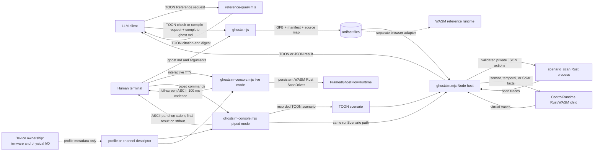
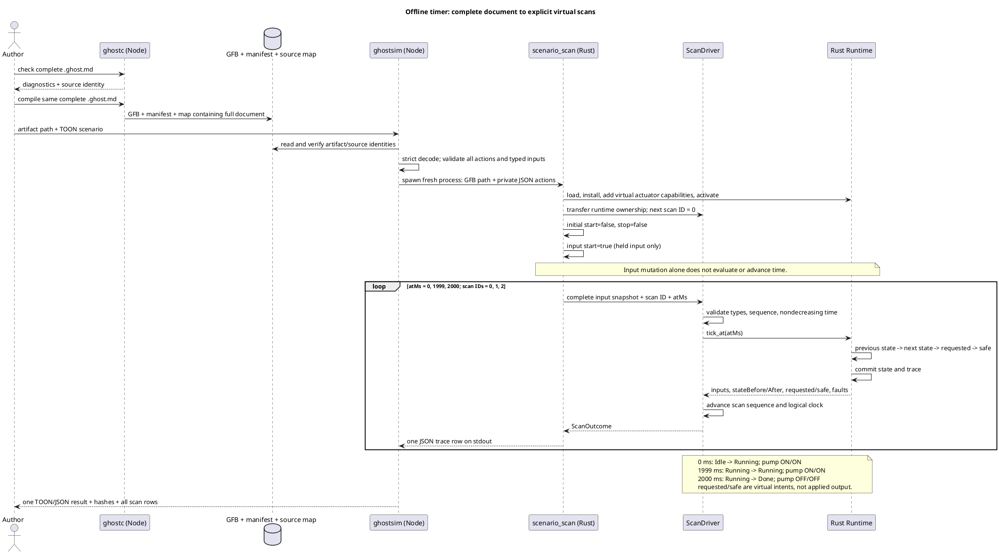
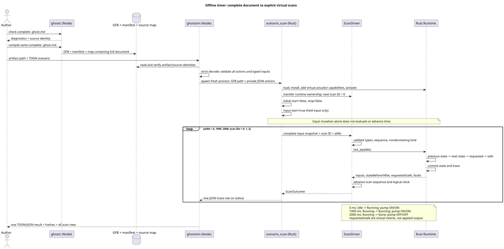
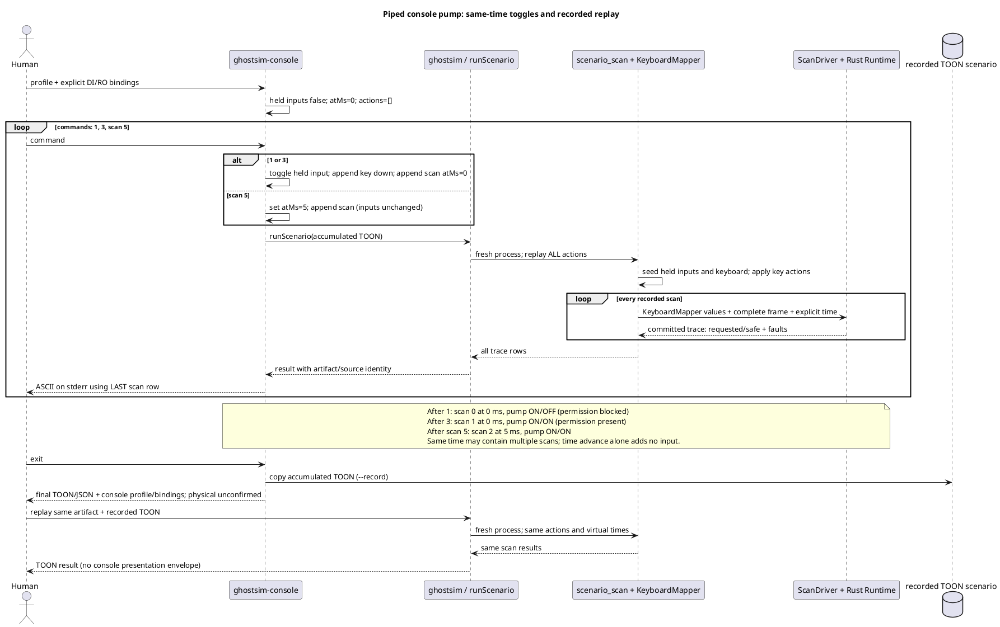
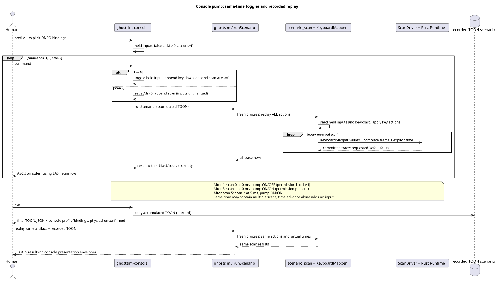
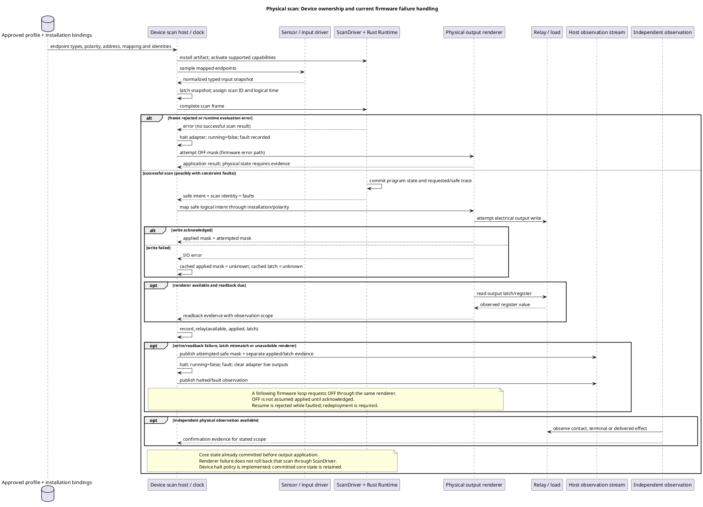
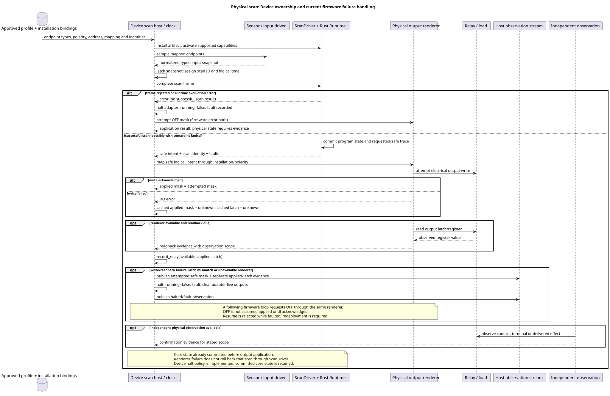
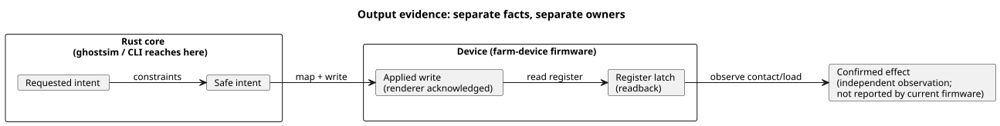

# Authoring and virtual simulation architecture

This document maps the **offline toolchain** in this checkout: how a program is
authored, compiled and simulated without a real device. The
[Language Reference](LANGUAGE-REFERENCE.md) defines program semantics; this
document describes the current tools and where their responsibilities end.

**In this document**

- The overall toolchain and its two audiences (an LLM client and a human
  terminal).
- Which component plays which "driver" or "runtime" role.
- Three representative execution sequences: a virtual timer, a piped console
  session, and a physical scan on a Device.
- What the simulations prove, what they leave open, and current limits.
- Commands to reproduce the public path.

**One canonical program.** The canonical program is one complete `.ghost.md`
document. Its prose, intent anchors, document ID and revision ID travel with the
compiled artifact. The toolchain never creates a second, separately editable
control string.

The flowchart below shows every tool on the offline path and what flows between
them. Dotted lines mark separate paths that this CLI does not drive.



**Model-facing formats.** The LLM path uses strict TOON (a compact text
encoding for structured requests and results) for:

- [Reference queries](../tools/reference-query.mjs),
- [`GhostFlow/cli-request-v1` and `cli-result-v1`](../tools/ghostc.mjs), and
- [`GhostFlow/scenario-v1` and `scenario-result-v1`](../tools/ghostsim.mjs).

`ghostc --request` returns typed diagnostics with source spans. The human
`ghostc` command takes the document path directly and prints short text
diagnostics.

**Two console modes.** The [ASCII console](KEYBOARD-HOST.md) has two modes:

- **Interactive TTY mode** scans immediately at startup. It then uses one
  persistent Rust WASM runtime and ScanDriver at a 100 ms wall-clock cadence.
  Number keys 1–8 toggle Bool inputs and scan immediately; `:toggle CHANNEL`
  does the same.
- **Piped mode** reads deterministic line commands, runs the existing scenario
  runner, and can record a replayable TOON scenario.

**Identity checks.** The source map holds the complete document and its
immutable document/revision identity. Before execution, `ghostsim` checks the
map against the exact GFB bytes and the manifest. The result names:

- the scenario SHA-256,
- the bytecode SHA-256,
- the source document SHA-256 and filename, and
- the document/revision IDs, when supplied.

**Failure results.** All failures exit nonzero.

| Failure | What the result contains |
| --- | --- |
| Malformed request or failed activation | A rejected result with no scan rows. |
| Runtime error | Only the scans committed before it, plus the failing action index. |
| Host failure after the runner was invoked | `host-error` with `traceComplete: false`. An empty scan list here means the child's observations are unavailable — not that the runtime performed no scan. |

**A replay, not a live record.** The scenario result is a deterministic replay
artifact, not a live observation record. Its `scanId` is scoped to that replay,
and it has no `runId`. A host that publishes scans as observations must assign
its own run identity. It must also keep the artifact, source, scenario and scan
identities together, as required by
[Reference §5.4](reference/05-settings-and-observation.md#54-정체성과-물리적-사실의-경계).

**Scans and virtual time.**

- Only a `scan` action evaluates the program.
- Its nonnegative `atMs` is a virtual clock value. It cannot move backward.
- Input and key actions only update held values. A later scan — even one that
  only advances the clock — evaluates them again.
- The Rust core produces requested and safe **virtual intent** separately.
  Neither field says a relay moved.

**Two transports, one core.** Both paths execute the same portable Rust core.
The transport is not another source language.

| Scenario kind | Transport | Scan entry point |
| --- | --- | --- |
| Plain inputs | Private JSON to the native `scenario_scan` Rust process | Rust `ScanDriver` in that process |
| Window, sensor and adaptation cases | Existing Rust/WASM `ControlRuntime` child, with explicit observations and activation profiles | Framed scans |
| Certified interval and Solar cases | Same `ControlRuntime` child | Existing legacy WASM entry points; the host assigns replay-local scan IDs |

**Where time comes from.** Timer time is supplied as monotonic `atMs`.
Wall-clock, calendar and Solar provider facts belong to the host binding, whether
they come from an offline RTC or an optional NTP correction. The language's time
semantics are the same for every source.

**Piped mode in detail.** Piped console mode accumulates one TOON scenario. For
each command redraw, it replays that scenario through the same `runScenario`
path. It has explicit virtual time and no background clock. If a piped command
or scan time fails after completed scans, `command-error` keeps those rows, and
`--record` saves only the accepted, replayable prefix.

**Interactive mode in detail.** Interactive TTY mode is separate. It owns one
persistent, activated Rust WASM `FramedGhostFlowRuntime`/`ScanDriver`.

- It scans at startup and every 100 ms.
- It supplies elapsed wall time as nondecreasing virtual logical time.
- A key toggle also causes an immediate scan.
- Display history is capped at 120 scans. Redraws do not replay old actions.

Both modes display only virtual inputs and requested/safe intent. Neither applies
physical output or confirms hardware state.

**Channel roster and bindings.** The selected
[`GhostFlow/board-profile-v1`](KEYBOARD-HOST.md) or presentation-only Channel
descriptor supplies the console's ordered input and output channels.

- `--bind CHANNEL=port` connects each channel to a matching logical port in the
  manifest.
- Board profiles never infer a logical binding from an endpoint name.
- With no descriptor, the console uses a **virtual Waveshare 8DI/8RO** layout.
  Only exact matching default `DI`/`RO` logical names bind automatically.
- That layout does not verify pins, an installed board, an installation mapping
  or an applied output.
- Other channel counts come from the chosen descriptor.

The result records the profile ID, the revision when present, the digest, the
bindings, and `physical: unconfirmed`.

**Other hosts and owners.**

- The [browser-safe public toolchain](../tools/browser-toolchain.mjs) and the
  [WASM adapter](../runtimes/wasm/README.md) form a separate host path to the
  same portable language/runtime semantics.
- The API host owns model requests, conversation, document storage and
  deployment orchestration.
- The Device repository owns board profiles, firmware, actual drivers, pins,
  clocks and physical verification.
- This CLI makes no model calls and no device calls.

## Driver, runtime and virtual device responsibilities

The components below are implemented on the offline path. The word **Driver**
always needs a qualifier: an input adapter, the core `ScanDriver`, a console
descriptor and a physical I/O driver each have different responsibilities.

| Component | Responsibility and state | Implementation |
| --- | --- | --- |
| Scenario / keyboard input driver | Holds typed logical inputs and key down/up state; converts explicit actions into a complete input snapshot. It never derives new sensor values from outputs. | [`scenario_scan.rs`](../crates/ghostflow-core/examples/scenario_scan.rs), [`KeyboardMapper`](../crates/ghostflow-core/src/keyboard.rs) |
| Piped virtual-time host | Supplies `atMs` and explicit scan opportunities. Toggle commands append an input/key action and a scan at the current time; `scan N` advances to the supplied time. No background clock advances this session. | [`ghostsim.mjs`](../tools/ghostsim.mjs), [`ghostsim-console.mjs`](../tools/ghostsim-console.mjs) |
| Sensor and provider scenario host | Conditions explicit sensor samples, accepts certified Bool intervals, and supplies Solar clock/provider facts. It uses explicit activation profiles and never reads RTC/NTP or a physical sensor itself. | [`scenario-sensors.mjs`](../tools/scenario-sensors.mjs), [`ControlRuntime`](../runtimes/wasm/control-runtime.mjs) |
| Interactive TTY host | Owns one persistent WASM `FramedGhostFlowRuntime`/Rust `ScanDriver`; scans immediately and every 100 ms using elapsed wall time, and scans immediately after input toggles. Holds bounded display history (120 scans). No device I/O. | [`ghostsim-live.mjs`](../tools/ghostsim-live.mjs), [`ghostsim-console.mjs`](../tools/ghostsim-console.mjs) |
| Framed scan driver | Owns one runtime and validates complete typed inputs, sequential scan IDs and nondecreasing logical time before evaluation. Successful scans advance its sequence/time. It performs no device I/O. | [`ScanDriver`](../crates/ghostflow-core/src/scan.rs) |
| Portable Rust runtime | Loads GFB, activates supported capabilities, evaluates expressions, program state, timers and constraints, and emits a trace with requested/safe intents and faults. Native and WASM hosts use this core. | [`ghostflow-core`](../crates/ghostflow-core/src/lib.rs), [WASM adapter](../runtimes/wasm/README.md) |
| Virtual device view | Displays held inputs, requested/safe output banks and scan identity using the selected channel roster. The state consists of simulated input values, core program state and recorded observations; it has no separate actuator or plant model. | [ASCII panel and profile rules](KEYBOARD-HOST.md) |
| Profile / channel descriptor | Describes ordered channels and types; explicit bindings connect them to manifest ports. Board-profile driver/address/polarity metadata is not executed by the console. | [`board-profile-v1` contract](../contracts/integration-v1/README.md), [`console-profile-v1`](KEYBOARD-HOST.md) |

**What "virtual device" means.** Here, a "virtual device" is an I/O view around a
real GhostFlow runtime — not an emulated machine.

- The native runner registers virtual actuator capabilities from the module's
  output types, so the runtime can activate.
- It does not emulate a Waveshare controller, relay register, contact, pump,
  tank level or sensor response.
- In particular, `safe.pump = true` does not change a water-level input. The
  scenario must supply that input explicitly.
- A closed-loop plant model, or a simulated applied/confirmed output, would need
  a separate, explicit model and evidence contract. This CLI implements neither.

**Runtime state across scans, per host.**

| Host | How runtime state carries across scans |
| --- | --- |
| Browser (Farm Studio) | Persists between scans in the browser runtime. |
| Interactive TTY mode | Persists in one live WASM session. |
| Piped console mode | Reconstructed by replaying the accumulated scenario in a fresh native process. |

The browser has its own input and pacing host. In Farm Studio:

- `app/src/features/playground/playgroundRuntime.ts` instantiates
  `ControlRuntime.instantiateFramed`.
- `playgroundScan.ts` supplies manifest-shaped Boolean snapshots and explicit
  logical time, then reads the displayed outputs from the returned safe bank.
- `simulationPacer.ts` decides scan opportunities for interactive playback.

These frontend components do not evaluate GhostFlow rules. The older real-time
Rust keyboard example remains a separate host.

## Representative execution sequences

### Compile, start, and reach a virtual timer boundary

This implemented path uses the complete
[`virtual-timer.ghost.md`](../examples/authoring/corpus/virtual-timer.ghost.md)
and its [scenario](../examples/authoring/corpus/virtual-timer-scenario.toon).

- `phase` starts at `Idle`; `pump` follows the computed next phase.
- There is no wall-clock waiting between the three scans.
- The phase names in the diagram describe source semantics. The actual trace
  also contains compiler-generated timer state.





**How this sequence can fail.**

- Validation or activation failure yields no scan rows.
- An action-level runtime error stops execution. The result returns the rows
  committed earlier, plus the failing action index.
- A constraint fault is different: it can be a *successful* scan whose safe
  intent is blocked. It is not automatically a runner failure.

These paths are implemented in [`ghostsim.mjs`](../tools/ghostsim.mjs),
[`scenario_scan.rs`](../crates/ghostflow-core/examples/scenario_scan.rs) and
[`ScanDriver`](../crates/ghostflow-core/src/scan.rs).

### Piped mode: toggle an input, inspect permission blocking, then replay

This sequence is the piped console command sequence from the reproduction
section below. It uses `pump-rev-2.ghost.md` with explicit DI/RO bindings.

- This pump program has no program state and no timer.
- The console owns the accumulated scenario.
- Each `runScenario` call creates a fresh Rust process, which rebuilds runtime
  state from the beginning.





**What a recording keeps.** A recording keeps logical input/key actions and
virtual scan times. The profile digest and DI/RO binding roster are added to the
final console result, not to the scenario file. So:

- replaying the recording reproduces the logical scans, but
- reproducing the panel also requires keeping its profile and binding arguments.

## Physical Driver and Device boundary

**Drivers and renderers are roles.** Input **drivers** produce logical inputs.
Output **renderers** apply logical output intent to relays, motors, lamps or
screens. These are roles, not mutually exclusive device classes:

- A USB force-feedback joystick has both an input driver and an output renderer.
- An EC11 encoder with a TFT screen likewise combines input and output roles.

These examples define boundaries, not implementations.

| Item | Owner or name |
| --- | --- |
| Driver and renderer source | `farm-device-drivers` |
| Host/board integration, bindings, clocks, watchdogs, boot/failure policy | Device |
| Cabinet operator UI (distinct from an output renderer) | `@ghostflow/cabinet-view` |

Existing `ScanDriver`, host ABI identifiers and profile `driver` fields keep
their names and contracts.

The physical path has additional responsibilities, defined by
[Reference §8](reference/08-language-runtime-and-device-boundaries.md) and the
[integration contract](../contracts/integration-v1/README.md). The sequence
below shows them for one physical scan:





**How to read this diagram.** It combines the ownership contract with the
current `farm-device` firmware failure path. It is not a connection that
`ghostsim` makes, and it is not hardware verification.

- Independent physical confirmation is a contract boundary. The current firmware
  observation reports only intent, applied write and register latch. It has no
  relay-contact or load feedback.
- Device owns firmware, the driver/renderer host and board integration, approved
  board profiles, clocks, watchdogs, and output handling at boot or failure.
- Installation bindings select the actual endpoint for each logical port.
- The integration validator checks supplied identities and mappings. It neither
  installs them nor performs I/O.

**Four kinds of evidence.** Logical safe intent, renderer-applied output,
register readback and physical confirmation stay distinct. The diagram below
shows who can produce each fact; this CLI stops at safe intent.



**Device adapter code.** Device adapter code lives separately in `farm-device`.
`rust/ghostflow-adapter/src/lib.rs` uses the shared `ScanDriver` and records
applied masks and relay latch observations through `record_relay`. The firmware
owns the actual output operation.

- This authoring path neither invokes nor certifies that separate
  implementation.
- For the intended deployment, its firmware/core revision, installation mapping
  and physical evidence must be checked.
- The commands below contain no end-to-end device deployment, hardware emulation
  or physical confirmation step.

**Where the evidence chain is defined.**

- [Reference §4.7](reference/04-sensors-constraints-control.md#47-requested-safe-applied-confirmed)
  already defines the output evidence chain: requested intent, safe intent,
  applied command and confirmed feedback are different facts.
- The [command-result lifecycle](reference/05-settings-and-observation.md#event-command-result와-alarm)
  describes request receipt, rejection, start, completion, cancellation and
  failure. A completed core scan is not proof that a physical action completed.
- The [Interaction v0 contract](../contracts/interaction-v0/README.md) projects
  completed runtime observations and performs no I/O.
- Reference
  [§8.5](reference/08-language-runtime-and-device-boundaries.md#85-변경과-재시작의-생명주기)
  assigns restart and state restoration to an explicit policy and checkpoint
  contract. It does not require rolling back a successful core scan after an I/O
  failure.

**Current Device failure policy.** The policy is visible in
`farm-device/rust/firmware/src/ghostflow.rs`
(`scan_with_clock`, `set_mask`, `record_relay`, then `halt`) and
`farm-device/rust/ghostflow-adapter/src/lib.rs` (`halt`, `scan_inner`, `resume`).
On an output failure it:

1. keeps the attempted safe mask as an observation,
2. stops further core evaluation,
3. clears the adapter's live output intents,
4. requests OFF on the next firmware loop,
5. keeps the committed core state, and
6. rejects resume while faulted.

This is an implemented Device policy, not a missing language transaction.

**Revision checked.** This assessment was checked against clean `farm-device`
revision
[`6d2e97b`](https://github.com/callin2/farm-device/commit/6d2e97b243045e3b2dfbbb9bf205614e26eceba4),
including the `relay_fault_halts_clears_intent_and_trace_is_bounded` case in
`rust/ghostflow-adapter/tests/adapter.rs`. The test was read, not rerun, for this
documentation review. Inspect any later Device revision before repeating the
implementation claim. Neither that host test nor this diagram proves that an
actual relay contact reached OFF.

## What the sequences establish and leave open

**What is established.** The offline ownership chain is coherent:

- hosts supply inputs and time,
- the Rust core owns evaluation and state, and
- views consume traces.

**What is not.** The sequences do not show that a deployment is complete. The
review findings below rate severity relative to the scenario that needs the
missing behavior.

| Finding | Consequence and severity | Required evidence or decision |
| --- | --- | --- |
| Core commit precedes physical output application; the evidence stages remain separate. | **Defined boundary, not a missing policy:** current Device firmware records failed application, halts and requests OFF on the following loop without rolling back the committed core state. | Verify the intended firmware revision and failure path on the target device. CLI simulation does not certify output handling or physical OFF. |
| No output-to-sensor plant model exists in the CLI. | **High for closed-loop claims:** safe pump intent cannot establish water flow, level change or sensor feedback. | Supply explicit scenario inputs or a separately specified plant model; independently observe physical effects for hardware claims. |
| Piped console redraw replays the accumulated scenario; the scenario is bounded to 256 scans. | **Low for piped review:** this mode is deterministic and bounded. | Use it for command scripts and replayable records. |
| Interactive TTY scans at 100 ms wall-clock cadence with 120 display samples retained. | **Host timing limit:** scheduler delays can affect actual scan intervals; runtime logical time uses elapsed wall time. | This is a virtual review view, not a deadline guarantee or device host. |
| A console recording omits its presentation profile/bindings; those exist in the final result. | **Low for logical replay; medium for panel reproduction:** the recorded logical scans are reproducible, but the original channel labels/layout cannot be recovered from TOON alone. | Retain the final console result and profile/binding arguments alongside the recording when panel identity matters. |

**What each sequence checks.**

- The pump permission sequence checks requested versus safe intent.
- The timer sequence checks previous/next program state and the 1999/2000 ms
  boundary.

Neither proves a physical deadline. If a host supplies no scan at 2000 ms, the
runtime makes no autonomous transition at that moment. Actual scan cadence,
input freshness and output latency remain host/Device acceptance criteria.

Open Device work is tracked here:

- Device-side debug/output policy:
  [farm-device #25](https://github.com/callin2/farm-device/issues/25).
- Physical relay contact evidence:
  [farm-device #26](https://github.com/callin2/farm-device/issues/26).

## Reproduce the public path

Run these commands from the language repository root, with dependencies
installed and the native `scenario_scan` example built. They use the reviewed
sample document and its TOON requests; no raw control copy is generated.

```sh
mkdir -p build/authoring
cp examples/authoring/pump-rev-2.ghost.md build/authoring/pump.ghost.md
node tools/ghostc.mjs --request examples/authoring/check-rev-2.toon
node tools/ghostc.mjs --request examples/authoring/compile-rev-2.toon
node tools/ghostsim.mjs build/authoring/pump.gfb examples/authoring/pump-scenario.toon --format toon
printf '1\n3\nscan 5\nexit\n' | node tools/ghostsim-console.mjs build/authoring/pump.gfb \
  --bind DI1=start --bind DI2=stop --bind DI3=permit_ok \
  --bind RO1=pump --bind RO2=permit --record build/authoring/console.toon --format json
node tools/ghostsim.mjs build/authoring/pump.gfb build/authoring/console.toon --format toon
```

This reproduction exercises **piped deterministic mode**. Expected results:

- **Check and compile** identify document `GF-EXAMPLE-PUMP`, revision `rev-2`,
  and the same full-document SHA-256.
- **Scripted scenario** scans at 0, 1 and 2 ms. The `pump` requested/safe values
  are `ON/OFF`, then `ON/ON`, then `OFF/OFF`.
- **Console example** scans at 0, 0 and 5 ms. Its panel has eight input/output
  rows, including unbound DI8/RO8, and reports physical status as unconfirmed.
- **Recorded scenario** replays with the same scans and artifact identity.

Related tests:

- A selected 2DI/4RO board-profile fixture exercises unequal row counts in
  [`ghostsim-console.test.mjs`](../tests/ghostsim-console.test.mjs).
- [`authoring-workflow.test.mjs`](../tests/authoring-workflow.test.mjs) already
  checks the TOON check/compile/simulate path. No separate compiler or runner is
  needed for this view.

## Current limits

**Runner limits.**

| Limit | Value |
| --- | --- |
| Scenario text | 256 KiB |
| Actions | 1,024 |
| Scans | 256 |
| Encoded result | 1 MiB |

**Activation.** The runner uses plain runtime activation. Controls that need
external certified intervals, schedule bindings or another host resource are
rejected at activation.

- Host event ordering is tracked in
  [#115](https://github.com/callin2/ghostflow-language/issues/115).
- Temporal resources are described in
  [TEMPORAL-RESOURCES.md](TEMPORAL-RESOURCES.md).
- Basic virtual-time simulation supplies no hidden default policy.

**Scan cadence.** Piped console mode has no automatic scan cadence. Interactive
TTY mode scans at a 100 ms wall-clock cadence and immediately after toggles.

**No physical proof.** Neither mode proves physical behavior. Displayed outputs
are requested and safe virtual intent, with no physical application or
confirmation.
