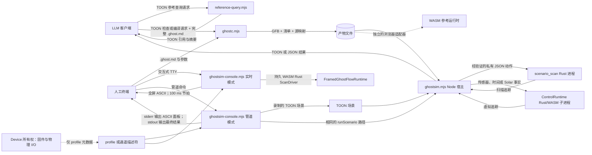
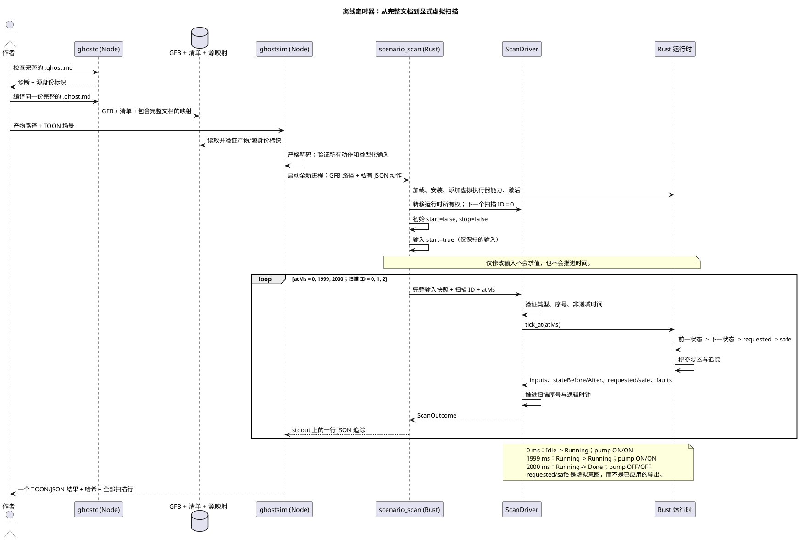
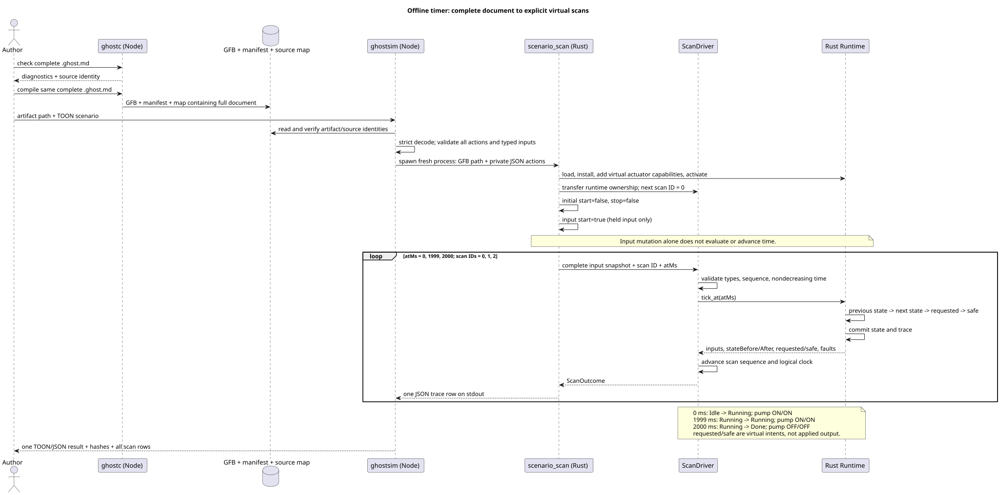
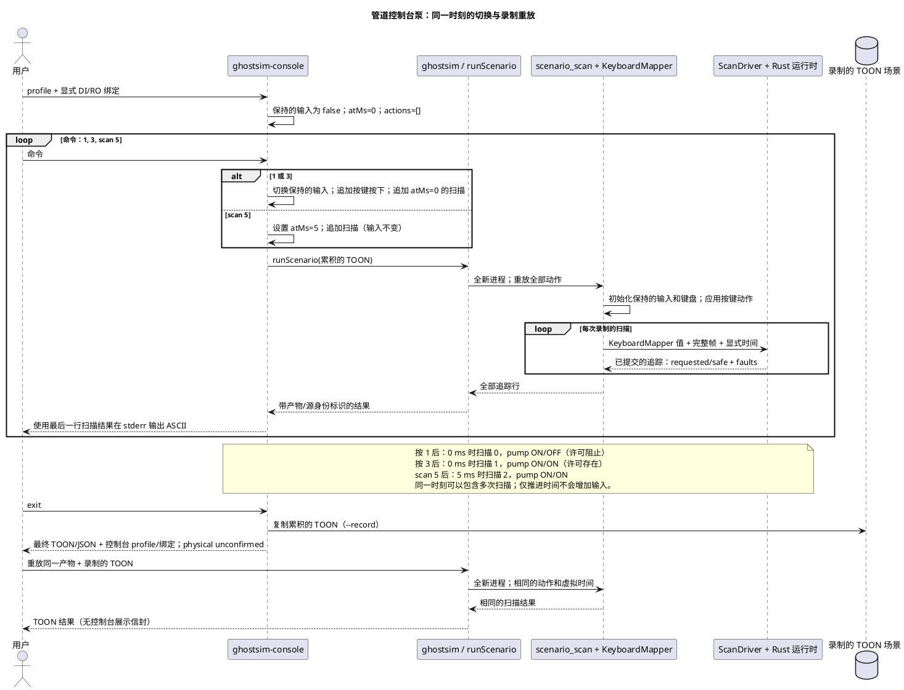
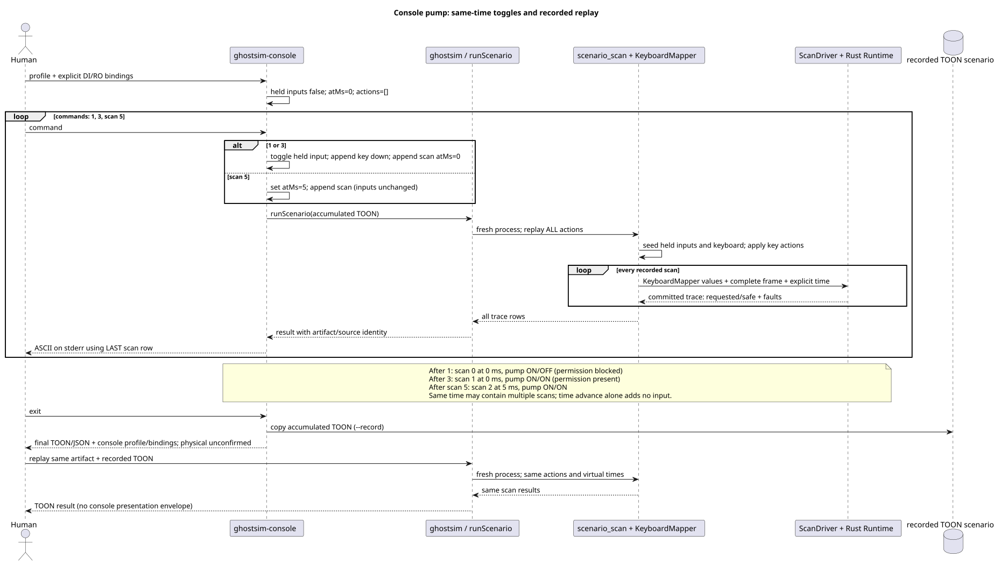
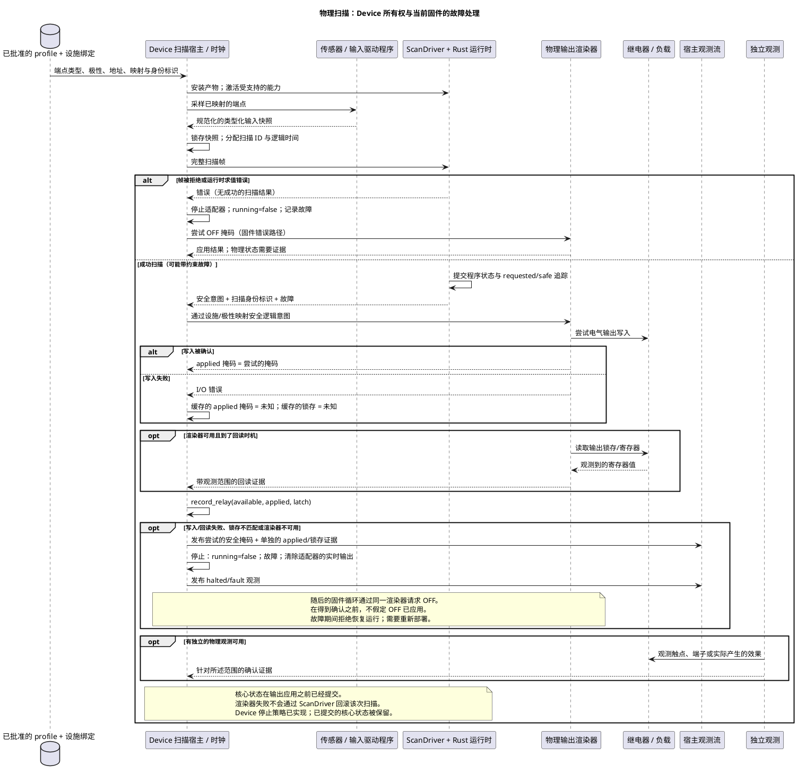
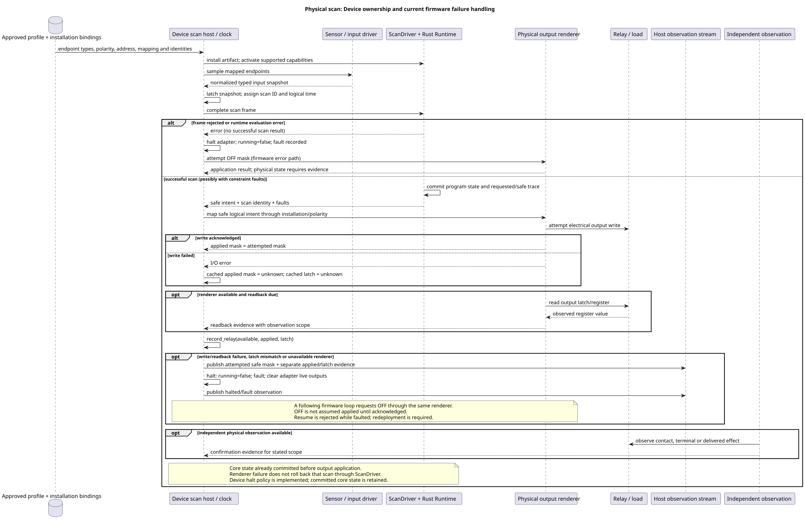
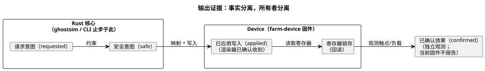

<!-- translation-source: docs/LLM-TOOLCHAIN-ARCHITECTURE.md -->
[英文原文](LLM-TOOLCHAIN-ARCHITECTURE.md)

# 编写与虚拟模拟架构

本文档梳理此检出（checkout）中的**离线工具链**：程序如何在没有真实设备的情况下被编写、编译和模拟。
[语言参考](LANGUAGE-REFERENCE.zh.md)定义程序语义；本文档描述当前的工具以及它们的职责边界。

**本文内容**

- 整体工具链及其两类使用者（LLM 客户端和人工终端）。
- 哪个组件扮演哪种“驱动程序”或“运行时”角色。
- 三个具有代表性的执行序列：虚拟定时器、管道控制台会话，以及 Device 上的一次物理扫描。
- 这些模拟证明了什么、留下了哪些未决问题，以及当前的限制。
- 复现公开路径的命令。

**唯一的规范程序。** 规范程序是一份完整的 `.ghost.md` 文档。它的正文、意图锚点、文档 ID
和修订版 ID 随编译产物一起流转。工具链绝不会创建第二份可单独编辑的控制字符串。

下面的流程图展示了离线路径上的每个工具以及它们之间传递的内容。虚线表示此 CLI 不驱动的独立路径。



**面向模型的格式。** LLM 路径使用严格的 TOON（一种用于结构化请求和结果的紧凑文本编码）来处理：

- [参考查询](../tools/reference-query.mjs)，
- [`GhostFlow/cli-request-v1` 和 `cli-result-v1`](../tools/ghostc.mjs)，以及
- [`GhostFlow/scenario-v1` 和 `scenario-result-v1`](../tools/ghostsim.mjs)。

`ghostc --request` 返回带源位置范围的类型化诊断。面向人工的 `ghostc` 命令直接接收文档路径，
并打印简短的文本诊断。

**两种控制台模式。** [ASCII 控制台](KEYBOARD-HOST.zh.md)有两种模式：

- **交互式 TTY 模式**在启动时立即扫描。之后它使用一个持久的 Rust WASM 运行时和 ScanDriver，
  以 100 ms 的墙钟节拍运行。数字键 1–8 切换 Bool 输入并立即扫描；`:toggle CHANNEL`
  的作用相同。
- **管道模式**读取确定性的行命令，运行现有的场景运行器，并可以录制可重放的 TOON 场景。

**身份标识检查。** 源映射保存完整文档及其不可变的文档/修订版身份标识。在执行之前，`ghostsim`
会将该映射与确切的 GFB 字节和清单进行核对。结果中会写明：

- 场景的 SHA-256，
- 字节码的 SHA-256，
- 源文档的 SHA-256 和文件名，以及
- 文档/修订版 ID（如有提供）。

**失败结果。** 所有失败都以非零状态退出。

| 失败 | 结果包含的内容 |
| --- | --- |
| 请求格式错误或激活失败 | 一个被拒绝的结果，不含扫描行。 |
| 运行时错误 | 仅包含在错误之前已提交的扫描，以及失败动作的索引。 |
| 调用运行器之后发生的宿主失败 | `host-error`，并带 `traceComplete: false`。此时扫描列表为空表示子进程的观测不可用——并不表示运行时没有执行扫描。 |

**是重放，而不是实时记录。** 场景结果是一个确定性的重放产物，而不是实时观测记录。它的 `scanId`
仅在该次重放内有效，并且它没有 `runId`。将扫描作为观测发布的宿主必须分配自己的运行身份标识。
它还必须按照 [Reference §5.4](reference/05-settings-and-observation.zh.md)
的要求，把产物、源、场景和扫描的身份标识保存在一起。

**扫描与虚拟时间。**

- 只有 `scan` 动作会对程序求值。
- 它的非负 `atMs` 是一个虚拟时钟值，不能倒退。
- 输入动作和按键动作只更新保持的值。之后的一次扫描——即使只是推进时钟——会再次对它们求值。
- Rust 核心分别产生 requested 和 safe 的**虚拟意图**。两个字段都不表示继电器发生了动作。

**两种传输，一个核心。** 两条路径执行同一个可移植 Rust 核心。传输方式不是另一种源语言。

| 场景类型 | 传输方式 | 扫描入口 |
| --- | --- | --- |
| 普通输入 | 发往原生 `scenario_scan` Rust 进程的私有 JSON | 该进程中的 Rust `ScanDriver` |
| Window、传感器和自适应用例 | 现有的 Rust/WASM `ControlRuntime` 子进程，带显式观测和激活 profile | 分帧扫描 |
| 经认证的区间和 Solar 用例 | 同一个 `ControlRuntime` 子进程 | 现有的旧版 WASM 入口点；宿主分配重放内有效的扫描 ID |

**时间从哪里来。** 定时器时间以单调的 `atMs` 提供。墙钟、日历和 Solar 提供者（provider）事实属于宿主绑定，
无论它们来自离线 RTC 还是可选的 NTP 校正。对每种来源而言，语言的时间语义都相同。

**管道模式详解。** 管道控制台模式累积一个 TOON 场景。每次命令重绘时，它都通过同一条 `runScenario`
路径重放该场景。它使用显式的虚拟时间，没有后台时钟。如果某条管道命令或扫描时间在已完成若干扫描之后失败，
`command-error` 会保留这些行，而 `--record` 只保存被接受的、可重放的前缀部分。

**交互模式详解。** 交互式 TTY 模式是独立的。它拥有一个持久的、已激活的 Rust WASM
`FramedGhostFlowRuntime`/`ScanDriver`。

- 它在启动时以及每隔 100 ms 进行扫描。
- 它把经过的墙钟时间作为非递减的虚拟逻辑时间提供。
- 按键切换也会触发一次立即扫描。
- 显示历史上限为 120 次扫描。重绘不会重放旧的动作。

两种模式都只显示虚拟输入和 requested/safe 意图。两者都不施加物理输出，也不确认硬件状态。

**通道名册与绑定。** 所选的 [`GhostFlow/board-profile-v1`](KEYBOARD-HOST.zh.md)
或仅用于展示的 Channel 描述符为控制台提供有序的输入和输出通道。

- `--bind CHANNEL=port` 将每个通道连接到清单中匹配的逻辑端口。
- 板卡 profile 绝不会根据端点名称推断逻辑绑定。
- 没有描述符时，控制台使用**虚拟 Waveshare 8DI/8RO** 布局。只有完全匹配的默认
  `DI`/`RO` 逻辑名称才会自动绑定。
- 该布局不验证引脚、已安装的板卡、设施映射或已应用的输出。
- 其他通道数量来自所选的描述符。

结果会记录 profile ID、修订版（如有）、摘要、绑定以及 `physical: unconfirmed`。

**其他宿主与所有者。**

- [浏览器安全的公开工具链](../tools/browser-toolchain.mjs)和
  [WASM 适配器](../runtimes/wasm/README.md)构成了一条独立的宿主路径，通往相同的可移植语言/运行时语义。
- API 宿主负责模型请求、对话、文档存储和部署编排。
- Device 仓库负责板卡 profile、固件、实际驱动程序、引脚、时钟以及物理验证。
- 此 CLI 不调用模型，也不调用设备。

## 驱动程序、运行时与虚拟设备的职责

下列组件在离线路径上已经实现。**Driver（驱动程序）**一词总是需要限定语：输入适配器、核心
`ScanDriver`、控制台描述符和物理 I/O 驱动程序各自承担不同的职责。

| 组件 | 职责与状态 | 实现 |
| --- | --- | --- |
| 场景 / 键盘输入驱动程序 | 保存类型化的逻辑输入和按键按下/抬起状态；把显式动作转换为完整的输入快照。它绝不会根据输出推导新的传感器值。 | [`scenario_scan.rs`](../crates/ghostflow-core/examples/scenario_scan.rs)、[`KeyboardMapper`](../crates/ghostflow-core/src/keyboard.rs) |
| 管道虚拟时间宿主 | 提供 `atMs` 和显式的扫描时机。切换命令在当前时间追加一个输入/按键动作和一次扫描；`scan N` 推进到给定的时间。此会话中没有后台时钟推进时间。 | [`ghostsim.mjs`](../tools/ghostsim.mjs)、[`ghostsim-console.mjs`](../tools/ghostsim-console.mjs) |
| 传感器与提供者场景宿主 | 对显式传感器样本进行调理，接受经认证的 Bool 区间，并提供 Solar 时钟/提供者事实。它使用显式激活 profile，自身从不读取 RTC/NTP 或物理传感器。 | [`scenario-sensors.mjs`](../tools/scenario-sensors.mjs)、[`ControlRuntime`](../runtimes/wasm/control-runtime.mjs) |
| 交互式 TTY 宿主 | 拥有一个持久的 WASM `FramedGhostFlowRuntime`/Rust `ScanDriver`；立即扫描，并使用经过的墙钟时间每 100 ms 扫描一次，输入切换后也立即扫描。保存有界的显示历史（120 次扫描）。无设备 I/O。 | [`ghostsim-live.mjs`](../tools/ghostsim-live.mjs)、[`ghostsim-console.mjs`](../tools/ghostsim-console.mjs) |
| 分帧扫描驱动程序 | 拥有一个运行时，并在求值前验证完整的类型化输入、连续的扫描 ID 和非递减的逻辑时间。成功的扫描会推进其序号/时间。它不执行设备 I/O。 | [`ScanDriver`](../crates/ghostflow-core/src/scan.rs) |
| 可移植 Rust 运行时 | 加载 GFB，激活受支持的能力，对表达式、程序状态、定时器和约束求值，并输出带 requested/safe 意图和故障的追踪。原生宿主和 WASM 宿主都使用这个核心。 | [`ghostflow-core`](../crates/ghostflow-core/src/lib.rs)、[WASM 适配器](../runtimes/wasm/README.md) |
| 虚拟设备视图 | 使用所选的通道名册显示保持的输入、requested/safe 输出组以及扫描身份标识。其状态由模拟输入值、核心程序状态和已记录的观测构成；它没有单独的执行器模型或被控对象（plant）模型。 | [ASCII 面板与 profile 规则](KEYBOARD-HOST.zh.md) |
| Profile / 通道描述符 | 描述有序的通道及其类型；显式绑定把它们连接到清单端口。控制台不执行板卡 profile 中的 driver/地址/极性元数据。 | [`board-profile-v1` 契约](../contracts/integration-v1/README.md)、[`console-profile-v1`](KEYBOARD-HOST.zh.md) |

**“虚拟设备”的含义。** 这里的“虚拟设备”是围绕真实 GhostFlow 运行时的一个 I/O 视图——而不是一台被仿真的机器。

- 原生运行器根据模块的输出类型注册虚拟执行器能力，使运行时能够激活。
- 它不仿真 Waveshare 控制器、继电器寄存器、触点、泵、水箱液位或传感器响应。
- 特别是，`safe.pump = true` 不会改变水位输入。场景必须显式提供该输入。
- 闭环被控对象模型，或模拟的 applied/confirmed 输出，都需要单独的显式模型和证据契约。此 CLI 两者都未实现。

**各宿主中跨扫描的运行时状态。**

| 宿主 | 运行时状态如何跨扫描延续 |
| --- | --- |
| 浏览器（Farm Studio） | 在浏览器运行时中于扫描之间持久保存。 |
| 交互式 TTY 模式 | 在一个实时 WASM 会话中持久保存。 |
| 管道控制台模式 | 在全新的原生进程中重放累积的场景来重建。 |

浏览器有自己的输入与节拍宿主。在 Farm Studio 中：

- `app/src/features/playground/playgroundRuntime.ts` 实例化
  `ControlRuntime.instantiateFramed`。
- `playgroundScan.ts` 提供与清单结构一致的 Boolean 快照和显式逻辑时间，然后从返回的 safe
  组中读取显示的输出。
- `simulationPacer.ts` 为交互式回放决定扫描时机。

这些前端组件不对 GhostFlow 规则求值。较早的实时 Rust 键盘示例仍是一个独立的宿主。

## 具有代表性的执行序列

### 编译、启动并到达虚拟定时器边界

这条已实现的路径使用完整的
[`virtual-timer.ghost.md`](../examples/authoring/corpus/virtual-timer.ghost.md)
及其[场景](../examples/authoring/corpus/virtual-timer-scenario.toon)。

- `phase` 从 `Idle` 开始；`pump` 跟随计算出的下一个 phase。
- 三次扫描之间没有墙钟等待。
- 图中的 phase 名称描述的是源语义。实际追踪中还包含编译器生成的定时器状态。





**此序列可能如何失败。**

- 验证或激活失败时不产生扫描行。
- 动作级运行时错误会停止执行。结果返回此前已提交的行，以及失败动作的索引。
- 约束故障则不同：它可以是一次*成功的*扫描，只是其安全意图被阻止。它并不自动等同于运行器失败。

这些路径在 [`ghostsim.mjs`](../tools/ghostsim.mjs)、
[`scenario_scan.rs`](../crates/ghostflow-core/examples/scenario_scan.rs) 和
[`ScanDriver`](../crates/ghostflow-core/src/scan.rs) 中实现。

### 管道模式：切换输入、检查许可阻止，然后重放

此序列就是下文复现一节中的管道控制台命令序列。它使用 `pump-rev-2.ghost.md`，并带有显式的 DI/RO 绑定。

- 这个泵程序没有程序状态，也没有定时器。
- 控制台拥有累积的场景。
- 每次 `runScenario` 调用都会创建一个全新的 Rust 进程，从头重建运行时状态。





**录制保留什么。** 录制保留逻辑输入/按键动作和虚拟扫描时间。profile 摘要和 DI/RO
绑定名册被添加到最终的控制台结果中，而不是场景文件中。因此：

- 重放录制可以复现逻辑扫描，但是
- 要复现面板，还需要保留其 profile 和绑定参数。

## 物理驱动程序与 Device 边界

**驱动程序和渲染器是角色。** 输入**驱动程序**产生逻辑输入。输出**渲染器**（renderer）将逻辑输出意图施加到继电器、
电机、指示灯或屏幕上。这些是角色，而不是互斥的设备类别：

- USB 力反馈摇杆同时具有输入驱动程序和输出渲染器。
- 带 TFT 屏幕的 EC11 编码器同样兼具输入和输出角色。

这些示例定义的是边界，而不是实现。

| 项目 | 所有者或名称 |
| --- | --- |
| 驱动程序和渲染器源代码 | `farm-device-drivers` |
| 宿主/板卡集成、绑定、时钟、看门狗、启动/故障策略 | Device |
| 机柜操作员 UI（与输出渲染器不同） | `@ghostflow/cabinet-view` |

现有的 `ScanDriver`、宿主 ABI 标识符以及 profile 的 `driver` 字段保持其名称和契约不变。

物理路径还有额外的职责，由 [Reference §8](reference/08-language-runtime-and-device-boundaries.zh.md)
和[集成契约](../contracts/integration-v1/README.md)定义。下面的序列展示了一次物理扫描中的这些职责：





**如何阅读此图。** 它把所有权契约与当前 `farm-device` 固件的故障路径结合在一起。它不是 `ghostsim`
建立的连接，也不是硬件验证。

- 独立的物理确认是一个契约边界。当前固件的观测只报告意图、已应用的写入和寄存器锁存，没有继电器触点或负载反馈。
- Device 负责固件、驱动程序/渲染器宿主和板卡集成、已批准的板卡 profile、时钟、看门狗，以及启动或故障时的输出处理。
- 设施绑定为每个逻辑端口选择实际端点。
- 集成验证器检查所提供的身份标识和映射。它既不安装它们，也不执行 I/O。

**四种证据。** 逻辑安全意图、渲染器已应用的输出、寄存器回读和物理确认彼此保持区分。下图展示了谁能产生每一种事实；
此 CLI 止步于安全意图。



**Device 适配器代码。** Device 适配器代码单独位于 `farm-device` 中。
`rust/ghostflow-adapter/src/lib.rs` 使用共享的 `ScanDriver`，并通过 `record_relay`
记录已应用的掩码和继电器锁存观测。固件负责实际的输出操作。

- 本编写路径既不调用也不认证那个独立的实现。
- 对于目标部署，必须检查其固件/核心修订版、设施映射和物理证据。
- 下面的命令不包含端到端设备部署、硬件仿真或物理确认步骤。

**证据链在哪里定义。**

- [Reference §4.7](reference/04-sensors-constraints-control.zh.md)
  已经定义了输出证据链：请求意图、安全意图、已应用的命令和已确认的反馈是不同的事实。
- [命令结果生命周期](reference/05-settings-and-observation.zh.md)描述了请求的接收、拒绝、开始、完成、取消和失败。
  一次已完成的核心扫描并不能证明物理动作已经完成。
- [Interaction v0 契约](../contracts/interaction-v0/README.md)投影已完成的运行时观测，不执行任何 I/O。
- Reference
  [§8.5](reference/08-language-runtime-and-device-boundaries.zh.md)
  将重启和状态恢复交给显式的策略和检查点契约。它不要求在 I/O 失败后回滚一次成功的核心扫描。

**当前的 Device 故障策略。** 该策略可在
`farm-device/rust/firmware/src/ghostflow.rs`
（`scan_with_clock`、`set_mask`、`record_relay`，然后 `halt`）和
`farm-device/rust/ghostflow-adapter/src/lib.rs`（`halt`、`scan_inner`、`resume`）中看到。
发生输出失败时，它会：

1. 将尝试的安全掩码作为观测保留，
2. 停止后续的核心求值，
3. 清除适配器的实时输出意图，
4. 在下一个固件循环中请求 OFF，
5. 保留已提交的核心状态，并且
6. 在故障期间拒绝恢复运行。

这是一项已实现的 Device 策略，而不是缺失的语言事务。

**已检查的修订版。** 本评估针对干净的 `farm-device` 修订版
[`6d2e97b`](https://github.com/callin2/farm-device/commit/6d2e97b243045e3b2dfbbb9bf205614e26eceba4)
进行核对，包括 `rust/ghostflow-adapter/tests/adapter.rs` 中的
`relay_fault_halts_clears_intent_and_trace_is_bounded` 用例。为本次文档审查，该测试只被阅读，没有重新运行。
在重复这一实现声明之前，请检查任何更新的 Device 修订版。无论是那个宿主测试还是此图，都不能证明实际的继电器触点已经到达 OFF。

## 这些序列确立了什么、留下了什么

**已确立的内容。** 离线所有权链是一致的：

- 宿主提供输入和时间，
- Rust 核心负责求值和状态，并且
- 视图消费追踪。

**未确立的内容。** 这些序列并不表明部署已经完整。下面的审查结论按需要缺失行为的场景来评定严重程度。

| 结论 | 后果与严重程度 | 所需证据或决定 |
| --- | --- | --- |
| 核心提交先于物理输出应用；各证据阶段保持分离。 | **已定义的边界，而非缺失的策略：**当前 Device 固件记录应用失败、停止运行，并在随后的循环中请求 OFF，而不回滚已提交的核心状态。 | 在目标设备上验证预期的固件修订版和故障路径。CLI 模拟不认证输出处理或物理 OFF。 |
| CLI 中不存在从输出到传感器的被控对象模型。 | **对闭环声明而言为高：**安全的泵意图无法确立水流、液位变化或传感器反馈。 | 提供显式的场景输入或单独规定的被控对象模型；对于硬件声明，应独立观测物理效果。 |
| 管道控制台重绘会重放累积的场景；场景上限为 256 次扫描。 | **对管道审查而言为低：**此模式是确定性且有界的。 | 用于命令脚本和可重放的记录。 |
| 交互式 TTY 以 100 ms 墙钟节拍扫描，保留 120 个显示样本。 | **宿主时序限制：**调度延迟会影响实际扫描间隔；运行时逻辑时间使用经过的墙钟时间。 | 这是一个虚拟审查视图，不是截止时间保证，也不是设备宿主。 |
| 控制台录制省略了其展示 profile/绑定；这些信息存在于最终结果中。 | **对逻辑重放而言为低；对面板复现而言为中：**录制的逻辑扫描可以复现，但仅凭 TOON 无法恢复原始通道标签/布局。 | 当面板身份很重要时，应将最终控制台结果和 profile/绑定参数与录制一起保留。 |

**每个序列检查什么。**

- 泵许可序列检查请求意图与安全意图的区别。
- 定时器序列检查前一/下一程序状态以及 1999/2000 ms 边界。

两者都不能证明物理截止时间。如果宿主在 2000 ms 时没有提供扫描，运行时在那一刻不会自主发生转换。
实际的扫描节拍、输入新鲜度和输出延迟仍是宿主/Device 的验收标准。

未完成的 Device 工作在此跟踪：

- Device 端调试/输出策略：
  [farm-device #25](https://github.com/callin2/farm-device/issues/25)。
- 物理继电器触点证据：
  [farm-device #26](https://github.com/callin2/farm-device/issues/26)。

## 复现公开路径

请在语言仓库根目录下运行这些命令，并确保已安装依赖且已构建原生 `scenario_scan` 示例。它们使用经过审查的示例文档及其
TOON 请求；不会生成原始的控制副本。

```sh
mkdir -p build/authoring
cp examples/authoring/pump-rev-2.ghost.md build/authoring/pump.ghost.md
node tools/ghostc.mjs --request examples/authoring/check-rev-2.toon
node tools/ghostc.mjs --request examples/authoring/compile-rev-2.toon
node tools/ghostsim.mjs build/authoring/pump.gfb examples/authoring/pump-scenario.toon --format toon
printf '1\n3\nscan 5\nexit\n' | node tools/ghostsim-console.mjs build/authoring/pump.gfb \
  --bind DI1=start --bind DI2=stop --bind DI3=permit_ok \
  --bind RO1=pump --bind RO2=permit --record build/authoring/console.toon --format json
node tools/ghostsim.mjs build/authoring/pump.gfb build/authoring/console.toon --format toon
```

此复现运行的是**管道确定性模式**。预期结果：

- **检查和编译**识别出文档 `GF-EXAMPLE-PUMP`、修订版 `rev-2`，以及相同的完整文档 SHA-256。
- **脚本化场景**在 0、1 和 2 ms 扫描。`pump` 的 requested/safe 值依次为
  `ON/OFF`、`ON/ON`、`OFF/OFF`。
- **控制台示例**在 0、0 和 5 ms 扫描。其面板有八行输入/输出（包括未绑定的 DI8/RO8），
  并将物理状态报告为未确认。
- **录制的场景**以相同的扫描和产物身份标识重放。

相关测试：

- 一个选定的 2DI/4RO 板卡 profile 夹具在
  [`ghostsim-console.test.mjs`](../tests/ghostsim-console.test.mjs) 中测试行数不相等的情况。
- [`authoring-workflow.test.mjs`](../tests/authoring-workflow.test.mjs) 已经检查了
  TOON 检查/编译/模拟路径。此视图不需要单独的编译器或运行器。

## 当前限制

**运行器限制。**

| 限制 | 值 |
| --- | --- |
| 场景文本 | 256 KiB |
| 动作 | 1,024 |
| 扫描 | 256 |
| 编码后的结果 | 1 MiB |

**激活。** 运行器使用普通的运行时激活。需要外部经认证区间、调度计划绑定或其他宿主资源的 control
会在激活时被拒绝。

- 宿主事件排序在
  [#115](https://github.com/callin2/ghostflow-language/issues/115) 中跟踪。
- 时间资源在 [TEMPORAL-RESOURCES.md](TEMPORAL-RESOURCES.zh.md) 中描述。
- 基本的虚拟时间模拟不提供任何隐藏的默认策略。

**扫描节拍。** 管道控制台模式没有自动扫描节拍。交互式 TTY 模式以 100 ms 墙钟节拍扫描，并在切换后立即扫描。

**没有物理证明。** 两种模式都不能证明物理行为。显示的输出是 requested 和 safe 虚拟意图，不包含物理应用或确认。
