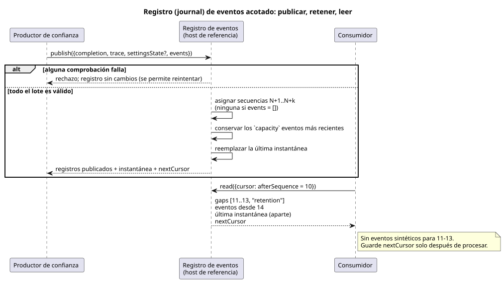

<!-- translation-source: docs/OBSERVATION-EVENT-HISTORY.md -->
[Original en inglés](OBSERVATION-EVENT-HISTORY.md)

# Historial acotado de eventos de observación

`prepareObservationEventHistory` en `tools/observation-event-history.mjs` es un
host de referencia para el límite de retención de eventos adoptado en la
Referencia §5.3. Está *ligado a la fuente*: cada registro que conserva está
vinculado a una única fuente compilada exacta.

El registro (journal) mantiene separadas dos cosas:

- los **eventos explícitos** que suministró un productor, y
- la **última instantánea (snapshot) completada**.

Una instantánea nunca reconstruye un evento. Si el productor no suministró un
evento, el registro no lo inventa.

Lo que este helper **no** es:

- Es una API de referencia, separada de Interaction snapshot v0.
- Está separado de la serialización y el transporte finales que hace el entorno
  de ejecución de eventos, resultados de comandos y alarmas.
- No añade ninguna palabra clave de fuente ni ninguna máquina de estados de
  comandos/alarmas.
- No evalúa ningún bloque `control` ni certifica ninguna afirmación física.

Un productor de confianza suministra dos entradas: hechos de eventos explícitos
`{kind, payload}` y una traza compartida del núcleo Rust que ya se ha completado.

El diagrama siguiente muestra el ciclo de vida completo: un productor publica, el
registro retiene una ventana acotada y un consumidor lee con un cursor.



## Activación y publicación

**Activación.** Llame al helper con
`{compilation, schema?, runId, capacity?, maxEventsPerScan?}`. Antes de la
activación, el titular existente de la instantánea completada copia y verifica
estas identidades: la fuente literaria (literate) compilada exacta, el esquema
emitido, el módulo y la fuente.

`capacity` y `maxEventsPerScan` son enteros explícitos de 1 a 4096. Ambos valen
256 de forma predeterminada. Son límites de este host de referencia. No son una
política operativa elegida para cada instalación.

**Publicación.** `publish({completion, trace, settingsState?, events})`
valida *primero* el lote completo de eventos explícitos y la traza completada.
Después:

- Cada publicación debe hacer avanzar el ID del escaneo completado.
- El tiempo lógico no debe retroceder.
- Las comprobaciones de instantánea del productor conservan la identidad de la
  fuente/Programa, los tipos de observación declarados y la semántica de Result
  de los ajustes.

El registro rechaza cualquiera de los siguientes casos **antes** de cambiar nada:

- metadatos incorrectos,
- una traza ajena,
- JSON disperso o no canónico,
- un escaneo duplicado,
- un lote o una carga útil (payload) demasiado grandes.

Como un rechazo deja el registro intacto, un reintento válido puede reutilizar la
misma completación.

**Eventos aceptados.** Cada evento aceptado recibe:

- un número de secuencia estrictamente creciente dentro de la ejecución (run),
- la identidad completa de esquema/módulo/fuente/ejecución, y
- la identidad del escaneo completado al que realmente pertenece.

La identidad de un evento es su identidad de ejecución más su número de
secuencia.

- Un escaneo puede llevar varios eventos explícitos.
- Un escaneo sin eventos sigue actualizando la última instantánea, pero no hace
  avanzar la secuencia de eventos.
- El texto público `kind` está acotado y no está vacío. Excluye caracteres de
  control y nombres privados reservados. (En el helper actual: como máximo 128
  bytes UTF-8, y los nombres que empiezan por `__gf_` están reservados).
- Una carga útil es JSON canónico propio, comprobado en cuanto a enteros seguros
  y arreglos dispersos. Cada carga útil de evento está limitada a 16 KiB de
  UTF-8.
- Los registros y las instantáneas devueltos son copias congeladas en
  profundidad.

## Retención y cursores

`read({cursor?})` devuelve:

| Campo | Significado |
| --- | --- |
| events | Eventos retenidos posteriores al cursor |
| `gaps` | Rangos explícitos de secuencias que ya no están disponibles |
| `snapshot` | La última instantánea completada |
| límites retenidos | La primera y la última secuencia retenidas |
| `nextCursor` | El cursor que se debe guardar tras procesar este resultado |

Un cursor lleva la identidad de ejecución exacta más `afterSequence`. No se puede
reutilizar para una nueva ejecución ni para una fuente, un Programa o un esquema
distintos.

La lectura no consume nada. La misma lectura puede repetirse hasta que el
consumidor guarde el cursor devuelto. Los registros repetidos conservan sus
identidades originales, de modo que un consumidor puede detectar duplicados.

**Ejemplo.** Un consumidor guardó la secuencia 10. La retención ahora empieza en
14. El registro entrega:

```text
gaps: [{from: 11, to: 13, reason: "retention"}]
events: [el evento original con secuencia 14]
snapshot: la última observación completada, conservada por separado
```

Reglas que ilustra este ejemplo:

- El registro no emite eventos sintéticos para 11–13.
- Si 11–14 siguen retenidos, entrega los cuatro y no informa ninguna brecha.
- En el límite exacto de retención, solo informa las secuencias que realmente no
  están disponibles.
- Un historial vacío tiene una instantánea nula y ninguna brecha.
- Los escaneos posteriores sin eventos explícitos no convierten los cambios de
  instantánea en eventos.
- Una conexión puede reanudarse con su cursor guardado. Los registros perdidos
  más allá de la retención se informan, no se reconstruyen.
- Una ejecución distinta es una discrepancia de identidad, no una brecha de
  secuencia ordinaria.

## Verificación y límites

**Verificación.** REF-05-022 ejecuta una única fuente exacta en Rust nativo de
producción y en WASM con tramas (framed), y compara todos los resultados. Luego
pasa ambas trazas por el mismo registro de host real. En una reproducción
(replay) nueva coinciden todos estos elementos: los lotes entregados completos,
las brechas, las instantáneas, las identidades y los cursores. Las pruebas
negativas muestran que un rechazo preserva el registro, y demuestran el
reintento válido, las comprobaciones de identidad del cursor y el aislamiento
frente a mutaciones del llamador.

**Límites.** El registro es retención en un host de referencia de JavaScript. No
es:

- un registro nativo en Rust,
- almacenamiento de red duradero,
- un protocolo de producto final,
- un servicio de autenticidad de eventos, ni
- un despliegue en Device.

Las cargas útiles de eventos del productor son hechos externos explícitos. Ni un
escaneo completado del núcleo ni el `kind` de un llamador pueden promover la
intención de salida a evidencia física aplicada (applied) o confirmada
(confirmed). Los límites independientes requested/safe/applied/confirmed y la
titularidad del transporte final se mantienen tal como se adoptaron.
