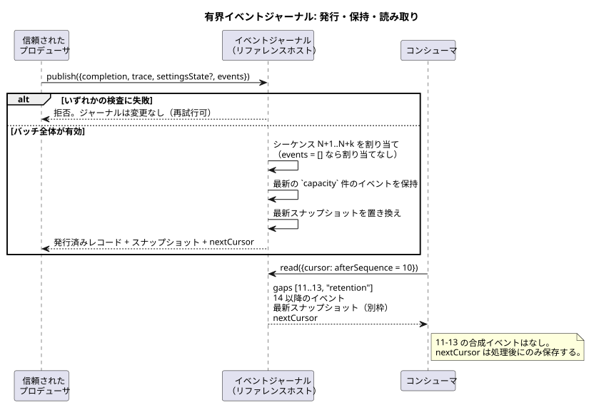

<!-- translation-source: docs/OBSERVATION-EVENT-HISTORY.md -->
[英語の原文](OBSERVATION-EVENT-HISTORY.md)

# 有界な観測イベント履歴

`tools/observation-event-history.mjs` の `prepareObservationEventHistory` は、Reference §5.3 で採用されたイベント保持の境界を示すリファレンスホストです。これは*ソースに束縛*されています。保持するすべてのレコードは、コンパイル済みの特定のソース 1 つに結び付けられます。

ジャーナル（journal）は次の 2 つを区別して扱います。

- プロデューサが供給した**明示的なイベント**
- **最新の完了済みスナップショット**

スナップショットからイベントを再構成することはありません。プロデューサがイベントを供給しなかった場合、ジャーナルがイベントを捏造することもありません。

このヘルパーが**行わない**こと:

- これは Interaction snapshot v0 とは別のリファレンス API です。
- イベント、コマンド結果、アラームの最終的なシリアライズと転送は実行環境の責務であり、このヘルパーとは別です。
- ソースキーワードやコマンド/アラームの状態機械は追加しません。
- `control` を評価したり、物理的な主張を証明したりはしません。

信頼されたプロデューサは 2 つの入力を供給します。明示的な `{kind, payload}` イベント事実と、すでに完了した共有 Rust コアのトレースです。

次の図はライフサイクル全体を示しています。プロデューサが発行し、ジャーナルが有界のウィンドウを保持し、コンシューマがカーソルを使って読み取ります。



## 有効化と発行

**有効化。** ヘルパーを `{compilation, schema?, runId, capacity?, maxEventsPerScan?}` で呼び出します。有効化の前に、既存の完了済みスナップショットの所有者が、コンパイル済みの文芸的ソース（literate source）、出力されたスキーマ、モジュール、ソースという各同一性をコピーして検証します。

`capacity` と `maxEventsPerScan` は 1 から 4096 までの明示的な整数で、どちらも既定値は 256 です。これらはこのリファレンスホストの上限値であり、あらゆる設備に向けて選ばれた運用ポリシーではありません。

**発行。** `publish({completion, trace, settingsState?, events})` は、まず明示的なイベントバッチ全体と完了済みトレースを*先に*検証します。そのうえで次を確認します。

- 各発行は、完了済みスキャン ID を前進させなければなりません。
- 論理時間は後退してはなりません。
- プロデューサのスナップショット検査により、ソース/Program の同一性、宣言された観測型、設定 Result の意味論が維持されます。

ジャーナルは次のいずれかを、何かを変更する**前に**拒否します。

- 不正なメタデータ
- 別系統のトレース
- 疎な（sparse）JSON または正規形でない JSON
- 重複したスキャン
- サイズ超過のバッチまたはペイロード

拒否してもジャーナルは変更されないため、有効な再試行では同じ completion を再利用できます。

**受け入れられたイベント。** 受け入れられた各イベントには次が付与されます。

- 実行（run）内で厳密に増加するシーケンス番号
- スキーマ/モジュール/ソース/実行の完全な同一性
- そのイベントが実際に属する完了済みスキャンの同一性

イベントの同一性は、実行の同一性とシーケンス番号の組です。

- 1 つのスキャンが複数の明示的イベントを持つことがあります。
- イベントのないスキャンでも最新スナップショットは更新されますが、イベントのシーケンスは進みません。
- 公開される `kind` テキストは有界で空ではありません。制御文字と予約済みの非公開名は使えません。（現在のヘルパーでは最大 128 UTF-8 バイトで、`__gf_` で始まる名前は予約されています。）
- ペイロードは所有権を持つ正規形 JSON で、安全な整数かどうかと疎な配列がないかが検査されます。各イベントのペイロードは UTF-8 で 16 KiB までです。
- 返されるレコードとスナップショットは、深くフリーズされたコピーです。

## 保持とカーソル

`read({cursor?})` は次を返します。

| フィールド | 意味 |
| --- | --- |
| events | カーソル以降に保持されているイベント |
| `gaps` | もう利用できないシーケンスの明示的な範囲 |
| `snapshot` | 最新の完了済みスナップショット |
| 保持範囲 | 保持されている最初と最後のシーケンス |
| `nextCursor` | この結果を処理した後に保存するカーソル |

カーソルは、実行の正確な同一性と `afterSequence` を持ちます。新しい実行や、異なるソース、Program、スキーマに対して再利用することはできません。

読み取りは何も消費しません。コンシューマが返されたカーソルを保存するまで、同じ読み取りを繰り返せます。繰り返し返されるレコードは元の同一性を保つため、コンシューマは重複を検出できます。

**例。** コンシューマはシーケンス 10 を保存しています。保持範囲は現在 14 から始まります。ジャーナルは次を返します。

```text
gaps: [{from: 11, to: 13, reason: "retention"}]
events: [シーケンス 14 の元のイベント]
snapshot: 最新の完了済み観測（別枠で保持）
```

この例が示す規則:

- ジャーナルは 11〜13 に対して合成イベントを出しません。
- 11〜14 がまだ保持されていれば、4 件すべてを返し、ギャップは報告しません。
- 保持範囲のちょうど境界では、本当に利用できないシーケンスだけを報告します。
- 履歴が空の場合、スナップショットは null で、ギャップはありません。
- その後の明示的イベントのないスキャンが、スナップショットの変化をイベントに変えることはありません。
- 接続は保存済みのカーソルで再開できます。保持範囲を超えて失われたレコードは報告されますが、再構成はされません。
- 異なる実行は同一性の不一致であり、通常のシーケンスギャップではありません。

## 検証と制限

**検証。** REF-05-022 は、1 つの特定のソースを本番用ネイティブ Rust とフレーム化 WASM の両方で実行し、すべての結果を比較します。次に、両方のトレースを同じ実際のホストジャーナルに通します。新規のリプレイでは、配信された完全なバッチ、ギャップ、スナップショット、同一性、カーソルのすべてが一致します。否定テストでは、拒否によってジャーナルが保たれることを示し、有効な再試行、カーソルの同一性検査、呼び出し側による変更からの隔離を証明します。

**制限。** このジャーナルは JavaScript リファレンスホスト内の保持機構です。次のものではありません。

- ネイティブ Rust のジャーナル
- 永続的なネットワークストレージ
- 最終的な製品プロトコル
- イベントの真正性を保証するサービス
- Device への展開

プロデューサのイベントペイロードは明示的な外部の事実です。完了したコアのスキャンも、呼び出し側の `kind` も、出力意図を適用済み（applied）や確認済み（confirmed）の物理的証拠に格上げすることはできません。requested/safe/applied/confirmed という独立した境界と、最終的な転送の所有権は、採用されたとおりに維持されます。
