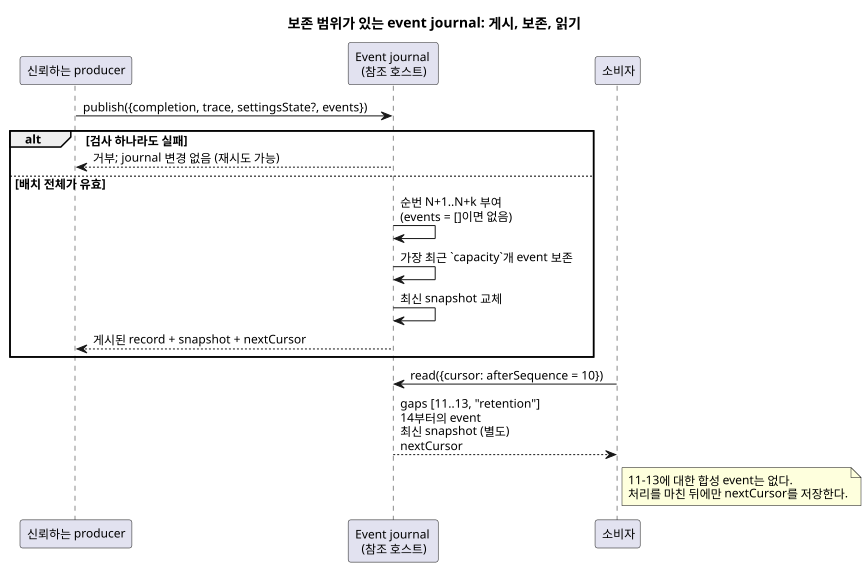

<!-- translation-source: docs/OBSERVATION-EVENT-HISTORY.md -->
[영문 원문](OBSERVATION-EVENT-HISTORY.md)

# 보존 범위가 있는 관찰 event 이력

`tools/observation-event-history.mjs`의 `prepareObservationEventHistory`는
Reference §5.3에서 채택한 event 보존 경계를 구현한 참조 호스트입니다. 이 호스트는
*소스에 결합*되어 있습니다. 보존하는 모든 record는 정확히 하나의 컴파일된 소스에
묶입니다.

journal은 다음 두 가지를 분리해서 보존합니다.

- producer가 제공한 **명시적 event**,
- **마지막으로 완료된 snapshot**.

snapshot으로 event를 재구성하는 일은 없습니다. producer가 event를 제공하지 않았다면
journal도 event를 만들어 내지 않습니다.

이 helper가 **아닌** 것:

- Interaction snapshot v0과 분리된 참조 API입니다.
- event, 명령 결과, 알람을 실행 환경이 최종적으로 직렬화하고 전송하는 일과는
  별개입니다.
- 소스 키워드나 command/alarm 상태 기계를 추가하지 않습니다.
- control을 평가하거나 물리적 주장을 인증하지 않습니다.

신뢰하는 producer는 두 가지 입력을 제공합니다. 명시적인 `{kind, payload}` event
사실과, 이미 완료된 공유 Rust 코어 trace입니다.

아래 다이어그램은 전체 생명주기를 보여 줍니다. producer가 게시하고, journal이 제한된
범위를 보존하며, 소비자가 cursor로 읽습니다.



## 활성화와 게시

**활성화.** helper를 `{compilation, schema?, runId, capacity?, maxEventsPerScan?}`로
호출합니다. 활성화 전에 기존 completed-snapshot 소유자가 다음 identity를 복사하고
검증합니다. 정확한 컴파일된 literate 소스, 출력된 schema, 모듈, 소스입니다.

`capacity`와 `maxEventsPerScan`은 1부터 4096까지의 명시적 정수입니다. 둘 다 기본값은
256입니다. 이 값은 이 참조 호스트의 한계일 뿐, 모든 설비에 적용하도록 정한 운영
정책이 아닙니다.

**게시.** `publish({completion, trace, settingsState?, events})`는 *먼저* 명시적 event
배치 전체와 완료된 trace를 검증합니다. 그다음 다음 규칙이 적용됩니다.

- 게시할 때마다 완료된 스캔 ID가 증가해야 합니다.
- 논리 시간은 뒤로 가서는 안 됩니다.
- producer의 snapshot 검사는 소스/Program identity, 선언된 관찰 타입, 설정 Result
  의미를 유지합니다.

journal은 다음 중 하나라도 해당하면 무엇이든 바꾸기 **전에** 거부합니다.

- 잘못된 메타데이터,
- 다른 실행의 trace,
- sparse 또는 비정규(noncanonical) JSON,
- 중복된 스캔,
- 크기 한도를 넘는 배치나 payload.

거부해도 journal은 그대로이므로, 같은 completion으로 유효하게 재시도할 수 있습니다.

**수락된 event.** 수락된 각 event는 다음을 받습니다.

- 실행(run) 안에서 엄격하게 증가하는 순번,
- 전체 schema/module/source/run identity,
- 그 event가 실제로 속한 완료된 스캔의 identity.

event의 identity는 실행 identity와 순번의 조합입니다.

- 한 스캔에 명시적 event가 여러 개 있을 수 있습니다.
- event가 없는 스캔도 마지막 snapshot은 갱신하지만, event 순번은 증가시키지 않습니다.
- 공개 `kind` 텍스트는 길이가 제한되고 비어 있지 않습니다. 제어 문자와 예약된
  비공개 이름은 허용하지 않습니다. (현재 helper에서는 최대 128 UTF-8 바이트이며,
  `__gf_`로 시작하는 이름은 예약되어 있습니다.)
- payload는 helper가 소유하는 정규(canonical) JSON이며, safe integer와 sparse 배열
  검사를 거칩니다. event payload 하나는 UTF-8 기준 16 KiB로 제한됩니다.
- 반환되는 record와 snapshot은 깊이 동결된 복사본입니다.

## 보존과 cursor

`read({cursor?})`는 다음을 반환합니다.

| 필드 | 의미 |
| --- | --- |
| events | cursor 이후에 보존된 event |
| `gaps` | 더 이상 사용할 수 없는 순번의 명시적 범위 |
| `snapshot` | 마지막으로 완료된 snapshot |
| 보존 범위 | 보존된 첫 순번과 마지막 순번 |
| `nextCursor` | 이 결과를 처리한 뒤 저장할 cursor |

cursor에는 정확한 실행 identity와 `afterSequence`가 담깁니다. 새 실행이나 다른 소스,
Program, schema에는 재사용할 수 없습니다.

읽기는 아무것도 소비하지 않습니다. 소비자가 반환된 cursor를 저장할 때까지 같은
읽기를 반복할 수 있습니다. 반복된 record는 원래 identity를 유지하므로 소비자가
중복을 감지할 수 있습니다.

**예시.** 소비자가 순번 10을 저장했습니다. 이제 보존 범위는 14부터 시작합니다.
journal은 다음을 전달합니다.

```text
gaps: [{from: 11, to: 13, reason: "retention"}]
events: [순번 14인 원래 event]
snapshot: 별도로 유지되는 마지막 완료 관찰
```

이 예시가 보여 주는 규칙:

- journal은 11–13에 대한 합성 event를 내보내지 않습니다.
- 11–14가 아직 보존되어 있으면 네 개를 모두 전달하고 gap은 보고하지 않습니다.
- 보존 경계에 정확히 걸칠 때에도 실제로 사용할 수 없는 순번만 보고합니다.
- 빈 이력의 snapshot은 null이며 gap은 없습니다.
- 명시적 event가 없는 이후의 스캔은 snapshot 변화를 event로 바꾸지 않습니다.
- 연결은 저장한 cursor로 재개할 수 있습니다. 보존 범위를 넘어 사라진 record는
  재구성하지 않고 보고합니다.
- 다른 실행은 일반적인 순번 gap이 아니라 identity 불일치입니다.

## 검증과 한계

**검증.** REF-05-022는 정확히 같은 소스 하나를 운영용 네이티브 Rust와 프레임 WASM에서
실행하고 모든 결과를 비교합니다. 그다음 두 trace를 같은 실제 호스트 journal에
통과시킵니다. 새로 재생하면 전달된 전체 배치, gap, snapshot, identity, cursor가 모두
일치합니다. 음성 테스트는 거부 시 journal이 보존됨을 보여 주며, 유효한 재시도,
cursor identity 검사, 호출자 변경으로부터의 격리를 증명합니다.

**한계.** journal은 JavaScript 참조 호스트 안의 보존 구현입니다. 다음이 아닙니다.

- 네이티브 Rust journal,
- 영속적인 네트워크 저장소,
- 최종 제품 프로토콜,
- event 진위 확인 서비스,
- Device 배포.

producer event payload는 명시적인 외부 사실입니다. 완료된 코어 스캔도, 호출자의
`kind`도 출력 의도를 applied나 confirmed 물리 증거로 승격시킬 수 없습니다.
requested/safe/applied/confirmed의 독립된 경계와 최종 전송의 소유권은 채택된 대로
유지됩니다.
