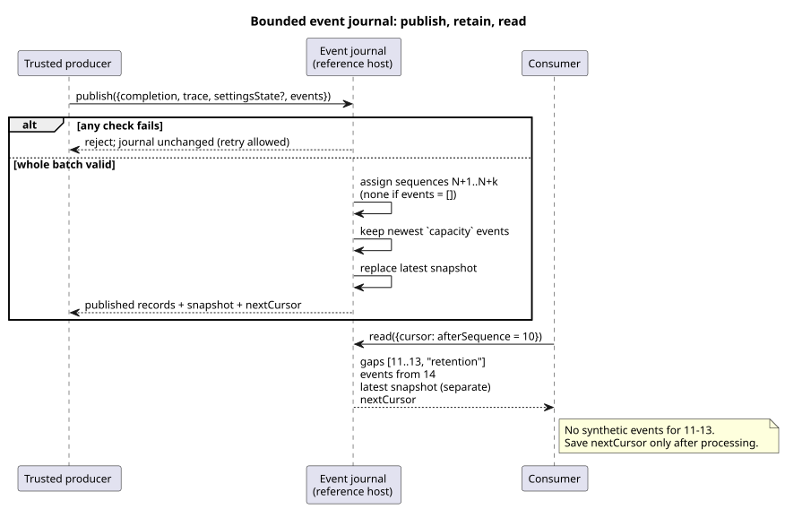

# Bounded observation event history

`prepareObservationEventHistory` in `tools/observation-event-history.mjs` is a
reference host for the event-retention boundary adopted in Reference §5.3. It is
*source-bound*: every record it keeps is tied to one exact compiled source.

The journal keeps two things separate:

- **explicit events** that a producer supplied, and
- the **latest completed snapshot**.

A snapshot never reconstructs an event. If the producer did not supply an event,
the journal does not invent one.

What this helper is **not**:

- It is a reference API, separate from Interaction snapshot v0.
- It is separate from the execution environment's final serialization and
  transport of events, command results and alarms.
- It adds no source keyword and no command/alarm state machine.
- It does not evaluate a control or certify a physical claim.

A trusted producer supplies two inputs: explicit `{kind, payload}` event facts,
and a shared Rust core trace that has already completed.

The diagram below shows the whole lifecycle: a producer publishes, the journal
retains a bounded window, and a consumer reads with a cursor.



## Activation and publication

**Activation.** Call the helper with
`{compilation, schema?, runId, capacity?, maxEventsPerScan?}`. Before activation,
the existing completed-snapshot owner copies and verifies these identities: the
exact compiled literate source, the emitted schema, the module and the source.

`capacity` and `maxEventsPerScan` are explicit integers from 1 to 4096. Both
default to 256. They are bounds of this reference host. They are not an
operating policy chosen for every installation.

**Publication.** `publish({completion, trace, settingsState?, events})`
validates the complete explicit event batch and the completed trace *first*.
Then:

- Each publication must advance the completed scan ID.
- Logical time must not move backward.
- The producer's snapshot checks keep the source/Program identity, the declared
  observation types and the settings Result semantics.

The journal rejects any of the following **before** it changes anything:

- bad metadata,
- a foreign trace,
- sparse or noncanonical JSON,
- a duplicate scan,
- an oversized batch or payload.

Because a rejection leaves the journal untouched, a valid retry can reuse the
same completion.

**Accepted events.** Each accepted event receives:

- a strictly increasing sequence number within the run,
- the full schema/module/source/run identity, and
- the identity of the completed scan it actually belongs to.

An event's identity is its execution identity plus its sequence number.

- One scan may carry several explicit events.
- A scan with no events still updates the latest snapshot, but does not advance
  the event sequence.
- The public `kind` text is bounded and nonempty. It excludes control characters
  and reserved private names. (In the current helper: at most 128 UTF-8 bytes,
  and names starting with `__gf_` are reserved.)
- A payload is owned canonical JSON, checked for safe integers and sparse
  arrays. Each event payload is limited to 16 KiB of UTF-8.
- Returned records and snapshots are deeply frozen copies.

## Retention and cursors

`read({cursor?})` returns:

| Field | Meaning |
| --- | --- |
| events | Retained events after the cursor |
| `gaps` | Explicit ranges of sequences that are no longer available |
| `snapshot` | The latest completed snapshot |
| retained bounds | The first and last retained sequence |
| `nextCursor` | The cursor to save after processing this result |

A cursor carries the exact execution identity plus `afterSequence`. You cannot
reuse it for a new run, or for a different source, Program or schema.

Reading does not consume anything. The same read can be repeated until the
consumer saves the returned cursor. Repeated records keep their original
identities, so a consumer can detect duplicates.

**Example.** A consumer saved sequence 10. Retention now begins at 14. The
journal delivers:

```text
gaps: [{from: 11, to: 13, reason: "retention"}]
events: [the original event with sequence 14]
snapshot: the latest completed observation, kept separately
```

Rules illustrated by this example:

- The journal emits no synthetic events for 11–13.
- If 11–14 are still retained, it delivers all four and reports no gap.
- At the exact retention boundary, it reports only sequences that are genuinely
  unavailable.
- Empty history has a null snapshot and no gaps.
- Later scans without explicit events do not turn snapshot changes into events.
- A connection can resume with its saved cursor. Records lost beyond retention
  are reported, not reconstructed.
- A different run is an identity mismatch, not an ordinary sequence gap.

## Verification and limits

**Verification.** REF-05-022 runs one exact source in production native Rust and
in framed WASM, and compares every outcome. It then feeds both traces through the
same actual host journal. On fresh replay, these all agree: complete delivered
batches, gaps, snapshots, identities and cursors. Negative tests show that a
rejection preserves the journal, and prove valid retry, cursor identity checks and
isolation from caller mutation.

**Limits.** The journal is retention in a JavaScript reference host. It is not:

- a native Rust journal,
- durable network storage,
- a final product protocol,
- an event authenticity service, or
- a Device deployment.

Producer event payloads are explicit external facts. Neither a completed core
scan nor a caller's `kind` can promote output intent into applied or confirmed
physical evidence. The independent requested/safe/applied/confirmed boundaries,
and the ownership of the final transport, remain as adopted.
