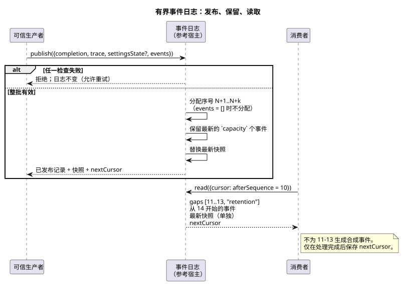

<!-- translation-source: docs/OBSERVATION-EVENT-HISTORY.md -->
[英文原文](OBSERVATION-EVENT-HISTORY.md)

# 有界观测事件历史

`tools/observation-event-history.mjs` 中的 `prepareObservationEventHistory`
是 Reference §5.3 所采纳的事件保留边界的参考宿主。它是*绑定源的*（source-bound）：
它保留的每条记录都绑定到一个确切的已编译源。

该日志（journal）将两样东西分开保存：

- 生产者提供的**显式事件**，以及
- **最新的已完成快照**。

快照绝不会重建事件。如果生产者没有提供某个事件，日志不会凭空生成一个。

这个辅助工具**不是**什么：

- 它是一个参考 API，独立于 Interaction snapshot v0。
- 它独立于执行环境对事件、命令结果和报警的最终序列化与传输。
- 它不增加任何源关键字，也不增加命令/报警状态机。
- 它不对 control 求值，也不认证任何物理声明。

可信生产者提供两个输入：显式的 `{kind, payload}` 事件事实，以及一个已经完成的共享
Rust 核心追踪（trace）。

下图展示了完整的生命周期：生产者发布，日志保留一个有界窗口，消费者使用游标读取。



## 激活与发布

**激活。** 使用 `{compilation, schema?, runId, capacity?, maxEventsPerScan?}`
调用该辅助工具。在激活之前，现有的已完成快照所有者会复制并验证以下身份标识：确切的已编译文学式源文件、
生成的 schema、模块以及源。

`capacity` 和 `maxEventsPerScan` 是取值 1 到 4096 的显式整数，两者默认均为 256。
它们是这个参考宿主的界限，而不是为每个设施选定的运行策略。

**发布。** `publish({completion, trace, settingsState?, events})`
会*首先*验证完整的显式事件批次和已完成的追踪。然后：

- 每次发布都必须推进已完成的扫描 ID。
- 逻辑时间不得倒退。
- 生产者的快照检查会保持源/Program 身份标识、已声明的观测类型以及设置 Result 语义。

在做出任何更改**之前**，日志会拒绝以下任何情况：

- 错误的元数据，
- 外来的追踪，
- 稀疏或非规范的 JSON，
- 重复的扫描，
- 超大的批次或载荷。

由于拒绝不会改动日志，有效的重试可以复用同一个 completion。

**被接受的事件。** 每个被接受的事件会获得：

- 在该运行（run）内严格递增的序号，
- 完整的 schema/模块/源/运行身份标识，以及
- 它实际所属的已完成扫描的身份标识。

事件的身份标识就是它的执行身份标识加上序号。

- 一次扫描可以携带多个显式事件。
- 没有事件的扫描仍会更新最新快照，但不会推进事件序号。
- 公开的 `kind` 文本是有界且非空的。它不包含控制字符和保留的私有名称。
  （在当前辅助工具中：最多 128 个 UTF-8 字节，以 `__gf_` 开头的名称为保留名称。）
- 载荷是自有的规范 JSON，并检查安全整数和稀疏数组。每个事件载荷的 UTF-8
  大小限制为 16 KiB。
- 返回的记录和快照都是深度冻结的副本。

## 保留与游标

`read({cursor?})` 返回：

| 字段 | 含义 |
| --- | --- |
| events | 游标之后被保留的事件 |
| `gaps` | 已不再可用的序号的显式范围 |
| `snapshot` | 最新的已完成快照 |
| 保留边界 | 第一个和最后一个被保留的序号 |
| `nextCursor` | 处理完此结果后应保存的游标 |

游标携带确切的执行身份标识以及 `afterSequence`。它不能复用于新的运行，也不能用于不同的源、
Program 或 schema。

读取不会消耗任何东西。在消费者保存返回的游标之前，可以重复执行同一次读取。重复的记录保持其原始身份标识，
因此消费者可以检测到重复。

**示例。** 某消费者保存了序号 10。保留范围现在从 14 开始。日志交付：

```text
gaps: [{from: 11, to: 13, reason: "retention"}]
events: [序号为 14 的原始事件]
snapshot: 最新的已完成观测，单独保存
```

此示例说明的规则：

- 日志不会为 11–13 生成合成事件。
- 如果 11–14 仍被保留，它会交付全部四个事件，并且不报告间隙。
- 恰好处于保留边界时，它只报告真正不可用的序号。
- 空历史的快照为 null，且没有间隙。
- 之后没有显式事件的扫描不会把快照变化转换为事件。
- 连接可以凭其保存的游标恢复。超出保留范围而丢失的记录会被报告，而不会被重建。
- 不同的运行属于身份标识不匹配，而不是普通的序号间隙。

## 验证与限制

**验证。** REF-05-022 在生产用原生 Rust 和分帧 WASM 中运行同一个确切的源，并比较每个结果。
然后它把两份追踪送入同一个实际的宿主日志。在全新重放时，以下各项全部一致：完整交付的批次、间隙、快照、
身份标识和游标。负面测试表明拒绝会保持日志不变，并证明了有效重试、游标身份标识检查以及与调用方修改的隔离。

**限制。** 该日志是 JavaScript 参考宿主中的保留机制。它不是：

- 原生 Rust 日志，
- 持久化的网络存储，
- 最终的产品协议，
- 事件真实性服务，或
- Device 部署。

生产者事件载荷是显式的外部事实。无论是已完成的核心扫描，还是调用方提供的 `kind`，都不能把输出意图提升为
已应用（applied）或已确认（confirmed）的物理证据。相互独立的 requested/safe/applied/confirmed
边界，以及最终传输的所有权，仍按已采纳的内容保持不变。
