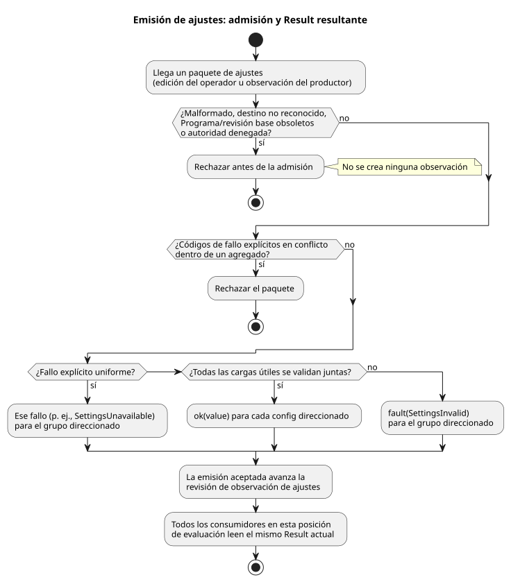

<!-- translation-source: docs/OPERATOR-SETTINGS-STREAM.md -->
[Original en inglés](OPERATOR-SETTINGS-STREAM.md)

# Flujos de configuración tipados

Este documento describe cómo los ajustes del operador (configs) llegan a un
programa GhostFlow en ejecución como flujos tipados, cómo se codifican en los
formatos binario y de punto de control (checkpoint), y qué perfiles de ejecución
los admiten actualmente.

Las reglas normativas del lenguaje están en la Referencia: §2 (Result), §3
(Periodic/DailySlots) y §5 (ajustes). Este documento no las modifica.

**En este documento**

- El modelo de flujo: qué devuelve una lectura de config y cómo funcionan los
  fallos.
- Integración binaria: descriptores, paquetes, preparación (staging) y
  puntos de control (GFB11, GFSF5, GFCX3).
- Límite del perfil ejecutable: qué es ejecutable
  hoy y qué se rechaza.

**El modelo de flujo.** Una declaración de config nombra un *flujo tipado*. El
flujo comienza con una observación inicial `ok(initial)`.

- Una lectura de config tiene el tipo `Result<T, SettingsFault>`.
- El consumidor la maneja con la semántica existente de `case`, `map`,
  `and_then` o `recover` explícito.
- El productor puede ser una interfaz de red o un control físico. La fuente
  consumidora nunca nombra su transporte.
- Este contrato no requiere RxJS ni un nuevo marco general de flujos.

**Fallos.** Hay dos fallos de ajustes:

| Fallo | Significado |
| --- | --- |
| `SettingsInvalid` | Una emisión reconocida y autorizada no superó la validación de la carga útil. |
| `SettingsUnavailable` | El productor informó explícitamente una observación de error. |

- La sola ausencia de mensajes no provoca ni un fallo ni una emisión repetida
  fabricada.
- Una emisión exitosa posterior recupera cualquiera de los dos fallos.
- No existe ninguna política implícita de último valor válido ni de valor
  predeterminado.

**Agregados.** Un agregado identifica un conjunto no vacío, sin duplicados y
autorizado de IDs de config. Todas sus cargas útiles se validan juntas, por lo
que el resultado es todo o nada:

- O bien cada config direccionado pasa a `ok`, o bien cada config direccionado
  recibe un `fault`. Los flujos no relacionados no cambian.
- Los códigos de fallo explícitos en conflicto dentro de un agregado rechazan el
  paquete.
- Un fallo explícito uniforme se propaga al grupo direccionado.
- Un fallo real de validación de la carga útil emite `SettingsInvalid` para ese
  grupo.

**Rechazo antes de la admisión.** Se rechazan antes de la admisión: los paquetes
malformados, los destinos no reconocidos, un Programa o una revisión base
obsoletos, y la autoridad denegada. Un rechazo así **no** crea ninguna
observación. En cambio, una emisión de error aceptada sí hace avanzar la
revisión de la observación de ajustes.

El diagrama de flujo siguiente resume cómo un paquete de ajustes se convierte en
un Result actual.



**Cómo ven los consumidores los Results.** Todos los consumidores en una misma
posición de evaluación usan los mismos Results actuales.

- **Programaciones.** Una programación (`schedule`) dependiente conserva un
  error como `Unknown(SettingsFault)`. Mientras ese error está vigente, no admite
  ninguna ocurrencia nueva. Al recuperarse, aplica la política de fase declarada
  en la posición de la emisión exitosa, sin recuperar el pasado (catch-up).
- **Runs admitidos.** Un error de config no cancela un Run ya admitido.
- **Control ordinario.** Las expresiones de control ordinarias deciden su propia
  respuesta de forma explícita. Por ejemplo, una duración leída dentro de `case`
  puede cambiar un control en curso en la siguiente evaluación, sin reiniciar el
  tiempo transcurrido. Si un programa prefiere una duración fija por ejecución,
  puede capturar explícitamente un valor exitoso en el estado.

## Integración binaria

**Descriptores de config (GFB11).** GFB11/control-v10 reemplaza el perfil de
contexto GFB10 anterior. Los descriptores de config escalares son el tag12 del
preludio. Van antes de las programaciones que los consumen:

```text
u32 id, string name, string semanticType, u8 kind, u8 operatorEditable
scalar: typed initial, u8 hasBounds, [typed min, max, step]
slots:  u64 gridMs, u16 capacity, u16 count, u16 minuteOfDay[]
u16 okInput, valueInput, faultInput
```

| `kind` | Nombre | Representación del valor |
| --- | --- | --- |
| 0 | Bool | indicador Bool canónico |
| 1 | Int | i32 con signo |
| 2 | Number | f64 finito |
| 3 | TimeSlots | lista de franjas (usa 0xffff para todos los índices de proyección escalar) |

- `semanticType` conserva en la transmisión las distinciones entre Duration,
  Percent y los tipos de magnitud/tiempo.
- Las proyecciones escalares tienen los nombres protegidos
  `__gf_config_ID_ok/value/fault`. Un host no puede establecerlas directamente.

**Consumidores de programaciones.** Ambos consumidores de programaciones hacen
referencia al descriptor de config compartido y a su observación actual, no a
copias separadas del ajuste.

- El tag5 de Periodic reemplaza su valor/límites de config incrustados por
  `u32 configId`. El ID0, en cambio, lleva inmediatamente a continuación un
  `u64 literalIntervalMs` positivo. Un literal no es un config editable
  inventado.
- El tag9 de DailySlots con config lleva `string timezone, u32 configId,
  u8 dstMissing, dstRepeated` después de su prefijo común.

**Objetivo (consigna PID).** Todo artefacto GFB11 termina con
`u16 objectiveCount` (0 o 1). El cuerpo del objetivo:

1. conserva el nombre/salida y sus cuatro índices de entrada,
2. añade `u16 targetOkInput`,
3. y después conserva period/late/direction y los seis números PID.

El par value/ok de la consigna debe referirse a un único descriptor de config
Temperature. El código del host no puede escribir ninguna de las dos entradas
protegidas ni sustituir la consigna inicial del manifiesto.

**Paquetes de ajustes (GFSF5).** GFSF5 conserva las secciones de reloj/evidencia
del contexto. Su envoltorio de ajustes contiene, en orden: la huella del
Programa, el ID de evento, la revisión base, la posición efectiva y los cambios.

- Después de la posición efectiva, `u8 origin` distingue operatorEdit0 de
  producerObservation1.
- El host autentica esta clasificación. Una afirmación dentro de un paquete no
  es una credencial de autenticación.
- La fuente consumidora solo ve el Result.
- Las ediciones del operador requieren acceso editable.
- Una observación legítima del productor puede informar un fallo para un config
  de solo lectura, y recuperarlo a su carga útil inicial declarada. No puede
  cambiar esa carga útil de solo lectura.

Cada cambio es `u32 configId, u8 rail`:

| Rail | Contenido |
| --- | --- |
| Rail0 (valor) | `string semanticType, u8 kind, typed value`; un valor TimeSlots es `u16 count` seguido de `(u64 key,u16 minute)` |
| Rail1 (fallo) | código de fallo 0 (`SettingsInvalid`) o código 1 (`SettingsUnavailable`) |

Las comprobaciones se hacen en dos capas:

1. Las etiquetas estructurales y la representación numérica finita se comprueban
   antes de la validación del flujo.
2. Una representación válida con un tipo declarado, rango, cuadrícula o
   capacidad incorrectos produce el rail de error semántico.

**Claves de TimeSlots.** El flujo de config compartido asigna las claves de
TimeSlots.

- La clave 0 solicita una identidad nueva.
- Las claves existentes reajustan el horario de las entradas que conservan.
- Las claves ausentes eliminan entradas.
- Todas las programaciones que consumen ese config comparten esas identidades.
- Los errores no exponen la lista histórica como un valor exitoso actual.

**Preparación combinada.** La llamada de contexto combinada prepara juntos las
emisiones, las entradas protegidas, las decisiones de programación y el estado de
la VM.

- Una llamada combinada rechazada no consume su evento, por lo que puede
  reintentarse.
- Esta API no reconoce una emisión como efectiva antes de consolidarla (commit).
- Las observaciones aceptadas de forma independiente mediante otra API, si las
  hay, no pueden deshacerse después por una evaluación de control fallida.

**Ruta con tramas.** La ruta pública con tramas (framed) usa
`gf_frame_activate_context` y `gf_frame_scan_context` con los mismos paquetes
GFCA1/GFSF5 y el ScanDriver nativo.

- La trama de entrada completa omite las proyecciones de Result protegidas por
  el runtime y el reloj monotónico derivado.
- Su tiempo lógico debe coincidir con el reloj del contexto.
- Solo una evaluación exitosa hace avanzar el ID/tiempo de escaneo nativo y
  publica el resultado aceptado. Las tramas rechazadas siguen pudiendo
  reintentarse con el mismo ID de escaneo.
- El acceso al punto de control/estado con tramas y la restauración previa al
  primer escaneo reutilizan GFCX3. No crean un segundo estado de ajustes ni
  sintetizan un resultado aceptado en JavaScript.

**Puntos de control (GFCX3).** GFCX3 persiste, bajo la identidad exacta de
Programa/vinculación (binding): el Result actual, la revisión, las identidades de
los eventos aceptados y el historial de asignación de claves.

- Un fallo restaurado sigue siendo un fallo.
- Las cargas útiles exitosas históricas solo existen para la validación de
  claves estables y de fase, nunca como respaldo (fallback) para el consumidor.
- Las cachés del motor restauradas deben coincidir con el historial de config
  compartido.
- GFCX3 también retiene un historial acotado del contenido completo de
  ID/revisión de calendario.
- Las imágenes antiguas GFCX1/GFCX2 se rechazan explícitamente.

**Estado del contexto.** El estado del contexto expone el ID, el nombre, el tipo
y el Result actual de cada config.

- Los Results de error contienen un fallo, no un `value` antiguo.
- Las emisiones no cambian los hashes de la fuente ni la identidad de ejecución.
- La semántica existente de estado/temporizador no cambia.
- La adquisición de hardware, el transporte de la WebUI y el trabajo de
  publicación para dispositivos quedan fuera de este cambio de
  lenguaje/runtime.

## Límite del perfil ejecutable

Esta sección enumera lo que este cambio ejecuta realmente y lo que rechaza.

**Periodic.** El perfil Periodic de este cambio ejecuta un ancla `instant`
explícita con `preserve_anchor` y las políticas de pulso/reloj de
confianza/línea base/omisión. Las demás anclas y políticas de fase de la
Referencia conservan sus propios requisitos de implementación; este cambio no
afirma ejecutarlas.

**TimeSlots.** TimeSlots respaldado por config usa el consumidor de flujo
compartido.

**Solar.** Solar ahora consume los mismos Results actuales mediante el
[perfil de contexto Solar compartido](SOLAR-CONFIG-EXECUTION.es.md).

- Sus dependencias `when` compiladas conservan un fallo actual como
  `Unknown(SettingsFault)`, incluso cuando una rama de fallo escrita por el autor
  devuelve true.
- La recuperación establece una línea base sin recuperar el pasado.
- Los fallos de configs no relacionados no suprimen Solar.
- La ruta Solar compartida usa GFB16/control-v15 y GFSF6. Prepara el motor Solar
  de Rust existente junto con los ajustes y el estado de la VM, y mantiene las
  identidades terminales de Solar dentro de GFCX3.
- Los consumidores existentes de Solar independiente y de GFSF5 sin Solar
  conservan sus perfiles explícitos. No son respaldos ejecutables para una
  fuente rechazada.

**PID de Temperature.** El objetivo PID de Temperature nativo lee su consigna
del mismo vector protegido de Results de config. Un fallo sigue la política de
desactivación escrita por el autor.

- El vector compartido se prepara antes del motor PID existente.
- Un fallo de la consigna sigue de inmediato la política `fault = disable`
  escrita por el autor, incluso entre plazos del PID.
- La recuperación conserva el plazo existente y la política `track_safe`.
- Los cambios de ajustes y los cambios del PID se consolidan con la misma
  evaluación exitosa.
- El reinicio restaura las observaciones de config y usa el
  `restart = reset(...)` del PID escrito por el autor. Un punto de control de
  config no restaura el historial del controlador.

**Rechazado en la compilación.** Lo siguiente sigue rechazándose. Estos rechazos
no deben eludirse convirtiendo un ajuste real del operador en una constante.

- **Mezclar flujos con DailySlots literales** se rechaza al compilar la fuente.
- **Los valores de reserva y de límite de la contabilización de uso
  (accounting)** en el perfil ejecutable son límites estáticos del diseñador. El
  ejemplo de la Referencia de 5 minutos en ON con un retardo de parada de 10
  segundos usa `let` para esos límites fijos. Un Result de config en vivo se
  rechaza, en lugar de reducirse silenciosamente a su valor inicial.
- **DailySlots con `basis = range(...)`** en el perfil actual también requiere
  una duración fija. Un Result de config en vivo se rechaza en la compilación.
  Las reglas de solapamiento y de límites que se tocan para rangos
  literales/`let` siguen siendo ejecutables. Extender Range a un consumidor
  compartido de Results en vivo es un trabajo separado de esta implementación de
  flujos para Periodic y el control ordinario.

**Qué cubre la validación.** La validación nativa/WASM y con el simulador virtual
no certifica la entrega al frontend, la adquisición física, el despliegue en
Device ni adaptadores arbitrarios de productores externos.

**Empaquetado.** Los paquetes portables firmados aceptan artefactos GFB11 con
config escalar, incluidos los temporizadores de tiempo transcurrido ordinarios,
bajo `GhostFlow/context-scan-abi-v5` y `control-v10`.

- Las comprobaciones de firma, digest, capacidad (capability) y coherencia del
  compilador siguen siendo obligatorias.
- Este perfil de paquete no añade soporte de empaquetado para programaciones,
  PID, TimeSlots ni el preludio de señales.
