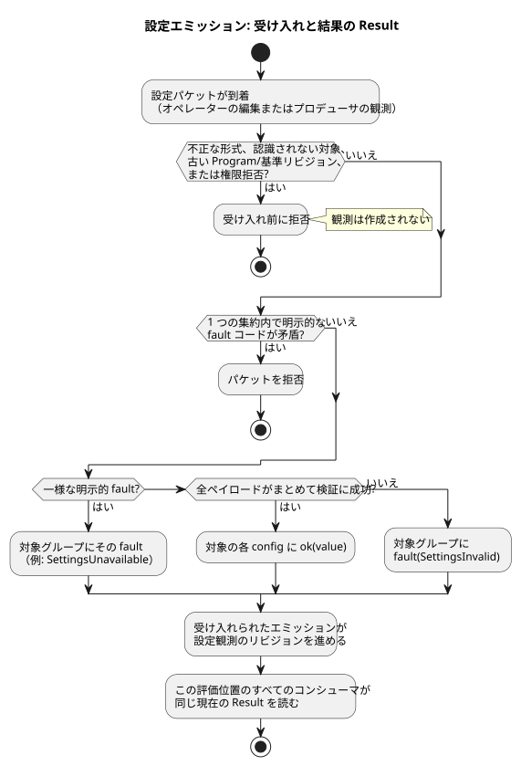

<!-- translation-source: docs/OPERATOR-SETTINGS-STREAM.md -->
[英語の原文](OPERATOR-SETTINGS-STREAM.md)

# 型付き設定ストリーム

このドキュメントでは、オペレーターの設定（config）が型付きストリームとして実行中の GhostFlow プログラムにどのように届くか、バイナリ形式とチェックポイント形式でどのようにエンコードされるか、そして現在どの実行プロファイルがそれをサポートしているかを説明します。

規範的な言語規則は Reference の §2（Result）、§3（Periodic/DailySlots）、§5（設定）にあります。このドキュメントはそれらを変更しません。

**このドキュメントの内容**

- ストリームモデル: config の読み取りが何を返し、fault がどのように働くか。
- バイナリ統合: ディスクリプタ、パケット、ステージング、チェックポイント（GFB11、GFSF5、GFCX3）。
- 実行可能プロファイルの境界: 現在何が実行可能で、何が拒否されるか。

**ストリームモデル。** `config` 宣言は*型付きストリーム*を名付けます。ストリームは初期観測 `ok(initial)` から始まります。

- config の読み取りの型は `Result<T, SettingsFault>` です。
- コンシューマは、既存の `case`、`map`、`and_then`、または明示的な `recover` の意味論でこれを扱います。
- プロデューサはネットワークインターフェースでも物理的な操作器でもかまいません。コンシューマのソースが転送手段を名指しすることはありません。
- この契約は RxJS や新しい汎用ストリームフレームワークを必要としません。

**fault。** 設定の fault は 2 種類あります。

| fault | 意味 |
| --- | --- |
| `SettingsInvalid` | 認識され、権限のあるエミッションがペイロード検証に失敗しました。 |
| `SettingsUnavailable` | プロデューサが明示的にエラー観測を報告しました。 |

- メッセージが欠落しただけでは、fault も、捏造された繰り返しエミッションも発生しません。
- 後続のエミッションが成功すれば、どちらの fault からも復旧します。
- 暗黙の「最後の正常値」や既定値のポリシーはありません。

**集約（aggregate）。** 集約は、空でなく、重複がなく、権限のある config ID の集合を識別します。すべてのペイロードはまとめて検証されるため、結果は全か無かです。

- 対象のすべての config が `ok` になるか、対象のすべての config が `fault` になるかのどちらかです。無関係なストリームは変わりません。
- 1 つの集約内で明示的な fault コードが矛盾していると、パケットは拒否されます。
- 一様な明示的 fault は、対象グループに伝播します。
- 実際のペイロード検証失敗は、そのグループに `SettingsInvalid` を出します。

**受け入れ前の拒否。** 次のものは受け入れ（admission）の前に拒否されます。不正な形式のパケット、認識されない対象、古い Program または基準リビジョン、拒否された権限です。このような拒否は観測を**一切**作成しません。これに対し、受け入れられたエラーエミッションは設定観測のリビジョンを進めます。

次のフローチャートは、1 つの設定パケットが現在の Result になるまでの流れをまとめたものです。



**コンシューマから見た Result。** 1 つの評価位置にあるすべてのコンシューマは、同じ現在の Result を使います。

- **スケジュール。** 依存するスケジュールは、エラーを `Unknown(SettingsFault)` として保持します。そのエラーが現在の値である間、新しい発生（オカレンス）は受け入れません。復旧時には、成功したエミッションの位置で宣言された位相ポリシーを適用し、過去分の追い付き実行はしません。
- **受け入れ済みの Run。** config のエラーは、すでに受け入れられた Run を取り消しません。
- **通常の制御。** 通常の制御式は、自らの対応を明示的に決めます。たとえば、`case` 内で読み取った継続時間は、経過時間をリセットせずに、次の評価で進行中の制御を変更できます。代わりに実行ごとに固定の継続時間を使いたいプログラムは、成功した値を明示的に state に取り込めます。

## バイナリ統合

**config ディスクリプタ（GFB11）。** GFB11/control-v10 は、以前の GFB10 コンテキストプロファイルを置き換えます。スカラー config ディスクリプタはプレリュードの tag12 です。これらは、それを消費するスケジュールより前に置かれます。

```text
u32 id, string name, string semanticType, u8 kind, u8 operatorEditable
scalar: typed initial, u8 hasBounds, [typed min, max, step]
slots:  u64 gridMs, u16 capacity, u16 count, u16 minuteOfDay[]
u16 okInput, valueInput, faultInput
```

| `kind` | 名前 | 値の表現 |
| --- | --- | --- |
| 0 | Bool | 正規形の Bool フラグ |
| 1 | Int | 符号付き i32 |
| 2 | Number | 有限の f64 |
| 3 | TimeSlots | スロットリスト（すべてのスカラー射影インデックスに 0xffff を使用） |

- `semanticType` は、Duration、Percent、物理量/時間型の区別をワイヤ上でも保ちます。
- スカラー射影は保護された名前 `__gf_config_ID_ok/value/fault` を持ちます。ホストはこれらを直接設定できません。

**スケジュールのコンシューマ。** どちらのスケジュールコンシューマも、設定の個別コピーではなく、共有の config ディスクリプタとその現在の観測を参照します。

- Periodic tag5 は、埋め込みの config 値/範囲を `u32 configId` に置き換えます。ID0 の場合は代わりに、その直後に正の `u64 literalIntervalMs` を持ちます。リテラルは、作り出された編集可能な config ではありません。
- config DailySlots tag9 は、共通プレフィックスの後に `string timezone, u32 configId, u8 dstMissing, dstRepeated` を持ちます。

**objective（PID 目標）。** すべての GFB11 成果物は `u16 objectiveCount`（0 または 1）で終わります。objective 本体は次のとおりです。

1. 名前/出力と 4 つの入力インデックスを維持し、
2. `u16 targetOkInput` を追加し、
3. その後に period/late/direction と 6 つの PID 数値を維持します。

目標の value/ok の組は、1 つの Temperature config ディスクリプタを参照しなければなりません。ホストコードはどちらの保護入力にも書き込めず、マニフェストの初期目標値で置き換えることもできません。

**設定パケット（GFSF5）。** GFSF5 はコンテキストのクロック/証拠セクションを維持します。設定エンベロープには、順に Program フィンガープリント、イベント ID、基準リビジョン、有効位置、変更内容が含まれます。

- 有効位置の後の `u8 origin` で、operatorEdit0 と producerObservation1 を区別します。
- この分類はホストが認証します。パケット内の主張は認証情報ではありません。
- コンシューマのソースに見えるのは Result だけです。
- オペレーターの編集には編集可能なアクセス権が必要です。
- 正当なプロデューサ観測は、読み取り専用 config について fault を報告し、宣言された初期ペイロードに復旧させることができます。ただし、その読み取り専用ペイロードを変更することはできません。

各変更は `u32 configId, u8 rail` です。

| レール | 内容 |
| --- | --- |
| Rail0（値） | `string semanticType, u8 kind, typed value`。TimeSlots の値は `u16 count` の後に `(u64 key,u16 minute)` |
| Rail1（fault） | fault code0（`SettingsInvalid`）または code1（`SettingsUnavailable`） |

検査は 2 層で行われます。

1. 構造タグと有限な数値表現は、ストリーム検証の前に検査されます。
2. 表現としては有効でも、宣言された型、範囲、グリッド、容量に合わない場合は、意味的なエラーレールになります。

**TimeSlots のキー。** TimeSlots のキーは共有 config ストリームが割り当てます。

- Key0 は新しい同一性を要求します。
- 既存のキーは、それが保持するエントリの時刻を変更します。
- 存在しないキーはエントリを削除します。
- その config を消費するすべてのスケジュールが、それらの同一性を共有します。
- エラーが、過去のリストを現在の成功値として公開することはありません。

**統合ステージング。** 統合コンテキスト呼び出しは、エミッション、保護入力、スケジュール判断、VM 状態をまとめてステージングします。

- 拒否された統合呼び出しはイベントを消費しないため、再試行できます。
- この API は、確定前にエミッションを有効として受理通知しません。
- 別の API を通じて独立に受け入れられた観測があったとしても、後で制御評価が失敗したことによってそれが取り消されることはありません。

**フレーム化パス。** 公開されたフレーム化パスは、同じ GFCA1/GFSF5 パケットとネイティブ ScanDriver を使って `gf_frame_activate_context` と `gf_frame_scan_context` を利用します。

- 完全な入力フレームには、ランタイムが保護する Result 射影と、導出される単調クロックは含まれません。
- その論理時間はコンテキストクロックと一致しなければなりません。
- ネイティブのスキャン ID/時刻を進め、受け入れられた結果を公開するのは、評価が成功した場合だけです。拒否されたフレームは同じスキャン ID で再試行できます。
- フレーム化パスのチェックポイント/状態アクセスと、最初のスキャン前の復元は GFCX3 を再利用します。2 つ目の設定状態は作らず、JavaScript で受け入れ済みの結果を合成することもありません。

**チェックポイント（GFCX3）。** GFCX3 は、正確な Program/バインディングの同一性のもとで、現在の Result、リビジョン、受け入れられたイベントの同一性、キー割り当て履歴を永続化します。

- 復元された fault は fault のままです。
- 過去の成功ペイロードは、安定キーと位相の検証のためだけに存在し、コンシューマのフォールバックには決して使われません。
- 復元されたエンジンキャッシュは、共有 config 履歴と一致しなければなりません。
- GFCX3 は、有界な完全カレンダー ID/リビジョン内容の履歴も保持します。
- 古い GFCX1/GFCX2 イメージは明示的に拒否されます。

**コンテキスト状態。** コンテキスト状態は、各 config の ID、名前、型、現在の Result を公開します。

- エラーの Result には古い `value` ではなく fault が入ります。
- エミッションはソースハッシュや実行の同一性を変えません。
- 既存の state/timer の意味論は変わりません。
- ハードウェアからの取得、WebUI の転送、デバイスリリース作業は、この言語/ランタイムの変更の範囲外です。

## 実行可能プロファイルの境界

この節では、この変更で実際に実行されるものと拒否されるものを示します。

**Periodic。** この変更の Periodic プロファイルは、`preserve_anchor` を伴う明示的な `instant` アンカーと、pulse/trusted-clock/baseline/skip の各ポリシーを実行します。Reference にあるその他のアンカーと位相ポリシーには、それぞれ独自の実装要件が残っています。この変更はそれらを実行するとは主張しません。

**TimeSlots。** config に基づく TimeSlots は、共有ストリームコンシューマを使います。

**Solar。** Solar は現在、[共有 Solar コンテキストプロファイル](SOLAR-CONFIG-EXECUTION.ja.md)を通じて同じ現在の Result を消費します。

- コンパイルされた `when` の依存関係は、作成者が書いた fault 分岐が true を返す場合でも、現在の fault を `Unknown(SettingsFault)` として保持します。
- 復旧時には追い付き実行なしでベースラインを確立します。
- 無関係な config の fault が Solar を抑止することはありません。
- 共有 Solar パスは GFB16/control-v15 と GFSF6 を使います。既存の Rust Solar エンジンを設定および VM 状態と一緒にステージングし、Solar の終端の同一性を GFCX3 内に保持します。
- 既存の単独 Solar と、Solar 以外の GFSF5 コンシューマは、それぞれの明示的プロファイルを維持します。これらは拒否されたソースのための実行可能なフォールバックではありません。

**Temperature PID。** ネイティブの Temperature PID objective は、同じ保護された config Result ベクトルから目標値を読み取ります。fault は作成者が記述した無効化ポリシーに従います。

- 共有ベクトルは、既存の PID エンジンより前にステージングされます。
- 目標値の fault は、PID の期限の合間であっても、作成者が記述した `fault = disable` ポリシーに即座に従います。
- 復旧時には既存の期限と `track_safe` ポリシーを維持します。
- 設定の変更と PID の変更は、同じ成功した評価で確定します。
- 再起動時は config の観測を復元し、作成者が記述した PID の `restart = reset(...)` を使います。config のチェックポイントがコントローラの履歴を復元することはありません。

**コンパイル時に拒否されるもの。** 次のものは引き続き拒否されます。実際のオペレーター設定を定数に変えることで、これらの拒否を回避してはなりません。

- **ストリームとリテラル DailySlots の混在**は、ソースのコンパイル時に拒否されます。
- 実行可能プロファイルにおける**使用量計上（アカウンティング）の予約値と上限値**は、静的な設計上の上限です。Reference の「5 分間 ON、停止遅延 10 秒」の例では、これらの固定上限に `let` を使っています。ライブの config Result は、初期値に黙って畳み込まれるのではなく、拒否されます。
- 現在のプロファイルにおける **`basis = range(...)` の DailySlots** も同様に固定の継続時間を必要とします。ライブの config Result はコンパイル時に拒否されます。リテラル/`let` の範囲の重なりと境界接触の規則は、引き続き実行可能です。Range を共有ライブ Result コンシューマに拡張することは、今回の Periodic と通常制御のストリーム実装とは別の作業です。

**検証の対象範囲。** ネイティブ/WASM および仮想シミュレータによる検証は、フロントエンドへの配信、物理的な取得、Device への展開、任意の外部プロデューサアダプタを証明するものではありません。

**パッケージング。** 署名付きポータブルパッケージは、通常の elapsed タイマーを含むスカラー config の GFB11 成果物を、`GhostFlow/context-scan-abi-v5` と `control-v10` のもとで受け入れます。

- 署名、ダイジェスト、ケイパビリティ、コンパイラ整合性の検査は引き続き必須です。
- このパッケージプロファイルは、スケジュール、PID、TimeSlots、signal プレリュードのパッケージングサポートを追加しません。
