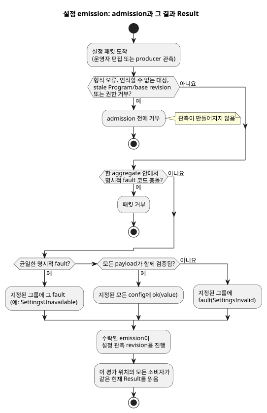

<!-- translation-source: docs/OPERATOR-SETTINGS-STREAM.md -->
[영문 원문](OPERATOR-SETTINGS-STREAM.md)

# 타입이 있는 설정 스트림

이 문서는 운영자 설정(config)이 실행 중인 GhostFlow 프로그램에 타입이 있는 스트림으로
어떻게 전달되는지, 바이너리 형식과 checkpoint 형식에 어떻게 인코딩되는지, 그리고
현재 어떤 실행 프로필이 이를 지원하는지 설명합니다.

규범적인 언어 규칙은 Reference의 §2(Result), §3(Periodic/DailySlots), §5(설정)에
있습니다. 이 문서는 그 규칙을 바꾸지 않습니다.

**이 문서의 내용**

- 스트림 모델: config 읽기가 무엇을 반환하고 fault가 어떻게 동작하는지.
- 바이너리 통합: descriptor, 패킷, staging, checkpoint(GFB11, GFSF5, GFCX3).
- 실행 프로필 경계: 현재 실행할 수 있는 것과 거부되는 것.

**스트림 모델.** `config` 선언은 *타입이 있는 스트림*에 이름을 붙입니다. 스트림은 초기
`ok(initial)` 관찰로 시작합니다.

- config 읽기의 타입은 `Result<T, SettingsFault>`입니다.
- 소비자는 기존 `case`, `map`, `and_then` 또는 명시적 `recover` 의미로 이를 처리합니다.
- producer는 네트워크 인터페이스일 수도 있고 물리적 조작부일 수도 있습니다. 소비자
  소스는 전송 방식을 명시하지 않습니다.
- 이 계약은 RxJS나 새로운 범용 스트림 프레임워크를 요구하지 않습니다.

**fault.** 설정 fault는 두 가지입니다.

| fault | 의미 |
| --- | --- |
| `SettingsInvalid` | 인식되고 권한이 확인된 emission이 payload 검증에 실패했습니다. |
| `SettingsUnavailable` | producer가 오류 관찰을 명시적으로 보고했습니다. |

- 메시지가 없다는 사실만으로는 fault도, 꾸며낸 반복 emission도 생기지 않습니다.
- 이후 성공한 emission이 오면 두 fault 모두에서 복구됩니다.
- 암묵적인 last-good 정책이나 기본값 정책은 없습니다.

**aggregate.** aggregate는 비어 있지 않고 중복이 없으며 권한이 확인된 config ID
집합을 식별합니다. 모든 payload를 함께 검증하므로 결과는 전부 아니면 전무입니다.

- 지정된 모든 config가 `ok`가 되거나, 지정된 모든 config가 `fault`를 받습니다. 관계없는
  스트림은 바뀌지 않습니다.
- 한 aggregate 안에서 명시적 fault 코드가 서로 충돌하면 패킷을 거부합니다.
- 균일한 명시적 fault는 지정된 그룹에 전달됩니다.
- 실제 payload 검증이 실패하면 그 그룹에 `SettingsInvalid`를 내보냅니다.

**admission 전 거부.** 다음은 admission(수용) 전에 거부됩니다. 형식이 잘못된 패킷,
인식할 수 없는 대상, stale(오래된) Program 또는 base revision, 거부된 권한입니다.
이런 거부는 관찰을 **만들지 않습니다**. 반대로 수락된 오류 emission은 설정 관찰
revision을 진행시킵니다.

아래 흐름도는 설정 패킷 하나가 현재 Result가 되는 과정을 요약합니다.



**소비자가 Result를 보는 방식.** 한 평가 위치의 모든 소비자는 같은 현재 Result를
사용합니다.

- **예약.** 의존하는 예약은 오류를 `Unknown(SettingsFault)`로 보존합니다. 그 오류가
  현재인 동안에는 새 발생(occurrence)을 수용하지 않습니다. 복구되면 성공한
  emission의 위치에서 선언된 phase 정책을 적용하며, 지난 발생을 따라잡지 않습니다.
- **수용된 Run.** config 오류는 이미 수용된 Run을 취소하지 않습니다.
- **일반 제어.** 일반 제어 식은 자신의 반응을 명시적으로 정합니다. 예를 들어 `case`
  안에서 읽은 duration은 경과 시간을 초기화하지 않고 다음 평가에서 진행 중인 제어를
  바꿀 수 있습니다. 프로그램이 대신 실행마다 고정된 duration을 원한다면, 성공한
  값을 state에 명시적으로 저장(capture)할 수 있습니다.

## 바이너리 통합

**config descriptor(GFB11).** GFB11/control-v10은 이전 GFB10 context 프로필을
대체합니다. scalar config descriptor는 prelude tag12입니다. 이를 소비하는 예약보다
먼저 옵니다.

```text
u32 id, string name, string semanticType, u8 kind, u8 operatorEditable
scalar: typed initial, u8 hasBounds, [typed min, max, step]
slots:  u64 gridMs, u16 capacity, u16 count, u16 minuteOfDay[]
u16 okInput, valueInput, faultInput
```

| `kind` | 이름 | 값 표현 |
| --- | --- | --- |
| 0 | Bool | 정규 Bool 플래그 |
| 1 | Int | 부호 있는 i32 |
| 2 | Number | 유한한 f64 |
| 3 | TimeSlots | 슬롯 목록(모든 scalar projection 인덱스에 0xffff 사용) |

- `semanticType`은 전송 형식에서도 Duration, Percent, 물리량/시간 타입의 구분을
  유지합니다.
- scalar projection은 보호된 이름 `__gf_config_ID_ok/value/fault`를 가집니다. 호스트는
  이를 직접 설정할 수 없습니다.

**예약 소비자.** 두 예약 소비자는 설정의 별도 복사본이 아니라, 공유 config
descriptor와 그 현재 관찰을 참조합니다.

- Periodic tag5는 내장했던 config 값/범위를 `u32 configId`로 대체합니다. ID0은 대신
  바로 뒤에 양수 `u64 literalIntervalMs`를 담습니다. 리터럴은 만들어 낸 편집 가능
  config가 아닙니다.
- config DailySlots tag9는 공통 접두부 뒤에 `string timezone, u32 configId, u8 dstMissing,
  dstRepeated`를 담습니다.

**objective(PID 목표).** 모든 GFB11 산출물은 `u16 objectiveCount`(0 또는 1)로
끝납니다. objective 본문은 다음과 같습니다.

1. name/output과 입력 인덱스 네 개를 유지하고,
2. `u16 targetOkInput`을 추가한 뒤,
3. period/late/direction과 PID 수치 여섯 개를 유지합니다.

목표의 value/ok 쌍은 하나의 Temperature config descriptor를 참조해야 합니다. 호스트
코드는 두 보호 입력 중 어느 것도 쓸 수 없고, 매니페스트의 초기 목표로 대체할 수도
없습니다.

**설정 패킷(GFSF5).** GFSF5는 context 시계/증거 섹션을 유지합니다. 설정 envelope에는
Program fingerprint, event ID, base revision, 유효 위치, 변경 목록이 이 순서로 들어
있습니다.

- 유효 위치 뒤의 `u8 origin`이 operatorEdit0과 producerObservation1을 구분합니다.
- 호스트가 이 분류를 인증합니다. 패킷 안의 주장은 인증 자격 증명이 아닙니다.
- 소비자 소스는 Result만 봅니다.
- 운영자 편집에는 편집 가능 접근 권한이 필요합니다.
- 정당한 producer 관찰은 readonly config에 대해 fault를 보고하고, 선언된 초기
  payload로 복구할 수 있습니다. 그 readonly payload를 바꿀 수는 없습니다.

각 변경은 `u32 configId, u8 rail`입니다.

| Rail | 내용 |
| --- | --- |
| Rail0(값) | `string semanticType, u8 kind, typed value`. TimeSlots 값은 `u16 count` 뒤에 `(u64 key,u16 minute)` |
| Rail1(fault) | fault code0(`SettingsInvalid`) 또는 code1(`SettingsUnavailable`) |

검사는 두 단계로 이루어집니다.

1. 구조 태그와 유한 수치 표현은 스트림 검증 전에 검사합니다.
2. 표현은 유효하지만 선언된 타입, 범위, 격자, 용량이 틀리면 의미 오류 rail이
   만들어집니다.

**TimeSlots 키.** TimeSlots 키는 공유 config 스트림이 할당합니다.

- Key0은 새 identity를 요청합니다.
- 기존 키는 유지하는 항목의 시각을 다시 정합니다.
- 빠진 키는 항목을 제거합니다.
- 그 config를 소비하는 모든 예약이 이 identity를 공유합니다.
- 오류가 나도 과거 목록을 현재 성공 값으로 노출하지 않습니다.

**결합 staging.** 결합 context 호출은 emission, 보호 입력, 예약 판단, VM 상태를 함께
staging합니다.

- 거부된 결합 호출은 event를 소비하지 않으므로 재시도할 수 있습니다.
- 이 API는 확정 전에 emission이 유효하다고 응답하지 않습니다.
- 다른 API를 통해 독립적으로 수락된 관찰이 있다면, 이후 제어 평가가 실패해도 그
  관찰을 되돌릴 수 없습니다.

**프레임 경로.** 공개 프레임 경로는 같은 GFCA1/GFSF5 패킷과 네이티브 ScanDriver로
`gf_frame_activate_context`와 `gf_frame_scan_context`를 사용합니다.

- 완전한 입력 프레임에는 런타임이 보호하는 Result projection과 파생된 단조 시계가
  빠집니다.
- 그 논리 시간은 context 시계와 일치해야 합니다.
- 성공한 평가만 네이티브 스캔 ID/시간을 진행시키고 수락된 결과를 게시합니다. 거부된
  프레임은 같은 스캔 ID에서 재시도할 수 있습니다.
- 프레임 checkpoint/상태 접근과 첫 스캔 전 복원은 GFCX3를 재사용합니다. 두 번째 설정
  상태를 만들지 않으며, JavaScript에서 수락된 결과를 합성하지도 않습니다.

**checkpoint(GFCX3).** GFCX3는 정확한 Program/바인딩 identity 아래에 현재 Result,
revision, 수락된 event identity, 키 할당 이력을 저장합니다.

- 복원된 fault는 fault로 남습니다.
- 과거의 성공 payload는 안정 키와 phase 검증을 위해서만 존재하며, 소비자의
  fallback으로 쓰이지 않습니다.
- 복원된 엔진 캐시는 공유 config 이력과 일치해야 합니다.
- GFCX3는 제한된 범위의 전체 달력 ID/revision 내용 이력도 보관합니다.
- 이전 GFCX1/GFCX2 이미지는 명시적으로 거부됩니다.

**context 상태.** context 상태는 각 config의 ID, 이름, 타입, 현재 Result를
노출합니다.

- 오류 Result에는 이전 `value`가 아니라 fault가 들어 있습니다.
- emission은 소스 해시나 실행 identity를 바꾸지 않습니다.
- 기존 state/타이머 의미는 바뀌지 않습니다.
- 하드웨어 수집, WebUI 전송, 장치 릴리스 작업은 이 언어/런타임 변경의 범위
  밖입니다.

## 실행 프로필 경계

이 절은 이번 변경이 실제로 실행하는 것과 거부하는 것을 정리합니다.

**Periodic.** 이번 변경의 Periodic 프로필은 `preserve_anchor`와
pulse/trusted-clock/baseline/skip 정책으로 명시적 `instant` anchor를 실행합니다.
Reference의 다른 anchor와 phase 정책은 각자의 구현 요구사항을 유지합니다. 이번 변경은
그것들을 실행한다고 주장하지 않습니다.

**TimeSlots.** config 기반 TimeSlots는 공유 스트림 소비자를 사용합니다.

**Solar.** Solar는 이제 [공유 Solar context 프로필](SOLAR-CONFIG-EXECUTION.ko.md)을
통해 같은 현재 Result를 소비합니다.

- 컴파일된 `when` 의존성은 작성자가 쓴 fault 분기가 true를 반환하더라도 현재 fault를
  `Unknown(SettingsFault)`로 보존합니다.
- 복구는 지난 발생을 따라잡지 않고 기준선(baseline)을 세웁니다.
- 관계없는 config fault는 Solar를 억제하지 않습니다.
- 공유 Solar 경로는 GFB16/control-v15와 GFSF6을 사용합니다. 기존 Rust Solar 엔진을
  설정 및 VM 상태와 함께 staging하고, Solar terminal identity를 GFCX3 안에 유지합니다.
- 기존의 독립 Solar 소비자와 Solar가 아닌 GFSF5 소비자는 자신의 명시적 프로필을
  유지합니다. 이들은 거부된 소스를 대신 실행하는 fallback이 아닙니다.

**Temperature PID.** 네이티브 Temperature PID objective는 같은 보호 config Result
벡터에서 목표를 읽습니다. fault가 나면 작성자가 정한 disable 정책을 따릅니다.

- 공유 벡터는 기존 PID 엔진보다 먼저 staging됩니다.
- 목표 fault는 PID 기한 사이에서도 즉시 작성된 `fault = disable` 정책을 따릅니다.
- 복구는 기존 기한과 `track_safe` 정책을 유지합니다.
- 설정 변경과 PID 변경은 같은 성공한 평가에서 함께 확정됩니다.
- 재시작하면 config 관찰을 복원하고 작성된 PID `restart = reset(...)`을 사용합니다.
  config checkpoint는 컨트롤러 이력을 복원하지 않습니다.

**컴파일 시 거부.** 다음은 여전히 거부됩니다. 실제 운영자 설정을 상수로 바꿔서 이
거부를 우회해서는 안 됩니다.

- **스트림과 리터럴 DailySlots를 섞는 것**은 소스 컴파일에서 거부됩니다.
- 실행 프로필의 **accounting 예비량(reserve)과 한도(limit) 값**은 설계자가 정한 정적
  범위입니다. Reference의 ON 5분, 정지 지연 10초 예시는 이런 고정 범위에 `let`을
  사용합니다. live config Result는 초기값으로 조용히 바꾸지 않고 거부합니다.
- 현재 프로필의 **`basis = range(...)` DailySlots**도 마찬가지로 고정된 duration을
  요구합니다. live config Result는 컴파일 시 거부됩니다. 리터럴/`let` range의 겹침
  규칙과 맞닿는 경계 규칙은 계속 실행할 수 있습니다. Range를 공유 live Result
  소비자로 확장하는 일은 이번 Periodic 및 일반 제어 스트림 구현과 별개의 작업입니다.

**검증이 다루는 범위.** 네이티브/WASM 검증과 가상 시뮬레이터 검증은 프런트엔드 전달,
물리적 수집, Device 배포, 임의의 외부 producer 어댑터를 인증하지 않습니다.

**패키징.** 서명된 이식 가능 패키지는 일반 elapsed 타이머를 포함한 scalar config
GFB11 산출물을 `GhostFlow/context-scan-abi-v5` 및 `control-v10` 아래에서 허용합니다.

- 서명, 다이제스트, capability, 컴파일러 일관성 검사는 여전히 필수입니다.
- 이 패키지 프로필은 예약, PID, TimeSlots, signal prelude에 대한 패키징 지원을
  추가하지 않습니다.
