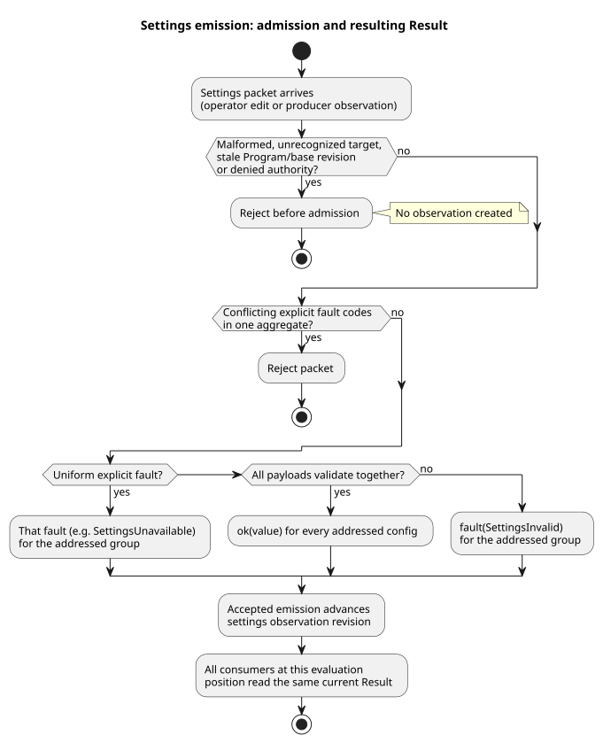

# Typed configuration streams

This document describes how operator settings (configs) reach a running
GhostFlow program as typed streams, how they are encoded in the binary and
checkpoint formats, and which execution profiles currently support them.

The normative language rules live in the Reference: §2 (Result), §3
(Periodic/DailySlots) and §5 (settings). This document does not change them.

**In this document**

- The stream model: what a config read returns, and how faults work.
- Binary integration: descriptors, packets, staging and
  checkpoints (GFB11, GFSF5, GFCX3).
- Executable profile boundary: what is executable
  today, and what is rejected.

**The stream model.** A config declaration names a *typed stream*. The stream
starts with an initial `ok(initial)` observation.

- A config read has the type `Result<T, SettingsFault>`.
- The consumer handles it with the existing `case`, `map`, `and_then` or explicit
  `recover` semantics.
- The producer may be a network interface or a physical control. Consumer source
  never names its transport.
- This contract does not require RxJS or a new general stream framework.

**Faults.** There are two settings faults:

| Fault | Meaning |
| --- | --- |
| `SettingsInvalid` | A recognized, authorized emission failed payload validation. |
| `SettingsUnavailable` | The producer explicitly reported an error observation. |

- Missing messages alone cause neither a fault nor a fabricated repeated
  emission.
- A later successful emission recovers from either fault.
- There is no implicit last-good or default policy.

**Aggregates.** An aggregate identifies a nonempty, unique, authorized set of
config IDs. All its payloads validate together, so the outcome is all-or-nothing:

- Either every addressed config becomes `ok`, or every addressed config gets a
  `fault`. Unrelated streams remain unchanged.
- Conflicting explicit fault codes inside one aggregate reject the packet.
- A uniform explicit fault is propagated to the addressed group.
- An actual payload validation failure emits `SettingsInvalid` for that group.

**Rejection before admission.** The following are rejected before admission:
malformed packets, unrecognized targets, a stale Program or base revision, and
denied authority. Such a rejection creates **no** observation. By contrast, an
accepted error emission does advance the settings observation revision.

The flowchart below summarizes how one settings packet becomes a current Result.



**How consumers see Results.** All consumers at one evaluation position use the
same current Results.

- **Schedules.** A dependent schedule preserves an error as
  `Unknown(SettingsFault)`. While that error is current, it admits no new
  occurrence. On recovery, it applies the declared phase policy at the position
  of the successful emission, with no past catch-up.
- **Admitted Runs.** A config error does not cancel an already admitted Run.
- **Ordinary control.** Ordinary control expressions decide their own response
  explicitly. For example, a duration read inside `case` can change an ongoing
  control at the next evaluation, without resetting elapsed time. If a program
  wants a fixed per-run duration instead, it can explicitly capture a successful
  value in state.

## Binary integration

**Config descriptors (GFB11).** GFB11/control-v10 replaces the earlier GFB10
context profile. Scalar config descriptors are prelude tag12. They come before
the schedules that consume them:

```text
u32 id, string name, string semanticType, u8 kind, u8 operatorEditable
scalar: typed initial, u8 hasBounds, [typed min, max, step]
slots:  u64 gridMs, u16 capacity, u16 count, u16 minuteOfDay[]
u16 okInput, valueInput, faultInput
```

| `kind` | Name | Value representation |
| --- | --- | --- |
| 0 | Bool | canonical Bool flag |
| 1 | Int | signed i32 |
| 2 | Number | finite f64 |
| 3 | TimeSlots | slot list (uses 0xffff for all scalar projection indices) |

- `semanticType` keeps the distinctions between Duration, Percent and
  quantity/time types on the wire.
- Scalar projections have the protected names `__gf_config_ID_ok/value/fault`.
  A host cannot set them directly.

**Schedule consumers.** Both schedule consumers reference the shared config
descriptor and its current observation, not separate copies of the setting.

- Periodic tag5 replaces its embedded config value/bounds with `u32 configId`.
  ID0 instead carries an immediately following positive `u64 literalIntervalMs`.
  A literal is not an invented editable config.
- Config DailySlots tag9 carries `string timezone, u32 configId, u8 dstMissing,
  dstRepeated` after its common prefix.

**Objective (PID target).** Every GFB11 artifact ends with `u16 objectiveCount`
(0 or 1). The objective body:

1. keeps the name/output and its four input indices,
2. adds `u16 targetOkInput`,
3. then keeps period/late/direction and the six PID numbers.

The target value/ok pair must refer to one Temperature config descriptor. Host
code cannot write either protected input, and cannot substitute the manifest's
initial target.

**Settings packets (GFSF5).** GFSF5 keeps the context clock/evidence sections.
Its settings envelope contains, in order: Program fingerprint, event ID, base
revision, effective position, and changes.

- After the effective position, `u8 origin` distinguishes operatorEdit0 from
  producerObservation1.
- The host authenticates this classification. A claim inside a packet is not an
  authentication credential.
- Consumer source sees only the Result.
- Operator edits require editable access.
- A legitimate producer observation can report a fault for a readonly config,
  and recover it to its declared initial payload. It cannot change that readonly
  payload.

Each change is `u32 configId, u8 rail`:

| Rail | Content |
| --- | --- |
| Rail0 (value) | `string semanticType, u8 kind, typed value`; a TimeSlots value is `u16 count` then `(u64 key,u16 minute)` |
| Rail1 (fault) | fault code0 (`SettingsInvalid`) or code1 (`SettingsUnavailable`) |

Checks happen in two layers:

1. Structural tags and finite numeric representation are checked before stream
   validation.
2. A valid representation with the wrong declared type, range, grid or capacity
   produces the semantic error rail.

**TimeSlots keys.** The shared config stream allocates TimeSlots keys.

- Key0 requests a new identity.
- Existing keys retime the entries they keep.
- Absent keys remove entries.
- All schedules that consume that config share those identities.
- Errors do not expose the historical list as a current successful value.

**Combined staging.** The combined context call stages emissions, protected
inputs, schedule decisions and VM state together.

- A rejected combined call does not consume its event, so it can be retried.
- This API does not acknowledge an emission as effective before commit.
- Observations accepted independently through another API, if any, cannot later
  be undone by a failed control evaluation.

**Framed path.** The public framed path uses `gf_frame_activate_context` and
`gf_frame_scan_context` with the same GFCA1/GFSF5 packets and the native
ScanDriver.

- The complete input frame omits the runtime-protected Result projections and
  the derived monotonic clock.
- Its logical time must match the context clock.
- Only a successful evaluation advances the native scan ID/time and publishes
  the accepted outcome. Rejected frames remain retryable at the same scan ID.
- Framed checkpoint/state access and pre-first-scan restore reuse GFCX3. They do
  not create a second settings state, and do not synthesize an accepted outcome
  in JavaScript.

**Checkpoints (GFCX3).** GFCX3 persists, under the exact Program/binding
identity: the current Result, the revision, accepted event identities and the key
allocation history.

- A restored fault remains a fault.
- Historical successful payloads exist only for stable-key and phase validation,
  never as a consumer fallback.
- Restored engine caches must agree with the shared config history.
- GFCX3 also retains bounded full calendar ID/revision content history.
- Old GFCX1/GFCX2 images are rejected explicitly.

**Context state.** Context state exposes each config's ID, name, type and
current Result.

- Error Results contain a fault, not an old `value`.
- Emissions do not change source hashes or run identity.
- Existing state/timer semantics are unchanged.
- Hardware acquisition, WebUI transport and device release work are outside this
  language/runtime change.

## Executable profile boundary

This section lists what this change actually executes, and what it rejects.

**Periodic.** The Periodic profile in this change executes an explicit `instant`
anchor with `preserve_anchor` and the pulse/trusted-clock/baseline/skip
policies. The Reference's other anchors and phase policies keep their own
implementation requirements; this change does not claim to execute them.

**TimeSlots.** Config-backed TimeSlots uses the shared stream consumer.

**Solar.** Solar now consumes the same current Results through the
[shared Solar context profile](SOLAR-CONFIG-EXECUTION.md).

- Its compiled `when` dependencies preserve a current fault as
  `Unknown(SettingsFault)`, even when an authored fault branch returns true.
- Recovery establishes a baseline without catch-up.
- Unrelated config faults do not suppress Solar.
- The shared Solar path uses GFB16/control-v15 and GFSF6. It stages the existing
  Rust Solar engine together with settings and VM state, and keeps Solar terminal
  identities inside GFCX3.
- Existing standalone Solar and non-Solar GFSF5 consumers keep their explicit
  profiles. They are not executable fallbacks for rejected source.

**Temperature PID.** The native Temperature PID objective reads its target from
the same protected config Result vector. A fault follows its authored disable
policy.

- The shared vector is staged before the existing PID engine.
- A target fault follows the authored `fault = disable` policy immediately, even
  between PID deadlines.
- Recovery keeps the existing deadline and the `track_safe` policy.
- Settings changes and PID changes commit with the same successful evaluation.
- Restart restores config observations and uses the authored PID
  `restart = reset(...)`. A config checkpoint does not restore controller
  history.

**Rejected at compilation.** The following remain rejected. These rejections
must not be bypassed by turning a real operator setting into a constant.

- **Mixing streams with literal DailySlots** is rejected at source compilation.
- **Accounting reserve and limit values** in the executable profile are static
  designer bounds. The Reference's example of 5 minutes ON with a 10-second stop
  delay uses `let` for those fixed bounds. A live config Result is rejected,
  rather than silently folded to its initial value.
- **`basis = range(...)` DailySlots** in the current profile likewise requires a
  fixed duration. A live config Result is rejected at compilation. The
  literal/`let` range overlap and touching-boundary rules remain executable.
  Extending Range to a shared live Result consumer is separate work from this
  Periodic and ordinary-control stream implementation.

**What validation covers.** Native/WASM and virtual-simulator validation does
not certify frontend delivery, physical acquisition, Device deployment or
arbitrary external producer adapters.

**Packaging.** Signed portable packages accept scalar config GFB11 artifacts,
including ordinary elapsed timers, under `GhostFlow/context-scan-abi-v5` and
`control-v10`.

- Signature, digest, capability and compiler-consistency checks remain
  mandatory.
- This package profile does not add packaging support for schedules, PID,
  TimeSlots or the signal prelude.
