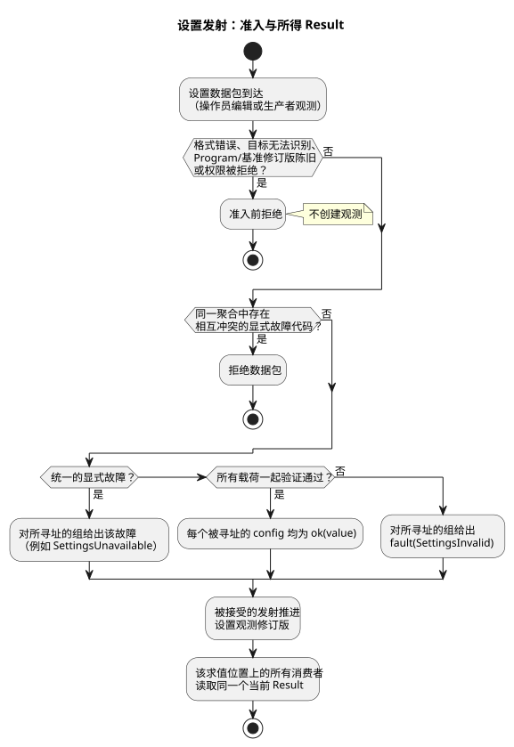

<!-- translation-source: docs/OPERATOR-SETTINGS-STREAM.md -->
[英文原文](OPERATOR-SETTINGS-STREAM.md)

# 类型化配置流

本文档说明操作员设置（config）如何以类型化流的形式到达正在运行的 GhostFlow
程序、它们在二进制格式和检查点格式中如何编码，以及当前哪些执行 profile 支持它们。

规范性的语言规则见 Reference：§2（Result）、§3（Periodic/DailySlots）和 §5（设置）。
本文档不改变这些规则。

**本文内容**

- 流模型：config 读取返回什么，以及故障如何工作。
- 二进制集成：描述符、数据包、暂存（staging）和检查点（GFB11、GFSF5、GFCX3）。
- 可执行 profile 边界：目前哪些可以执行，哪些会被拒绝。

**流模型。** 一个 config 声明命名一个*类型化流*。该流以初始观测 `ok(initial)` 开始。

- config 读取的类型为 `Result<T, SettingsFault>`。
- 消费者使用现有的 `case`、`map`、`and_then` 或显式 `recover` 语义来处理它。
- 生产者可以是网络接口，也可以是物理控件。消费者源从不指明其传输方式。
- 该契约不需要 RxJS，也不需要新的通用流框架。

**故障。** 设置故障有两种：

| 故障 | 含义 |
| --- | --- |
| `SettingsInvalid` | 一次已识别、已授权的发射未通过载荷验证。 |
| `SettingsUnavailable` | 生产者显式报告了一个错误观测。 |

- 仅仅缺少消息，既不会导致故障，也不会凭空生成重复发射。
- 之后的一次成功发射可以从任一故障中恢复。
- 不存在隐式的“最后一次正常值”（last-good）或默认值策略。

**聚合。** 一个聚合（aggregate）标识一个非空、唯一且已授权的 config ID 集合。它的所有载荷一起验证，
因此结果是全有或全无：

- 要么每个被寻址的 config 都变为 `ok`，要么每个被寻址的 config 都得到一个 `fault`。
  无关的流保持不变。
- 同一聚合内相互冲突的显式故障代码会导致该数据包被拒绝。
- 统一的显式故障会传播到被寻址的组。
- 实际的载荷验证失败会对该组发出 `SettingsInvalid`。

**准入前拒绝。** 以下情况会在准入（admission）之前被拒绝：格式错误的数据包、无法识别的目标、
陈旧的 Program 或基准修订版（revision），以及被拒绝的权限。这类拒绝**不会**创建任何观测。
相反，一次被接受的错误发射确实会推进设置观测修订版。

下面的流程图概括了一个设置数据包如何变成当前的 Result。



**消费者如何看到 Result。** 同一求值位置上的所有消费者使用同一组当前 Result。

- **调度计划。** 依赖的调度计划会把错误保留为 `Unknown(SettingsFault)`。
  在该错误为当前值期间，它不准入新的触发实例（occurrence）。恢复时，它在成功发射的位置应用所声明的相位策略，
  不追补过去。
- **已准入的 Run。** config 错误不会取消已经准入的 Run。
- **普通控制。** 普通控制表达式显式地决定自己的响应。例如，在 `case` 中读取的持续时间可以在下一次求值时
  改变正在进行的控制，而不会重置经过时间。如果程序希望每次运行使用固定的持续时间，可以显式地把一个成功值捕获到
  state 中。

## 二进制集成

**config 描述符（GFB11）。** GFB11/control-v10 取代了先前的 GFB10 上下文 profile。
标量 config 描述符是 prelude tag12，位于消费它们的调度计划之前：

```text
u32 id, string name, string semanticType, u8 kind, u8 operatorEditable
scalar: typed initial, u8 hasBounds, [typed min, max, step]
slots:  u64 gridMs, u16 capacity, u16 count, u16 minuteOfDay[]
u16 okInput, valueInput, faultInput
```

| `kind` | 名称 | 值的表示 |
| --- | --- | --- |
| 0 | Bool | 规范 Bool 标志 |
| 1 | Int | 有符号 i32 |
| 2 | Number | 有限 f64 |
| 3 | TimeSlots | 时间槽列表（所有标量投影索引均使用 0xffff） |

- `semanticType` 在线路上保留 Duration、Percent 与物理量/时间类型之间的区别。
- 标量投影使用受保护的名称 `__gf_config_ID_ok/value/fault`。宿主不能直接设置它们。

**调度计划消费者。** 两种调度计划消费者都引用共享的 config 描述符及其当前观测，而不是各自持有设置的副本。

- Periodic tag5 用 `u32 configId` 取代其内嵌的 config 值/边界。ID0 则改为紧随其后携带一个正的
  `u64 literalIntervalMs`。字面量不是凭空生成的可编辑 config。
- config DailySlots tag9 在其公共前缀之后携带
  `string timezone, u32 configId, u8 dstMissing, dstRepeated`。

**目标（PID 目标值）。** 每个 GFB11 产物都以 `u16 objectiveCount`（0 或 1）结尾。目标主体：

1. 保留名称/输出及其四个输入索引，
2. 增加 `u16 targetOkInput`，
3. 然后保留周期/延迟/方向以及六个 PID 数值。

目标的 value/ok 对必须引用同一个 Temperature config 描述符。宿主代码不能写入这两个受保护输入中的任何一个，
也不能替换清单（manifest）中的初始目标值。

**设置数据包（GFSF5）。** GFSF5 保留上下文的时钟/证据部分。其设置信封依次包含：Program 指纹、事件 ID、
基准修订版、生效位置以及变更。

- 在生效位置之后，`u8 origin` 区分 operatorEdit0 与 producerObservation1。
- 宿主对这一分类进行认证。数据包内的声明不是认证凭据。
- 消费者源只看到 Result。
- 操作员编辑需要可编辑访问权限。
- 合法的生产者观测可以为只读 config 报告故障，并将其恢复为声明的初始载荷，但不能改变该只读载荷。

每个变更为 `u32 configId, u8 rail`：

| 通道 | 内容 |
| --- | --- |
| Rail0（值） | `string semanticType, u8 kind, typed value`；TimeSlots 值为 `u16 count` 后接 `(u64 key,u16 minute)` |
| Rail1（故障） | 故障代码 0（`SettingsInvalid`）或代码 1（`SettingsUnavailable`） |

检查分两层进行：

1. 在流验证之前，先检查结构标签和有限数值表示。
2. 表示有效但声明的类型、范围、网格或容量不符时，会产生语义错误通道。

**TimeSlots 键。** 共享的 config 流负责分配 TimeSlots 键。

- Key0 请求一个新的身份标识。
- 已有的键会为其保留的条目重新设定时间。
- 缺失的键会删除对应条目。
- 消费该 config 的所有调度计划共享这些身份标识。
- 错误不会把历史列表作为当前的成功值暴露出来。

**组合暂存。** 组合上下文调用将发射、受保护输入、调度判定和 VM 状态一起暂存。

- 被拒绝的组合调用不会消耗其事件，因此可以重试。
- 此 API 不会在提交（commit）之前确认某次发射已经生效。
- 通过其他 API 独立接受的观测（如果有）不能因为之后的控制求值失败而被撤销。

**分帧路径。** 公开的分帧路径使用 `gf_frame_activate_context` 和 `gf_frame_scan_context`，
配合相同的 GFCA1/GFSF5 数据包以及原生 ScanDriver。

- 完整输入帧省略由运行时保护的 Result 投影以及派生的单调时钟。
- 其逻辑时间必须与上下文时钟一致。
- 只有成功的求值才会推进原生扫描 ID/时间并发布被接受的结果。被拒绝的帧仍可在同一扫描 ID 上重试。
- 分帧检查点/状态访问以及首次扫描前的恢复复用 GFCX3。它们不会创建第二份设置状态，也不会在 JavaScript
  中合成被接受的结果。

**检查点（GFCX3）。** GFCX3 在确切的 Program/绑定身份标识下持久化：当前 Result、修订版、
已接受的事件身份标识以及键分配历史。

- 恢复出的故障仍然是故障。
- 历史成功载荷仅用于稳定键和相位验证，绝不作为消费者的 fallback。
- 恢复的引擎缓存必须与共享 config 历史一致。
- GFCX3 还保留有界的完整日历 ID/修订版内容历史。
- 旧的 GFCX1/GFCX2 镜像会被显式拒绝。

**上下文状态。** 上下文状态公开每个 config 的 ID、名称、类型和当前 Result。

- 错误 Result 包含一个故障，而不是旧的 `value`。
- 发射不会改变源哈希或运行身份标识。
- 现有的 state/定时器语义保持不变。
- 硬件采集、WebUI 传输和设备发布工作不属于本次语言/运行时变更的范围。

## 可执行 profile 边界

本节列出本次变更实际执行的内容以及拒绝的内容。

**Periodic。** 本次变更中的 Periodic profile 执行带 `preserve_anchor` 的显式 `instant`
锚点，以及 pulse/可信时钟/基线/跳过策略。Reference 中的其他锚点和相位策略保留各自的实现要求；
本次变更并不声称执行它们。

**TimeSlots。** 由 config 支撑的 TimeSlots 使用共享流消费者。

**Solar。** Solar 现在通过[共享 Solar 上下文 profile](SOLAR-CONFIG-EXECUTION.zh.md)
消费同一组当前 Result。

- 其编译后的 `when` 依赖会把当前故障保留为 `Unknown(SettingsFault)`，
  即使作者编写的故障分支返回 true 也是如此。
- 恢复时建立基线，不进行追补。
- 无关的 config 故障不会抑制 Solar。
- 共享 Solar 路径使用 GFB16/control-v15 和 GFSF6。它将现有的 Rust Solar 引擎与设置和 VM
  状态一起暂存，并将 Solar 终端身份标识保存在 GFCX3 中。
- 现有的独立 Solar 消费者和非 Solar 的 GFSF5 消费者保留各自的显式 profile。它们不是被拒绝源的可执行
  fallback。

**Temperature PID。** 原生 Temperature PID 目标从同一个受保护的 config Result 向量中读取其目标值。
故障遵循作者编写的禁用策略。

- 共享向量在现有 PID 引擎之前暂存。
- 目标值故障会立即遵循作者编写的 `fault = disable` 策略，即使处于两个 PID 截止时间之间也是如此。
- 恢复时保留现有的截止时间和 `track_safe` 策略。
- 设置变更与 PID 变更随同一次成功求值一起提交。
- 重启会恢复 config 观测，并使用作者编写的 PID `restart = reset(...)`。config
  检查点不会恢复控制器历史。

**在编译时被拒绝。** 以下内容仍会被拒绝。不得通过把真实的操作员设置改为常量来绕过这些拒绝。

- **将流与字面量 DailySlots 混用**在源编译时被拒绝。
- 可执行 profile 中的**用量核算（accounting）预留值和限值**是静态的设计者边界。Reference 中
  “ON 5 分钟、停止延时 10 秒”的示例对这些固定边界使用 `let`。实时 config Result 会被拒绝，
  而不是被悄悄折叠为其初始值。
- 当前 profile 中的 **`basis = range(...)` DailySlots** 同样需要固定的持续时间。实时 config
  Result 在编译时被拒绝。字面量/`let` 范围的重叠和边界相接规则仍然可以执行。将 Range
  扩展为共享实时 Result 的消费者，是与本次 Periodic 及普通控制流实现相独立的工作。

**验证覆盖的范围。** 原生/WASM 以及虚拟模拟器验证不认证前端交付、物理采集、Device 部署或任意外部生产者适配器。

**打包。** 签名的可移植包在 `GhostFlow/context-scan-abi-v5` 和 `control-v10`
下接受标量 config GFB11 产物，包括普通的经过时间定时器。

- 签名、摘要、能力（capability）和编译器一致性检查仍然是强制的。
- 此包 profile 不为调度计划、PID、TimeSlots 或 signal prelude 增加打包支持。
