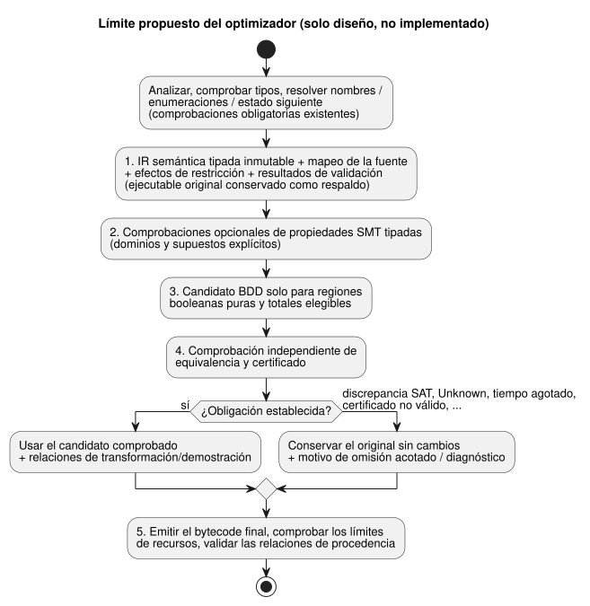

<!-- translation-source: docs/OPTIMIZER-PASS-CONTRACT.md -->
[Original en inglés](OPTIMIZER-PASS-CONTRACT.md)

# Contrato de la pasada del optimizador

[한국어](OPTIMIZER-PASS-CONTRACT.ko.md)

Estado: **solo diseño**, issue [#42](https://github.com/callin2/ghostflow-language/issues/42).

Este documento registra la selección realizada el 2026-09-13 para un futuro
optimizador del compilador:

- **Comprobaciones SMT en tiempo de compilación.** La resolución SMT tipada
  (satisfacibilidad módulo teorías) se usa para comprobaciones de restricciones y
  comprobaciones de equivalencia.
- **Simplificación con BDD en tiempo de generación/compilación.** Los diagramas
  de decisión binarios (BDD) se usan para simplificar la IR (representación
  intermedia) booleana tipada que sea elegible.
- Ninguno de los dos motores se ejecuta en el ESP32.
- DBM no se ha seleccionado; solo era un candidato condicional.

Lo que este documento **no** acepta:

- ninguna elección de biblioteca, implementación del compilador ni mejora de
  rendimiento;
- ningún indicador público ni ninguna extensión del manifiesto.

La elección de biblioteca se aplaza intencionadamente; no es un requisito previo
de este contrato. Se trata de un diseño local, no de una investigación publicada.

En este documento:

- [Autoridad semántica y alcance](#autoridad-semántica-y-alcance): lo que el
  optimizador nunca debe cambiar.
- [Límite y orden propuestos de la pasada](#límite-y-orden-propuestos-de-la-pasada):
  dónde se situaría el optimizador dentro del compilador.
- [Obligación de equivalencia](#obligación-de-equivalencia): qué significa
  "equivalente".
- [Fallos y aceptación de demostraciones](#fallos-y-aceptación-de-demostraciones):
  cómo se trata cada resultado de comprobación.
- [Procedencia propuesta y adopción de artefactos](#procedencia-propuesta-y-adopción-de-artefactos):
  registros necesarios antes de poder distribuir artefactos optimizados.
- [Plan de conformidad ejecutable y fases de implementación](#plan-de-conformidad-ejecutable-y-fases-de-implementación):
  vectores de prueba planificados y orden de entrega.

## Autoridad semántica y alcance

Lea estos documentos en conjunto:
[Referencia 02](reference/02-types-expressions-state.es.md),
[Referencia 4.7](reference/04-sensors-constraints-control.es.md#47-requested-safe-applied-confirmed),
el [límite físico](LLM-TOOLCHAIN-ARCHITECTURE.es.md)
y el [mapa de anclas de intención](INTENT-ANCHOR-MAP.es.md).

**La fuente sigue siendo la autoridad.** La fuente canónica `.ghost.md`,
incluidos su prosa y sus comentarios, sigue siendo la autoridad.

- La optimización debe conservar los bytes exactos y la identidad de revisión de
  la fuente, aunque se elimine el material opcional de depuración de la IR.
- La optimización no puede reescribir la intención.
- No puede convertir un supuesto de IA no confirmado en un axioma formal.
- La prosa confirmada por sí sola tampoco es una premisa tipada para la máquina.

**Lo que ya existe.** El mapeo básico de anclas de #31 y la procedencia del
reducido de require de #342/actual ya están implementados:

- `tools/source-trace.mjs` emite derivaciones `GhostFlow/source-trace-v1` con
  `relation: lowered-as`, `status: compiler-derived` y
  `semanticVerification: not-proven`.
- La reproducción (replay) determinista valida la coherencia. No demuestra la
  equivalencia semántica, la evaluación ni la aplicación física.
- Las demostraciones para comprobaciones/sustituciones eliminadas y para nodos
  fusionados corresponden a la futura implementación de #42. Este diseño no
  cierra la aceptación pendiente de #31.

**Una carencia conocida: `require` de tres salidas.** Hoy,
`require !(a && b && c)` se reduce a `mutex(a,b,c)`. No son lo mismo:

| `a` | `b` | `c` | "no todas" booleano `!(a && b && c)` | "como máximo una" `mutex(a,b,c)` |
| --- | --- | --- | --- | --- |
| true | true | false | true | false |

- La derivación actual sigue sin demostrarse.
- Este diseño ni cambia ni define la semántica de fuente de tres salidas, y no
  repara el reducido de require aguas arriba.
- Por tanto, un optimizador compara la **IR ejecutable actual resuelta
  semánticamente**, con semántica tipada de efectos de restricción, frente a su
  candidato. Nunca compara solo AST booleanos en bruto.
- Para dos salidas, las tablas de verdad coinciden. Eso por sí solo sigue sin
  demostrar el comportamiento final de salida segura, de errores y de evidencia.

## Límite y orden propuestos de la pasada

El Parser/Lowerer actual combina tipado, resolución y emisión. Todavía no expone
el límite del optimizador descrito abajo. Una implementación futura debe hacer
explícito ese límite:

- **después** del análisis sintáctico, la comprobación de tipos y la resolución
  de nombres/enumeraciones/estado siguiente;
- **antes** de la emisión final del bytecode;
- **sin** saltarse ninguna comprobación obligatoria existente.

El orden propuesto es:

1. Producir una IR semántica tipada inmutable, el mapeo de la fuente, los efectos
   de las restricciones y los resultados de validación actuales; conservar el
   ejecutable original como respaldo (fallback).
2. Opcionalmente, ejecutar comprobaciones de propiedades SMT tipadas con dominios
   y supuestos explícitos.
3. Generar un candidato BDD solo para regiones booleanas puras y totales
   elegibles.
4. Comprobar de forma independiente la equivalencia del candidato y cualquier
   certificado presentado.
5. Emitir el bytecode final, comprobar los límites de recursos y validar las
   relaciones de procedencia.

El diagrama siguiente muestra el mismo orden y dónde se conserva el original.

**La entrada de la pasada** incluye:

- las revisiones exactas de la fuente, del compilador y del perfil;
- los operadores y dominios tipados;
- las vinculaciones de estado y de salidas, y el orden de evaluación;
- los puntos de efecto y de fallo, y las etapas de las restricciones;
- las dependencias de temporizadores, programaciones y contabilización de uso;
- los ID de nodo de la fuente y los enlaces de anclas.

**Elegibilidad.** Una región se excluye cuando su codificación no se admite o
cuando falta evidencia de pureza/totalidad. ("Pura" significa sin efectos
secundarios; "total" significa definida para toda entrada admitida).

- Las ramas de Result, las programaciones, los temporizadores, las expresiones
  que producen errores y los operandos de cortocircuito **no** son
  automáticamente átomos booleanos puros y totales.
- `Number` es binary64 finito, no Real de SMT. Deben modelarse el redondeo y los
  fallos por operaciones no finitas.
- `Int` es i32 comprobado, no un entero no acotado ni un desbordamiento
  silencioso con vuelta.
- Duration, las enumeraciones, las etiquetas de Result, las unidades y los
  dominios de entrada válidos siguen siendo distintos.

**La salida de la pasada** es una de dos cosas:

- el original sin cambios, con un motivo de omisión acotado; o
- un candidato comprobado, más las relaciones exactas de
  transformación/demostración.

Ninguna transformación pasa a ser desplegable solo porque un solver o un
generador de BDD la haya producido. La identidad de BDD puede respaldar una
región booleana modelada; no es una demostración del comportamiento de todo el
programa.

## Obligación de equivalencia

**Qué se compara.** Compare las **transiciones** del original y del candidato, no
solo el Bool devuelto. La comparación cubre toda entrada admitida, todo estado
anterior y todo historial del entorno, bajo los mismos:

- programa y perfil;
- identidad de ejecución y épocas de reloj;
- supuestos tipados declarados.

**Varios ticks.** La equivalencia de varios ticks requiere una relación de
transición preservada y estados iniciales/de punto de control (checkpoint)
coincidentes. Probar una traza finita no establece esa demostración.

La tabla enumera lo que debe preservarse.

| Observable | Preservación requerida |
| --- | --- |
| Estado | Lecturas del estado anterior, dependencias resueltas del estado siguiente, consolidación en paralelo y reversión atómica ante un fallo |
| Salidas | Intención solicitada, intención segura final, bloqueo de punto fijo e identidades de los bloqueadores; las restricciones nunca fabrican salidas verdaderas |
| Errores | Cortocircuito y selección de rama, primer fallo/error observable y su orden/origen, entradas rechazadas y reversión de la transición fallida |
| Tiempo y ciclo de vida | Continuidad de la ejecución/del tiempo, estado de inicialización/reinicio/transcurrido de los temporizadores, identidad y límites de ocurrencia/admisión de las programaciones |
| Contabilización de uso | Base requested/safe/applied declarada, registros de uso/admisión, límites y su reversión |
| Evidencia | Eventos de evaluación reales e identidades de la fuente, satisfacción derivada, bloqueo final y procedencia retenida de Result/sensores |

**Los hechos físicos quedan fuera del alcance.** Los comandos aplicados y la
retroalimentación física confirmada siguen siendo hechos separados del Device.
Esta pasada no establece ninguno de ellos.

**Qué puede cambiar y qué no.**

- La pasada puede eliminar instrucciones internas o fusionar cálculos elegibles,
  pero solo dentro de una región demostrada.
- El tamaño del bytecode y el número de instrucciones pueden diferir dentro del
  perfil de recursos aceptado.
- Los fallos observables por límite de recursos, las reglas de
  temporización/admisión y la evidencia no pueden cambiar de forma silenciosa.
- Cualquier relajación propuesta de una observación pública de coste/traza
  requiere un contrato aparte.

**Trazas honestas.**

- Los nodos eliminados nunca deben notificarse como ejecutados.
- Un valor lógico reconstruido o una satisfacción derivada se etiqueta como
  *derivado*, junto con su evidencia de sustitución. Es distinto de una
  comprobación de la fuente evaluada y de un bloqueo final de salida.
- Si los consumidores de trazas actuales no pueden expresar esa distinción, omita
  la transformación.

## Fallos y aceptación de demostraciones

Cada resultado de comprobación tiene una consecuencia fija:

| Resultado de la comprobación | Contrato |
| --- | --- |
| UNSAT | Aceptar solo cuando la codificación tipada de discrepancia/propiedad, el alcance de los supuestos y un certificado validado de forma independiente establecen la obligación enunciada |
| SAT | Validar el contraejemplo frente a la semántica del original/candidato; una discrepancia real rechaza el candidato y conserva el original |
| Unknown, tiempo de espera agotado, error del solver/verificador, teoría no admitida, presupuesto de nodos/memoria/tiempo superado | Omitir la optimización opcional, conservar el original y un diagnóstico acotado; nunca marcar como demostrado ni rechazar una fuente válida por este motivo |
| Certificado no válido, contraejemplo no verificable o mapeo incoherente | Rechazar el candidato, conservar el original; registrar el fallo de validación sin afirmar que la fuente no es válida |

Reglas que se aplican a todo resultado:

- Los errores obligatorios existentes de lenguaje, de artefacto y de recursos
  siguen siendo errores.
- Un fallo del optimizador opcional no es un nuevo rechazo del lenguaje fuente.
- El estado del solver por sí solo no es una demostración.
- Las versiones del certificado, de la codificación y del verificador, los
  supuestos y el alcance deben registrarse y revalidarse.
- Una comprobación *independiente* significa no confiar en la afirmación de
  equivalencia propia y no comprobada del generador de candidatos.
- El comportamiento ante el presupuesto es determinista para la selección de
  artefactos, o se registra explícitamente. No afecta al significado de la
  fuente.

## Procedencia propuesta y adopción de artefactos

Estos son requisitos para futuros registros de relación, **no campos de esquema
aceptados**:

- Hashes de la IR y del bytecode de entrada/candidatos; revisiones exactas del
  documento fuente, del compilador, del perfil del lenguaje y del mapeo;
  identidad de la transformación y composición ordenada.
- Cada ancla de origen y cada ID/rango de nodo original, incluidos los nodos
  eliminados/fusionados; ID de los nodos de sustitución, relación, guarda de
  sustitución y alcance semántico. Preservar los orígenes de muchos a muchos y la
  clasificación de autoría sin inventar enlaces a la fuente.
- Resumen de la obligación/codificación tipada, supuestos explícitos, identidad y
  versión del verificador/certificado, estado de validación, motivo y resumen del
  certificado/contenido.
- Estados distintos para sustituciones no verificadas/generadas y verificadas de
  forma independiente; nunca promover mediante reproducción los registros de
  reducido existentes `compiler-derived`/`not-proven`.

**Validación de cada transformación.** Cada transformación, y su composición,
debe superar la validación de:

- la revisión exacta;
- los orígenes completos;
- la cobertura de la sustitución;
- la evidencia semántica.

Preserve las ubicaciones en la fuente tanto en Markdown como en las coordenadas
extraídas, cuando existan. Una restricción eliminada necesita una garantía
comprobada de forma independiente que cubra su efecto de bloqueo original. No
basta con una afirmación conveniente de que otro Bool la implica.

**Adopción.** La validación estricta actual de reproducción/paquetes debe seguir
rechazando el bytecode optimizado, o las nuevas afirmaciones de relación, que no
pueda derivar y validar. La adopción requiere:

- un validador consciente de las demostraciones, especificado por separado; y
- una decisión de compatibilidad/versión para los mapas de fuente, los paquetes,
  la reproducción y los consumidores.

No desactive la reproducción canónica ni reutilice su resultado de coherencia
como demostración semántica.

## Plan de conformidad ejecutable y fases de implementación

Los siguientes son vectores **planificados**. No son pasadas del optimizador
implementadas ni resultados aprobados notificados. El plan:

- asignar los ID propuestos estables de abajo;
- compilar fixtures literarios (literate) canónicos;
- ejecutar el original y el candidato tanto en nativo como en WASM;
- comparar los registros completos de transición y de evidencia.

Las pruebas existentes aportan semillas, no nuevos certificados de demostración.

| ID propuesto / semilla | Vectores y oráculo requeridos |
| --- | --- |
| OPT-STATE / Referencia 02 | Actualizaciones en paralelo, dependencias del estado anterior/siguiente, cambios de rama y continuación desde punto de control a lo largo de varios ticks; consolidación y reversión ante fallos iguales |
| OPT-TIMER / `examples/optional-feedback-timer.ghost.md`, `tests/continuous-timer-compatibility.test.mjs` | Umbral menos 1ms/exacto/más 1ms, inicialización/reinicio, retroalimentación no disponible, discontinuidad de época de ejecución/reloj y soporte rechazado; estado y fallos de temporizador iguales |
| OPT-SCHEDULE / `examples/scheduled-watering.ghost.md`, `tests/schedule-missed-reaction.test.mjs` | Límites de ocurrencia, duplicados, reacción a omitidas, corrección hacia atrás del reloj de pared y límites de contabilización de uso; identidades de admisión y reversión del uso iguales |
| OPT-INT / `tests/int-compiler.test.mjs`, `tests/int-division-identity.test.mjs` | MIN/MAX, desbordamiento comprobado, división por cero, MIN div -1, fallo en cortocircuito; origen/orden de fallos iguales |
| OPT-NUMBER / Referencia 02 | Redondeo/cancelación binary64, cero con signo cuando sea observable, límites finito/no finito y distinciones de unidades tipadas; ninguna reescritura basada en Real |
| OPT-RESULT / `tests/result-control.test.mjs`, `tests/result-provenance.test.mjs` | Estado de enumeración, ramas ok/fault, cortocircuito de izquierda a derecha, procedencia retenida y reversión de decisiones fallidas; evidencia seleccionada igual |
| OPT-CONSTRAINT / `tests/constraints.test.mjs` | Tablas de verdad exhaustivas de dos/tres salidas, incluido true,true,false; comparar los efectos reducidos actuales, reordenar restricciones, cadenas de require y bloqueadores finales; nunca certificar el "no todas" de tres salidas en bruto como mutex |
| OPT-PROVENANCE / `tests/intent-anchor-map.test.mjs`, `tests/portable-package.test.mjs` | Orígenes eliminados/fusionados, revisiones solo de prosa, hashes cambiados, manipulación de certificados/mapeos, eventos derivados frente a ejecutados; rechazar demostraciones falsas y revisiones mezcladas |
| OPT-FALLBACK / todos los fixtures | Forzar unknown/tiempo de espera agotado/fallo del verificador y cada límite de presupuesto; artefacto original conservado, errores obligatorios existentes sin cambios |

**Fases de implementación.** Implemente en fases acotadas, en este orden:

1. Límite de IR/efectos tipados con reproducción de referencia.
2. Codificaciones de propiedades tipadas y vectores negativos comprobados de
   forma independiente.
3. Elegibilidad de Bool puro/total y generación acotada de candidatos BDD.
4. Comprobación de equivalencia, comprobación de certificados y composición.
5. Adopción de procedencia/paquetes consciente de las demostraciones, con
   conformidad diferencial nativo/WASM.

Cada fase conserva la ruta original hasta que se verifica su propia aceptación.
La evaluación de bibliotecas sigue a los requisitos de codificación/certificado;
aquí no se elige ningún motor ni ninguna ABI.
