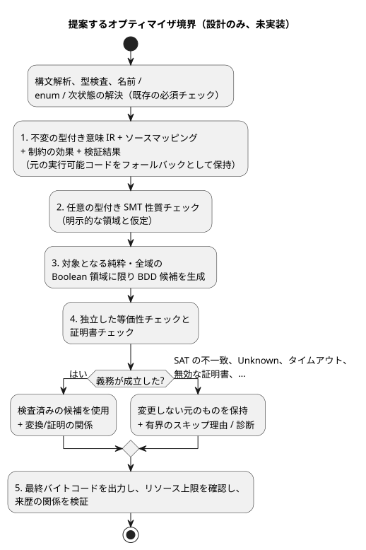

<!-- translation-source: docs/OPTIMIZER-PASS-CONTRACT.md -->
[英語の原文](OPTIMIZER-PASS-CONTRACT.md)

# オプティマイザパス契約

[한국어](OPTIMIZER-PASS-CONTRACT.ko.md)

ステータス：**設計のみ**、issue [#42](https://github.com/callin2/ghostflow-language/issues/42)。

このドキュメントは、将来のコンパイラオプティマイザについて 2026-09-13 に行った選定を記録します。

- **コンパイル時の SMT チェック。** 制約チェックと等価性チェックには、型付きの SMT（satisfiability modulo theories、理論付き充足可能性）ソルバを使います。
- **生成時/コンパイル時の BDD 簡約。** 対象となる型付きの Boolean IR（中間表現）の簡約には、二分決定図（BDD）を使います。
- どちらのエンジンも ESP32 上では動作しません。
- DBM は選定されていません。条件付きの候補にすぎませんでした。

このドキュメントが受け入れて**いない**もの：

- ライブラリの選定、コンパイラの実装、性能向上
- 公開フラグ、マニフェストの拡張

ライブラリの選定は意図的に先送りしています。この契約の前提条件ではありません。これはローカルな設計であり、公表された研究ではありません。

このドキュメントの内容：

- [意味上の権威と範囲](#意味上の権威と範囲)：オプティマイザが決して変えてはならないもの。
- [提案するパス境界と順序](#提案するパス境界と順序)：オプティマイザをコンパイラのどこに置くか。
- [等価性の義務](#等価性の義務)：「等価」とは何を意味するか。
- [失敗と証明の受け入れ](#失敗と証明の受け入れ)：各チェック結果をどう扱うか。
- [提案する来歴とアーティファクトの採用](#提案する来歴とアーティファクトの採用)：最適化済みアーティファクトを出荷する前に必要な記録。
- [実行可能な適合性計画と実装スライス](#実行可能な適合性計画と実装スライス)：計画しているテストベクタと提供の順序。

## 意味上の権威と範囲

次のものを合わせて読んでください：
[Reference 02](reference/02-types-expressions-state.ja.md)、
[Reference 4.7](reference/04-sensors-constraints-control.ja.md#47-requestedsafeappliedconfirmed)、
[物理的な境界](LLM-TOOLCHAIN-ARCHITECTURE.md#physical-driver-and-device-boundary)、
[意図アンカーマップ](INTENT-ANCHOR-MAP.ja.md)。

**ソースが権威であり続けます。** 散文とコメントを含む正本の `.ghost.md` ソースが、引き続き権威です。

- 任意の IR デバッグ情報が取り除かれても、最適化はソースの正確なバイト列とリビジョンの同一性を保たなければなりません。
- 最適化は意図を書き換えることができません。
- 確認されていない AI の仮定を、形式的な公理に変えることはできません。
- 確認済みの散文だけでも、型付きの機械的な前提にはなりません。

**すでに存在するもの。** #31 の基本的なアンカーマッピングと、#342/現行の require の lowering の来歴は、すでに実装されています。

- `tools/source-trace.mjs` は、`relation: lowered-as`、`status: compiler-derived`、`semanticVerification: not-proven` を持つ `GhostFlow/source-trace-v1` の導出を出力します。
- 決定的なリプレイは一貫性を検証します。意味上の等価性、評価、物理的な適用を証明するものではありません。
- 除去されたチェック/置換と、統合されたノードの証明は、将来の #42 の実装に属します。この設計は、#31 の残りの受け入れ基準を完了させるものではありません。

**既知のギャップ：3出力の `require`。** 現在、`require !(a && b && c)` は `mutex(a,b,c)` に lowering されます。これらは同じではありません。

| `a` | `b` | `c` | Boolean の「全部ではない」`!(a && b && c)` | 「高々1つ」`mutex(a,b,c)` |
| --- | --- | --- | --- | --- |
| true | true | false | true | false |

- 現在の導出は未証明のままです。
- この設計は、3出力のソース意味論を変更も定義もせず、上流の require の lowering を修正することもありません。
- そのためオプティマイザは、型付きの制約効果の意味論を持つ、**意味が解決された現在の実行可能 IR** を候補と比較します。生の Boolean AST だけを比較することは決してありません。
- 2出力の場合は真理値表が一致します。しかしそれだけでは、最終的な安全出力、エラー、証拠の振る舞いを証明したことにはなりません。

## 提案するパス境界と順序

現在の Parser/Lowerer は、型付け、解決、出力生成をまとめて行っています。下に示すオプティマイザ境界は、まだ公開されていません。将来の実装では、その境界を明示しなければなりません。

- 構文解析、型検査、名前/enum/次状態の解決の**後**
- 最終的なバイトコード出力の**前**
- 既存の必須チェックを**一切迂回しない**

提案する順序は次のとおりです。

1. 不変の型付き意味 IR、ソースマッピング、制約の効果、現在の検証結果を生成します。元の実行可能コードはフォールバックとして保持します。
2. 任意で、明示的な領域と仮定を伴う型付き SMT 性質チェックを実行します。
3. 対象となる純粋で全域の Boolean 領域に限り、BDD 候補を生成します。
4. 候補の等価性と、提出された証明書を独立にチェックします。
5. 最終バイトコードを出力し、リソース上限を確認し、来歴の関係を検証します。

次の図は、同じ順序と、元のものが保持される箇所を示しています。

**パスの入力**には次のものが含まれます。

- 正確なソース、コンパイラ、プロファイルのリビジョン
- 型付きの演算子と領域
- 状態と出力のバインディング、評価順序
- 効果と故障の発生箇所、制約の段階
- タイマー、スケジュール、使用量計上（アカウンティング）の依存関係
- ソースノード ID とアンカーリンク

**対象となる条件。** エンコーディングがサポートされていない領域や、純粋性/全域性の証拠が欠けている領域は除外されます（「純粋」とは副作用がないこと、「全域」とは受け入れられるすべての入力に対して定義されていることを意味します）。

- Result の分岐、スケジュール、タイマー、エラーを生じうる式、短絡評価のオペランドは、自動的に純粋で全域の Boolean アトムになるわけでは**ありません**。
- `Number` は有限の binary64 であり、SMT の Real ではありません。丸めと非有限演算の故障をモデル化しなければなりません。
- `Int` はチェック付きの i32 であり、非有界の整数でも、黙ってラップアラウンドするものでもありません。
- Duration、enum、Result のタグ、単位、有効な入力領域は、それぞれ区別されたままです。

**パスの出力**は次の2つのいずれかです。

- 変更されていない元のものと、有界のスキップ理由
- 検査済みの候補と、正確な変換/証明の関係

ソルバや BDD ジェネレータが生成したというだけで、変換がデプロイ可能になることはありません。BDD の同一性はモデル化された Boolean 領域を裏付けることはできますが、プログラム全体の振る舞いの証明ではありません。

## 等価性の義務

**何を比較するか。** 返される Bool だけでなく、元のものと候補の**遷移**を比較します。比較は、受け入れられるすべての入力、前状態、環境の履歴を対象とし、次のものを同一とした条件で行います。

- プログラムとプロファイル
- 実行（run）の同一性とクロックのエポック
- 宣言された型付きの仮定

**複数の tick。** 複数 tick にわたる等価性には、保存された遷移関係と、一致する初期状態/チェックポイント状態が必要です。有限のトレースをテストしても、その証明は成立しません。

次の表は、保存しなければならないものの一覧です。

| 観測可能な対象 | 必要な保存 |
| --- | --- |
| 状態 | 前状態の読み取り、解決済みの次状態の依存関係、並列の確定と失敗時のアトミックなロールバック |
| 出力 | 要求意図、最終的な安全意図、不動点によるブロックとブロック要因の同一性。制約が true の出力を作り出すことは決してない |
| エラー | 短絡評価と分岐の選択、最初に観測される故障/エラーとその順序/発生元、拒否された入力と失敗した遷移のロールバック |
| 時間とライフサイクル | 実行/時間の連続性、タイマーの初期化/リセット/経過状態、スケジュールの発生/受け入れの同一性と境界 |
| 使用量計上 | 宣言された requested/safe/applied の基準、使用量/受け入れの記録、上限とそのロールバック |
| 証拠 | 実際の評価イベントとソースの同一性、導出された充足、最終的なブロック、保持された Result/センサの来歴 |

**物理的な事実は範囲外です。** 適用されたコマンドと、確認済みの物理的なフィードバックは、別個の Device の事実のままです。このパスはそのどちらも確立しません。

**変わってよいもの、変わってはならないもの。**

- パスは内部命令を除去したり、対象となる計算を統合したりしてもかまいません。ただし、証明された領域内に限ります。
- バイトコードのサイズと命令数は、受け入れられたリソースプロファイルの範囲内で異なってもかまいません。
- 観測可能なリソース上限の故障、タイミング/受け入れの規則、証拠は、黙って変わってはなりません。
- 公開されているコスト/トレースの観測を緩和する提案には、別の契約が必要です。

**正直なトレース。**

- 除去されたノードを、実行されたものとして報告してはなりません。
- 再構成された論理値や導出された充足には、置換の証拠とともに*導出*（derived）というラベルを付けます。これは、評価されたソースのチェックとも、最終的な出力のブロックとも区別されます。
- 現在のトレースの利用者がその区別を表現できない場合は、その変換をスキップします。

## 失敗と証明の受け入れ

各チェック結果には、決まった帰結があります。

| チェック結果 | 契約 |
| --- | --- |
| UNSAT | 型付きの不一致/性質のエンコーディング、仮定の範囲、独立に検証された証明書が、述べられた義務を確立する場合にのみ受け入れる |
| SAT | 反例を元のもの/候補の意味論に照らして検証する。実際の不一致であれば候補を拒否し、元のものを保持する |
| Unknown、タイムアウト、ソルバ/チェッカのエラー、サポートされていない理論、ノード/メモリ/時間の予算超過 | 任意の最適化をスキップし、元のものと有界の診断を保持する。この理由で証明済みとしたり、有効なソースを拒否したりすることは決してない |
| 無効な証明書、検証できない反例、一貫しないマッピング | 候補を拒否し、元のものを保持する。ソースが無効だと主張せずに、検証の失敗を記録する |

すべての結果に適用される規則：

- 既存の必須の言語エラー、アーティファクトエラー、リソースエラーは、エラーのままです。
- 任意のオプティマイザの失敗は、新たなソース言語上の拒否ではありません。
- ソルバのステータスだけでは証明になりません。
- 証明書、エンコーディング、チェッカのバージョン、仮定、範囲は、記録して再検証しなければなりません。
- *独立した*チェックとは、候補ジェネレータ自身による未検査の等価性の主張を信頼しないことを意味します。
- 予算に関する振る舞いは、アーティファクトの選択について決定的であるか、明示的に記録されます。ソースの意味には影響しません。

## 提案する来歴とアーティファクトの採用

以下は将来の関係レコードに対する要件であり、**受け入れられたスキーマのフィールドではありません**。

- 入力/候補の IR とバイトコードのハッシュ。正確なソースドキュメント、コンパイラ、言語プロファイル、マッピングのリビジョン。変換の同一性と、順序付きの合成。
- すべての発生元アンカーと、除去/統合されたノードを含む元のノード ID/範囲。置換ノードの ID、関係、置換ガード、意味の範囲。ソースリンクを捏造することなく、多対多の発生元と作成者による分類を保持すること。
- 型付きの義務/エンコーディングのダイジェスト、明示的な仮定、チェッカ/証明書の同一性とバージョン、検証ステータス、理由、証明書/内容のダイジェスト。
- 未検証/生成済みの置換状態と、独立に検証済みの置換状態を区別すること。既存の `compiler-derived`/`not-proven` の lowering レコードを、リプレイによって格上げしてはならない。

**各変換の検証。** 各変換とその合成は、次の検証に合格しなければなりません。

- 正確なリビジョン
- 完全な発生元
- 置換の網羅性
- 意味上の証拠

存在する場合は、Markdown 上の位置と抽出後の座標の両方でソース位置を保持します。除去された制約には、その元のブロック効果を網羅する、独立にチェックされた保証が必要です。別の Bool がそれを含意するという都合のよい主張だけでは不十分です。

**採用。** 現在の厳格なリプレイ/パッケージ検証は、導出も検証もできない最適化済みバイトコードや新しい関係の主張を、引き続き拒否しなければなりません。採用には次のものが必要です。

- 別途仕様化された、証明を認識するバリデータ
- ソースマップ、パッケージ、リプレイ、利用者に関する互換性/バージョンの決定

正本のリプレイを無効にしてはならず、その一貫性の結果を意味上の証明として流用してもなりません。

## 実行可能な適合性計画と実装スライス

以下は**計画中の**ベクタです。実装済みのオプティマイザパスでも、合格が報告された結果でもありません。計画は次のとおりです。

- 下に示す安定した提案 ID を割り当てます。
- 正本の literate フィクスチャをコンパイルします。
- 元のものと候補を、ネイティブと WASM の両方で実行します。
- 完全な遷移と証拠のレコードを比較します。

既存のテストはシードを提供するものであり、新しい証明書を提供するものではありません。

| 提案 ID / シード | 必要なベクタとオラクル |
| --- | --- |
| OPT-STATE / Reference 02 | 並列更新、前状態/次状態の依存関係、分岐の変化、複数 tick にわたるチェックポイントからの継続。確定と故障時のロールバックが等しいこと |
| OPT-TIMER / `examples/optional-feedback-timer.ghost.md`、`tests/continuous-timer-compatibility.test.mjs` | しきい値の 1ms 前/ちょうど/1ms 後、初期化/リセット、利用できないフィードバック、実行/クロックのエポックの不連続、拒否されるサポート。タイマー状態と失敗が等しいこと |
| OPT-SCHEDULE / `examples/scheduled-watering.ghost.md`、`tests/schedule-missed-reaction.test.mjs` | 発生（オカレンス）の境界、重複、取りこぼしへの反応、壁時計の後方補正、使用量計上の上限。受け入れの同一性と使用量のロールバックが等しいこと |
| OPT-INT / `tests/int-compiler.test.mjs`、`tests/int-division-identity.test.mjs` | MIN/MAX、チェック付きオーバーフロー、ゼロ除算、MIN div -1、短絡評価された故障。故障の発生元/順序が等しいこと |
| OPT-NUMBER / Reference 02 | binary64 の丸め/桁落ち、観測可能な場合の符号付きゼロ、有限/非有限の境界、型付きの単位の区別。Real に基づく書き換えをしないこと |
| OPT-RESULT / `tests/result-control.test.mjs`、`tests/result-provenance.test.mjs` | enum の状態、ok/fault の分岐、左から右への短絡評価、保持される来歴、失敗した判断のロールバック。選ばれた証拠が等しいこと |
| OPT-CONSTRAINT / `tests/constraints.test.mjs` | true,true,false を含む2出力/3出力の網羅的な真理値表。現在の lowering 後の効果の比較、制約の並べ替え、require の連鎖、最終的なブロック要因。生の3出力の「全部ではない」を mutex として認定しないこと |
| OPT-PROVENANCE / `tests/intent-anchor-map.test.mjs`、`tests/portable-package.test.mjs` | 除去/統合された発生元、散文のみのリビジョン、変更されたハッシュ、証明書/マッピングの改ざん、導出されたイベントと実行されたイベントの区別。誤った証明と混在したリビジョンを拒否すること |
| OPT-FALLBACK / すべてのフィクスチャ | unknown/タイムアウト/チェッカの失敗と、すべての予算境界を強制する。元のアーティファクトが保持され、既存の必須エラーが変わらないこと |

**実装スライス。** 有界のスライスに分けて、次の順序で実装します。

1. 型付き IR/効果の境界と、ベースラインのリプレイ。
2. 型付きの性質エンコーディングと、独立にチェックされた否定ベクタ。
3. 純粋/全域の Bool の対象判定と、有界の BDD 候補生成。
4. 等価性チェック、証明書チェック、合成。
5. 証明を認識する来歴/パッケージの採用と、ネイティブ/WASM の差分適合性。

各スライスは、それ自身の受け入れが検証されるまで元の経路を保持します。ライブラリの評価は、エンコーディング/証明書の要件に従って行います。ここではエンジンも ABI も選定しません。
