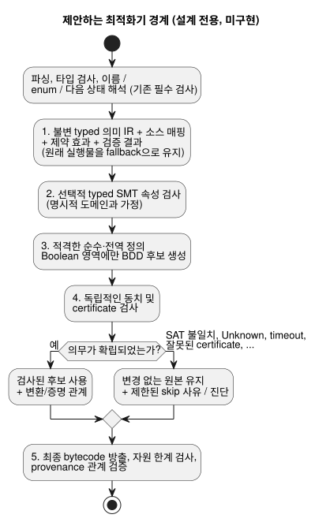

<!-- translation-source: docs/OPTIMIZER-PASS-CONTRACT.md -->
[영문 원문](OPTIMIZER-PASS-CONTRACT.md)

# 최적화 패스 계약

상태: **설계 전용**, 이슈 [#42](https://github.com/callin2/ghostflow-language/issues/42).

이 문서는 향후 컴파일러 최적화기에 대해 2026-09-13에 내린 선택을 기록합니다.

- **컴파일 시점의 SMT 검사.** typed SMT(satisfiability modulo theories) 풀이를 제약 검사와
  동치 검사에 사용합니다.
- **생성/컴파일 시점의 BDD 단순화.** 이진 결정 다이어그램(BDD)을 적격한 typed Boolean
  IR(중간 표현)을 단순화하는 데 사용합니다.
- 두 엔진 모두 ESP32에서 실행하지 않습니다.
- DBM은 선택하지 않았습니다. DBM은 조건부 후보였을 뿐입니다.

이 문서가 승인하지 **않는** 것:

- 라이브러리 선택, 컴파일러 구현, 성능 향상
- 공개 플래그, manifest 확장

라이브러리 선택은 의도적으로 미뤘으며, 이 계약의 선행 조건이 아닙니다. 이 문서는 로컬
설계이며 출판된 연구가 아닙니다.

이 문서의 내용:

- [의미의 권위와 범위](#의미의-권위와-범위): 최적화기가 절대 바꿔서는 안 되는 것
- [제안하는 패스 경계와 순서](#제안하는-패스-경계와-순서): 최적화기가 컴파일러 안에서
  놓일 위치
- [동치 의무](#동치-의무): "동치"의 의미
- [실패와 증명 수용](#실패와-증명-수용): 각 검사 결과를 처리하는 방법
- [제안하는 provenance와 artifact 도입](#제안하는-provenance와-artifact-도입):
  최적화된 artifact를 배포하기 전에 필요한 기록
- [실행 가능한 적합성 계획과 구현 단위](#실행-가능한-적합성-계획과-구현-단위):
  계획된 테스트 vector와 전달 순서

## 의미의 권위와 범위

다음 문서를 함께 읽으세요.
[Reference 02](reference/02-types-expressions-state.md),
[Reference 4.7](reference/04-sensors-constraints-control.md#47-requested-safe-applied-confirmed),
[물리 경계](LLM-TOOLCHAIN-ARCHITECTURE.ko.md),
[의도 앵커 맵](INTENT-ANCHOR-MAP.ko.md).

**소스가 계속 권위를 가집니다.** 설명과 주석을 포함한 정본 `.ghost.md` 소스가 계속
권위를 가집니다.

- 선택적인 IR 디버그 자료를 제거하더라도, 최적화는 소스의 정확한 바이트와 revision
  identity를 보존해야 합니다.
- 최적화는 의도를 다시 쓸 수 없습니다.
- 확인되지 않은 AI 가정을 형식 공리로 바꿀 수 없습니다.
- 확인된 설명만으로 typed 기계 전제가 되는 것도 아닙니다.

**이미 있는 것.** #31의 기본 앵커 매핑과 #342/현재 require lowering provenance는 이미
구현되어 있습니다.

- `tools/source-trace.mjs`는 `relation: lowered-as`, `status: compiler-derived`,
  `semanticVerification: not-proven`을 가진 `GhostFlow/source-trace-v1` derivation을
  출력합니다.
- 결정적 replay(재생)는 일관성을 검증합니다. 의미 동치, 평가, 물리적 적용을 증명하지는
  않습니다.
- 제거된 검사/대체와 병합된 노드에 대한 증명은 향후 #42 구현에 속합니다. 이 설계는 #31의
  남은 수용 조건을 닫지 않습니다.

**알려진 공백: 세 출력 `require`.** 현재
`require !(a && b && c)`는 `mutex(a,b,c)`로 lowering됩니다. 둘은 같지 않습니다.

| `a` | `b` | `c` | Boolean not-all `!(a && b && c)` | at-most-one `mutex(a,b,c)` |
| --- | --- | --- | --- | --- |
| true | true | false | true | false |

- 현재 derivation은 증명되지 않은 상태로 남습니다.
- 이 설계는 세 출력의 소스 의미를 바꾸지도 정의하지도 않으며, 앞 단계의 require lowering을
  고치지도 않습니다.
- 따라서 최적화기는 typed 제약 효과 의미를 포함한 **의미 해석이 끝난 현재 실행 IR**을
  후보와 비교합니다. raw Boolean AST만 비교하는 일은 결코 없습니다.
- 출력이 둘이면 진리표가 일치합니다. 그렇더라도 그것만으로 최종 safe 출력, 오류, 증거
  동작이 증명되지는 않습니다.

## 제안하는 패스 경계와 순서

현재 Parser/Lowerer는 타입 검사, 이름 해석, 방출을 하나로 묶고 있습니다. 아래의 최적화기
경계는 아직 드러나 있지 않습니다. 향후 구현은 이 경계를 명시적으로 만들어야 합니다.

- 파싱, 타입 검사, 이름/enum/다음 상태 해석 **뒤**
- 최종 bytecode 방출 **전**
- 기존 필수 검사를 하나도 우회하지 **않고**

제안하는 순서는 다음과 같습니다.

1. 불변 typed 의미 IR, 소스 매핑, 제약 효과, 현재 검증 결과를 만듭니다. 원래 실행물은
   fallback으로 유지합니다.
2. 명시적 도메인과 가정을 사용해 선택적으로 typed SMT 속성 검사를 실행합니다.
3. 적격한 순수·전역 정의 Boolean 영역에 대해서만 BDD 후보를 생성합니다.
4. 후보의 동치와 제출된 certificate를 독립적으로 검사합니다.
5. 최종 bytecode를 방출하고, 자원 한계를 검사하고, provenance 관계를 검증합니다.

아래 다이어그램은 같은 순서와 원본이 유지되는 위치를 보여 줍니다.

**패스 입력**에는 다음이 포함됩니다.

- 정확한 소스, 컴파일러, 프로필 revision
- typed 연산자와 도메인
- 상태 및 출력 바인딩, 평가 순서
- 효과 및 fault 지점, 제약 단계
- 타이머, 예약, accounting 의존성
- 소스 노드 ID와 앵커 링크

**적격성.** 인코딩이 지원되지 않거나 순수성/전역 정의 증거가 없는 영역은 제외합니다.
("순수"는 부작용이 없다는 뜻이고, "전역 정의(total)"는 허용되는 모든 입력에 대해 정의되어
있다는 뜻입니다.)

- Result 분기, 예약, 타이머, 오류를 낼 수 있는 식, 단락 평가 피연산자는 자동으로 순수하고
  전역 정의된 Boolean atom이 **아닙니다**.
- `Number`는 유한 binary64이며 SMT Real이 아닙니다. 반올림과 비유한 연산 fault를
  모델링해야 합니다.
- `Int`는 검사되는 i32입니다. 무한 정수도 아니고, 조용한 wraparound도 아닙니다.
- Duration, enum, Result tag, 단위, 유효 입력 도메인은 서로 구별된 채로 남습니다.

**패스 출력**은 다음 둘 중 하나입니다.

- 제한된 skip 사유를 동반한, 변경되지 않은 원본
- 정확한 변환/증명 관계를 동반한, 검사된 후보

solver나 BDD 생성기가 만들었다는 이유만으로 배포 가능한 변환이 되지는 않습니다. BDD
identity는 모델링된 Boolean 영역을 뒷받침할 수 있지만, 프로그램 전체 동작의 증명은
아닙니다.

## 동치 의무

**무엇을 비교하는가.** 반환된 Bool만이 아니라 원본과 후보의 **전이**를 비교합니다. 비교는
허용되는 모든 입력, 이전 상태, 환경 이력을 대상으로 하며, 다음이 같다는 조건에서 이루어집니다.

- 프로그램과 프로필
- run identity와 clock epoch
- 선언된 typed 가정

**여러 tick.** 여러 tick에 걸친 동치에는 보존된 전이 관계와 일치하는 초기/checkpoint 상태가
필요합니다. 유한 trace를 테스트하는 것만으로는 그 증명이 성립하지 않습니다.

아래 표는 보존해야 하는 것을 나열합니다.

| 관측 항목 | 보존 의무 |
| --- | --- |
| 상태 | 이전 상태 읽기, 해석된 다음 상태 의존성, 병렬 확정과 실패 시 원자적 rollback |
| 출력 | 요청 의도, 최종 안전 의도, 고정점 차단과 blocker identity. 제약은 결코 true 출력을 만들어 내지 않음 |
| 오류 | 단락 평가와 분기 선택, 처음 관측되는 fault/error와 그 순서/origin, 거부된 입력과 실패한 전이의 rollback |
| 시간과 lifecycle | run/시간 연속성, 타이머 초기화/reset/경과 상태, 예약 발생/admission identity와 경계 |
| accounting | 선언된 requested/safe/applied 기준, 사용량/admission 기록, 한도와 그 rollback |
| 증거 | 실제 평가 이벤트와 소스 identity, 유도된 만족, 최종 차단, 보존된 Result/센서 provenance |

**물리적 사실은 범위 밖입니다.** 적용된(applied) 명령과 확인된(confirmed) 물리 피드백은 별도의
Device 사실로 남습니다. 이 패스는 둘 중 어느 것도 확립하지 않습니다.

**바뀌어도 되는 것과 바뀌면 안 되는 것.**

- 패스는 내부 명령을 제거하거나 적격한 계산을 병합할 수 있지만, 증명된 영역 안에서만
  가능합니다.
- bytecode 크기와 명령 수는 허용된 자원 프로필 안에서 달라질 수 있습니다.
- 관측 가능한 자원 한계 fault, 시간/admission 규칙, 증거는 조용히 바뀌어서는 안 됩니다.
- 공개 비용/trace 관측을 완화하자는 제안에는 별도의 계약이 필요합니다.

**정직한 trace.**

- 제거된 노드를 실행되었다고 보고해서는 절대 안 됩니다.
- 재구성한 논리 값이나 유도된 만족은 대체 증거와 함께 *derived*로 표시합니다. 이것은
  평가된 소스 검사와도, 최종 출력 차단과도 구별됩니다.
- 현재 trace 소비자가 이 구별을 표현할 수 없다면 해당 변환을 건너뜁니다.

## 실패와 증명 수용

각 검사 결과에는 정해진 결과가 따릅니다.

| 검사 결과 | 계약 |
| --- | --- |
| UNSAT | typed 불일치/속성 인코딩, 가정 범위, 독립적으로 검증된 certificate가 명시된 의무를 확립할 때만 수용 |
| SAT | 원본/후보 의미에 대해 반례를 검증. 실제 불일치이면 후보를 거부하고 원본을 유지 |
| Unknown, timeout, solver/checker 오류, 지원하지 않는 theory, 노드/메모리/시간 예산 초과 | 선택적 최적화를 건너뛰고 원본과 제한된 진단을 유지. 이를 이유로 증명됨(proved)으로 표시하거나 유효한 소스를 거부해서는 안 됨 |
| 잘못된 certificate, 검증할 수 없는 반례, 일관되지 않은 매핑 | 후보를 거부하고 원본을 유지. 소스가 잘못되었다고 주장하지 않고 검증 실패를 기록 |

모든 결과에 적용되는 규칙:

- 기존의 필수 언어, artifact, 자원 오류는 계속 오류입니다.
- 선택적 최적화기의 실패는 새로운 소스 언어 거부 사유가 아닙니다.
- solver 상태만으로는 증명이 되지 않습니다.
- certificate, 인코딩, checker 버전, 가정, 범위를 기록하고 다시 검증해야 합니다.
- *독립적* 검사란 후보 생성기가 스스로 내놓은, 검사되지 않은 동치 주장을 신뢰하지 않는다는
  뜻입니다.
- 예산 동작은 artifact 선택에 대해 결정적이거나 명시적으로 기록됩니다. 소스 의미에는 영향을
  주지 않습니다.

## 제안하는 provenance와 artifact 도입

다음은 향후 관계 기록에 대한 요구사항이며, **승인된 schema 필드가 아닙니다**.

- 입력/후보 IR 및 bytecode 해시, 정확한 소스 문서·컴파일러·언어 프로필·매핑 revision,
  변환 identity와 순서가 있는 합성.
- 제거/병합된 노드를 포함한 모든 origin 앵커와 원본 노드 ID/범위, 대체 노드 ID, 관계, 대체
  guard, 의미 범위. 다대다 origin과 작성자가 정한 분류를 보존하되 소스 링크를 지어내지
  않습니다.
- typed 의무/인코딩 다이제스트, 명시적 가정, checker/certificate identity와 버전, 검증 상태,
  사유, certificate/콘텐츠 다이제스트.
- 검증되지 않은/생성된 대체 상태와 독립적으로 검증된 대체 상태의 구별. replay로 기존
  `compiler-derived`/`not-proven` lowering 기록을 절대 승격하지 않습니다.

**각 변환의 검증.** 각 변환과 그 합성은 다음 검증을 통과해야 합니다.

- 정확한 revision
- 완전한 origin
- 대체 coverage
- 의미 증거

소스 위치가 있다면 Markdown 좌표와 추출 좌표 모두에서 보존합니다. 제거된 제약에는 원래의
차단 효과를 포괄하는, 독립적으로 검사된 보장이 필요합니다. 다른 Bool이 그것을 함의한다는
편의적인 주장만으로는 충분하지 않습니다.

**도입.** 현재의 strict replay/package 검증은 스스로 유도하고 검증할 수 없는 최적화
bytecode나 새 관계 주장을 계속 거부해야 합니다. 도입에는 다음이 필요합니다.

- 별도로 명세된 proof-aware validator
- source map, package, replay, 소비자에 대한 호환성/버전 결정

정본 replay를 끄지 말고, 그 일관성 결과를 의미 증명으로 재사용하지 마세요.

## 실행 가능한 적합성 계획과 구현 단위

다음은 **계획된** vector입니다. 구현된 최적화 패스도 아니고, 통과했다고 보고된 결과도
아닙니다. 계획은 다음과 같습니다.

- 아래의 안정적인 제안 ID를 부여합니다.
- 정본 문서형 소스(literate) fixture를 컴파일합니다.
- 원본과 후보를 native와 WASM 양쪽에서 실행합니다.
- 전체 전이 기록과 증거 기록을 비교합니다.

기존 테스트는 seed를 제공할 뿐이며, 새로운 증명 certificate가 아닙니다.

| 제안 ID / seed | 필수 vector와 oracle |
| --- | --- |
| OPT-STATE / Reference 02 | 병렬 갱신, 이전/다음 상태 의존성, 분기 변화, 여러 tick에 걸친 checkpoint 재개. 같은 확정과 fault rollback |
| OPT-TIMER / `examples/optional-feedback-timer.ghost.md`, `tests/continuous-timer-compatibility.test.mjs` | 문턱값 -1ms/정확히/+1ms, 초기화/reset, 사용할 수 없는 피드백, run/clock epoch 단절, 거부되는 지원. 같은 타이머 상태와 실패 |
| OPT-SCHEDULE / `examples/scheduled-watering.ghost.md`, `tests/schedule-missed-reaction.test.mjs` | 발생 경계, 중복, 놓친 발생에 대한 반응, 벽시계의 역방향 보정, accounting 한도. 같은 admission identity와 사용량 rollback |
| OPT-INT / `tests/int-compiler.test.mjs`, `tests/int-division-identity.test.mjs` | MIN/MAX, 검사되는 overflow, 0 나눗셈, MIN div -1, 단락 평가된 fault. 같은 fault origin/순서 |
| OPT-NUMBER / Reference 02 | binary64 반올림/상쇄, 관측 가능한 경우의 부호 있는 0, 유한/비유한 경계, typed 단위 구별. Real 기반 재작성 금지 |
| OPT-RESULT / `tests/result-control.test.mjs`, `tests/result-provenance.test.mjs` | enum 상태, ok/fault 분기, 왼쪽에서 오른쪽으로의 단락 평가, 보존된 provenance, 실패한 판단의 rollback. 같은 선택 증거 |
| OPT-CONSTRAINT / `tests/constraints.test.mjs` | true,true,false를 포함한 두/세 출력의 전체 진리표. 현재 lowering된 효과, 제약 순서 변경, require 체인, 최종 blocker를 비교. raw 세 출력 not-all을 mutex로 인증하는 일은 결코 없음 |
| OPT-PROVENANCE / `tests/intent-anchor-map.test.mjs`, `tests/portable-package.test.mjs` | 제거/병합된 origin, 설명만 바뀐 revision, 바뀐 해시, certificate/매핑 변조, derived 이벤트와 실행된 이벤트의 구별. 거짓 증명과 혼합 revision 거부 |
| OPT-FALLBACK / 모든 fixture | unknown/timeout/checker 실패와 모든 예산 경계를 강제. 원본 artifact 유지, 기존 필수 오류는 변경 없음 |

**구현 단위.** 제한된 단위로 나누어 다음 순서로 구현합니다.

1. baseline replay를 갖춘 typed IR/효과 경계
2. typed 속성 인코딩과 독립적으로 검사되는 negative vector
3. 순수/전역 정의 Bool 적격성과 제한된 BDD 후보 생성
4. 동치 검사, certificate 검사, 합성
5. native/WASM 차등 적합성을 동반한 proof-aware provenance/package 도입

각 단위는 자체 수용 조건이 검증될 때까지 원래 경로를 보존합니다. 라이브러리 평가는
인코딩/certificate 요구사항을 따릅니다. 여기서는 어떤 엔진이나 ABI도 선택하지 않습니다.
