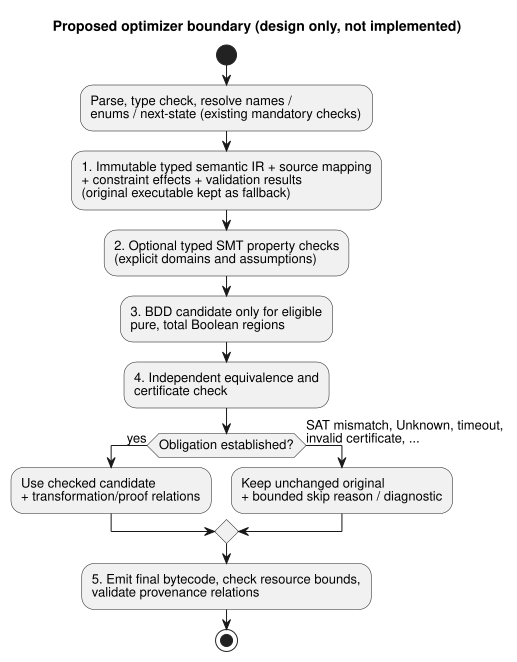

# Optimizer pass contract

[한국어](OPTIMIZER-PASS-CONTRACT.ko.md)

Status: **design only**, issue [#42](https://github.com/callin2/ghostflow-language/issues/42).

This document records the selection made on 2026-09-13 for a future compiler
optimizer:

- **SMT checks at compile time.** Typed SMT (satisfiability modulo theories)
  solving is used for constraint checks and equivalence checks.
- **BDD simplification at generation/compile time.** Binary decision diagrams
  (BDDs) are used to simplify eligible typed Boolean IR (intermediate
  representation).
- Neither engine runs on the ESP32.
- DBM is not selected; it was only a conditional candidate.

What this document does **not** accept:

- no library choice, compiler implementation or performance gain;
- no public flag and no manifest extension.

The library choice is intentionally deferred; it is not a prerequisite for this
contract. This is a local design, not published research.

In this document:

- [Semantic authority and scope](#semantic-authority-and-scope): what the
  optimizer must never change.
- [Proposed pass boundary and order](#proposed-pass-boundary-and-order): where
  the optimizer would sit in the compiler.
- [Equivalence obligation](#equivalence-obligation): what "equivalent" means.
- [Failure and proof acceptance](#failure-and-proof-acceptance): how each check
  outcome is handled.
- [Proposed provenance and artifact adoption](#proposed-provenance-and-artifact-adoption):
  records needed before optimized artifacts can ship.
- [Executable conformance plan and implementation slices](#executable-conformance-plan-and-implementation-slices):
  planned test vectors and delivery order.

## Semantic authority and scope

Read these together:
[Reference 02](reference/02-types-expressions-state.en.md),
[Reference 4.7](reference/04-sensors-constraints-control.en.md#47-requested-safe-applied-confirmed),
the [physical boundary](LLM-TOOLCHAIN-ARCHITECTURE.md#physical-driver-and-device-boundary)
and the [intent anchor map](INTENT-ANCHOR-MAP.md).

**The source stays authoritative.** The canonical `.ghost.md` source, including
its prose and comments, remains the authority.

- Optimization must keep the source's exact bytes and revision identity, even if
  optional IR debug material is stripped.
- Optimization cannot rewrite intent.
- It cannot turn an unconfirmed AI assumption into a formal axiom.
- Confirmed prose alone is not a typed machine premise either.

**What already exists.** #31 basic anchor mapping and #342/current
require-lowering provenance are already implemented:

- `tools/source-trace.mjs` emits `GhostFlow/source-trace-v1` derivations with
  `relation: lowered-as`, `status: compiler-derived` and
  `semanticVerification: not-proven`.
- Deterministic replay validates consistency. It does not prove semantic
  equivalence, evaluation or physical application.
- Proofs for eliminated checks/replacements and for merged nodes belong to the
  future #42 implementation. This design does not close #31's remaining
  acceptance.

**A known gap: three-output `require`.** Today,
`require !(a && b && c)` is lowered to `mutex(a,b,c)`. These are not the same:

| `a` | `b` | `c` | Boolean not-all `!(a && b && c)` | at-most-one `mutex(a,b,c)` |
| --- | --- | --- | --- | --- |
| true | true | false | true | false |

- The current derivation stays unproven.
- This design neither changes nor defines three-output source semantics, and it
  does not repair the upstream require lowering.
- An optimizer therefore compares the **semantically resolved current executable
  IR**, with typed constraint-effect semantics, against its candidate. It never
  compares just raw Boolean ASTs.
- For two outputs the truth tables coincide. That alone still does not prove the
  final safe-output, error and evidence behavior.

## Proposed pass boundary and order

Today's Parser/Lowerer combines typing, resolution and emission. It does not
yet expose the optimizer boundary below. A future implementation must make that
boundary explicit:

- **after** parsing, type checking and name/enum/next-state resolution;
- **before** final bytecode emission;
- **without** bypassing any existing mandatory check.

The proposed order is:

1. Produce immutable typed semantic IR, source mapping, constraint effects and
   current validation results; keep the original executable as the fallback.
2. Optionally run typed SMT property checks with explicit domains and assumptions.
3. Generate a BDD candidate only for eligible pure, total Boolean regions.
4. Independently check candidate equivalence and any submitted certificate.
5. Emit final bytecode, check resource bounds and validate provenance relations.

The diagram below shows the same order and where the original is kept.

**Pass input** includes:

- exact source, compiler and profile revisions;
- typed operators and domains;
- state and output bindings, and evaluation order;
- effect and fault sites, and constraint stages;
- timer, schedule and accounting dependencies;
- source node IDs and anchor links.

**Eligibility.** A region is excluded when its encoding is unsupported or when
purity/totality evidence is missing. ("Pure" means no side effects; "total"
means defined for every admitted input.)

- Result branches, schedules, timers, error-producing expressions and
  short-circuit operands are **not** automatically pure, total Boolean atoms.
- `Number` is finite binary64, not SMT Real. Rounding and nonfinite-operation
  faults must be modeled.
- `Int` is checked i32, not an unbounded integer and not silent wraparound.
- Duration, enum, Result tags, units and valid input domains remain distinct.

**Pass output** is one of two things:

- the unchanged original, with a bounded skip reason; or
- a checked candidate, plus exact transformation/proof relations.

No transformation becomes deployable merely because a solver or BDD generator
produced it. BDD identity can support a modeled Boolean region; it is not proof
of whole-program behavior.

## Equivalence obligation

**What is compared.** Compare the original and candidate **transitions**, not
only the returned Bool. The comparison covers every admitted input, prior state
and environment history, under the same:

- program and profile;
- run identity and clock epochs;
- declared typed assumptions.

**Multiple ticks.** Multi-tick equivalence requires a preserved transition
relation and matching initial/checkpoint states. Testing a finite trace does not
establish that proof.

The table lists what must be preserved.

| Observable | Required preservation |
| --- | --- |
| State | Previous-state reads, resolved next-state dependencies, parallel commit and atomic rollback on failure |
| Outputs | Requested intent, final safe intent, fixed-point blocking and blocker identities; constraints never manufacture true outputs |
| Errors | Short-circuit and branch selection, first observable fault/error and its order/origin, rejected inputs and failed-transition rollback |
| Time and lifecycle | Run/time continuity, timer initialization/reset/elapsed state, schedule occurrence/admission identity and boundaries |
| Accounting | Declared requested/safe/applied basis, usage/admission records, limits and their rollback |
| Evidence | Actual evaluation events and source identities, derived satisfaction, final blocking and retained Result/sensor provenance |

**Physical facts are out of scope.** Applied commands and confirmed physical
feedback remain separate Device facts. This pass establishes neither.

**What may change, and what may not.**

- The pass may remove internal instructions or merge eligible computations, but
  only within a proved region.
- Bytecode size and instruction count may differ within the accepted resource
  profile.
- Observable resource-limit faults, timing/admission rules and evidence may not
  silently change.
- Any proposed relaxation of a public cost/trace observation requires a separate
  contract.

**Honest traces.**

- Removed nodes must never be reported as executed.
- A reconstructed logical value or derived satisfaction is labeled *derived*,
  together with its replacement evidence. It is distinct from an evaluated source
  check and from a final output block.
- If current trace consumers cannot express that distinction, skip the
  transformation.

## Failure and proof acceptance

Each check outcome has a fixed consequence:

| Check outcome | Contract |
| --- | --- |
| UNSAT | Accept only when the typed mismatch/property encoding, assumption scope and independently validated certificate establish the stated obligation |
| SAT | Validate the counterexample against original/candidate semantics; a real mismatch rejects the candidate and retains the original |
| Unknown, timeout, solver/checker error, unsupported theory, node/memory/time budget exceeded | Skip optional optimization, retain original and bounded diagnostic; never mark proved or reject valid source for this reason |
| Invalid certificate, unverifiable counterexample or inconsistent mapping | Reject candidate, retain original; record validation failure without asserting source invalidity |

Rules that apply to every outcome:

- Existing mandatory language, artifact and resource errors remain errors.
- An optional optimizer failure is not a new source-language rejection.
- Solver status alone is not proof.
- Certificate, encoding and checker versions, assumptions and scope must be
  recorded and revalidated.
- *Independent* checking means not trusting the candidate generator's own
  unchecked equivalence assertion.
- Budget behavior is deterministic for artifact selection, or explicitly
  recorded. It does not affect source meaning.

## Proposed provenance and artifact adoption

These are requirements for future relation records, **not accepted schema fields**:

- Input/candidate IR and bytecode hashes; exact source document, compiler, language
  profile and mapping revisions; transform identity and ordered composition.
- Every origin anchor and original node ID/range, including removed/merged nodes;
  replacement node IDs, relation, replacement guard and semantic scope. Preserve
  many-to-many origins and authored classification without inventing source links.
- Typed obligation/encoding digest, explicit assumptions, checker/certificate
  identity and version, validation status, reason and certificate/content digest.
- Distinct unverified/generated and independently verified replacement states;
  never upgrade existing `compiler-derived`/`not-proven` lowering records by replay.

**Validation of each transform.** Each transform, and its composition, must pass
validation of:

- exact revision;
- complete origins;
- replacement coverage;
- semantic evidence.

Preserve source locations in both Markdown and extracted coordinates where
present. An eliminated constraint needs an independently checked guarantee that
covers its original blocking effect. A convenient assertion that another Bool
implies it is not enough.

**Adoption.** Current strict replay/package validation must keep rejecting
optimized bytecode, or new relation claims, that it cannot derive and validate.
Adoption requires:

- a separately specified proof-aware validator; and
- a compatibility/version decision for source maps, packages, replay and
  consumers.

Do not disable canonical replay, and do not reuse its consistency result as a
semantic proof.

## Executable conformance plan and implementation slices

The following are **planned** vectors. They are not implemented optimizer passes
and not reported passing results. The plan:

- assign the stable proposed IDs below;
- compile canonical literate fixtures;
- run original and candidate on both native and WASM;
- compare complete transition and evidence records.

Existing tests supply seeds, not new proof certificates.

| Proposed ID / seed | Required vectors and oracle |
| --- | --- |
| OPT-STATE / Reference 02 | Parallel updates, previous/next-state dependencies, branch changes and multi-tick checkpoint continuation; equal commit and fault rollback |
| OPT-TIMER / `examples/optional-feedback-timer.ghost.md`, `tests/continuous-timer-compatibility.test.mjs` | Threshold minus 1ms/exact/plus 1ms, initialization/reset, unavailable feedback, run/clock epoch discontinuity and rejected support; equal timer state and failures |
| OPT-SCHEDULE / `examples/scheduled-watering.ghost.md`, `tests/schedule-missed-reaction.test.mjs` | Occurrence boundaries, duplicates, missed reaction, backward wall-clock correction and accounting limits; equal admission identities and usage rollback |
| OPT-INT / `tests/int-compiler.test.mjs`, `tests/int-division-identity.test.mjs` | MIN/MAX, checked overflow, zero division, MIN div -1, short-circuited fault; equal fault origin/order |
| OPT-NUMBER / Reference 02 | Binary64 rounding/cancellation, signed zero where observable, finite/nonfinite boundaries and typed unit distinctions; no Real-based rewrite |
| OPT-RESULT / `tests/result-control.test.mjs`, `tests/result-provenance.test.mjs` | Enum state, ok/fault branches, left-to-right short circuit, retained provenance and failed-decision rollback; equal selected evidence |
| OPT-CONSTRAINT / `tests/constraints.test.mjs` | Exhaustive two/three-output truth tables including true,true,false; compare current lowered effects, reorder constraints, require chains and final blockers; never certify raw three-output not-all as mutex |
| OPT-PROVENANCE / `tests/intent-anchor-map.test.mjs`, `tests/portable-package.test.mjs` | Removed/merged origins, prose-only revisions, changed hashes, certificate/mapping tampering, derived versus executed events; reject false proof and mixed revisions |
| OPT-FALLBACK / all fixtures | Force unknown/timeout/checker failure and every budget boundary; original artifact retained, existing mandatory errors unchanged |

**Implementation slices.** Implement in bounded slices, in this order:

1. Typed IR/effect boundary with baseline replay.
2. Typed property encodings and independently checked negative vectors.
3. Pure/total Bool eligibility and bounded BDD candidate generation.
4. Equivalence checking, certificate checking and composition.
5. Proof-aware provenance/package adoption, with native/WASM differential
   conformance.

Each slice preserves the original path until its own acceptance is verified.
Library evaluation follows the encoding/certificate requirements; no engine or
ABI is chosen here.
