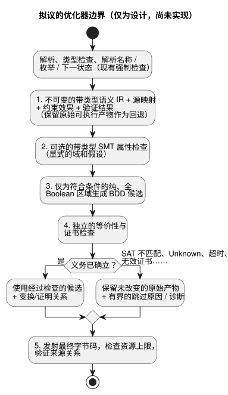

<!-- translation-source: docs/OPTIMIZER-PASS-CONTRACT.md -->
[英文原文](OPTIMIZER-PASS-CONTRACT.md)

# 优化器 pass 契约

[한국어](OPTIMIZER-PASS-CONTRACT.ko.md)

状态：**仅为设计**，issue [#42](https://github.com/callin2/ghostflow-language/issues/42)。

本文档记录 2026-09-13 为未来的编译器优化器所做的选择：

- **编译时进行 SMT 检查。** 约束检查和等价性检查使用带类型的 SMT（satisfiability modulo theories，可满足性模理论）求解。
- **在生成/编译时进行 BDD 化简。** 使用二元决策图（BDD）化简符合条件的带类型 Boolean IR（中间表示）。
- 这两种引擎都不在 ESP32 上运行。
- 未选择 DBM；它只是一个有条件的候选方案。

本文档**不**接受以下内容：

- 不选定库，不提供编译器实现，也不承诺性能提升；
- 不提供公开标志，也不扩展 manifest（清单）。

库的选择被有意推迟；它不是本契约的前提条件。这是一份本地设计，而非已发表的研究。

本文档内容：

- [语义权威与范围](#语义权威与范围)：优化器绝不能改变的内容。
- [拟议的 pass 边界与顺序](#拟议的-pass-边界与顺序)：优化器在编译器中的位置。
- [等价性义务](#等价性义务)：“等价”的含义。
- [失败与证明的接受](#失败与证明的接受)：如何处理每种检查结果。
- [拟议的来源记录与产物采用](#拟议的来源记录与产物采用)：优化后的产物发布前需要的记录。
- [可执行一致性计划与实现切片](#可执行一致性计划与实现切片)：计划中的测试向量和交付顺序。

## 语义权威与范围

请结合以下文档一起阅读：
[Reference 02](reference/02-types-expressions-state.zh.md)、
[Reference 4.7](reference/04-sensors-constraints-control.en.md#47-requested-safe-applied-confirmed)、
[物理边界](LLM-TOOLCHAIN-ARCHITECTURE.md#physical-driver-and-device-boundary)
以及[意图锚点映射](INTENT-ANCHOR-MAP.zh.md)。

**源始终是权威。** 规范的 `.ghost.md` 源（包括其中的说明文字和注释）始终是权威。

- 即使剥离了可选的 IR 调试材料，优化也必须保持源的确切字节和修订版身份标识。
- 优化不能改写意图。
- 优化不能把未经确认的 AI 假设变成形式化公理。
- 仅有已确认的说明文字，也不能构成带类型的机器前提。

**已经存在的内容。** #31 的基础锚点映射以及 #342/当前 require 降级（lowering）来源记录已经实现：

- `tools/source-trace.mjs` 输出 `GhostFlow/source-trace-v1` 推导记录，其中包含 `relation: lowered-as`、`status: compiler-derived` 和 `semanticVerification: not-proven`。
- 确定性重放验证一致性。它不证明语义等价、求值或物理应用。
- 被消除的检查/替换以及被合并节点的证明，属于未来 #42 的实现。本设计不会完成 #31 剩余的验收项。

**已知缺口：三输出 `require`。** 目前，`require !(a && b && c)` 被降级为 `mutex(a,b,c)`。二者并不相同：

| `a` | `b` | `c` | Boolean 非全真 `!(a && b && c)` | 至多一个 `mutex(a,b,c)` |
| --- | --- | --- | --- | --- |
| true | true | false | true | false |

- 当前的推导仍未被证明。
- 本设计既不改变也不定义三输出的源语义，也不修复上游的 require 降级。
- 因此，优化器将**经过语义解析的当前可执行 IR**（带有类型化的约束效果语义）与其候选进行比较。它绝不只比较原始的 Boolean AST。
- 对于两个输出，真值表是一致的。但仅凭这一点，仍不能证明最终的安全输出、错误和证据行为。

## 拟议的 pass 边界与顺序

当前的 Parser/Lowerer 将类型检查、解析和发射合在一起，尚未暴露下文所述的优化器边界。未来的实现必须使该边界显式化：

- 位于解析、类型检查以及名称/枚举/下一状态解析**之后**；
- 位于最终字节码发射**之前**；
- **不得**绕过任何现有的强制检查。

拟议的顺序如下：

1. 生成不可变的带类型语义 IR、源映射、约束效果和当前验证结果；保留原始可执行产物作为回退（fallback）。
2. 可选地运行带类型的 SMT 属性检查，并使用显式的域和假设。
3. 仅为符合条件的纯、全 Boolean 区域生成 BDD 候选。
4. 独立检查候选的等价性以及任何提交的证书。
5. 发射最终字节码，检查资源上限，并验证来源关系。

下图展示了相同的顺序以及原始产物被保留的位置。

**Pass 输入**包括：

- 确切的源、编译器和 profile 修订版；
- 带类型的运算符和域；
- 状态与输出绑定，以及求值顺序；
- 效果与故障位置，以及约束阶段；
- 定时器、调度计划和用量核算的依赖；
- 源节点 ID 和锚点链接。

**适用条件。** 当某个区域的编码不受支持，或缺少纯性/全性证据时，该区域被排除。（“纯”指没有副作用；“全”指对每个被接受的输入都有定义。）

- Result 分支、调度计划、定时器、会产生错误的表达式以及短路操作数，**不会**自动成为纯、全的 Boolean 原子。
- `Number` 是有限的 binary64，而不是 SMT Real。必须对舍入和非有限运算故障进行建模。
- `Int` 是带检查的 i32，既不是无界整数，也不会静默回绕。
- Duration、枚举、Result 标签、单位以及有效输入域彼此保持区分。

**Pass 输出**是以下两者之一：

- 未改变的原始产物，附带有界的跳过原因；或
- 经过检查的候选，附带确切的变换/证明关系。

任何变换都不会仅仅因为由求解器或 BDD 生成器产生就成为可部署的。BDD 同一性可以支持一个已建模的 Boolean 区域；它不是整个程序行为的证明。

## 等价性义务

**比较的对象。** 比较原始与候选的**转移**，而不仅仅是返回的 Bool。比较覆盖每一个被接受的输入、先前状态和环境历史，并要求以下各项相同：

- 程序和 profile；
- 运行身份标识和时钟纪元；
- 声明的带类型假设。

**多个 tick。** 多 tick 等价要求保持转移关系，并且初始/检查点状态一致。测试有限的轨迹并不能建立该证明。

下表列出了必须保持的内容。

| 可观测项 | 必须保持的内容 |
| --- | --- |
| 状态 | 前一状态读取、已解析的下一状态依赖、并行提交以及失败时的原子回滚 |
| 输出 | 请求意图、最终安全意图、不动点阻止以及阻止者身份；约束绝不会制造为 true 的输出 |
| 错误 | 短路和分支选择、第一个可观测的故障/错误及其顺序/来源、被拒绝的输入以及失败转移的回滚 |
| 时间与生命周期 | 运行/时间连续性、定时器初始化/重置/经过时间状态、调度计划触发实例/准入身份及边界 |
| 用量核算 | 声明的 requested/safe/applied 基准、使用/准入记录、限制及其回滚 |
| 证据 | 实际求值事件和源身份、派生的满足、最终阻止以及保留的 Result/传感器来源 |

**物理事实不在范围内。** 已应用的命令和已确认的物理反馈仍是独立的 Device 事实。本 pass 不建立其中任何一项。

**可以改变和不可以改变的内容。**

- pass 可以移除内部指令或合并符合条件的计算，但只能在已证明的区域内进行。
- 字节码大小和指令数量可以在已接受的资源 profile 内有所不同。
- 可观测的资源限制故障、时序/准入规则和证据不得被静默改变。
- 任何拟议的对公开代价/追踪观测的放宽，都需要单独的契约。

**诚实的追踪。**

- 被移除的节点绝不能被报告为已执行。
- 重建的逻辑值或派生的满足会被标记为 *derived*（派生），并附带其替换证据。它不同于已求值的源检查，也不同于最终的输出阻止。
- 如果当前的追踪消费者无法表达这一区别，则跳过该变换。

## 失败与证明的接受

每种检查结果都有固定的后果：

| 检查结果 | 契约 |
| --- | --- |
| UNSAT | 仅当带类型的不匹配/属性编码、假设范围以及经独立验证的证书确立了所述义务时才接受 |
| SAT | 依据原始/候选语义验证反例；真实的不匹配会拒绝候选并保留原始产物 |
| Unknown、超时、求解器/检查器错误、不支持的理论、超出节点/内存/时间预算 | 跳过可选优化，保留原始产物和有界诊断；绝不因此标记为已证明，也绝不因此拒绝有效的源 |
| 无效证书、无法验证的反例或不一致的映射 | 拒绝候选，保留原始产物；记录验证失败，但不断言源无效 |

适用于每种结果的规则：

- 现有的强制性语言、产物和资源错误仍然是错误。
- 可选优化器的失败不是新的源语言拒绝。
- 仅凭求解器状态不构成证明。
- 必须记录并重新验证证书、编码和检查器的版本、假设以及范围。
- *独立*检查是指不信任候选生成器自身未经检查的等价性断言。
- 预算行为对于产物选择是确定性的，或被显式记录。它不影响源的含义。

## 拟议的来源记录与产物采用

以下是对未来关系记录的要求，**不是已接受的 schema 字段**：

- 输入/候选 IR 和字节码哈希；确切的源文档、编译器、语言 profile 和映射修订版；变换身份标识及有序组合。
- 每个起源锚点和原始节点 ID/范围（包括被移除/合并的节点）；替换节点 ID、关系、替换守卫和语义范围。保留多对多的起源和作者分类，不得凭空编造源链接。
- 带类型的义务/编码摘要、显式假设、检查器/证书身份标识和版本、验证状态、原因以及证书/内容摘要。
- 区分未验证/生成的替换状态与经独立验证的替换状态；绝不通过重放升级现有的 `compiler-derived`/`not-proven` 降级记录。

**每个变换的验证。** 每个变换及其组合都必须通过以下验证：

- 确切的修订版；
- 完整的起源；
- 替换覆盖；
- 语义证据。

在存在的情况下，同时保留 Markdown 中的源位置和提取后的坐标。被消除的约束需要一个经独立检查的保证，覆盖其原有的阻止效果。仅凭“另一个 Bool 蕴含它”这一便利断言是不够的。

**采用。** 当前严格的重放/包验证必须继续拒绝其无法推导和验证的优化字节码或新的关系声明。采用需要：

- 一个单独规定的、能够理解证明的验证器；以及
- 针对源映射、包、重放和消费者的兼容性/版本决策。

不要禁用规范重放，也不要把其一致性结果当作语义证明重复使用。

## 可执行一致性计划与实现切片

以下是**计划中**的向量。它们不是已实现的优化器 pass，也不是已报告通过的结果。计划如下：

- 分配下文所列的稳定拟议 ID；
- 编译规范的文学式（literate）测试夹具；
- 在原生和 WASM 上分别运行原始产物和候选；
- 比较完整的转移和证据记录。

现有测试提供种子，而不是新的证明证书。

| 拟议 ID / 种子 | 必需的向量和判定依据 |
| --- | --- |
| OPT-STATE / Reference 02 | 并行更新、前一/下一状态依赖、分支变化以及多 tick 检查点延续；提交和故障回滚相同 |
| OPT-TIMER / `examples/optional-feedback-timer.ghost.md`、`tests/continuous-timer-compatibility.test.mjs` | 阈值减 1ms/恰好/加 1ms、初始化/重置、反馈不可用、运行/时钟纪元不连续以及被拒绝的支持；定时器状态和失败相同 |
| OPT-SCHEDULE / `examples/scheduled-watering.ghost.md`、`tests/schedule-missed-reaction.test.mjs` | 触发实例边界、重复、错过时的反应、墙钟向后校正以及用量核算限制；准入身份和使用量回滚相同 |
| OPT-INT / `tests/int-compiler.test.mjs`、`tests/int-division-identity.test.mjs` | MIN/MAX、带检查的溢出、除以零、MIN div -1、被短路的故障；故障来源/顺序相同 |
| OPT-NUMBER / Reference 02 | binary64 舍入/抵消、可观测时的有符号零、有限/非有限边界以及带类型的单位区分；不进行基于 Real 的改写 |
| OPT-RESULT / `tests/result-control.test.mjs`、`tests/result-provenance.test.mjs` | 枚举状态、ok/fault 分支、从左到右的短路、保留的来源以及失败判定的回滚；所选证据相同 |
| OPT-CONSTRAINT / `tests/constraints.test.mjs` | 穷尽的两输出/三输出真值表（包括 true,true,false）；比较当前降级后的效果、重排约束、require 链以及最终阻止者；绝不把原始的三输出非全真认证为 mutex |
| OPT-PROVENANCE / `tests/intent-anchor-map.test.mjs`、`tests/portable-package.test.mjs` | 被移除/合并的起源、仅说明文字的修订、变更的哈希、证书/映射篡改、派生事件与已执行事件；拒绝虚假证明和混合修订版 |
| OPT-FALLBACK / 所有测试夹具 | 强制产生 unknown/超时/检查器失败以及每个预算边界；保留原始产物，现有强制错误不变 |

**实现切片。** 按以下顺序以有界切片实现：

1. 带类型的 IR/效果边界，并以基线重放为基础。
2. 带类型的属性编码以及经独立检查的反向向量。
3. 纯/全 Bool 适用条件以及有界的 BDD 候选生成。
4. 等价性检查、证书检查以及组合。
5. 能够理解证明的来源记录/包采用，并进行原生/WASM 差分一致性测试。

每个切片在其自身验收得到验证之前，都保留原始路径。库的评估遵循编码/证书要求；此处不选定任何引擎或 ABI。
