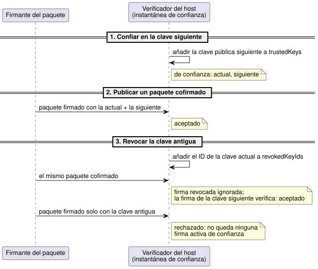
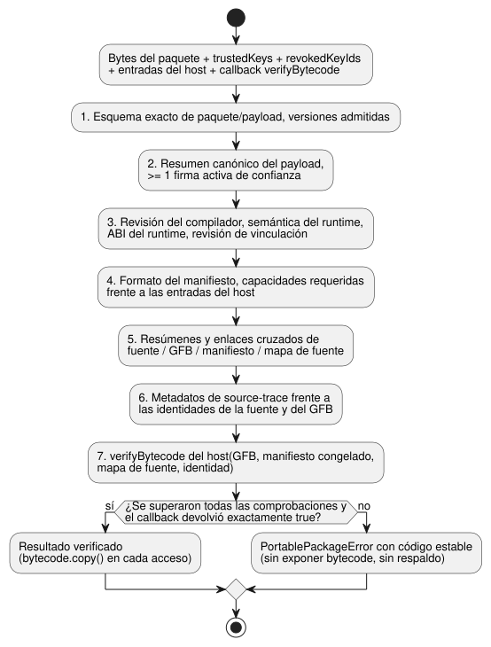

<!-- translation-source: docs/PORTABLE-PACKAGE.md -->
[Original en inglés](PORTABLE-PACKAGE.md)

# Paquete GFB portable v1

Un **paquete portable** es la unidad firmada que cargan los hosts de GhostFlow.
El formato `GhostFlow/portable-package-v1` vincula una revisión autorizada de la
fuente literaria (literate), es decir, el documento `.ghost.md`, con los bytes
exactos del bytecode GFB1 que cargan los hosts Browser y Device. También
contiene:

- el manifiesto y el mapa de fuente generados;
- una identidad de compatibilidad de ejecución;
- firmas Ed25519.

El paquete no cambia los bytes de GFB1 ni la semántica de la VM.

En este documento:

- **Envoltorio**: la estructura del paquete y su codificación canónica.
- **Bytes de la firma y confianza**: qué se firma, claves de confianza,
  revocación y rotación.
- **Orden de verificación**: las comprobaciones que ejecuta un host antes de
  obtener el bytecode, incluida la omisión nativa para desarrollo.
- **Compatibilidad y migración**: qué perfiles GFB se admiten y cómo se tratan
  las versiones.
- **API del verificador nativo**, **Descriptores de estrategias adaptativas** y
  **Procedencia exacta de la composición reutilizable**: el verificador de Rust y
  los casos especiales.

## Envoltorio

```text
paquete
├─ format: GhostFlow/portable-package-v1
├─ payload
│  ├─ format: GhostFlow/portable-payload-v1
│  ├─ source: bytes UTF-8 exactos del .ghost.md + SHA-256
│  ├─ bytecode: bytes exactos del perfil GFB 1/2/3/4 + SHA-256
│  ├─ manifest: bytes JSON canónicos exactos + SHA-256
│  ├─ sourceMap: bytes JSON canónicos exactos + SHA-256
│  └─ identity
│     ├─ compilerRevision
│     ├─ runtimeSemantics
│     ├─ runtimeAbi
│     ├─ requiredCapabilities[]
│     └─ bindingRevision
├─ payloadSha256
└─ signatures[]: algorithm + keyId + signatureBase64
```

**Codificación canónica.**

- Los campos binarios usan base64 canónico con relleno.
- Los bytes del manifiesto y del mapa de fuente usan ordenación recursiva de las
  claves JSON, preservan el orden de los arrays y usan la serialización de
  números finitos de ECMAScript.
- Se rechazan los arrays dispersos y los enteros fuera del rango seguro exacto de
  JavaScript. `-0` se serializa como `0`.
- El Markdown original **no** se normaliza. Unicode, los comentarios, la prosa,
  los CRLF y el salto de línea final siguen formando parte de su resumen de
  fuente.

**Construcción de un paquete.** `buildPortablePackage` solo acepta un resultado
de `compileSource` cuya fuente sea un documento literario `.ghost.md` y cuyo
manifiesto de control coincida con el resumen del GFB.

- La firma también requiere una reproducción (replay) nueva de
  `verifyCompilation`. Los bytes exactos de GFB, manifiesto y mapa de fuente de
  la reproducción deben coincidir con el resultado aportado. Esto impide que un
  constructor oficial empareje una fuente legible con un programa compilado
  distinto.
- Las capacidades requeridas se ordenan por `kind`, luego por `name` y luego por
  `type`.
- Cada entrada del manifiesto (`input`), sensor no opcional (`sensor`) y salida
  (`actuator`) debe coincidir con el conjunto firmado de capacidades requeridas
  **en ambas direcciones**: no falta nada y no sobra nada.
- Los sensores opcionales quedan fuera del conjunto requerido. Las vinculaciones
  explícitas del host deciden si están presentes.

## Bytes de la firma y confianza

**Qué se firma.**

- La entrada de la firma es la codificación UTF-8 canónica exacta de `payload`.
- `payloadSha256` resume esos mismos bytes.
- El formato externo del paquete se comprueba antes de la verificación.
  `signatures` y `payloadSha256` se excluyen de la entrada de la firma.
- Todos los bytes incrustados, sus descriptores y las identidades de ejecución
  están dentro del payload firmado.

**Algoritmos e ID de clave.** La versión 1 solo permite Ed25519. Cada firma
nombra un `keyId` acotado. Se rechazan las claves duplicadas y la negociación de
algoritmos.

**Entradas de confianza.** Un verificador recibe dos entradas de confianza
explícitas:

- `trustedKeys`: los ID de clave aceptados actualmente y las claves públicas
  Ed25519.
- `revokedKeyIds`: las claves que ya no autorizan un paquete.

Ambas entradas son instantáneas de confianza obligatorias. Omitir el estado de
revocación es un error, no una lista de revocación vacía.

**La rotación de claves** usa un paquete cofirmado:

1. Primero, los hosts confían en la clave pública siguiente.
2. Después, los hosts aceptan un paquete firmado tanto por la clave actual como
   por la siguiente.
3. Por último, los hosts revocan la clave antigua.

Una firma revocada se ignora cuando otra firma activa de confianza verifica
correctamente. Un paquete sin ninguna firma activa de confianza restante se
rechaza. Los registros de confianza no dependen del reloj de pared.

La secuencia siguiente muestra los tres pasos de la rotación desde el punto de
vista del host.



El material de claves RFC 8032 de `tests/portable-package.test.mjs` son datos de
prueba públicos y nunca debe configurarse como raíz de confianza de un producto.

## Orden de verificación

### Política de autenticación nativa para desarrollo

**Predeterminado: autenticar siempre.** La API `verify_portable_package` de Rust
`ghostflow-package` siempre exige la autenticación del publicador.
`SignaturePolicy::default()` es `Enforce`.

**Omisión explícita para desarrollo.** Un host de desarrollo explícito puede
llamar a `verify_portable_package_with_signature_policy` con
`DevelopmentBypass`. Ejecuta el mismo verificador canónico y el mismo cargador
de destino. Esta interfaz de propietario no selecciona un perfil de compilación
de Device y no habilita ninguna omisión en la verificación de Browser/JavaScript.

Lo que relaja la omisión:

- Acepta un array `signatures` vacío, o firmas de un publicador que no es de
  confianza o que está revocado, sin comprobar la autenticación criptográfica.
- Las raíces de confianza y las entradas de revocación no se usan en este modo.
  No se sustituye ninguna clave de confianza falsa.

Lo que sigue siendo obligatorio incluso en modo de omisión:

- El array `signatures` sigue siendo obligatorio y está acotado por
  `max_signatures`.
- Las entradas presentes deben tener el esquema exacto, el algoritmo Ed25519, ID
  de clave distintos y acotados, y una codificación base64 canónica de 64 bytes.
- El transporte canónico, los hashes del payload y de los artefactos, los límites
  de tamaño, la identidad de compatibilidad, las capacidades, la vinculación, los
  enlaces cruzados entre fuente y bytecode, y la carga en el destino.

Los hashes establecen la coherencia de los bytes, no un publicador ni una
intención autenticados.

**Notificación del modo.** El resultado expone `signature_authentication` como
`Authenticated` o `DevelopmentBypass`.

- Un resultado con omisión siempre tiene `accepted_key_ids` vacío, aunque una
  firma aportada hubiera verificado en otro caso.
- Los hosts deben exponer ese estado no autenticado y deben aplicar una única
  política a la carga, al arranque desde el programa almacenado y a la reversión.
- Los hosts de producción y de aceptación de confianza deben mantener la
  exigencia. La exclusión voluntaria para desarrollo no concede autoridad sobre
  las salidas ni autoriza la ejecución.

**Los pasos de verificación.** `verifyPortablePackage` devuelve
`PortablePackageError` con un `code` estable, y no expone el bytecode hasta que
se superan estas comprobaciones, en este orden:

1. esquema exacto de paquete/payload y versiones admitidas;
2. resumen canónico del payload y al menos una firma activa de confianza;
3. revisión del compilador, semántica del runtime, ABI del runtime y revisión de
   vinculación;
4. formato del manifiesto y capacidades requeridas frente a las entradas del
   host;
5. resúmenes de contenido y enlaces cruzados de la fuente, el GFB, el manifiesto
   y el mapa de fuente;
6. metadatos de source-trace propiedad del compilador frente a las identidades
   de la fuente y del GFB;
7. el callback `verifyBytecode` aportado por el host.

El diagrama siguiente muestra la misma secuencia y sus dos resultados posibles.



**El callback `verifyBytecode`** es obligatorio.

- Recibe los bytes exactos del GFB más los valores verificados y profundamente
  congelados del manifiesto, del mapa de fuente y de la identidad.
- Browser pasa su cargador WASM de GFB1. Device pasa el límite nativo
  `Module::load`.
- Un resultado `false` o una excepción se convierte en `bytecode-rejected`. Solo
  un `true` explícito acepta el resultado del cargador de destino.
- El resultado verificado ofrece un `bytecode.copy()` desvinculado en cada
  acceso, de modo que quien llama no puede modificar los bytes verificados
  retenidos.

**Sin respaldos silenciosos.** El verificador nunca reintenta con una ABI
distinta, nunca elimina un requisito desconocido, nunca sustituye otra
vinculación y nunca recurre a un programa anterior.

**Qué demuestra la verificación.** Los bytes devueltos de la fuente, el
manifiesto, el mapa y el GFB proceden todos del payload verificado.

- Un resumen del paquete demuestra la identidad.
- Una firma demuestra un emisor aceptado.
- Ninguno de los dos demuestra la intención del agricultor, la compatibilidad
  del hardware, el funcionamiento de los relés ni el movimiento físico de la
  carga.

**Revisión de vinculación.** `bindingRevision` identifica la vinculación de
instalación seleccionada por la API y el Device. Este paquete comprueba la
igualdad exacta de la revisión y la forma lógica de las capacidades. La capa
propietaria API/Device debe validar el mapa real de canales DI/RO de esa revisión
antes de invocar el verificador de paquetes.

## Compatibilidad y migración

### Range IANA inmutable firmado

**Perfiles admitidos.**

- GFB21 con `GhostFlow/control-v21` y `GhostFlow/context-scan-abi-v5` es un
  perfil portable explícito.
- GFB22 puede envolver ese inner21 sin cambios con el descriptor de ciclo de vida
  comprobado.
- Se mantiene la admisión existente de los perfiles 1–4, 10 y 11.
- Este cambio no admite ningún otro perfil de Range, calendario, proveedor,
  objetivo o configuración.
- Las restricciones de GFB11 sobre configuración escalar/Periodic se mantienen
  intactas.

**Cómo se impide la sustitución.** La firma requiere una reproducción exacta y
nueva de la fuente.

- La verificación de JavaScript compara el manifiesto canónico completo del
  propietario con un reducido (lowering) nuevo.
- Rust vincula el número/punto/nombre de las programaciones, la zona IANA, las
  franjas seleccionadas, la duración, las políticas de DST y los campos de gap y
  recovery con los descriptores CivilRange decodificados.
- Ambos rechazan las sustituciones refirmadas antes del cargador de destino.
- Rust vuelve a codificar la IR de expresiones de propietario `when`/`cancelWhen`
  firmada, incluidas las ramas no literales, los enteros y las trazas de Result.
  Exige igualdad exacta de los bytes ejecutables sin evaluar la IR y sin
  restringir los predicados existentes.

**Capacidades y hechos de runtime.**

- Las capacidades excluyen los puertos de reinicio propiedad del runtime, pero
  conservan los requisitos reales de adquisición y de actuadores.
- Los hechos de ocurrencia de tzdb/tiempo del host siguen siendo entradas
  explícitas del runtime. Un paquete firmado no demuestra esos hechos ni la
  ejecución física.

Consulte `tests/civil-range-package.test.mjs` y su fixture JavaScript firmado
real, que ejercita el verificador nativo de Rust.

### GFB11 Periodic firmado con ajustes escalares

GFB11 con `GhostFlow/control-v10` y `GhostFlow/context-scan-abi-v5` ahora puede
empaquetar configuraciones escalares junto con una programación Periodic
ejecutable.

El subconjunto firmado actual requiere todo lo siguiente:

- un ancla instant y `preserve_anchor`;
- un intervalo `Duration` respaldado por una configuración;
- un predicado constante `true`;
- la política `pulse`/`trusted_only`/`baseline`/`skip`.

Comprobaciones cruzadas:

- El punto de la programación en el manifiesto, el nombre, el ID y el valor de la
  configuración del intervalo, el ancla, el gap y la política deben coincidir
  con el descriptor GFB11 decodificado.
- Las proyecciones de configuración generadas y las entradas de reloj/época deben
  coincidir con el bytecode.
- Otros tipos de programación, los preludios de objetivo/ventana/señal y los
  paquetes sin firmar o no coincidentes siguen rechazándose.
- Los valores iniciales y los límites de las configuraciones escalares mantienen
  sus comprobaciones existentes.

Esto solo amplía la admisión de paquetes. No cambia el lenguaje ni la política
de despliegue del Device.

Reglas generales de versión:

- El paquete v1 contiene un perfil GFB admitido.
  - La versión del descriptor de bytecode firmado es la cadena decimal de la
    versión real del encabezado en little-endian. Tanto el verificador de
    JavaScript como el de Rust exigen una coincidencia exacta antes de invocar el
    cargador de destino.
  - Las versiones admitidas pero no coincidentes notifican
    `bytecode-version-mismatch`; las versiones desconocidas notifican
    `unsupported-bytecode-version`.
  - Los puertos Int se asignan al tipo de capacidad `int` distinto, también en el
    perfil 3.
  - Los 17 tipos de magnitud física se asignan a la capacidad de máquina
    `number`. Sus descriptores de entrada/salida/sensor/configuración exigen el
    `canonicalUnit` exacto del catálogo.
  - Los registros de magnitud de entrada/salida contienen exactamente `name`,
    `type` y `canonicalUnit`. Los registros que no son de magnitud prohíben ese
    campo. JavaScript y Rust rechazan los metadatos de unidad ausentes,
    incorrectos o inesperados antes de invocar un cargador de destino.
  - La reproducción de la compilación, las firmas, los resúmenes de los
    artefactos y la verificación en el destino siguen siendo obligatorios.
    Consulte [BYTECODE.md](BYTECODE.es.md) para conocer la semántica actual de
    los perfiles.
- Los hosts que exigen un despliegue firmado no deben degradar un paquete no
  válido a una ruta `.gfb` en bruto.
- Se rechazan las versiones desconocidas de paquete, payload, bytecode,
  manifiesto, semántica del runtime o ABI. Admitir una versión nueva requiere un
  nuevo corpus de conformidad y una actualización explícita de compatibilidad de
  los consumidores.
- El almacenamiento de la API, la preparación/activación/recuperación atómica del
  Device y la custodia de claves de producción pertenecen a sus módulos
  respectivos; estos consumen este contrato de paquete.

**Cobertura de pruebas.** `tests/portable-package.test.mjs` cubre:

- la construcción determinista y la reproducción del compilador;
- la preservación de la fuente y de los artefactos;
- el rechazo de manipulaciones;
- la rotación/revocación de claves;
- el rechazo de capacidades y de vinculaciones;
- la verificación en navegador sin Buffer;
- la extracción idéntica byte a byte mediante los cargadores GFB1 nativos de Rust
  de release y de WASM.

## API del verificador nativo

**Entrada.** `crates/ghostflow-package` solo acepta bytes de transporte
`GhostFlow/portable-package-v1` canónicos exactos, incluido el único salto de
línea final.

**Qué verifica.**

- el resumen del payload firmado;
- una firma Ed25519 de confianza y no revocada;
- la identidad del compilador/runtime/vinculación;
- los enlaces cruzados de capacidades y manifiesto;
- los resúmenes de los artefactos;
- la concordancia entre el perfil GFB y el encabezado;
- el JSON canónico del manifiesto/mapa de fuente incrustado;
- el enlace del mapa de fuente con el documento fuente autorizado.

**Cargador de destino.** Quien llama aporta un `TargetLoader` obligatorio. El
verificador no devuelve una copia de los bytes de GFB1 hasta que ese cargador
devuelve `Ok(true)`. `VerifiedPackage` devuelve copias desvinculadas de la
fuente, el manifiesto, el mapa de fuente y el bytecode, junto con los ID de las
claves de firma aceptadas.

**Deliberadamente no duplicado.** La fase nativa v1 intencionadamente **no**
duplica la validación semántica profunda de `sourceMap.traceMetadata`, que es
propiedad del compilador. Esa validación permanece en el verificador común de JS
existente, y el constructor de paquetes de confianza la cubre con una
reproducción determinista nueva del compilador antes de firmar. La verificación
nativa no acepta GFB en bruto ni un respaldo heredado, y nunca trata una
atestación aportada por quien llama como autoridad de confianza.

**Perfil GFB 4 (ventanas).**

- El verificador nativo comprueba los descriptores de ventana firmados y sus
  vinculaciones de máquina como parte de los enlaces cruzados de manifiesto y
  bytecode.
- Los descriptores anidados vinculan cada nombre, punto y franja previa de
  `upstreamWindows` con la lista de dependencias decodificada a partir de las
  proyecciones de calidad. Las listas de dependencias omitidas, vacías o
  revinculadas se rechazan antes del cargador de destino.
- La activación temporal es un paso de runtime aparte. Tras la verificación de
  la firma, quien llama aporta la época de tiempo explícita, los límites de
  densidad raíz y el presupuesto de retención.
- La verificación de la firma por sí sola no activa un perfil temporal ni
  demuestra la semántica de las trazas de ventana.
- La fase de paquetes nativa no recompila la fuente canónica de JavaScript ni
  realiza una reproducción semántica profunda de las trazas. La verificación de
  descriptores por sí sola no establece la aritmética de ventanas anidadas del
  runtime ni la retención de demostraciones.

**Destinos y límites.**

- El crate nativo actual tiene como destino Rust `std`, incluido el runtime Rust
  de ESP-IDF que usa Farm Device. Una pila de paquetes `no_std` aparte no forma
  parte del destino Waveshare.
- `VerifierLimits` acota el transporte, el payload firmado, los artefactos, las
  firmas, las capacidades y la profundidad del JSON.
- El consumidor Device debe seleccionar un perfil del tamaño del dispositivo,
  preparar los bytes de transporte fuera de la ranura del programa activo e
  invocar este verificador antes de la activación atómica.
- La verificación en el host por sí sola no es evidencia de la activación en la
  MCU, del funcionamiento de los relés ni del movimiento físico de la carga.


## Descriptores de estrategias adaptativas

**Metadatos emparejados.** `adaptPolicy` y `strategies`, producidos por el
compilador, son metadatos de manifiesto firmados y emparejados.

- La verificación de JS los compara con una recompilación canónica de la fuente
  y con el bytecode exacto.
- La verificación nativa hace coincidir los nombres de estrategia ordenados, las
  prioridades, los nombres de salida y los bytes de consulta de capacidades con
  el módulo del núcleo decodificado.
- Las coincidencias tipadas deben hacer referencia a capacidades declaradas de
  sensor/actuador.
- La selección sigue siendo `highest-priority-unique`. Los metadatos no
  admitidos o no emparejados se rechazan antes de la carga.
- El nombre de la política son metadatos de fuente firmados y acotados, no un
  nuevo selector de runtime.

**Sin activación automática.** Una observación Bool opcional no selecciona ni
activa automáticamente una política nueva. Una instantánea explícita de
capacidades del host decide si su estrategia de autoría es elegible.

- Las pruebas nativas y de WASM preservan las salidas de referencia cuando la
  observación está ausente, y las salidas de retroalimentación cuando está
  presente.
- Rechazan la manipulación refirmada de estrategias/consultas/bytecode.
- Los formatos GFB y de transmisión, la ABI y la política de firmas no cambian.
- El cableado físico y la admisión en el Device siguen siendo responsabilidad de
  los consumidores.

## Procedencia exacta de la composición reutilizable

**Cierre de la fuente.** Un paquete de composición reutilizable incluye el
`sourceClosure` opcional en su envoltorio firmado del mapa de fuente. El cierre
contiene los documentos literarios transitivos fijados exactos, sus revisiones y
resúmenes, y las identidades de instancia de autoría.

- La verificación recompila ese cierre y compara el envoltorio completo de
  bytecode, manifiesto y mapa de fuente antes de invocar el verificador de
  bytecode de destino.
- Una firma válida no puede autorizar una procedencia de instancias alterada.
- Los paquetes existentes sin cierre mantienen su ruta de verificación
  existente.

**Conformidad.** REF-06-025 comprueba la reutilización anidada, el estado
booleano separado por instancia y los puertos lógicos tipados mediante nativo y
WASM con tramas. Después prepara una reproducción sin efectos a partir de un
paquete verificado. La revisión de vinculación virtual identifica capacidades
lógicas; no establece la idoneidad de los pines físicos ni su aplicación. El
perfil existente de reproducción booleana simple no cambia.
