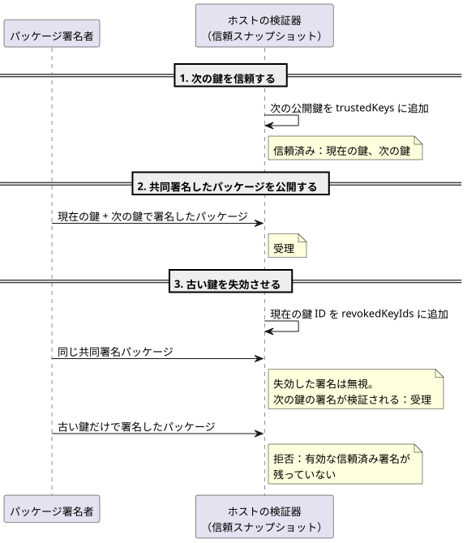
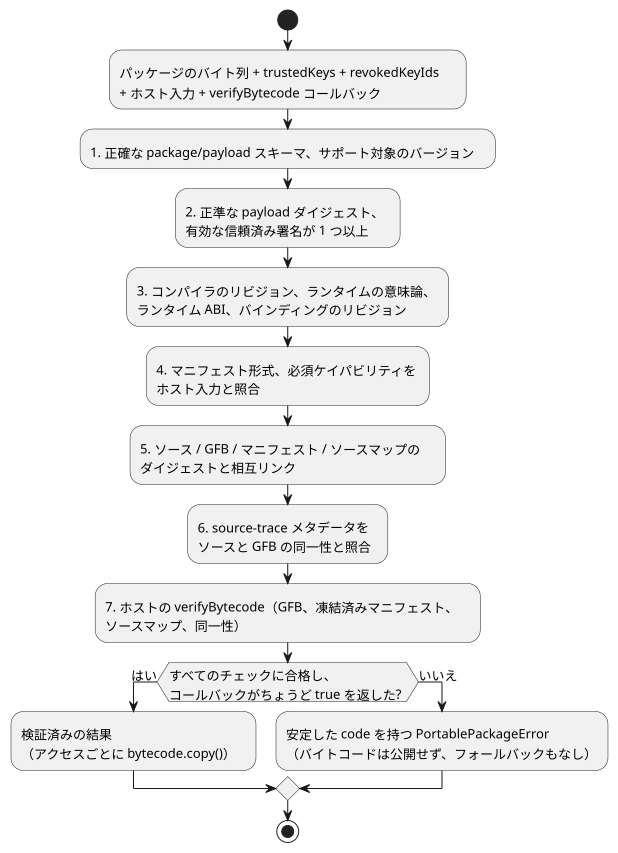

<!-- translation-source: docs/PORTABLE-PACKAGE.md -->
[英語の原文](PORTABLE-PACKAGE.md)

# ポータブル GFB パッケージ v1

**ポータブルパッケージ**は、GhostFlow のホストが読み込む署名付きの単位です。形式 `GhostFlow/portable-package-v1` は、権威ある文芸的ソース（literate）のリビジョン1つ（`.ghost.md` ドキュメント）を、Browser と Device のホストが読み込む正確な GFB1 バイトコードのバイト列に結び付けます。さらに次のものも含みます。

- 生成されたマニフェストとソースマップ
- 実行互換性の同一性
- Ed25519 署名

パッケージは GFB1 のバイト列や VM の意味論を変更しません。

このドキュメントの内容：

- **エンベロープ**：パッケージのレイアウトとその正準エンコーディング。
- **署名バイト列と信頼**：何に署名するか、信頼済みの鍵、失効、ローテーション。
- **検証順序**：ホストがバイトコードを受け取る前に実行するチェック。ネイティブの開発用バイパスも含みます。
- **互換性と移行**：どの GFB プロファイルが受け入れられるか、バージョンをどう扱うか。
- **ネイティブ検証器 API**、**適応的な戦略ディスクリプタ**、**再利用可能な合成の正確な来歴**：Rust の検証器と特殊なケース。

## エンベロープ

```text
package
├─ format: GhostFlow/portable-package-v1
├─ payload
│  ├─ format: GhostFlow/portable-payload-v1
│  ├─ source: 正確な UTF-8 の .ghost.md バイト列 + SHA-256
│  ├─ bytecode: 正確な GFB プロファイル 1/2/3/4 のバイト列 + SHA-256
│  ├─ manifest: 正確な正準 JSON のバイト列 + SHA-256
│  ├─ sourceMap: 正確な正準 JSON のバイト列 + SHA-256
│  └─ identity
│     ├─ compilerRevision
│     ├─ runtimeSemantics
│     ├─ runtimeAbi
│     ├─ requiredCapabilities[]
│     └─ bindingRevision
├─ payloadSha256
└─ signatures[]: algorithm + keyId + signatureBase64
```

**正準エンコーディング。**

- バイナリのフィールドは、パディング付きの正準な base64 を使います。
- マニフェストとソースマップのバイト列は、JSON のキーを再帰的にソートし、配列の順序を保ち、ECMAScript の有限数のシリアライズを使います。
- 疎な配列と、JavaScript で正確に扱える安全な範囲を超える整数は拒否されます。`-0` は `0` としてシリアライズされます。
- 元の Markdown は正規化**されません**。Unicode、コメント、散文、CRLF、末尾の改行はすべて、ソースダイジェストの一部のままです。

**パッケージの構築。** `buildPortablePackage` は、ソースが `.ghost.md` の文芸的ドキュメントであり、制御マニフェストが GFB のダイジェストと一致する `compileSource` の結果だけを受け付けます。

- 署名には、新たな `verifyCompilation` のリプレイも必要です。リプレイの正確な GFB、マニフェスト、ソースマップのバイト列は、与えられた結果と一致しなければなりません。これにより、公式のビルダーが読みやすいソースを別のコンパイル済みプログラムと組み合わせることを防ぎます。
- 必須ケイパビリティは、`kind`、次に `name`、次に `type` の順でソートされます。
- マニフェストのすべての入力（`input`）、オプションでないセンサ（`sensor`）、出力（`actuator`）は、署名済みの必須ケイパビリティの集合と**双方向で**一致しなければなりません。欠けているものも、余分なものもあってはなりません。
- オプションのセンサは必須の集合の外に置かれます。存在するかどうかは、明示的なホストバインディングが決めます。

## 署名バイト列と信頼

**何に署名するか。**

- 署名の入力は、`payload` の正確な正準 UTF-8 エンコーディングです。
- `payloadSha256` は、それと同じバイト列をハッシュします。
- 外側のパッケージ形式は、検証の前にチェックされます。`signatures` と `payloadSha256` は署名の入力から除外されます。
- 埋め込まれたすべてのバイト列、そのディスクリプタ、実行の同一性は、署名されたペイロードの内側にあります。

**アルゴリズムと鍵 ID。** バージョン 1 では Ed25519 のみが許可されます。各署名は、長さが有界の `keyId` を名指しします。鍵の重複とアルゴリズムのネゴシエーションは拒否されます。

**信頼の入力。** 検証器は、明示的な信頼の入力を2つ受け取ります。

- `trustedKeys`：現在受け入れられている鍵 ID と Ed25519 公開鍵。
- `revokedKeyIds`：もはやパッケージを認可しない鍵。

どちらの入力も必須の信頼スナップショットです。失効状態を省略するとエラーになります。空の失効リストとしては扱われません。

**鍵のローテーション**には、共同署名されたパッケージを使います。

1. ホストはまず、次の公開鍵を信頼します。
2. 次にホストは、現在の鍵と次の鍵の両方で署名されたパッケージを受け入れます。
3. 最後に、ホストは古い鍵を失効させます。

失効した署名は、別の有効な信頼済み署名が検証される場合は無視されます。有効な信頼済み署名が1つも残っていないパッケージは拒否されます。信頼のレコードは壁時計に依存しません。

次のシーケンス図は、ホストの視点から見た3つのローテーション手順を示しています。



`tests/portable-package.test.mjs` にある RFC 8032 の鍵素材は公開テストデータであり、製品の信頼ルートとして設定してはなりません。

## 検証順序

### ネイティブの開発用認証ポリシー

**既定：常に認証する。** Rust の `ghostflow-package` API `verify_portable_package` は、常に発行者の認証を強制します。`SignaturePolicy::default()` は `Enforce` です。

**明示的な開発用バイパス。** 明示的な開発用ホストは、`DevelopmentBypass` を指定して `verify_portable_package_with_signature_policy` を呼び出すことができます。これは同じ正準の検証器とターゲットローダーを実行します。この所有者向けインターフェースは、Device のビルドプロファイルを選択せず、Browser/JavaScript の検証でバイパスを有効にすることもありません。

バイパスが緩和するもの：

- 暗号学的な認証をチェックせずに、空の `signatures` 配列や、信頼されていない/失効した発行者の署名を受け入れます。
- このモードでは、信頼ルートと失効の入力は使われません。偽の信頼済み鍵で代用することもありません。

バイパスモードでも必須のままのもの：

- `signatures` 配列は引き続き必須で、`max_signatures` によって上限が設けられます。
- 存在するエントリは、正確なスキーマ、Ed25519 アルゴリズム、互いに異なる有界の鍵 ID、64 バイトの正準 base64 エンコーディングを持たなければなりません。
- 正準なトランスポート、ペイロードとアーティファクトのハッシュ、サイズの上限、互換性の同一性、ケイパビリティ、バインディング、ソース/バイトコードの相互リンク、ターゲットの読み込み。

ハッシュが確立するのはバイト列の一貫性であり、認証された発行者や意図ではありません。

**モードの報告。** 結果は `signature_authentication` を `Authenticated` または `DevelopmentBypass` として公開します。

- バイパスされた結果では、与えられた署名が本来なら検証されるとしても、`accepted_key_ids` は常に空です。
- ホストはその未認証のステータスを公開しなければならず、アップロード、保存済みプログラムの起動、ロールバックに同じ1つのポリシーを適用しなければなりません。
- 本番ホストと信頼された受け入れホストは、強制を維持しなければなりません。開発用のオプトアウトは、出力の権限を与えるものでも、実行を認可するものでもありません。

**検証の手順。** `verifyPortablePackage` は、安定した `code` を持つ `PortablePackageError` を返し、次のチェックにこの順序で合格するまでバイトコードを公開しません。

1. 正確な package/payload のスキーマと、サポートされているバージョン
2. 正準なペイロードのダイジェストと、少なくとも1つの有効な信頼済み署名
3. コンパイラのリビジョン、ランタイムの意味論、ランタイム ABI、バインディングのリビジョン
4. マニフェストの形式と、ホスト入力に対する必須ケイパビリティ
5. ソース、GFB、マニフェスト、ソースマップの内容のダイジェストと相互リンク
6. ソースと GFB の同一性に対する、コンパイラ所有の source-trace メタデータ
7. ホストが与えた `verifyBytecode` コールバック

次の図は、同じ手順とその2つの結果を示しています。



**`verifyBytecode` コールバック**は必須です。

- 正確な GFB のバイト列と、深く凍結された検証済みのマニフェスト、ソースマップ、同一性の値を受け取ります。
- Browser は WASM の GFB1 ローダーを渡します。Device はネイティブの `Module::load` 境界を渡します。
- `false` の結果や例外は `bytecode-rejected` になります。ターゲットローダーの結果を受け入れるのは、明示的な `true` だけです。
- 検証済みの結果は、アクセスのたびに切り離された `bytecode.copy()` を提供します。そのため、呼び出し側は保持されている検証済みのバイト列を変更できません。

**暗黙のフォールバックはありません。** 検証器は、別の ABI で再試行したり、未知の要件を取り除いたり、別のバインディングで代用したり、古いプログラムにフォールバックしたりすることは決してありません。

**検証が証明するもの。** 返されるソース、マニフェスト、マップ、GFB のバイト列は、すべて検証済みのペイロードから来たものです。

- パッケージのダイジェストは同一性を証明します。
- 署名は、受け入れられた発行者であることを証明します。
- どちらも、農家の意図、ハードウェアの互換性、リレーの動作、物理的な負荷の動きを証明するものではありません。

**バインディングのリビジョン。** `bindingRevision` は、API と Device が選んだ設置のバインディングを識別します。このパッケージは、リビジョンの完全一致と論理的なケイパビリティの形をチェックします。所有する API/Device のレイヤーは、パッケージの検証器を呼び出す前に、そのリビジョンの実際の DI/RO チャネルマップを検証しなければなりません。

## 互換性と移行

### 署名された不変の IANA Range

**受け入れられるプロファイル。**

- `GhostFlow/control-v21` と `GhostFlow/context-scan-abi-v5` を伴う GFB21 は、明示的なポータブルプロファイルです。
- GFB22 は、その変更されていない inner21 を、検査済みのライフサイクルディスクリプタで包むことができます。
- プロファイル 1–4、10、11 に対する既存の受け入れは維持されます。
- この変更によって、他の Range、カレンダー、プロバイダ、目標、config のプロファイルが受け入れられることはありません。
- GFB11 のスカラー config/Periodic の制限はそのまま維持されます。

**すり替えをどう防ぐか。** 署名には、正確な新しいソースのリプレイが必要です。

- JavaScript の検証は、完全な正準の所有者マニフェストを新たな lowering と比較します。
- Rust は、スケジュールの数/発生箇所/名前、IANA ゾーン、選択されたスロット、継続時間、DST ポリシー、gap と recovery のフィールドを、デコードした CivilRange ディスクリプタに結び付けます。
- どちらも、再署名によるすり替えをターゲットローダーの前に拒否します。
- Rust は、署名された `when`/`cancelWhen` の所有者式 IR を、リテラルでない分岐、整数、Result のトレースも含めて再エンコードします。IR を評価せず、既存の述語を制限することもなく、実行可能バイト列の完全一致を要求します。

**ケイパビリティとランタイムの事実。**

- ケイパビリティには、ランタイムが所有する再起動ポートは含まれませんが、実際の取得とアクチュエータの要件は含まれます。
- ホストの tzdb/時刻の発生に関する事実は、明示的なランタイム入力のままです。署名されたパッケージは、それらの事実や物理的な実行を証明するものではありません。

`tests/civil-range-package.test.mjs` と、その実際の署名済み JavaScript フィクスチャを参照してください。ネイティブの Rust 検証器がこれを実行して確認します。

### スカラー設定を伴う署名済み GFB11 Periodic

`GhostFlow/control-v10` と `GhostFlow/context-scan-abi-v5` を伴う GFB11 は、スカラーの config を実行可能な Periodic スケジュールとともにパッケージ化できるようになりました。

現在の署名済みサブセットでは、次のすべてが必要です。

- instant のアンカーと `preserve_anchor`
- config に裏付けられた `Duration` の間隔
- 定数 `true` の述語
- `pulse`/`trusted_only`/`baseline`/`skip` のポリシー

相互チェック：

- マニフェストのスケジュールの発生箇所、名前、間隔の config ID と値、アンカー、gap、ポリシーは、デコードした GFB11 ディスクリプタと一致しなければなりません。
- 生成された config の射影と、クロック/エポックの入力は、バイトコードと一致しなければなりません。
- その他の種類のスケジュール、目標/ウィンドウ/信号のプレリュード、署名されていないパッケージや一致しないパッケージは、引き続き拒否されます。
- スカラー config の初期値と範囲には、既存のチェックがそのまま適用されます。

これはパッケージの受け入れを拡張するだけです。言語や Device のデプロイポリシーは変更しません。

一般的なバージョン規則：

- パッケージ v1 は、サポートされている GFB プロファイルを1つ含みます。
  - 署名されたバイトコードディスクリプタのバージョンは、実際のリトルエンディアンのヘッダーバージョンを10進数の文字列にしたものです。JavaScript と Rust の検証器はどちらも、ターゲットローダーを呼び出す前に完全一致を要求します。
  - サポートされているが一致しないバージョンは `bytecode-version-mismatch` を報告し、未知のバージョンは `unsupported-bytecode-version` を報告します。
  - Int のポートは、プロファイル 3 も含めて、区別された `int` ケイパビリティ型に対応付けられます。
  - 17 種類の物理量の型は、機械向けケイパビリティ `number` に対応付けられます。それらの input/output/sensor/config のディスクリプタには、カタログにある正確な `canonicalUnit` が必要です。
  - 入力/出力の物理量レコードは、ちょうど `name`、`type`、`canonicalUnit` を含みます。物理量でないレコードでは、このフィールドは禁止されています。JavaScript と Rust は、ターゲットローダーを呼び出す前に、欠落した、誤った、または予期しない単位のメタデータを拒否します。
  - コンパイルのリプレイ、署名、アーティファクトのダイジェスト、ターゲットの検証は引き続き必須です。現在のプロファイルの意味論については [BYTECODE.md](BYTECODE.ja.md) を参照してください。
- 署名付きのデプロイを要求するホストは、無効なパッケージを生の `.gfb` の経路へ格下げしてはなりません。
- 未知のパッケージ、ペイロード、バイトコード、マニフェスト、ランタイム意味論、ABI のバージョンは拒否されます。新しいバージョンをサポートするには、新しい適合性コーパスと、利用者側の互換性の明示的な更新が必要です。
- API のストレージ、Device のアトミックなステージ/有効化/復旧、本番鍵の保管は、それぞれのモジュールに属します。それらはこのパッケージ契約を利用します。

**テストの範囲。** `tests/portable-package.test.mjs` は次のものを扱います。

- 決定的な構築とコンパイラのリプレイ
- ソースとアーティファクトの保存
- 改ざんの拒否
- 鍵のローテーション/失効
- ケイパビリティとバインディングの拒否
- Buffer を使わないブラウザでの検証
- リリース版のネイティブ Rust と WASM の GFB1 ローダーを通した、バイト単位で同一の抽出

## ネイティブ検証器 API

**入力。** `crates/ghostflow-package` は、末尾の1つの改行も含めて、正確な正準 `GhostFlow/portable-package-v1` のトランスポートバイト列だけを受け付けます。

**検証するもの。**

- 署名されたペイロードのダイジェスト
- 信頼済みで失効していない Ed25519 署名
- コンパイラ/ランタイム/バインディングの同一性
- ケイパビリティとマニフェストの相互リンク
- アーティファクトのダイジェスト
- GFB プロファイルとヘッダーの一致
- 埋め込まれた正準なマニフェスト/ソースマップの JSON
- ソースマップから権威あるソースドキュメントへのリンク

**ターゲットローダー。** 呼び出し側は必須の `TargetLoader` を与えます。検証器は、そのローダーが `Ok(true)` を返すまで、GFB1 のバイト列のコピーを返しません。`VerifiedPackage` は、ソース、マニフェスト、ソースマップ、バイトコードの切り離されたコピーを、受け入れられた署名鍵 ID とともに返します。

**意図的に重複させないもの。** ネイティブ v1 のスライスは、`sourceMap.traceMetadata` に対するコンパイラ所有の深い意味検証を、意図的に重複させて**いません**。その検証は既存の JS 共通検証器に残り、信頼されたパッケージビルダーが署名の前に新たな決定的コンパイラリプレイでそれを担保します。ネイティブの検証は、生の GFB やレガシーなフォールバックを受け付けず、呼び出し側が提供した証明書（attestation）を信頼の権威として扱うことは決してありません。

**GFB プロファイル 4（ウィンドウ）。**

- ネイティブ検証器は、マニフェストとバイトコードの相互リンクの一部として、署名されたウィンドウディスクリプタとその機械向けバインディングをチェックします。
- 入れ子のディスクリプタは、各 `upstreamWindows` の名前、発生箇所、前のスロットを、品質の射影からデコードした依存関係リストに結び付けます。省略された、空の、または別のものに結び付け直された依存関係リストは、ターゲットローダーの前に拒否されます。
- 時間的な有効化は別のランタイム手順です。署名の検証の後、呼び出し側は明示的な時間エポック、ルート密度の上限、保持の予算を与えます。
- 署名の検証だけでは、時間的プロファイルが有効になることも、ウィンドウのトレースの意味論が証明されることもありません。
- ネイティブパッケージのスライスは、正準な JavaScript ソースを再コンパイルせず、深い意味上のトレースのリプレイも行いません。ディスクリプタの検証だけでは、ランタイムの入れ子ウィンドウの計算や証明の保持は確立されません。

**ターゲットと制限。**

- 現在のネイティブクレートは Rust の `std` を対象としており、Farm Device が使う ESP-IDF の Rust ランタイムも含みます。別個の `no_std` パッケージスタックは、Waveshare ターゲットには含まれません。
- `VerifierLimits` は、トランスポート、署名されたペイロード、アーティファクト、署名、ケイパビリティ、JSON の深さに上限を設けます。
- Device 側の利用者は、デバイスに適したサイズのプロファイルを選び、トランスポートのバイト列を稼働中のプログラムスロットの外でステージングし、アトミックな有効化の前にこの検証器を呼び出さなければなりません。
- ホストでの検証だけでは、MCU での有効化、リレーの動作、物理的な負荷の動きの証拠にはなりません。


## 適応的な戦略ディスクリプタ

**対になったメタデータ。** コンパイラが生成する `adaptPolicy` と `strategies` は、対になった署名済みマニフェストメタデータです。

- JS の検証は、それらを正準ソースの再コンパイル結果と正確なバイトコードと比較します。
- ネイティブの検証は、順序付きの戦略名、優先度、出力名、ケイパビリティ照会のバイト列を、デコードしたコアモジュールと照合します。
- 型付きの照合は、宣言されたセンサ/アクチュエータのケイパビリティを参照しなければなりません。
- 選択は引き続き `highest-priority-unique` です。サポートされていない、または対になっていないメタデータは、読み込みの前に拒否されます。
- ポリシー名は署名された有界のソースメタデータであり、新しいランタイムのセレクタではありません。

**自動的な有効化はありません。** オプションの Bool 観測が、新しいポリシーを自動的に選択したり有効にしたりすることはありません。作成者が書いた戦略が対象になるかどうかは、明示的なホストのケイパビリティスナップショットが決めます。

- ネイティブと WASM のテストは、観測が欠落しているときはベースラインの出力を、存在するときはフィードバックの出力を保持します。
- 再署名による戦略/照会/バイトコードの改ざんを拒否します。
- GFB とワイヤ形式、ABI、署名ポリシーは変わりません。
- 物理的な配線と Device での受け入れは、引き続き利用者の責任です。

## 再利用可能な合成の正確な来歴

**ソースクロージャ。** 再利用可能な合成パッケージは、署名されたソースマップのエンベロープに、任意の `sourceClosure` を含めます。クロージャには、固定された推移的な文芸的ドキュメントの正確な内容、そのリビジョンとダイジェスト、作成者が書いたインスタンスの同一性が含まれます。

- 検証では、ターゲットのバイトコード検証器を呼び出す前に、そのクロージャを再コンパイルし、バイトコード、マニフェスト、ソースマップのエンベロープ全体を比較します。
- 有効な署名であっても、改変されたインスタンスの来歴を認可することはできません。
- クロージャを持たない既存のパッケージは、既存の検証経路をそのまま使います。

**適合性。** REF-06-025 は、ネイティブとフレーム方式の WASM を通して、入れ子の再利用、別個の Boolean インスタンス状態、型付きの論理ポートをチェックします。その後、検証済みパッケージから効果を伴わないリプレイを準備します。仮想バインディングのリビジョンは論理的なケイパビリティを識別するものであり、物理的なピンの適合性や適用を確立するものではありません。既存の単純な Boolean リプレイのプロファイルは変わりません。
