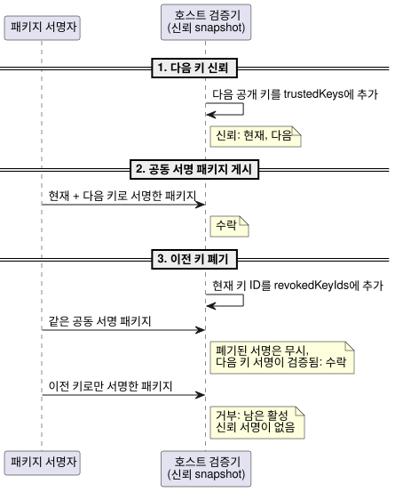
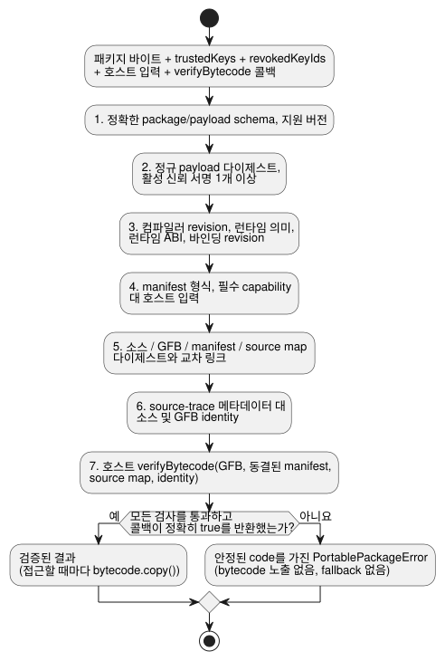

<!-- translation-source: docs/PORTABLE-PACKAGE.md -->
[영문 원문](PORTABLE-PACKAGE.md)

# 이식 가능한 GFB 패키지 v1

**이식 가능한 패키지(portable package)**는 GhostFlow 호스트가 불러오는 서명된 단위입니다.
`GhostFlow/portable-package-v1` 형식은 권위 있는 문서형 소스 revision 하나(`.ghost.md`
문서)를 Browser 호스트와 Device 호스트가 불러오는 정확한 GFB1 bytecode 바이트에
묶습니다. 패키지에는 다음도 함께 들어 있습니다.

- 생성된 manifest와 source map
- 실행 호환성 identity
- Ed25519 서명

패키지는 GFB1 바이트나 VM 의미를 바꾸지 않습니다.

이 문서의 내용:

- **봉투(envelope)**: 패키지 구조와 정규 인코딩
- **서명 바이트와 신뢰**: 무엇에 서명하는지, 신뢰 키, 폐기, 교체
- **검증 순서**: 호스트가 bytecode를 받기 전에 실행하는 검사(native 개발용 우회 포함)
- **호환성과 마이그레이션**: 어떤 GFB 프로필을 허용하며 버전을 어떻게 다루는지
- **Native 검증기 API**, **적응형 전략 descriptor**, **정확한 재사용 조합 provenance**:
  Rust 검증기와 특수한 경우

## 봉투

```text
package
├─ format: GhostFlow/portable-package-v1
├─ payload
│  ├─ format: GhostFlow/portable-payload-v1
│  ├─ source: exact UTF-8 .ghost.md bytes + SHA-256
│  ├─ bytecode: exact GFB profile 1/2/3/4 bytes + SHA-256
│  ├─ manifest: exact canonical JSON bytes + SHA-256
│  ├─ sourceMap: exact canonical JSON bytes + SHA-256
│  └─ identity
│     ├─ compilerRevision
│     ├─ runtimeSemantics
│     ├─ runtimeAbi
│     ├─ requiredCapabilities[]
│     └─ bindingRevision
├─ payloadSha256
└─ signatures[]: algorithm + keyId + signatureBase64
```

**정규 인코딩.**

- 바이너리 필드는 패딩이 있는 정규 base64를 사용합니다.
- manifest와 source map 바이트는 JSON 키를 재귀적으로 정렬하고, 배열 순서를 보존하며,
  ECMAScript 유한 수 직렬화를 사용합니다.
- 희소 배열과 JavaScript의 정확한 안전 범위를 벗어난 정수는 거부됩니다. `-0`은 `0`으로
  직렬화됩니다.
- 원본 Markdown은 정규화하지 **않습니다**. 유니코드, 주석, 설명 글, CRLF, 마지막 개행이
  모두 소스 다이제스트의 일부로 남습니다.

**패키지 만들기.** `buildPortablePackage`는 소스가 `.ghost.md` 문서형 소스이고 control
manifest가 GFB 다이제스트와 일치하는 `compileSource` 결과만 받습니다.

- 서명하려면 새로운 `verifyCompilation` replay도 필요합니다. replay가 만든 정확한 GFB,
  manifest, source map 바이트가 제공된 결과와 일치해야 합니다. 이렇게 하면 공식 빌더가 읽을
  수 있는 소스를 다른 컴파일 프로그램과 짝지을 수 없습니다.
- 필수 capability는 `kind`, 그다음 `name`, 그다음 `type` 순으로 정렬됩니다.
- 모든 manifest 입력(`input`), 선택적이지 않은 센서(`sensor`), 출력(`actuator`)은 서명된
  필수 capability 집합과 **양방향으로** 일치해야 합니다. 빠진 것도, 남는 것도 없어야 합니다.
- 선택적 센서는 필수 집합 밖에 둡니다. 존재 여부는 명시적인 호스트 바인딩이 결정합니다.

## 서명 바이트와 신뢰

**무엇에 서명하는가.**

- 서명 입력은 `payload`의 정확한 정규 UTF-8 인코딩입니다.
- `payloadSha256`은 바로 그 바이트를 해싱합니다.
- 바깥 패키지 형식은 검증 전에 검사합니다. `signatures`와 `payloadSha256`은 서명 입력에서
  제외됩니다.
- 내장된 모든 바이트, 그 descriptor, 실행 identity는 서명된 payload 안에 있습니다.

**알고리즘과 키 ID.** 버전 1은 Ed25519만 허용합니다. 각 서명은 길이가 제한된 `keyId`를
명시합니다. 중복 키와 알고리즘 협상은 거부됩니다.

**신뢰 입력.** 검증기는 명시적인 신뢰 입력 두 가지를 받습니다.

- `trustedKeys`: 현재 받아들이는 키 ID와 Ed25519 공개 키
- `revokedKeyIds`: 더 이상 패키지를 승인하지 않는 키

두 입력 모두 필수 신뢰 snapshot입니다. 폐기 상태를 생략하면 빈 폐기 목록으로 취급하는 것이
아니라 오류입니다.

**키 교체**에는 공동 서명된 패키지를 사용합니다.

1. 먼저 호스트가 다음 공개 키를 신뢰합니다.
2. 그다음 호스트가 현재 키와 다음 키 모두로 서명된 패키지를 받아들입니다.
3. 마지막으로 호스트가 이전 키를 폐기합니다.

다른 활성 신뢰 서명이 검증되면 폐기된 서명은 무시됩니다. 활성 신뢰 서명이 하나도 남지 않은
패키지는 거부됩니다. 신뢰 기록은 벽시계에 의존하지 않습니다.

아래 시퀀스는 호스트 관점에서 본 세 가지 교체 단계를 보여 줍니다.



`tests/portable-package.test.mjs`의 RFC 8032 키 자료는 공개 테스트 데이터이며, 제품 신뢰
루트로 설정해서는 절대 안 됩니다.

## 검증 순서

### Native 개발 인증 정책

**기본값: 항상 인증.** Rust `ghostflow-package` API `verify_portable_package`는 항상
게시자 인증을 강제합니다. `SignaturePolicy::default()`는 `Enforce`입니다.

**명시적 개발용 우회.** 명시적인 개발 호스트는 `DevelopmentBypass`와 함께
`verify_portable_package_with_signature_policy`를 호출할 수 있습니다. 이 호출은 같은 정규
검증기와 대상 로더를 실행합니다. 이 소유자 인터페이스는 Device 빌드 프로필을 선택하지 않으며,
Browser/JavaScript 검증에서 우회를 활성화하지도 않습니다.

우회가 완화하는 것:

- 빈 `signatures` 배열이나 신뢰되지 않은/폐기된 게시자의 서명을, 암호학적 인증을 검사하지
  않고 받아들입니다.
- 이 모드에서는 신뢰 루트와 폐기 입력을 사용하지 않습니다. 가짜 신뢰 키로 대체하지도
  않습니다.

우회 모드에서도 여전히 필수인 것:

- `signatures` 배열은 여전히 필요하며 `max_signatures`로 제한됩니다.
- 존재하는 항목은 정확한 schema, Ed25519 알고리즘, 서로 다르고 길이가 제한된 키 ID, 64바이트의
  정규 base64 인코딩을 가져야 합니다.
- 정규 전송, payload 및 artifact 해시, 크기 한계, 호환성 identity, capability, 바인딩,
  소스/bytecode 교차 링크, 대상 로딩.

해시는 바이트 일관성을 확립할 뿐, 인증된 게시자나 의도를 확립하지 않습니다.

**모드 보고.** 결과는 `signature_authentication`을 `Authenticated` 또는
`DevelopmentBypass`로 노출합니다.

- 우회된 결과의 `accepted_key_ids`는 제공된 서명이 원래라면 검증되었을 경우에도 항상
  비어 있습니다.
- 호스트는 이 인증되지 않은 상태를 드러내야 하며, 업로드, 저장된 프로그램 부팅, rollback에
  하나의 정책을 적용해야 합니다.
- 운영 호스트와 신뢰 수용 호스트는 강제 인증을 유지해야 합니다. 개발용 선택 해제는 출력
  권한을 부여하거나 실행을 승인하지 않습니다.

**검증 단계.** `verifyPortablePackage`는 안정된 `code`를 가진 `PortablePackageError`를
반환하며, 다음 검사가 이 순서대로 통과할 때까지 bytecode를 노출하지 않습니다.

1. 정확한 package/payload schema와 지원 버전
2. 정규 payload 다이제스트와 활성 신뢰 서명 최소 1개
3. 컴파일러 revision, 런타임 의미, 런타임 ABI, 바인딩 revision
4. manifest 형식과, 호스트 입력에 대한 필수 capability
5. 소스, GFB, manifest, source map 콘텐츠 다이제스트와 교차 링크
6. 소스 및 GFB identity에 대한 컴파일러 소유 source-trace 메타데이터
7. 호스트가 제공한 `verifyBytecode` 콜백

아래 다이어그램은 같은 순서와 두 가지 가능한 결과를 보여 줍니다.



**`verifyBytecode` 콜백**은 필수입니다.

- 정확한 GFB 바이트와, 깊게 동결된 검증 manifest, source map, identity 값을 받습니다.
- Browser는 WASM GFB1 로더를 넘깁니다. Device는 native `Module::load` 경계를 넘깁니다.
- `false` 결과나 예외는 `bytecode-rejected`가 됩니다. 명시적인 `true`일 때만 대상 로더
  결과를 받아들입니다.
- 검증된 결과는 접근할 때마다 분리된 `bytecode.copy()`를 제공하므로, 호출자는 보관된 검증
  바이트를 변경할 수 없습니다.

**조용한 fallback 없음.** 검증기는 다른 ABI로 재시도하거나, 알 수 없는 요구사항을
떼어 내거나, 다른 바인딩으로 대체하거나, 이전 프로그램으로 fallback하지 않습니다.

**검증이 증명하는 것.** 반환된 소스, manifest, 맵, GFB 바이트는 모두 검증된 payload에서
나옵니다.

- 패키지 다이제스트는 identity를 증명합니다.
- 서명은 받아들여진 발급자를 증명합니다.
- 어느 쪽도 농민의 의도, 하드웨어 호환성, 릴레이 동작, 물리적 부하의 움직임을 증명하지
  않습니다.

**바인딩 revision.** `bindingRevision`은 API와 Device가 선택한 설치 바인딩을 식별합니다. 이
패키지는 revision이 정확히 같은지와 논리 capability 형태를 검사합니다. 소유하는 API/Device
계층은 패키지 검증기를 호출하기 전에 그 revision의 실제 DI/RO 채널 맵을 검증해야 합니다.

## 호환성과 마이그레이션

### 서명된 불변 IANA Range

**허용되는 프로필.**

- `GhostFlow/control-v21`과 `GhostFlow/context-scan-abi-v5`를 사용하는 GFB21은 명시적인
  이식 가능 프로필입니다.
- GFB22는 변경되지 않은 그 inner21을 검사된 lifecycle descriptor로 감쌀 수 있습니다.
- 프로필 1–4, 10, 11에 대한 기존 허용은 그대로 유지됩니다.
- 이 변경으로 그 밖의 Range, calendar, provider, objective, config 프로필은 허용되지
  않습니다.
- GFB11 scalar-config/Periodic 제한은 그대로 유지됩니다.

**대체를 막는 방법.** 서명하려면 정확한 새 소스 replay가 필요합니다.

- JavaScript 검증은 완전한 정규 소유자 manifest를 새 lowering 결과와 비교합니다.
- Rust는 예약 개수/위치/이름, IANA 시간대, 선택된 슬롯, 지속 시간, DST 정책, gap 및 recovery
  필드를 디코딩한 CivilRange descriptor에 묶습니다.
- 둘 다 대상 로더 전에 재서명된 대체를 거부합니다.
- Rust는 리터럴이 아닌 분기, 정수, Result trace를 포함해 서명된 `when`/`cancelWhen` 소유자
  식 IR을 다시 인코딩합니다. IR을 평가하지 않고 기존 술어를 제한하지도 않으면서, 실행
  바이트가 정확히 같을 것을 요구합니다.

**capability와 런타임 사실.**

- capability는 런타임이 소유하는 재시작 포트를 제외하지만, 실제 획득 및 액추에이터
  요구사항은 유지합니다.
- 호스트 tzdb/시간 발생 사실은 명시적인 런타임 입력으로 남습니다. 서명된 패키지는 그 사실이나
  물리적 실행을 증명하지 않습니다.

`tests/civil-range-package.test.mjs`와, native Rust 검증기가 실행하는 실제 서명된
JavaScript fixture를 참고하세요.

### 스칼라 설정을 가진 서명된 GFB11 Periodic

`GhostFlow/control-v10`과 `GhostFlow/context-scan-abi-v5`를 사용하는 GFB11은 이제 스칼라
config를 실행 가능한 Periodic 예약과 함께 패키징할 수 있습니다.

현재 서명 가능한 부분집합은 다음을 모두 요구합니다.

- instant 앵커와 `preserve_anchor`
- config 기반 `Duration` 간격
- 상수 `true` 술어
- `pulse`/`trusted_only`/`baseline`/`skip` 정책

교차 검사:

- manifest의 예약 위치, 이름, 간격 config ID와 값, 앵커, gap, 정책은 디코딩된 GFB11
  descriptor와 일치해야 합니다.
- 생성된 config projection과 clock/epoch 입력은 bytecode와 일치해야 합니다.
- 다른 예약 종류, objective/window/signal prelude, 서명되지 않았거나 일치하지 않는 패키지는
  계속 거부됩니다.
- 스칼라 config 초깃값과 한계는 기존 검사를 그대로 받습니다.

이것은 패키지 허용 범위만 넓힙니다. 언어나 Device 배포 정책은 바꾸지 않습니다.

일반 버전 규칙:

- 패키지 v1에는 지원되는 GFB 프로필 하나가 들어 있습니다.
  - 서명된 bytecode descriptor 버전은 실제 little-endian 헤더 버전의 10진 문자열입니다.
    JavaScript와 Rust 검증기 모두 대상 로더를 호출하기 전에 정확한 일치를 요구합니다.
  - 지원되지만 일치하지 않는 버전은 `bytecode-version-mismatch`를, 알 수 없는 버전은
    `unsupported-bytecode-version`을 보고합니다.
  - Int 포트는 프로필 3을 포함해 별도의 `int` capability 타입에 대응됩니다.
  - 17개 물리량 타입은 기계 capability `number`에 대응됩니다. 이들의
    input/output/sensor/config descriptor는 정확한 카탈로그 `canonicalUnit`을 요구합니다.
  - 입력/출력 물리량 기록에는 정확히 `name`, `type`, `canonicalUnit`만 들어 있습니다.
    물리량이 아닌 기록에는 그 필드가 금지됩니다. JavaScript와 Rust는 대상 로더를 호출하기
    전에 누락되었거나, 틀렸거나, 예상치 못한 단위 메타데이터를 거부합니다.
  - 컴파일 replay, 서명, artifact 다이제스트, 대상 검증은 계속 필수입니다. 현재 프로필
    의미는 [BYTECODE.md](BYTECODE.ko.md)를 참고하세요.
- 서명된 배포를 요구하는 호스트는 유효하지 않은 패키지를 raw `.gfb` 경로로 격하해서는 안
  됩니다.
- 알 수 없는 package, payload, bytecode, manifest, runtime-semantics, ABI 버전은 거부됩니다.
  새 버전을 지원하려면 새 적합성 corpus와 명시적인 소비자 호환성 갱신이 필요합니다.
- API 저장, Device의 원자적 stage/activate/recovery, 운영 키 보관은 각 모듈에 속하며, 이들
  모듈이 이 패키지 계약을 사용합니다.

**테스트 범위.** `tests/portable-package.test.mjs`는 다음을 다룹니다.

- 결정적 생성과 컴파일러 replay
- 소스와 artifact 보존
- 변조 거부
- 키 교체/폐기
- capability 및 바인딩 거부
- Buffer 없는 브라우저 검증
- release native Rust 및 WASM GFB1 로더를 통한 바이트 동일 추출

## Native 검증기 API

**입력.** `crates/ghostflow-package`는 마지막 개행 하나를 포함한, 정확한 정규
`GhostFlow/portable-package-v1` 전송 바이트만 받습니다.

**검증하는 것.**

- 서명된 payload 다이제스트
- 신뢰되고 폐기되지 않은 Ed25519 서명
- 컴파일러/런타임/바인딩 identity
- capability와 manifest 교차 링크
- artifact 다이제스트
- GFB 프로필/헤더 일치
- 내장된 정규 manifest/source map JSON
- source map과 권위 있는 소스 문서 사이의 연결

**대상 로더.** 호출자는 필수 `TargetLoader`를 제공합니다. 검증기는 그 로더가 `Ok(true)`를
반환하기 전까지 GFB1 바이트의 사본을 반환하지 않습니다. `VerifiedPackage`는 소스, manifest,
source map, bytecode의 분리된 사본을 받아들여진 서명 키 ID와 함께 반환합니다.

**의도적으로 중복하지 않는 것.** native v1 부분은 컴파일러가 소유하는
`sourceMap.traceMetadata` 심층 의미 검증을 의도적으로 중복하지 **않습니다**. 그 검증은 기존
JS 공통 검증기에 남아 있으며, 신뢰된 패키지 빌더가 서명 전에 새로운 결정적 컴파일러 replay로
이를 다룹니다. native 검증은 raw GFB나 legacy fallback을 받아들이지 않으며, 호출자가 제공한
attestation을 신뢰 권한으로 취급하지 않습니다.

**GFB 프로필 4 (window).**

- native 검증기는 manifest와 bytecode 교차 링크의 일부로 서명된 window descriptor와 그
  기계 바인딩을 검사합니다.
- 중첩 descriptor는 각 `upstreamWindows` 이름, 위치, 이전 슬롯을 quality projection에서
  디코딩한 의존성 목록에 묶습니다. 생략되었거나, 비어 있거나, 다시 묶인 의존성 목록은 대상
  로더 전에 거부됩니다.
- 시간 활성화는 별도의 런타임 단계입니다. 서명 검증 후 호출자가 명시적인 time epoch,
  root-density 한계, 보존 예산을 제공합니다.
- 서명 검증만으로는 시간 프로필이 활성화되거나 window trace 의미가 증명되지 않습니다.
- native 패키지 부분은 정규 JavaScript 소스를 다시 컴파일하거나 심층 의미 trace replay를
  수행하지 않습니다. descriptor 검증만으로는 런타임의 중첩 window 산술이나 증명 보존이
  확립되지 않습니다.

**대상과 한계.**

- 현재 native crate는 Farm Device가 사용하는 ESP-IDF Rust 런타임을 포함해 Rust `std`를
  대상으로 합니다. 별도의 `no_std` 패키지 스택은 Waveshare 대상에 포함되지 않습니다.
- `VerifierLimits`는 전송, 서명된 payload, artifact, 서명, capability, JSON 깊이를
  제한합니다.
- Device 소비자는 장치 크기에 맞는 프로필을 선택하고, 활성 프로그램 슬롯 밖에 전송 바이트를
  준비(stage)하며, 원자적 활성화 전에 이 검증기를 호출해야 합니다.
- 호스트 검증만으로는 MCU 활성화, 릴레이 동작, 물리적 부하의 움직임에 대한 증거가 되지
  않습니다.


## 적응형 전략 descriptor

**짝을 이루는 메타데이터.** 컴파일러가 만든 `adaptPolicy`와 `strategies`는 짝을 이루는
서명된 manifest 메타데이터입니다.

- JS 검증은 이를 정규 소스 재컴파일 결과와 정확한 bytecode에 대해 비교합니다.
- native 검증은 순서가 있는 전략 이름, 우선순위, 출력 이름, capability 질의 바이트를 디코딩된
  core 모듈과 대조합니다.
- typed 일치는 선언된 sensor/actuator capability를 참조해야 합니다.
- 선택 방식은 계속 `highest-priority-unique`입니다. 지원되지 않거나 짝이 맞지 않는
  메타데이터는 불러오기 전에 거부됩니다.
- 정책 이름은 서명되고 길이가 제한된 소스 메타데이터일 뿐, 새로운 런타임 선택자가
  아닙니다.

**자동 활성화 없음.** 선택적 Bool 관측이 새 정책을 자동으로 선택하거나 활성화하지
않습니다. 작성된 전략이 적격한지는 명시적인 호스트 capability snapshot이 결정합니다.

- native 및 WASM 테스트는 관측이 없을 때 baseline 출력을, 관측이 있을 때 피드백 출력을
  보존합니다.
- 재서명된 전략/질의/bytecode 변조를 거부합니다.
- GFB 및 wire 형식, ABI, 서명 정책은 바뀌지 않습니다.
- 물리 배선과 Device admission은 계속 소비자의 책임입니다.

## 정확한 재사용 조합 provenance

**소스 closure.** 재사용 조합 패키지는 서명된 source map 봉투 안에 선택적인
`sourceClosure`를 포함합니다. closure에는 고정된 전이적 문서형 소스 문서 그대로, 그
revision과 다이제스트, 작성된 인스턴스 identity가 들어 있습니다.

- 검증은 대상 bytecode 검증기를 호출하기 전에 그 closure를 다시 컴파일하고, 완전한 bytecode,
  manifest, source map 봉투를 비교합니다.
- 유효한 서명이라도 변경된 인스턴스 provenance를 승인할 수 없습니다.
- closure가 없는 기존 패키지는 기존 검증 경로를 그대로 따릅니다.

**적합성.** REF-06-025는 native 및 framed WASM에서 중첩 재사용, 분리된 Boolean 인스턴스 상태,
typed 논리 포트를 검사합니다. 그다음 검증된 패키지로부터 효과 없는 replay를 준비합니다. 가상
바인딩 revision은 논리 capability를 식별할 뿐, 물리 핀의 적합성이나 적용을 확립하지
않습니다. 기존의 일반 Boolean replay 프로필은 바뀌지 않습니다.
