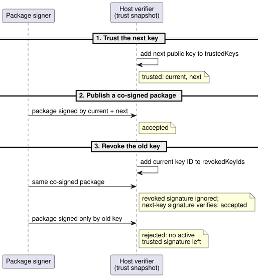
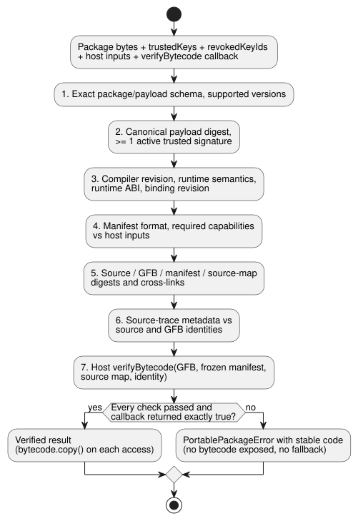

# Portable GFB package v1

A **portable package** is the signed unit that GhostFlow hosts load. The format
`GhostFlow/portable-package-v1` binds one authoritative literate source revision
(the `.ghost.md` document) to the exact GFB1 bytecode bytes that Browser and
Device hosts load. It also carries:

- the generated manifest and source map;
- an execution compatibility identity;
- Ed25519 signatures.

The package does not change GFB1 bytes or VM semantics.

In this document:

- **Envelope**: the package layout and its canonical encoding.
- **Signature bytes and trust**: what is signed, trusted keys, revocation and
  rotation.
- **Verification order**: the checks a host runs before it gets bytecode,
  including the native development bypass.
- **Compatibility and migration**: which GFB profiles are admitted and how
  versions are handled.
- **Native verifier API**, **Adaptive strategy descriptors** and **Exact
  reusable composition provenance**: the Rust verifier and special cases.

## Envelope

```text
package
├─ format: GhostFlow/portable-package-v1
├─ payload
│  ├─ format: GhostFlow/portable-payload-v1
│  ├─ source: exact UTF-8 .ghost.md bytes + SHA-256
│  ├─ bytecode: exact GFB profile 1/2/3/4 bytes + SHA-256
│  ├─ manifest: exact canonical JSON bytes + SHA-256
│  ├─ sourceMap: exact canonical JSON bytes + SHA-256
│  └─ identity
│     ├─ compilerRevision
│     ├─ runtimeSemantics
│     ├─ runtimeAbi
│     ├─ requiredCapabilities[]
│     └─ bindingRevision
├─ payloadSha256
└─ signatures[]: algorithm + keyId + signatureBase64
```

**Canonical encoding.**

- Binary fields use canonical padded base64.
- Manifest and source-map bytes use recursive JSON key sorting, preserve array
  order and use ECMAScript finite-number serialization.
- Sparse arrays and integers outside JavaScript's exact safe range are rejected.
  `-0` serializes as `0`.
- The original Markdown is **not** normalized. Unicode, comments, prose, CRLF
  and the trailing newline all remain part of its source digest.

**Building a package.** `buildPortablePackage` accepts only a `compileSource`
result whose source is a `.ghost.md` literate document and whose control
manifest matches the GFB digest.

- Signing also requires a fresh `verifyCompilation` replay. The replay's exact
  GFB, manifest and source-map bytes must match the supplied result. This
  prevents an official builder from pairing readable source with a different
  compiled program.
- Required capabilities are sorted by `kind`, then `name`, then `type`.
- Every manifest input (`input`), non-optional sensor (`sensor`) and output
  (`actuator`) must match the signed required-capability set **in both
  directions**: nothing missing and nothing extra.
- Optional sensors stay outside the required set. Explicit host bindings decide
  whether they are present.

## Signature bytes and trust

**What is signed.**

- The signature input is the exact canonical UTF-8 encoding of `payload`.
- `payloadSha256` hashes those same bytes.
- The outer package format is checked before verification. `signatures` and
  `payloadSha256` are excluded from the signature input.
- All embedded bytes, their descriptors and the execution identities are inside
  the signed payload.

**Algorithms and key IDs.** Version 1 permits only Ed25519. Each signature names
a bounded `keyId`. Duplicate keys and algorithm negotiation are rejected.

**Trust inputs.** A verifier receives two explicit trust inputs:

- `trustedKeys`: currently accepted key IDs and Ed25519 public keys.
- `revokedKeyIds`: keys that no longer authorize a package.

Both inputs are mandatory trust snapshots. Omitting revocation state is an error,
not an empty revocation list.

**Key rotation** uses a co-signed package:

1. Hosts first trust the next public key.
2. Hosts then accept a package signed by both the current and the next key.
3. Finally, hosts revoke the old key.

A revoked signature is ignored when another active trusted signature verifies.
A package with no remaining active trusted signature is rejected. Trust records
do not depend on the wall clock.

The sequence below shows the three rotation steps from the host's point of view.



The RFC 8032 key material in `tests/portable-package.test.mjs` is public test data
and must never be configured as a product trust root.

## Verification order

### Native development authentication policy

**Default: always authenticate.** The Rust `ghostflow-package` API
`verify_portable_package` always enforces publisher authentication.
`SignaturePolicy::default()` is `Enforce`.

**Explicit development bypass.** An explicit development host may call
`verify_portable_package_with_signature_policy` with `DevelopmentBypass`. It runs
the same canonical verifier and target loader. This owner interface does not
select a Device build profile, and it does not enable a bypass in
Browser/JavaScript verification.

What the bypass relaxes:

- It accepts an empty `signatures` array, or signatures from an
  untrusted/revoked publisher, without checking cryptographic authentication.
- Trust roots and revocation inputs are unused in this mode. No fake trusted key
  is substituted.

What stays mandatory even in bypass mode:

- The `signatures` array is still required and bounded by `max_signatures`.
- Present entries must have the exact schema, the Ed25519 algorithm, distinct
  bounded key IDs and a canonical base64 encoding of 64 bytes.
- Canonical transport, payload and artifact hashes, size bounds, compatibility
  identity, capabilities, binding, source/bytecode cross-links and target
  loading.

Hashes establish byte consistency, not an authenticated publisher or intent.

**Reporting the mode.** The result exposes `signature_authentication` as
`Authenticated` or `DevelopmentBypass`.

- A bypassed result always has empty `accepted_key_ids`, even if a supplied
  signature would otherwise verify.
- Hosts must expose that unauthenticated status, and must apply one policy to
  upload, stored-program boot and rollback.
- Production and trusted acceptance hosts must keep enforcement. The development
  opt-out does not grant output authority or authorize execution.

**The verification steps.** `verifyPortablePackage` returns
`PortablePackageError` with a stable `code`, and does not expose bytecode until
these checks pass, in this order:

1. exact package/payload schema and supported versions;
2. canonical payload digest and at least one active trusted signature;
3. compiler revision, runtime semantics, runtime ABI and binding revision;
4. manifest format and required capabilities against host inputs;
5. source, GFB, manifest and source-map content digests and cross-links;
6. compiler-owned source-trace metadata against the source and GFB identities;
7. the host's supplied `verifyBytecode` callback.

The diagram below shows the same sequence and its two possible outcomes.



**The `verifyBytecode` callback** is mandatory.

- It receives the exact GFB bytes plus deeply frozen verified manifest, source
  map and identity values.
- Browser passes its WASM GFB1 loader. Device passes the native `Module::load`
  boundary.
- A `false` result or an exception becomes `bytecode-rejected`. Only an explicit
  `true` accepts the target loader result.
- The verified result offers a detached `bytecode.copy()` on each access, so a
  caller cannot mutate the retained verified bytes.

**No silent fallbacks.** The verifier never retries with a different ABI, strips
an unknown requirement, substitutes another binding or falls back to an older
program.

**What verification proves.** The returned source, manifest, map and GFB bytes
all come from the verified payload.

- A package digest proves identity.
- A signature proves an accepted issuer.
- Neither proves farmer intent, hardware compatibility, relay operation or
  physical load movement.

**Binding revision.** `bindingRevision` identifies the installation binding
selected by the API and Device. This package checks exact revision equality and
the logical capability shape. The owning API/Device layer must validate that
revision's actual DI/RO channel map before it invokes the package verifier.

## Compatibility and migration

### Signed immutable IANA Range

**Admitted profiles.**

- GFB21 with `GhostFlow/control-v21` and `GhostFlow/context-scan-abi-v5` is an
  explicit portable profile.
- GFB22 may wrap that unchanged inner21 with the checked lifecycle descriptor.
- Existing admission for profiles 1–4, 10 and 11 remains.
- No other Range, calendar, provider, objective or config profile is admitted by
  this change.
- The GFB11 scalar-config/Periodic restrictions remain intact.

**How substitution is prevented.** Signing requires an exact fresh source replay.

- JavaScript verification compares the complete canonical owner manifest with a
  fresh lowering.
- Rust binds schedule count/site/name, IANA zone, selected slots, duration, DST
  policies, gap and recovery fields to the decoded CivilRange descriptors.
- Both reject re-signed substitutions before the target loader.
- Rust re-encodes the signed `when`/`cancelWhen` owner expression IR, including
  non-literal branches, integers and Result traces. It requires exact
  executable-byte equality without evaluating the IR and without restricting
  existing predicates.

**Capabilities and runtime facts.**

- Capabilities exclude runtime-owned restart ports but keep actual acquisition
  and actuator requirements.
- Host tzdb/time occurrence facts remain explicit runtime inputs. A signed
  package does not prove those facts or physical execution.

See `tests/civil-range-package.test.mjs` and its real signed JavaScript fixture,
which the native Rust verifier exercises.

### Signed GFB11 Periodic with scalar settings

GFB11 with `GhostFlow/control-v10` and `GhostFlow/context-scan-abi-v5` may now
package scalar configs together with an executable Periodic schedule.

The current signed subset requires all of the following:

- an instant anchor and `preserve_anchor`;
- a config-backed `Duration` interval;
- a constant `true` predicate;
- the `pulse`/`trusted_only`/`baseline`/`skip` policy.

Cross-checks:

- The manifest schedule site, name, interval config ID and value, anchor, gap
  and policy must match the decoded GFB11 descriptor.
- Generated config projections and the clock/epoch inputs must match the
  bytecode.
- Other schedule kinds, objective/window/signal preludes, and unsigned or
  mismatched packages remain rejected.
- Scalar config initial values and bounds keep their existing checks.

This extends package admission only. It does not change the language or the
Device deployment policy.

General version rules:

- Package v1 contains one supported GFB profile.
  - The signed bytecode descriptor version is the decimal string of the actual
    little-endian header version. Both JavaScript and Rust verifiers require an
    exact match before invoking the target loader.
  - Supported-but-mismatched versions report `bytecode-version-mismatch`;
    unknown versions report `unsupported-bytecode-version`.
  - Int ports map to the distinct `int` capability type, including in profile 3.
  - The 17 physical quantity types map to machine capability `number`. Their
    input/output/sensor/config descriptors require the exact catalog
    `canonicalUnit`.
  - Input/output quantity records contain exactly `name`, `type`, and
    `canonicalUnit`. Nonquantity records forbid that field. JavaScript and Rust
    reject missing, incorrect, or unexpected unit metadata before invoking a
    target loader.
  - Compilation replay, signatures, artifact digests and target verification
    remain required. See [BYTECODE.md](BYTECODE.md) for the current profile
    semantics.
- Hosts that require signed deployment must not downgrade an invalid package to
  a raw `.gfb` path.
- Unknown package, payload, bytecode, manifest, runtime-semantics or ABI versions
  are rejected. Supporting a new version requires a new conformance corpus and
  an explicit consumer compatibility update.
- API storage, Device atomic stage/activate/recovery and production key custody
  belong to their respective modules; they consume this package contract.

**Test coverage.** `tests/portable-package.test.mjs` covers:

- deterministic construction and compiler replay;
- source and artifact preservation;
- tamper rejection;
- key rotation/revocation;
- capability and binding rejection;
- Buffer-less browser verification;
- byte-identical extraction through release native Rust and WASM GFB1 loaders.

## Native verifier API

**Input.** `crates/ghostflow-package` accepts only exact canonical
`GhostFlow/portable-package-v1` transport bytes, including the single trailing
newline.

**What it verifies.**

- the signed payload digest;
- a trusted, non-revoked Ed25519 signature;
- compiler/runtime/binding identity;
- capability and manifest cross-links;
- artifact digests;
- GFB profile/header agreement;
- canonical embedded manifest/source-map JSON;
- the source map's link to the authoritative source document.

**Target loader.** The caller supplies a mandatory `TargetLoader`. The verifier
does not return a copy of the GFB1 bytes until that loader returns `Ok(true)`.
`VerifiedPackage` returns detached copies of the source, manifest, source map
and bytecode, together with the accepted signing key IDs.

**Deliberately not duplicated.** The native v1 slice intentionally does **not**
duplicate the compiler-owned deep semantic validation of
`sourceMap.traceMetadata`. That validation stays in the existing JS common
verifier, and the trusted package builder covers it with a fresh deterministic
compiler replay before signing. Native verification does not accept raw GFB or
a legacy fallback, and it never treats a caller-provided attestation as a trust
authority.

**GFB profile 4 (windows).**

- The native verifier checks the signed window descriptors and their machine
  bindings as part of the manifest and bytecode cross-links.
- Nested descriptors bind each `upstreamWindows` name, site and prior slot to the
  dependency list decoded from quality projections. Omitted, empty or rebound
  dependency lists are rejected before the target loader.
- Temporal activation is a separate runtime step. After signature verification,
  the caller supplies the explicit time epoch, root-density limits and retention
  budget.
- Signature verification alone does not activate a temporal profile or prove
  window trace semantics.
- The native package slice does not recompile canonical JavaScript source or
  perform deep semantic trace replay. Descriptor verification alone does not
  establish the runtime's nested-window arithmetic or proof retention.

**Targets and limits.**

- The current native crate targets Rust `std`, including the ESP-IDF Rust
  runtime used by Farm Device. A separate `no_std` package stack is not part of
  the Waveshare target.
- `VerifierLimits` bounds transport, signed payload, artifacts, signatures,
  capabilities and JSON depth.
- The Device consumer must select a device-sized profile, stage transport bytes
  outside the active program slot, and invoke this verifier before atomic
  activation.
- Host verification alone is not evidence of MCU activation, relay operation or
  physical load movement.


## Adaptive strategy descriptors

**Paired metadata.** Compiler-produced `adaptPolicy` and `strategies` are paired,
signed manifest metadata.

- JS verification compares them with a canonical source recompilation and the
  exact bytecode.
- Native verification matches ordered strategy names, priorities, output names
  and capability-query bytes against the decoded core module.
- Typed matches must reference declared sensor/actuator capabilities.
- Selection remains `highest-priority-unique`. Unsupported or unpaired metadata
  is rejected before loading.
- The policy name is signed, bounded source metadata, not a new runtime selector.

**No automatic activation.** An optional Bool observation does not automatically
select or activate a new policy. An explicit host capability snapshot decides
whether its authored strategy is eligible.

- Native and WASM tests preserve the baseline outputs when the observation is
  absent, and the feedback outputs when it is present.
- They reject re-signed strategy/query/bytecode tampering.
- GFB and wire formats, ABI and signature policy remain unchanged.
- Physical wiring and Device admission remain consumer responsibilities.

## Exact reusable composition provenance

**Source closure.** A reusable composition package includes the optional
`sourceClosure` in its signed source-map envelope. The closure contains the
exact pinned transitive literate documents, their revisions and digests, and the
authored instance identities.

- Verification recompiles that closure and compares the complete bytecode,
  manifest and source-map envelope before invoking the target bytecode verifier.
- A valid signature cannot authorize altered instance provenance.
- Existing packages without a closure keep their existing verification path.

**Conformance.** REF-06-025 checks nested reuse, separate Boolean instance state
and typed logical ports through native and framed WASM. It then prepares
effect-free replay from a verified package. The virtual binding revision
identifies logical capabilities; it does not establish physical pin suitability
or application. The existing plain Boolean replay profile remains unchanged.
