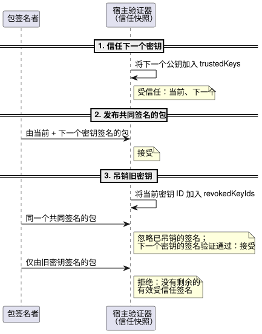
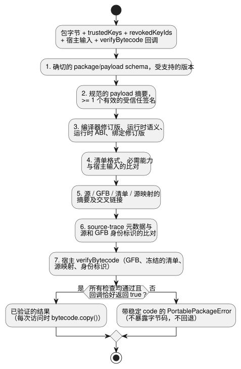

<!-- translation-source: docs/PORTABLE-PACKAGE.md -->
[英文原文](PORTABLE-PACKAGE.md)

# 可移植 GFB 包 v1

**可移植包**是 GhostFlow 宿主加载的已签名单元。格式 `GhostFlow/portable-package-v1` 将一个权威的文学式（literate）源修订版（`.ghost.md` 文档）与 Browser 和 Device 宿主加载的确切 GFB1 字节码字节绑定在一起。它还携带：

- 生成的清单（manifest）和源映射；
- 执行兼容性身份标识；
- Ed25519 签名。

该包不会改变 GFB1 字节或 VM 语义。

本文档内容：

- **信封**：包的布局及其规范编码。
- **签名字节与信任**：签名的内容、受信任的密钥、吊销与轮换。
- **验证顺序**：宿主在获得字节码之前执行的检查，包括原生开发绕过。
- **兼容性与迁移**：接受哪些 GFB profile，以及如何处理版本。
- **原生验证器 API**、**自适应策略描述符**和**精确的可复用组合来源**：Rust 验证器和特殊情况。

## 信封

```text
package
├─ format: GhostFlow/portable-package-v1
├─ payload
│  ├─ format: GhostFlow/portable-payload-v1
│  ├─ source: exact UTF-8 .ghost.md bytes + SHA-256
│  ├─ bytecode: exact GFB profile 1/2/3/4 bytes + SHA-256
│  ├─ manifest: exact canonical JSON bytes + SHA-256
│  ├─ sourceMap: exact canonical JSON bytes + SHA-256
│  └─ identity
│     ├─ compilerRevision
│     ├─ runtimeSemantics
│     ├─ runtimeAbi
│     ├─ requiredCapabilities[]
│     └─ bindingRevision
├─ payloadSha256
└─ signatures[]: algorithm + keyId + signatureBase64
```

**规范编码。**

- 二进制字段使用规范的带填充 base64。
- 清单和源映射字节使用递归的 JSON 键排序，保持数组顺序，并使用 ECMAScript 有限数序列化。
- 稀疏数组以及超出 JavaScript 精确安全范围的整数会被拒绝。`-0` 序列化为 `0`。
- 原始 Markdown **不**做规范化。Unicode、注释、说明文字、CRLF 以及末尾换行都仍是其源摘要的一部分。

**构建包。** `buildPortablePackage` 只接受这样的 `compileSource` 结果：其源是 `.ghost.md` 文学式文档，且其控制清单与 GFB 摘要相匹配。

- 签名还需要一次新的 `verifyCompilation` 重放。重放得到的确切 GFB、清单和源映射字节必须与提供的结果一致。这可以防止官方构建器把可读的源与另一个编译后的程序配对。
- 必需的能力（capability）依次按 `kind`、`name`、`type` 排序。
- 每个清单输入（`input`）、非可选传感器（`sensor`）和输出（`actuator`）都必须与已签名的必需能力集合**双向**匹配：既不缺少，也不多出。
- 可选传感器不在必需集合中。由显式的宿主绑定决定它们是否存在。

## 签名字节与信任

**签名的内容。**

- 签名输入是 `payload` 的确切规范 UTF-8 编码。
- `payloadSha256` 对这些相同的字节计算哈希。
- 外层包格式在验证之前检查。`signatures` 和 `payloadSha256` 不包含在签名输入中。
- 所有嵌入的字节、它们的描述符以及执行身份标识都在已签名的 payload 之内。

**算法与密钥 ID。** 版本 1 只允许 Ed25519。每个签名都指明一个有界的 `keyId`。重复的密钥和算法协商会被拒绝。

**信任输入。** 验证器接收两个显式的信任输入：

- `trustedKeys`：当前被接受的密钥 ID 和 Ed25519 公钥。
- `revokedKeyIds`：不再授权包的密钥。

这两个输入都是必需的信任快照。省略吊销状态是一个错误，而不是空的吊销列表。

**密钥轮换**使用共同签名的包：

1. 宿主首先信任下一个公钥。
2. 然后宿主接受由当前密钥和下一个密钥共同签名的包。
3. 最后，宿主吊销旧密钥。

当另一个有效的受信任签名验证通过时，已吊销的签名会被忽略。没有剩余有效受信任签名的包会被拒绝。信任记录不依赖墙钟。

下面的时序图从宿主的角度展示了三个轮换步骤。



`tests/portable-package.test.mjs` 中的 RFC 8032 密钥材料是公开的测试数据，绝不能被配置为产品的信任根。

## 验证顺序

### 原生开发认证策略

**默认：始终认证。** Rust `ghostflow-package` API `verify_portable_package` 始终强制执行发布者认证。`SignaturePolicy::default()` 为 `Enforce`。

**显式开发绕过。** 显式的开发宿主可以使用 `DevelopmentBypass` 调用 `verify_portable_package_with_signature_policy`。它运行相同的规范验证器和目标加载器。这个所有者接口不会选择 Device 构建 profile，也不会在 Browser/JavaScript 验证中启用绕过。

绕过所放宽的内容：

- 它接受空的 `signatures` 数组，或来自不受信任/已吊销发布者的签名，而不检查密码学认证。
- 在此模式下不使用信任根和吊销输入。不会用伪造的受信任密钥替代。

即使在绕过模式下仍然必需的内容：

- `signatures` 数组仍然是必需的，并受 `max_signatures` 限制。
- 存在的条目必须具有确切的 schema、Ed25519 算法、互不相同的有界密钥 ID，以及 64 字节的规范 base64 编码。
- 规范传输、payload 和产物哈希、大小上限、兼容性身份标识、能力、绑定、源/字节码交叉链接以及目标加载。

哈希确立的是字节一致性，而不是经过认证的发布者或意图。

**报告模式。** 结果以 `Authenticated` 或 `DevelopmentBypass` 的形式暴露 `signature_authentication`。

- 被绕过的结果总是具有空的 `accepted_key_ids`，即使所提供的签名原本可以验证通过。
- 宿主必须暴露该未认证状态，并且必须对上传、存储程序启动和回滚应用同一策略。
- 生产宿主和受信任的验收宿主必须保持强制执行。开发选择退出不会授予输出权限，也不会授权执行。

**验证步骤。** `verifyPortablePackage` 返回带有稳定 `code` 的 `PortablePackageError`，并且在以下检查按此顺序通过之前不会暴露字节码：

1. 确切的 package/payload schema 和受支持的版本；
2. 规范的 payload 摘要，以及至少一个有效的受信任签名；
3. 编译器修订版、运行时语义、运行时 ABI 和绑定修订版；
4. 清单格式，以及必需能力与宿主输入的比对；
5. 源、GFB、清单和源映射的内容摘要及交叉链接；
6. 编译器拥有的 source-trace 元数据与源和 GFB 身份标识的比对；
7. 宿主提供的 `verifyBytecode` 回调。

下图展示了相同的顺序及其两种可能的结果。



**`verifyBytecode` 回调**是必需的。

- 它接收确切的 GFB 字节，以及深度冻结的已验证清单、源映射和身份标识值。
- Browser 传入其 WASM GFB1 加载器。Device 传入原生 `Module::load` 边界。
- `false` 结果或异常会变为 `bytecode-rejected`。只有显式的 `true` 才会接受目标加载器的结果。
- 已验证的结果在每次访问时提供一个分离的 `bytecode.copy()`，因此调用者无法修改保留的已验证字节。

**没有静默回退。** 验证器绝不会用不同的 ABI 重试、剥离未知的要求、替换为另一个绑定，或回退到较旧的程序。

**验证所证明的内容。** 返回的源、清单、映射和 GFB 字节全部来自已验证的 payload。

- 包摘要证明身份。
- 签名证明签发者是被接受的。
- 二者都不能证明农户的意图、硬件兼容性、继电器动作或物理负载的运动。

**绑定修订版。** `bindingRevision` 标识由 API 和 Device 选定的安装绑定。本包检查修订版是否完全相等以及逻辑能力的形态。拥有者 API/Device 层必须在调用包验证器之前验证该修订版实际的 DI/RO 通道映射。

## 兼容性与迁移

### 已签名的不可变 IANA Range

**接受的 profile。**

- 带有 `GhostFlow/control-v21` 和 `GhostFlow/context-scan-abi-v5` 的 GFB21 是一个显式的可移植 profile。
- GFB22 可以用经过检查的生命周期描述符包装该未改变的 inner21。
- 对 profile 1–4、10 和 11 的现有准入保持不变。
- 此变更不接受其他任何 Range、日历、provider、objective 或 config profile。
- GFB11 的标量 config/Periodic 限制保持不变。

**如何防止替换。** 签名需要一次确切的新源重放。

- JavaScript 验证将完整的规范所有者清单与新的降级结果进行比较。
- Rust 将调度计划数量/位置/名称、IANA 时区、所选时段、持续时间、DST 策略、gap 和 recovery 字段绑定到解码后的 CivilRange 描述符。
- 二者都会在目标加载器之前拒绝重新签名的替换。
- Rust 重新编码已签名的 `when`/`cancelWhen` 所有者表达式 IR，包括非字面量分支、整数和 Result 追踪。它要求可执行字节完全相等，既不对 IR 求值，也不限制现有谓词。

**能力与运行时事实。**

- 能力排除由运行时拥有的重启端口，但保留实际的采集和执行器要求。
- 宿主的 tzdb/时间触发实例事实仍是显式的运行时输入。已签名的包并不证明这些事实或物理执行。

参见 `tests/civil-range-package.test.mjs` 及其真实的已签名 JavaScript 测试夹具，原生 Rust 验证器会使用它进行测试。

### 带标量设置的已签名 GFB11 Periodic

带有 `GhostFlow/control-v10` 和 `GhostFlow/context-scan-abi-v5` 的 GFB11 现在可以把标量 config 与可执行的 Periodic 调度计划一起打包。

当前的已签名子集要求满足以下全部条件：

- 一个 instant 锚点以及 `preserve_anchor`；
- 由 config 支撑的 `Duration` 间隔；
- 常量 `true` 谓词；
- `pulse`/`trusted_only`/`baseline`/`skip` 策略。

交叉检查：

- 清单中的调度计划位置、名称、间隔 config ID 和值、锚点、gap 以及策略必须与解码后的 GFB11 描述符一致。
- 生成的 config 投影以及时钟/纪元输入必须与字节码一致。
- 其他调度计划种类、objective/window/signal 前导部分，以及未签名或不匹配的包仍会被拒绝。
- 标量 config 的初始值和边界保留其现有检查。

这只扩展了包的准入。它不改变语言，也不改变 Device 部署策略。

通用版本规则：

- 包 v1 包含一个受支持的 GFB profile。
  - 已签名的字节码描述符版本是实际小端序头部版本的十进制字符串。JavaScript 和 Rust 验证器都要求在调用目标加载器之前完全匹配。
  - 受支持但不匹配的版本报告 `bytecode-version-mismatch`；未知版本报告 `unsupported-bytecode-version`。
  - Int 端口映射到独立的 `int` 能力类型，在 profile 3 中也是如此。
  - 17 种物理量类型映射到机器能力 `number`。它们的 input/output/sensor/config 描述符要求与目录中的 `canonicalUnit` 完全一致。
  - 输入/输出物理量记录恰好包含 `name`、`type` 和 `canonicalUnit`。非物理量记录禁止该字段。JavaScript 和 Rust 会在调用目标加载器之前拒绝缺失、错误或多余的单位元数据。
  - 编译重放、签名、产物摘要和目标验证仍然是必需的。当前 profile 的语义参见 [BYTECODE.md](BYTECODE.zh.md)。
- 要求签名部署的宿主不得把无效的包降级为原始 `.gfb` 路径。
- 未知的 package、payload、字节码、清单、运行时语义或 ABI 版本会被拒绝。支持新版本需要新的一致性语料库，以及显式的消费者兼容性更新。
- API 存储、Device 原子暂存/激活/恢复以及生产密钥保管属于各自的模块；它们使用本包契约。

**测试覆盖。** `tests/portable-package.test.mjs` 覆盖：

- 确定性构建与编译器重放；
- 源与产物的保留；
- 篡改拒绝；
- 密钥轮换/吊销；
- 能力与绑定拒绝；
- 不依赖 Buffer 的浏览器验证；
- 通过发布版原生 Rust 和 WASM GFB1 加载器进行逐字节一致的提取。

## 原生验证器 API

**输入。** `crates/ghostflow-package` 只接受确切的规范 `GhostFlow/portable-package-v1` 传输字节，包括唯一的末尾换行。

**它验证的内容。**

- 已签名的 payload 摘要；
- 一个受信任且未被吊销的 Ed25519 签名；
- 编译器/运行时/绑定身份标识；
- 能力与清单的交叉链接；
- 产物摘要；
- GFB profile/头部的一致性；
- 规范的嵌入式清单/源映射 JSON；
- 源映射与权威源文档之间的链接。

**目标加载器。** 调用者提供一个必需的 `TargetLoader`。在该加载器返回 `Ok(true)` 之前，验证器不会返回 GFB1 字节的副本。`VerifiedPackage` 返回源、清单、源映射和字节码的分离副本，以及被接受的签名密钥 ID。

**有意不重复的内容。** 原生 v1 切片有意**不**重复编译器拥有的 `sourceMap.traceMetadata` 深度语义验证。该验证保留在现有的 JS 通用验证器中，而受信任的包构建器会在签名前通过一次新的确定性编译器重放来覆盖它。原生验证不接受原始 GFB 或遗留回退，也绝不把调用者提供的证明当作信任权威。

**GFB profile 4（窗口）。**

- 原生验证器在清单和字节码交叉链接中检查已签名的窗口描述符及其机器绑定。
- 嵌套描述符把每个 `upstreamWindows` 的名称、位置和先前槽位绑定到从质量投影解码出的依赖列表。被省略、为空或被重新绑定的依赖列表会在目标加载器之前被拒绝。
- 时间激活是一个单独的运行时步骤。签名验证之后，调用者提供显式的时间纪元、根密度限制和保留预算。
- 仅凭签名验证不会激活时间 profile，也不证明窗口追踪语义。
- 原生包切片不会重新编译规范的 JavaScript 源，也不执行深度语义追踪重放。仅凭描述符验证并不能确立运行时的嵌套窗口算术或证明保留。

**目标与限制。**

- 当前的原生 crate 面向 Rust `std`，包括 Farm Device 使用的 ESP-IDF Rust 运行时。单独的 `no_std` 包栈不属于 Waveshare 目标。
- `VerifierLimits` 限制传输、已签名 payload、产物、签名、能力和 JSON 深度。
- Device 消费者必须选择适合设备大小的 profile，在活动程序槽之外暂存传输字节，并在原子激活之前调用此验证器。
- 仅有宿主验证并不能证明 MCU 已激活、继电器已动作或物理负载已运动。


## 自适应策略描述符

**成对的元数据。** 编译器生成的 `adaptPolicy` 和 `strategies` 是成对的已签名清单元数据。

- JS 验证将它们与规范源的重新编译结果和确切的字节码进行比较。
- 原生验证将有序的策略名称、优先级、输出名称和能力查询字节与解码后的核心模块进行匹配。
- 带类型的匹配必须引用已声明的传感器/执行器能力。
- 选择方式仍为 `highest-priority-unique`。不受支持或未配对的元数据会在加载前被拒绝。
- 策略名称是已签名的有界源元数据，而不是新的运行时选择器。

**不会自动激活。** 可选的 Bool 观测不会自动选择或激活新策略。由显式的宿主能力快照决定其编写的策略是否符合条件。

- 原生和 WASM 测试在观测缺失时保持基线输出，在观测存在时保持反馈输出。
- 它们拒绝重新签名的策略/查询/字节码篡改。
- GFB 和线路格式、ABI 以及签名策略保持不变。
- 物理接线和 Device 准入仍由消费者负责。

## 精确的可复用组合来源

**源闭包。** 可复用组合包在其已签名的源映射信封中包含可选的 `sourceClosure`。该闭包包含被确切固定的传递性文学式文档、它们的修订版和摘要，以及编写的实例身份标识。

- 验证会重新编译该闭包，并在调用目标字节码验证器之前比较完整的字节码、清单和源映射信封。
- 有效的签名不能授权被篡改的实例来源。
- 没有闭包的现有包保留其现有的验证路径。

**一致性。** REF-06-025 通过原生和带帧的 WASM 检查嵌套复用、独立的 Boolean 实例状态以及带类型的逻辑端口。随后它从已验证的包准备无副作用的重放。虚拟绑定修订版标识逻辑能力；它不能确立物理引脚的适用性或实际应用。现有的纯 Boolean 重放 profile 保持不变。
