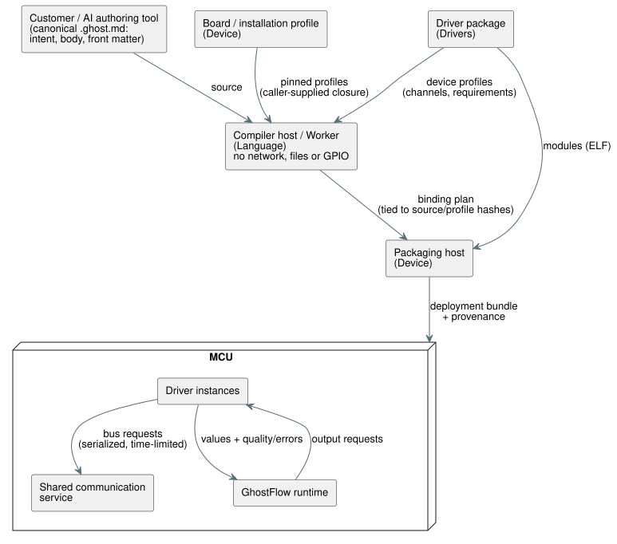

# Profile-based Front Matter Design

[English](PROFILE-FRONT-MATTER.en.md) · [Issue #555](https://github.com/callin2/ghostflow-language/issues/555)

## Purpose

**GhostFlow's overall goal.** GhostFlow aims to lower the barrier to automation:

- AI translates control intent, expressed by a person in natural language, into
  a control program.
- That program runs on real equipment in a predictable way, including how it
  handles intent and abnormal conditions.

Equipment can affect plants, animals and people. So being concise must never
cost the facts and failure states that verification needs.

**The direct goal of front matter.** Front matter is the YAML block at the top
of a `.ghost.md` document. **Its job is to connect the logical inputs and
outputs of the control body to the devices actually installed, without making
customers repeat hardware facts that the board and driver already know.**

- Customers write only the configuration they use, the values that differ in
  their actual installation, and the logical bindings.
- The control body does not need to know pins, communication implementations,
  driver initialization, warm-up, or minimum read intervals.
- Read failures and recovery states flow through the existing railway-oriented
  data path (values travel together with their quality/error status).

**Why metadata is separate from the body.** It follows the same split of
responsibility:

- Control intent should stay usable when an installation changes.
- The same installation knowledge should be reusable across many programs.

Deleting fields and moving them into hidden firmware constants does **not**
achieve this goal.

## What the Customer Writes

The customer writes only a short block like this:

```yaml
---
profile: ess3h32@1

devices:
  meter1:
    profile: jsy-mk-333@1
  meter2:
    profile: jsy-mk-333@1
    params: { address: 2 }

bindings:
  motor1Current: meter1.currentA
  motor2Current: meter2.currentA
  motor1Run: board.RO1
  motor2Run: board.RO2
---
```

These names are design examples. They are not published profile IDs.

**Root fields.** This compact format allows only three root fields:

| Field | Required | Meaning |
| --- | --- | --- |
| `profile` | yes | The board (installation) profile |
| `devices` | no | Additional devices; omit it when there are none |
| `bindings` | yes | A binding for every logical input and output in the body |

These field names are reserved, so authored hardware YAML cannot silently become
ordinary metadata.

**Devices.** Each device has only:

- `profile`;
- optional `params`;
- optional `bus`. Specify a bus, such as `bus: board.rs485Aux`, only when you
  select a different communication connection.

`board` is the reserved name for channels that the board exposes.

**Board providers and `omit`.** By default, every built-in input and output
channel of the selected board profile is included as a provider.

- `omit: [board.inputs]` or `omit: [board.outputs]` excludes the board providers
  in that direction.
- Binding to an excluded channel is a validation error.

The Device owns the physical composition. Language only validates selectors and
bindings.

## Software, Host, and Observation Provider Selectors

**Nonphysical selectors.** Besides physical channels, the same `bindings` map
accepts three explicit kinds of selector
([Language #584](https://github.com/callin2/ghostflow-language/issues/584)):

- `software:<logical-name>`;
- `host:scan-delta-ms`;
- `observation:<logical-name>`.

**Example: two independent valves.**

- Modes and resets bind to names such as `software:valveAMode` and
  `software:resetA`.
- The scan-interval input binds to `host:scan-delta-ms`.
- A diagnostic Bool output binds to `observation:valveAFault`.
- Contacts still bind explicitly to physical input channels such as `board.DI1`.
- Relay commands bind to output channels such as `board.RO1`.

A provider is never inferred from a name; every logical input and output needs a
binding. Explicit nonphysical selectors stay available even when `omit` excludes
board channels.

**Type and role rules.** Canonical `input` declarations currently appear as
quality-bearing `sensors` in the compiler manifest.

| Selector | Accepts only |
| --- | --- |
| `software:<logical-name>` | A same-name, dimensionless Bool or Number in manifest `sensors` or existing scalar `inputs` |
| `host:scan-delta-ms` | A dimensionless Number in either set |
| `observation:<logical-name>` | A same-name Bool in manifest `outputs` |

These fail, with the original YAML location:

- other types, such as Percent, Duration and physical quantities;
- wrong roles or names;
- duplicate physical channels;
- missing bindings;
- two logical inputs sharing `host:scan-delta-ms`.

**Physical versus nonphysical records.**

- Physical inputs bind only `sensors`. Scalar `inputs` cannot be disguised as
  physical sensors.
- Existing physical records keep `instance`, `channel`, `role`, `type`, and
  optional `unit`.
- A nonphysical plan record keeps `{ provider, endpoint, role }`; its type is
  checked against the compiler manifest.
- The plan does not strip quality rails, and it does not synthesize providers or
  values.

This is the Language static interpretation contract. Device production of
Number software/host sensor values, package integration, real I/O, and operating
observations still require their own consumer and physical evidence.

**Where the values in the first example come from.**

- `meter1`'s address 1, communication conditions, channel names, physical
  quantities and units come from its device profile.
- `meter2`'s address 2 is an installation-specific difference.
- Inheriting an address default does not mean the device's physical address is
  changed automatically.
- The customer chooses the logical name; `currentA` is selected from the channel
  specification bundled with the driver.
- The contract carries the canonical unit `A` for `ElectricalCurrent`.
  Compatible unit literals in the body, such as `mA`, follow the language's
  existing unit-conversion rules.

## RS485 Input and 8-Channel Relay Output

This example adds a **RYR408B** relay expansion board (address **3**,
**9600 bps**, **8 channels**) to the two-current-meter setup above:

```yaml
---
profile: ess3h32@1

devices:
  meter1:
    profile: jsy-mk-333@1
  meter2:
    profile: jsy-mk-333@1
    params: { address: 2 }
  relay:
    profile: ryr408b@1
    params: { address: 3 }

bindings:
  motor1Current: meter1.currentA
  motor2Current: meter2.currentA
  motor1Run: relay.RO1
  motor2Run: relay.RO2
  auxiliary3: relay.RO3
  auxiliary4: relay.RO4
  auxiliary5: relay.RO5
  auxiliary6: relay.RO6
  auxiliary7: relay.RO7
  auxiliary8: relay.RO8
---
```

The [complete GhostFlow example](../examples/hardware/rs485-current-relay.ghost.en.md) includes intent links, control of outputs 1 and 2 based on current, and OFF requests for unused outputs 3–8.

**One shared bus.** The input current meters and the output relay share the
same default RS485 connection.

- The board/device profiles provide 9600/8N1, so the customer document does not
  repeat those settings.
- Addresses 1, 2 and 3 distinguish the devices.
- `relay.RO1`–`relay.RO8` are Bool output channels from the relay
  driver/profile. They are distinct from built-in board channels such as
  `board.RO1`.
- Duplicate addresses on the same physical bus must be an error, even across
  different drivers.

**DIP switches.** RYR408B's address and baud rate are set by DIP switches.
`address: 3` and the profile's `9600bps` configure communication to match the
actual DIP values. The physical settings and the declarations must agree; static
validation checks agreement only among the supplied contracts.

**What is confirmed and what is not.**

- The relay model **RYR408B**, the address, the speed and the channel count are
  user-confirmed values. 8N1 is shown in the attached material.
- `ryr408b@1` and the channel names are proposed design contracts for the
  confirmed model, not yet published profiles.
- The static example assumes an RS485/Modbus RTU contract. Confirm the protocol
  specification, per-channel registers and ON/OFF values before publishing a
  driver.
- Adding the example does not count as verification that a real relay operates.

## Overall Structure and Execution Context

Each owner has a clear responsibility and output:

| Execution location / owner | Responsibility | Output / storage location |
| --- | --- | --- |
| Customer / AI authoring tool | Write intent, control body, installation differences, and logical bindings | Canonical `.ghost.md` |
| Board / installation profile provider (Device) | Fixed pins, connected resources, explicit default connections, built-in channels/modules | Version-pinned profile |
| Driver provider (Drivers) | ELF, initialization specification/defaults, communication requirements, channels/units, device behavior constraints | Package published as one version |
| Compiler host / Worker (Language) | Deterministic interpretation and diagnostics for the supplied profile set | Derived binding plan tied to source/profile hashes |
| Packaging host (Device) | Validate actual modules/resources/host ABI and create initialization records | Deployment bundle and provenance |
| MCU shared communication service | Own physical buses, serialize requests, enforce time limits | Runtime resources and communication results |
| MCU driver instance | Per-device protocol, warm-up/read interval/conversion, independent state | Values and quality/errors |
| MCU GhostFlow runtime | Run control and error handling independently of physical bindings | Output requests and execution evidence |

The diagram below shows how these owners hand data to each other, from authoring
to execution on the MCU.



**Trust boundaries.**

- The compile-time interpreter does not access the network, files or GPIO. Its
  caller supplies the profile closure to validate.
- Download/deployment trust policy and caching belong to the provider and
  deployment tools.
- SHA-256 checks byte identity. It does not prove trustworthiness or the absence
  of malicious code.

## Profile Interpretation Contract

**Provider data.** Provider data is a deployment contract, separate from
customer YAML. In the first implementation, each item of the `hardwareProfiles`
array has:

- `ref`: `id@revision`. `latest` is rejected.
- `sha256`: the SHA-256 of the UTF-8 value of the repository's
  `canonicalJson(definition)`.
- `definition`: the profile itself.

Digests of the actual deployed files/ELFs are kept separately.

**Kinds and inheritance.** `definition.kind` is `board` or `device`.

- Optional `extends` points to a pinned ref of the same kind.
- Missing object fields are inherited from the parent; explicitly supplied values
  override them.
- Arrays are replaced as a whole.
- Cycles, kind changes and missing parents are errors.
- Customer `params` override defaults one parameter at a time.
- There is no path for customers to override physical pins in their documents.

**Board profiles** have `connections`, `defaults` and `channels`.

- A connection specifies `resource` (physical resource ID), `transport`,
  `protocol` and `settings`.
- `defaults` maps a protocol name to `board.<connection>`. Even when a board has
  only one connection, it is not used implicitly: a device may omit `bus` only
  if `defaults` explicitly names a connection for its protocol.
- Aliases for the same physical resource must have identical communication
  contracts.
- A board without an RS485 transceiver cannot provide the RS485 capability.

**Device profiles** have a fixed `module: { id, revision, sha256 }`, `requires`,
`parameters` and `channels`.

- `requires` specifies `transport`, `protocol` and `settings`. A required setting
  value is a constant or a parameter reference such as `{ param: baudRate }`.
- A parameter specification has `type` and optional `default`, `minimum`,
  `maximum` and `enum`. The first implementation supports `integer`, `number`,
  `boolean` and `string`. Every defined parameter needs either a default or an
  explicit value.
- Schemas for structured initialization values are future scope.
- Unknown settings are not passed through to the driver.
- Optional `addressParameter` is used to check address conflicts on shared
  connections.
- A channel has `role` (`input`/`output`), `type` and optional `unit`.

**Interpretation result.** The result preserves:

- the selected profile and parent digests;
- the params actually applied;
- connection and channel contracts;
- source locations.

**Shared resources are defined once.** Several devices that refer to the same
connection do **not** each create a new UART.

- The hardware/software implementation of built-in SPI, relay expander chips,
  multiplexers, built-in RS485 and GPIO mappings is defined once in the
  board/installation profile.
- If an external transceiver or expander chip is added, that installation's
  profile declares the actual additional wiring and resources.
- General combinations in which devices create connection resources are a later
  phase. Even then, customers will not have to repeat existing board information.

## Verification and Use Cases

Each use case has a result that verification must show:

| Requirement by purpose | Result to verify |
| --- | --- |
| Customer using only built-in features | Resolve channels using only `profile` + `bindings` |
| Two current meters of the same model | Default address 1 and explicit address 2, separate instances, same physical bus |
| Current inputs and 8-channel relay outputs | Current meter addresses 1 and 2, relay address 3, shared 9600 bps connection, bindings to Bool outputs RO1–RO8 |
| Confirm RS485 use | An explicit path where device requirements match board capability and communication conditions |
| Different device / different communication implementation | Determine the connection through provider contracts without changing the control body |
| Typo / missing information | Error that includes the original YAML location and reason for omission/conflict |
| Errors as control data | Driver read failure flows through the existing quality/error path |

**Required rejections.** Reject:

- missing profiles, floating revisions and invalid digests;
- inheritance cycles;
- parameter type, range or name errors;
- missing default connections;
- transport/protocol/settings mismatches;
- duplicate addresses on the same physical bus;
- missing channels and duplicate channel bindings;
- mismatches between the body and role/type/canonical unit.

In the two-meter example, omitting both addresses must fail, because both meters
would use address 1.

**Static versus physical evidence.** Static validation confirms that the
supplied contracts configure an RS485 path. Actual wiring, device responses,
current measurements and contact/load operation are verified through evidence
from the corresponding execution. The existing ESS3 user confirmation remains on
record; this documentation task does not require asking for the same
confirmation again.

## Implementation Sequence and Completion Criteria

1. **Language / #555:** Implement compact YAML, bounded profile-closure interpretation, inheritance/explicit defaults, communication/address/channel/body-type validation, and source diagnostics. Pass `hardwareProfiles` through the public compile API; do not infer a missing closure automatically. Test Node/browser results, source preservation, and unchanged existing GFB bytes.
2. **Device + Drivers:** Publish actual board/driver profiles from existing packages and connect the interpretation plan to the configure/bundle path. Pin actual ELF and profile digests, and provide a conversion for migrating existing long-form authored hardware documents. Remove the active legacy authoring path once migration of existing installations is verified.
3. **Device / #249 coordination:** Refine admission and endpoint identity so multiple independent instances can safely share the same RS485 resource. Check that a fault in one device does not become another instance's state, and reject deployment for hosts that do not support this.

**What is not done yet.** The documentation and Language phase alone do not
justify declaring that deploying a new source to ESS3 is complete.

- The current Device packager has fixed CURRENT_A/B/C endpoints and a
  shared-RS485 admission constraint.
- Actual profile publication, profile delivery by the CLI, package integration
  and shared-bus execution on the MCU each need separate completion evidence.
- Device-sharing rules across imported documents are outside this scope.

The completion question is: **Can the customer clearly connect their installation differences and control intent without rewriting already established hardware facts, while ensuring omissions, conflicts, and abnormal states are not hidden and execution remains predictable?** Link each phase's results and remaining work to #555.
