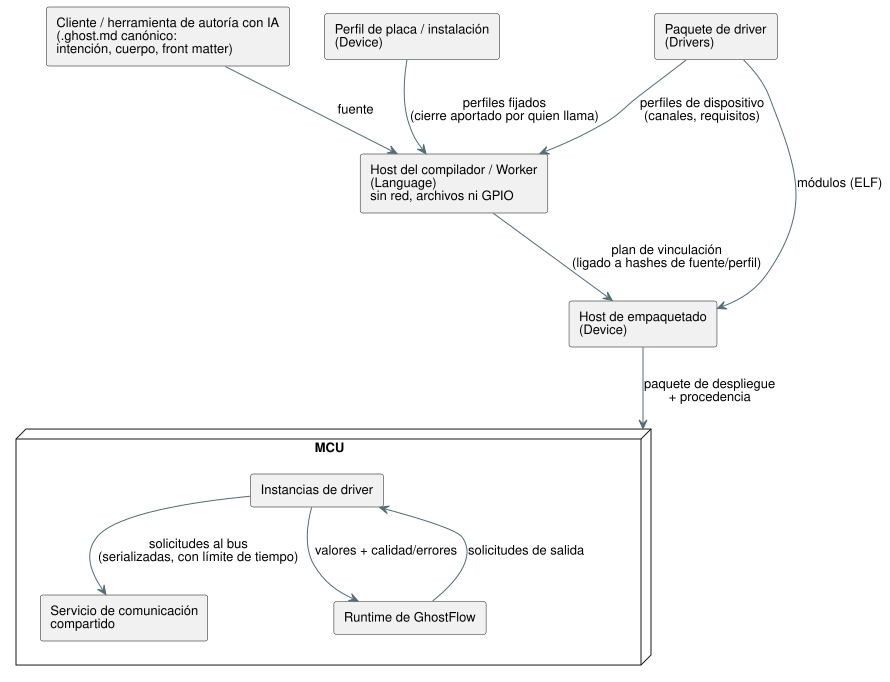

<!-- translation-source: docs/PROFILE-FRONT-MATTER.en.md -->
[Original en inglés](PROFILE-FRONT-MATTER.en.md)

# Diseño de front matter basado en perfiles

[English](PROFILE-FRONT-MATTER.en.md) · [Issue #555](https://github.com/callin2/ghostflow-language/issues/555)

## Propósito

**El objetivo general de GhostFlow.** GhostFlow busca reducir la barrera de
entrada a la automatización:

- La IA traduce a un programa de control la intención de control que una persona
  expresa en lenguaje natural.
- Ese programa se ejecuta en equipos reales de forma predecible, incluido cómo
  trata la intención y las condiciones anómalas.

Los equipos pueden afectar a plantas, animales y personas. Por eso, la concisión
nunca debe sacrificar los hechos ni los estados de fallo que la verificación
necesita.

**El objetivo directo del front matter.** El front matter (metadatos iniciales)
es el bloque YAML situado al principio de un documento `.ghost.md`. **Su función
es conectar las entradas y salidas lógicas del cuerpo de control con los
dispositivos realmente instalados, sin obligar a los clientes a repetir hechos de
hardware que la placa y el driver ya conocen.**

- Los clientes escriben solo la configuración que usan, los valores que difieren
  en su instalación real y las vinculaciones (bindings) lógicas.
- El cuerpo de control no necesita conocer los pines, las implementaciones de
  comunicación, la inicialización del driver, el precalentamiento ni los
  intervalos mínimos de lectura.
- Los fallos de lectura y los estados de recuperación fluyen por la ruta de datos
  orientada a raíles existente (los valores viajan junto con su estado de
  calidad/error).

**Por qué los metadatos están separados del cuerpo.** Responde a la misma
división de responsabilidades:

- La intención de control debe seguir siendo utilizable cuando cambia una
  instalación.
- El mismo conocimiento de la instalación debe poder reutilizarse en muchos
  programas.

Eliminar campos y trasladarlos a constantes de firmware ocultas **no** logra
este objetivo.

## Lo que escribe el cliente

El cliente escribe solo un bloque breve como este:

```yaml
---
profile: ess3h32@1

devices:
  meter1:
    profile: jsy-mk-333@1
  meter2:
    profile: jsy-mk-333@1
    params: { address: 2 }

bindings:
  motor1Current: meter1.currentA
  motor2Current: meter2.currentA
  motor1Run: board.RO1
  motor2Run: board.RO2
---
```

Estos nombres son ejemplos de diseño. No son ID de perfil publicados.

**Campos raíz.** Este formato compacto solo permite tres campos raíz:

| Campo | Obligatorio | Significado |
| --- | --- | --- |
| `profile` | sí | El perfil de la placa (instalación) |
| `devices` | no | Dispositivos adicionales; omítalo cuando no haya ninguno |
| `bindings` | sí | Una vinculación para cada entrada y salida lógica del cuerpo |

Estos nombres de campo están reservados, de modo que el YAML de hardware escrito
por el autor no puede convertirse silenciosamente en metadatos ordinarios.

**Dispositivos.** Cada dispositivo tiene solo:

- `profile`;
- `params` opcional;
- `bus` opcional. Especifique un bus, como `bus: board.rs485Aux`, solo cuando
  seleccione una conexión de comunicación distinta.

`board` es el nombre reservado para los canales que expone la placa.

**Proveedores de la placa y `omit`.** De forma predeterminada, todos los canales
de entrada y salida integrados del perfil de placa seleccionado se incluyen como
proveedores.

- `omit: [board.inputs]` u `omit: [board.outputs]` excluye los proveedores de la
  placa en esa dirección.
- Vincular a un canal excluido es un error de validación.

El Device es propietario de la composición física. Language solo valida los
selectores y las vinculaciones.

## Selectores de proveedores de software, de host y de observación

**Selectores no físicos.** Además de los canales físicos, el mismo mapa
`bindings` acepta tres tipos explícitos de selector
([Language #584](https://github.com/callin2/ghostflow-language/issues/584)):

- `software:<logical-name>`;
- `host:scan-delta-ms`;
- `observation:<logical-name>`.

**Ejemplo: dos válvulas independientes.**

- Los modos y los reinicios se vinculan a nombres como `software:valveAMode` y
  `software:resetA`.
- La entrada del intervalo de escaneo se vincula a `host:scan-delta-ms`.
- Una salida Bool de diagnóstico se vincula a `observation:valveAFault`.
- Los contactos siguen vinculándose explícitamente a canales de entrada físicos
  como `board.DI1`.
- Los comandos de relé se vinculan a canales de salida como `board.RO1`.

Un proveedor nunca se infiere a partir de un nombre; cada entrada y salida lógica
necesita una vinculación. Los selectores no físicos explícitos siguen disponibles
aunque `omit` excluya los canales de la placa.

**Reglas de tipo y de rol.** Las declaraciones `input` canónicas aparecen
actualmente como `sensors` con calidad en el manifiesto del compilador.

| Selector | Solo acepta |
| --- | --- |
| `software:<logical-name>` | Un Bool o Number adimensional con el mismo nombre en `sensors` del manifiesto o en `inputs` escalares existentes |
| `host:scan-delta-ms` | Un Number adimensional en cualquiera de los dos conjuntos |
| `observation:<logical-name>` | Un Bool con el mismo nombre en `outputs` del manifiesto |

Estos casos fallan, indicando la ubicación original en el YAML:

- otros tipos, como Percent, Duration y las magnitudes físicas;
- roles o nombres incorrectos;
- canales físicos duplicados;
- vinculaciones ausentes;
- dos entradas lógicas que comparten `host:scan-delta-ms`.

**Registros físicos frente a no físicos.**

- Las entradas físicas solo vinculan `sensors`. Las `inputs` escalares no pueden
  disfrazarse de sensores físicos.
- Los registros físicos existentes conservan `instance`, `channel`, `role`,
  `type` y `unit` opcional.
- Un registro de plan no físico conserva `{ provider, endpoint, role }`; su tipo
  se comprueba contra el manifiesto del compilador.
- El plan no elimina los raíles de calidad, y no sintetiza proveedores ni
  valores.

Este es el contrato de interpretación estática de Language. La producción en el
Device de valores Number de sensores de software/host, la integración de
paquetes, la E/S real y las observaciones de operación siguen requiriendo su
propio consumidor y su propia evidencia física.

**De dónde vienen los valores del primer ejemplo.**

- La dirección 1 de `meter1`, las condiciones de comunicación, los nombres de
  canal, las magnitudes físicas y las unidades proceden de su perfil de
  dispositivo.
- La dirección 2 de `meter2` es una diferencia específica de la instalación.
- Heredar una dirección predeterminada no significa que la dirección física del
  dispositivo se cambie automáticamente.
- El cliente elige el nombre lógico; `currentA` se selecciona de la
  especificación de canales incluida con el driver.
- El contrato lleva la unidad canónica `A` para `ElectricalCurrent`. Los
  literales de unidad compatibles en el cuerpo, como `mA`, siguen las reglas de
  conversión de unidades existentes del lenguaje.

## Entrada RS485 y salida de relés de 8 canales

Este ejemplo añade una placa de expansión de relés **RYR408B** (dirección **3**,
**9600 bps**, **8 canales**) a la configuración anterior con dos medidores de
corriente:

```yaml
---
profile: ess3h32@1

devices:
  meter1:
    profile: jsy-mk-333@1
  meter2:
    profile: jsy-mk-333@1
    params: { address: 2 }
  relay:
    profile: ryr408b@1
    params: { address: 3 }

bindings:
  motor1Current: meter1.currentA
  motor2Current: meter2.currentA
  motor1Run: relay.RO1
  motor2Run: relay.RO2
  auxiliary3: relay.RO3
  auxiliary4: relay.RO4
  auxiliary5: relay.RO5
  auxiliary6: relay.RO6
  auxiliary7: relay.RO7
  auxiliary8: relay.RO8
---
```

El [ejemplo completo de GhostFlow](../examples/hardware/rs485-current-relay.ghost.es.md) incluye enlaces de intención, el control de las salidas 1 y 2 en función de la corriente y solicitudes de OFF para las salidas 3–8 no utilizadas.

**Un único bus compartido.** Los medidores de corriente de entrada y el relé de
salida comparten la misma conexión RS485 predeterminada.

- Los perfiles de placa/dispositivo aportan 9600/8N1, de modo que el documento
  del cliente no repite esos ajustes.
- Las direcciones 1, 2 y 3 distinguen los dispositivos.
- `relay.RO1`–`relay.RO8` son canales de salida Bool del driver/perfil del relé.
  Son distintos de los canales integrados de la placa, como `board.RO1`.
- Las direcciones duplicadas en el mismo bus físico deben ser un error, incluso
  entre drivers distintos.

**Interruptores DIP.** La dirección y la velocidad en baudios del RYR408B se
configuran con interruptores DIP. `address: 3` y los `9600bps` del perfil
configuran la comunicación para que coincida con los valores DIP reales. Los
ajustes físicos y las declaraciones deben concordar; la validación estática solo
comprueba la concordancia entre los contratos aportados.

**Qué está confirmado y qué no.**

- El modelo de relé **RYR408B**, la dirección, la velocidad y el número de
  canales son valores confirmados por el usuario. 8N1 figura en el material
  adjunto.
- `ryr408b@1` y los nombres de canal son contratos de diseño propuestos para el
  modelo confirmado, todavía no son perfiles publicados.
- El ejemplo estático supone un contrato RS485/Modbus RTU. Confirme la
  especificación del protocolo, los registros por canal y los valores de ON/OFF
  antes de publicar un driver.
- Añadir el ejemplo no cuenta como verificación de que un relé real funcione.

## Estructura general y contexto de ejecución

Cada propietario tiene una responsabilidad y una salida claras:

| Lugar de ejecución / propietario | Responsabilidad | Salida / ubicación de almacenamiento |
| --- | --- | --- |
| Cliente / herramienta de autoría con IA | Escribir la intención, el cuerpo de control, las diferencias de la instalación y las vinculaciones lógicas | `.ghost.md` canónico |
| Proveedor del perfil de placa / instalación (Device) | Pines fijos, recursos conectados, conexiones predeterminadas explícitas, canales/módulos integrados | Perfil con versión fijada |
| Proveedor de drivers (Drivers) | ELF, especificación/valores predeterminados de inicialización, requisitos de comunicación, canales/unidades, restricciones de comportamiento del dispositivo | Paquete publicado como una sola versión |
| Host del compilador / Worker (Language) | Interpretación determinista y diagnósticos para el conjunto de perfiles aportado | Plan de vinculación derivado, ligado a los hashes de fuente/perfil |
| Host de empaquetado (Device) | Validar los módulos/recursos/ABI del host reales y crear registros de inicialización | Paquete de despliegue y procedencia |
| Servicio de comunicación compartido de la MCU | Ser propietario de los buses físicos, serializar solicitudes, imponer límites de tiempo | Recursos de runtime y resultados de comunicación |
| Instancia de driver de la MCU | Protocolo por dispositivo, precalentamiento/intervalo de lectura/conversión, estado independiente | Valores y calidad/errores |
| Runtime de GhostFlow de la MCU | Ejecutar el control y el tratamiento de errores con independencia de las vinculaciones físicas | Solicitudes de salida y evidencia de ejecución |

El diagrama siguiente muestra cómo estos propietarios se pasan los datos entre
sí, desde la autoría hasta la ejecución en la MCU.



**Límites de confianza.**

- El intérprete en tiempo de compilación no accede a la red, a archivos ni a
  GPIO. Quien lo llama aporta el cierre de perfiles que se va a validar.
- La política de confianza y la caché de descarga/despliegue corresponden al
  proveedor y a las herramientas de despliegue.
- SHA-256 comprueba la identidad de los bytes. No demuestra la fiabilidad ni la
  ausencia de código malicioso.

## Contrato de interpretación de perfiles

**Datos del proveedor.** Los datos del proveedor son un contrato de despliegue,
separado del YAML del cliente. En la primera implementación, cada elemento del
array `hardwareProfiles` tiene:

- `ref`: `id@revision`. `latest` se rechaza.
- `sha256`: el SHA-256 del valor UTF-8 de `canonicalJson(definition)` del
  repositorio.
- `definition`: el propio perfil.

Los resúmenes de los archivos/ELF desplegados realmente se guardan por separado.

**Tipos y herencia.** `definition.kind` es `board` o `device`.

- `extends` opcional apunta a una ref fijada del mismo tipo.
- Los campos de objeto ausentes se heredan del padre; los valores aportados
  explícitamente los sobrescriben.
- Los arrays se sustituyen por completo.
- Los ciclos, los cambios de tipo y los padres ausentes son errores.
- Los `params` del cliente sobrescriben los valores predeterminados parámetro a
  parámetro.
- No existe ninguna vía para que los clientes sobrescriban los pines físicos en
  sus documentos.

**Los perfiles de placa** tienen `connections`, `defaults` y `channels`.

- Una conexión especifica `resource` (ID del recurso físico), `transport`,
  `protocol` y `settings`.
- `defaults` asigna un nombre de protocolo a `board.<connection>`. Aunque una
  placa tenga una sola conexión, esta no se usa implícitamente: un dispositivo
  solo puede omitir `bus` si `defaults` nombra explícitamente una conexión para
  su protocolo.
- Los alias de un mismo recurso físico deben tener contratos de comunicación
  idénticos.
- Una placa sin transceptor RS485 no puede ofrecer la capacidad RS485.

**Los perfiles de dispositivo** tienen un `module: { id, revision, sha256 }`
fijo, `requires`, `parameters` y `channels`.

- `requires` especifica `transport`, `protocol` y `settings`. El valor de un
  ajuste requerido es una constante o una referencia a un parámetro como
  `{ param: baudRate }`.
- La especificación de un parámetro tiene `type` y, opcionalmente, `default`,
  `minimum`, `maximum` y `enum`. La primera implementación admite `integer`,
  `number`, `boolean` y `string`. Cada parámetro definido necesita un valor
  predeterminado o un valor explícito.
- Los esquemas para valores de inicialización estructurados quedan para el
  futuro.
- Los ajustes desconocidos no se transmiten al driver.
- `addressParameter` opcional se usa para comprobar conflictos de dirección en
  conexiones compartidas.
- Un canal tiene `role` (`input`/`output`), `type` y `unit` opcional.

**Resultado de la interpretación.** El resultado conserva:

- el perfil seleccionado y los resúmenes de sus padres;
- los params aplicados realmente;
- los contratos de conexión y de canal;
- las ubicaciones en la fuente.

**Los recursos compartidos se definen una sola vez.** Varios dispositivos que
hacen referencia a la misma conexión **no** crean cada uno una UART nueva.

- La implementación de hardware/software del SPI integrado, los chips expansores
  de relés, los multiplexores, el RS485 integrado y los mapeos de GPIO se define
  una sola vez en el perfil de placa/instalación.
- Si se añade un transceptor o un chip expansor externo, el perfil de esa
  instalación declara el cableado y los recursos adicionales reales.
- Las combinaciones generales en las que los dispositivos crean recursos de
  conexión son una fase posterior. Incluso entonces, los clientes no tendrán que
  repetir la información de placa existente.

## Verificación y casos de uso

Cada caso de uso tiene un resultado que la verificación debe mostrar:

| Requisito según el propósito | Resultado que se debe verificar |
| --- | --- |
| Cliente que usa solo funciones integradas | Resolver los canales usando solo `profile` + `bindings` |
| Dos medidores de corriente del mismo modelo | Dirección predeterminada 1 y dirección explícita 2, instancias separadas, mismo bus físico |
| Entradas de corriente y salidas de relés de 8 canales | Direcciones 1 y 2 de los medidores de corriente, dirección 3 del relé, conexión compartida a 9600 bps, vinculaciones a las salidas Bool RO1–RO8 |
| Confirmar el uso de RS485 | Una ruta explícita en la que los requisitos del dispositivo coinciden con la capacidad y las condiciones de comunicación de la placa |
| Dispositivo distinto / implementación de comunicación distinta | Determinar la conexión mediante los contratos del proveedor sin cambiar el cuerpo de control |
| Errata / información ausente | Error que incluye la ubicación original en el YAML y el motivo de la omisión/el conflicto |
| Errores como datos de control | Un fallo de lectura del driver fluye por la ruta de calidad/error existente |

**Rechazos obligatorios.** Se debe rechazar:

- los perfiles ausentes, las revisiones flotantes y los resúmenes no válidos;
- los ciclos de herencia;
- los errores de tipo, rango o nombre de parámetro;
- las conexiones predeterminadas ausentes;
- las discrepancias de transport/protocol/settings;
- las direcciones duplicadas en el mismo bus físico;
- los canales ausentes y las vinculaciones de canal duplicadas;
- las discrepancias entre el cuerpo y el rol/tipo/unidad canónica.

En el ejemplo de dos medidores, omitir ambas direcciones debe fallar, porque
ambos medidores usarían la dirección 1.

**Evidencia estática frente a física.** La validación estática confirma que los
contratos aportados configuran una ruta RS485. El cableado real, las respuestas
de los dispositivos, las mediciones de corriente y el funcionamiento de los
contactos/cargas se verifican mediante la evidencia de la ejecución
correspondiente. La confirmación existente del usuario de ESS3 sigue registrada;
esta tarea de documentación no requiere volver a pedir la misma confirmación.

## Secuencia de implementación y criterios de finalización

1. **Language / #555:** Implementar el YAML compacto, la interpretación acotada del cierre de perfiles, la herencia/los valores predeterminados explícitos, la validación de comunicación/dirección/canal/tipo del cuerpo y los diagnósticos de fuente. Pasar `hardwareProfiles` a través de la API pública de compilación; no inferir automáticamente un cierre ausente. Probar los resultados en Node/navegador, la preservación de la fuente y que los bytes de GFB existentes no cambian.
2. **Device + Drivers:** Publicar los perfiles reales de placa/driver a partir de los paquetes existentes y conectar el plan de interpretación con la ruta de configure/bundle. Fijar los resúmenes reales de ELF y de perfil, y ofrecer una conversión para migrar los documentos de hardware existentes escritos en formato largo. Eliminar la ruta de autoría heredada activa una vez verificada la migración de las instalaciones existentes.
3. **Coordinación Device / #249:** Refinar la admisión y la identidad de los endpoints para que varias instancias independientes puedan compartir de forma segura el mismo recurso RS485. Comprobar que un fallo en un dispositivo no se convierte en el estado de otra instancia, y rechazar el despliegue en hosts que no lo admitan.

**Lo que todavía no está hecho.** La fase de documentación y de Language por sí
sola no justifica declarar completo el despliegue de una fuente nueva en ESS3.

- El empaquetador actual del Device tiene endpoints CURRENT_A/B/C fijos y una
  restricción de admisión de RS485 compartido.
- La publicación real de perfiles, la entrega de perfiles mediante la CLI, la
  integración de paquetes y la ejecución en bus compartido en la MCU necesitan
  cada una su propia evidencia de finalización.
- Las reglas de compartición de dispositivos entre documentos importados quedan
  fuera de este alcance.

La pregunta de finalización es: **¿Puede el cliente conectar con claridad las diferencias de su instalación y su intención de control sin reescribir hechos de hardware ya establecidos, garantizando a la vez que las omisiones, los conflictos y los estados anómalos no se oculten y que la ejecución siga siendo predecible?** Vincule a #555 los resultados y el trabajo pendiente de cada fase.
