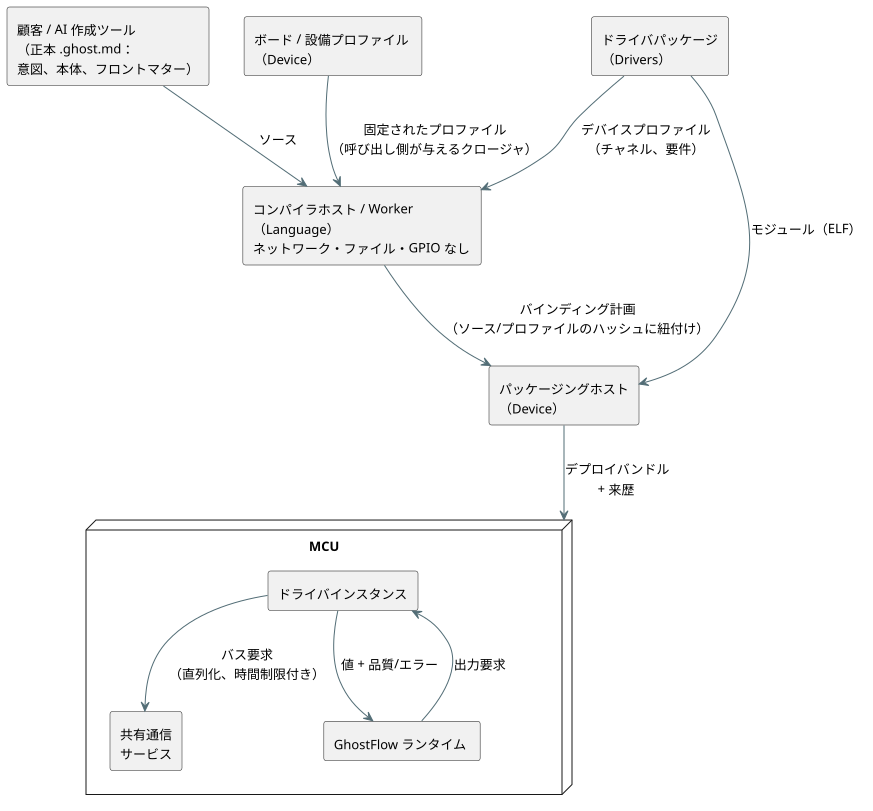

<!-- translation-source: docs/PROFILE-FRONT-MATTER.en.md -->
[英語の原文](PROFILE-FRONT-MATTER.en.md)

# プロファイルに基づくフロントマターの設計

[韓国語の原文](PROFILE-FRONT-MATTER.md) · [Issue #555](https://github.com/callin2/ghostflow-language/issues/555)

## 目的

**GhostFlow 全体の目標。** GhostFlow は、自動化への障壁を下げることを目指しています。

- 人が自然言語で表現した制御の意図を、AI が制御プログラムに変換します。
- そのプログラムは、意図や異常状態の扱いも含めて、実際の設備上で予測可能な形で動作します。

設備は植物、動物、人に影響を与えうるものです。そのため、簡潔さと引き換えに、検証に必要な事実や故障状態を失うことがあってはなりません。

**フロントマターの直接の目標。** フロントマターは、`.ghost.md` ドキュメントの先頭にある YAML ブロックです。**その役割は、ボードとドライバがすでに知っているハードウェアの事実を顧客に繰り返させることなく、制御本体の論理的な入力と出力を、実際に設置されたデバイスに結び付けることです。**

- 顧客が書くのは、使用する構成、実際の設備で異なる値、論理的なバインディングだけです。
- 制御本体は、ピン、通信の実装、ドライバの初期化、ウォームアップ、最小読み取り間隔を知る必要がありません。
- 読み取りの失敗と復旧の状態は、既存の鉄道指向（railway-oriented）のデータ経路を通って流れます（値は品質/エラーのステータスと一緒に運ばれます）。

**メタデータを本体から分ける理由。** これも同じ責任分担に従っています。

- 制御の意図は、設備が変わっても使い続けられるべきです。
- 同じ設備の知識は、多くのプログラムで再利用できるべきです。

フィールドを削除して、隠れたファームウェアの定数に移しても、この目標は達成**されません**。

## 顧客が書くもの

顧客は、次のような短いブロックだけを書きます。

```yaml
---
profile: ess3h32@1

devices:
  meter1:
    profile: jsy-mk-333@1
  meter2:
    profile: jsy-mk-333@1
    params: { address: 2 }

bindings:
  motor1Current: meter1.currentA
  motor2Current: meter2.currentA
  motor1Run: board.RO1
  motor2Run: board.RO2
---
```

これらの名前は設計上の例です。公開されたプロファイル ID ではありません。

**ルートフィールド。** このコンパクトな形式で許されるルートフィールドは3つだけです。

| フィールド | 必須 | 意味 |
| --- | --- | --- |
| `profile` | はい | ボード（設備）のプロファイル |
| `devices` | いいえ | 追加のデバイス。ない場合は省略します |
| `bindings` | はい | 本体のすべての論理入力と論理出力に対するバインディング |

これらのフィールド名は予約されているため、作成されたハードウェアの YAML が黙って通常のメタデータになることはありません。

**デバイス。** 各デバイスが持つのは次のものだけです。

- `profile`
- 任意の `params`
- 任意の `bus`。別の通信接続を選ぶ場合にのみ、`bus: board.rs485Aux` のようにバスを指定します。

`board` は、ボードが公開するチャネルのための予約名です。

**ボードのプロバイダと `omit`。** 既定では、選択したボードプロファイルの組み込みの入力チャネルと出力チャネルはすべて、プロバイダとして含まれます。

- `omit: [board.inputs]` または `omit: [board.outputs]` は、その方向のボードプロバイダを除外します。
- 除外されたチャネルへのバインディングは検証エラーになります。

物理的な構成は Device が所有します。Language はセレクタとバインディングを検証するだけです。

## ソフトウェア、ホスト、観測のプロバイダセレクタ

**非物理的なセレクタ。** 物理チャネルのほかに、同じ `bindings` マップは3種類の明示的なセレクタを受け付けます（[Language #584](https://github.com/callin2/ghostflow-language/issues/584)）。

- `software:<logical-name>`
- `host:scan-delta-ms`
- `observation:<logical-name>`

**例：独立した2つのバルブ。**

- モードとリセットは、`software:valveAMode` や `software:resetA` のような名前にバインドします。
- スキャン間隔の入力は `host:scan-delta-ms` にバインドします。
- 診断用の Bool 出力は `observation:valveAFault` にバインドします。
- 接点は、引き続き `board.DI1` のような物理入力チャネルに明示的にバインドします。
- リレーへのコマンドは、`board.RO1` のような出力チャネルにバインドします。

プロバイダが名前から推論されることは決してありません。すべての論理入力と論理出力にバインディングが必要です。`omit` でボードのチャネルを除外しても、明示的な非物理セレクタは引き続き利用できます。

**型と役割の規則。** 正本の `input` 宣言は、現在、コンパイラのマニフェストでは品質を伴う `sensors` として現れます。

| セレクタ | 受け付けるもの |
| --- | --- |
| `software:<logical-name>` | マニフェストの `sensors` または既存のスカラー `inputs` にある、同名で無次元の Bool または Number のみ |
| `host:scan-delta-ms` | どちらかの集合にある無次元の Number のみ |
| `observation:<logical-name>` | マニフェストの `outputs` にある同名の Bool のみ |

次のものは、元の YAML の位置とともに失敗します。

- Percent、Duration、物理量などの他の型
- 誤った役割や名前
- 物理チャネルの重複
- バインディングの欠落
- 2つの論理入力が `host:scan-delta-ms` を共有すること

**物理レコードと非物理レコード。**

- 物理入力は `sensors` だけをバインドします。スカラー `inputs` を物理センサに偽装することはできません。
- 既存の物理レコードは、`instance`、`channel`、`role`、`type`、任意の `unit` を保持します。
- 非物理の計画レコードは `{ provider, endpoint, role }` を保持し、その型はコンパイラのマニフェストに照らしてチェックされます。
- 計画は品質のレールを取り除かず、プロバイダや値を合成することもありません。

これは Language の静的な解釈契約です。Device による Number のソフトウェア/ホストのセンサ値の生成、パッケージの統合、実際の I/O、運用中の観測には、引き続きそれぞれの利用者と物理的な証拠が必要です。

**最初の例の値がどこから来るか。**

- `meter1` のアドレス 1、通信条件、チャネル名、物理量、単位は、そのデバイスプロファイルから来ます。
- `meter2` のアドレス 2 は、設備固有の違いです。
- アドレスの既定値を継承しても、デバイスの物理アドレスが自動的に変更されるわけではありません。
- 論理名は顧客が選びます。`currentA` は、ドライバに同梱されたチャネル仕様から選ばれます。
- 契約は、`ElectricalCurrent` の正準単位 `A` を運びます。本体にある `mA` のような互換な単位リテラルは、言語の既存の単位変換規則に従います。

## RS485 入力と8チャネルのリレー出力

この例では、上の電流計2台の構成に **RYR408B** リレー拡張ボード（アドレス **3**、**9600 bps**、**8 チャネル**）を追加します。

```yaml
---
profile: ess3h32@1

devices:
  meter1:
    profile: jsy-mk-333@1
  meter2:
    profile: jsy-mk-333@1
    params: { address: 2 }
  relay:
    profile: ryr408b@1
    params: { address: 3 }

bindings:
  motor1Current: meter1.currentA
  motor2Current: meter2.currentA
  motor1Run: relay.RO1
  motor2Run: relay.RO2
  auxiliary3: relay.RO3
  auxiliary4: relay.RO4
  auxiliary5: relay.RO5
  auxiliary6: relay.RO6
  auxiliary7: relay.RO7
  auxiliary8: relay.RO8
---
```

[完全な GhostFlow の例](../examples/hardware/rs485-current-relay.ghost.ja.md)には、意図へのリンク、電流に基づく出力 1 と 2 の制御、未使用の出力 3–8 への OFF 要求が含まれています。

**1本の共有バス。** 入力側の電流計と出力側のリレーは、同じ既定の RS485 接続を共有します。

- ボード/デバイスのプロファイルが 9600/8N1 を提供するため、顧客のドキュメントではそれらの設定を繰り返しません。
- アドレス 1、2、3 でデバイスを区別します。
- `relay.RO1`–`relay.RO8` は、リレーのドライバ/プロファイルが提供する Bool の出力チャネルです。`board.RO1` のような組み込みのボードチャネルとは区別されます。
- 同じ物理バス上でのアドレスの重複は、ドライバが異なっていてもエラーにしなければなりません。

**DIP スイッチ。** RYR408B のアドレスとボーレートは DIP スイッチで設定します。`address: 3` とプロファイルの `9600bps` は、実際の DIP の値に合うように通信を構成します。物理的な設定と宣言は一致していなければなりません。静的な検証がチェックするのは、与えられた契約の間の一致だけです。

**確認済みのものとそうでないもの。**

- リレーの型式 **RYR408B**、アドレス、速度、チャネル数は、ユーザーが確認した値です。8N1 は添付資料に示されています。
- `ryr408b@1` とチャネル名は、確認済みの型式に対して提案された設計上の契約であり、まだ公開されたプロファイルではありません。
- この静的な例は、RS485/Modbus RTU の契約を前提としています。ドライバを公開する前に、プロトコル仕様、チャネルごとのレジスタ、ON/OFF の値を確認してください。
- 例を追加しても、実際のリレーが動作することの検証にはなりません。

## 全体の構造と実行コンテキスト

それぞれの所有者には、明確な責任と出力があります。

| 実行場所 / 所有者 | 責任 | 出力 / 保存場所 |
| --- | --- | --- |
| 顧客 / AI 作成ツール | 意図、制御本体、設備の違い、論理的なバインディングを書く | 正本の `.ghost.md` |
| ボード / 設備プロファイルのプロバイダ（Device） | 固定のピン、接続されたリソース、明示的な既定の接続、組み込みのチャネル/モジュール | バージョンが固定されたプロファイル |
| ドライバのプロバイダ（Drivers） | ELF、初期化の仕様/既定値、通信の要件、チャネル/単位、デバイスの振る舞いの制約 | 1つのバージョンとして公開されるパッケージ |
| コンパイラホスト / Worker（Language） | 与えられたプロファイルの集合に対する決定的な解釈と診断 | ソース/プロファイルのハッシュに紐付いた、導出されたバインディング計画 |
| パッケージングホスト（Device） | 実際のモジュール/リソース/ホスト ABI を検証し、初期化レコードを作成する | デプロイバンドルと来歴 |
| MCU の共有通信サービス | 物理バスを所有し、要求を直列化し、時間制限を強制する | ランタイムのリソースと通信結果 |
| MCU のドライバインスタンス | デバイスごとのプロトコル、ウォームアップ/読み取り間隔/変換、独立した状態 | 値と品質/エラー |
| MCU の GhostFlow ランタイム | 物理的なバインディングとは独立に、制御とエラー処理を実行する | 出力要求と実行の証拠 |

次の図は、作成から MCU 上での実行まで、これらの所有者がどのようにデータを受け渡すかを示しています。



**信頼の境界。**

- コンパイル時のインタプリタは、ネットワーク、ファイル、GPIO にアクセスしません。検証するプロファイルのクロージャは、その呼び出し側が与えます。
- ダウンロード/デプロイの信頼ポリシーとキャッシュは、プロバイダとデプロイツールに属します。
- SHA-256 はバイト列の同一性をチェックします。信頼性や悪意のあるコードがないことを証明するものではありません。

## プロファイルの解釈契約

**プロバイダのデータ。** プロバイダのデータは、顧客の YAML とは別のデプロイ契約です。最初の実装では、`hardwareProfiles` 配列の各項目は次のものを持ちます。

- `ref`：`id@revision`。`latest` は拒否されます。
- `sha256`：リポジトリの `canonicalJson(definition)` の UTF-8 値の SHA-256。
- `definition`：プロファイルそのもの。

実際にデプロイされるファイル/ELF のダイジェストは別に保持されます。

**種類と継承。** `definition.kind` は `board` または `device` です。

- 任意の `extends` は、同じ種類の固定された ref を指します。
- 欠けているオブジェクトのフィールドは親から継承され、明示的に与えられた値がそれを上書きします。
- 配列は全体として置き換えられます。
- 循環、種類の変更、親の欠落はエラーです。
- 顧客の `params` は、パラメータ1つずつ既定値を上書きします。
- 顧客がドキュメント内で物理ピンを上書きする経路はありません。

**ボードプロファイル**は、`connections`、`defaults`、`channels` を持ちます。

- 接続は、`resource`（物理リソース ID）、`transport`、`protocol`、`settings` を指定します。
- `defaults` は、プロトコル名を `board.<connection>` に対応付けます。ボードに接続が1つしかない場合でも、それが暗黙に使われることはありません。デバイスが `bus` を省略できるのは、`defaults` がそのプロトコルに対する接続を明示的に指定している場合だけです。
- 同じ物理リソースに対する別名は、同一の通信契約を持たなければなりません。
- RS485 トランシーバを持たないボードは、RS485 のケイパビリティを提供できません。

**デバイスプロファイル**は、固定の `module: { id, revision, sha256 }`、`requires`、`parameters`、`channels` を持ちます。

- `requires` は、`transport`、`protocol`、`settings` を指定します。必須の設定値は、定数か、`{ param: baudRate }` のようなパラメータ参照です。
- パラメータの仕様は、`type` と、任意の `default`、`minimum`、`maximum`、`enum` を持ちます。最初の実装は `integer`、`number`、`boolean`、`string` をサポートします。定義されたすべてのパラメータには、既定値か明示的な値のどちらかが必要です。
- 構造化された初期化値のスキーマは、将来の範囲です。
- 未知の設定はドライバに渡されません。
- 任意の `addressParameter` は、共有接続上のアドレス競合のチェックに使われます。
- チャネルは、`role`（`input`/`output`）、`type`、任意の `unit` を持ちます。

**解釈の結果。** 結果は次のものを保持します。

- 選択されたプロファイルと親のダイジェスト
- 実際に適用された params
- 接続とチャネルの契約
- ソース上の位置

**共有リソースは1度だけ定義されます。** 同じ接続を参照する複数のデバイスが、それぞれ新しい UART を作ることは**ありません**。

- 組み込みの SPI、リレーのエクスパンダチップ、マルチプレクサ、組み込みの RS485、GPIO マッピングのハードウェア/ソフトウェア実装は、ボード/設備プロファイルで1度だけ定義されます。
- 外付けのトランシーバやエクスパンダチップを追加する場合は、その設備のプロファイルが、実際の追加配線とリソースを宣言します。
- デバイスが接続リソースを作る一般的な組み合わせは、後の段階で扱います。その場合でも、顧客が既存のボード情報を繰り返す必要はありません。

## 検証とユースケース

各ユースケースには、検証で示さなければならない結果があります。

| 目的別の要件 | 検証する結果 |
| --- | --- |
| 組み込み機能だけを使う顧客 | `profile` + `bindings` だけでチャネルを解決する |
| 同じ型式の電流計2台 | 既定のアドレス 1 と明示的なアドレス 2、別々のインスタンス、同じ物理バス |
| 電流入力と8チャネルのリレー出力 | 電流計のアドレス 1 と 2、リレーのアドレス 3、共有された 9600 bps の接続、Bool 出力 RO1–RO8 へのバインディング |
| RS485 の使用を確認する | デバイスの要件がボードのケイパビリティおよび通信条件と一致する、明示的な経路 |
| 別のデバイス / 別の通信実装 | 制御本体を変更せずに、プロバイダの契約を通じて接続を決定する |
| タイプミス / 情報の欠落 | 元の YAML の位置と、欠落/競合の理由を含むエラー |
| 制御データとしてのエラー | ドライバの読み取り失敗が、既存の品質/エラーの経路を通って流れる |

**必須の拒否。** 次のものを拒否します。

- プロファイルの欠落、固定されていないリビジョン、無効なダイジェスト
- 継承の循環
- パラメータの型、範囲、名前のエラー
- 既定の接続の欠落
- transport/protocol/settings の不一致
- 同じ物理バス上でのアドレスの重複
- チャネルの欠落とチャネルバインディングの重複
- 本体と、役割/型/正準単位との不一致

電流計2台の例でアドレスを両方とも省略すると、両方の電流計がアドレス 1 を使うことになるため、失敗しなければなりません。

**静的な証拠と物理的な証拠。** 静的な検証は、与えられた契約が RS485 の経路を構成していることを確認します。実際の配線、デバイスの応答、電流の測定、接点/負荷の動作は、対応する実行から得た証拠によって検証されます。ESS3 に関する既存のユーザー確認は記録として残っています。このドキュメント作業のために、同じ確認を再度求める必要はありません。

## 実装の順序と完了基準

1. **Language / #555：** コンパクトな YAML、有界なプロファイルクロージャの解釈、継承/明示的な既定値、通信/アドレス/チャネル/本体の型の検証、ソース診断を実装します。`hardwareProfiles` を公開コンパイル API に通します。欠けているクロージャを自動的に推論してはなりません。Node/ブラウザでの結果、ソースの保存、既存の GFB バイト列が変わらないことをテストします。
2. **Device + Drivers：** 既存のパッケージから実際のボード/ドライバのプロファイルを公開し、解釈の計画を configure/bundle の経路に接続します。実際の ELF とプロファイルのダイジェストを固定し、既存の長い形式で書かれたハードウェアドキュメントを移行するための変換を提供します。既存の設備の移行が検証されたら、有効なレガシーの作成経路を削除します。
3. **Device / #249 との調整：** 複数の独立したインスタンスが同じ RS485 リソースを安全に共有できるように、受け入れ（アドミッション）とエンドポイントの同一性を改良します。あるデバイスの故障が別のインスタンスの状態にならないことを確認し、これをサポートしないホストへのデプロイは拒否します。

**まだ行われていないこと。** ドキュメントと Language の段階だけでは、新しいソースを ESS3 にデプロイすることが完了したと宣言する根拠にはなりません。

- 現在の Device パッケージャには、固定の CURRENT_A/B/C エンドポイントと、共有 RS485 の受け入れ制約があります。
- 実際のプロファイルの公開、CLI によるプロファイルの提供、パッケージの統合、MCU 上での共有バスの実行には、それぞれ個別の完了の証拠が必要です。
- インポートされたドキュメントをまたぐデバイス共有の規則は、この範囲の外です。

完了の問いは次のとおりです。**すでに確立されたハードウェアの事実を書き直すことなく、顧客が設備の違いと制御の意図を明確に結び付けられるか。そして、欠落、競合、異常状態が隠されず、実行が予測可能なままであるか。** 各段階の結果と残りの作業は #555 にリンクしてください。
