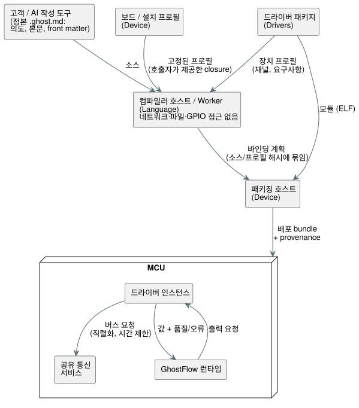

<!-- translation-source: docs/PROFILE-FRONT-MATTER.en.md -->
[영문 원문](PROFILE-FRONT-MATTER.en.md)

# 프로필 기반 front matter 설계

[이슈 #555](https://github.com/callin2/ghostflow-language/issues/555)

## 목적

**GhostFlow의 상위 목표.** GhostFlow는 자동화의 진입 장벽을 낮추는 것을 목표로 합니다.

- 사람이 자연어로 표현한 제어 의도를 AI가 제어 프로그램으로 옮깁니다.
- 그 프로그램은 의도와 이상 상태를 다루는 방식까지 포함해, 실제 장비에서 예측 가능한
  방식으로 실행됩니다.

장비는 동식물과 사람에게 영향을 줄 수 있습니다. 따라서 간결함 때문에 검증에 필요한 사실과
실패 상태를 잃어서는 절대 안 됩니다.

**front matter의 직접 목적.** front matter는 `.ghost.md` 문서 맨 위에 있는 YAML 블록입니다.
**front matter의 역할은 제어 본문의 논리 입출력을 실제로 설치된 장치에 연결하면서, 보드와
드라이버가 이미 아는 하드웨어 사실을 고객이 반복해서 작성하지 않게 하는 것입니다.**

- 고객은 사용하는 구성, 실제 설치에서 달라지는 값, 논리 바인딩만 작성합니다.
- 제어 본문은 핀, 통신 구현, 드라이버 초기화, warm-up, 최소 읽기 간격을 알 필요가 없습니다.
- 읽기 실패와 복구 상태는 기존의 railway-oriented 데이터 경로(값이 품질/오류 상태와 함께
  전달되는 경로)를 따라 흐릅니다.

**메타데이터를 본문과 분리하는 이유.** 같은 책임 분리를 따르기 때문입니다.

- 설치가 바뀌어도 제어 의도는 계속 사용할 수 있어야 합니다.
- 같은 설치 지식을 여러 프로그램에서 재사용할 수 있어야 합니다.

필드를 삭제하고 그 내용을 펌웨어의 숨은 상수로 옮기는 것으로는 이 목표를 달성할 수
**없습니다**.

## 고객이 작성하는 내용

고객은 다음과 같은 짧은 블록만 작성합니다.

```yaml
---
profile: ess3h32@1

devices:
  meter1:
    profile: jsy-mk-333@1
  meter2:
    profile: jsy-mk-333@1
    params: { address: 2 }

bindings:
  motor1Current: meter1.currentA
  motor2Current: meter2.currentA
  motor1Run: board.RO1
  motor2Run: board.RO2
---
```

이 이름들은 설계 예제입니다. 배포된 프로필 ID가 아닙니다.

**최상위 필드.** 이 compact 형식은 최상위 필드 세 개만 허용합니다.

| 필드 | 필수 여부 | 의미 |
| --- | --- | --- |
| `profile` | 예 | 보드(설치) 프로필 |
| `devices` | 아니요 | 추가 장치. 없으면 생략합니다 |
| `bindings` | 예 | 본문의 모든 논리 입력과 출력에 대한 바인딩 |

이 필드 이름들은 예약되어 있으므로, 작성된 하드웨어 YAML이 조용히 평범한 메타데이터가 되는
일은 없습니다.

**장치.** 각 장치에는 다음만 둡니다.

- `profile`
- 선택적 `params`
- 선택적 `bus`. `bus: board.rs485Aux`처럼 버스는 다른 통신 연결을 선택할 때만 명시합니다.

`board`는 보드가 공개하는 채널을 위한 예약 이름입니다.

**보드 provider와 `omit`.** 기본적으로 선택한 보드 프로필의 내장 입력 및 출력 채널은 모두
provider로 포함됩니다.

- `omit: [board.inputs]` 또는 `omit: [board.outputs]`는 해당 방향의 보드 provider를
  제외합니다.
- 제외된 채널에 바인딩하면 검증 오류입니다.

물리적 구성은 Device가 소유합니다. Language는 선택자와 바인딩만 검증합니다.

## 소프트웨어·호스트·관측 provider 선택자

**비물리 선택자.** 물리 채널 외에도 같은 `bindings` 맵은 세 가지 명시적인 선택자를
받습니다([Language #584](https://github.com/callin2/ghostflow-language/issues/584)).

- `software:<logical-name>`
- `host:scan-delta-ms`
- `observation:<logical-name>`

**예: 독립된 밸브 두 개.**

- 모드와 reset은 `software:valveAMode`, `software:resetA` 같은 이름에 바인딩합니다.
- scan 간격 입력은 `host:scan-delta-ms`에 바인딩합니다.
- 진단용 Bool 출력은 `observation:valveAFault`에 바인딩합니다.
- 접점은 여전히 `board.DI1` 같은 물리 입력 채널에 명시적으로 바인딩합니다.
- 릴레이 명령은 `board.RO1` 같은 출력 채널에 바인딩합니다.

provider를 이름으로 추정하는 일은 없으며, 모든 논리 입력과 출력에는 바인딩이 필요합니다.
`omit`으로 보드 채널을 제외해도 명시적인 비물리 선택자는 계속 사용할 수 있습니다.

**타입과 역할 규칙.** 정본 `input` 선언은 현재 컴파일러 manifest에서 품질 정보를 가진
`sensors`로 나타납니다.

| 선택자 | 받아들이는 것 |
| --- | --- |
| `software:<logical-name>` | manifest `sensors` 또는 기존 스칼라 `inputs`에 있는, 이름이 같고 단위가 없는 Bool 또는 Number |
| `host:scan-delta-ms` | 두 집합 중 어느 쪽에든 있는 단위 없는 Number |
| `observation:<logical-name>` | manifest `outputs`에 있는 이름이 같은 Bool |

다음은 원본 YAML 위치와 함께 실패합니다.

- Percent, Duration, 물리량 같은 다른 타입
- 잘못된 역할이나 이름
- 중복된 물리 채널
- 누락된 바인딩
- 두 논리 입력이 `host:scan-delta-ms`를 공유하는 경우

**물리 기록과 비물리 기록.**

- 물리 입력은 `sensors`에만 바인딩합니다. 스칼라 `inputs`를 물리 센서로 위장할 수
  없습니다.
- 기존 물리 기록은 `instance`, `channel`, `role`, `type`, 선택적 `unit`을 그대로 유지합니다.
- 비물리 계획 기록은 `{ provider, endpoint, role }`을 유지하며, 타입은 컴파일러 manifest에
  대해 검사합니다.
- 계획은 품질 rail을 제거하지 않으며, provider나 값을 합성하지도 않습니다.

이것은 Language의 정적 해석 계약입니다. Device가 Number 소프트웨어/호스트 센서 값을 만드는
일, 패키지 통합, 실제 입출력, 운전 관측에는 여전히 각각의 소비자와 물리적 증거가 필요합니다.

**첫 번째 예제의 값은 어디에서 오는가.**

- `meter1`의 주소 1, 통신 조건, 채널 이름, 물리량, 단위는 장치 프로필에서 옵니다.
- `meter2`의 주소 2는 설치에 따른 차이입니다.
- 주소 기본값을 상속한다고 해서 장치의 물리 주소가 자동으로 바뀌는 것은 아닙니다.
- 논리 이름은 고객이 정합니다. `currentA`는 드라이버에 동봉된 채널 명세에서 선택합니다.
- 계약은 `ElectricalCurrent`의 대표 단위 `A`를 전달합니다. 본문의 `mA` 같은 호환 단위
  리터럴은 언어의 기존 단위 변환 규칙을 따릅니다.

## RS485 입력과 8채널 릴레이 출력

이 예제는 위의 전류계 두 개 구성에 **RYR408B** 릴레이 확장 보드(주소 **3**, **9600 bps**,
**8채널**)를 추가합니다.

```yaml
---
profile: ess3h32@1

devices:
  meter1:
    profile: jsy-mk-333@1
  meter2:
    profile: jsy-mk-333@1
    params: { address: 2 }
  relay:
    profile: ryr408b@1
    params: { address: 3 }

bindings:
  motor1Current: meter1.currentA
  motor2Current: meter2.currentA
  motor1Run: relay.RO1
  motor2Run: relay.RO2
  auxiliary3: relay.RO3
  auxiliary4: relay.RO4
  auxiliary5: relay.RO5
  auxiliary6: relay.RO6
  auxiliary7: relay.RO7
  auxiliary8: relay.RO8
---
```

[전체 GhostFlow 예제](../examples/hardware/rs485-current-relay.ghost.md)는 의도 링크, 전류에 따른 출력 1·2 제어, 사용하지 않는 출력 3~8에 대한 OFF 요청까지 포함합니다.

**공유 버스 하나.** 입력 전류계와 출력 릴레이는 같은 기본 RS485 연결을 공유합니다.

- 보드/장치 프로필이 9600/8N1을 제공하므로 고객 문서에서 이 설정을 반복하지 않습니다.
- 주소 1, 2, 3으로 장치를 구분합니다.
- `relay.RO1`~`relay.RO8`은 릴레이 드라이버/프로필의 Bool 출력 채널입니다. `board.RO1` 같은
  보드 내장 채널과 구별됩니다.
- 같은 물리 버스에서 주소가 겹치면, 드라이버가 서로 다르더라도 오류여야 합니다.

**DIP 스위치.** RYR408B의 주소와 통신 속도는 DIP 스위치로 설정합니다. `address: 3`과
프로필의 `9600bps`는 실제 DIP 값에 맞게 통신을 구성합니다. 물리적 설정과 선언은 일치해야
합니다. 정적 검증은 제공된 계약 사이의 일치만 확인합니다.

**확인된 것과 확인되지 않은 것.**

- 릴레이 모델 **RYR408B**, 주소, 속도, 채널 수는 사용자가 확인한 값입니다. 8N1은 첨부
  자료에 표시된 값입니다.
- `ryr408b@1`과 채널 이름은 확인된 모델을 위해 제안한 설계 계약이며, 아직 배포된 프로필이
  아닙니다.
- 정적 예제는 RS485/Modbus RTU 계약을 가정합니다. 드라이버를 배포하기 전에 프로토콜 명세,
  채널별 레지스터, ON/OFF 값을 확인하세요.
- 예제를 추가했다고 해서 실제 릴레이가 동작한다는 검증으로 간주하지 않습니다.

## 전체 구조와 실행 컨텍스트

각 소유자에게는 명확한 책임과 산출물이 있습니다.

| 실행 위치 / 소유자 | 책임 | 산출물 / 저장 위치 |
| --- | --- | --- |
| 고객 / AI 작성 도구 | 의도, 제어 본문, 설치 차이, 논리 바인딩 작성 | 정본 `.ghost.md` |
| 보드 / 설치 프로필 공급자 (Device) | 고정 핀, 연결된 자원, 명시적 기본 연결, 내장 채널/모듈 | 버전이 고정된 프로필 |
| 드라이버 공급자 (Drivers) | ELF, 초기화 명세/기본값, 통신 요구사항, 채널/단위, 장치 동작 제약 | 하나의 버전으로 배포되는 패키지 |
| 컴파일러 호스트 / Worker (Language) | 제공된 프로필 집합에 대한 결정적 해석과 진단 | 소스/프로필 해시에 묶인 파생 바인딩 계획 |
| 패키징 호스트 (Device) | 실제 모듈/자원/호스트 ABI 검증, 초기화 기록 생성 | 배포 bundle과 provenance |
| MCU 공유 통신 서비스 | 물리 버스 소유, 요청 직렬화, 시간 제한 적용 | 런타임 자원과 통신 결과 |
| MCU 드라이버 인스턴스 | 장치별 프로토콜, warm-up/읽기 간격/변환, 독립된 상태 | 값과 품질/오류 |
| MCU GhostFlow 런타임 | 물리 바인딩과 독립적으로 제어와 오류 처리 실행 | 출력 요청과 실행 증거 |

아래 다이어그램은 작성부터 MCU에서의 실행까지, 이 소유자들이 서로 데이터를 넘기는 방식을
보여 줍니다.



**신뢰 경계.**

- 컴파일 시점 해석기는 네트워크, 파일, GPIO에 접근하지 않습니다. 검증할 프로필 closure는
  호출자가 제공합니다.
- 다운로드/배포 신뢰 정책과 캐시는 공급자와 배포 도구의 책임입니다.
- SHA-256은 바이트 동일성을 확인합니다. 신뢰성이나 악성 코드가 없음을 증명하지 않습니다.

## 프로필 해석 계약

**공급자 데이터.** 공급자 데이터는 고객 YAML과 별개인 배포 계약입니다. 1차 구현에서
`hardwareProfiles` 배열의 각 항목은 다음을 가집니다.

- `ref`: `id@revision`. `latest`는 거부됩니다.
- `sha256`: 저장소의 `canonicalJson(definition)` UTF-8 값의 SHA-256
- `definition`: 프로필 자체

실제로 배포된 파일/ELF의 다이제스트는 별도로 보관합니다.

**종류와 상속.** `definition.kind`는 `board` 또는 `device`입니다.

- 선택적 `extends`는 같은 종류의 고정된 ref를 가리킵니다.
- 객체에서 빠진 필드는 부모에게서 상속하고, 명시적으로 제공한 값은 이를 덮어씁니다.
- 배열은 통째로 교체됩니다.
- 순환, 종류 변경, 없는 부모는 오류입니다.
- 고객의 `params`는 매개변수 하나 단위로 기본값을 덮어씁니다.
- 고객이 문서에서 물리 핀을 덮어쓰는 경로는 없습니다.

**보드 프로필**은 `connections`, `defaults`, `channels`를 가집니다.

- 연결은 `resource`(물리 자원 ID), `transport`, `protocol`, `settings`를 명시합니다.
- `defaults`는 프로토콜 이름을 `board.<connection>`에 대응시킵니다. 보드에 연결이 하나뿐이어도
  암묵적으로 사용하지 않습니다. 장치는 `defaults`가 그 프로토콜의 연결을 명시적으로 지정한
  경우에만 `bus`를 생략할 수 있습니다.
- 같은 물리 자원에 대한 별칭은 통신 계약이 동일해야 합니다.
- RS485 트랜시버가 없는 보드는 RS485 capability를 제공할 수 없습니다.

**장치 프로필**은 고정된 `module: { id, revision, sha256 }`, `requires`, `parameters`,
`channels`를 가집니다.

- `requires`는 `transport`, `protocol`, `settings`를 명시합니다. 요구되는 설정 값은 상수이거나
  `{ param: baudRate }` 같은 매개변수 참조입니다.
- 매개변수 명세는 `type`과 선택적 `default`, `minimum`, `maximum`, `enum`을 가집니다. 1차
  구현은 `integer`, `number`, `boolean`, `string`을 지원합니다. 정의된 모든 매개변수에는
  기본값이나 명시적인 값이 필요합니다.
- 구조화된 초기화 값의 schema는 향후 범위입니다.
- 알 수 없는 설정은 드라이버로 전달하지 않습니다.
- 선택적 `addressParameter`는 공유 연결에서 주소 충돌을 검사하는 데 사용합니다.
- 채널은 `role`(`input`/`output`), `type`, 선택적 `unit`을 가집니다.

**해석 결과.** 결과는 다음을 보존합니다.

- 선택한 프로필과 부모의 다이제스트
- 실제로 적용한 params
- 연결 및 채널 계약
- 원본 위치

**공유 자원은 한 번만 정의합니다.** 같은 연결을 참조하는 여러 장치가 각자 새 UART를 만드는
것이 **아닙니다**.

- 내장 SPI, 릴레이 확장 칩, 멀티플렉서, 내장 RS485, GPIO 매핑의 하드웨어/소프트웨어 구현은
  보드/설치 프로필에 한 번 정의합니다.
- 외부 트랜시버나 확장 칩을 추가하면, 그 설치의 프로필이 실제 추가 배선과 자원을
  선언합니다.
- 장치가 연결 자원을 만드는 일반적인 조합은 후속 단계입니다. 그때에도 고객이 기존 보드
  정보를 반복해서 작성할 필요는 없습니다.

## 검증과 사용 사례

각 사용 사례에는 검증이 보여 주어야 하는 결과가 있습니다.

| 목적에 따른 요구 | 검증해야 하는 결과 |
| --- | --- |
| 내장 기능만 사용하는 고객 | `profile` + `bindings`만으로 채널 해석 |
| 같은 모델의 전류계 두 개 | 기본 주소 1과 명시 주소 2, 별도 인스턴스, 같은 물리 버스 |
| 전류 입력과 8채널 릴레이 출력 | 전류계 주소 1·2, 릴레이 주소 3, 공유 9600 bps 연결, Bool 출력 RO1~RO8에 대한 바인딩 |
| RS485 사용 확인 | 장치 요구사항이 보드 capability 및 통신 조건과 일치하는 명시적 경로 |
| 다른 장치 / 다른 통신 구현 | 제어 본문을 바꾸지 않고 공급자 계약으로 연결 결정 |
| 오타 / 정보 누락 | 원본 YAML 위치와 누락/충돌 이유를 포함하는 오류 |
| 제어 데이터로서의 오류 | 드라이버 읽기 실패가 기존 품질/오류 경로로 흐름 |

**반드시 거부해야 하는 것.** 다음을 거부합니다.

- 없는 프로필, 고정되지 않은(floating) revision, 잘못된 다이제스트
- 상속 순환
- 매개변수 타입, 범위, 이름 오류
- 없는 기본 연결
- transport/protocol/settings 불일치
- 같은 물리 버스에서의 중복 주소
- 없는 채널과 중복 채널 바인딩
- 본문과 role/type/대표 단위 사이의 불일치

전류계 두 개 예제에서 두 주소를 모두 생략하면 실패해야 합니다. 두 전류계가 모두 주소 1을
사용하게 되기 때문입니다.

**정적 증거와 물리적 증거.** 정적 검증은 제공된 계약이 RS485 경로를 구성한다는 것을
확인합니다. 실제 배선, 장치 응답, 전류 측정, 접점/부하 동작은 해당 실행에서 나온 증거로
검증합니다. 기존 ESS3 사용자 확인은 기록으로 유지되며, 이 문서 작업을 위해 같은 확인을 다시
요청할 필요는 없습니다.

## 구현 순서와 완료 기준

1. **Language / #555:** compact YAML, 제한된 프로필 closure 해석, 상속/명시적 기본값, 통신/주소/채널/본문 타입 검증, 원본 진단을 구현합니다. 공개 컴파일 API를 통해 `hardwareProfiles`를 전달하며, 빠진 closure를 자동으로 추정하지 않습니다. Node/브라우저 결과, 원본 보존, 기존 GFB 바이트 불변을 테스트합니다.
2. **Device + Drivers:** 기존 패키지에서 실제 보드/드라이버 프로필을 배포하고, 해석 계획을 configure/bundle 경로에 연결합니다. 실제 ELF와 프로필 다이제스트를 고정하고, 기존의 장문 authored hardware 문서를 이전하기 위한 변환을 제공합니다. 기존 설치의 이전이 검증되면 활성 상태의 구형 작성 경로를 제거합니다.
3. **Device / #249 연계:** 여러 독립 인스턴스가 같은 RS485 자원을 안전하게 공유할 수 있도록 admission과 endpoint identity를 다듬습니다. 한 장치의 고장이 다른 인스턴스의 상태가 되지 않는지 확인하고, 이를 지원하지 않는 호스트에 대한 배포는 거부합니다.

**아직 완료되지 않은 것.** 문서와 Language 단계만으로는 새 소스를 ESS3에 배포하는 일이
완료되었다고 선언할 수 없습니다.

- 현재 Device 패키저에는 고정된 CURRENT_A/B/C endpoint와 공유 RS485 admission 제약이
  있습니다.
- 실제 프로필 배포, CLI를 통한 프로필 전달, 패키지 통합, MCU에서의 공유 버스 실행에는 각각
  별도의 완료 증거가 필요합니다.
- 가져온(import) 문서 사이의 장치 공유 규칙은 이 범위 밖입니다.

완료를 판단하는 질문은 다음과 같습니다. **고객이 이미 확립된 하드웨어 사실을 다시 쓰지 않고도 자신의 설치 차이와 제어 의도를 명확하게 연결할 수 있으며, 그러면서도 누락, 충돌, 이상 상태가 숨겨지지 않고 실행이 예측 가능하게 유지되는가?** 각 단계의 결과와 남은 일은 #555에 연결합니다.
