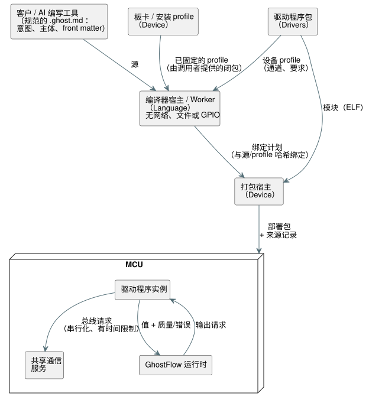

<!-- translation-source: docs/PROFILE-FRONT-MATTER.en.md -->
[英文原文](PROFILE-FRONT-MATTER.en.md)

# 基于 profile 的 Front Matter 设计

[English](PROFILE-FRONT-MATTER.en.md) · [Issue #555](https://github.com/callin2/ghostflow-language/issues/555)

## 目的

**GhostFlow 的总体目标。** GhostFlow 旨在降低自动化的门槛：

- AI 将人用自然语言表达的控制意图翻译成控制程序。
- 该程序在真实设备上以可预测的方式运行，包括它如何处理意图和异常状况。

设备可能影响植物、动物和人。因此，简洁绝不能以牺牲验证所需的事实和故障状态为代价。

**front matter 的直接目标。** front matter（前置元数据）是 `.ghost.md` 文档顶部的 YAML 块。**它的任务是把控制主体的逻辑输入和输出连接到实际安装的设备上，同时不让客户重复板卡和驱动程序已经知道的硬件事实。**

- 客户只写自己使用的配置、实际安装中不同的值，以及逻辑绑定。
- 控制主体不需要知道引脚、通信实现、驱动程序初始化、预热或最小读取间隔。
- 读取失败和恢复状态通过现有的面向铁路（railway-oriented）的数据路径传递（值与其质量/错误状态一起传递）。

**为什么元数据与主体分离。** 这遵循同样的职责划分：

- 当安装发生变化时，控制意图应当仍然可用。
- 同样的安装知识应当可以在多个程序之间复用。

删除字段并把它们移入隐藏的固件常量**不能**实现这一目标。

## 客户编写的内容

客户只需编写如下的简短块：

```yaml
---
profile: ess3h32@1

devices:
  meter1:
    profile: jsy-mk-333@1
  meter2:
    profile: jsy-mk-333@1
    params: { address: 2 }

bindings:
  motor1Current: meter1.currentA
  motor2Current: meter2.currentA
  motor1Run: board.RO1
  motor2Run: board.RO2
---
```

这些名称只是设计示例，并不是已发布的 profile ID。

**根字段。** 这种紧凑格式只允许三个根字段：

| 字段 | 是否必需 | 含义 |
| --- | --- | --- |
| `profile` | 是 | 板卡（安装）profile |
| `devices` | 否 | 附加设备；没有时省略 |
| `bindings` | 是 | 主体中每个逻辑输入和输出的绑定 |

这些字段名是保留的，因此编写的硬件 YAML 不会悄无声息地变成普通元数据。

**设备。** 每个设备只有：

- `profile`；
- 可选的 `params`；
- 可选的 `bus`。只有在选择不同的通信连接时，才指定总线，例如 `bus: board.rs485Aux`。

`board` 是板卡所暴露通道的保留名称。

**板卡提供者与 `omit`。** 默认情况下，所选板卡 profile 的每个内置输入和输出通道都作为提供者包含在内。

- `omit: [board.inputs]` 或 `omit: [board.outputs]` 会排除该方向上的板卡提供者。
- 绑定到被排除的通道是验证错误。

物理组成由 Device 负责。Language 只验证选择器和绑定。

## 软件、宿主与观测提供者选择器

**非物理选择器。** 除了物理通道之外，同一个 `bindings` 映射还接受三种显式的选择器（[Language #584](https://github.com/callin2/ghostflow-language/issues/584)）：

- `software:<logical-name>`；
- `host:scan-delta-ms`；
- `observation:<logical-name>`。

**示例：两个独立的阀门。**

- 模式和复位绑定到诸如 `software:valveAMode` 和 `software:resetA` 的名称。
- 扫描间隔输入绑定到 `host:scan-delta-ms`。
- 诊断用的 Bool 输出绑定到 `observation:valveAFault`。
- 触点仍然显式绑定到诸如 `board.DI1` 的物理输入通道。
- 继电器命令绑定到诸如 `board.RO1` 的输出通道。

提供者绝不会从名称推断；每个逻辑输入和输出都需要绑定。即使 `omit` 排除了板卡通道，显式的非物理选择器仍然可用。

**类型与角色规则。** 规范的 `input` 声明目前在编译器清单中表现为带质量信息的 `sensors`。

| 选择器 | 只接受 |
| --- | --- |
| `software:<logical-name>` | 清单 `sensors` 或现有标量 `inputs` 中同名的无量纲 Bool 或 Number |
| `host:scan-delta-ms` | 两个集合中任一集合里的无量纲 Number |
| `observation:<logical-name>` | 清单 `outputs` 中同名的 Bool |

以下情况会失败，并给出原始 YAML 位置：

- 其他类型，例如 Percent、Duration 和物理量；
- 错误的角色或名称；
- 重复的物理通道；
- 缺失的绑定；
- 两个逻辑输入共用 `host:scan-delta-ms`。

**物理记录与非物理记录。**

- 物理输入只绑定 `sensors`。标量 `inputs` 不能伪装成物理传感器。
- 现有的物理记录保留 `instance`、`channel`、`role`、`type` 以及可选的 `unit`。
- 非物理计划记录保留 `{ provider, endpoint, role }`；其类型会依据编译器清单进行检查。
- 该计划不会剥离质量通道（quality rail），也不会合成提供者或值。

这是 Language 的静态解释契约。Device 生成 Number 类型的软件/宿主传感器值、包集成、真实 I/O 以及运行观测，仍需各自的消费者和物理证据。

**第一个示例中的值从何而来。**

- `meter1` 的地址 1、通信条件、通道名称、物理量和单位来自其设备 profile。
- `meter2` 的地址 2 是特定于该安装的差异。
- 继承地址默认值并不意味着设备的物理地址会被自动更改。
- 逻辑名称由客户选择；`currentA` 从驱动程序附带的通道规格中选出。
- 契约为 `ElectricalCurrent` 携带规范单位 `A`。主体中兼容的单位字面量（例如 `mA`）遵循语言现有的单位换算规则。

## RS485 输入与 8 通道继电器输出

本示例在上面的双电流表配置基础上，增加了一块 **RYR408B** 继电器扩展板（地址 **3**、**9600 bps**、**8 通道**）：

```yaml
---
profile: ess3h32@1

devices:
  meter1:
    profile: jsy-mk-333@1
  meter2:
    profile: jsy-mk-333@1
    params: { address: 2 }
  relay:
    profile: ryr408b@1
    params: { address: 3 }

bindings:
  motor1Current: meter1.currentA
  motor2Current: meter2.currentA
  motor1Run: relay.RO1
  motor2Run: relay.RO2
  auxiliary3: relay.RO3
  auxiliary4: relay.RO4
  auxiliary5: relay.RO5
  auxiliary6: relay.RO6
  auxiliary7: relay.RO7
  auxiliary8: relay.RO8
---
```

[完整的 GhostFlow 示例](../examples/hardware/rs485-current-relay.ghost.zh.md)包括意图链接、基于电流对输出 1 和 2 的控制，以及对未使用的输出 3–8 的 OFF 请求。

**一条共享总线。** 输入电流表和输出继电器共享同一个默认 RS485 连接。

- 板卡/设备 profile 提供 9600/8N1，因此客户文档无需重复这些设置。
- 地址 1、2 和 3 用于区分设备。
- `relay.RO1`–`relay.RO8` 是来自继电器驱动程序/profile 的 Bool 输出通道。它们不同于诸如 `board.RO1` 的板卡内置通道。
- 同一物理总线上的重复地址必须是错误，即使跨越不同的驱动程序也是如此。

**DIP 开关。** RYR408B 的地址和波特率由 DIP 开关设置。`address: 3` 和 profile 中的 `9600bps` 将通信配置为与实际 DIP 值一致。物理设置与声明必须一致；静态验证只检查所提供的契约之间是否一致。

**哪些已确认，哪些尚未确认。**

- 继电器型号 **RYR408B**、地址、速率和通道数是用户确认的值。8N1 见于附带的资料中。
- `ryr408b@1` 和通道名称是针对已确认型号拟议的设计契约，尚未作为 profile 发布。
- 该静态示例假定采用 RS485/Modbus RTU 契约。在发布驱动程序之前，请确认协议规格、每个通道的寄存器以及 ON/OFF 值。
- 添加该示例并不等同于验证了真实继电器能够动作。

## 整体结构与执行上下文

每个所有者都有明确的职责和输出：

| 执行位置 / 所有者 | 职责 | 输出 / 存储位置 |
| --- | --- | --- |
| 客户 / AI 编写工具 | 编写意图、控制主体、安装差异和逻辑绑定 | 规范的 `.ghost.md` |
| 板卡 / 安装 profile 提供者（Device） | 固定引脚、已连接资源、显式默认连接、内置通道/模块 | 固定版本的 profile |
| 驱动程序提供者（Drivers） | ELF、初始化规格/默认值、通信要求、通道/单位、设备行为约束 | 以单一版本发布的包 |
| 编译器宿主 / Worker（Language） | 针对所提供的 profile 集合进行确定性解释和诊断 | 与源/profile 哈希绑定的派生绑定计划 |
| 打包宿主（Device） | 验证实际的模块/资源/宿主 ABI 并创建初始化记录 | 部署包和来源记录 |
| MCU 共享通信服务 | 拥有物理总线、串行化请求、强制执行时间限制 | 运行时资源和通信结果 |
| MCU 驱动程序实例 | 每个设备的协议、预热/读取间隔/换算、独立状态 | 值和质量/错误 |
| MCU GhostFlow 运行时 | 独立于物理绑定运行控制和错误处理 | 输出请求和执行证据 |

下图展示了这些所有者如何相互传递数据，从编写一直到在 MCU 上执行。



**信任边界。**

- 编译时解释器不访问网络、文件或 GPIO。由其调用者提供要验证的 profile 闭包。
- 下载/部署的信任策略和缓存属于提供者和部署工具。
- SHA-256 检查字节同一性。它不能证明可信性，也不能证明不存在恶意代码。

## Profile 解释契约

**提供者数据。** 提供者数据是一份部署契约，与客户 YAML 相分离。在第一个实现中，`hardwareProfiles` 数组的每一项包含：

- `ref`：`id@revision`。`latest` 会被拒绝。
- `sha256`：仓库中 `canonicalJson(definition)` 的 UTF-8 值的 SHA-256。
- `definition`：profile 本身。

实际部署的文件/ELF 的摘要另行保存。

**种类与继承。** `definition.kind` 为 `board` 或 `device`。

- 可选的 `extends` 指向同一种类的已固定 ref。
- 缺失的对象字段从父项继承；显式提供的值会覆盖它们。
- 数组整体替换。
- 循环、种类变更以及缺失父项都是错误。
- 客户的 `params` 逐个参数地覆盖默认值。
- 客户没有途径在其文档中覆盖物理引脚。

**板卡 profile** 包含 `connections`、`defaults` 和 `channels`。

- 连接指定 `resource`（物理资源 ID）、`transport`、`protocol` 和 `settings`。
- `defaults` 将协议名称映射到 `board.<connection>`。即使板卡只有一个连接，也不会隐式使用它：只有当 `defaults` 显式为某设备的协议指定了连接时，该设备才可以省略 `bus`。
- 同一物理资源的别名必须具有相同的通信契约。
- 没有 RS485 收发器的板卡无法提供 RS485 能力。

**设备 profile** 包含固定的 `module: { id, revision, sha256 }`、`requires`、`parameters` 和 `channels`。

- `requires` 指定 `transport`、`protocol` 和 `settings`。必需的设置值是常量，或诸如 `{ param: baudRate }` 的参数引用。
- 参数规格包含 `type` 以及可选的 `default`、`minimum`、`maximum` 和 `enum`。第一个实现支持 `integer`、`number`、`boolean` 和 `string`。每个已定义的参数都需要默认值或显式值。
- 结构化初始化值的 schema 属于未来范围。
- 未知设置不会传递给驱动程序。
- 可选的 `addressParameter` 用于检查共享连接上的地址冲突。
- 通道包含 `role`（`input`/`output`）、`type` 以及可选的 `unit`。

**解释结果。** 结果会保留：

- 所选 profile 及父项摘要；
- 实际应用的 params；
- 连接和通道契约；
- 源位置。

**共享资源只定义一次。** 引用同一连接的多个设备**不会**各自创建新的 UART。

- 内置 SPI、继电器扩展芯片、多路复用器、内置 RS485 以及 GPIO 映射的硬件/软件实现，在板卡/安装 profile 中只定义一次。
- 如果添加了外部收发器或扩展芯片，则由该安装的 profile 声明实际增加的接线和资源。
- 由设备创建连接资源的一般组合属于后续阶段。即便到那时，客户也无需重复现有的板卡信息。

## 验证与用例

每个用例都有验证必须展示的结果：

| 按目的划分的要求 | 需要验证的结果 |
| --- | --- |
| 只使用内置功能的客户 | 仅使用 `profile` + `bindings` 解析通道 |
| 同一型号的两个电流表 | 默认地址 1 和显式地址 2、独立的实例、同一物理总线 |
| 电流输入与 8 通道继电器输出 | 电流表地址 1 和 2、继电器地址 3、共享的 9600 bps 连接、绑定到 Bool 输出 RO1–RO8 |
| 确认使用 RS485 | 设备要求与板卡能力及通信条件相匹配的显式路径 |
| 不同设备 / 不同通信实现 | 通过提供者契约确定连接，而无需更改控制主体 |
| 拼写错误 / 缺失信息 | 包含原始 YAML 位置以及遗漏/冲突原因的错误 |
| 错误作为控制数据 | 驱动程序读取失败通过现有的质量/错误路径传递 |

**必需的拒绝。** 拒绝：

- 缺失的 profile、浮动的修订版和无效的摘要；
- 继承循环；
- 参数类型、范围或名称错误；
- 缺失的默认连接；
- transport/protocol/settings 不匹配；
- 同一物理总线上的重复地址；
- 缺失的通道和重复的通道绑定；
- 主体与 role/type/规范单位之间的不匹配。

在双电流表示例中，省略两个地址必须失败，因为两个电流表都会使用地址 1。

**静态证据与物理证据。** 静态验证确认所提供的契约配置了一条 RS485 路径。实际接线、设备响应、电流测量以及触点/负载动作，需要通过相应执行所产生的证据来验证。现有的 ESS3 用户确认仍有记录；本文档任务不需要再次请求同样的确认。

## 实现顺序与完成标准

1. **Language / #555：** 实现紧凑 YAML、有界的 profile 闭包解释、继承/显式默认值、通信/地址/通道/主体类型验证，以及源诊断。通过公开的编译 API 传递 `hardwareProfiles`；不要自动推断缺失的闭包。测试 Node/浏览器结果、源保留，以及现有 GFB 字节不变。
2. **Device + Drivers：** 从现有包发布实际的板卡/驱动程序 profile，并将解释计划连接到 configure/bundle 路径。固定实际的 ELF 和 profile 摘要，并提供用于迁移现有长格式硬件文档的转换。在现有安装的迁移得到验证后，移除仍在使用的旧编写路径。
3. **Device / #249 协调：** 完善准入和端点身份标识，使多个独立实例能够安全地共享同一个 RS485 资源。检查一个设备的故障不会变成另一个实例的状态，并对不支持这一点的宿主拒绝部署。

**尚未完成的内容。** 仅凭文档和 Language 阶段，还不足以宣布向 ESS3 部署新源的工作已经完成。

- 当前的 Device 打包器具有固定的 CURRENT_A/B/C 端点以及共享 RS485 的准入约束。
- 实际的 profile 发布、CLI 交付 profile、包集成以及 MCU 上的共享总线执行，各自都需要单独的完成证据。
- 跨导入文档的设备共享规则不在本范围内。

完成与否的判断问题是：**客户能否在不重写已确立的硬件事实的情况下，清楚地连接其安装差异和控制意图，同时确保遗漏、冲突和异常状态不会被隐藏，并且执行保持可预测？** 请将每个阶段的结果和剩余工作链接到 #555。
