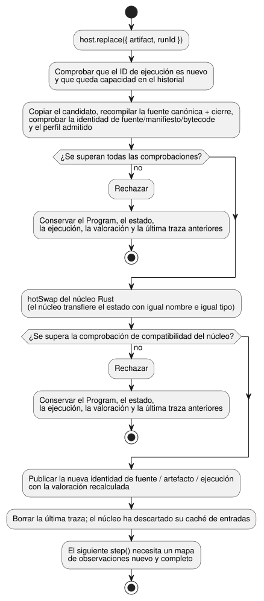

<!-- translation-source: docs/PROGRAM-REPLACEMENT-HOST.md -->
[Original en inglés](PROGRAM-REPLACEMENT-HOST.md)

# Host de referencia para el reemplazo de Program

`ProgramReplacementHost` ejecuta un Program de GhostFlow compilado y puede
reemplazarlo por un Program nuevo validado. Un reemplazo solo se consolida
**entre ticks completados** (un tick es un paso de evaluación del Program).

- Usa el núcleo Rust existente para la evaluación y para la transferencia del
  estado.
- Es solo un adaptador de referencia. No realiza instalación, llamadas a
  drivers, renderizado de salidas ni verificación física.

## Ejecutar el ejemplo

Compile el artefacto WASM en `target/wasm32-unknown-unknown/release/ghostflow_wasm.wasm`
y, después, ejecute esto desde la raíz del repositorio:

```sh
node examples/program-replacement-host.mjs
```

Qué hace el ejemplo:

1. Compila dos documentos `.ghost.md` completos.
2. Aporta un perfil de placa y una instalación ficticios de Integration v1.
3. Ejecuta una observación de entrada.
4. Reemplaza el Program.
5. Ejecuta una observación nueva.

La salida muestra identidades distintas de fuente, de artefacto y de ejecución.
La primera traza del reemplazo muestra el estado `held` anterior y el valor
predeterminado del estado nuevo. El perfil virtual y las observaciones aportadas
por quien llama **no** son evidencia de dispositivo.

## API y transacción

**Valoración.** Las instantáneas, los pasos aceptados y los reemplazos correctos
exponen una `assessment` (valoración) propia procedente de la
[admisión de instalación solo con metadatos](../contracts/integration-v1/README.es.md).

- Separa la validación de metadatos `{valid, errors}` de la compuerta física.
- Fija la versión publicada (release) más los resúmenes exactos de la fuente, el
  módulo y el manifiesto.
- El estado físico es `unknown`. La dirección, el tipo, la polaridad y el
  `safeLevel` declarados de una salida Bool no verifican el comportamiento
  eléctrico, la idoneidad a prueba de fallos, las cargas ni el cableado.
- La ejecución del host continúa mientras los metadatos sean válidos.
- Un reemplazo correcto publica su valoración recalculada junto con la nueva
  identidad del Program.
- Un candidato rechazado deja intactas la valoración actual y la última traza.
- Las valoraciones devueltas están desvinculadas del estado del host.

```js
const host = await ProgramReplacementHost.instantiate(wasmBytes, artifact, {
  runId, release, boardProfile, installation, historyCapacity: 128,
});
const result = host.step({ observations: {
  enabled: { ok: true, value: true, source: 'virtual-input', observationId: 'sample-1' },
} });
const boundary = host.replace({ artifact: candidate, runId: 'next-run' });
host.dispose();
```

**Carga de un artefacto.** `artifact` es el resultado del compilador que contiene
`sourceDocument`, `manifest` y `bytes`. Antes de cargarlo, el host:

1. copia el artefacto;
2. recompila la fuente canónica exacta y el cierre aportado;
3. comprueba la identidad de la fuente, del manifiesto y del bytecode;
4. valida la versión publicada de Integration v1 fijada, los registros de perfil
   y de instalación, y cada vinculación (binding) de sensor lógico requerida.

El conjunto de capacidades (capabilities) instalado permanece fijo durante toda
la vida del host. La validez de Integration significa solo coherencia
estructural. No autentica el cableado de la placa ni un resultado físico.

**Cada paso.** Cada llamada a `step` aporta un mapa de observaciones completo:

- Cada entrada lógica Bool tiene un Result con un `source` y un `observationId`
  declarados por quien llama.
- Un fallo usa `{ok:false,fault:'Disconnected'|'Stale'|'Invalid'|'NotReady',source,observationId}`.
- El host guarda estas declaraciones junto a la traza aceptada del núcleo. No
  las eleva a observaciones de sensor verificadas de forma independiente.
- Un mapa mal formado se rechaza antes de preparar ninguna entrada.
- La traza y la identidad devueltas pertenecen al mismo tick aceptado.
- Los objetos y las instantáneas devueltos están desvinculados del estado del
  host.

**Reemplazo.** `replace` valida el candidato y toma posesión de él antes de
llamar al `hotSwap` de Rust. El diagrama siguiente muestra la transacción.



- Si falla la validación o la comprobación de compatibilidad del núcleo, el
  Program, el estado, la ejecución y la última traza aceptada anteriores siguen
  activos.
- Un reemplazo correcto publica la nueva identidad de fuente/artefacto/ejecución
  y borra la última traza.
- El núcleo descarta su caché de entradas, de modo que el siguiente tick requiere
  un mapa de observaciones nuevo y completo.
- Solo el núcleo transfiere el estado, y solo el estado con el mismo nombre y el
  mismo tipo. Este host no copia el estado en JavaScript.
- Un ID de ejecución no puede reutilizarse.
- Cuando la capacidad finita de historial configurada está llena, los reemplazos
  posteriores se rechazan. El host no olvida un ID ya usado para hacer sitio.

## Perfil admitido y límites

**Observaciones "nuevas".** Tras un reemplazo, quien llama debe volver a aportar
todas las observaciones para el nuevo esquema; el host nunca hereda la caché de
entradas anterior. Esto *no* exige un valor de dispositivo muestreado de nuevo
ni un ID de observación nuevo. La misma muestra puede seguir vigente a lo largo
de varios ticks. La antigüedad y la autenticidad de las muestras se cubren con
sus propios contratos de observación, con propietarios separados.

**Programs admitidos.** El host de referencia acepta `GhostFlow/control-v1` y
`control-v4` con entradas y salidas lógicas Bool, incluido el estado de control
Int.

**Características rechazadas.** Antes de cambiar el Program activo, rechaza:

- la composición;
- los ajustes;
- los temporizadores, las señales y las programaciones;
- el acondicionamiento de sensores y los sensores opcionales;
- las políticas de recursos/objetivos;
- los carriles de observación de salidas;
- los perfiles de ciclo de vida/contexto.

**Fuera de alcance.** El `ControlRuntime` completo con tramas tiene estado
adicional de sensores y de contexto propiedad del host, y no tiene una ABI de
hot-swap con tramas. Migrarlos requiere un diseño de transacción aparte. La
instalación de dispositivos/drivers, la aplicación de salidas, la
retroalimentación y la aceptación física siguen teniendo propietarios
independientes.

Casos relacionados: [REF-06-020](https://github.com/callin2/ghostflow-language/issues/305), [REF-06-022](https://github.com/callin2/ghostflow-language/issues/307).
