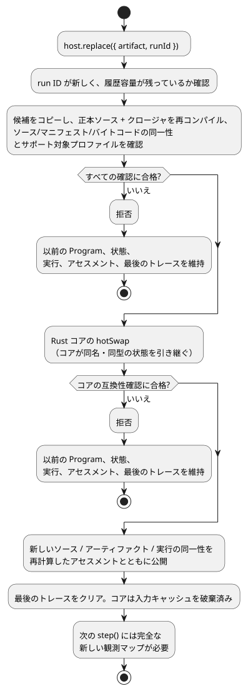

<!-- translation-source: docs/PROGRAM-REPLACEMENT-HOST.md -->
[英語の原文](PROGRAM-REPLACEMENT-HOST.md)

# リファレンス Program 置換ホスト

`ProgramReplacementHost` は、コンパイル済みの GhostFlow Program を1つ実行し、それを検証済みの新しい Program に置き換えることができます。置換が確定するのは、**完了した tick と tick の間**だけです（tick は Program の1回の評価ステップです）。

- 評価と状態の引き継ぎには、既存の Rust コアを使います。
- これはリファレンスアダプタにすぎません。インストール、ドライバ呼び出し、出力のレンダリング、物理的な検証は一切行いません。

## 例を実行する

`target/wasm32-unknown-unknown/release/ghostflow_wasm.wasm` に WASM アーティファクトをビルドしてから、リポジトリのルートで次を実行します。

```sh
node examples/program-replacement-host.mjs
```

この例が行うこと：

1. 完全な `.ghost.md` ドキュメントを2つコンパイルします。
2. 架空の Integration v1 ボードプロファイルと設備を与えます。
3. 入力観測を1回実行します。
4. Program を置き換えます。
5. 新しい観測を実行します。

出力には、異なるソース、アーティファクト、実行（run）の同一性が表示されます。置換後の最初のトレースには、以前の `held` 状態と、新しい状態の既定値が表示されます。仮想プロファイルと呼び出し側が与えた観測は、デバイスの証拠では**ありません**。

## API とトランザクション

**アセスメント。** スナップショット、受理されたステップ、成功した置換は、[メタデータのみによる設置の受け入れ](../contracts/integration-v1/README.ja.md)から得た、所有権付きの `assessment` を公開します。

- `{valid, errors}` のメタデータ検証を、物理的なゲートから分離します。
- リリースと、正確なソース・モジュール・マニフェストのダイジェストを固定します。
- 物理的なステータスは `unknown` です。宣言された Bool 出力の方向、型、極性、`safeLevel` は、電気的な振る舞い、フェイルセーフとしての適合性、負荷、配線を検証するものではありません。
- メタデータが有効である間、ホストの実行は継続します。
- 成功した置換は、再計算したアセスメントを新しい Program の同一性とともに公開します。
- 拒否された候補は、現在のアセスメントと最後のトレースをそのまま残します。
- 返されるアセスメントは、ホストの状態から切り離されています。

```js
const host = await ProgramReplacementHost.instantiate(wasmBytes, artifact, {
  runId, release, boardProfile, installation, historyCapacity: 128,
});
const result = host.step({ observations: {
  enabled: { ok: true, value: true, source: 'virtual-input', observationId: 'sample-1' },
} });
const boundary = host.replace({ artifact: candidate, runId: 'next-run' });
host.dispose();
```

**アーティファクトの読み込み。** `artifact` は、`sourceDocument`、`manifest`、`bytes` を含むコンパイラの結果です。読み込む前に、ホストは次のことを行います。

1. アーティファクトをコピーします。
2. 正確な正本ソースと、与えられたクロージャを再コンパイルします。
3. ソース、マニフェスト、バイトコードの同一性を確認します。
4. 固定された Integration v1 のリリース、プロファイル、設備の各レコードと、必要な各論理センサバインディングを検証します。

インストールされたケイパビリティの集合は、ホストの存続期間中は固定されたままです。Integration としての有効性は、構造的な一貫性だけを意味します。ボードの配線や物理的な結果を認証するものではありません。

**各ステップ。** すべての `step` 呼び出しは、完全な観測マップを与えます。

- 各論理 Bool 入力には、呼び出し側が宣言した `source` と `observationId` を持つ Result があります。
- 故障（fault）は `{ok:false,fault:'Disconnected'|'Stale'|'Invalid'|'NotReady',source,observationId}` を使います。
- ホストはこれらの宣言を、受理されたコアのトレースの隣に保持します。それらを独立に検証されたセンサ観測へと格上げすることはありません。
- 形式が不正なマップは、入力がステージングされる前に拒否されます。
- 返されるトレースと同一性は、同じ受理済み tick に属します。
- 返されるオブジェクトとスナップショットは、ホストの状態から切り離されています。

**置換。** `replace` は、Rust の `hotSwap` を呼び出す前に、候補を検証してその所有権を取得します。次の図はこのトランザクションを示しています。



- 検証またはコアの互換性確認に失敗した場合、以前の Program、状態、実行、最後に受理されたトレースが有効なまま残ります。
- 成功した置換は、新しいソース/アーティファクト/実行の同一性を公開し、最後のトレースをクリアします。
- コアは入力キャッシュを破棄するため、次の tick には完全な新しい観測マップが必要です。
- 状態を引き継ぐのはコアだけで、対象は同じ名前と型を持つ状態に限られます。このホストは JavaScript で状態をコピーしません。
- 実行 ID は再利用できません。
- 設定された有限の履歴容量がいっぱいになると、それ以降の置換は拒否されます。ホストは、空きを作るために使用済みの ID を忘れることはしません。

## サポートされるプロファイルと制限

**「新しい」観測。** 置換後、呼び出し側は新しいスキーマのすべての観測を与え直さなければなりません。ホストが古い入力キャッシュを引き継ぐことはありません。これは、デバイスから新たにサンプリングした値や新しい観測 ID を必要とするという意味では*ありません*。同じサンプルが tick をまたいで最新のままであってもかまいません。サンプルの経過時間と真正性は、別途それぞれが所有する観測契約で扱われます。

**サポートされる Program。** リファレンスホストは、Bool の論理入力と論理出力を持つ `GhostFlow/control-v1` と `control-v4` を受け付けます。Int の制御状態も含みます。

**拒否される機能。** 稼働中の Program を変更する前に、次のものを拒否します。

- 合成（composition）
- 設定
- タイマー、信号、スケジュール
- センサのコンディショニングとオプションのセンサ
- リソース/目標のポリシー
- 出力観測レール
- ライフサイクル/コンテキストのプロファイル

**範囲外。** 完全なフレーム方式の `ControlRuntime` は、ホストが所有するセンサとコンテキストの状態を追加で持ち、フレーム方式の hot-swap ABI はありません。それらを移行するには、別のトランザクション設計が必要です。デバイス/ドライバのインストール、出力の適用、フィードバック、物理的な受け入れは、それぞれ独立して所有されたままです。

関連ケース：[REF-06-020](https://github.com/callin2/ghostflow-language/issues/305)、[REF-06-022](https://github.com/callin2/ghostflow-language/issues/307)。
