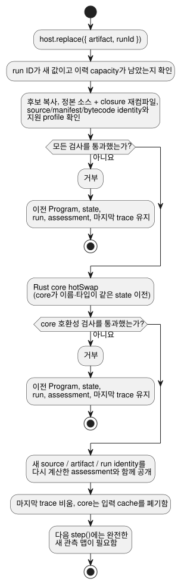

<!-- translation-source: docs/PROGRAM-REPLACEMENT-HOST.md -->
[영문 원문](PROGRAM-REPLACEMENT-HOST.md)

# 참조 Program 교체 호스트

`ProgramReplacementHost`는 컴파일된 GhostFlow Program 하나를 실행하고, 그 Program을 검증된
새 Program으로 교체할 수 있습니다. 교체는 **완료된 tick 사이에서만** 확정됩니다(tick은
Program의 평가 한 단계입니다).

- 평가와 상태 이전에는 기존 Rust core를 사용합니다.
- 이것은 참조용 어댑터일 뿐입니다. 설치, 드라이버 호출, 출력 렌더링, 물리 검증을 전혀
  수행하지 않습니다.

## 예제 실행

WASM 산출물을 `target/wasm32-unknown-unknown/release/ghostflow_wasm.wasm`에 빌드한 다음,
저장소 루트에서 다음을 실행합니다.

```sh
node examples/program-replacement-host.mjs
```

예제가 하는 일은 다음과 같습니다.

1. 완전한 `.ghost.md` 문서 두 개를 컴파일합니다.
2. 가상의 Integration v1 보드 프로필과 설치 정보를 제공합니다.
3. 입력 관측 하나로 실행합니다.
4. Program을 교체합니다.
5. 새 관측으로 실행합니다.

출력에는 서로 다른 source, artifact, run identity가 나타납니다. 교체 후 첫 trace에는 이전
`held` 상태와 새 상태의 기본값이 보입니다. 가상 프로필과 호출자가 제공한 관측은 장치 증거가
**아닙니다**.

## API와 트랜잭션

**평가(assessment).** snapshot, 수락된 step, 성공한 교체는
[선언 정보만으로 판단하는 설치 admission](../contracts/integration-v1/README.ko.md)에서 나온
소유 `assessment`를 노출합니다.

- `{valid, errors}` 메타데이터 검증과 물리 게이트를 구분합니다.
- release와 정확한 source, module, manifest 다이제스트를 고정합니다.
- 물리 상태는 `unknown`입니다. 선언된 Bool 출력의 방향, 타입, 극성, `safeLevel`은 전기적
  동작, 페일세이프 적합성, 부하, 배선을 검증하지 않습니다.
- 메타데이터가 유효한 동안 호스트 실행은 계속됩니다.
- 성공한 교체는 다시 계산한 평가를 새 Program identity와 함께 공개합니다.
- 거부된 후보는 현재 평가와 마지막 trace를 그대로 둡니다.
- 반환된 평가는 호스트 상태와 분리되어 있습니다.

```js
const host = await ProgramReplacementHost.instantiate(wasmBytes, artifact, {
  runId, release, boardProfile, installation, historyCapacity: 128,
});
const result = host.step({ observations: {
  enabled: { ok: true, value: true, source: 'virtual-input', observationId: 'sample-1' },
} });
const boundary = host.replace({ artifact: candidate, runId: 'next-run' });
host.dispose();
```

**artifact 불러오기.** `artifact`는 `sourceDocument`, `manifest`, `bytes`를 담은 컴파일러
결과입니다. 불러오기 전에 호스트는 다음을 수행합니다.

1. artifact를 복사합니다.
2. 정확한 정본 소스와 제공된 closure를 다시 컴파일합니다.
3. source, manifest, bytecode identity를 검사합니다.
4. 고정된 Integration v1 release, 프로필, 설치 기록과 필수 논리 센서 바인딩 각각을
   검증합니다.

설치된 capability 집합은 호스트 수명 동안 고정됩니다. Integration 유효성은 구조적 일관성만을
뜻합니다. 보드 배선이나 물리적 결과를 인증하지 않습니다.

**각 step.** 모든 `step` 호출은 완전한 관측 맵을 제공합니다.

- 각 논리 Bool 입력은 호출자가 선언한 `source`와 `observationId`를 가진 Result를 가집니다.
- 고장은 `{ok:false,fault:'Disconnected'|'Stale'|'Invalid'|'NotReady',source,observationId}`를
  사용합니다.
- 호스트는 이 선언을 수락된 core trace 옆에 보관합니다. 독립적으로 검증된 센서 관측으로
  승격하지는 않습니다.
- 형식이 잘못된 맵은 어떤 입력도 준비(stage)하기 전에 거부됩니다.
- 반환된 trace와 identity는 같은 수락된 tick에 속합니다.
- 반환된 객체와 snapshot은 호스트 상태와 분리되어 있습니다.

**교체.** `replace`는 Rust `hotSwap`을 호출하기 전에 후보를 검증하고 소유권을 가져옵니다.
아래 다이어그램은 이 트랜잭션을 보여 줍니다.



- 검증이나 core 호환성 검사가 실패하면 이전 Program, 상태, run, 마지막으로 수락된 trace가
  계속 활성 상태로 남습니다.
- 교체에 성공하면 새 source/artifact/run identity를 공개하고 마지막 trace를 비웁니다.
- core가 입력 cache를 폐기하므로 다음 tick에는 완전한 새 관측 맵이 필요합니다.
- 상태 이전은 core만 수행하며, 이름과 타입이 같은 상태에만 적용됩니다. 이 호스트는
  JavaScript에서 상태를 복사하지 않습니다.
- run ID는 재사용할 수 없습니다.
- 설정된 유한 이력 capacity가 가득 차면 이후 교체는 거부됩니다. 호스트는 공간을 만들기 위해
  사용한 ID를 잊지 않습니다.

## 지원 프로필과 한계

**"새" 관측.** 교체 후 호출자는 새 schema에 맞는 모든 관측을 다시 제공해야 합니다. 호스트는
이전 입력 cache를 절대 물려받지 않습니다. 이것은 장치에서 새로 채취한 값이나 새 observation
ID를 요구한다는 뜻이 *아닙니다*. 같은 샘플이 여러 tick에 걸쳐 최신 상태로 남을 수 있습니다.
샘플의 나이와 진위는 별도로 소유되는 관측 계약에서 다룹니다.

**지원하는 Program.** 참조 호스트는 Bool 논리 입력과 출력을 가진 `GhostFlow/control-v1`과
`control-v4`를 받아들이며, Int 제어 상태도 포함할 수 있습니다.

**거부되는 기능.** 실행 중인 Program을 바꾸기 전에 다음을 거부합니다.

- 조합(composition)
- 설정
- 타이머, 신호, 예약
- 센서 conditioning과 선택적 센서
- resource/objective 정책
- 출력 관측 rail
- lifecycle/context 프로필

**범위 밖.** 전체 framed `ControlRuntime`에는 호스트가 소유하는 센서 및 context 상태가 추가로
있고, framed hot-swap ABI는 없습니다. 이를 이전하려면 별도의 트랜잭션 설계가 필요합니다.
Device/드라이버 설치, 출력 적용, 피드백, 물리적 인수는 계속 독립적으로 소유됩니다.

관련 사례: [REF-06-020](https://github.com/callin2/ghostflow-language/issues/305), [REF-06-022](https://github.com/callin2/ghostflow-language/issues/307).
