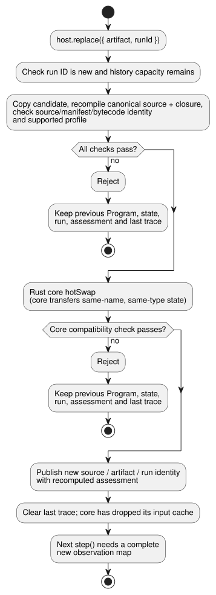

# Reference Program replacement host

`ProgramReplacementHost` runs one compiled GhostFlow Program and can replace it
with a validated new Program. A replacement is committed only **between
completed ticks** (a tick is one evaluation step of the Program).

- It uses the existing Rust core for evaluation and for state transfer.
- It is a reference adapter only. It performs no installation, no driver calls,
  no output rendering and no physical verification.

## Run the example

Build the WASM artifact at `target/wasm32-unknown-unknown/release/ghostflow_wasm.wasm`,
then run this from the repository root:

```sh
node examples/program-replacement-host.mjs
```

What the example does:

1. Compiles two complete `.ghost.md` documents.
2. Supplies a fictional Integration v1 board profile and installation.
3. Executes one input observation.
4. Replaces the Program.
5. Executes a fresh observation.

The output shows different source, artifact and run identities. The
replacement's first trace shows the prior `held` state and the new state's
default value. The virtual profile and the caller-supplied observations are
**not** device evidence.

## API and transaction

**Assessment.** Snapshots, accepted steps and successful replacements expose an
owned `assessment` from
[metadata-only installation admission](../contracts/integration-v1/README.md).

- It separates `{valid, errors}` metadata validation from the physical gate.
- It pins the release plus the exact source, module and manifest digests.
- The physical status is `unknown`. Declared Bool output direction, type,
  polarity and `safeLevel` do not verify electrical behavior, fail-safe
  suitability, loads or wiring.
- Host execution continues while the metadata is valid.
- A successful replacement publishes its recomputed assessment with the new
  Program identity.
- A rejected candidate leaves the current assessment and the last trace intact.
- Returned assessments are detached from host state.

```js
const host = await ProgramReplacementHost.instantiate(wasmBytes, artifact, {
  runId, release, boardProfile, installation, historyCapacity: 128,
});
const result = host.step({ observations: {
  enabled: { ok: true, value: true, source: 'virtual-input', observationId: 'sample-1' },
} });
const boundary = host.replace({ artifact: candidate, runId: 'next-run' });
host.dispose();
```

**Loading an artifact.** `artifact` is the compiler result containing
`sourceDocument`, `manifest` and `bytes`. Before loading, the host:

1. copies the artifact;
2. recompiles the exact canonical source and the supplied closure;
3. checks source, manifest and bytecode identity;
4. validates the pinned Integration v1 release, profile and installation
   records, and each required logical sensor binding.

The installed capability set stays fixed for the lifetime of the host.
Integration validity means structural consistency only. It does not
authenticate board wiring or a physical result.

**Each step.** Every `step` call supplies a complete observation map:

- Each logical Bool input has a Result with a caller-declared `source` and
  `observationId`.
- A fault uses `{ok:false,fault:'Disconnected'|'Stale'|'Invalid'|'NotReady',source,observationId}`.
- The host keeps these declarations next to the accepted core trace. It does
  not promote them to independently verified sensor observations.
- A malformed map is rejected before any input is staged.
- The returned trace and identity belong to the same accepted tick.
- Returned objects and snapshots are detached from host state.

**Replacing.** `replace` validates and takes ownership of the candidate before
it calls the Rust `hotSwap`. The diagram below shows the transaction.



- If validation or the core compatibility check fails, the previous Program,
  state, run and last accepted trace stay active.
- A successful replacement publishes the new source/artifact/run identity and
  clears the last trace.
- The core discards its input cache, so the next tick requires a complete new
  observation map.
- Only the core transfers state, and only for state with the same name and
  type. This host does not copy state in JavaScript.
- A run ID may not be reused.
- When the configured finite history capacity is full, further replacements are
  rejected. The host does not forget a used ID to make room.

## Supported profile and limits

**"Fresh" observations.** After a replacement, the caller must resupply every
observation for the new schema; the host never inherits the old input cache.
This does *not* require a newly sampled device value or a new observation ID.
The same sample may remain current across ticks. Sample age and authenticity
are covered by their own, separately owned observation contracts.

**Supported Programs.** The reference host accepts `GhostFlow/control-v1` and
`control-v4` with Bool logical inputs and outputs, including Int control state.

**Rejected features.** Before it changes the live Program, it rejects:

- composition;
- settings;
- timers, signals and schedules;
- sensor conditioning and optional sensors;
- resource/objective policies;
- output observation rails;
- lifecycle/context profiles.

**Out of scope.** The full framed `ControlRuntime` has additional host-owned
sensor and context state and no framed hot-swap ABI. Migrating those requires a
separate transaction design. Device/driver installation, output application,
feedback and physical acceptance remain independently owned.

Related cases: [REF-06-020](https://github.com/callin2/ghostflow-language/issues/305), [REF-06-022](https://github.com/callin2/ghostflow-language/issues/307).
