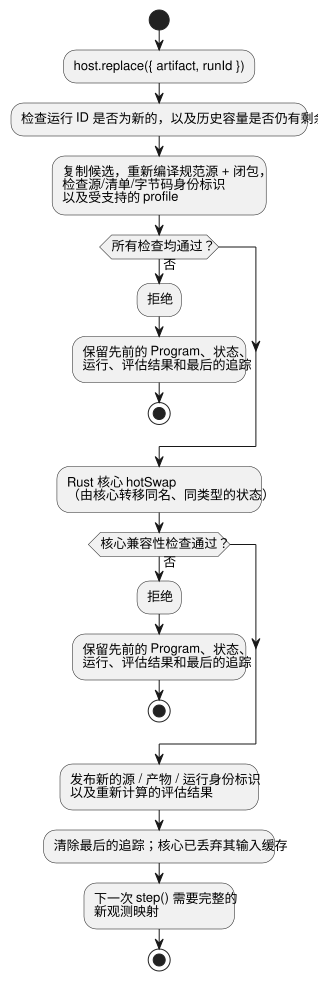

<!-- translation-source: docs/PROGRAM-REPLACEMENT-HOST.md -->
[英文原文](PROGRAM-REPLACEMENT-HOST.md)

# 参考 Program 替换宿主

`ProgramReplacementHost` 运行一个已编译的 GhostFlow Program，并可以用经过验证的新 Program 替换它。替换只在**已完成的 tick 之间**提交（tick 是 Program 的一个求值步骤）。

- 它使用现有的 Rust 核心进行求值和状态转移。
- 它只是一个参考适配器。它不执行安装，不调用驱动程序，不渲染输出，也不做物理验证。

## 运行示例

先在 `target/wasm32-unknown-unknown/release/ghostflow_wasm.wasm` 构建 WASM 产物，然后在仓库根目录下运行：

```sh
node examples/program-replacement-host.mjs
```

该示例执行以下操作：

1. 编译两个完整的 `.ghost.md` 文档。
2. 提供一个虚构的 Integration v1 板卡 profile 和安装。
3. 执行一次输入观测。
4. 替换 Program。
5. 执行一次新的观测。

输出显示不同的源、产物和运行身份标识。替换后的第一条追踪显示先前的 `held` 状态以及新状态的默认值。虚拟 profile 和调用者提供的观测**不是**设备证据。

## API 与事务

**评估结果。** 快照、被接受的步骤以及成功的替换会暴露一个自有的 `assessment`，它来自[仅元数据的安装准入](../contracts/integration-v1/README.zh.md)。

- 它将 `{valid, errors}` 元数据验证与物理关卡区分开。
- 它固定发布版本以及确切的源、模块和清单摘要。
- 物理状态为 `unknown`。声明的 Bool 输出方向、类型、极性和 `safeLevel` 并不能验证电气行为、故障安全适用性、负载或接线。
- 只要元数据有效，宿主就继续执行。
- 成功的替换会随新的 Program 身份标识一起发布重新计算的评估结果。
- 被拒绝的候选会保留当前的评估结果和最后的追踪不变。
- 返回的评估结果与宿主状态相分离。

```js
const host = await ProgramReplacementHost.instantiate(wasmBytes, artifact, {
  runId, release, boardProfile, installation, historyCapacity: 128,
});
const result = host.step({ observations: {
  enabled: { ok: true, value: true, source: 'virtual-input', observationId: 'sample-1' },
} });
const boundary = host.replace({ artifact: candidate, runId: 'next-run' });
host.dispose();
```

**加载产物。** `artifact` 是包含 `sourceDocument`、`manifest` 和 `bytes` 的编译器结果。在加载之前，宿主会：

1. 复制该产物；
2. 重新编译确切的规范源以及所提供的闭包；
3. 检查源、清单和字节码的身份标识；
4. 验证已固定的 Integration v1 发布版本、profile 和安装记录，以及每个必需的逻辑传感器绑定。

已安装的能力集合在宿主的整个生命周期内保持固定。Integration 有效性仅指结构上的一致性。它不认证板卡接线或物理结果。

**每个步骤。** 每次 `step` 调用都提供一个完整的观测映射：

- 每个逻辑 Bool 输入都有一个 Result，带有调用者声明的 `source` 和 `observationId`。
- 故障使用 `{ok:false,fault:'Disconnected'|'Stale'|'Invalid'|'NotReady',source,observationId}`。
- 宿主将这些声明保存在被接受的核心追踪旁边。它不会把它们提升为经过独立验证的传感器观测。
- 格式错误的映射会在任何输入被暂存之前被拒绝。
- 返回的追踪和身份标识属于同一个被接受的 tick。
- 返回的对象和快照与宿主状态相分离。

**替换。** `replace` 在调用 Rust `hotSwap` 之前验证候选并取得其所有权。下图展示了该事务。



- 如果验证或核心兼容性检查失败，先前的 Program、状态、运行和最后被接受的追踪仍保持有效。
- 成功的替换会发布新的源/产物/运行身份标识，并清除最后的追踪。
- 核心会丢弃其输入缓存，因此下一个 tick 需要一个完整的新观测映射。
- 只有核心会转移状态，并且只转移名称和类型都相同的状态。本宿主不会在 JavaScript 中复制状态。
- 运行 ID 不得重复使用。
- 当配置的有限历史容量已满时，后续的替换会被拒绝。宿主不会为腾出空间而遗忘已使用的 ID。

## 支持的 profile 与限制

**“新的”观测。** 替换之后，调用者必须为新的 schema 重新提供每一个观测；宿主绝不会继承旧的输入缓存。这*并不*要求重新采样设备值或使用新的观测 ID。同一个样本可以在多个 tick 之间保持为当前值。样本的时效和真实性由各自独立拥有的观测契约负责。

**支持的 Program。** 参考宿主接受带有 Bool 逻辑输入和输出（包括 Int 控制状态）的 `GhostFlow/control-v1` 和 `control-v4`。

**被拒绝的功能。** 在更改正在运行的 Program 之前，它会拒绝：

- 组合；
- 设置；
- 定时器、信号和调度计划；
- 传感器调理和可选传感器；
- 资源/objective 策略；
- 输出观测通道（rail）；
- 生命周期/上下文 profile。

**范围之外。** 完整的带帧 `ControlRuntime` 还有额外的、由宿主拥有的传感器和上下文状态，并且没有带帧的 hot-swap ABI。迁移这些需要单独的事务设计。Device/驱动程序安装、输出应用、反馈以及物理验收仍由各自独立负责。

相关案例：[REF-06-020](https://github.com/callin2/ghostflow-language/issues/305)、[REF-06-022](https://github.com/callin2/ghostflow-language/issues/307)。
