# Programming in GhostFlow

**Note on the 2026-10-05 external-input revision.** Declarations that carry quality information now use `input`. Existing conditioning and explicit `Result` fault branches stay as policies written in the source. The earlier `sensor` excerpts are kept under `tests/fixtures/history/issue531/`. An imported source revision needs its own, separately verified source closure.

Examples that used to read plain observations now declare `observed_*` producer channels and handle their `Result` explicitly. Some related rules apply throughout the book:

- `remembered_*` and `displayed_*` states initialize memory inside the source. Their initial values do not claim that the producer supplied a healthy `false` or zero.
- An unknown observation keeps the memory that is already established. It cannot authorize a new guarded transition.
- A current healthy STOP, or a permission that has been removed, takes precedence. An existing maximum run duration still expires.
- Acquisition quality does not claim that a physical button or piece of equipment has failed.

These are explicit, illustrative revisions. Retained healthy datasets keep their original logical field names; an explicit test adapter connects them.

Write device behavior as code, then understand it by running it

**Revised edition · English translation · based on the Language Reference**

## Before you begin

Suppose you want a lamp to turn on when you press a switch, water to run at a set time, or a pump to stop when the water runs low.

Each task is simple on its own. But as conditions pile up and several devices work together, it gets hard to see what turns on, when, and why it stops.

GhostFlow is a language for writing these conditions and actions as code. A GhostFlow program describes how its state changes in response to sensor values or user actions, and which actions it requests from devices.

This book does not ask you to memorize the grammar before you write a program. Instead, you will repeat three steps:

1. Predict the result.
2. Change one thing.
3. Find the tick where the result changes.

A **tick** is one evaluation of the control program; [Chapter 1](#ch01) explains it in detail. We begin with a single switch, but we quickly reach questions that come up in real installations:

- When START and STOP arrive together, which one wins?
- When a sensor chatters or its value becomes stale, what can you still trust?
- Does ON on a screen mean that the device physically turned on?

Keeping the evidence matters more than getting the answer right. For each example, write down the inputs and the previous state. Then predict the next state and the requested and safe intent. **Requested intent** is the output the program asks for. **Safe intent** is that output after the safety conditions have been applied. Finally, compare your prediction with the run. When your prediction differs from the run, that difference is the concept worth learning.

The diagram below shows what one tick reads and produces, and therefore what to write down before each run.

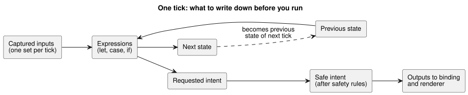

The next state of one tick becomes the previous state of the following tick. Programs without `state` (such as E01) simply have no previous state to read.

For exact syntax and behavior rules, see the [Language Reference](LANGUAGE-REFERENCE.en.md). This guide teaches through examples; the Reference defines the language. If the two disagree, follow the Reference. When the syntax changes, the Reference is updated first, and then this guide's examples are aligned with it.

For questions that come up while you write code, also see the [GhostFlow Coding FAQ](language_faq.en.md).

### Before reading the examples

An example in this guide does not mean that its feature is ready to run on a physical board today.

Three things each need their own verification: that the code compiles, that the execution environment supports the feature, and that a real device behaves as intended. This guide explains how to write and read code under the current specification. It does not claim that every feature is implemented or ready for board deployment.

This edition makes exactly these claims, and no more:

- whether the source follows the current Language Reference;
- what the current compiler and logical execution paths check;
- which exercises the public reader can open.

It does not claim physical verification on any particular board, wiring harness, sensor, or actuator. Implementation scope and evidence are always defined by the current checkout's [Implementation](IMPLEMENTATION.md) document, [feature maturity and executable evidence](REFERENCE-FEATURE-STATUS.md), and the tests.

The examples fall into these categories in the public reader catalog:

| Examples | Where they are checked |
|---|---|
| E01–E33 except E11, PC-01–PC-10, tutorial/03–04 | Run in the reader once the browser capabilities they need are admitted. |
| E11 | Not an executable control; it explains canonical notation. |
| E34–E37 | Compile, but the current browser cabinet cannot admit `Int`, `DateTime`, and the new natural-event host facts, so they are checked in a separate host profile. |
| `station-rules` | A policy grammar that runs on a separate host. |
| E90–E102 | Check the expected diagnostics, not successful execution. |

These categories tell you **where you can see which evidence**. They do not rank the features by value.

### How to read the examples

**Run each example on its own.** Every `ghost` example is an independent program. Do not join all of the book's examples into one file and run them together.

**The explanations are part of the program document.** A real program is written as a `.ghost.md` document. If one program's code is split across several top-level `ghost` blocks, read those blocks from top to bottom as one control program. The paragraphs between the blocks, including the reasons why the program should behave a certain way, stay in the source document too.

**Keep code outputs separate from device behavior.** In this book, an *output* is a value the program calculates to request an action from a device. Producing a value that says "turn the pump on" does not turn on a real pump by itself. Two more pieces are needed: a **binding**, which connects the value to a GPIO pin or relay, and an **output renderer**, which applies it to the hardware. Reading values from sensors is the job of an **input driver**.

For exact notation, see the [Reference declaration and notation index](reference/07-semantic-rules-and-index.en.md#75-declaration-and-notation-index). The [design philosophy](LANGUAGE-REFERENCE.en.md#design-philosophy) explains why the language is designed this way. [Reference Chapter 8](reference/08-language-runtime-and-device-boundaries.en.md#83-complete-faq-responsibility-table) describes what the language, the execution environment, and the device are each responsible for.

### How are the examples checked?

The [example execution check](../tests/programming-book-simulation.test.mjs) compiles the original examples and runs them with specified inputs and test times. It then checks how the state changed, which output was requested (requested intent), and which output remains after the safety conditions (safe intent).

Examples need different inputs and execution environments, so their checks vary:

- Controls from E01–E33 except E11 are checked in the execution profile that the public reader selects.
- E02 and E08 receive configuration results (`Result`) and context facts. E09 receives civil schedule facts, that is, schedule information based on the calendar and clock time.
- E10, E14, and tutorial/03 receive sensor samples and the capabilities they need.
- PC-01–PC-10 and tutorial/03–04 also run in the browser when the capabilities they need are admitted.
- E34–E37 and `station-rules` use the separate host profiles described above.

General input and state examples check the logical results of the shared Rust core. The browser reader shows the same meaning through a WASM path. Both paths observe inputs, state, requested/safe intent, and diagnostics. Neither path establishes a physical device effect.

tutorial/04 checks schedule events and sequential outputs in the existing `ControlRuntime`/`DailySlots` WASM host. station-rules compiles a policy with `ghostrules`, binds it, and then checks output authorization and `Stop` in WASM `GhostFlowStation`. These two advanced examples are checked separately from the `ghostsim` CLI path.

E11 explains notation. E90–E102 deliberately contain invalid code and check that the compiler reports the expected errors. Diagrams and explanations of program composition are not executed. Source-mutation experiments are checked separately from the originals.

To run the example check yourself, you need the Node dependencies and native/WASM artifacts built from the same revision. Then run `node --test tests/programming-book-simulation.test.mjs`. See [Verification](VERIFICATION.md) for the full build and verification sequence.

The compiler check in `tests/docs-runnable-examples.test.mjs` runs without building the runtime.

Chapter 14 contains E16–E22, which cover temperature and climate sensors. Chapter 15 and the advanced examples E23–E37 go deeper into physical quantities, observation, exact counts, and natural time. The evidence for control calculations and import packages is split across `tests/programming-book-simulation.test.mjs`, `tests/programming-climate.test.mjs`, and `tests/programming-book-import-package.test.mjs`.

All of these steps check program logic and calculations. Whether real sensors and devices behave as intended must be verified separately.

## Contents

### From PLC to GhostFlow — start with practice

This ten-stage practice path starts with buttons and lamps. It then covers START/STOP, motors, interlocks, limits, timers, water levels, Manual/Auto operation, sequential control, and fault recovery.

At each stage, first think about how the device should behave. Then see how to express that behavior in GhostFlow code.

### Browse by topic

1. [One switch and one output](#ch01)
2. [Names, values, types, and expressions](#ch02) · [Quantity-to-type lookup](#quantity-type-lookup)
3. [What it means to remember state](#ch03)
4. [Output intent and final outputs](#ch04)
5. [Separating calculations with functions](#ch05)
6. [Control that waits for time](#ch06)
7. [Starting at scheduled times](#ch07)
8. [Sensor values and quality](#ch08)
9. [Reading expressions precisely](#ch09)
10. [Stopping, changing, and comparing](#ch10)
11. [Files and literate programs](#ch11)
12. [One device, multiple controls](#ch12)
13. [Built-in functions and operations](#ch13)
14. [Temperature units and air-VPD control](#ch14)
15. [Named physical quantities and units](#ch15)

Appendices: [A. Specification guide](#appendix-a) · [B. Learning through errors](#appendix-b) · [C. Document maintenance rules](#appendix-c) · [D. Examples by audience](#appendix-d)


<a id="ch01"></a>
## 1. One switch and one output

When you first learn device control, you may wonder why you need a language at all if an input is simply wired to an output. That simplicity is the starting point.

Before running E01, write down the lamp value for three ticks in which the switch goes `false → true → false`. If the result matches your prediction, the next question is not about the value but about **which boundary the value came from**. Once you can separate the physical contact, the normalized input, the logical output, and the real relay, you can read every more complicated program in this book the same way.

### E01 — Connecting an input to an output

The first program turns the LED on when the switch is on, and off when the switch is off.

```ghost
// E01
// Explicit quality-input revision: acquisition faults request lamp OFF.
control FollowSwitch {
  input switch_on: Bool;
  output lamp: Bool;

  lamp <- switch_on |> recover(false);
}
```

This revised example reads the external input as `Result<Bool, SensorFault>`. In other words, each tick the program receives either a healthy value or a fault:

- A healthy `false` or `true` behaves exactly as in the table below.
- A fault (NotReady, Disconnected, Stale, or Invalid) explicitly requests lamp OFF. `|> recover(false)` supplies that `false`.

Requesting OFF on a fault is the confirmed policy of this example. It is not a language default, and it is not evidence that the physical contact is OFF. The input fault and its provenance are still recorded. This switch-following example adds no START button and no running memory. The previous E01 source is preserved in the [prior-code record](historical/2026-10-05-input-531-book-excerpts.md).

`control FollowSwitch` gives this decision a name and a boundary. Values that come in from outside the boundary are `input`s; values that the calculation sends out are `output`s. No hidden wiring or device choice sits between them.

Read `lamp <- switch_on |> recover(false)` in the direction of the arrow: "this tick's lamp request came from `switch_on`." Even with just two `Bool` values, you can explain where an output came from. That is the first small result of this chapter.

| Input `switch_on` | Output `lamp` |
|---|---|
| `false` | `false` |
| `true` | `true` |

The table shows the two possible moments. Release → press → release is not a third value. It is a **transition scenario** that moves between the two rows over time. Keeping the table and the scenario apart stops you from mixing up "what is the value now?" with "how did we get here?"

The timeline below plays such a scenario tick by tick, and adds one tick where the observation is a fault.

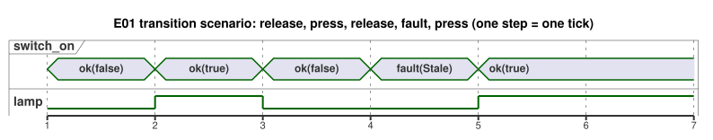

During the fault tick, the lamp is OFF because this example chooses `recover(false)`, not because the switch was released.

### Distinguishing contacts, PLC inputs, and GhostFlow inputs

In relay circuits, an NO (normally open) contact and an NC (normally closed) contact conduct differently at rest and when pressed. A PLC reads that electrical state through a digital input (DI). It then normalizes the state into a program meaning, taking the wiring and the polarity of the input module into account. GhostFlow's `switch_on` is already a normalized logical input. The boundaries in this example are therefore as follows.

| Layer | NO | NC | Value passed to GhostFlow |
|---|---|---|---|
| At rest | Contact discontinuous | Contact continuous | `switch_on = false` |
| Pressed | Contact continuous | Contact discontinuous | `switch_on = true` |

When an NC contact makes the raw signal look reversed, that is an input normalization issue. An NC contact does not, by itself, mean that you add `!` in the program. Specify the normalization at the wiring/input-module boundary, and pass GhostFlow a healthy observation whose Bool payload is `false` or `true`. Preserve the observation's quality and identity. A broken delivery path is a fault; never turn it into a healthy `false`.

In short:

- **Relays** create physical contact paths.
- **PLCs** process those inputs with DI and ladder logic or function blocks.
- **GhostFlow** connects normalized, meaningful inputs to declared output calculations.

The examples in this book explain logical calculations. Verifying the actual contacts, electrical wiring, PLC input modules, or device outputs belongs to the binding and renderer contracts.

The diagram below follows the E01 signal from the contact to the relay. Only the middle part is GhostFlow code.


### The unit for reading execution: tick

One control evaluation is called a **tick**. Every expression in a tick sees the same input set, captured once. Do not imagine the switch changing in the middle of a calculation so that different expressions read different physical moments. A new input set arrives when the next tick starts.

E01 has no memory, so the same input observation always produces the same output. Suppose a trace of healthy inputs shows a tick where `switch_on` and `lamp` first disagree. Then look at input normalization, the binding, or the Driver before you suspect this expression. Chapter 3 adds `state`. After that, the same current input can produce different results because the past was different.

The information that connects `switch_on` to DI1 and `lamp` to RO1 is a mapping outside the program. Names do not choose hardware ports automatically. That is why the same calculation can be connected to a virtual switch and LED, or to real device I/O.

### Try changing it

Change the connection to `lamp <- case switch_on { ok(value) => !value; fault(_) => false; };`. Before you run it, draw the new table on paper. Because `!` flips true and false, both output cells should change.

After checking the result, restore the original. This time, change only the input name. The behavior stays the same, but the way a reader interprets the program changes. This is your first exercise in telling a calculation change apart from an explanation change.

<a id="ch02"></a>
## 2. Names, values, types, and expressions

Many mistakes in the field happen not because the arithmetic is hard, but because one person reads `30` as 30 percent and another reads it as 30 seconds. In this chapter, names and types are tools that catch such misunderstandings early.

Before running E02, write down the expected rows for 29%, 30%, and 31%. Then change only `<` to `<=`. If exactly one boundary row changes, you can see how much a type and a small expression narrow down the decision.

### Notation separating statements

In the current syntax, declarations and expression definitions end with `;`. The compiler never guesses from a line break that a statement has ended, so you can split a long expression across several lines without changing its meaning. `{ }` creates a scope; indentation only helps people see the structure. Appendix A lists the few positions, such as a function's final expression, where the semicolon is optional.

Names start with an English letter or an underscore, and may continue with letters, digits, or underscores. Names are case-sensitive, so `start` and `Start` are different names. Do not use reserved words or the internal `__gf_` prefix as names. Identifiers are currently ASCII only, so write explanations in other languages (for example, Korean) in `//` comments or in the literate prose.

### Basic values and types

| Type | Example | Meaning |
|---|---|---|
| `Bool` | `true`, `false` | True or false |
| `Int` | `120`, `-2` | Exact signed 32-bit integer |
| `Number` | `3`, `0.5`, `-2` | General numeric values, represented internally as f64 |
| `Percent` | `30%` | Percentage values. Literal/input range is 0–100 |
| `Duration` | `250ms`, `2s`, `5min`, `1h` | Nonnegative time length with millisecond resolution |

`Int`, `Number`, `Percent`, and `Duration` may look alike, but each answers a different question. You cannot compare a `Percent` directly with a `Number`. This rule stops 30% from quietly pretending to be a measurement whose value happens to be 30. Use `Int` for exact counts and repetitions, and `Number` for approximate values such as measurements. Exact ranges and conversions follow [Reference §2.1–2.3](reference/02-types-expressions-state.en.md#21-value-kinds).

When no numeric type is expected, a whole-number literal is an `Int`, and a literal with a decimal point or exponent is a `Number`. In a context that is already `Number`, `3` is read as a Number from the start.

A `Duration` literal is a nonnegative integer followed by the unit `ms`, `s`, `min`, or `h`. Write half a second as `500ms`. Detailed ranges and operations follow [Reference §3.1](reference/03-time-and-schedules.en.md#31-time-values-and-clock-domains).

`"Asia/Seoul"` is used in time-zone settings, and `06:00` is used in schedule settings. Do not confuse them with general string or time-value syntax.

### Exact counts and approximate measurements

Counted values, such as the number of fruits or repetitions, must be exact integers. For example, `120 + 1` must be exactly `121`. In contrast, a measured real value such as a temperature of `24.3` can be approximate, within the tolerance that the sensor and the domain define.

GhostFlow represents exact counts with the signed 32-bit `Int`. Out-of-range values and invalid conversions never wrap around or round silently. They produce diagnostics or explicit runtime faults instead. Use `Number` for measured real values. See [Reference §2.3](reference/02-types-expressions-state.en.md#23-exact-integer-design) for details.

Dates and times are written with the `date`, `time`, and `datetime` tagged literals. A DateTime requires a time-zone offset. Calendar date/time and monotonic elapsed time mean different things. Follow [Reference §3.1](reference/03-time-and-schedules.en.md#31-time-values-and-clock-domains).

Keep values whose units affect control decisions, such as temperature, flow, and voltage, separate from a general `Number`. For example, `25°C` for `Temperature`, `5L/min` for `FlowRate`, and `24V` for `Voltage` have fixed physical-quantity types and units. Allowed units, conversions, and operations follow [Reference §2.9](reference/02-types-expressions-state.en.md#29-physical-quantities-and-units). `Rate<Q>` is an expression-only type for temporal-window calculations; it is not a general input, output, or state type. [Chapter 15](#ch15) gives examples of mixing units and of operations between physical quantities.

<a id="quantity-type-lookup"></a>
### Find the type for your measurement

Even when you measure in Celsius, the type name is `Temperature`. Do not declare a type named `Celsius` or `Fahrenheit`. Put the unit on the value instead: declare `input air: Temperature;` and write a threshold as `30°C`. `30°C`, `86°F`, and `303.15K` represent the same absolute temperature. [Chapter 14](#ch14) continues with unit conversions and temperature control.

| Measurement | Declaration type | Example value | Input declaration |
| --- | --- | --- | --- |
| Absolute temperature | `Temperature` | `30°C` | `input air: Temperature;` |
| Temperature difference | `TemperatureDelta` | `5Δ°C` | `input rise: TemperatureDelta;` |
| Relative humidity | `RelativeHumidity` | `70%RH` | `input humidity: RelativeHumidity;` |
| Percentage, such as tank level | `Percent` | `70%` | `input level: Percent;` |
| Carbon dioxide concentration | `CO2Concentration` | `800ppm` | `input co2: CO2Concentration;` |
| Flow rate | `FlowRate` | `5L/min` | `input flow: FlowRate;` |
| Pressure | `Pressure` | `1.2kPa` | `input pressure: Pressure;` |
| Vapor pressure deficit | `VaporPressureDeficit` | `1.2kPaVPD` | `input vpd: VaporPressureDeficit;` |
| Photosynthetic photon flux density | `PPFD` | `500umol/m2/s` | `input light: PPFD;` |
| Voltage | `Voltage` | `24V` | `input supply: Voltage;` |
| Elapsed time | `Duration` | `5s` | `input delay: Duration;` |

Watch for look-alike values: `70%RH` and `70%` have different types, and so do `1.2kPaVPD` and `1.2kPa`. Absolute temperature and temperature difference are also distinct types.

Inputs are read as quality-bearing `Result` values. Handle the healthy and fault branches explicitly before you extract or compare the value. This table does not choose a fault fallback or a control policy for you. The complete unit and operation rules follow [Reference §2.9](reference/02-types-expressions-state.en.md#29-physical-quantities-and-units).

### E02 — Naming inputs, settings, and calculations separately

Turn on the water-supply output when the water level is below the setting.

```ghost
// E02
control ThresholdControl {
  state displayed_pump: Bool = false;
  displayed_pump' = if level_good then low else displayed_pump;
  // Source-local display memory is initialized here; faults remain producer unknown.
  state remembered_level: Percent = 0%;
  let level_good = case observed_level { ok(_) => true; fault(_) => false; };
  let level = case observed_level { ok(value) => value; fault(_) => remembered_level; };
  remembered_level' = level;
  input observed_level: Percent;
  config threshold: Percent = 30%;
  let low = case threshold {
    ok(value) => level < value;
    fault(_) => false;
  };

  output pump: Bool;
  pump <- displayed_pump';
}
```

The program gives separate names to three kinds of values:

| Name | Kind | What it is |
|---|---|---|
| `observed_level` / `level` | Input observation | `observed_level` arrives every tick. `level` is its healthy value, or the last remembered value when the observation is a fault. |
| `threshold` | Setting | Exposed as `config` so that it can be adjusted. |
| `low` | Calculation | This tick's comparison of `level` with `threshold`. It is not stored state. |

Because the three have distinct names, a trace can answer separate questions: Did the water fall? Did the setting change? Did the comparison change?

A few more details:

- Changing the default value in the source creates a new document revision. During operation, a setting can be changed through typed atomic live events only if it is exposed with `access = operator`. The metadata contract follows [Reference §5](reference/05-settings-and-observation.en.md#51-config-declarations).
- Reading `config threshold: Percent` yields `Result<Percent, SettingsFault>`. Its initial value is `ok(30%)`. If a later observation is an error, the setting does not automatically recover to the default.
- On a `threshold` fault, this example chooses `low = false`. This is not a language-wide fallback, and it is not a physical fail-safe guarantee.
- On an `observed_level` fault, `level_good` is false, so `displayed_pump'` keeps its previous value and `pump` holds. This is how the example keeps established memory while the observation is unknown. `state` and the `'` (next-state) notation are explained in [Chapter 3](#ch03).
- `let` gives a calculation a name; it is not stored memory.

With a healthy level and a healthy threshold, the decision looks like this:

| `level` | Healthy `threshold` payload | `low` / `pump` |
|---|---|---|
| `29%` | `30%` | `true` |
| `30%` | `30%` | `false` |
| `31%` | `30%` | `false` |

If you move the definition of `low` below the output connection, the calculation stays the same. The compiler follows dependencies instead of overwriting values from top to bottom. So an edit that only moves code can stay separate from an edit that changes a decision. Two `let` definitions that each need the other's result first form a cycle. The compiler rejects such a cycle, because neither definition provides a starting point.

**Small experiment:** If `<` becomes `<=`, which single table row changes?

<a id="ch03"></a>
## 3. What it means to remember state

A pump that must keep running after the operator releases START cannot be
controlled from the current inputs alone. The program has to remember that START
was pressed. The opposite problem matters just as much: after STOP, a START button
that is still held down must not restart the pump at once. The exercises in this
chapter therefore ask two questions together:

- What must the program remember?
- After which events must it forget something?

In each table, cover the next-state column and predict it before you read it. The
optional PC route (PC-02 to PC-10) later grows this small memory into motors,
direction changes, water levels, mode transfer, sequences, and fault recovery.

### E03 — Stop-priority self-holding

Goal: the pump keeps running after a short press and release of START, and stops
when STOP is pressed. This pattern is called *self-holding* (a latch).

```ghost
// E03
// Explicit quality-input revision: protective faults stop; recovery needs healthy START release/repress.
control LatchingPump {
  input start, stop: Bool;
  state running: Bool = false;
  state restart_blocked: Bool = false;
  output valve, pump: Bool;

  let start_good = case start { ok(_) => true; fault(_) => false; };
  let stop_good = case stop { ok(_) => true; fault(_) => false; };
  let start_requested = start |> recover(false);
  let stop_requested = stop |> recover(true);
  let acquisition_fault = !start_good || !stop_good;
  restart_blocked' = if acquisition_fault then true
    else if !start_requested then false else restart_blocked;
  running' = !stop_requested && (running || (start_requested && !restart_blocked));
  valve <- running';
  pump <- running';

  require pump => valve;
}
```

This source is an explicit new revision for inputs that carry quality (`ok` or
`fault`). It keeps two behaviors of the healthy case: self-holding and stop
priority. It adds a policy for acquisition faults:

- A START fault prevents a new start (`recover(false)` treats START as released).
- An active run continues only while STOP is healthy and released.
- A STOP fault clears the running memory and requests pump/valve OFF
  (`recover(true)` treats STOP as pressed).
- A fault on either input sets `restart_blocked`. After a fault stop, holding
  START cannot restart the run. The program must first observe START released
  while both inputs are healthy; then a new press starts it.
- A healthy START that is already pressed at startup still starts immediately,
  as in the original healthy behavior.

This policy applies to the existing START circuit. It is not a rule to add START
buttons to lamps or automatic controllers. Applying the outputs to real equipment
needs separate renderer evidence. The previous E03 source is preserved in the
[prior-code record](historical/2026-10-05-input-531-book-excerpts.md).

The diagram below shows the same policy as states. Each arrow is one tick.

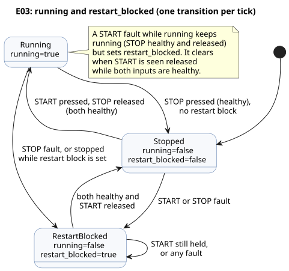

`running` is the value remembered at the start of the tick. `running'` is the
next value, calculated from the current inputs. Read the apostrophe as **prime**.
Two names keep two moments apart: "the running state before STOP was observed"
and "the state to commit after STOP has been handled."

Read the expression aloud: "Keep running if stop is not pressed and either start
is pressed or the system was already running." If that sentence is not what the
field requires, fix the requirement before you rearrange parentheses. When both
buttons are pressed, `!stop_requested` is false, so stop wins. That one
simultaneous-input row turns the phrase "stop priority" into observable behavior.

| tick | start | stop | Previous `running` | Next `running'` | pump |
|---|---|---|---|---|---|
| 1 | false | false | false | false | false |
| 2 | true | false | false | true | true |
| 3 | false | false | true | true | true |
| 4 | true | true | true | false | false |
| 5 | false | false | false | false | false |

The same table as a timing diagram. Note how `running` lags `running'` by exactly
one tick: the next value of one tick becomes the previous value of the next.

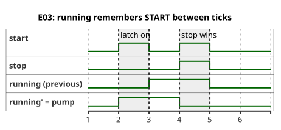

The output reads `running'`, so the pump turns on in the same tick that observes
START. Change one line to `pump <- running;` and the output reads the old state,
so it turns on one tick later. Run both versions with the same inputs and find the
first tick where they differ. The behavior changed because of **which point in
time the value belongs to**, not because of where the statement sits in the source.

### PC-02 — START / STOP waiting for a fresh start

PC-02 through PC-10 form an optional route of field problems. They are not a
required grammar sequence:

| Lessons | Topic |
|---|---|
| PC-02–03 | restart and motor permission |
| PC-04–05 | direction and position |
| PC-06–08 | time, levels, and mode |
| PC-09–10 | the whole sequence and recovery |

No lesson replaces an earlier one. Each keeps the earlier example and adds one
new burden.

E03's basic self-holding stays unchanged. PC-02 lives in a
[separate literate original](../examples/curriculum/pc-02-start-stop.ghost.md). It adds
`stop_ok`, `armed`, `running`, and `start_event` to express stop priority and
restart inhibition. When the circuit returns from STOP while START is still held,
that is not a fresh start event, so the outputs stay off. Release START and press
it again: then `running'` and the pump/valve outputs turn on. PC-02 does not
replace E03. Verify real contact and relay behavior under a separate installation
contract.

### PC-03 — Motor contactor commands and overload permission

PC-03's [canonical literate original](../examples/curriculum/pc-03-motor-contactor.ghost.md)
connects PC-02's fresh start event and self-holding to a motor control command.
`stop_ok` and `overload_ok` are normalized permission inputs. The electrical or
device adapter defines NC-contact wiring and polarity; this program reads only the
Bool meaning.

The key expressions are:

- `permit = stop_ok && overload_ok`
- `start_event = armed && start`
- `running' = permit && (start_event || running)`
- `armed' = permit && !start`
- `motor_contactor <- running'`

`motor_contactor` is one logical command for the MC (magnetic contactor) coil. It
is not feedback, and it does not prove that the MC main contacts closed, that the
motor has power, or that the motor turns. Read the two circuits separately:

- **Main circuit:** breaker, MC main contacts, overload relay, motor.
- **Control circuit:** control power, STOP, overload protection contact, the
  START/MC auxiliary-contact self-holding branch, MC coil.

Software commands do not replace independent electrical protection. Alarms, fault
latch/reset, timers, sensor feedback, and hardware operation are outside the scope
of this curriculum/learning scenario.

The example separates `requested` intent from `safe` results. Physical evidence
from relays, MCs, or motors is not part of the language's output intent.

### PC-04 — Forward/reverse direction-change interlock

Run PC-04 from its [canonical literate original](../examples/curriculum/pc-04-direction-interlock.ghost.md).
[E06 — Requesting both directions at once](#e06--requesting-both-directions-at-once)
stays as the basic example: `mutex` blocks both outputs when both become
candidates. PC-04 does more than copy that constraint. It defines logical forward
and reverse operating states, and a stopped wait between direction changes.

Inputs:

- `forward_start`, `reverse_start`: momentary start inputs.
- `stop_ok`, `overload_ok`: normalized permission inputs, true when healthy.

The states are `Stopped | Forward | Reverse | WaitForward | WaitReverse`, and the
program starts with `start_armed=false`. The rules:

- If both starts arrive together, stop. Do not invent a priority.
- A fresh opposite-direction press while running first moves to a Wait state,
  which turns off both contactor commands immediately.
- The opposite direction turns on only after the configured `reversal_wait = 2s`.
- If a fresh direction request changes the target during the wait, move to the
  matching Wait state and restart the wait. Never keep an old target and start
  against the operator's fresh request.

`forward_contactor` and `reverse_contactor` are only logical commands for the
contactor coils. `mutex` is a software backstop; real equipment also needs
electrical and mechanical interlocks. Two elapsed seconds do not prove the motor
has physically stopped. Express zero-speed feedback through separate inputs and
Driver contracts.

### PC-05 — Confirming valve end positions with limit feedback

Run PC-05 from its [canonical literate original](../examples/curriculum/pc-05-limit-feedback.ghost.md).
It keeps and references E06 and PC-04. It uses `Phase`, `elapsed(phase)`, next
state, and output connections to separate a command from the observation that the
motion finished.

Inputs:

- momentary requests `open_request`/`close_request`;
- end-position observations `open_limit`/`close_limit`;
- permissions `stop_ok`/`overload_ok`.

The program starts in `Stopped` and does not invent an initial position. If a limit
that was observed while stopped disappears, it does not trust the past state alone.
Both limits true at once lead to `SensorConflict`, with both outputs off. A fresh
opposite-direction request takes priority over the target limit: it switches off
both coil commands and resumes motion only at the two-second boundary.

When `Opening`/`Closing` never reaches its end position, timeout and fault
policies handle it. Commands and end-position observations are separate values.
Physically stopping the actuator belongs to the Driver and the safety chain.

### PC-06 — Reading ON-delay, OFF-delay, and maximum operation separately

PC-06's [canonical literate original](../examples/curriculum/pc-06-timer-patterns.ghost.md)
shows three timer meanings, each with its own state:

| Input | Behavior |
|---|---|
| `on_delay_request` | turns on after the demand has persisted for two seconds |
| `off_delay_request` | stays on for three more seconds after the demand disappears |
| `limited_request` | turns off at ten seconds and cannot restart until the demand is released |

These three inputs are maintained operating demands, not momentary button events.

Keeping the meanings out of one shared timer prevents OFF-delay from secretly
extending the maximum operating time. `stop_ok=false` bypasses even the OFF-delay
and turns all three outputs off immediately. Evaluate the moments just before, at,
and just after each boundary, as well as cancellation and re-request, with the same
logical tick rules. Do not confuse wall-clock speed with the meaning of logical
time.

### PC-07 — Remembering state between two water-level switches

PC-07's [canonical literate original](../examples/curriculum/pc-07-tank-hysteresis.ghost.md)
covers digital two-point water-level control. `low_level_reached` and
`high_level_reached` are normalized observations that the water has reached each
physical switch.

- Start `Filling` below the lower switch.
- Between the lower and upper switches, keep the current state.
- Stop at the upper switch.
- If the level starts in the middle, do not turn on: there was no earlier
  low-level event.

The upper switch true while the lower switch is false contradicts the physical
order, so the output is off in `SensorConflict`. The scan that clears the conflict
first returns to `Idle`; normal evaluation then resumes. Do not mix common
stop/protection or fault latch/reset into this water-level concept; PC-08 and
PC-10 combine them. [tutorial/03](../examples/tutorial/03-moisture.ghost.md)'s
continuous-sensor median/quality/hysteresis example stays as a separate lesson.

### PC-08 — Changing output ownership between manual and automatic

PC-08's [canonical literate original](../examples/curriculum/pc-08-manual-auto.ghost.md)
connects PC-03's manual start/self-holding and PC-07's automatic demand to one pump.

| `manual_mode_request` | `auto_mode_request` | Mode |
|---|---|---|
| false | false | `Off` |
| true | false | `Manual` |
| false | true | `Auto` |
| true | true | `ModeConflict` |

The pump command is always off on conflict, in `Off`, and on mode-change scans.

`manual_start` is a momentary start event; `auto_demand` is a maintained automatic
demand. The shared `request_armed` accepts a new true as a start event only after
it has first observed the selected demand false in a stable mode. So changing modes
while running, or recovering stop/overload permission, does not restart with a
demand that is already on. Losing the demand during Auto stops operation
immediately. [station-rules.ghost.md](../examples/station-rules.ghost.md) and
[tutorial/04](../examples/tutorial/04-extra-valves.ghost.md) stay as advanced
material on multiple controls and shared-resource arbitration.

This example handles mode conflicts through explicit state and output expressions.
Coil closure or pump rotation needs separate device confirmation.

### PC-09 — Turning on the pump after confirming opening

PC-09's [canonical literate original](../examples/curriculum/pc-09-sequential-water-supply.ghost.md)
defines the sequence `Idle → Opening → Settling → Watering → PumpStopping → Closing → Idle`.
It separates an enabled valve-opening output from the observation that the valve
has physically reached the open position.

- `open_limit` must stay confirmed for two seconds before the pump turns on.
- On the scan that ends five minutes of irrigation, the pump turns off first.
- The closing contactor turns on from the next logical scan. This guarantees the
  output order without inventing another delay.

All outputs turn off if the open-position feedback disappears, both limits turn on
together, or stop/overload permission disappears. The sequence does not restart
just because the cause has cleared. It must observe the closed position and a
released START, and then it requires a fresh START. Opening/closing no-response
timeouts, fault latch, alarm, reset, and fault-specific safe recovery belong to
PC-10.

tutorial/02's time-only sequence and tutorial/04's shared-pump arbitration across
controls stay as they are, because they teach different things. This example
treats logical commands, valve movement, pump rotation, and flow observations as
separate contracts.

### PC-10 — Capturing fault causes and recovering safely

PC-10's [canonical literate original](../examples/curriculum/pc-10-fault-alarm-reset.ghost.md)
adds fault causes, alarms, and reset to PC-09's sequential operation. The GhostFlow
blocks in that document are the sole executable original. The explanation below,
or any code extracted from it, does not become a separately editable original.
PC-01 to PC-09 keep their learning goals; this lesson adds only fault detection
and recovery.

Safety evaluation priority is `EmergencyStop > Overload > ValveDriveUnavailable >
SensorConflict > FeedbackLost > OpenTimeout/CloseTimeout > LowSourceWater`.
If several causes occur in one scan, the first in this order is latched as
`FaultCause`. Later live input changes do not overwrite it. On emergency stop, an
external hardwired safety chain must cut the energy. GhostFlow observation inputs
and alarms do not guarantee that physical cutoff or the actual equipment behavior.

Normal `STOP` is not a fault. When `stop_ok == false`, all motion outputs and the
alarm turn off immediately, the sequence returns to `Idle`, and it does not restart
automatically. A fault clears only through a RESET release/repress procedure:

1. The latched cause and all current fault conditions have cleared.
2. `known_closed` is confirmed.
3. RESET is released once and pressed again.

A remaining secondary live fault blocks RESET. RESET only returns to `Idle`; it does
not replace START. A released START must be observed, and then a fresh `START` is
required to run again.

`LowSourceWater` is the exception that performs an orderly close, and only with a
confirmed open valve and closing-drive permission. In `FaultPumpStopping`, the pump
turns off first for one logical scan; then `FaultClosing` requests valve closing.
Every other fault or safety condition becomes an immediate all-off fault. The
opening and closing timeouts are ten seconds each. At the exact boundary, an
observation of the target limit takes priority over the timeout.

This example does not confuse semantic DI (digital input meanings) with physical
wiring. The first cabinet's existing meanings — `START`, `STOP`, `MODE`, tank
upper/lower limits, open/close limits, and overload — use eight DI. Separating
`RESET`, E-stop observation, source-water-low, and valve-drive-ok gives 12 meanings
in total. An 8DI installation therefore needs a site-specific choice: external
safety-chain aggregation, authenticated host commands, or DI expansion. Never
combine or omit meanings silently.

Current `require` syntax expresses only Bool **output relationships**. Specify
input safety conditions and fault priorities in `phase` transitions and output
expressions. So do not read `require` alone as expressing the entire input safety
policy.

This example separates logical intent from feedback inputs. Language semantics
alone do not establish physical acceptance of the Web UI, MCU upload, contactor
energy cutoff, valve movement, or pump rotation.

### E04 — Multiple states change together

```ghost
// E04
control TwoStates {
  state a: Bool = true;
  state b: Bool = false;
  output out_a, out_b: Bool;

  a' = b;
  b' = a;
  out_a <- a';
  out_b <- b';
}
```

After the first tick, `a=false` and `b=true`. After the second, `a=true` and
`b=false` again. Both expressions read the same previous state, so the values swap.
Do not read this as top-to-bottom assignment that overwrites `a` first.

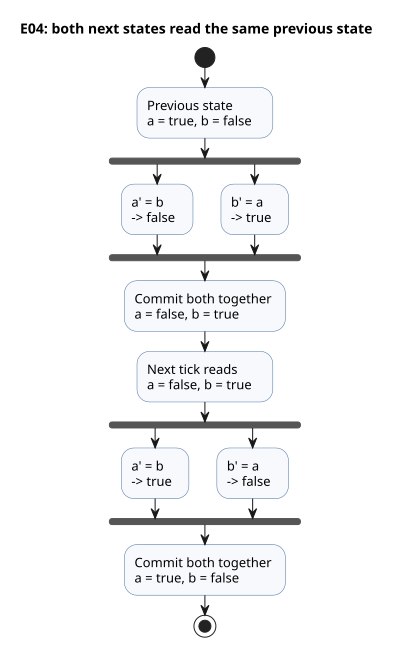

Currently, next-state references are allowed only in output expressions. Code
such as `b' = a';`, which uses another state's next value in a state transition,
is rejected. When several transitions need the same calculation, name it with
`let` and share it.

**Design reason:** Writing previous and next states explicitly preserves "the basis
for this evaluation" while all states update at once. This distinction is the basis
for timing comparisons and for the values displayed beside the source.

The user explained this choice in [#149](https://github.com/callin2/ghostflow-language/issues/149).
The influence from React/ObservableHQ is this: control is evaluated within an event
stream and returns an explicit next state. The user's educational premise was that
recursive or loop-shaped control may be hard for electricians to trace. E04 makes
the time boundary concrete: read the previous `a` and `b`, describe `a'` and `b'`,
then commit both. This is a readability goal, not a general judgment about
electricians. In code, use the ASCII apostrophe (`'`) shown in E04. The backtick
used in that conversation, and later assistant proposals, do not add syntax,
time-travel, or causal-explanation features. The execution rules are in
[Reference §2.8](reference/02-types-expressions-state.en.md#28-tick-and-state-snapshot).

A successful tick works in this order: it calculates candidate next states from
this tick's input snapshot and the previous state, then requested and safe intents,
and then atomically commits the state and intent records. A runtime fault in a
selected expression rejects the tick, with no partial updates. Output-constraint
blocking is different from such an evaluation failure: it does not cancel the
successful tick's state commit.

<a id="ch04"></a>
## 4. Output intent and final outputs

The screen says the pump is ON, but no water moves. One Boolean cannot explain
that. The code may have requested ON, a constraint may have blocked it, the
renderer may not have applied it, or feedback may not have confirmed it yet. In
E05, set `request=true` and `valve_ready=false`, then predict where requested and
safe intent diverge. Once you know these stages, "why did it not turn on?" stops
being guesswork and becomes a question about which evidence is missing.

This chapter uses four terms:

| Term | Meaning |
|---|---|
| **requested intent** | what the `<-` connections ask for |
| **safe intent** | requested intent after the output constraints; this chapter calls it the "final output" |
| **applied** | evidence that a renderer applied the command |
| **confirmed** | separate feedback evidence, such as a limit switch or encoder |

A true safe intent does not establish that a relay switched or a pump ran.
Concluding "the pump ran" from a safe=true trace skips boundaries that still need
checking. Read [Reference §4.7](reference/04-sensors-constraints-control.md#47-requested-safe-applied-confirmed)
together with the [physical Driver boundary](LLM-TOOLCHAIN-ARCHITECTURE.md#physical-driver-and-device-boundary).

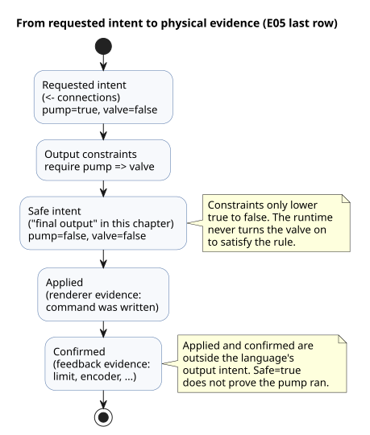

### E05 — Requests to turn on and permitted outputs

The calculation "please turn on the pump" may differ from the decision "the pump
may turn on." This time, make the two values differ on purpose.

```ghost
// E05
control PumpPermission {
  state displayed_pump: Bool = false;
  displayed_pump' = if request_good && !request then false else if request_good then request else displayed_pump;
  state displayed_valve: Bool = false;
  displayed_valve' = if valve_ready_good && !valve_ready then false else if valve_ready_good then valve_ready else displayed_valve;
  // Source-local display memory is initialized here; faults remain producer unknown.
  state remembered_request: Bool = false;
  let request_good = case observed_request { ok(_) => true; fault(_) => false; };
  let request = case observed_request { ok(value) => value; fault(_) => remembered_request; };
  remembered_request' = request;
  state remembered_valve_ready: Bool = false;
  let valve_ready_good = case observed_valve_ready { ok(_) => true; fault(_) => false; };
  let valve_ready = case observed_valve_ready { ok(value) => value; fault(_) => remembered_valve_ready; };
  remembered_valve_ready' = valve_ready;
  input observed_request: Bool;
  input observed_valve_ready: Bool;
  output pump, valve: Bool;

  pump <- displayed_pump';
  valve <- displayed_valve';
  require pump => valve;
}
```

Most of the lines before the `output` declaration read the quality-carrying inputs
`observed_request` and `observed_valve_ready`. With a healthy (`ok`) value, the
derived names `request` and `valve_ready` follow the input. With a `fault`, they
keep the last remembered value, and the displayed state holds its previous value.
The lesson itself is in the last three lines.

| request | valve_ready | Candidate pump / valve | Final pump / valve |
|---|---|---|---|
| false | false | false / false | false / false |
| true | true | true / true | true / true |
| true | false | true / false | false / false |

The last row is the reason for the example. The pump request from `<-` is true,
but `require` makes the pump's safe intent false. `pump => valve` says: if the pump
is requested, the valve must already be requested too. The runtime does not
secretly turn the valve on to satisfy the rule. The trace records which request was
abandoned, so the conservative result is easy to explain.

```text
request ─────────────→ pump intent ──┐
                                    ├─ require check ─→ final pump
valve_ready ─────────→ valve intent ─┘
```

Here `valve_ready` is only a name, derived from the input `observed_valve_ready`.
The input mapping explains which sensor or calculation supplies that input. A
complete explanation needs both "why the output is true" and "where the input came
from."

### E06 — Requesting both directions at once

```ghost
// E06
control DirectionInterlock {
  state displayed_forward: Bool = false;
  displayed_forward' = if forward_button_good && !forward_button then false else if forward_button_good then forward_button else displayed_forward;
  state displayed_reverse: Bool = false;
  displayed_reverse' = if reverse_button_good && !reverse_button then false else if reverse_button_good then reverse_button else displayed_reverse;
  // Source-local display memory is initialized here; faults remain producer unknown.
  state remembered_forward_button: Bool = false;
  let forward_button_good = case observed_forward_button { ok(_) => true; fault(_) => false; };
  let forward_button = case observed_forward_button { ok(value) => value; fault(_) => remembered_forward_button; };
  remembered_forward_button' = forward_button;
  state remembered_reverse_button: Bool = false;
  let reverse_button_good = case observed_reverse_button { ok(_) => true; fault(_) => false; };
  let reverse_button = case observed_reverse_button { ok(value) => value; fault(_) => remembered_reverse_button; };
  remembered_reverse_button' = reverse_button;
  input observed_forward_button: Bool;
  input observed_reverse_button: Bool;
  output forward, reverse: Bool;

  forward <- displayed_forward';
  reverse <- displayed_reverse';
  mutex(forward, reverse);
}
```

If both inputs are true, both outputs become false. Neither the output written
first nor the button pressed first gets priority automatically.
`require !(forward && reverse);` also blocks simultaneous requests for these
outputs.

When constraints are connected, the runtime applies them repeatedly, feeding back
each blocking result, until nothing changes. For example, if another constraint
turns a valve off, a pump that requires that valve also turns off. Current local
Bool constraints only lower true outputs to false. They are not a language feature
that automatically searches for a combination satisfying arbitrary logical
expressions.

Blocking an output through a constraint does not automatically revert `state`.
If the program should move to a stopped state, express that transition in the
program too.

**Small experiment:** Change E03 to `pump <- start;` and release Start.
Can you explain separately why `running` stays true and why `pump` turns off?

### Named local groups and the shared resource envelope

E05 and E06 constrain outputs of their own control. Putting the same rule in a
named local group, such as `constraints LocalRules { require pump => valve; }`,
keeps the same scope and the same Bool constraint meaning. Constraints define the
permitted region in which goals may move; all mandatory conditions combine with
AND. Priority or optional nonblocking analysis never releases a mandatory
condition.

For shared resources, continue with the
[complete bound execution example](../examples/bound-resource-execution.ghost.md).
Checking `constraints SharedRules for station` alone does not execute protected
outputs. The checked descriptor from `compileSourceSync` also needs an explicit
`compileBoundResourceControl` step that binds it to exact source/artifact
identities, stable IDs, and mode/output mappings. The resulting artifact checks
every supported automatic, manual, and fallback path through the same guard during
actual Rust/WASM scans. It is not a JavaScript filter that the host adds after
outputs are published.

In that example, a relation violated during execution leads to the authored safe
vector: pump OFF, valve ON. The rules for admission and recovery are:

- A violation before start denies new admission.
- A conflicting newcomer neither takes the incumbent's admission nor enters a
  hidden queue.
- Normal conditions alone do not clear a trip.
- Exclusive groups need a neutral observation followed by a fresh claim.
- Require-only groups need requested = authored safe, followed by a fresh request.
- Connected groups recover together in one scan.
- A successfully evaluated denial commits ordinary state; binding/VM errors roll
  back state, guard, and trace.

This is logical execution of one Bool GFB1 v1/v3 control with every output
explicitly mapped. The installation authority shares the writers' registry and
refuses a second active writer for the same stable ID. Separate installation
registries do not certify physical exclusion. Arbitrary PID, context, shared-policy
import composition, cooperative multi-VM arbitration, and physical safe sequencing
have separate boundaries. Do not replace E05/E06's existing results or replay
records with those of this new example.
[Reference §4.8](reference/04-sensors-constraints-control.en.md#48-common-constraints-notation-and-operations)
and [the constraint contract](CONSTRAINTS.en.md#shared-bool-execution) distinguish
source, binding, admission, and safe-output evidence.

<a id="ch05"></a>
## 5. Separating calculations with functions

Copy a latch expression into several places, and one day one copy will end up with
a different stop priority. A function is less about saving lines than about naming
one decision so that it is reviewed once. In E07, first calculate `hold` and
`permitted` separately, then compose them. Predict whether toggling `enabled` off
and on restarts the control without START. The answer shows that a function hides
no state.

### E07 — Extracting the self-holding calculation into a function

```ghost
// E07
fn hold(start: Bool, stop: Bool, previous: Bool) -> Bool {
  !stop && (start || previous)
}

control FunctionLatch {
  // Source-local display memory is initialized here; faults remain producer unknown.
  state remembered_start: Bool = false;
  let start_good = case observed_start { ok(_) => true; fault(_) => false; };
  let start = case observed_start { ok(value) => value; fault(_) => remembered_start; };
  remembered_start' = start;
  state remembered_stop: Bool = false;
  let stop_good = case observed_stop { ok(_) => true; fault(_) => false; };
  let stop = case observed_stop { ok(value) => value; fault(_) => remembered_stop; };
  remembered_stop' = stop;
  state remembered_enabled: Bool = false;
  let enabled_good = case observed_enabled { ok(_) => true; fault(_) => false; };
  let enabled = case observed_enabled { ok(value) => value; fault(_) => remembered_enabled; };
  remembered_enabled' = enabled;
  input observed_start: Bool;
  input observed_stop: Bool;
  input observed_enabled: Bool;
  state running: Bool = false;
  output pump: Bool;

  fn permitted(request: Bool, allow: Bool) -> Bool {
    request && allow
  }

  running' = if stop_good && stop then false else if enabled_good && !enabled then false else if start_good && stop_good && enabled_good then (permitted(hold(start, stop, running), enabled)) else running;
  pump <- running';
}
```

The parameters after `fn` gather, in one place, the evidence the decision needs.
`-> Bool` states what kind of result it promises. The last expression is the
result, so there is no separate `return`. Reading `hold(start, stop, running)`
alone tells you that the decision needs the current START, the current STOP, and
the previous running state.

When `enabled=false`, `permitted` returns false and the next state turns off. When
`enabled` becomes true again, operation does not resume, because the remembered
state is already false. The function calculates only from its arguments and hides
no memory of its own.

Current functions do not read external inputs, state, or settings directly; they
receive them as parameters. The needed values appear at the call site, which keeps
dependencies readable. For example, reading the global `running` directly inside
`hold` is rejected.

Functions are expanded statically at compile time. Recursive and cyclic calls are
rejected. Do not build execution flows that block for a period of time, or private
mutable state, inside functions. Express memory with `state`, and time with the
timers of the next chapter.

**Small experiment:** In `permitted(hold(...), enabled)`, if `enabled` becomes false
and then true again, will operation resume without Start? Extend E03's state table.

<a id="ch06"></a>
## 6. Control that waits for time

“Turn on after two seconds” does not mean “stop running for two seconds.” While
the controller waits, it must keep reading STOP and keep computing its other
controls. E08 therefore makes the wait visible: a `Waiting` state plus the time
elapsed in it.

Before reading on, write down the next state at 1999ms, 2000ms, and 2001ms of
waiting. Then predict what happens to the wait if START is released halfway
through. The key discovery of this chapter is the difference between the two:
time flows continuously, but decisions happen only at ticks.

### E08 — Turning on after an input persists for two seconds

```ghost
// E08
control DelayedStart {
  // Source-local display memory is initialized here; faults remain producer unknown.
  state remembered_start: Bool = false;
  let start_good = case observed_start { ok(_) => true; fault(_) => false; };
  let start = case observed_start { ok(value) => value; fault(_) => remembered_start; };
  remembered_start' = start;
  input observed_start: Bool;
  config delay: Duration = 2s;
  type Phase = Idle | Waiting | Running;
  state phase: Phase = Idle;
  timer age = elapsed(phase);
  output motor: Bool;

  phase' = if start_good then (case delay {
    ok(value) => case phase {
      Idle => if start then Waiting else Idle;
      Waiting =>
        if !start then Idle
        else if age >= value then Running else Waiting;
      Running => if start then Running else Idle;
    };
    fault(_) => Idle;
  }) else phase;

  motor <- phase' == Running;
}
```

`type Phase = ...` gives a name to each of the three situations the wait must
tell apart. With a single Bool, “not started yet” and “waiting” would both hide
inside the same “off” value. `case phase` picks the one expression for the
current stage and computes the next stage from it. Every case must be written,
so if you add a stage later, the compiler tells you which decision is missing.

`delay` is a `Result<Duration, SettingsFault>`. Compare time against its payload
only inside the `ok(value)` branch.

- **Config fault:** this example cancels the pending wait and moves to `Idle`,
  so the output intent is off.
- **Recovery:** once a valid config and `start=true` are read again, a new wait
  begins.
- **`2s`:** this is the initial `ok` payload, not a fallback for errors.

This is this example's policy. It is not a language or Driver default, and it is
not a physical fail-safe guarantee.

`elapsed(phase)` is **the time elapsed since `phase` last committed a change**.
Zero is the commit point of the tick that changes `Idle` to `Waiting`. Idle time
before START arrives does not count toward the two seconds. If START is released
and pressed again, the old wait is not spliced onto the new one.

A transition happens at the first tick where its condition is true, and one tick
never skips several stages.

The state diagram below collects these rules. Every arrow is evaluated at a tick;
nothing happens between ticks.

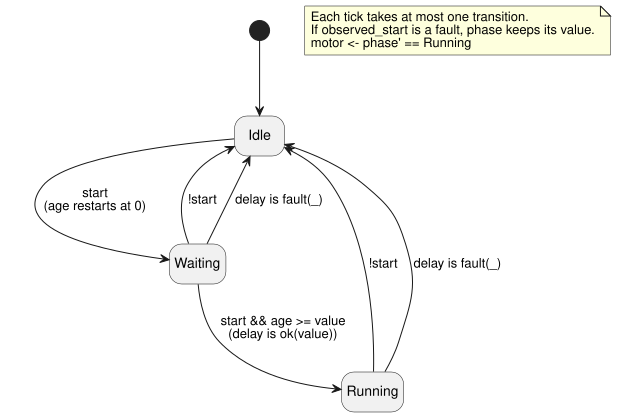

The table traces one run. “Stage read” and “age read” are the values the tick
reads; “Next stage” is what it commits.

| Logical time | start | Stage read | age read | Next stage | motor |
|---|---|---|---|---|---|
| 0ms | false | Idle | 0ms | Idle | false |
| 1000ms | true | Idle | 1000ms | Waiting | false |
| 2999ms | true | Waiting | 1999ms | Waiting | false |
| 3000ms | true | Waiting | 2000ms | Running | true |
| 4000ms | false | Running | 1000ms | Idle | false |

The wait does not start at the moment the button physically changed. It starts
at the tick that reads the change and moves to `Waiting`. That is why the two
seconds are counted from 1000ms, and the motor turns on at 3000ms.

### Speeding up a simulation changes how time advances

Running a simulation at ten times speed does not turn `2s` in the source into
`200ms`. Instead, the simulator advances logical time faster than real time. If
each tick has the same logical time and the same inputs, the result must be the
same at any speed.

The boundaries must be shared across platforms: the time used for timer
calculations, the set of DI inputs read together, and the final RO outputs.

- Native and WASM builds run expressions, state, timers, and constraints in the
  same Rust core.
- The host supplies inputs, logical time, and opportunities to scan.
- The real Device I/O Drivers are a separate boundary.

Concrete frame and Driver APIs are host contracts. Do not add platform branches
to this source.

The current CLI simulator provides virtual I/O. It shows inputs and the
requested and safe intents.

- It has no plant model that automatically derives tank levels or sensor values
  from pump intent.
- An explicitly configured greenhouse-temperature plant model is supported. Its
  virtual application and feedback are still not evidence from a physical device.
- Piped mode advances only at explicit scans. An interactive TTY supplies the
  real elapsed wall time.
- Schedules, sensors, and certified intervals need the matching host
  capabilities.

For execution paths and reproduction commands, see
[Authoring and virtual simulation architecture](LLM-TOOLCHAIN-ARCHITECTURE.md#reproduce-the-public-path).

**Small experiment:** Move the tick after 2999ms to 3500ms. The motor turns on at
that tick, not at 3000ms. The timer condition is two seconds, but observation and
transition happen only at tick times.

<a id="ch07"></a>
## 7. Starting at scheduled times

“Water at 06:00” and “water for five minutes” are both about time, but they read
different clocks:

- **06:00** needs civil time: a calendar and a time zone.
- **Five minutes** needs monotonic elapsed time, counted from the start event.

In E09, imagine the 06:00 event has arrived and then the wall clock is set
backward. Predict the result: the five-minute run should not be disturbed. That
prediction explains why the source spells out DST handling, clock gaps, provider
failure, and fallback.

### E09 — Running five minutes at two times each day

```ghost
// E09
control ScheduledPulse {
  schedule starts: DailySlots<15min> {
    timezone = "Asia/Seoul";
    selected = [06:00, 18:45];
    dst_missing = skip;
    dst_repeated = first;
    basis = pulse;
    when = true;
    clock = trusted_only;
    gap = skip_after(60s);
    recovery = baseline;
    fallback = skip;
  }
  let run_time = 5min;
  type Phase = Idle | Watering;
  state phase: Phase = Idle;
  timer age = elapsed(phase);
  output valve, pump: Bool;

  phase' = case phase {
    Idle => if starts.due then Watering else Idle;
    Watering => if age >= run_time then Idle else Watering;
  };

  valve <- phase' in {Watering};
  pump <- phase' == Watering;
  require pump => valve;
}
```

`DailySlots<15min>` picks times from a 15-minute grid within each local date. An
off-grid value such as 06:07 is rejected, not rounded. `starts.due` is a
projection: it tells whether a start occurrence arrived on this tick. Admission
and missed/unknown evidence are kept as separate observations.

The declaration states every clock assumption explicitly: pulse basis, trusted
clock only, a 60-second gap limit, baseline recovery, and skip fallback. That way
a later review cannot quietly assume the clock was perfect.

The diagram shows where each clock is used. The civil clock only decides *when*
watering starts; the monotonic clock alone decides *when it stops*.

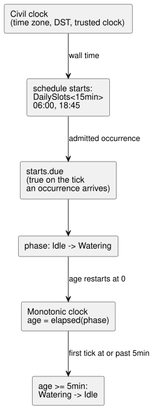

| Event | Previous stage | Next stage | pump |
|---|---|---|---|
| Selected start event | Idle | Watering | true |
| Less than five minutes elapsed | Watering | Watering | true |
| First tick with at least five minutes elapsed | Watering | Idle | false |

`in {Watering}` tests set membership. When several states qualify, list values
of the same type, as in `phase' in {Opening, Watering, Closing}`.

This source has no queue. If another start event arrives while the phase is
already `Watering`, it is not stored. Schedule occurrence identity, duplicate
suppression, missed-occurrence handling, and replay evidence follow the contract
in Reference §3.5. Do not invent your own catch-up for overlapping or missed
occurrences from other schedules.

**Reading question:** Does the `Watering` branch read another start event and
change its end time? (The two selected times are more than five minutes apart.)
Answer by reading the branch. This is not an execution scenario that injects a
hidden `starts.due` input into the public simulator.

### Calendar time and natural events

Calendar time, schedules, and monotonic elapsed time are different kinds of
input. Dates and times are tagged literals. Recurring schedules use a
type-specific `schedule` declaration. For the exact notation of `DailySlots`,
`Periodic`, `cron5`, solar/lunar/tide context, time zones, gap recovery, and
mandatory fallback, see [Reference §3](reference/03-time-and-schedules.md).

Sunrise and sunset, tide predictions, calendars, and clock data all depend on
external provider/Driver contracts. The source names the reference event and the
fallback. Do not hide prediction data inside a single Bool, and do not assume the
time is always trusted. Read the policies defined in the Reference, and supply the
required environment capabilities through bindings.

<a id="ch08"></a>
## 8. Sensor values and quality

Use the [quantity-to-type lookup](#quantity-type-lookup) to choose the input type.
For example, a Celsius measurement uses the `Temperature` type and a value such
as `30°C`.

Suppose the moisture reading goes `29%, 31%, 29%`. If the decision follows a
single threshold, the water request flips on and off along with it. Now a single
`90%` appears. Did the soil suddenly become wet, or did one reading spike? And if
the sensor disconnects after its last reading, how long can you still trust that
number?

These are three different questions, and E10 answers each one separately:

1. It checks the quality of each measurement.
2. It takes the median of the recent values.
3. It uses separate thresholds for turning on and turning off.
4. Finally, it checks whether the user has enabled watering.

As you read, follow the raw value, the filtered value, the decision, and the
requested output one line at a time. You will see that the code is longer **so
that different questions are not mixed together**.

The moisture percentages and the 30%/35% thresholds are illustrative logical
values. They are not agricultural recommendations for any soil, crop, or sensor
calibration. This chapter verifies a water **request**; actual water flow needs
separate device and feedback evidence.

### Input values and measured values

The earlier `input level: Percent` declared a value that the host supplies for
the current calculation. A real sensor has more than a value. It can be not ready
yet, disconnected, or holding a stale measurement. So whenever you read an
`input`, you also handle whether a healthy value was obtained.

### E10 — Deciding water supply from fluctuating moisture values

```ghost
// E10
control MoistureControl {
  state displayed_pump: Bool = false;
  displayed_pump' = if enabled_good && !enabled then false else if enabled_good then enabled && need_water else displayed_pump;
  // Source-local display memory is initialized here; faults remain producer unknown.
  state remembered_enabled: Bool = false;
  let enabled_good = case observed_enabled { ok(_) => true; fault(_) => false; };
  let enabled = case observed_enabled { ok(value) => value; fault(_) => remembered_enabled; };
  remembered_enabled' = enabled;
  input observed_enabled: Bool;
  input moisture: Percent {
    sample = 1s;
    valid = 0% .. 100%;
    filter = median(3);
    stale_after = 3s;
    recover_after = 1 samples;
  }
  signal dry = hysteresis(moisture,
    on_below: 30%, off_above: 35%, initial: false);
  let need_water = case dry {
    ok(value) => value;
    fault(_) => false;
  };

  output pump: Bool;
  pump <- displayed_pump';
}
```

The diagram follows one sample through E10, from the host to the pump request.

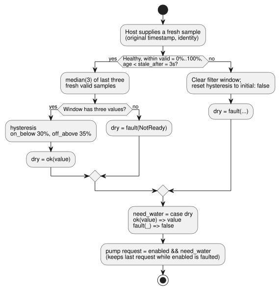

`sample = 1s` records the intended measurement interval. It does not create a
thread that reads the sensor, and it does not invent a new observation every
second. The host supplies samples, each with its original timestamp and identity.
`valid` defines the range of healthy values; the filter accepts only fresh, valid
samples within that range. Reading the same sample on several ticks neither fills
the window nor makes its timestamp newer.

`median(3)` picks the middle of the last three valid values. Sorting
`29%, 90%, 28%` gives `28%, 29%, 90%`, so the result is `29%`. One large value
does not immediately mean wet soil. With only two values, there is no middle yet:
the first two samples give `NotReady`, and this example's fault branch keeps the
water request off.

`hysteresis` uses separate thresholds for on and off. For healthy measurements:

| Filtered value | `dry` decision |
|---|---|
| below 30% | turns on (`true`) |
| above 35% | turns off (`false`) |
| from 30% to 35%, including exactly 30% or 35% | keeps the previous decision |

So a value that wobbles around 30% does not flip the output on every reading.

Between `30%` and `35%`, a number does not produce a new conclusion. It is **the
band that keeps the previous conclusion**. The same `33%` keeps watering on if
the soil was already judged dry, but does not start watering from the initial
state. This small difference adds memory to a threshold comparison.

Now set `enabled=true` and supply the raw samples below in order. Each one is a
fresh, healthy observation, one second apart. Cover the table and first predict
which row turns the request off.

| New raw sample | Median of the latest three | `dry` result | Requested `pump` |
|---|---|---|---|
| `31%` | Window incomplete | `fault(NotReady)` | `false` |
| `29%` | Window incomplete | `fault(NotReady)` | `false` |
| `90%` | `31%` | `ok(false)` | `false` |
| `28%` | `29%` | `ok(true)` | `true` |
| `30%` | `30%` | `ok(true)` | `true` |
| `34%` | `30%` | `ok(true)` | `true` |
| `36%` | `34%` | `ok(true)` | `true` |
| `38%` | `36%` | `ok(false)` | `false` |

The request is still on in the row where the raw value reaches `36%`, because the
filtered value is only `34%`. Only when `38%` arrives does the window
`34%, 36%, 38%` have a median of `36%`. That is above 35%, so the decision turns
off. If you compare a raw value directly with the output, the result looks odd;
follow the intermediate values and the reason becomes clear.

Next, stop supplying new samples. When the age measured from the last sample's
original timestamp reaches exactly 3 seconds, the result becomes `Stale`. Compare
2999ms and 3000ms to see the boundary. Re-evaluating or re-sending the same sample
does not extend that deadline.

A fault is not a normal moisture value. When a fault occurs, the filter window is
cleared and the hysteresis returns to `initial: false`. When healthy samples come
back, do not assume that `recover_after = 1 samples` alone allows immediate
recovery: this filter also needs **three new valid samples** for its median. If
the recovered filtered value is `33%`, the old `true` decision does not come
back; the initial `false` decision remains.

`ok(value)` gives a name to a healthy result. The `_` in `fault(_)` means this
calculation does not use the specific error value. Even when `false` is chosen
as the substitute value, the original quality information stays in the execution
record.

Here, `ok` and `fault` are `case` patterns. The current language also provides:

- `ok(...)` and `fault(...)` constructors for the built-in `Result<T, E>`, whose
  fault types are owned by the compiler;
- static `map`, `and_then`, and `recover` transforms.

Do not confuse these with user-defined error ADTs or general higher-order
functions. See [Reference §2.5](reference/02-types-expressions-state.md#25-sensor-결과와-명시적-오류-흐름).

### E14 — An optional sensor

```ghost
// E14
control OptionalMoisture {
  input moisture?: Percent;
  output request: Bool;
  adapt moisture_policy {
    strategy WithMoisture priority 100 match (moisture: sensor<Percent>) {
      request <- case moisture {
        ok(value) => value < 30%;
        fault(_) => false;
      };
    }
    strategy Baseline priority 0 match always {
      request <- false;
    }
  }
}
```

`?` is declaration information: it marks the sensor as an optional installation
capability.

- **Installed and healthy:** `WithMoisture` compares the value.
- **Installed but faulted:** `WithMoisture` requests `false`.
- **Not installed:** `Baseline` requests `false`.

`?` alone does not generate a fallback strategy; you write `Baseline` yourself.
For the detailed rules, see [Reference §4.5–4.6](reference/04-sensors-constraints-control.md#45-선택-sensor와-capability).

E14 takes different paths for “no sensor installed” and “installed sensor has
failed.” Without the sensor, it selects `Baseline`. With an installed sensor
whose value cannot be read, it follows the fault branch inside `WithMoisture`.
Both requests are `false`, but for different reasons. The same output does not
mean the same execution evidence.

**Change one thing:** While E10 produces `ok(true)`, turn off only `enabled`. The
decision stays the same; only the pump request stops. Enable it again, and the
request returns only while the quality is still healthy. Because the decision
and the permission are separate, you do not need to invent a new sensor state for
a user operation.

Also predict what happens if you make the two thresholds equal. The current
`hysteresis` requires `on_below < off_above`, so this edit should produce a
diagnostic instead of a healthy run. In a chart, show the raw and filtered values
together, and check quality and request separately. E10 has no `require` or
`mutex`, so the safe output equals the requested one here. That equality still
does not confirm that water is physically being pumped.

<a id="ch09"></a>
## 9. Reading expressions precisely

The shorter an expression looks, the more readily we bring in rules from a
language we already know. So instead of a grammar list to memorize, this chapter
uses small counterexamples. For division, conditionals, and `case`, pick one
normal value and one fault, and predict each result. E11's canonical notation is
a promise that the same shape means the same thing in reviews and searches.

### E12 — Numbers and operators

```ghost
// E12
control NumbersAndOperators {
  state displayed_sum: Number = 0;
  displayed_sum' = if a_good && b_good then a + b else displayed_sum;
  state displayed_difference: Number = 0;
  displayed_difference' = if a_good && b_good then a - b else displayed_difference;
  state displayed_product: Number = 0;
  displayed_product' = if a_good && b_good then a * b else displayed_product;
  state displayed_quotient: Number = 0;
  displayed_quotient' = if a_good && b_good then a / b else displayed_quotient;
  state displayed_negative: Number = 0;
  displayed_negative' = if a_good then -a else displayed_negative;
  state displayed_equal: Bool = false;
  displayed_equal' = if a_good && b_good then a == b else displayed_equal;
  state displayed_different: Bool = false;
  displayed_different' = if a_good && b_good then a != b else displayed_different;
  state displayed_less: Bool = false;
  displayed_less' = if a_good && b_good then a < b else displayed_less;
  state displayed_at_most: Bool = false;
  displayed_at_most' = if a_good && b_good then a <= b else displayed_at_most;
  state displayed_greater: Bool = false;
  displayed_greater' = if a_good && b_good then a > b else displayed_greater;
  state displayed_at_least: Bool = false;
  displayed_at_least' = if a_good && b_good then a >= b else displayed_at_least;
  // Source-local display memory is initialized here; faults remain producer unknown.
  state remembered_a: Number = 0;
  let a_good = case observed_a { ok(_) => true; fault(_) => false; };
  let a = case observed_a { ok(value) => value; fault(_) => remembered_a; };
  remembered_a' = a;
  state remembered_b: Number = 0;
  let b_good = case observed_b { ok(_) => true; fault(_) => false; };
  let b = case observed_b { ok(value) => value; fault(_) => remembered_b; };
  remembered_b' = b;
  input observed_a: Number;
  input observed_b: Number;
  output sum, difference, product, quotient, negative: Number;
  output equal, different, less, at_most, greater, at_least: Bool;

  sum <- displayed_sum';
  difference <- displayed_difference';
  product <- displayed_product';
  quotient <- displayed_quotient';
  negative <- displayed_negative';
  equal <- displayed_equal';
  different <- displayed_different';
  less <- displayed_less';
  at_most <- displayed_at_most';
  greater <- displayed_greater';
  at_least <- displayed_at_least';
}
```

With `a=6` and `b=2`, the numeric outputs are, in order, `8, 4, 12, 3, -6`. The
Bool outputs are `false, true, false, false, true, true`. Number outputs can be
observed logically too, but they cannot be mapped directly to Bool relay ports.

Operator precedence, from strongest to weakest:

| Rank | Notation |
|---|---|
| 1 | Parentheses, function calls, member/next-state references |
| 2 | Unary `!`, `-` |
| 3 | `*`, `/` |
| 4 | `+`, `-` |
| 5 | `in {…}` |
| 6 | `==`, `!=`, `<`, `<=`, `>`, `>=` |
| 7 | `&&` |
| 8 | `||` |

Binary operators of the same precedence group from the left: `6 - 2 - 1` means
`(6 - 2) - 1`. To make a complex condition easier to read, split it with
parentheses or with named `let` calculations.

`=>` is not an ordinary arithmetic or logical operator. It connects the two sides
of an output constraint and joins a `case` pattern to its branch. You cannot put
it into an ordinary expression.

### E13 — Having conditionals versus skipping calculation

`if`, `&&`, and `||` are evaluated deterministically from left to right, with
short-circuiting. A runtime fault in a branch that is not selected never happens,
but every branch is still type-checked statically. For example:

```ghost
// E13
control SafeDivision {
  state displayed_result: Number = 0;
  displayed_result' = if a_good && b_good then if zero then 0 else a / denominator else displayed_result;
  // Source-local display memory is initialized here; faults remain producer unknown.
  state remembered_a: Number = 0;
  let a_good = case observed_a { ok(_) => true; fault(_) => false; };
  let a = case observed_a { ok(value) => value; fault(_) => remembered_a; };
  remembered_a' = a;
  state remembered_b: Number = 0;
  let b_good = case observed_b { ok(_) => true; fault(_) => false; };
  let b = case observed_b { ok(value) => value; fault(_) => remembered_b; };
  remembered_b' = b;
  input observed_a: Number;
  input observed_b: Number;
  let zero = b == 0;
  let denominator = if zero then 1 else b;
  output result: Number;

  result <- displayed_result';
}
```

With `a=6, b=2`, the result is `3`. With `a=6, b=0`, it is `0`. The important
point is that the division is never evaluated on the zero branch. Still, `0` is
this program's policy, not the language's universal answer. If your domain must
tell zero apart from a fault, preserving the error is the more honest choice.

### E11 — Using only canonical notation

New programs use these forms:

- `fn`
- `type Mode = Off | On;`
- `running' = ...;`
- `if c then a else b`

`purefn`, `enum` syntax, `next running`, `input.start`, `state.running`, and `ifthenelse(...)` are not permitted aliases. If you see them in older documents, follow the migration notes in [Reference §1.6](reference/01-source-and-syntax.md#16-대표-표기-참고-별칭과-역사적-대안).

<a id="ch10"></a>
## 10. Stopping, changing, and comparing

The most worrying question after you change control code is: “Did only what I
intended change?” Do not answer it by feel. Feed both revisions the same inputs
at the same logical times. The first tick where they differ shows how a change in
one expression spreads into state, intent, and constraints. This habit of
comparison is also the basis for understanding import replacement and replay
later in the book.

The two expressions below look so similar that the change could pass as “tidying
up parentheses.” Using E03's stop-priority latch as the baseline, run both
versions against the same input record.

```text
Original A: running' = !stop && (start || running);
Modified B: running' = start || (!stop && running);
```

With `start=true` and `stop=true`, A produces `false` and B produces `true`.
Moving the parentheses and the position of `start` slightly changes which input
wins when both arrive at once.

| Previous running | start | stop | A's next value | B's next value |
|---|---|---|---|---|
| false | true | false | true | true |
| true | false | false | true | true |
| true | true | true | false | true |
| true | false | true | false | false |

### Comparison experiment sequence

1. Keep the original source and each tick's inputs and logical time.
2. Decide the state at the point where the comparison starts. To compare from the
   beginning, start each program from its own initial state.
3. Create the modified version while keeping the original.
4. Feed both programs the same input record at the same times.
5. Compare state, output intent, constraint decisions, and final outputs side by
   side.

If you also changed the state structure, the rule for migrating existing
checkpoints to the new structure is part of the change. Until that rule is
defined, replay both programs from their initial states. Only with the same
starting point and the same inputs can you say that the first difference came
from the code change. That is why the book's first comparison experiment uses
replay from the initial state.

### Which values should appear beside the source?

When you review a trace or design an observation view, compare these values
with the source:

- for the selected tick: `start`, the previous `running`, and the next `running'`;
- for `pump`: the conditions it depends on;
- when a constraint changed an output: the candidate value and the final value.

This is guidance for observation and screen design. It does not claim that the
current reader already has a source-selection or dependency-tracing UI.

An observation screen should answer four questions:

- From which inputs and previous state was this value calculated?
- What are the next state and output intent?
- Which constraint permitted or blocked it?
- At which tick do the original and modified versions first differ?

Observable values and evidence kinds follow [Reference §5](reference/05-settings-and-observation.md). A screen must preserve the meaning of the descriptor it presents.

<a id="ch11"></a>
## 11. Files and literate programs

Months after a fault, whoever investigates it needs more than the code. They need
to know *why* a condition was written. E15 keeps that reasoning in the same document
as the executable source, instead of squeezing it into comments.

Two rules follow from this:

- Changing a prose paragraph changes the document revision. Only the `ghost` blocks
  carry execution meaning.
- Save and check the `.ghost.md` document itself. Do not copy its blocks into a
  second source file.

### One file and one control

An executable document has exactly one root `control`. Because of this, no filename
or deployment convention has to guess which control starts.

To reuse another document, you pin the revision and digest of a complete `.ghost.md`
definition with a document-scope `import`. You then compose it with `instance` and
`connect`. Wildcard imports and a second root are rejected for the same reason: the
identity you reviewed must match the structure that actually executes.

The single-root rule is the skeleton of an executable definition. When you compose
several imported definitions as instances, it guarantees that the root is never
ambiguous.

### E15 — Writing explanation and code in the same document

Imagine saving the entire content below as `follow-switch.ghost.md`.

The quoted document is the canonical one, so it keeps its Korean prose and its exact
source identity. In English:

- the heading means “Output following input”;
- the first paragraph says “Declare the switch and LED values”;
- the paragraph between the code blocks says “The output follows the switch value on
  every tick.”

This English text only translates the explanation. It does not create a second,
independently editable canonical source.

````markdown
# 입력을 따라가는 출력

스위치와 LED의 값을 선언한다.

```ghost
// E15
control LiterateSwitch {
  // Source-local display memory is initialized here; faults remain producer unknown.
  state remembered_switch_on: Bool = false;
  let switch_on_good = case observed_switch_on { ok(_) => true; fault(_) => false; };
  let switch_on = case observed_switch_on { ok(value) => value; fault(_) => remembered_switch_on; };
  remembered_switch_on' = switch_on;
  input observed_switch_on: Bool;
  output lamp: Bool;
```

출력은 매 tick 스위치의 값을 따른다.

```ghost
  lamp <- switch_on;
}
```
````

The compiler joins the exact top-level `ghost` code blocks in document order.
In the example, one `control` is simply split across two blocks; this does not
create two programs. Explanatory paragraphs never execute, and error locations
point back to the original document.

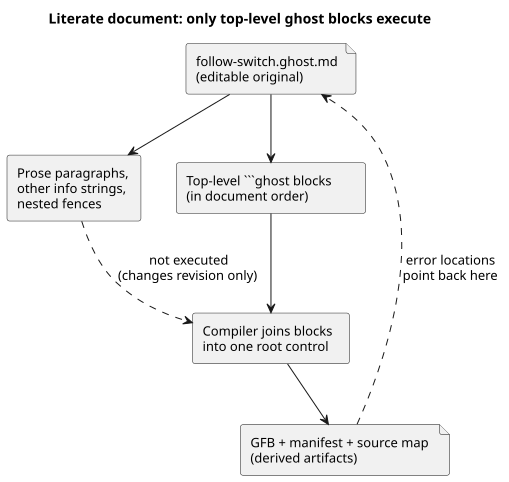

The diagram shows what the compiler reads: prose changes the revision but not the
program, and diagnostics map back to the `.ghost.md` original.

These are **not** executable code: ordinary paragraphs, code blocks with other info
strings, and nested fences inside lists or quotes. The exact extraction rules are in
[Reference §1.1](reference/01-source-and-syntax.md#11-왜-문서-하나가-소스인가).

### Files and program composition

Files do not become related just because they share a directory. `import` names an
immutable source identity. `instance` and `connect` expose typed logical ports.

When the original changes, you review a new revision; the composition never picks
up the change silently. That is the minimum needed to back up the claim “today's
composition uses the component we reviewed yesterday.”

Keep two kinds of evidence apart:

- The compiler checks the contracts of pinned imports, instances, and ports.
- Runtime execution is separate evidence. The fixed source closures of E22 and E31
  are also executed in the browser Worker/WASM runtime. That evidence does not
  extend to arbitrary compositions or installation profiles.

For a single-control exercise, save the entire document as in E15. Then check and
compile it from the language repository root:

```sh
node tools/ghostc.mjs --check follow-switch.ghost.md
node tools/ghostc.mjs follow-switch.ghost.md build/follow-switch.gfb
```

These commands need the Node dependencies installed. The GFB, manifest, and source
map are derived artifacts; the `.ghost.md` file remains the editable original.
Do not compile this whole book as one executable document.

<a id="ch12"></a>
## 12. One device, multiple controls

Watering and ventilation may each work correctly on their own, yet still conflict
when they share one pump or one power budget. This chapter does not paste files
together. Instead, it pins imported revisions and exposes the relationships through
instances and typed ports.

Before you replace a component, write down which ports and resource contracts must
stay the same. The real payoff of composition is not reuse alone: it lets you prove
what changed and what stayed the same.

Each definition has one root. A composition creates instances of imported controls
and connects their logical ports, so every arrow has a type and an origin you can
inspect.

Connections alone cannot settle a conflict when two instances want the same physical
resource. The resource identity and its contract must be explicit. Output intent also
stays distinct from physical confirmation.

```text
definition revision → import → instance + typed connect
                   → semantic composition → bound runtime
```

Use `adapt`, capability checks, common constraints, shared resources, replay, and hot
replacement only in their prescribed locations, with their defined types and
contracts. The syntax and semantic DAG rules are in
[Reference §6](reference/06-composition-and-replay.md). The responsibilities of
devices, drivers/renderers, and bindings are in
[Reference §8](reference/08-language-runtime-and-device-boundaries.md). Do not assume
that an ordinary `control` contains some separate, arbitrary policy language.

<a id="ch13"></a>
## 13. Built-in functions and operations

This is the chapter where a familiar function name is most dangerous. Before you
guess what a call does, mark three things:

- Does it return a `Result`?
- Does it remember samples?
- Does it need an external clock or a natural-event provider?

A call may be a value calculation, a stateful signal, a schedule descriptor, or a
host policy, and each kind leaves different observable evidence. Treat the catalog
below as a map for practicing those questions, not as a list of names to memorize.

A **builtin** is an operation the compiler already knows. A `fn` is a calculation you
declare yourself, such as the function in E07. A familiar name does not make something
a builtin: there are no general `abs`, `min`, `max`, `clamp`, `sqrt`, `pow` or `round`
expression functions. When the language permits the calculation, declare a suitable
`fn` yourself.

Read the call names and signatures in this chapter against the current Language
Reference and compiler registry. The chapter covers all **52 primary callable
spellings** and the **3 additional host-policy spellings**. The tables separate
ordinary calls, declaration constructors, and restricted transforms. The signatures
are fragments; the linked tests contain complete examples. Do not treat the fragments
as extra, independent source documents.

Read each table row with the same questions, in this order:

1. Where is the operation permitted?
2. What are its input and result types?
3. Does it remember samples or state?
4. Does it require a clock or provider?
5. Can it return a fault?

A successful compile may only produce a checked descriptor, not executable control,
so “it compiled” does not mean “it runs in the field.” Even executable control needs
the stated runtime inputs and bindings. None of these operations proves a physical
output effect on its own.

### 13.1 Numbers and explicit Result construction

Use a conversion when you intend to change the numeric representation. `Int` is an
exact signed 32-bit integer; `Number` is floating point. Each conversion takes exactly
one positional argument. For example:

- `int_floor(-1.2)` is -2, while `int_trunc(-1.2)` is -1.
- With nearest-even, a halfway value such as 2.5 rounds to 2, and 3.5 rounds to 4.

| Builtin | Signature and purpose | Context, boundaries and example |
|---|---|---|
| `number` | `number(x: Int) -> Number`: change representation explicitly | Ordinary expression, no state. [Integer examples](../tests/int-compiler.test.mjs). |
| `int_exact` | `int_exact(x: Number) -> Int`: require an integral value | Reject fractional or out-of-range values. [Conversions](../tests/dynamic-int-conversions.test.mjs). |
| `int_floor` | `int_floor(x: Number) -> Int`: round toward negative infinity | Converted value must fit Int. [Conversions](../tests/dynamic-int-conversions.test.mjs). |
| `int_ceil` | `int_ceil(x: Number) -> Int`: round toward positive infinity | Converted value must fit Int. [Conversions](../tests/dynamic-int-conversions.test.mjs). |
| `int_trunc` | `int_trunc(x: Number) -> Int`: discard fraction toward zero | Converted value must fit Int. [Conversions](../tests/dynamic-int-conversions.test.mjs). |
| `int_nearest_even` | `int_nearest_even(x: Number) -> Int`: nearest integer, ties to even | Converted value must fit Int. [Conversions](../tests/dynamic-int-conversions.test.mjs). |
| `ok` | `ok(value: T) -> Result<T,E>`: construct success | An expected Result type determines T and compiler-owned E. [Result examples](../tests/result-control.test.mjs). |
| `fault` | `fault(reason: E) -> Result<T,E>`: construct failure | Expected Result type required; keep the typed reason and source origin. [Result examples](../tests/result-control.test.mjs). |
| `rate` | `rate(delta: Q-difference, time: Duration) -> Rate<Q>`: build a comparison rate | Expected Rate context; positive time; Temperature uses TemperatureDelta. Canonical difference is divided by seconds. [Rate examples](../tests/window-control.test.mjs). |

An invalid constant conversion fails compilation. A dynamic numeric error prevents
successful evaluation; it is not a sensor `Result`, so `recover` cannot catch it.

`Rate<Q>` exists only inside expressions. To compare a rate, use a `window_rate`
signal and a `rate` threshold. `Rate<Q>` is not a general storage type for
config/state/input/output.
Source: [expression calls](../tools/control.mjs), [integer contract](EXACT-INTEGER-CONTRACT.md).

### 13.2 Keep quality until you choose a response

A failed sensor reading is not a normal zero. A `Result` pipeline carries either a
value or its error, and E10 shows explicit failure handling. Write pipelines as:

- `result |> map(transform)`
- `result |> and_then(transform)`
- `result |> recover(default)`

`>>` combines static transforms. These are compiler-known transforms, not arbitrary
first-class functions.

| Builtin | Signature and purpose | Context, boundaries and example |
|---|---|---|
| `map` | `map(T -> U)`: Result<T,E> -> Result<U,E> | Unary named fn or `below(limit)`; U must not be Result. Preserve failure. [Pipelines](../tests/result-control.test.mjs). |
| `and_then` | `and_then(T -> Result<U,E>)`: Result<T,E> -> Result<U,E> | Unary named fn; same E required. Existing failure bypasses the transform. [Pipelines](../tests/result-control.test.mjs). |
| `recover` | `recover(default: T)`: Result<T,E> -> T | Explicit same-type fallback; records the fault and origin in trace. `recover(false)` is an author decision. [Provenance](../tests/result-provenance.test.mjs). |
| `below` | `below(limit: T)`: transform T -> Bool using strict `<` | Only as a map transform. Ordered numeric, Rate, DateTime or TimeOfDay; same-type limit. and_then(below(...)) is rejected because Bool is not Result. [Pipelines](../tests/result-control.test.mjs). |

Source: [static transform lowering](../tools/control.mjs). Recovering a value does not make the original measurement trustworthy.
For E10's Percent sensor, the fragment `moisture |> map(below(30%)) |> recover(false)` asks for false when the reading faults. This threshold calculation has no hysteresis memory; §13.3 adds it.

### 13.3 Filter samples, then use hysteresis to retain a decision

A **filter** smooths measured values. **Hysteresis** remembers a Bool decision across
a band of values. They solve different problems, and you can use them together.

To use a filter, declare a numeric sensor and select one filter with `filter = ...`.
Filters consume new, valid physical samples; repeated scans of the same sample do not
add weight. For example, E10's `filter = median(3);` uses three actual samples, while
`filter = ema(alpha: 0.25);` gives each new sample one quarter of the update weight.

| Builtin | Signature and purpose | Context, boundaries and example |
|---|---|---|
| `median` | `median(n)`: middle of the last n valid samples | Sensor filter only; constant odd integer 1..31. Partial window is NotReady. [Filters](../tests/signals-wasm.test.mjs). |
| `moving_average` | `moving_average(n)`: arithmetic mean of last n valid samples | Sensor filter only; constant integer 1..31. Partial window is NotReady. [Filters](../tests/signals-wasm.test.mjs). |
| `ema` | `ema(alpha: Number)`: weighted new sample and previous value | Sensor filter only; constant finite 0 < alpha <= 1. Seed first valid sample; recovery rules still apply. [Filters](../tests/signals-wasm.test.mjs). |
| `hysteresis` | `hysteresis(sensor, on_below: T, off_above: T, initial: Bool) -> Result<Bool,SensorFault>` | Signal declaration; direct numeric sensor; constant thresholds with same T and on_below < off_above. [Hysteresis boundaries and faults](../tests/signals-wasm.test.mjs). |

Consider E10's moisture control: `signal dry = hysteresis(moisture, on_below: 30%, off_above: 35%, initial: false);`.

- Below 30%, dry becomes true.
- Above 35%, dry becomes false.
- Every value in the **closed band [30%,35%]**, including both equalities, preserves
  the prior Bool while quality is good.

This band stops small fluctuations from flipping the decision back and forth.

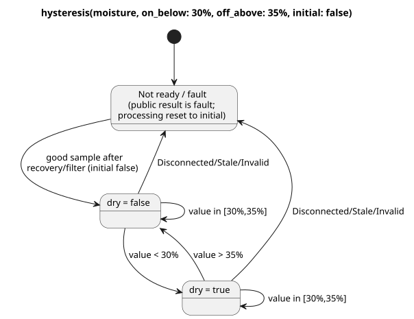

The diagram shows the two retained decisions, the strict transitions, and the fault
path that resets processing to `initial`.

The following sequence lists good filtered readings after readiness, not raw samples
before the filter.

| Good filtered moisture | Retained dry value | Reason |
|---|---|---|
| 30% after startup | false | Equality retains initial false. |
| 35% | false | Upper equality also retains false. |
| 29% | true | Strictly below lower threshold. |
| 30% | true | Lower equality retains true. |
| 33% | true | Inside the band. |
| 35% | true | Upper equality retains true. |
| 36% | false | Strictly above upper threshold. |

`initial` is the starting retained value. It is not permission to ignore a missing
sample:

- Before readiness, or after Disconnected/Stale/Invalid, the public result is a fault.
- Processing resets to `initial`, and good samples must satisfy the recovery and filter
  requirements again.
- A recovered in-band sample therefore starts from `initial`; it does not continue the
  decision from before the fault.
- Even when `initial` is true, a failed Result never becomes `ok(true)`. E10 chooses
  its output response with `case`.

The [Rust conditioner](../crates/ghostflow-core/src/signals.rs) uses strict comparisons and resets hysteresis processing on faults. The linked WASM test contains “retains either prior state exactly at both thresholds” and fault/recovery examples. This chapter describes those contracts; editing the documentation does not create a new hardware test.

### 13.4 Time, samples and events are different evidence

Declare these operations with `signal name = constructor(...);`. A monotonic timer
that counts scans does not prove that a physical condition stayed true *between*
scans. When continuity matters, use certified evidence.

For a declared Temperature sensor, `signal recent = hold_last(temperature, for_at_most: 2min, quality: measured);` limits how long its last good sample may be reused. Before an output can use it, you still need an explicit Result response.

| Builtin | Signature and purpose | Context, boundaries and example |
|---|---|---|
| `debounce` | `debounce(source, stable_for: Duration, initial: T) -> T or Result<T,E>`: accept a stable candidate | Bool or finite enum; positive constant duration and matching constant initial. Candidate changes restart its age; faults reset. Sample sources preserve lineage; plain values use scans. [Debounce](../tests/debounce-control.test.mjs). |
| `true_for` | `true_for(BoolSensor, duration: Duration, quality: measured) -> Result<Bool,SensorFault>`: prove continuous true | Direct declared Bool sensor, positive constant duration. Driver-certified intervals; false/inadmissible quality resets. Boundary reaching duration is true. [Certified source](../tests/fixtures/true-for-certified.ghost.md). |
| `after_event` | `after_event(Event, BoolSensor, window: Duration, quality: measured)`: retain per-event evidence | Positive constant window; event identities and predicate samples required. Predicate is tested in [eventTime,eventTime+window). Signal itself is not scalar. [Event source](../tests/fixtures/after-event-evidence.ghost.md). |
| `after_event_any` | `after_event_any(signal) -> Result<Bool,SensorFault>`: project existential event result | One after_event signal. Decisive true can establish any; otherwise unresolved identities/faults remain relevant. [Projection examples](../tests/after-event-control.test.mjs). |
| `after_event_all` | `after_event_all(signal) -> Result<Bool,SensorFault>`: project universal event result | One after_event signal. Decisive false can establish all=false; empty/pending sets without decisive evidence yield NotReady, not automatic permission. [Projection examples](../tests/after-event-control.test.mjs). |
| `window_average` | `window_average(source, over: Duration, quality: measured, max_age: Duration)` | Result<numeric/physical,SensorFault> with physical sample lineage. Return same payload, except Int -> Number. [Windows](../tests/window-control.test.mjs). |
| `window_min` | `window_min(source, over: Duration, quality: measured, max_age: Duration)` | Same admissible payloads as average; Result of the minimum, same payload type. [Windows](../tests/window-control.test.mjs). |
| `window_max` | `window_max(source, over: Duration, quality: measured, max_age: Duration)` | Same admissible payloads as average; Result of the maximum, same payload type. [Windows](../tests/window-control.test.mjs). |
| `window_rate` | `window_rate(source, over: Duration, quality: measured, max_age: Duration) -> Result<Rate<Q>,SensorFault>` | Supported linear physical quantity; earliest/latest observations at distinct times. Temperature difference uses delta K. Number/Int/Percent, RelativeHumidity, CO2 and Acidity are not accepted inputs. [Rate examples](../tests/window-control.test.mjs). |
| `hold_last` | `hold_last(source, for_at_most: Duration, quality: measured) -> Result<T,SensorFault>`: temporarily reuse a good sample | Physical lineage required; positive constant duration. Preserve actual timestamp, held age and masked fault; never refresh it by reevaluation. [Hold examples](../tests/hold-last-control.test.mjs). |
| `elapsed` | `elapsed(state) -> Duration`: age since a state change | Timer declaration only; declared state, explicit monotonic clock; resets on change. [E08](#ch06). |
| `continuous_true` | `continuous_true(BoolExpression) -> Duration`: age of continuously true scan observations | Timer declaration only; starts at zero on first true scan, resets on false. It does not certify the unobserved interval. [Timer examples](../tests/compiler.test.mjs). |

Window rules:

- `over` and `max_age` are positive constant Durations.
- A window uses the actual admissible observations in **(now-over,now]**, without
  interpolation.
- No observations, or a newest observation whose age is **>= max_age**, gives NotReady.
- A current source fault is preserved.
- A rate needs observations at two distinct times.
- Window composition keeps aggregate and sample provenance. Scans where only the clock
  advances do not fabricate new observations.

A program that uses after_event only through the any/all projections can compile to
executable control with event-runtime bindings. An unprojected after_event, or one
combined with natural conditions, can produce an `executable:false` temporal
descriptor. `after_event_for` is covered under the unsupported names below.
Source: [signal/timer lowering](../tools/control.mjs), [temporal Reference](reference/04-sensors-constraints-control.md).

### 13.5 Natural facts and schedule policy constructors

A provider supplies observations or predictions; the program decides what they
permit. The following three ordinary calls return their uncertainty explicitly as a
`Result`.

| Builtin | Signature and purpose | Context, boundaries and example |
|---|---|---|
| `local_day_is` | ``local_day_is(day`mon..fri`, timezone: "Asia/Seoul") -> Result<Bool,ClockFault>`` | Checks the current trusted local date against named weekdays. Handle a clock fault explicitly before using the Bool to admit a new start. [Three-zone weekday example](../tests/monitoring-plan.test.mjs). |
| `calendar_is` | ``calendar_is(calendar, day`workday` or day`offday` or day`holiday`) -> Result<Bool,CalendarFault>`` | Typed WorkCalendar or HolidayCalendar with an explicit UTC binding in GFB18. Missing, outside-coverage, expired or untrusted-clock facts preserve a fault; handle it explicitly before negating the successful Bool. [Executed calendar boundaries](../tests/reference-calendar-boundary.test.mjs). |
| `tide_is` | ``tide_is(provider, tide`spring` or tide`neap`) -> Result<Bool,TemporalContextFault>`` | Declared TidePredictions provider. Missing/stale prediction or clock context is a fault. [Natural conditions](../tests/natural-condition-contract.test.mjs). |
| `moon_is` | ``moon_is(provider, moon`phase`) -> Result<Bool,TemporalContextFault>`` | LunarEphemeris provider; phases: new, waxing_crescent, first_quarter, waxing_gibbous, full, waning_gibbous, last_quarter, waning_crescent. [Natural conditions](../tests/natural-condition-contract.test.mjs). |

The tagged literals in these signatures are notation fragments. These calls need runtime/provider facts, so a pure `fn` cannot capture a global calendar or provider.

The following constructors are valid only in schedule fields. They do not return values you can store in ordinary expressions. All Durations here are positive constants.
For example, `gap = skip_after(10min);` declares a gap policy. For Tide, `basis = run(5min, within(10min));` allows admission within ten minutes of the planned time, then runs for five minutes from admission.

| Builtin | Signature and purpose | Context, boundaries and example |
|---|---|---|
| `instant` | `instant(DateTime)`: absolute Periodic anchor | Constant DateTime; current executable slice uses preserve_anchor and pulse. [Periodic](../tests/periodic-cron-policy.test.mjs). |
| `civil` | `civil(Date, TimeOfDay)`: civil Periodic anchor | Constant date/time; checked descriptor contract, outside current Periodic bytecode slice. [Periodic](../tests/periodic-cron-policy.test.mjs). |
| `skip_after` | `skip_after(Duration)`: bound acceptable observation gap | Schedule gap field; larger gaps use explicit skip/baseline policy. [Policies](../tests/periodic-cron-policy.test.mjs). |
| `range` | `range(Duration)`: planned interval | Schedule basis; nonoverlap must be provable and cancel_when explicit. Fixed UTC ranges have a bounded execution slice; general civil ranges remain descriptor scope. [Range contract](../tests/schedule-descriptor-artifact.test.mjs). |
| `run` | `run(Duration, within(Duration))`: Tide run from admission | Tide basis; first Duration is run length. Admission must occur inside the grace interval. [Tide](../tests/natural-schedule-contract.test.mjs). |
| `window` | `window(Duration)`: one-shot At admission interval | The first eligible scan in a fixed At half-open interval emits `.due`. `.open` is the current condition level and does not restart an admitted or missed occurrence. [At Window](../tests/reference-foundations-temporal.test.mjs). |
| `within` | `within(Duration)`: Tide admission grace | Only second argument of Tide run; [planned,planned+grace), exact end excluded. It does not extend run length. [Tide](../tests/natural-schedule-contract.test.mjs). |
| `hold_trusted` | `hold_trusted(Duration, terminal: skip)`: bounded trusted-time hold | Solar/Tide clock field; positive constant, prior trusted evidence and run/time continuity required. Exact expiry skips. E36. [Execution](../tests/programming-natural-examples.test.mjs). |
| `fixed_time` | `fixed_time(TimeOfDay literal, terminal: skip)`: fixed-time fallback | Solar fallback only; constant TimeOfDay literal and explicit terminal skip. Do not transfer it to Tide. E36/E101. [Execution](../tests/programming-natural-examples.test.mjs). |

Current executable schedules use baseline recovery. The supported combinations are:

- Solar and Tide clocks: `trusted_only`, or `hold_trusted` with a positive constant Duration and `terminal: skip`.
- Solar fallback: `fixed_time(TimeOfDay, terminal: skip)`. Tide fallback is `skip`.
- Daily/slots/Cron use pulse; Periodic requires instant+preserve_anchor; Tide uses run+within.
- Fixed UTC `range` has its own bounded execution slice. This does not make every civil descriptor executable.

See E36–E37 below and the [fallback checks](../tests/natural-fallback-compiler.test.mjs).
Source: [schedule lowering and slice selection](../tools/control.mjs), [time Reference](reference/03-time-and-schedules.md).

### 13.6 Account for use before granting more

An account records evidence. It does not predict use from an animation or from a
requested output. Applied receipts are different from requested intent, and durable
accounting needs a ledger and verified resource bindings.

For a bound resource `pump`, the declaration fragment `account pumping = on_time(pump, stage: applied, persistence: durable);` chooses applied evidence. The linked accounting examples also declare the resource and the limit policies.

| Builtin | Signature and purpose | Context, boundaries and example |
|---|---|---|
| `on_time` | `on_time(resource, stage: applied, persistence: durable)`: Duration account | Account declaration; bounded executable slice accepts durable/applied only. Requested/safe/confirmed alternatives can be checked but are not this executable binding. [Accounting](../tests/accounting-syntax.test.mjs). |
| `count_events` | `count_events(Event, over: local_day("zone"), persistence: durable)`: event account | Account declaration; .count returns Result<Int,AccountingFault>. Executable slice requires durable/local_day; duplicate event identities do not double count. [Accounting](../tests/accounting-syntax.test.mjs). |
| `used` | `used(account, rolling(Duration))`: inspect accounted Duration | Only accounting constraint limit position. Executable limit uses <=, positive bound/reserve and on_unknown=block. [Limits](../tests/accounting-syntax.test.mjs). |
| `rolling` | `rolling(Duration)`: trailing accounting basis | Positive constant duration; count_events rolling is descriptor/check scope, outside executable event-count slice. [Limits](../tests/accounting-syntax.test.mjs). |
| `local_day` | `local_day("timezone")`: civil-day accounting basis | Nonempty literal timezone; clock/calendar/ledger required. It is not a fixed 24-hour rolling window. [Accounting](../tests/accounting-syntax.test.mjs). |
| `count_on` | `count_on({resources}) -> Int`: count true candidate resources | Named resource constraints, not ordinary expressions. Finite distinct Bool resource set; empty -> 0. Host policy binding required. [Named constraints](../tests/named-constraints.test.mjs). |
| `any_on` | `any_on({resources}) -> Bool`: test candidate resources | Same restricted context; empty -> false. Evaluation stage is declared by the constraint. [Named constraints](../tests/named-constraints.test.mjs). |

A standalone named resource policy becomes a host-policy artifact, not ordinary VM control. Source: [accounting/resource constraints](../tools/control.mjs).

### 13.7 PID constructors belong to an objective

A controller computes requested targets, and later constraints may restrict them.
These constructors set gains and the restart policy; they are not general unit-algebra
functions.

The current native binding is a Temperature sensor, a Temperature config target, and a
`ContinuousActuator<Percent>`, with an output minimum of 0%. Other controller kinds can
carry binding-required metadata, but a parsed `pi` or `on_off` does not prove that a
controller is running.

| Builtin | Signature and purpose | Context, boundaries and example |
|---|---|---|
| `proportional_gain` | `proportional_gain(output: Percent, error: TemperatureDelta)`: P gain | PID kp field; constants, output >=0, error >0; output/error. [Controller examples](../tests/gfb7-pid-contract.test.mjs). |
| `integral_gain` | `integral_gain(output: Percent, error: TemperatureDelta, time: Duration)`: I gain | PID ki; same bounds plus time >0; output/error/seconds. [Controller examples](../tests/gfb7-pid-contract.test.mjs). |
| `derivative_gain` | `derivative_gain(output: Percent, error: TemperatureDelta, time: Duration)`: D gain | PID kd; same bounds plus time >0; output*seconds/error. [Controller examples](../tests/gfb7-pid-contract.test.mjs). |
| `reset` | `reset(output: Percent)`: explicit restart target | PID restart field; constant inside objective output range. First accepted sample initializes tracking; it is not an arbitrary state reset call. [Controller examples](../tests/gfb7-pid-contract.test.mjs). |

A gain whose output is zero disables that term. The period must be positive, and
late_after >= period. Explicit direction, bias, anti-windup, disabled/transfer, fault,
and restart policies govern the controller's lifecycle; stale or missing measurements
are never silently accepted. See [controller lowering](../tools/control.mjs) and [continuous control Reference](reference/04-sensors-constraints-control.md).
For example, `kp = proportional_gain(output: 2%, error: 1Δ°C);` declares two percentage points of output per degree of temperature error. `restart = reset(output: 0%);` explicitly chooses the first tracked target.

### 13.8 The separate host-policy grammar

The `ghostrules` adapter checks a narrow station-policy grammar. Forms that look like
calls there are contextual forms; they do not add functions to ordinary control
expressions. The existing [station rules](../examples/station-rules.ghost.md) and [constraint tests](../tests/constraints.test.mjs) show complete policies.

| Builtin | Signature and purpose | Context, boundaries and example |
|---|---|---|
| `stopped` | `stopped(station)`: require stopped station | Only allow enter/apply policy conditions with their specified mode. Host station state, not physical motor proof. [Rules](../examples/station-rules.ghost.md). |
| `pump_capacity` | `pump_capacity(pump)`: request a capacity check | Only require ... == Pass or check policy clauses. Host policy artifact; not a numeric capacity expression. [Rules](../examples/station-rules.ghost.md). |
| `day` | `day("timezone")`: civil day for a daily limit | Only `limit on_time(pump) <= Duration per day("zone")`; valid IANA timezone, nonempty <=128 chars. [Rules](../examples/station-rules.ghost.md). |

In this grammar, `count_on(pump.valves)`, `any_on(pump.valves)` and `on_time(pump)` are restricted forms whose argument shapes differ from §13.6. They produce max-valves, pump-needs-valve and daily-limit policy clauses. Do not move these spellings into arbitrary `let` expressions. The keywords `exclusive`, `allow`, `require`, `limit`, `once` and `check` introduce clauses; `warn` is rejected.
Source: [host-policy parser](../tools/constraints.mjs).

### 13.9 Adjacent syntax and unavailable alternatives

The following items are useful alongside builtins, but they are **not callable functions**.

| Syntax | Meaning and current boundary |
|---|---|
| Daily, DailySlots<15min>, Periodic, Cron, Solar, Tide | Schedule declaration types. DailySlots execution uses a fixed 15-minute grid; Cron has five validated fields. |
| pulse; time/date/datetime/cron5/day/sun/tide/moon tagged literals | Policy value and typed notation. ``sun`rise` ``/``sun`set` `` are not sunrise()/sunset() calls. |
| TimeSlots<grid,capacity> | Config type: positive grid dividing 24h, positive capacity, finite unique aligned TimeOfDay list. No TimeSlots(...) call. |
| `Result<T,E>`; `Rate<Q>` | Typed result and expression-only rate. E is compiler-owned; nested Result payload is rejected. |
| schedule.due; schedule.active; schedule.missed | Bool projections; .missed requires exposed projection. Active occurrence is not applied output. No method calls. |
| eventAccount.count | Result<Int,AccountingFault> projection; only count_events accounts. |
| resource.on/position/valves | Contextual resource/policy endpoints, not generic methods. |
| sample, valid, filter, stale_after, recover_after, samples | Sensor declaration fields/notation. In particular stale_after is not an expression call. |
| on_below, off_above, initial; min, max, step, access, label | Named arguments or config fields, not functions. |
| if/case/in; >> and \|>; fn/type/state/config/timer/signal | Syntax, operators and declarations. Qualified input.name/state.name/next.name are removed aliases. |

[Parser and member/type rules](../tools/control.mjs) define where these may appear. The complete types and units are in [Reference Chapter 2](reference/02-types-expressions-state.md).

The next table lists spellings you may meet in the Reference or in design notes that
the current compiler does **not** support as calls.

| Selected/reference spelling | Current status; do not claim execution |
|---|---|
| after_event_for(signal, EventId) | Reference describes per-identity projection, but current compiler has no call dispatcher; unknown function. Use supported any/all only when their meaning matches intent. |
| window(Duration) schedule basis | Design alternative, not accepted current basis. This is distinct from supported window_average/min/max/rate signals. |
| run(Duration, on_time) | Design alternative; supported Tide run requires within(Duration). |
| range(Duration); civil(Date,TimeOfDay) | Checked descriptor contracts as explained above; not current bytecode slices. |
| PID checkpoint; degraded Name | Selected design alternatives unsupported by current native PID fault/restart policies. |
| ifthenelse, purefn, enum, next | Removed aliases. Use canonical if ... then ... else, fn, type and primed state. |

Seeing a name in a diagnostic is not evidence that it is supported. That is why the
table separates design alternatives from current calls. Check the compiler path and
the artifact kind. The [chapter coverage check](../tests/programming-builtins.test.mjs)
keeps both languages aligned with the compiler's callable dispatch; it does not judge
physical usefulness.

<a id="ch14"></a>
## 14. Temperature units and air-VPD control

25°C and 77°F describe the same air with different numbers. Conversely, the same
number 25 with a different unit can describe a completely different condition.

Try two predictions in this chapter:

- Feed the same physical temperature to E16–E18 and predict that all three heaters
  make the same decision.
- In the VPD examples, change only the temperature or only the humidity, and observe
  which demand changes first.

Keeping unit conversion separate from control policy lets you settle calculation
errors and policy disagreements in different places.

### One physical temperature, three source units

A Temperature sensor keeps its physical type whether its source/display unit is
Celsius, Fahrenheit, or Kelvin. At runtime the canonical representation is kelvin.

The three heater examples express one physical rule in three display units:

- below 18°C, request ON;
- above 22°C, request OFF;
- at either boundary or inside the band, keep the previous good decision.

Read the table below across a row to check that conversion preserves each boundary.

Quality travels with the calculation:

- Before the first sample, the sensor is NotReady.
- Between deliveries, the last good sample stays usable until its age is >= 3s; then
  it becomes Stale.
- A fault inhibits the heater request and resets hysteresis to `initial` false.
- With `median(1)`, these examples recover after one new good sample.

“A number was seen before” and “the number is trustworthy now” are different claims.

| Physical boundary | Celsius | Fahrenheit | Kelvin |
|---|---|---|---|
| Lower heater threshold | 18°C | 64.4°F | 291.15K |
| Upper heater threshold | 22°C | 71.6°F | 295.15K |
| Heater valid range | −40–50°C | −40–122°F | 233.15–323.15K |

Literal conversion is exact before binary64 rounding. Do not feed a number such as
64.4 directly as a canonical runtime sample: 64.4°F means 291.15K. Driver bindings
identify the unit and quantity they supply. See [physical types](reference/02-types-expressions-state.md) and [hysteresis](#ch13).

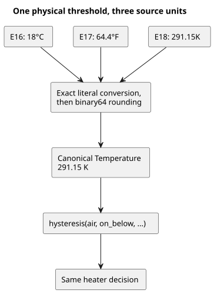

The diagram traces the lower threshold: each example spells it in a different unit,
but all three reach the same kelvin value and therefore the same decision.

### E16 — Celsius heater

```ghost
// E16
control CelsiusHeater {
  input air: Temperature {
    sample = 1s;
    valid = -40°C .. 50°C;
    filter = median(1);
    stale_after = 3s;
    recover_after = 1 samples;
  }
  signal cold = hysteresis(air,
    on_below: 18°C, off_above: 22°C, initial: false);
  output heater: Bool;
  heater <- cold |> recover(false);
}
```

### E17 — Fahrenheit heater

```ghost
// E17
control FahrenheitHeater {
  input air: Temperature {
    sample = 1s;
    valid = -40°F .. 122°F;
    filter = median(1);
    stale_after = 3s;
    recover_after = 1 samples;
  }
  signal cold = hysteresis(air,
    on_below: 64.4°F, off_above: 71.6°F, initial: false);
  output heater: Bool;
  heater <- cold |> recover(false);
}
```

### E18 — Kelvin heater

```ghost
// E18
control KelvinHeater {
  input air: Temperature {
    sample = 1s;
    valid = 233.15K .. 323.15K;
    filter = median(1);
    stale_after = 3s;
    recover_after = 1 samples;
  }
  signal cold = hysteresis(air,
    on_below: 291.15K, off_above: 295.15K, initial: false);
  output heater: Bool;
  heater <- cold |> recover(false);
}
```

### Air VPD from temperature and relative humidity

**Air VPD** (vapour pressure deficit) is the saturation vapour pressure minus the actual
vapour pressure of the air. For simultaneous air temperature T in °C and air relative
humidity RH, use `0.6108 * exp(17.27*T/(T+237.3)) * (1-RH/100)` kPa.

- The saturation relation and the relative-humidity definition come from [FAO-56, Chapter 3, equations 10–11](https://www.fao.org/4/x0490e/x0490e07.htm).
- This is an instantaneous air calculation, not FAO's daily evapotranspiration estimate.
- Leaf VPD also depends on leaf temperature; it is not calculated here.

GhostFlow has no exp builtin, so each complete example authors `exp_0_3_1` as an
ordinary pure fn: a fixed 14th-order Taylor polynomial, evaluated in Horner form.

- The declared air sensor domain is **0–50°C**, so the exponent stays within
  **0–3.006**, inside the function's stated 0–3.1 domain.
- Outside that temperature range the sensor returns Invalid and the formula is not
  evaluated. Do not extrapolate the approximation.
- The [independent numerical check](../tests/programming-climate.test.mjs) compares real
  runtime values with host Math.exp on a 0.1°C grid and at humidity boundaries,
  requiring absolute error <= **0.001 kPa**. It checks all three originals instead of
  copying their polynomial into an expected-value implementation.

The typed arithmetic in `air_vpd` is explicit:

- `(t - 0°C) / 1Δ°C` turns the temperature into a plain Number in Celsius.
- `rh / 100%RH` normalizes the typed humidity into a ratio, following [the RH ratio contract](reference/02-types-expressions-state.md).
- The final multiplication by `0.6108kPaVPD` gives the result the type VaporPressureDeficit.

RelativeHumidity is air humidity. It is not the soil-moisture Percent used in E10.

Light is typed as **PPFD**, in `umol/m2/s` (µmol·m⁻²·s⁻¹). PPFD counts photosynthetically
relevant photons. Lux is illuminance weighted for human vision, and there is no
universal lux-to-PPFD conversion, so use a verified PPFD sensor/binding. In these
examples light only **gates output eligibility**; it never changes the calculated VPD
at a fixed T/RH.

### Three independent teaching policies

The thresholds are illustrative source intent, not universal crop recommendations.
Keep these limits in mind:

- A humidifier demand does not prove that humidity rises.
- Ventilation depends on outdoor conditions.
- An irrigation demand is not a soil-water estimate or a pump sequence.

These examples contain no greenhouse physical model. The installation owns the actuator
binding, its suitability, and verification of the physical effect.

| Example | ON | OFF | Light gate |
|---|---|---|---|
| E19 humidification demand | VPD > 1.2 kPa | VPD < 1.0 kPa | PPFD >= 200 µmol·m⁻²·s⁻¹ |
| E20 ventilation demand | VPD < 0.4 kPa | VPD > 0.6 kPa | PPFD >= 200 µmol·m⁻²·s⁻¹ |
| E21 irrigation demand | VPD > 1.0 kPa | VPD < 0.8 kPa | PPFD >= 300 µmol·m⁻²·s⁻¹ |

A calculated Result is not a declared sensor, so the sensor-only `hysteresis`
constructor cannot consume it. Instead, each example uses an explicit Bool `state`
that expresses the same strict ON / OFF / dead-band intent.

How the examples respond to faults and light:

- A temperature or RH fault clears the demand.
- Night, or a light fault, inhibits the output, while the climate demand may stay
  remembered.
- A light fault inhibits the output without invalidating a still-good T/RH calculation.
- Recovery uses current good evidence. No timer or extra automatic mode is introduced.

`air_vpd_value = 0` on a climate fault is only an explicit display placeholder.
**Read vpd_valid with it**: false does not mean a measured VPD of zero.

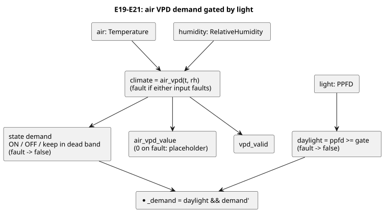

The diagram shows the shared structure of E19–E21. Only the ON/OFF thresholds and the
PPFD gate differ between the three examples.

### E19 — High-VPD humidification demand

<!-- ghostflow:anchor id=GF-INT-PIG-E19-HYSTERESIS kind=intent status=confirmed origin=ai -->
> Keep the previous demand between the two VPD thresholds to prevent rapid switching; clear the demand when the climate sample is faulted.

```ghost
// E19
fn exp_0_3_1(x: Number) -> Number {
  1 + x / 1 * (1 + x / 2 * (1 + x / 3 * (1 + x / 4 * (1 + x / 5 * (1 + x / 6 * (1 + x / 7 * (1 + x / 8 * (1 + x / 9 * (1 + x / 10 * (1 + x / 11 * (1 + x / 12 * (1 + x / 13 * (1 + x / 14 * (1))))))))))))))
}
fn air_vpd(t: Temperature, rh: RelativeHumidity) -> VaporPressureDeficit {
  0.6108kPaVPD * exp_0_3_1(
    17.27 * ((t - 0°C) / 1Δ°C) / (((t - 0°C) / 1Δ°C) + 237.3)
  ) * (1 - rh / 100%RH)
}
control HumidificationDemand {
  input air: Temperature {
    sample = 1s; valid = 0°C .. 50°C;
    filter = median(1); stale_after = 3s; recover_after = 1 samples;
  }
  input humidity: RelativeHumidity {
    sample = 1s; valid = 0%RH .. 100%RH;
    filter = median(1); stale_after = 3s; recover_after = 1 samples;
  }
  input light: PPFD {
    sample = 1s; valid = 0umol/m2/s .. 3000umol/m2/s;
    filter = median(1); stale_after = 3s; recover_after = 1 samples;
  }
  let climate: Result<VaporPressureDeficit, SensorFault> = case air {
    ok(t) => case humidity {
      ok(rh) => ok(air_vpd(t, rh));
      fault(reason) => fault(reason);
    };
    fault(reason) => fault(reason);
  };
  let daylight = case light {
    ok(ppfd) => ppfd >= 200umol/m2/s;
    fault(_) => false;
  };
  // ghostflow:link id=GF-INT-PIG-E19-HYSTERESIS relation=implements
  state demand: Bool = false;
  demand' = case climate {
    ok(value) => if value > 1.2kPaVPD then true
      else if value < 1.0kPaVPD then false else demand;
    fault(_) => false;
  };
  output air_vpd_value: VaporPressureDeficit;
  output vpd_valid, humidify_demand: Bool;
  air_vpd_value <- climate |> recover(0kPaVPD);
  vpd_valid <- case climate { ok(_) => true; fault(_) => false; };
  humidify_demand <- daylight && demand';
}
```

### E20 — Low-VPD ventilation demand

<!-- ghostflow:anchor id=GF-INT-PIG-E20-HYSTERESIS kind=intent status=confirmed origin=ai -->
> Keep the previous demand between the two VPD thresholds to prevent rapid switching; clear the demand when the climate sample is faulted.

```ghost
// E20
fn exp_0_3_1(x: Number) -> Number {
  1 + x / 1 * (1 + x / 2 * (1 + x / 3 * (1 + x / 4 * (1 + x / 5 * (1 + x / 6 * (1 + x / 7 * (1 + x / 8 * (1 + x / 9 * (1 + x / 10 * (1 + x / 11 * (1 + x / 12 * (1 + x / 13 * (1 + x / 14 * (1))))))))))))))
}
fn air_vpd(t: Temperature, rh: RelativeHumidity) -> VaporPressureDeficit {
  0.6108kPaVPD * exp_0_3_1(
    17.27 * ((t - 0°C) / 1Δ°C) / (((t - 0°C) / 1Δ°C) + 237.3)
  ) * (1 - rh / 100%RH)
}
control VentilationDemand {
  input air: Temperature {
    sample = 1s; valid = 0°C .. 50°C;
    filter = median(1); stale_after = 3s; recover_after = 1 samples;
  }
  input humidity: RelativeHumidity {
    sample = 1s; valid = 0%RH .. 100%RH;
    filter = median(1); stale_after = 3s; recover_after = 1 samples;
  }
  input light: PPFD {
    sample = 1s; valid = 0umol/m2/s .. 3000umol/m2/s;
    filter = median(1); stale_after = 3s; recover_after = 1 samples;
  }
  let climate: Result<VaporPressureDeficit, SensorFault> = case air {
    ok(t) => case humidity {
      ok(rh) => ok(air_vpd(t, rh));
      fault(reason) => fault(reason);
    };
    fault(reason) => fault(reason);
  };
  let daylight = case light {
    ok(ppfd) => ppfd >= 200umol/m2/s;
    fault(_) => false;
  };
  // ghostflow:link id=GF-INT-PIG-E20-HYSTERESIS relation=implements
  state demand: Bool = false;
  demand' = case climate {
    ok(value) => if value < 0.4kPaVPD then true
      else if value > 0.6kPaVPD then false else demand;
    fault(_) => false;
  };
  output air_vpd_value: VaporPressureDeficit;
  output vpd_valid, ventilate_demand: Bool;
  air_vpd_value <- climate |> recover(0kPaVPD);
  vpd_valid <- case climate { ok(_) => true; fault(_) => false; };
  ventilate_demand <- daylight && demand';
}
```

### E21 — VPD and light irrigation demand

<!-- ghostflow:anchor id=GF-INT-PIG-E21-HYSTERESIS kind=intent status=confirmed origin=ai -->
> Keep the previous demand between the two VPD thresholds to prevent rapid switching; clear the demand when the climate sample is faulted.

```ghost
// E21
fn exp_0_3_1(x: Number) -> Number {
  1 + x / 1 * (1 + x / 2 * (1 + x / 3 * (1 + x / 4 * (1 + x / 5 * (1 + x / 6 * (1 + x / 7 * (1 + x / 8 * (1 + x / 9 * (1 + x / 10 * (1 + x / 11 * (1 + x / 12 * (1 + x / 13 * (1 + x / 14 * (1))))))))))))))
}
fn air_vpd(t: Temperature, rh: RelativeHumidity) -> VaporPressureDeficit {
  0.6108kPaVPD * exp_0_3_1(
    17.27 * ((t - 0°C) / 1Δ°C) / (((t - 0°C) / 1Δ°C) + 237.3)
  ) * (1 - rh / 100%RH)
}
control IrrigationDemand {
  input air: Temperature {
    sample = 1s; valid = 0°C .. 50°C;
    filter = median(1); stale_after = 3s; recover_after = 1 samples;
  }
  input humidity: RelativeHumidity {
    sample = 1s; valid = 0%RH .. 100%RH;
    filter = median(1); stale_after = 3s; recover_after = 1 samples;
  }
  input light: PPFD {
    sample = 1s; valid = 0umol/m2/s .. 3000umol/m2/s;
    filter = median(1); stale_after = 3s; recover_after = 1 samples;
  }
  let climate: Result<VaporPressureDeficit, SensorFault> = case air {
    ok(t) => case humidity {
      ok(rh) => ok(air_vpd(t, rh));
      fault(reason) => fault(reason);
    };
    fault(reason) => fault(reason);
  };
  let daylight = case light {
    ok(ppfd) => ppfd >= 300umol/m2/s;
    fault(_) => false;
  };
  // ghostflow:link id=GF-INT-PIG-E21-HYSTERESIS relation=implements
  state demand: Bool = false;
  demand' = case climate {
    ok(value) => if value > 1.0kPaVPD then true
      else if value < 0.8kPaVPD then false else demand;
    fault(_) => false;
  };
  output air_vpd_value: VaporPressureDeficit;
  output vpd_valid, irrigation_demand: Bool;
  air_vpd_value <- climate |> recover(0kPaVPD);
  vpd_valid <- case climate { ok(_) => true; fault(_) => false; };
  irrigation_demand <- daylight && demand';
}
```

### E22 — Run two existing VPD controls together through imports

E22 does not copy the E19 or E20 source. Instead, it imports complete `.ghost.md`
documents generated from those two original sections, each pinned by exact revision
and SHA-256.

- One raw sample packet for `air`, `humidity`, and `light` fans out to both instances.
- Each instance keeps its own sensor conditioner and its own `demand` state.
- The root exposes both demands.
- The common VPD observation comes from the `high` instance's `air_vpd_value` and
  `vpd_valid`, calculated from the same inputs.

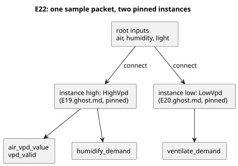

```ghost
// E22
import HighVpd from "./E19.ghost.md"
  revision "041dbfb015b692b9dd9a7879e06b2925462a61fe"
  sha256 "e6006e3dbbe4db7ec058a9e5f152cfe927ca524cf081b1747b66d5b61e0de932";
import LowVpd from "./E20.ghost.md"
  revision "041dbfb015b692b9dd9a7879e06b2925462a61fe"
  sha256 "0c33afee76307db1affcadd5ea7e43260dc6f866fec9afeadb4254358baa5b60";
control CombinedVpdDemands {
  input air: Temperature {
    sample = 1s; valid = 0°C .. 50°C;
    filter = median(1); stale_after = 3s; recover_after = 1 samples;
  }
  input humidity: RelativeHumidity {
    sample = 1s; valid = 0%RH .. 100%RH;
    filter = median(1); stale_after = 3s; recover_after = 1 samples;
  }
  input light: PPFD {
    sample = 1s; valid = 0umol/m2/s .. 3000umol/m2/s;
    filter = median(1); stale_after = 3s; recover_after = 1 samples;
  }
  output air_vpd_value: VaporPressureDeficit;
  output vpd_valid, humidify_demand, ventilate_demand: Bool;
  instance high: HighVpd;
  instance low: LowVpd;
  connect high.air <- air;
  connect high.humidity <- humidity;
  connect high.light <- light;
  connect low.air <- air;
  connect low.humidity <- humidity;
  connect low.light <- light;
  connect air_vpd_value <- high.air_vpd_value;
  connect vpd_valid <- high.vpd_valid;
  connect humidify_demand <- high.humidify_demand;
  connect ventilate_demand <- low.ventilate_demand;
}
```

### Run, observe and change one input

Compile each E16–E21 fence separately as a complete .ghost.md document, as in E15. Compile E22 together with the generated `examples/programming-book-imports` source closure.

To check the compiler and actual ghostsim/WASM scans, run `node --test tests/programming-climate.test.mjs tests/programming-book-simulation.test.mjs tests/programming-book-import-package.test.mjs`. The native and WASM artifacts must have matching build provenance; [Verification](VERIFICATION.md) describes the build prerequisites. The test writes disposable scenario artifacts and never drives hardware.

By default, the online reader uses a coordinated **24-hour synthetic daily profile**, built on the time-dependent sensor source introduced with E10:

- Temperature, RH and PPFD change linearly between the knots in the table below, and the profile repeats continuously.
- Temperature never decreases during 06–18, and light is exactly zero during 18–06.
- Each declared sample interval supplies new typed sensor evidence. The actual WASM program computes VPD and control demand.

This is an illustrative input trajectory, not a greenhouse model or actuator feedback.

| Simulated hour | Air °C | RH % | PPFD µmol·m⁻²·s⁻¹ | Observe |
|---|---|---|---|---|
| 00 | 18 | 90 | 0 | Initial heater OFF; light-gated demands OFF |
| 03 | 17 | 92 | 0 | Heater ON |
| 06 | 16 | 94 | 0 | Sunrise; heater ON |
| 09 | 22 | 85 | 500 | Low-VPD ventilation ON; heater retains ON at exact 22°C |
| 12 | 28 | 60 | 1000 | Humidification and irrigation demand ON; heater/ventilation OFF |
| 15 | 31 | 45 | 650 | High-VPD demands remain ON |
| 18 | 31 | 60 | 0 | Sunset; light-gated demands OFF |
| 21 | 23 | 80 | 0 | Night cooling; heater still OFF |
| 24 | 18 | 90 | 0 | Continuous loop boundary; heater turns ON only below 18°C |

Run each example from simulated 00:00. E16–E21 default to 1000× speed and a 24-hour timing chart; compare the hours 09, 12, 15 and 18.

- Actual wall-clock throughput depends on the computer.
- Speed changes only how much simulated time passes per wall-clock second. It does not change thresholds or the daily profile.
- Pause freezes simulation time.
- The heater ON at 09 turns off once temperature rises strictly above 22°C.
- These are independent programs, so no interlock between heater and ventilation is implied.
- Unit selection changes entry/display units without changing physical values: 17°C = 62.6°F = 290.15K. E16–E18 must make identical decisions across the day.

Constant-value and manual single-packet modes remain useful for individual boundary experiments. They are optional debugging sources; they do not replace observing how decisions change over the day.

To test Stale, use single-packet mode or stop sample delivery, then advance simulation time to the declared 3s boundary. Repeated constant-source samples are fresh evidence, so they should not become stale. To demonstrate Disconnected, choose that sample quality; a newly delivered failure is still a failure. Do not simulate a disconnection by reusing an old Good packet as if it were fresh.

Suggested experiments:

- **Heater:** observe 18 → 17 → 18 → 22 → 23°C, then a sensor fault and recovery.
- **Each VPD controller:** hold temperature at 25°C and change RH to cross its thresholds; then change only PPFD. Compare requested/safe demand, air_vpd_value and vpd_valid.
- **Faults:** try absent, Invalid, Disconnected and stale samples. Each relevant fault must inhibit the output immediately.
- **Numerical relation:** change T and RH together.

Do not interpret a logical demand, a successful scan, or a virtual actuator as a physically confirmed effect.

<a id="ch15"></a>
## 15. Named physical quantities and units

A number that computes is not necessarily a number that means something. Flow
multiplied by time gives a volume. Adding a voltage to a flow rate also produces a
number, but the question itself is wrong. Before you run E33, predict the result:
conversions between units of one quantity succeed, and mixtures of different
quantities are diagnosed. When the compiler rejects such an expression, it is not
getting in your way. It has caught a field misunderstanding before execution.

This chapter does not cover `Duration` (Chapter 6) or dates and times (Chapter 7).
It covers the 17 named physical quantities, such as temperature, pressure, and light,
whose units change what a control value means. Keep these values in their own types
instead of converting them to unitless `Number`. The compiler can then stop you from
comparing readings of two unrelated sensors that happen to hold similar numbers.
`Rate<Q>` is an expression-only type derived over a time window. It is not a separate
entry in the quantity catalog, so Chapter 13 covers it.

### Each physical quantity has its own type

The literals below are valid spellings for each type.
[Reference §2.9](reference/02-types-expressions-state.en.md#29-physical-quantities-and-units)
lists every accepted unit suffix and each type's canonical unit. When an expression
uses different units of the same type, GhostFlow converts them to the canonical unit.
The conversion never changes the quantity's type.

| Named type | Literal example | Meaning |
|---|---|---|
| `Temperature` | `25°C`, `77°F`, `298.15K` | Absolute temperature |
| `TemperatureDelta` | `5Δ°C`, `9Δ°F` | Difference in temperature |
| `RelativeHumidity` | `70%RH` | Relative humidity |
| `Pressure` | `100kPa` | Pressure |
| `VaporPressureDeficit` | `1kPaVPD` | Difference between saturation and actual vapor pressure |
| `CO2Concentration` | `800ppm` | Carbon dioxide mole fraction |
| `FlowRate` | `5L/min` | Volumetric flow rate |
| `Volume` | `20L` | Volume |
| `Length` | `35cm` | Length |
| `Irradiance` | `300W/m2` | Radiant power per area |
| `PPFD` | `600umol/m2/s` | Photosynthetic photon flux per area and time |
| `Energy` | `1kWh` | Energy |
| `Power` | `150W` | Power |
| `ElectricalCurrent` | `800mA` | Electric current |
| `Voltage` | `24V` | Voltage |
| `Conductivity` | `1.5mS/cm` | Electrical conductivity |
| `Acidity` | `6.5pH` | Acidity measure |

The diagram below summarizes the idea of this chapter. A unit is only a spelling:
every temperature literal becomes the same `Temperature` type. Quantities that sound
alike, such as the two light measurements, stay separate types.

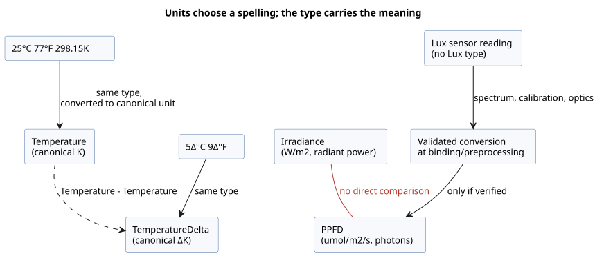

### Units of the same quantity can be combined

`25°C` and `77°F` use different numbers and unit spellings, but both are
`Temperature`. A sensor value of that type can therefore be compared with either
boundary. `5Δ°C` and `9Δ°F` are likewise the same temperature difference.

An absolute temperature and a temperature difference are different types:

- Subtracting one temperature from another produces a `TemperatureDelta`.
- Adding a delta to a temperature, or subtracting one from it, produces a `Temperature`.
- Adding two absolute temperatures is an error.

GhostFlow does not perform arbitrary dimensional algebra. The set of operations is
closed:

- Values of the same type can be compared.
- Values of the same linear quantity can be added and subtracted.
- A quantity can be multiplied or divided by a numeric scalar.
- Products and quotients between different quantities are limited to defined
  relationships: `FlowRate * Duration -> Volume`, `Power * Duration -> Energy`, and
  `Voltage * ElectricalCurrent -> Power`, plus the matching divisions
  (`Volume / Duration` gives `FlowRate`; `Energy / Duration` gives `Power`).

Everything else is an error. That includes undefined combinations such as
`Pressure + Length`, and implicit conversion to unitless `Number`. Reference §2.9 lists
the few additional rules, for example for `RelativeHumidity`, `CO2Concentration`, and
`Acidity`.

| Valid expression | Result | Invalid mixture example |
|---|---|---|
| `room < 25°C && room < 77°F` | Temperature comparisons | `room + room` — adding absolute temperatures |
| `change >= 5Δ°C && change >= 9Δ°F` | Temperature-difference comparisons | `room > change` — comparing temperature with a delta |
| `flow * 1min` | `Volume` | `flow + 20L` — adding flow rate and volume |
| `voltage * current` | `Power` | `pressure > vpd` — comparing pressure and VPD |
| `power * 1h` | `Energy` | `irradiance > ppfd` — comparing different light quantities |

### Keep sensor light units distinct

Greenhouse sensors can report light measurements with similar names in different
units:

- `Irradiance`, in `W/m2`, is the radiant power reaching an area.
- `PPFD`, in `umol/m2/s`, counts photons in the band that drives photosynthesis.

These are different physical types. You cannot compare them directly or use one as
the other's threshold. Without a validated conversion that accounts for the light
spectrum, no general conversion factor exists between them.

The current quantity catalog has no `Lux` type. Do not connect a lux sensor value as
if it were PPFD by renaming it. Lux measures illuminance weighted by the sensitivity
of the human eye. A trustworthy conversion has to account for the light source's
spectrum, the sensor's calibration, and the optics. State that conversion at the
sensor binding or at a validated preprocessing boundary, and make the resulting type
match the actual unit. When sensors measure different quantities, declare them
separately so that each input's type can be checked.

### E33 — Check mixed units and quantities in one control

This example uses every named physical quantity in the supported catalog. The allowed
relationships, such as temperature and temperature delta, flow rate and volume, and
voltage and current, show their result types. The radiant irradiance sensor and the
PPFD sensor are declared as separate types.

```ghost
// E33
control PhysicalQuantityUnits {
  state displayed_temperature_ok: Bool = false;
  displayed_temperature_ok' = if air_good then air >= 25°C && air >= 77°F else displayed_temperature_ok;
  state displayed_change_ok: Bool = false;
  displayed_change_ok' = if temperature_change_good then temperature_change >= 5Δ°C && temperature_change >= 9Δ°F else displayed_change_ok;
  state displayed_humidity_ok: Bool = false;
  displayed_humidity_ok' = if humidity_good then humidity >= 70%RH else displayed_humidity_ok;
  state displayed_pressure_ok: Bool = false;
  displayed_pressure_ok' = if pressure_good then pressure >= 100kPa else displayed_pressure_ok;
  state displayed_vpd_ok: Bool = false;
  displayed_vpd_ok' = if vpd_good then vpd >= 1kPaVPD else displayed_vpd_ok;
  state displayed_co2_ok: Bool = false;
  displayed_co2_ok' = if co2_good then co2 >= 800ppm else displayed_co2_ok;
  state displayed_volume_ok: Bool = false;
  displayed_volume_ok' = if tank_volume_good then tank_volume >= 20L else displayed_volume_ok;
  state displayed_length_ok: Bool = false;
  displayed_length_ok' = if pipe_length_good then pipe_length >= 35cm else displayed_length_ok;
  state displayed_energy_ok: Bool = false;
  displayed_energy_ok' = if stored_energy_good then stored_energy >= 1kWh else displayed_energy_ok;
  state displayed_power_ok: Bool = false;
  displayed_power_ok' = if rated_power_good then rated_power >= 150W else displayed_power_ok;
  state displayed_current_ok: Bool = false;
  displayed_current_ok' = if current_good then current >= 800mA else displayed_current_ok;
  state displayed_voltage_ok: Bool = false;
  displayed_voltage_ok' = if voltage_good then voltage >= 24V else displayed_voltage_ok;
  state displayed_conductivity_ok: Bool = false;
  displayed_conductivity_ok' = if conductivity_good then conductivity >= 1.5mS/cm else displayed_conductivity_ok;
  state displayed_acidity_ok: Bool = false;
  displayed_acidity_ok' = if acidity_good then acidity <= 6.5pH else displayed_acidity_ok;
  state displayed_pumped_volume: Volume = 0L;
  displayed_pumped_volume' = if flow_good then flow * 1min else displayed_pumped_volume;
  state displayed_motor_power: Power = 0W;
  displayed_motor_power' = if current_good && voltage_good then motor_load else displayed_motor_power;
  state displayed_hourly_energy: Energy = 0Wh;
  displayed_hourly_energy' = if current_good && voltage_good then motor_load * 1h else displayed_hourly_energy;
  // Source-local display memory is initialized here; faults remain producer unknown.
  state remembered_air: Temperature = 0°C;
  let air_good = case observed_air { ok(_) => true; fault(_) => false; };
  let air = case observed_air { ok(value) => value; fault(_) => remembered_air; };
  remembered_air' = air;
  state remembered_temperature_change: TemperatureDelta = 0Δ°C;
  let temperature_change_good = case observed_temperature_change { ok(_) => true; fault(_) => false; };
  let temperature_change = case observed_temperature_change { ok(value) => value; fault(_) => remembered_temperature_change; };
  remembered_temperature_change' = temperature_change;
  state remembered_humidity: RelativeHumidity = 0%RH;
  let humidity_good = case observed_humidity { ok(_) => true; fault(_) => false; };
  let humidity = case observed_humidity { ok(value) => value; fault(_) => remembered_humidity; };
  remembered_humidity' = humidity;
  state remembered_pressure: Pressure = 0kPa;
  let pressure_good = case observed_pressure { ok(_) => true; fault(_) => false; };
  let pressure = case observed_pressure { ok(value) => value; fault(_) => remembered_pressure; };
  remembered_pressure' = pressure;
  state remembered_vpd: VaporPressureDeficit = 0kPaVPD;
  let vpd_good = case observed_vpd { ok(_) => true; fault(_) => false; };
  let vpd = case observed_vpd { ok(value) => value; fault(_) => remembered_vpd; };
  remembered_vpd' = vpd;
  state remembered_co2: CO2Concentration = 0ppm;
  let co2_good = case observed_co2 { ok(_) => true; fault(_) => false; };
  let co2 = case observed_co2 { ok(value) => value; fault(_) => remembered_co2; };
  remembered_co2' = co2;
  state remembered_flow: FlowRate = 0L/min;
  let flow_good = case observed_flow { ok(_) => true; fault(_) => false; };
  let flow = case observed_flow { ok(value) => value; fault(_) => remembered_flow; };
  remembered_flow' = flow;
  state remembered_tank_volume: Volume = 0L;
  let tank_volume_good = case observed_tank_volume { ok(_) => true; fault(_) => false; };
  let tank_volume = case observed_tank_volume { ok(value) => value; fault(_) => remembered_tank_volume; };
  remembered_tank_volume' = tank_volume;
  state remembered_pipe_length: Length = 0m;
  let pipe_length_good = case observed_pipe_length { ok(_) => true; fault(_) => false; };
  let pipe_length = case observed_pipe_length { ok(value) => value; fault(_) => remembered_pipe_length; };
  remembered_pipe_length' = pipe_length;
  state remembered_stored_energy: Energy = 0Wh;
  let stored_energy_good = case observed_stored_energy { ok(_) => true; fault(_) => false; };
  let stored_energy = case observed_stored_energy { ok(value) => value; fault(_) => remembered_stored_energy; };
  remembered_stored_energy' = stored_energy;
  state remembered_rated_power: Power = 0W;
  let rated_power_good = case observed_rated_power { ok(_) => true; fault(_) => false; };
  let rated_power = case observed_rated_power { ok(value) => value; fault(_) => remembered_rated_power; };
  remembered_rated_power' = rated_power;
  state remembered_current: ElectricalCurrent = 0A;
  let current_good = case observed_current { ok(_) => true; fault(_) => false; };
  let current = case observed_current { ok(value) => value; fault(_) => remembered_current; };
  remembered_current' = current;
  state remembered_voltage: Voltage = 0V;
  let voltage_good = case observed_voltage { ok(_) => true; fault(_) => false; };
  let voltage = case observed_voltage { ok(value) => value; fault(_) => remembered_voltage; };
  remembered_voltage' = voltage;
  state remembered_conductivity: Conductivity = 0mS/cm;
  let conductivity_good = case observed_conductivity { ok(_) => true; fault(_) => false; };
  let conductivity = case observed_conductivity { ok(value) => value; fault(_) => remembered_conductivity; };
  remembered_conductivity' = conductivity;
  state remembered_acidity: Acidity = 0pH;
  let acidity_good = case observed_acidity { ok(_) => true; fault(_) => false; };
  let acidity = case observed_acidity { ok(value) => value; fault(_) => remembered_acidity; };
  remembered_acidity' = acidity;
  input observed_air: Temperature;
  input observed_temperature_change: TemperatureDelta;
  input observed_humidity: RelativeHumidity;
  input observed_pressure: Pressure;
  input observed_vpd: VaporPressureDeficit;
  input observed_co2: CO2Concentration;
  input observed_flow: FlowRate;
  input observed_tank_volume: Volume;
  input observed_pipe_length: Length;
  input irradiance: Irradiance {
    sample = 1s; valid = 0W/m2 .. 1500W/m2;
    filter = median(1); stale_after = 3s; recover_after = 1 samples;
  }
  input ppfd: PPFD {
    sample = 1s; valid = 0umol/m2/s .. 3000umol/m2/s;
    filter = median(1); stale_after = 3s; recover_after = 1 samples;
  }
  input observed_stored_energy: Energy;
  input observed_rated_power: Power;
  input observed_current: ElectricalCurrent;
  input observed_voltage: Voltage;
  input observed_conductivity: Conductivity;
  input observed_acidity: Acidity;

  output temperature_ok, change_ok, humidity_ok, pressure_ok, vpd_ok: Bool;
  output co2_ok, volume_ok, length_ok, irradiance_ok, ppfd_ok: Bool;
  output energy_ok, power_ok, current_ok, voltage_ok, conductivity_ok, acidity_ok: Bool;
  output pumped_volume: Volume;
  output motor_power: Power;
  output hourly_energy: Energy;

  let motor_load = voltage * current;
  temperature_ok <- displayed_temperature_ok';
  change_ok <- displayed_change_ok';
  humidity_ok <- displayed_humidity_ok';
  pressure_ok <- displayed_pressure_ok';
  vpd_ok <- displayed_vpd_ok';
  co2_ok <- displayed_co2_ok';
  volume_ok <- displayed_volume_ok';
  length_ok <- displayed_length_ok';
  irradiance_ok <- case irradiance { ok(value) => value >= 300W/m2; fault(_) => false; };
  ppfd_ok <- case ppfd { ok(value) => value >= 600umol/m2/s; fault(_) => false; };
  energy_ok <- displayed_energy_ok';
  power_ok <- displayed_power_ok';
  current_ok <- displayed_current_ok';
  voltage_ok <- displayed_voltage_ok';
  conductivity_ok <- displayed_conductivity_ok';
  acidity_ok <- displayed_acidity_ok';
  pumped_volume <- displayed_pumped_volume';
  motor_power <- displayed_motor_power';
  hourly_energy <- displayed_hourly_energy';
}
```

Each of the following expressions is rejected, because the operand types differ or
the operation is undefined: `pressure > vpd`, `irradiance > ppfd`, `humidity > 70%`,
`air + air`, and `flow + tank_volume`.

Before you silence such a diagnostic with a conversion, ask whether the physical
question makes sense:

- If only the display unit of one quantity differs, an allowed conversion handles it.
- If the quantity itself differs, as with the light measurements, the conversion
  needs its own verified source and accuracy.

Type checks do not replace sensor calibration or equipment operating limits. They do
make the questions for those checks precise.

<a id="appendix-a"></a>
## Appendix A. Specification guide

Use this appendix after the main text has introduced a concept and you need its exact
boundary. You do not need to memorize it. Treat it as an index that routes a
declaration you are curious about to its Reference rule, rationale ("Why"), and
diagnostics.

The table points from the learning chapters to the normative syntax. It does not
replace the full grammar or an implementation support list.

| Topic | Language Reference |
|---|---|
| `.ghost.md`, fence extraction, anchors, names, declaration skeletons | [Chapter 1](reference/01-source-and-syntax.en.md) |
| Types, integers, Result, expressions, functions, ticks, state | [Chapter 2](reference/02-types-expressions-state.en.md) |
| Duration, time, timers, schedules, solar/lunar/tide | [Chapter 3](reference/03-time-and-schedules.en.md) |
| Sensor quality, filters, capabilities, constraints, resources | [Chapter 4](reference/04-sensors-constraints-control.en.md) |
| Typed config, live updates, observation descriptors | [Chapter 5](reference/05-settings-and-observation.en.md) |
| Import, instance, connect, macro, replay, replacement | [Chapter 6](reference/06-composition-and-replay.en.md) |
| Errors, uncertainty, syntax index | [Chapter 7](reference/07-semantic-rules-and-index.en.md) |
| Language/runtime/Driver/binding/UI responsibilities | [Chapter 8](reference/08-language-runtime-and-device-boundaries.en.md) |
| Frequently asked coding examples | [GhostFlow Coding FAQ](language_faq.md) |

<a id="appendix-b"></a>
## Appendix B. Learning through errors

A good diagnostic does not stop at "this is wrong". It tells you which promise was
broken. E90–E102 are not examples to fix until they pass. They are experiments whose
expected outcome is failure: predict where the diagnostic will point and why, then
check. Keep only one error in a program at a time, so the boundary the compiler
protects stays clearly visible.

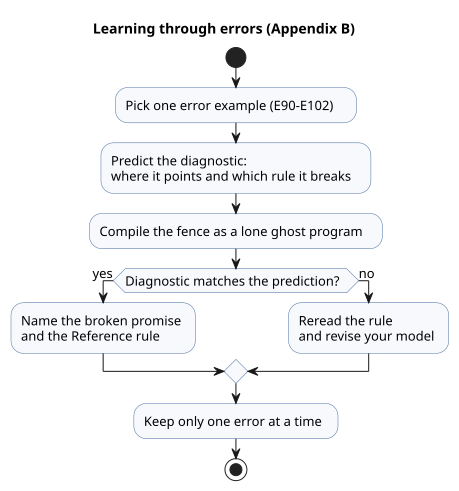

These short error examples exercise Reference rules. Read each one on its own.

`ghost-error` is a presentation tag that marks error examples in this guide. Real
`.ghost.md` execution fences use exactly `ghost`. Do not put the error code below into
an executable program.

### E90 — Missing semicolon

```ghost-error
control MissingSemicolon {
  input start: Bool
  output pump: Bool;
  pump <- start;
}
```

A line break does not end a declaration. Each declaration needs a `;` after it.

### E91 — Comparing different types

```ghost-error
control MixedTypes {
  let level: Number = 0;
  output pump: Bool;
  pump <- level < 30%;
}
```

`Number` and `Percent` are never converted into each other implicitly.

### E92 — Next-state dependency

```ghost-error
control NextDependency {
  state a: Bool = false;
  state b: Bool = false;
  output lamp: Bool;
  a' = !a;
  b' = a';
  lamp <- b';
}
```

Within one tick, every next-state expression reads the snapshot of the previous state.
It cannot chain reads through another state's next value.

### E93 — Two root controls

```ghost-error
control First { output lamp: Bool; lamp <- false; }
control Second { output lamp: Bool; lamp <- true; }
```

A program has exactly one root control, which is the one that executes. To reuse
several controls, use import, instance, and connect from Reference Chapter 6.

### E94 — Exceeding the mutable integer range

```ghost-error
control OutOfRange {
  let count = 2147483648;
  output lamp: Bool;
  lamp <- false;
}
```

An `Int` literal must fit the signed 32-bit range. See
[Reference §2.3](reference/02-types-expressions-state.en.md#23-exact-integer-design)
for integer ranges and conversions.

### E95 — Missing enum case

```ghost-error
control MissingCase {
  type Mode = Off | On;
  state mode: Mode = Off;
  output lamp: Bool;
  lamp <- case mode { Off => false; };
}
```

A `case` must handle every member of the enum.

### E96 — Duplicate output connection

```ghost-error
control DuplicateOutput {
  output lamp: Bool;
  lamp <- false;
  lamp <- true;
}
```

An output takes exactly one connection. A later statement does not overwrite an
earlier connection.

### E97 — Unhandled sensor Result

```ghost-error
control BareSensor {
  input moisture: Percent;
  output pump: Bool;
  pump <- moisture < 30%;
}
```

A sensor is a Result, not its payload, so do not compare it directly. Use `case` or an
explicit Result transform from Reference §2.5.

<a id="appendix-c"></a>
## Appendix C. Document maintenance rules

The examples in this book are teaching fragments and checked contracts at the same
time. When you edit prose, preserve anchors, example IDs, canonical fences, and the
correspondence between translations. Then readers and regression tests keep pointing
at the same example. Keep the source distinct from its projections, so that new prose
never creates a second executable original.

A teaching example about a changing environment cannot prove its intent with one
constant, valid input. Keep independent checkpoints before ON, at the ON boundary,
through the band where the output is held, and at the OFF boundary. A daily trace adds
to the fault and strict-boundary scans; it does not replace them.

The Language Reference is normative. Follow these rules when you maintain this guide:

- If you find a conflict or a missing example here, check the relevant Reference
  section before correcting the guide.
- A syntax or semantic change first updates the Reference syntax, rules, reasons, and
  examples. Then synchronize this guide's learning path and code.
- Link implementation boundaries that learners need to evidence documents. Keep
  changing facts, such as progress, test counts, artifact hashes, and supported-board
  lists, in those documents.
- Reuse `tests/docs-runnable-examples.test.mjs` for compiler checks of examples.
- After changing the book, run `npm run generate:pc01` to refresh derived provenance.
  Do not alter historical replay and benchmark evidence.

<a id="appendix-d"></a>
## Appendix D. Examples by audience

The same GhostFlow program raises different first questions for different readers. A
PLC developer starts from interlocks, a web developer from the observation model, and
a firmware developer from the binding boundary. E23–E32 offer those different
entrances, and all of them return to the same requested/safe/applied/confirmed
distinction. Start with the role nearest yours. Then reread the same trace with
another role's question in mind.

The ten programs show which questions different jobs bring to one trace. Each is an
independent, executable program, so pick one that interests you and change the order
of its inputs. A PLC developer may look first for the condition that blocked the
output, a web developer for the evidence to display, and a firmware developer for the
boundary between a logical value and a pin. The result is logical evidence. Boards,
Drivers, wiring, and field checks remain responsible for real contacts, valves, and
motors.

### E23 — PLC developers: trace a fault from its cause to the output

> “No more guessing why the system stopped.”

When a conveyor stops unexpectedly, the first question is not "should I press Start
again?" but "which condition stopped it?" In any scan where the jam input reports a
jam (`jam_clear=false`), this program drops the running state and remembers the fault.
After the cause is gone, pressing reset clears the fault, but the conveyor does not
restart until the operator releases Start and presses it again.

Try it:

1. Run one scan with `start=true`, `jam_clear=false`, and `reset=false`.
   `fault_latched` and `fault_lamp` turn on; `running` and `conveyor` turn off.
2. Clear the jam, then press reset. Only the fault memory clears; the drive stays
   stopped.

You can follow, directly in the source, which inputs and states each output decision
used. The electrical meaning of the jam detector and the emergency-stop circuit still
need their own design.

```ghost
// E23
control TraceableConveyor {
  // Source-local display memory is initialized here; faults remain producer unknown.
  state remembered_start: Bool = false;
  let start_good = case observed_start { ok(_) => true; fault(_) => false; };
  let start = case observed_start { ok(value) => value; fault(_) => remembered_start; };
  remembered_start' = start;
  state remembered_stop: Bool = false;
  let stop_good = case observed_stop { ok(_) => true; fault(_) => false; };
  let stop = case observed_stop { ok(value) => value; fault(_) => remembered_stop; };
  remembered_stop' = stop;
  state remembered_jam_clear: Bool = false;
  let jam_clear_good = case observed_jam_clear { ok(_) => true; fault(_) => false; };
  let jam_clear = case observed_jam_clear { ok(value) => value; fault(_) => remembered_jam_clear; };
  remembered_jam_clear' = jam_clear;
  state remembered_reset: Bool = false;
  let reset_good = case observed_reset { ok(_) => true; fault(_) => false; };
  let reset = case observed_reset { ok(value) => value; fault(_) => remembered_reset; };
  remembered_reset' = reset;
  input observed_start: Bool;
  input observed_stop: Bool;
  input observed_jam_clear: Bool;
  input observed_reset: Bool;
  state running: Bool = false;
  state fault_latched: Bool = false;
  state start_armed: Bool = true;
  let fault_next = (fault_latched && !reset) || !jam_clear;

  fault_latched' = if jam_clear_good && !jam_clear then true else if start_good && stop_good && jam_clear_good && reset_good then (fault_next) else fault_latched;
  start_armed' = if stop_good && stop then false else if jam_clear_good && !jam_clear then false else if start_good && stop_good && jam_clear_good && reset_good then (!fault_next && !start) else start_armed;
  running' = if stop_good && stop then false else if jam_clear_good && !jam_clear then false else if start_good && stop_good && jam_clear_good && reset_good then (!stop && jam_clear && !fault_latched && (running || (start_armed && start))) else running;

  output conveyor, fault_lamp: Bool;
  conveyor <- running';
  fault_lamp <- fault_latched';
}
```

### E24 — Web developers: separate the screen’s target from device feedback

> “Now program the world beyond the screen.”

Clicking "open" on a dashboard is not the same as the valve reaching its open
position. Web developers already keep a request separate from the server's response,
but device interfaces often collapse both into the same green icon. Here
`target_open` remembers the commanded state, and the limit input is shown as a
separate confirmation signal.

Set `open_request` for one scan and the command stays active. The "moving" indicator
stays on until `open_limit` becomes true. A close request takes priority over an open
request. The interface can render the target, the output command, and the physical
feedback as three separate values. Whether the limit signal reflects the real position
accurately is the job of the installation and of device diagnostics.

```ghost
// E24
control ValvePanelState {
  state displayed_open_confirmed: Bool = false;
  displayed_open_confirmed' = if open_limit_good && !open_limit then false else if open_limit_good then open_limit else displayed_open_confirmed;
  // Source-local display memory is initialized here; faults remain producer unknown.
  state remembered_open_request: Bool = false;
  let open_request_good = case observed_open_request { ok(_) => true; fault(_) => false; };
  let open_request = case observed_open_request { ok(value) => value; fault(_) => remembered_open_request; };
  remembered_open_request' = open_request;
  state remembered_close_request: Bool = false;
  let close_request_good = case observed_close_request { ok(_) => true; fault(_) => false; };
  let close_request = case observed_close_request { ok(value) => value; fault(_) => remembered_close_request; };
  remembered_close_request' = close_request;
  state remembered_stop: Bool = false;
  let stop_good = case observed_stop { ok(_) => true; fault(_) => false; };
  let stop = case observed_stop { ok(value) => value; fault(_) => remembered_stop; };
  remembered_stop' = stop;
  state remembered_open_limit: Bool = false;
  let open_limit_good = case observed_open_limit { ok(_) => true; fault(_) => false; };
  let open_limit = case observed_open_limit { ok(value) => value; fault(_) => remembered_open_limit; };
  remembered_open_limit' = open_limit;
  input observed_open_request: Bool;
  input observed_close_request: Bool;
  input observed_stop: Bool;
  input observed_open_limit: Bool;
  state target_open: Bool = false;

  target_open' = if close_request_good && close_request then false else if stop_good && stop then false else if open_request_good && close_request_good && stop_good && open_limit_good then (!stop && !close_request && (open_request || target_open)) else target_open;

  output open_command, close_command, moving_open, open_confirmed: Bool;
  open_command <- !stop && target_open';
  close_command <- !stop && !target_open';
  moving_open <- !stop && target_open' && !open_limit;
  open_confirmed <- displayed_open_confirmed';
  require !(open_command && close_command);
}
```

### E25 — Firmware developers: catch conflicting direction commands before flashing

> “Run the logic before you energize a relay.”

Forward and reverse requests can both be true in the same scan, because of buttons,
network packets, or contact bounce. This example does not pick one arbitrarily; it
turns both drive commands off. In PIG, alternate between a normal request, a lost stop
permission, and a conflicting request, and inspect each output before you put the
logic on a board.

This is a first step in reading logical priority before a firmware upload. Software
mutual exclusion alone cannot prevent both contactors from closing at once, and it
cannot stop a coasting motor. The equipment needs proper electrical and mechanical
interlocks and independent protection. Equipment that requires a delay before
reversing also needs explicit state and feedback.

```ghost
// E25
control DirectionRequestGate {
  state displayed_forward_command: Bool = false;
  displayed_forward_command' = if forward_request_good && !forward_request then false else if reverse_request_good && reverse_request then false else if stop_ok_good && !stop_ok then false else if forward_request_good && reverse_request_good && stop_ok_good then stop_ok && forward_request && !reverse_request else displayed_forward_command;
  state displayed_reverse_command: Bool = false;
  displayed_reverse_command' = if forward_request_good && forward_request then false else if reverse_request_good && !reverse_request then false else if stop_ok_good && !stop_ok then false else if forward_request_good && reverse_request_good && stop_ok_good then stop_ok && reverse_request && !forward_request else displayed_reverse_command;
  state displayed_conflict: Bool = false;
  displayed_conflict' = if forward_request_good && !forward_request then false else if reverse_request_good && !reverse_request then false else if forward_request_good && reverse_request_good then forward_request && reverse_request else displayed_conflict;
  // Source-local display memory is initialized here; faults remain producer unknown.
  state remembered_stop_ok: Bool = false;
  let stop_ok_good = case observed_stop_ok { ok(_) => true; fault(_) => false; };
  let stop_ok = case observed_stop_ok { ok(value) => value; fault(_) => remembered_stop_ok; };
  remembered_stop_ok' = stop_ok;
  state remembered_forward_request: Bool = false;
  let forward_request_good = case observed_forward_request { ok(_) => true; fault(_) => false; };
  let forward_request = case observed_forward_request { ok(value) => value; fault(_) => remembered_forward_request; };
  remembered_forward_request' = forward_request;
  state remembered_reverse_request: Bool = false;
  let reverse_request_good = case observed_reverse_request { ok(_) => true; fault(_) => false; };
  let reverse_request = case observed_reverse_request { ok(value) => value; fault(_) => remembered_reverse_request; };
  remembered_reverse_request' = reverse_request;
  input observed_stop_ok: Bool;
  input observed_forward_request: Bool;
  input observed_reverse_request: Bool;
  output forward_command, reverse_command, conflict: Bool;

  forward_command <- displayed_forward_command';
  reverse_command <- displayed_reverse_command';
  conflict <- displayed_conflict';
  require !(forward_command && reverse_command);
}
```

### E26 — AI developers: keep reviewable intent beside generated rules

> “Even when AI writes it, the reason for the behavior must remain.”

A generated control program that compiles has not thereby shown what was intended.
Reviewers need one document that links three things: the field assumptions, the rule
that encodes them, and the input sequences worth simulating. A `.ghost.md` file keeps
prose and executable code in one source, and the compiler reads its top-level `ghost`
fences together with their original locations.

The rule below requests the pump only when the watering window is open, the soil
needs water, and the water source is ready. In a real project, note in the prose any
assumptions the AI made, such as sensor polarity, and any open field decisions. A
responsible person then confirms them and records the result as a source revision.
The document format cannot guarantee that the AI is right, but it keeps the review
target from hiding inside generated code.

```ghost
// E26
control ReviewedWateringRule {
  state displayed_pump_request: Bool = false;
  displayed_pump_request' = if soil_needs_water_good && !soil_needs_water then false else if source_ready_good && !source_ready then false else if watering_window_good && !watering_window then false else if soil_needs_water_good && source_ready_good && watering_window_good then watering_window && soil_needs_water && source_ready else displayed_pump_request;
  // Source-local display memory is initialized here; faults remain producer unknown.
  state remembered_watering_window: Bool = false;
  let watering_window_good = case observed_watering_window { ok(_) => true; fault(_) => false; };
  let watering_window = case observed_watering_window { ok(value) => value; fault(_) => remembered_watering_window; };
  remembered_watering_window' = watering_window;
  state remembered_soil_needs_water: Bool = false;
  let soil_needs_water_good = case observed_soil_needs_water { ok(_) => true; fault(_) => false; };
  let soil_needs_water = case observed_soil_needs_water { ok(value) => value; fault(_) => remembered_soil_needs_water; };
  remembered_soil_needs_water' = soil_needs_water;
  state remembered_source_ready: Bool = false;
  let source_ready_good = case observed_source_ready { ok(_) => true; fault(_) => false; };
  let source_ready = case observed_source_ready { ok(value) => value; fault(_) => remembered_source_ready; };
  remembered_source_ready' = source_ready;
  input observed_watering_window: Bool;
  input observed_soil_needs_water: Bool;
  input observed_source_ready: Bool;
  output pump_request: Bool;

  pump_request <- displayed_pump_request';
}
```

### E27 — ESP32 and controller-board makers: connect I/O counts to real uses

> “Give a good board more ways to be useful.”

A data sheet that lists eight inputs and eight outputs still leaves customers guessing
what they could build. This example connects a grow light, a circulation fan, a drain
pump, and a warning output to operating conditions. A board maker can publish it as a
product example of logical roles that customers map onto their own board.

Output names describe device roles, not GPIO numbers. The board binding, input driver,
and output renderer decide which channel drives `grow_light` and which sensor supplies
each input. A manufacturer therefore does not have to promise that one source works
automatically on every board. Instead, it can ship the example together with a wiring
map verified for each board.

```ghost
// E27
control BoardShowcase {
  state displayed_grow_light: Bool = false;
  displayed_grow_light' = if enabled_good && !enabled then false else if light_schedule_good && !light_schedule then false else if enabled_good && light_schedule_good then enabled && light_schedule else displayed_grow_light;
  state displayed_circulation_fan: Bool = false;
  displayed_circulation_fan' = if enabled_good && !enabled then false else if ventilation_request_good && !ventilation_request then false else if enabled_good && ventilation_request_good then enabled && ventilation_request else displayed_circulation_fan;
  state displayed_drain_pump: Bool = false;
  displayed_drain_pump' = if drain_path_ready_good && !drain_path_ready then false else if drain_request_good && !drain_request then false else if enabled_good && !enabled then false else if drain_path_ready_good && drain_request_good && enabled_good then enabled && drain_request && drain_path_ready else displayed_drain_pump;
  state displayed_warning: Bool = false;
  displayed_warning' = if drain_path_ready_good && drain_path_ready then false else if drain_request_good && !drain_request then false else if drain_path_ready_good && drain_request_good then drain_request && !drain_path_ready else displayed_warning;
  // Source-local display memory is initialized here; faults remain producer unknown.
  state remembered_enabled: Bool = false;
  let enabled_good = case observed_enabled { ok(_) => true; fault(_) => false; };
  let enabled = case observed_enabled { ok(value) => value; fault(_) => remembered_enabled; };
  remembered_enabled' = enabled;
  state remembered_light_schedule: Bool = false;
  let light_schedule_good = case observed_light_schedule { ok(_) => true; fault(_) => false; };
  let light_schedule = case observed_light_schedule { ok(value) => value; fault(_) => remembered_light_schedule; };
  remembered_light_schedule' = light_schedule;
  state remembered_ventilation_request: Bool = false;
  let ventilation_request_good = case observed_ventilation_request { ok(_) => true; fault(_) => false; };
  let ventilation_request = case observed_ventilation_request { ok(value) => value; fault(_) => remembered_ventilation_request; };
  remembered_ventilation_request' = ventilation_request;
  state remembered_drain_request: Bool = false;
  let drain_request_good = case observed_drain_request { ok(_) => true; fault(_) => false; };
  let drain_request = case observed_drain_request { ok(value) => value; fault(_) => remembered_drain_request; };
  remembered_drain_request' = drain_request;
  state remembered_drain_path_ready: Bool = false;
  let drain_path_ready_good = case observed_drain_path_ready { ok(_) => true; fault(_) => false; };
  let drain_path_ready = case observed_drain_path_ready { ok(value) => value; fault(_) => remembered_drain_path_ready; };
  remembered_drain_path_ready' = drain_path_ready;
  input observed_enabled: Bool;
  input observed_light_schedule: Bool;
  input observed_ventilation_request: Bool;
  input observed_drain_request: Bool;
  input observed_drain_path_ready: Bool;
  output grow_light, circulation_fan, drain_pump, warning: Bool;

  grow_light <- displayed_grow_light';
  circulation_fan <- displayed_circulation_fan';
  drain_pump <- displayed_drain_pump';
  warning <- displayed_warning';
}
```

### E28 — Panel builders and integrators: wait for valve confirmation before requesting the pump

> “Deliver the reason for the behavior along with the equipment.”

Commissioning often exposes the gap between "we commanded the valve to open" and "the
open limit switch reported". Treating them as one condition can request the pump
before the piping state is confirmed. This example remembers the fill request but
holds back the pump output until open feedback arrives.

Try it:

1. Set `fill_request` with `valve_open_limit=false`. Only the valve command turns on.
2. Set the limit to true. The pump request turns on in the next scan.
3. A stop or a source-full input clears the state and stops both outputs.

The installer must still add the limit polarity, a valve timeout, and recovery after a
stop, according to the site's contract.

```ghost
// E28
control ConfirmedValveFill {
  // Source-local display memory is initialized here; faults remain producer unknown.
  state remembered_fill_request: Bool = false;
  let fill_request_good = case observed_fill_request { ok(_) => true; fault(_) => false; };
  let fill_request = case observed_fill_request { ok(value) => value; fault(_) => remembered_fill_request; };
  remembered_fill_request' = fill_request;
  state remembered_stop_ok: Bool = false;
  let stop_ok_good = case observed_stop_ok { ok(_) => true; fault(_) => false; };
  let stop_ok = case observed_stop_ok { ok(value) => value; fault(_) => remembered_stop_ok; };
  remembered_stop_ok' = stop_ok;
  state remembered_valve_open_limit: Bool = false;
  let valve_open_limit_good = case observed_valve_open_limit { ok(_) => true; fault(_) => false; };
  let valve_open_limit = case observed_valve_open_limit { ok(value) => value; fault(_) => remembered_valve_open_limit; };
  remembered_valve_open_limit' = valve_open_limit;
  state remembered_source_full: Bool = false;
  let source_full_good = case observed_source_full { ok(_) => true; fault(_) => false; };
  let source_full = case observed_source_full { ok(value) => value; fault(_) => remembered_source_full; };
  remembered_source_full' = source_full;
  input observed_fill_request: Bool;
  input observed_stop_ok: Bool;
  input observed_valve_open_limit: Bool;
  input observed_source_full: Bool;
  state filling: Bool = false;

  filling' = if stop_ok_good && !stop_ok then false else if source_full_good && source_full then false else if fill_request_good && stop_ok_good && valve_open_limit_good && source_full_good then (stop_ok && !source_full && (fill_request || filling)) else filling;

  output valve_open_command, pump_command: Bool;
  valve_open_command <- filling';
  pump_command <- filling' && valve_open_limit;
  require pump_command => valve_open_command;
}
```

### E29 — Maintenance teams: leave a clue that separates waiting from failure

> “Leave a repair trail that survives the original author.”

Someone who inherits a machine needs to see both the request and the feedback to
answer "why hasn't the pump started yet?" While this controller waits for the valve to
open, it keeps the pump off and turns on `waiting_for_valve`. When the limit arrives,
the waiting indicator turns off and the pump command appears. Losing stop permission
clears both outputs and the waiting indicator.

This indicator does not judge whether the valve's travel time is normal. The interface
and logs should keep "waiting" distinct from a timeout fault. The handover notes should
record the limit input's channel, polarity, and inspection method. The goal is that
the next maintainer knows which input to check first without having to find the
original author.

```ghost
// E29
control ValveWaitDiagnosis {
  state displayed_valve_open_command: Bool = false;
  displayed_valve_open_command' = if fill_request_good && !fill_request then false else if stop_ok_good && !stop_ok then false else if fill_request_good && stop_ok_good then fill_request && stop_ok else displayed_valve_open_command;
  state displayed_pump_command: Bool = false;
  displayed_pump_command' = if fill_request_good && !fill_request then false else if stop_ok_good && !stop_ok then false else if valve_open_limit_good && !valve_open_limit then false else if fill_request_good && stop_ok_good && valve_open_limit_good then fill_request && stop_ok && valve_open_limit else displayed_pump_command;
  state displayed_waiting_for_valve: Bool = false;
  displayed_waiting_for_valve' = if fill_request_good && !fill_request then false else if stop_ok_good && !stop_ok then false else if valve_open_limit_good && valve_open_limit then false else if fill_request_good && stop_ok_good && valve_open_limit_good then fill_request && stop_ok && !valve_open_limit else displayed_waiting_for_valve;
  // Source-local display memory is initialized here; faults remain producer unknown.
  state remembered_fill_request: Bool = false;
  let fill_request_good = case observed_fill_request { ok(_) => true; fault(_) => false; };
  let fill_request = case observed_fill_request { ok(value) => value; fault(_) => remembered_fill_request; };
  remembered_fill_request' = fill_request;
  state remembered_stop_ok: Bool = false;
  let stop_ok_good = case observed_stop_ok { ok(_) => true; fault(_) => false; };
  let stop_ok = case observed_stop_ok { ok(value) => value; fault(_) => remembered_stop_ok; };
  remembered_stop_ok' = stop_ok;
  state remembered_valve_open_limit: Bool = false;
  let valve_open_limit_good = case observed_valve_open_limit { ok(_) => true; fault(_) => false; };
  let valve_open_limit = case observed_valve_open_limit { ok(value) => value; fault(_) => remembered_valve_open_limit; };
  remembered_valve_open_limit' = valve_open_limit;
  input observed_fill_request: Bool;
  input observed_stop_ok: Bool;
  input observed_valve_open_limit: Bool;
  output valve_open_command, pump_command, waiting_for_valve: Bool;

  valve_open_command <- displayed_valve_open_command';
  pump_command <- displayed_pump_command';
  waiting_for_valve <- displayed_waiting_for_valve';
}
```

### E30 — Farmers and operators: choose when to water; let the controller repeat it

> “The farmer decides. The machine repeats.”

An irrigation policy is more than one moisture reading. The farmer's decisions about
the crop and the work appear here as `enabled` and `watering_window`. The controller
requests water only when the soil is dry within that chosen window and the source is
ready. If the source is not ready, it shows the operator that reason.

`watering_window` is not a hidden default standing in for the calendar, the weather,
or the work plan. It is an input that the execution environment supplies according to
a schedule the farmer chose. The farmer can change the window or the dryness rule and
let the controller repeat the same decision. Sensor placement and calibration,
watering volume, and crop-specific thresholds are still decided in the field.

```ghost
// E30
control FarmerDirectedWatering {
  state displayed_pump_request: Bool = false;
  displayed_pump_request' = if enabled_good && !enabled then false else if soil_needs_water_good && !soil_needs_water then false else if source_ready_good && !source_ready then false else if watering_window_good && !watering_window then false else if enabled_good && soil_needs_water_good && source_ready_good && watering_window_good then enabled && watering_window && soil_needs_water && source_ready else displayed_pump_request;
  state displayed_source_attention: Bool = false;
  displayed_source_attention' = if enabled_good && !enabled then false else if soil_needs_water_good && !soil_needs_water then false else if source_ready_good && source_ready then false else if watering_window_good && !watering_window then false else if enabled_good && soil_needs_water_good && source_ready_good && watering_window_good then enabled && watering_window && soil_needs_water && !source_ready else displayed_source_attention;
  // Source-local display memory is initialized here; faults remain producer unknown.
  state remembered_enabled: Bool = false;
  let enabled_good = case observed_enabled { ok(_) => true; fault(_) => false; };
  let enabled = case observed_enabled { ok(value) => value; fault(_) => remembered_enabled; };
  remembered_enabled' = enabled;
  state remembered_watering_window: Bool = false;
  let watering_window_good = case observed_watering_window { ok(_) => true; fault(_) => false; };
  let watering_window = case observed_watering_window { ok(value) => value; fault(_) => remembered_watering_window; };
  remembered_watering_window' = watering_window;
  state remembered_soil_needs_water: Bool = false;
  let soil_needs_water_good = case observed_soil_needs_water { ok(_) => true; fault(_) => false; };
  let soil_needs_water = case observed_soil_needs_water { ok(value) => value; fault(_) => remembered_soil_needs_water; };
  remembered_soil_needs_water' = soil_needs_water;
  state remembered_source_ready: Bool = false;
  let source_ready_good = case observed_source_ready { ok(_) => true; fault(_) => false; };
  let source_ready = case observed_source_ready { ok(value) => value; fault(_) => remembered_source_ready; };
  remembered_source_ready' = source_ready;
  input observed_enabled: Bool;
  input observed_watering_window: Bool;
  input observed_soil_needs_water: Bool;
  input observed_source_ready: Bool;
  output pump_request, source_attention: Bool;

  pump_request <- displayed_pump_request';
  source_attention <- displayed_source_attention';
}
```

### E31 — Makers and automation learners: bring watering and ventilation examples together

> “Plenty of examples. Hard to combine them?”

This example imports the irrigation program E21 and the ventilation program E20
instead of copying them. The root control connects the same air, humidity, and light
inputs to both programs, while each program keeps its own sensor processing and
internal state. Their outputs are exposed separately as `irrigation_demand` and
`ventilate_demand`.

Both demands can be true at the same time. Before you connect them to shared power or
a shared output, decide which combinations are allowed and which takes priority. Each
import pins the original revision and hash. Before loading the combined program onto a
board, also check its memory and compute requirements.

```ghost
// E31
import Irrigation from "./E21.ghost.md"
  revision "041dbfb015b692b9dd9a7879e06b2925462a61fe"
  sha256 "d4102e8f521f49e965e76fff7c1dff74a393c83349cb8592c436f699bbce485d";
import Ventilation from "./E20.ghost.md"
  revision "041dbfb015b692b9dd9a7879e06b2925462a61fe"
  sha256 "0c33afee76307db1affcadd5ea7e43260dc6f866fec9afeadb4254358baa5b60";
control CombinedGreenhouseDemands {
  input air: Temperature {
    sample = 1s; valid = 0°C .. 50°C;
    filter = median(1); stale_after = 3s; recover_after = 1 samples;
  }
  input humidity: RelativeHumidity {
    sample = 1s; valid = 0%RH .. 100%RH;
    filter = median(1); stale_after = 3s; recover_after = 1 samples;
  }
  input light: PPFD {
    sample = 1s; valid = 0umol/m2/s .. 3000umol/m2/s;
    filter = median(1); stale_after = 3s; recover_after = 1 samples;
  }
  output irrigation_demand, ventilate_demand: Bool;
  instance watering: Irrigation;
  instance fan: Ventilation;
  connect watering.air <- air;
  connect watering.humidity <- humidity;
  connect watering.light <- light;
  connect fan.air <- air;
  connect fan.humidity <- humidity;
  connect fan.light <- light;
  connect irrigation_demand <- watering.irrigation_demand;
  connect ventilate_demand <- fan.ventilate_demand;
}
```

### E32 — Open-source users: own the control rule before the hardware

> “The control should survive the company.”

Even if a device vendor or an online service changes, users should be able to read and
keep the control rule they approved. This standalone example takes soil moisture and
its threshold as inputs and spells out the comparison in the source. A subscription
screen or a remote account does not become the private original of the control
decision.

Keep the `.ghost.md` file together with the Language Reference and the compiler
revision, and you keep the material needed to review and regenerate the program.
Running it on another board still depends on that board's supported runtime and I/O
bindings. Owning the program does not guarantee portability, but it keeps the control
intent out of a binary that only one supplier can read.

```ghost
// E32
control OwnedWateringRule {
  state displayed_pump_request: Bool = false;
  displayed_pump_request' = if soil_moisture_good && threshold_good then soil_moisture < threshold else displayed_pump_request;
  // Source-local display memory is initialized here; faults remain producer unknown.
  state remembered_soil_moisture: Percent = 0%;
  let soil_moisture_good = case observed_soil_moisture { ok(_) => true; fault(_) => false; };
  let soil_moisture = case observed_soil_moisture { ok(value) => value; fault(_) => remembered_soil_moisture; };
  remembered_soil_moisture' = soil_moisture;
  state remembered_threshold: Percent = 0%;
  let threshold_good = case observed_threshold { ok(_) => true; fault(_) => false; };
  let threshold = case observed_threshold { ok(value) => value; fault(_) => remembered_threshold; };
  remembered_threshold' = threshold;
  input observed_soil_moisture: Percent;
  input observed_threshold: Percent;
  output pump_request: Bool;
  pump_request <- displayed_pump_request';
}
```

You do not need to read all ten examples. Follow one from its inputs to its output
intent, then look for the same evidence distinction in another role's example. What
GhostFlow aims to leave behind is less a claim that a device moved than the reasons
that let the next person review the decision and carry it forward.

## Exact counts and natural time: executable R14–R17 examples

This final advanced group covers boundaries that cannot be rounded off as "close
enough":

- Scan counts need an exact `Int`.
- Absolute time needs a `DateTime` with an offset.
- Sunrise and tide need evidence from a provider, plus a fallback.

E34–E37 currently run in a separate host profile, not in the browser cabinet. That
they do not open in the browser does not mean the language lacks them. The way to
study this group is to fix the input evidence and compare the results just before,
exactly at, and just after each boundary.

The four examples look different but ask one question: what exact evidence lets us
say that a boundary was crossed? E34 uses a scan count, E35 a UTC instant, E36 a
sunrise occurrence, and E37 a tide occurrence.
[Reference 02](reference/02-types-expressions-state.en.md) and
[Reference 03](reference/03-time-and-schedules.en.md) define the rules. The table
routes each decision to evidence you can rerun.

| Item | Adopted decision and work | Execution evidence |
|---|---|---|
| R14 exact counts | #22/#24/#25: checked i32 Int, explicit conversion, reject overflowing ticks | E34/E98, [integer checks](../tests/int-compiler.test.mjs), [division and boundaries](../tests/int-division-identity.test.mjs) |
| R15 absolute time | #27: DateTime with an offset, exact UTC instant, Duration shifts | E35/E99, [DateTime execution](../tests/date-time-control.test.mjs) |
| R16 calendar/natural schedules | #28 and #401/#403: Solar pulse, Tide run/within, provider and occurrence identity | E36/E37, [natural schedules](../tests/natural-schedule-contract.test.mjs), [Solar scan parity](../tests/solar-scanframe-native-wasm.test.mjs) |
| R17 uncertain-time policy | #29: bounded hold_trusted, Solar fixed_time, explicit terminal skip | E36/E100–E102, [fallback compilation](../tests/natural-fallback-compiler.test.mjs), [fallback execution](../tests/natural-fallback-runtime.test.mjs) |

E34–E37 are standalone programs for which the current compiler emits executable
bytecode. The input evidence each one needs explains why it runs in a separate host
rather than in the browser cabinet. The error examples that follow are the reverse:
they are complete programs that succeed only when the compiler rejects them. Run each
fence separately.

- [Document compilation checks](../tests/docs-runnable-examples.test.mjs) verify that
  both languages contain identical source and that each error produces its intended
  diagnostic.
- [Book execution checks](../tests/programming-natural-examples.test.mjs) exercise the
  host behavior of E34–E37.

Neither kind of check extends to Device deployment or to confirming a physical output.

### E34 — Count true scans exactly

Every successful scan with `add=true` adds one. This counts scans, not rising edges,
so holding `add` true increments the count on every scan. The output reads `count'`,
the value after the parallel update. Adding at the `Int` maximum rejects the tick with
`integer-overflow`, and neither the new state nor the output intent is committed.
Overflow is never hidden by wrapping or saturation.

```ghost
// E34
control ExactScanCount {
  // Source-local display memory is initialized here; faults remain producer unknown.
  state remembered_add: Bool = false;
  let add_good = case observed_add { ok(_) => true; fault(_) => false; };
  let add = case observed_add { ok(value) => value; fault(_) => remembered_add; };
  remembered_add' = add;
  input observed_add: Bool;
  state count: Int = 0;
  output total: Int;
  count' = if add_good then (if add then count + 1 else count) else count;
  total <- count';
}
```

### E35 — Compare an absolute window with explicit offsets

The local spelling 06:30+09:00 and 21:30Z on the previous day name the same UTC
instant. `now` is a typed `DateTime` supplied by the environment; the expression does
not guess what a number means or whether the clock can be trusted. The window
includes its start and excludes its end. `5min` is a fixed `Duration`; it never means
a calendar month or a timezone change. A `DateTime` input or shifted result outside the
supported domain is rejected, without any partial state update.

```ghost
// E35
control AbsoluteWindow {
  state displayed_in_window: Bool = false;
  displayed_in_window' = if now_good then now >= start && now < end else displayed_in_window;
  state displayed_same_instant: Bool = false;
  displayed_same_instant' = if true then start == datetime`2026-09-29T21:30:00Z` else displayed_same_instant;
  // Source-local display memory is initialized here; faults remain producer unknown.
  state remembered_now: DateTime = datetime`1970-01-01T00:00:00Z`;
  let now_good = case observed_now { ok(_) => true; fault(_) => false; };
  let now = case observed_now { ok(value) => value; fault(_) => remembered_now; };
  remembered_now' = now;
  input observed_now: DateTime;
  output in_window, same_instant: Bool;
  let start = datetime`2026-09-30T06:30:00+09:00`;
  let end = start + 5min;
  in_window <- displayed_in_window';
  same_instant <- displayed_same_instant';
}
```

### E36 — Sunrise pulses with bounded clock and fixed-time fallback

When `enabled` is true, the control requests a start pulse at the occurrence thirty
minutes after sunrise. `start` is not a state that stays on all day, and it adds no
run duration. The environment supplies a trusted clock and the evidence for location
and the Solar calculation.

Clock policy, `hold_trusted`:

- Within the same run/time continuity, it extends a previously received trusted clock
  snapshot on monotonic time, for less than two minutes.
- Without that earlier trusted evidence, or exactly at the two-minute boundary, it
  skips.
- Held time is never recorded as trusted wall-clock time.

Fallback policy, `fixed_time`:

- When the Solar event is unavailable, the control uses the explicit alternative at
  06:30 UTC.
- This fallback still needs a valid trusted clock or a bounded held clock.
- An unavailable time never becomes zero or "now"; the terminal policy is skip.

The first observation, and baseline recovery after a large gap, never start past
occurrences retroactively. The schedule evidence records admission, unknown, and
fallback reasons separately.

```ghost
// E36
control SolarFallbackStart {
  state displayed_start: Bool = false;
  displayed_start' = if true then dawn.due else displayed_start;
  // Source-local display memory is initialized here; faults remain producer unknown.
  state remembered_enabled: Bool = false;
  let enabled_good = case observed_enabled { ok(_) => true; fault(_) => false; };
  let enabled = case observed_enabled { ok(value) => value; fault(_) => remembered_enabled; };
  remembered_enabled' = enabled;
  input observed_enabled: Bool;
  schedule dawn: Solar {
    timezone = "UTC";
    latitude = 37;
    longitude = 127;
    at = sun`rise + 30min`;
    basis = pulse;
    when = enabled_good && enabled;
    clock = hold_trusted(2min, terminal: skip);
    gap = skip_after(60s);
    recovery = baseline;
    fallback = fixed_time(time`06:30`, terminal: skip);
  }
  output start: Bool;
  start <- displayed_start';
}
```

### E37 — Admit before high tide, then run on monotonic time

The planned time is thirty minutes before high tide, as predicted by the provider
`harbor_tides`. When predictions are valid and fresh, the clock is trusted, and
`allowed=true`, the control admits one run inside [planned, planned+10min). The exact
end of the window is excluded. The run lasts five minutes from admission, so a late
admission does not extend it. `stop=true` cancels the run through `cancel_when`. Once a
run has been admitted, it continues on monotonic time even if new admissions become
unavailable, subject to cancellation and the run/time continuity rules.

The timing diagram shows one example, where admission happens four minutes after the
planned time: the run still lasts exactly five minutes, and the admission window
closes at planned+10min.

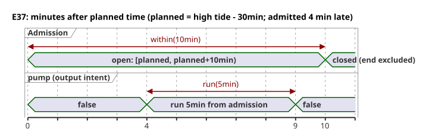

Missing or stale predictions, or an Unknown clock, admit no new runs.
`fallback=skip` neither proves physical fail-safe behavior nor invents predictions.
`pump` is output intent, distinct from the safe, applied, and confirmed physical
facts. The provider's station, revision, and occurrence, and the clock snapshots, are
environment inputs. The code contains no addresses or installation credentials.

```ghost
// E37
control TideRun {
  state displayed_pump: Bool = false;
  displayed_pump' = if true then high.active else displayed_pump;
  // Source-local display memory is initialized here; faults remain producer unknown.
  state remembered_allowed: Bool = false;
  let allowed_good = case observed_allowed { ok(_) => true; fault(_) => false; };
  let allowed = case observed_allowed { ok(value) => value; fault(_) => remembered_allowed; };
  remembered_allowed' = allowed;
  state remembered_stop: Bool = false;
  let stop_good = case observed_stop { ok(_) => true; fault(_) => false; };
  let stop = case observed_stop { ok(value) => value; fault(_) => remembered_stop; };
  remembered_stop' = stop;
  input observed_allowed: Bool;
  input observed_stop: Bool;
  provider harbor_tides: TidePredictions;
  schedule high: Tide {
    source = harbor_tides;
    timezone = "UTC";
    at = tide`high - 30min`;
    basis = run(5min, within(10min));
    when = allowed_good && allowed;
    cancel_when = stop_good && stop;
    clock = trusted_only;
    gap = skip_after(60s);
    recovery = baseline;
    fallback = skip;
  }
  output pump: Bool;
  pump <- displayed_pump';
}
```

### E98 — Reject implicit Int and Number mixing

Here `count` is an `Int` and `measurement` is a `Number`, and the compiler rejects the
code. If you intend an approximate calculation, write `number(count)` explicitly. To
convert to an exact count, choose `int_exact` or an explicit rounding conversion, along
with its error policy.

```ghost-error
control MixedCount {
  let count: Int = 1;
  let measurement: Number = 1.5;
  output total: Number;
  total <- count + measurement;
}
```

### E99 — Reject DateTime without an offset

A local time alone does not identify a UTC instant. Write `Z` or a numeric offset;
GhostFlow never guesses an IANA zone.

```ghost-error
control MissingOffset {
  output ready: Bool;
  ready <- datetime`2026-09-30T06:30:00` < datetime`2026-09-30T07:00:00Z`;
}
```

### E100 — Keep Solar fallback explicit

What happens when data is missing is part of the source contract. A schedule without
its mandatory fallback produces no bytecode. If skipping is the policy you want, write
`fallback = skip;`.

```ghost-error
control MissingSolarFallback {
  schedule dawn: Solar {
    timezone = "UTC"; latitude = 37; longitude = 127; at = sun`rise`;
    basis = pulse; when = true; clock = trusted_only;
    gap = skip_after(60s); recovery = baseline;
  }
  output start: Bool;
  start <- dawn.due;
}
```

### E101 — Keep Solar fixed-time fallback out of Tide

The current `fixed_time` execution path is Solar only. A Tide fallback is `skip`; a
fixed time is never treated as an occurrence of a high-tide prediction.

```ghost-error
control UnsupportedTideFallback {
  provider predictions: TidePredictions;
  schedule high: Tide {
    source = predictions; timezone = "UTC"; at = tide`high`;
    basis = run(5min, within(10min)); when = true; cancel_when = false;
    clock = trusted_only; gap = skip_after(60s); recovery = baseline;
    fallback = fixed_time(time`06:30`, terminal: skip);
  }
  output pump: Bool;
  pump <- high.active;
}
```

### E102 — Specify the end of clock hold

`hold_trusted(2min)` alone would hide what happens when the hold expires. The only
explicit terminal policy currently supported is `terminal: skip`.

```ghost-error
control MissingHoldTerminal {
  schedule dawn: Solar {
    timezone = "UTC"; latitude = 37; longitude = 127; at = sun`rise`;
    basis = pulse; when = true; clock = hold_trusted(2min);
    gap = skip_after(60s); recovery = baseline; fallback = skip;
  }
  output start: Bool;
  start <- dawn.due;
}
```
