<!-- translation-source: docs/ProgrammingInGhostflow.en.md -->
[Original en inglés](ProgrammingInGhostflow.en.md)

# Programación en GhostFlow

**Nota sobre la revisión de entradas externas del 2026-10-05.** Las declaraciones que llevan información de calidad ahora usan `input`. El acondicionamiento existente y las ramas explícitas de fallo de `Result` se mantienen como políticas escritas en la fuente. Los fragmentos anteriores con `sensor` se conservan en `tests/fixtures/history/issue531/`. Una revisión de fuente importada necesita su propia clausura de fuentes (source closure), verificada por separado.

Los ejemplos que antes leían observaciones simples ahora declaran canales productores `observed_*` y manejan su `Result` de forma explícita. Algunas reglas relacionadas se aplican en todo el libro:

- Los estados `remembered_*` y `displayed_*` inicializan la memoria dentro de la fuente. Sus valores iniciales no afirman que el productor haya entregado un `false` o un cero sanos.
- Una observación desconocida conserva la memoria ya establecida. No puede autorizar una nueva transición protegida.
- Un STOP sano actual, o un permiso que se ha retirado, tiene prioridad. Una duración máxima de marcha ya existente sigue venciendo.
- La calidad de adquisición no afirma que un botón físico o un equipo haya fallado.

Estas son revisiones explícitas e ilustrativas. Los conjuntos de datos sanos que se conservan mantienen sus nombres de campo lógicos originales; un adaptador de prueba explícito los conecta.

Escriba el comportamiento de los dispositivos como código y entiéndalo ejecutándolo

**Edición revisada · traducción al español · basada en la Referencia del lenguaje**

## Antes de empezar

Suponga que quiere que una lámpara se encienda al pulsar un interruptor, que el agua corra a una hora fijada o que una bomba se detenga cuando el agua baje demasiado.

Cada tarea es sencilla por sí sola. Pero a medida que se acumulan condiciones y varios dispositivos trabajan juntos, resulta difícil ver qué se enciende, cuándo y por qué se detiene.

GhostFlow es un lenguaje para escribir estas condiciones y acciones como código. Un programa GhostFlow describe cómo cambia su estado en respuesta a los valores de los sensores o a las acciones del usuario, y qué acciones solicita a los dispositivos.

Este libro no le pide que memorice la gramática antes de escribir un programa. En su lugar, repetirá tres pasos:

1. Prediga el resultado.
2. Cambie una sola cosa.
3. Encuentre el tick en el que cambia el resultado.

Un **tick** (paso de decisión lógica) es una evaluación del programa de control; el [Capítulo 1](#ch01) lo explica en detalle. Empezamos con un único interruptor, pero enseguida llegamos a preguntas que surgen en instalaciones reales:

- Cuando START y STOP llegan juntos, ¿cuál gana?
- Cuando un sensor rebota o su valor queda obsoleto, ¿en qué se puede seguir confiando?
- ¿Significa ON en una pantalla que el dispositivo se encendió físicamente?

Conservar la evidencia importa más que acertar la respuesta. Para cada ejemplo, anote las entradas y el estado anterior. Luego prediga el estado siguiente y la intención solicitada y segura. La **intención solicitada** (requested intent) es la salida que pide el programa. La **intención segura** (safe intent) es esa salida después de aplicar las condiciones de seguridad. Por último, compare su predicción con la ejecución. Cuando su predicción difiere de la ejecución, esa diferencia es el concepto que vale la pena aprender.

El diagrama siguiente muestra qué lee y qué produce un tick y, por tanto, qué anotar antes de cada ejecución.


El estado siguiente de un tick se convierte en el estado anterior del tick que le sigue. Los programas sin `state` (como E01) simplemente no tienen estado anterior que leer.

Para las reglas exactas de sintaxis y comportamiento, consulte la [Referencia del lenguaje](LANGUAGE-REFERENCE.es.md). Esta guía enseña mediante ejemplos; la Referencia define el lenguaje. Si ambas discrepan, siga la Referencia. Cuando cambia la sintaxis, primero se actualiza la Referencia y después se alinean con ella los ejemplos de esta guía.

Para las preguntas que surgen mientras escribe código, consulte también las [Preguntas frecuentes de programación en GhostFlow](language_faq.es.md).

### Antes de leer los ejemplos

Que un ejemplo aparezca en esta guía no significa que su funcionalidad esté lista hoy para ejecutarse en una placa física.

Hay tres cosas que necesitan cada una su propia verificación: que el código compile, que el entorno de ejecución admita la funcionalidad y que un dispositivo real se comporte como se pretende. Esta guía explica cómo escribir y leer código según la especificación actual. No afirma que todas las funcionalidades estén implementadas ni listas para desplegarse en una placa.

Esta edición afirma exactamente lo siguiente, y nada más:

- si la fuente sigue la Referencia del lenguaje actual;
- qué comprueban el compilador actual y las rutas de ejecución lógica;
- qué ejercicios puede abrir el lector público.

No afirma ninguna verificación física en una placa, un mazo de cableado, un sensor o un actuador concretos. El alcance de la implementación y la evidencia se definen siempre en el documento [Implementación](IMPLEMENTATION.es.md) del checkout actual, en la [madurez de las funcionalidades y la evidencia ejecutable](REFERENCE-FEATURE-STATUS.es.md) y en las pruebas.

Los ejemplos se clasifican así en el catálogo del lector público:

| Ejemplos | Dónde se comprueban |
|---|---|
| E01–E33 excepto E11, PC-01–PC-10, tutorial/03–04 | Se ejecutan en el lector una vez admitidas las capacidades del navegador que necesitan. |
| E11 | No es un control ejecutable; explica la notación canónica. |
| E34–E37 | Compilan, pero el gabinete actual del navegador no puede admitir `Int`, `DateTime` ni los nuevos hechos de host sobre eventos naturales, así que se comprueban en un perfil de host aparte. |
| `station-rules` | Una gramática de políticas que se ejecuta en un host aparte. |
| E90–E102 | Comprueban los diagnósticos esperados, no una ejecución correcta. |

Estas categorías le indican **dónde puede ver qué evidencia**. No clasifican las funcionalidades por su valor.

### Cómo leer los ejemplos

**Ejecute cada ejemplo por separado.** Cada ejemplo `ghost` es un programa independiente. No junte todos los ejemplos del libro en un solo archivo para ejecutarlos a la vez.

**Las explicaciones forman parte del documento del programa.** Un programa real se escribe como un documento `.ghost.md`. Si el código de un programa está repartido en varios bloques `ghost` de nivel superior, lea esos bloques de arriba abajo como un único programa de control. Los párrafos entre los bloques, incluidas las razones por las que el programa debe comportarse de cierta manera, también permanecen en el documento fuente.

**Distinga las salidas del código del comportamiento del dispositivo.** En este libro, una *salida* es un valor que el programa calcula para solicitar una acción a un dispositivo. Producir un valor que diga «enciende la bomba» no enciende por sí solo una bomba real. Hacen falta dos piezas más: una **vinculación** (binding), que conecta el valor con un pin GPIO o un relé, y un **renderizador de salida** (output renderer), que lo aplica al hardware. Leer valores de los sensores es tarea de un **driver de entrada**.

Para la notación exacta, consulte el [índice de declaraciones y notación de la Referencia (§7.5)](reference/07-semantic-rules-and-index.es.md). La [filosofía de diseño](LANGUAGE-REFERENCE.es.md) explica por qué el lenguaje está diseñado así. El [Capítulo 8 de la Referencia (§8.3)](reference/08-language-runtime-and-device-boundaries.es.md) describe de qué se encarga cada parte: el lenguaje, el entorno de ejecución y el dispositivo.

### ¿Cómo se comprueban los ejemplos?

La [comprobación de ejecución de ejemplos](../tests/programming-book-simulation.test.mjs) compila los ejemplos originales y los ejecuta con entradas y tiempos de prueba especificados. Después comprueba cómo cambió el estado, qué salida se solicitó (intención solicitada) y qué salida queda tras las condiciones de seguridad (intención segura).

Los ejemplos necesitan entradas y entornos de ejecución distintos, así que sus comprobaciones varían:

- Los controles de E01–E33 excepto E11 se comprueban en el perfil de ejecución que selecciona el lector público.
- E02 y E08 reciben resultados de configuración (`Result`) y hechos de contexto. E09 recibe hechos de programación civil, es decir, información de programación basada en el calendario y la hora del reloj.
- E10, E14 y tutorial/03 reciben muestras de sensores y las capacidades que necesitan.
- PC-01–PC-10 y tutorial/03–04 también se ejecutan en el navegador cuando se admiten las capacidades que necesitan.
- E34–E37 y `station-rules` usan los perfiles de host aparte descritos arriba.

Los ejemplos generales de entradas y estado comprueban los resultados lógicos del núcleo Rust compartido. El lector del navegador muestra el mismo significado a través de una ruta WASM. Ambas rutas observan las entradas, el estado, la intención solicitada/segura y los diagnósticos. Ninguna de las dos establece un efecto físico en un dispositivo.

tutorial/04 comprueba eventos de programación y salidas secuenciales en el host WASM existente `ControlRuntime`/`DailySlots`. station-rules compila una política con `ghostrules`, la vincula y luego comprueba la autorización de salidas y `Stop` en el `GhostFlowStation` de WASM. Estos dos ejemplos avanzados se comprueban por separado de la ruta de la CLI `ghostsim`.

E11 explica la notación. E90–E102 contienen deliberadamente código no válido y comprueban que el compilador informe los errores esperados. Los diagramas y las explicaciones sobre la composición de programas no se ejecutan. Los experimentos que modifican la fuente se comprueban por separado de los originales.

Para ejecutar usted mismo la comprobación de ejemplos, necesita las dependencias de Node y los artefactos nativos/WASM compilados a partir de la misma revisión. Luego ejecute `node --test tests/programming-book-simulation.test.mjs`. Consulte [Verificación](VERIFICATION.es.md) para la secuencia completa de compilación y verificación.

La comprobación del compilador en `tests/docs-runnable-examples.test.mjs` se ejecuta sin compilar el runtime.

El Capítulo 14 contiene E16–E22, que tratan sensores de temperatura y de clima. El Capítulo 15 y los ejemplos avanzados E23–E37 profundizan en magnitudes físicas, observación, conteos exactos y tiempo natural. La evidencia de los cálculos de control y de los paquetes de importación se reparte entre `tests/programming-book-simulation.test.mjs`, `tests/programming-climate.test.mjs` y `tests/programming-book-import-package.test.mjs`.

Todos estos pasos comprueban la lógica y los cálculos del programa. Si los sensores y dispositivos reales se comportan como se pretende debe verificarse por separado.

## Contenido

### Del PLC a GhostFlow: empiece con la práctica

Este recorrido práctico de diez etapas empieza con botones y lámparas. Después trata START/STOP, motores, enclavamientos, límites, temporizadores, niveles de agua, operación Manual/Auto, control secuencial y recuperación ante fallos.

En cada etapa, piense primero cómo debe comportarse el dispositivo. Después vea cómo expresar ese comportamiento en código GhostFlow.

### Explorar por tema

1. [Un interruptor y una salida](#ch01)
2. [Nombres, valores, tipos y expresiones](#ch02) · [Tabla de magnitudes y tipos](#quantity-type-lookup)
3. [Qué significa recordar el estado](#ch03)
4. [Intención de salida y salidas finales](#ch04)
5. [Separar cálculos con funciones](#ch05)
6. [Control que espera al tiempo](#ch06)
7. [Arrancar a horas programadas](#ch07)
8. [Valores de sensores y calidad](#ch08)
9. [Leer las expresiones con precisión](#ch09)
10. [Detener, cambiar y comparar](#ch10)
11. [Archivos y programas literarios](#ch11)
12. [Un dispositivo, varios controles](#ch12)
13. [Funciones y operaciones integradas](#ch13)
14. [Unidades de temperatura y control del VPD del aire](#ch14)
15. [Magnitudes físicas con nombre y unidades](#ch15)

Apéndices: [A. Guía de la especificación](#appendix-a) · [B. Aprender a través de los errores](#appendix-b) · [C. Reglas de mantenimiento del documento](#appendix-c) · [D. Ejemplos por público](#appendix-d)


<a id="ch01"></a>
## 1. Un interruptor y una salida

Cuando se aprende control de dispositivos por primera vez, uno puede preguntarse para qué hace falta un lenguaje si una entrada simplemente se cablea a una salida. Esa sencillez es el punto de partida.

Antes de ejecutar E01, anote el valor de la lámpara en tres ticks en los que el interruptor pasa por `false → true → false`. Si el resultado coincide con su predicción, la siguiente pregunta no es sobre el valor, sino sobre **de qué frontera vino el valor**. Una vez que sepa separar el contacto físico, la entrada normalizada, la salida lógica y el relé real, podrá leer de la misma manera todos los programas más complejos de este libro.

### E01 — Conectar una entrada a una salida

El primer programa enciende el LED cuando el interruptor está encendido y lo apaga cuando el interruptor está apagado.

```ghost
// E01
// Explicit quality-input revision: acquisition faults request lamp OFF.
control FollowSwitch {
  input switch_on: Bool;
  output lamp: Bool;

  lamp <- switch_on |> recover(false);
}
```

Este ejemplo revisado lee la entrada externa como `Result<Bool, SensorFault>`. Es decir, en cada tick el programa recibe o bien un valor sano o bien un fallo:

- Un `false` o `true` sano se comporta exactamente como en la tabla siguiente.
- Un fallo (NotReady, Disconnected, Stale o Invalid) solicita explícitamente lámpara OFF. `|> recover(false)` aporta ese `false`.

Solicitar OFF ante un fallo es la política confirmada de este ejemplo. No es un valor predeterminado del lenguaje, ni es evidencia de que el contacto físico esté en OFF. El fallo de entrada y su procedencia se siguen registrando. Este ejemplo de seguimiento del interruptor no añade ningún botón START ni memoria de marcha. La fuente anterior de E01 se conserva en el [registro del código anterior](historical/2026-10-05-input-531-book-excerpts.es.md).

`control FollowSwitch` da un nombre y una frontera a esta decisión. Los valores que entran desde fuera de la frontera son `input`s; los valores que el cálculo envía hacia fuera son `output`s. Entre ellos no hay cableado oculto ni elección de dispositivo.

Lea `lamp <- switch_on |> recover(false)` en el sentido de la flecha: «la solicitud de lámpara de este tick vino de `switch_on`». Incluso con solo dos valores `Bool`, puede explicar de dónde vino una salida. Ese es el primer pequeño resultado de este capítulo.

| Entrada `switch_on` | Salida `lamp` |
|---|---|
| `false` | `false` |
| `true` | `true` |

La tabla muestra los dos momentos posibles. Soltar → pulsar → soltar no es un tercer valor. Es un **escenario de transición** que se mueve entre las dos filas a lo largo del tiempo. Mantener separados la tabla y el escenario evita confundir «¿cuál es el valor ahora?» con «¿cómo llegamos hasta aquí?».

La línea de tiempo siguiente reproduce un escenario así tick a tick y añade un tick en el que la observación es un fallo.

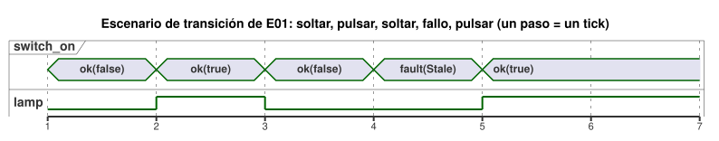

Durante el tick de fallo, la lámpara está en OFF porque este ejemplo elige `recover(false)`, no porque se haya soltado el interruptor.

### Distinguir contactos, entradas de PLC y entradas de GhostFlow

En los circuitos de relés, un contacto NA (normalmente abierto) y un contacto NC (normalmente cerrado) conducen de forma distinta en reposo y al pulsarse. Un PLC lee ese estado eléctrico a través de una entrada digital (DI). Después lo normaliza a un significado de programa, teniendo en cuenta el cableado y la polaridad del módulo de entrada. El `switch_on` de GhostFlow ya es una entrada lógica normalizada. Por tanto, las fronteras de este ejemplo son las siguientes.

| Capa | NA | NC | Valor que se entrega a GhostFlow |
|---|---|---|---|
| En reposo | Contacto abierto | Contacto cerrado | `switch_on = false` |
| Pulsado | Contacto cerrado | Contacto abierto | `switch_on = true` |

Cuando un contacto NC hace que la señal en bruto parezca invertida, se trata de un problema de normalización de la entrada. Un contacto NC no significa, por sí solo, que haya que añadir `!` en el programa. Especifique la normalización en la frontera del cableado/módulo de entrada y entregue a GhostFlow una observación sana cuyo contenido Bool sea `false` o `true`. Conserve la calidad y la identidad de la observación. Una ruta de entrega rota es un fallo; nunca la convierta en un `false` sano.

En resumen:

- Los **relés** crean rutas físicas de contacto.
- Los **PLC** procesan esas entradas con DI y lógica de escalera (ladder) o bloques de función.
- **GhostFlow** conecta entradas normalizadas y con significado a cálculos de salida declarados.

Los ejemplos de este libro explican cálculos lógicos. La verificación de los contactos reales, el cableado eléctrico, los módulos de entrada del PLC o las salidas de los dispositivos corresponde a los contratos de vinculación y de renderizador.

El diagrama siguiente sigue la señal de E01 desde el contacto hasta el relé. Solo la parte central es código GhostFlow.


### La unidad para leer la ejecución: el tick

Una evaluación de control se llama **tick**. Todas las expresiones de un tick ven el mismo conjunto de entradas, capturado una sola vez. No imagine que el interruptor cambia en mitad de un cálculo de modo que distintas expresiones lean momentos físicos distintos. Un nuevo conjunto de entradas llega cuando empieza el siguiente tick.

E01 no tiene memoria, así que la misma observación de entrada siempre produce la misma salida. Suponga que una traza de entradas sanas muestra un tick en el que `switch_on` y `lamp` discrepan por primera vez. Entonces revise la normalización de la entrada, la vinculación o el driver antes de sospechar de esta expresión. El Capítulo 3 añade `state`. A partir de ahí, la misma entrada actual puede producir resultados distintos porque el pasado fue distinto.

La información que conecta `switch_on` con DI1 y `lamp` con RO1 es un mapeo externo al programa. Los nombres no eligen puertos de hardware automáticamente. Por eso el mismo cálculo puede conectarse a un interruptor y un LED virtuales, o a la E/S real de un dispositivo.

### Pruebe a cambiarlo

Cambie la conexión a `lamp <- case switch_on { ok(value) => !value; fault(_) => false; };`. Antes de ejecutarlo, dibuje la nueva tabla en papel. Como `!` invierte verdadero y falso, deberían cambiar las dos celdas de salida.

Después de comprobar el resultado, restaure el original. Esta vez, cambie solo el nombre de la entrada. El comportamiento sigue siendo el mismo, pero cambia la forma en que un lector interpreta el programa. Este es su primer ejercicio para distinguir un cambio de cálculo de un cambio de explicación.

<a id="ch02"></a>
## 2. Nombres, valores, tipos y expresiones

Muchos errores en campo no ocurren porque la aritmética sea difícil, sino porque una persona lee `30` como 30 por ciento y otra lo lee como 30 segundos. En este capítulo, los nombres y los tipos son herramientas que detectan pronto esos malentendidos.

Antes de ejecutar E02, anote las filas esperadas para 29 %, 30 % y 31 %. Después cambie solo `<` por `<=`. Si cambia exactamente una fila límite, podrá ver cuánto acotan la decisión un tipo y una expresión pequeña.

### Notación que separa las sentencias

En la sintaxis actual, las declaraciones y las definiciones de expresiones terminan en `;`. El compilador nunca deduce de un salto de línea que una sentencia ha terminado, así que puede repartir una expresión larga en varias líneas sin cambiar su significado. `{ }` crea un ámbito; la sangría solo ayuda a las personas a ver la estructura. El Apéndice A enumera las pocas posiciones, como la expresión final de una función, en las que el punto y coma es opcional.

Los nombres empiezan con una letra del alfabeto inglés o un guion bajo, y pueden continuar con letras, dígitos o guiones bajos. Los nombres distinguen mayúsculas de minúsculas, así que `start` y `Start` son nombres distintos. No use palabras reservadas ni el prefijo interno `__gf_` como nombres. Por ahora los identificadores son solo ASCII, así que escriba las explicaciones en otros idiomas (por ejemplo, en español) en comentarios `//` o en la prosa literaria.

### Valores y tipos básicos

| Tipo | Ejemplo | Significado |
|---|---|---|
| `Bool` | `true`, `false` | Verdadero o falso |
| `Int` | `120`, `-2` | Entero exacto con signo de 32 bits |
| `Number` | `3`, `0.5`, `-2` | Valores numéricos generales, representados internamente como f64 |
| `Percent` | `30%` | Valores porcentuales. El rango de literales/entradas es 0–100 |
| `Duration` | `250ms`, `2s`, `5min`, `1h` | Duración no negativa con resolución de milisegundos |

`Int`, `Number`, `Percent` y `Duration` pueden parecerse, pero cada uno responde a una pregunta distinta. No se puede comparar directamente un `Percent` con un `Number`. Esta regla impide que un 30 % se haga pasar en silencio por una medición cuyo valor resulta ser 30. Use `Int` para conteos exactos y repeticiones, y `Number` para valores aproximados como las mediciones. Los rangos y las conversiones exactos siguen la [Referencia §2.1–2.3](reference/02-types-expressions-state.es.md).

Cuando no se espera ningún tipo numérico, un literal de número entero es un `Int`, y un literal con punto decimal o exponente es un `Number`. En un contexto que ya es `Number`, `3` se lee como Number desde el principio.

Un literal `Duration` es un entero no negativo seguido de la unidad `ms`, `s`, `min` o `h`. Medio segundo se escribe `500ms`. Los rangos y las operaciones en detalle siguen la [Referencia §3.1](reference/03-time-and-schedules.es.md).

`"Asia/Seoul"` se usa en los ajustes de zona horaria, y `06:00` en los ajustes de programación. No los confunda con la sintaxis general de cadenas o de valores de tiempo.

### Conteos exactos y mediciones aproximadas

Los valores contados, como el número de frutas o de repeticiones, deben ser enteros exactos. Por ejemplo, `120 + 1` debe ser exactamente `121`. En cambio, un valor real medido, como una temperatura de `24.3`, puede ser aproximado, dentro de la tolerancia que definan el sensor y el dominio.

GhostFlow representa los conteos exactos con el `Int` con signo de 32 bits. Los valores fuera de rango y las conversiones no válidas nunca dan la vuelta (wrap around) ni se redondean en silencio. En su lugar, producen diagnósticos o fallos explícitos en tiempo de ejecución. Use `Number` para valores reales medidos. Consulte la [Referencia §2.3](reference/02-types-expressions-state.es.md) para más detalles.

Las fechas y horas se escriben con los literales etiquetados `date`, `time` y `datetime`. Un DateTime requiere un desfase de zona horaria. La fecha/hora del calendario y el tiempo transcurrido monotónico significan cosas distintas. Siga la [Referencia §3.1](reference/03-time-and-schedules.es.md).

Mantenga los valores cuyas unidades afectan a las decisiones de control, como la temperatura, el caudal y la tensión, separados de un `Number` general. Por ejemplo, `25°C` para `Temperature`, `5L/min` para `FlowRate` y `24V` para `Voltage` tienen tipos de magnitud física y unidades fijos. Las unidades, conversiones y operaciones permitidas siguen la [Referencia §2.9](reference/02-types-expressions-state.es.md). `Rate<Q>` es un tipo exclusivo de expresiones para cálculos sobre ventanas temporales; no es un tipo general de entrada, salida ni estado. El [Capítulo 15](#ch15) da ejemplos de combinación de unidades y de operaciones entre magnitudes físicas.

<a id="quantity-type-lookup"></a>
### Encuentre el tipo para su medición

Prueba una lectura de 30°C en el [ejemplo del ventilador](#hot-greenhouse-fan).

Aunque mida en grados Celsius, el nombre del tipo es `Temperature`. No declare un tipo llamado `Celsius` ni `Fahrenheit`. Ponga la unidad en el valor: declare `input air: Temperature;` y escriba un umbral como `30°C`. `30°C`, `86°F` y `303.15K` representan la misma temperatura absoluta. El [Capítulo 14](#ch14) continúa con las conversiones de unidades y el control de temperatura.

| Medición | Tipo de la declaración | Valor de ejemplo | Declaración de entrada |
| --- | --- | --- | --- |
| Temperatura absoluta | `Temperature` | `30°C` | `input air: Temperature;` |
| Diferencia de temperatura | `TemperatureDelta` | `5Δ°C` | `input rise: TemperatureDelta;` |
| Humedad relativa | `RelativeHumidity` | `70%RH` | `input humidity: RelativeHumidity;` |
| Porcentaje, como el nivel de un tanque | `Percent` | `70%` | `input level: Percent;` |
| Concentración de dióxido de carbono | `CO2Concentration` | `800ppm` | `input co2: CO2Concentration;` |
| Caudal | `FlowRate` | `5L/min` | `input flow: FlowRate;` |
| Presión | `Pressure` | `1.2kPa` | `input pressure: Pressure;` |
| Déficit de presión de vapor | `VaporPressureDeficit` | `1.2kPaVPD` | `input vpd: VaporPressureDeficit;` |
| Densidad de flujo de fotones fotosintéticos | `PPFD` | `500umol/m2/s` | `input light: PPFD;` |
| Tensión | `Voltage` | `24V` | `input supply: Voltage;` |
| Tiempo transcurrido | `Duration` | `5s` | `input delay: Duration;` |

Atención a los valores que se parecen: `70%RH` y `70%` tienen tipos distintos, igual que `1.2kPaVPD` y `1.2kPa`. La temperatura absoluta y la diferencia de temperatura también son tipos distintos.

Las entradas se leen como valores `Result` que llevan calidad. Maneje explícitamente las ramas sana y de fallo antes de extraer o comparar el valor. Esta tabla no elige por usted un respaldo ante fallos ni una política de control. Las reglas completas de unidades y operaciones siguen la [Referencia §2.9](reference/02-types-expressions-state.es.md).

### E02 — Nombrar por separado entradas, ajustes y cálculos

Encienda la salida de suministro de agua cuando el nivel de agua esté por debajo del ajuste.

```ghost
// E02
control ThresholdControl {
  state displayed_pump: Bool = false;
  displayed_pump' = if level_good then low else displayed_pump;
  // Source-local display memory is initialized here; faults remain producer unknown.
  state remembered_level: Percent = 0%;
  let level_good = case observed_level { ok(_) => true; fault(_) => false; };
  let level = case observed_level { ok(value) => value; fault(_) => remembered_level; };
  remembered_level' = level;
  input observed_level: Percent;
  config threshold: Percent = 30%;
  let low = case threshold {
    ok(value) => level < value;
    fault(_) => false;
  };

  output pump: Bool;
  pump <- displayed_pump';
}
```

El programa da nombres distintos a tres tipos de valores:

| Nombre | Clase | Qué es |
|---|---|---|
| `observed_level` / `level` | Observación de entrada | `observed_level` llega en cada tick. `level` es su valor sano, o el último valor recordado cuando la observación es un fallo. |
| `threshold` | Ajuste | Se expone como `config` para que pueda ajustarse. |
| `low` | Cálculo | La comparación de `level` con `threshold` en este tick. No es estado almacenado. |

Como los tres tienen nombres distintos, una traza puede responder preguntas por separado: ¿bajó el agua?, ¿cambió el ajuste?, ¿cambió la comparación?

Algunos detalles más:

- Cambiar el valor predeterminado en la fuente crea una nueva revisión del documento. Durante la operación, un ajuste solo puede cambiarse mediante eventos en vivo atómicos y tipados si se expone con `access = operator`. El contrato de metadatos sigue la [Referencia §5](reference/05-settings-and-observation.es.md).
- Leer `config threshold: Percent` produce `Result<Percent, SettingsFault>`. Su valor inicial es `ok(30%)`. Si una observación posterior es un error, el ajuste no se recupera automáticamente al valor predeterminado.
- Ante un fallo de `threshold`, este ejemplo elige `low = false`. No es un respaldo para todo el lenguaje, ni una garantía física a prueba de fallos.
- Ante un fallo de `observed_level`, `level_good` es falso, así que `displayed_pump'` conserva su valor anterior y `pump` se mantiene. Así es como el ejemplo conserva la memoria establecida mientras la observación es desconocida. `state` y la notación `'` (estado siguiente) se explican en el [Capítulo 3](#ch03).
- `let` da nombre a un cálculo; no es memoria almacenada.

Con un nivel sano y un umbral sano, la decisión queda así:

| `level` | Contenido sano de `threshold` | `low` / `pump` |
|---|---|---|
| `29%` | `30%` | `true` |
| `30%` | `30%` | `false` |
| `31%` | `30%` | `false` |

Si mueve la definición de `low` por debajo de la conexión de salida, el cálculo sigue siendo el mismo. El compilador sigue las dependencias en lugar de sobrescribir valores de arriba abajo. Así, una edición que solo mueve código puede mantenerse separada de una edición que cambia una decisión. Dos definiciones `let` que necesitan primero el resultado de la otra forman un ciclo. El compilador rechaza ese ciclo, porque ninguna de las dos definiciones ofrece un punto de partida.

**Pequeño experimento:** si `<` pasa a ser `<=`, ¿qué única fila de la tabla cambia?

<a id="ch03"></a>
## 3. Qué significa recordar el estado

Una bomba que debe seguir en marcha después de que el operador suelta START no
puede controlarse solo con las entradas actuales. El programa tiene que recordar
que se pulsó START. El problema opuesto importa igual: después de STOP, un botón
START que sigue pulsado no debe rearrancar la bomba de inmediato. Por eso, los
ejercicios de este capítulo plantean dos preguntas a la vez:

- ¿Qué debe recordar el programa?
- ¿Después de qué eventos debe olvidar algo?

En cada tabla, tape la columna del estado siguiente y prediga su valor antes de
leerlo. La ruta opcional PC (PC-02 a PC-10) amplía después esta pequeña memoria a
motores, cambios de sentido, niveles de agua, transferencia de modo, secuencias y
recuperación de fallos.

### E03 — Autorretención con prioridad de paro

Objetivo: la bomba sigue en marcha tras pulsar y soltar brevemente START, y se
detiene al pulsar STOP. Este patrón se llama *autorretención* (enclavamiento
propio, o latch).

```ghost
// E03
// Explicit quality-input revision: protective faults stop; recovery needs healthy START release/repress.
control LatchingPump {
  input start, stop: Bool;
  state running: Bool = false;
  state restart_blocked: Bool = false;
  output valve, pump: Bool;

  let start_good = case start { ok(_) => true; fault(_) => false; };
  let stop_good = case stop { ok(_) => true; fault(_) => false; };
  let start_requested = start |> recover(false);
  let stop_requested = stop |> recover(true);
  let acquisition_fault = !start_good || !stop_good;
  restart_blocked' = if acquisition_fault then true
    else if !start_requested then false else restart_blocked;
  running' = !stop_requested && (running || (start_requested && !restart_blocked));
  valve <- running';
  pump <- running';

  require pump => valve;
}
```

Este código es una nueva revisión explícita para entradas que llevan calidad
(`ok` o `fault`). Conserva dos comportamientos del caso sano: la autorretención y
la prioridad de paro. Además, añade una política para los fallos de adquisición:

- Un fallo de START impide un nuevo arranque (`recover(false)` trata START como
  liberado).
- Una marcha activa continúa solo mientras STOP esté sano y liberado.
- Un fallo de STOP borra la memoria de marcha y solicita bomba/válvula en OFF
  (`recover(true)` trata STOP como pulsado).
- Un fallo en cualquiera de las dos entradas activa `restart_blocked`. Después de
  una parada por fallo, mantener START pulsado no puede rearrancar la marcha. El
  programa debe observar primero START liberado con ambas entradas sanas; entonces
  una nueva pulsación la arranca.
- Un START sano que ya está pulsado en el arranque sigue arrancando de inmediato,
  como en el comportamiento sano original.

Esta política se aplica al circuito START existente. No es una regla para añadir
botones START a lámparas o controladores automáticos. Aplicar las salidas a un
equipo real requiere evidencia aparte del renderizador. El código anterior de E03
se conserva en el
[registro del código anterior](historical/2026-10-05-input-531-book-excerpts.es.md).

El diagrama siguiente muestra la misma política como estados. Cada flecha es un
tick.

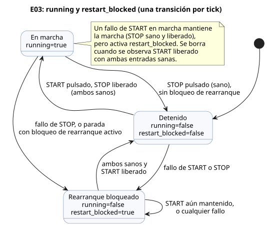

`running` es el valor recordado al inicio del tick. `running'` es el valor
siguiente, calculado a partir de las entradas actuales. Lea el apóstrofo como
**prima** (*prime*). Dos nombres mantienen separados dos momentos: "el estado de
marcha antes de observar STOP" y "el estado que se consolida después de procesar
STOP".

Lea la expresión en voz alta: "Sigue en marcha si stop no está pulsado y, además,
start está pulsado o el sistema ya estaba en marcha". Si esa frase no es lo que
exige la instalación, corrija el requisito antes de reordenar paréntesis. Cuando
se pulsan ambos botones, `!stop_requested` es false, así que gana el paro. Esa
única fila de entradas simultáneas convierte la expresión "prioridad de paro" en
un comportamiento observable.

| tick | start | stop | `running` anterior | `running'` siguiente | pump |
|---|---|---|---|---|---|
| 1 | false | false | false | false | false |
| 2 | true | false | false | true | true |
| 3 | false | false | true | true | true |
| 4 | true | true | true | false | false |
| 5 | false | false | false | false | false |

La misma tabla como diagrama de tiempos. Observe que `running` va exactamente un
tick por detrás de `running'`: el valor siguiente de un tick se convierte en el
valor anterior del siguiente.

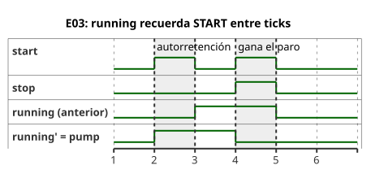

La salida lee `running'`, así que la bomba se enciende en el mismo tick que
observa START. Cambie una línea a `pump <- running;` y la salida leerá el estado
anterior, de modo que se encenderá un tick después. Ejecute ambas versiones con
las mismas entradas y busque el primer tick en que difieren. El comportamiento
cambió por **el instante al que pertenece el valor**, no por la posición de la
sentencia en el código.

### PC-02 — START / STOP a la espera de un arranque nuevo

De PC-02 a PC-10 se forma una ruta opcional de problemas de campo. No son una
secuencia gramatical obligatoria:

| Lecciones | Tema |
|---|---|
| PC-02–03 | rearranque y permiso del motor |
| PC-04–05 | sentido y posición |
| PC-06–08 | tiempo, niveles y modo |
| PC-09–10 | la secuencia completa y la recuperación |

Ninguna lección sustituye a una anterior. Cada una conserva el ejemplo anterior y
añade una sola carga nueva.

La autorretención básica de E03 no cambia. PC-02 está en un
[original literario aparte](../examples/curriculum/pc-02-start-stop.ghost.es.md).
Añade `stop_ok`, `armed`, `running` y `start_event` para expresar la prioridad de
paro y la inhibición del rearranque. Cuando el circuito vuelve de STOP con START
aún pulsado, eso no es un evento de arranque nuevo, así que las salidas siguen
apagadas. Suelte START y púlselo otra vez: entonces `running'` y las salidas de
bomba/válvula se encienden. PC-02 no sustituye a E03. Verifique el comportamiento
real de contactos y relés con un contrato de instalación aparte.

### PC-03 — Comandos del contactor del motor y permiso por sobrecarga

El [original literario canónico](../examples/curriculum/pc-03-motor-contactor.ghost.es.md)
de PC-03 conecta el evento de arranque nuevo y la autorretención de PC-02 con un
comando de control del motor. `stop_ok` y `overload_ok` son entradas de permiso
normalizadas. El adaptador eléctrico o de dispositivo define el cableado y la
polaridad de los contactos NC; este programa solo lee el significado Bool.

Las expresiones clave son:

- `permit = stop_ok && overload_ok`
- `start_event = armed && start`
- `running' = permit && (start_event || running)`
- `armed' = permit && !start`
- `motor_contactor <- running'`

`motor_contactor` es un único comando lógico para la bobina del MC (contactor
magnético). No es retroalimentación, y no demuestra que los contactos principales
del MC se cerraron, que el motor tiene alimentación ni que el motor gira. Lea los
dos circuitos por separado:

- **Circuito principal:** interruptor automático, contactos principales del MC,
  relé de sobrecarga, motor.
- **Circuito de control:** alimentación de control, STOP, contacto de protección
  por sobrecarga, la rama de autorretención START/contacto auxiliar del MC, bobina
  del MC.

Los comandos de software no sustituyen la protección eléctrica independiente. Las
alarmas, el latch/reset de fallos, los temporizadores, la retroalimentación de
sensores y el funcionamiento del hardware quedan fuera del alcance de este
escenario de currículo/aprendizaje.

El ejemplo separa la intención `requested` de los resultados `safe`. La evidencia
física de relés, MC o motores no forma parte de la intención de salida del
lenguaje.

### PC-04 — Enclavamiento del cambio de sentido directo/inverso

Ejecute PC-04 desde su [original literario canónico](../examples/curriculum/pc-04-direction-interlock.ghost.es.md).
[E06 — Solicitar ambos sentidos a la vez](#e06--solicitar-ambos-sentidos-a-la-vez)
sigue siendo el ejemplo básico: `mutex` bloquea ambas salidas cuando las dos se
vuelven candidatas. PC-04 hace algo más que copiar esa restricción. Define estados
lógicos de giro directo e inverso, y una espera con el motor detenido entre
cambios de sentido.

Entradas:

- `forward_start`, `reverse_start`: entradas de arranque momentáneas.
- `stop_ok`, `overload_ok`: entradas de permiso normalizadas, true cuando están
  sanas.

Los estados son `Stopped | Forward | Reverse | WaitForward | WaitReverse`, y el
programa arranca con `start_armed=false`. Las reglas:

- Si ambos arranques llegan a la vez, se detiene. No invente una prioridad.
- Una pulsación nueva del sentido opuesto durante la marcha pasa primero a un
  estado Wait, que apaga de inmediato ambos comandos de contactor.
- El sentido opuesto se enciende solo después del `reversal_wait = 2s`
  configurado.
- Si una solicitud de sentido nueva cambia el destino durante la espera, pase al
  estado Wait correspondiente y reinicie la espera. Nunca conserve un destino
  antiguo para arrancar en contra de la solicitud nueva del operador.

`forward_contactor` y `reverse_contactor` son solo comandos lógicos para las
bobinas de los contactores. `mutex` es un respaldo de software; el equipo real
también necesita enclavamientos eléctricos y mecánicos. Que pasen dos segundos no
demuestra que el motor se haya detenido físicamente. Exprese la retroalimentación
de velocidad cero mediante entradas y contratos de Driver aparte.

### PC-05 — Confirmar las posiciones finales de la válvula con finales de carrera

Ejecute PC-05 desde su [original literario canónico](../examples/curriculum/pc-05-limit-feedback.ghost.es.md).
Conserva E06 y PC-04 y hace referencia a ellos. Usa `Phase`, `elapsed(phase)`, el
estado siguiente y las conexiones de salida para separar un comando de la
observación de que el movimiento terminó.

Entradas:

- solicitudes momentáneas `open_request`/`close_request`;
- observaciones de posición final `open_limit`/`close_limit`;
- permisos `stop_ok`/`overload_ok`.

El programa arranca en `Stopped` y no inventa una posición inicial. Si desaparece
un final de carrera que se había observado con el actuador detenido, no confía
solo en el estado pasado. Ambos finales de carrera en true a la vez llevan a
`SensorConflict`, con ambas salidas apagadas. Una solicitud nueva del sentido
opuesto tiene prioridad sobre el final de carrera de destino: apaga ambos
comandos de bobina y reanuda el movimiento solo en el límite de dos segundos.

Cuando `Opening`/`Closing` nunca alcanza su posición final, lo gestionan las
políticas de tiempo límite y de fallo. Los comandos y las observaciones de
posición final son valores separados. Detener físicamente el actuador corresponde
al Driver y a la cadena de seguridad.

### PC-06 — Leer por separado el retardo a la conexión, el retardo a la desconexión y la operación máxima

El [original literario canónico](../examples/curriculum/pc-06-timer-patterns.ghost.es.md)
de PC-06 muestra tres significados de temporizador, cada uno con su propio estado:

| Entrada | Comportamiento |
|---|---|
| `on_delay_request` | se enciende después de que la demanda haya persistido dos segundos |
| `off_delay_request` | sigue encendida tres segundos más después de que la demanda desaparezca |
| `limited_request` | se apaga a los diez segundos y no puede rearrancar hasta que se libere la demanda |

Estas tres entradas son demandas de operación mantenidas, no eventos momentáneos
de botón.

Mantener los significados fuera de un único temporizador compartido evita que el
retardo a la desconexión prolongue en secreto el tiempo máximo de operación.
`stop_ok=false` omite incluso el retardo a la desconexión y apaga las tres salidas
de inmediato. Evalúe los instantes justo antes, en y justo después de cada límite,
así como la cancelación y la nueva solicitud, con las mismas reglas de tick
lógico. No confunda la velocidad del reloj de pared con el significado del tiempo
lógico.

### PC-07 — Recordar el estado entre dos interruptores de nivel de agua

El [original literario canónico](../examples/curriculum/pc-07-tank-hysteresis.ghost.es.md)
de PC-07 trata el control digital de nivel de agua a dos puntos.
`low_level_reached` y `high_level_reached` son observaciones normalizadas de que
el agua ha alcanzado cada interruptor físico.

- Inicie `Filling` por debajo del interruptor inferior.
- Entre los interruptores inferior y superior, mantenga el estado actual.
- Detenga en el interruptor superior.
- Si el nivel arranca en la zona intermedia, no encienda: no hubo un evento
  previo de nivel bajo.

Que el interruptor superior esté en true mientras el inferior está en false
contradice el orden físico, así que la salida queda apagada en `SensorConflict`.
El escaneo que despeja el conflicto vuelve primero a `Idle`; después se reanuda la
evaluación normal. No mezcle en este concepto de nivel de agua el paro/protección
común ni el latch/reset de fallos; PC-08 y PC-10 los combinan. El ejemplo de
mediana/calidad/histéresis con sensor continuo de
[tutorial/03](../examples/tutorial/03-moisture.ghost.es.md) sigue siendo una
lección aparte.

### PC-08 — Cambiar la titularidad de la salida entre manual y automático

El [original literario canónico](../examples/curriculum/pc-08-manual-auto.ghost.es.md)
de PC-08 conecta el arranque manual/autorretención de PC-03 y la demanda
automática de PC-07 con una sola bomba.

| `manual_mode_request` | `auto_mode_request` | Modo |
|---|---|---|
| false | false | `Off` |
| true | false | `Manual` |
| false | true | `Auto` |
| true | true | `ModeConflict` |

El comando de la bomba siempre está apagado en conflicto, en `Off` y en los
escaneos de cambio de modo.

`manual_start` es un evento de arranque momentáneo; `auto_demand` es una demanda
automática mantenida. El `request_armed` compartido acepta un nuevo true como
evento de arranque solo después de haber observado primero la demanda
seleccionada en false con un modo estable. Así, cambiar de modo durante la marcha,
o recuperar el permiso de paro/sobrecarga, no rearranca con una demanda que ya
está activa. Perder la demanda en Auto detiene la operación de inmediato.
[station-rules.ghost.md](../examples/station-rules.ghost.es.md) y
[tutorial/04](../examples/tutorial/04-extra-valves.ghost.es.md) siguen siendo
material avanzado sobre varios controles y el arbitraje de recursos compartidos.

Este ejemplo gestiona los conflictos de modo mediante estado explícito y
expresiones de salida. El cierre de la bobina o el giro de la bomba requieren una
confirmación aparte del dispositivo.

### PC-09 — Encender la bomba después de confirmar la apertura

El [original literario canónico](../examples/curriculum/pc-09-sequential-water-supply.ghost.es.md)
de PC-09 define la secuencia `Idle → Opening → Settling → Watering → PumpStopping → Closing → Idle`.
Separa una salida habilitada de apertura de la válvula de la observación de que
la válvula ha alcanzado físicamente la posición abierta.

- `open_limit` debe permanecer confirmado durante dos segundos antes de que la
  bomba se encienda.
- En el escaneo que termina cinco minutos de riego, la bomba se apaga primero.
- El contactor de cierre se enciende a partir del siguiente escaneo lógico. Esto
  garantiza el orden de las salidas sin inventar otro retardo.

Todas las salidas se apagan si desaparece la retroalimentación de posición
abierta, si ambos finales de carrera se activan a la vez o si desaparece el
permiso de paro/sobrecarga. La secuencia no rearranca solo porque la causa haya
desaparecido. Debe observar la posición cerrada y un START liberado, y después
exige un START nuevo. Los tiempos límite por falta de respuesta en
apertura/cierre, el latch de fallos, la alarma, el reset y la recuperación segura
específica de cada fallo corresponden a PC-10.

La secuencia solo temporal de tutorial/02 y el arbitraje de la bomba compartida
entre controles de tutorial/04 se mantienen como están, porque enseñan cosas
distintas. Este ejemplo trata los comandos lógicos, el movimiento de la válvula,
el giro de la bomba y las observaciones de caudal como contratos separados.

### PC-10 — Capturar las causas de fallo y recuperar de forma segura

El [original literario canónico](../examples/curriculum/pc-10-fault-alarm-reset.ghost.es.md)
de PC-10 añade causas de fallo, alarmas y reset a la operación secuencial de
PC-09. Los bloques GhostFlow de ese documento son el único original ejecutable. La
explicación siguiente, o cualquier código extraído de ella, no se convierte en un
original editable por separado. PC-01 a PC-09 conservan sus objetivos de
aprendizaje; esta lección solo añade la detección de fallos y la recuperación.

La prioridad de evaluación de seguridad es `EmergencyStop > Overload > ValveDriveUnavailable >
SensorConflict > FeedbackLost > OpenTimeout/CloseTimeout > LowSourceWater`.
Si en un escaneo ocurren varias causas, se retiene (latch) como `FaultCause` la
primera según este orden. Los cambios posteriores de las entradas en vivo no la
sobrescriben. Ante una parada de emergencia, una cadena de seguridad cableada
externa debe cortar la energía. Las entradas de observación y las alarmas de
GhostFlow no garantizan ese corte físico ni el comportamiento real del equipo.

El `STOP` normal no es un fallo. Cuando `stop_ok == false`, todas las salidas de
movimiento y la alarma se apagan de inmediato, la secuencia vuelve a `Idle` y no
rearranca automáticamente. Un fallo solo se borra mediante un procedimiento de
liberar/volver a pulsar RESET:

1. La causa retenida y todas las condiciones de fallo actuales han desaparecido.
2. `known_closed` está confirmado.
3. RESET se suelta una vez y se vuelve a pulsar.

Un fallo secundario en vivo que persista bloquea RESET. RESET solo vuelve a
`Idle`; no sustituye a START. Se debe observar un START liberado, y después se
requiere un `START` nuevo para volver a operar.

`LowSourceWater` es la excepción que realiza un cierre ordenado, y solo con una
válvula abierta confirmada y permiso del accionamiento de cierre. En
`FaultPumpStopping`, la bomba se apaga primero durante un escaneo lógico; después,
`FaultClosing` solicita el cierre de la válvula. Cualquier otro fallo o condición
de seguridad se convierte en un fallo de apagado total inmediato. Los tiempos
límite de apertura y de cierre son de diez segundos cada uno. Justo en el límite,
una observación del final de carrera de destino tiene prioridad sobre el tiempo
límite.

Este ejemplo no confunde las DI semánticas (significados de las entradas
digitales) con el cableado físico. Los significados existentes del primer
gabinete —`START`, `STOP`, `MODE`, límites superior/inferior del tanque, finales
de carrera de apertura/cierre y sobrecarga— usan ocho DI. Al separar `RESET`, la
observación de la parada de emergencia, el nivel bajo de agua de origen y el
permiso del accionamiento de la válvula, se obtienen 12 significados en total. Por
eso, una instalación de 8DI necesita una elección específica del sitio: agregación
en una cadena de seguridad externa, comandos de host autenticados o ampliación de
DI. Nunca combine ni omita significados en silencio.

La sintaxis actual de `require` solo expresa **relaciones entre salidas** Bool.
Especifique las condiciones de seguridad de las entradas y las prioridades de
fallo en las transiciones de `phase` y en las expresiones de salida. Por tanto, no
interprete que `require` por sí solo expresa toda la política de seguridad de las
entradas.

Este ejemplo separa la intención lógica de las entradas de retroalimentación. La
semántica del lenguaje por sí sola no establece la aceptación física de la Web UI,
la carga en el MCU, el corte de energía del contactor, el movimiento de la válvula
ni el giro de la bomba.

### E04 — Varios estados cambian a la vez

```ghost
// E04
control TwoStates {
  state a: Bool = true;
  state b: Bool = false;
  output out_a, out_b: Bool;

  a' = b;
  b' = a;
  out_a <- a';
  out_b <- b';
}
```

Después del primer tick, `a=false` y `b=true`. Después del segundo, de nuevo
`a=true` y `b=false`. Ambas expresiones leen el mismo estado anterior, así que los
valores se intercambian. No lo lea como una asignación de arriba abajo que
sobrescribe primero `a`.

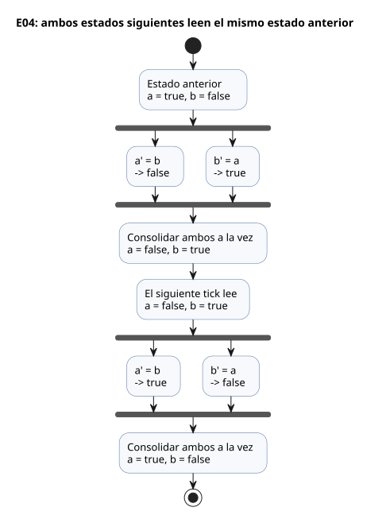

Actualmente, las referencias al estado siguiente solo se permiten en expresiones
de salida. Un código como `b' = a';`, que usa el valor siguiente de otro estado en
una transición de estado, se rechaza. Cuando varias transiciones necesitan el
mismo cálculo, póngale nombre con `let` y compártalo.

**Razón de diseño:** escribir explícitamente los estados anterior y siguiente
conserva "la base de esta evaluación" mientras todos los estados se actualizan a
la vez. Esta distinción es la base de las comparaciones de tiempos y de los
valores que se muestran junto al código.

El usuario explicó esta elección en [#149](https://github.com/callin2/ghostflow-language/issues/149).
La influencia de React/ObservableHQ es esta: el control se evalúa dentro de un
flujo de eventos y devuelve un estado siguiente explícito. La premisa educativa
del usuario era que el control recursivo o en forma de bucle puede ser difícil de
seguir para los electricistas. E04 hace concreto el límite temporal: leer los `a`
y `b` anteriores, describir `a'` y `b'` y, después, consolidar ambos. Es un
objetivo de legibilidad, no un juicio general sobre los electricistas. En el
código, use el apóstrofo ASCII (`'`) que muestra E04. La comilla invertida usada
en esa conversación, y las propuestas posteriores del asistente, no añaden
sintaxis, viaje en el tiempo ni funciones de explicación causal. Las reglas de
ejecución están en
[Referencia §2.8](reference/02-types-expressions-state.es.md#28-tick-e-instantánea-de-estado).

Un tick correcto funciona en este orden: calcula los estados siguientes
candidatos a partir de la instantánea de entradas de este tick y del estado
anterior, después las intenciones solicitada y segura, y luego consolida de forma
atómica los registros de estado e intención. Un fallo de runtime en una expresión
seleccionada rechaza el tick, sin actualizaciones parciales. El bloqueo por una
restricción de salida es distinto de ese fallo de evaluación: no cancela la
consolidación del estado de un tick correcto.

<a id="ch04"></a>
## 4. Intención de salida y salidas finales

La pantalla dice que la bomba está en ON, pero el agua no se mueve. Un solo
Boolean no puede explicarlo. Puede que el código haya solicitado ON, que una
restricción lo haya bloqueado, que el renderizador no lo haya aplicado o que la
retroalimentación aún no lo haya confirmado. En E05, ponga `request=true` y
`valve_ready=false`, y prediga dónde divergen la intención solicitada y la
intención segura. Cuando conozca estas etapas, "¿por qué no se encendió?" deja de
ser una conjetura y se convierte en una pregunta sobre qué evidencia falta.

Este capítulo usa cuatro términos:

| Término | Significado |
|---|---|
| **intención solicitada (requested)** | lo que piden las conexiones `<-` |
| **intención segura (safe)** | la intención solicitada después de las restricciones de salida; este capítulo la llama "salida final" |
| **aplicado (applied)** | evidencia de que un renderizador aplicó el comando |
| **confirmado (confirmed)** | evidencia de retroalimentación aparte, como un final de carrera o un encoder |

Una intención segura en true no establece que un relé conmutó ni que una bomba
funcionó. Concluir "la bomba funcionó" a partir de una traza con safe=true se
salta límites que todavía hay que comprobar. Lea la
[Referencia §4.7](reference/04-sensors-constraints-control.es.md#47-requested-safe-applied-confirmed)
junto con el [límite físico del Driver](LLM-TOOLCHAIN-ARCHITECTURE.es.md).

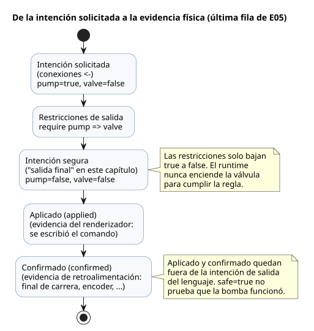

### E05 — Solicitudes de encendido y salidas permitidas

El cálculo "por favor, enciende la bomba" puede diferir de la decisión "la bomba
puede encenderse". Esta vez, haga que los dos valores difieran a propósito.

```ghost
// E05
control PumpPermission {
  state displayed_pump: Bool = false;
  displayed_pump' = if request_good && !request then false else if request_good then request else displayed_pump;
  state displayed_valve: Bool = false;
  displayed_valve' = if valve_ready_good && !valve_ready then false else if valve_ready_good then valve_ready else displayed_valve;
  // Source-local display memory is initialized here; faults remain producer unknown.
  state remembered_request: Bool = false;
  let request_good = case observed_request { ok(_) => true; fault(_) => false; };
  let request = case observed_request { ok(value) => value; fault(_) => remembered_request; };
  remembered_request' = request;
  state remembered_valve_ready: Bool = false;
  let valve_ready_good = case observed_valve_ready { ok(_) => true; fault(_) => false; };
  let valve_ready = case observed_valve_ready { ok(value) => value; fault(_) => remembered_valve_ready; };
  remembered_valve_ready' = valve_ready;
  input observed_request: Bool;
  input observed_valve_ready: Bool;
  output pump, valve: Bool;

  pump <- displayed_pump';
  valve <- displayed_valve';
  require pump => valve;
}
```

La mayoría de las líneas anteriores a la declaración `output` leen las entradas
con calidad `observed_request` y `observed_valve_ready`. Con un valor sano (`ok`),
los nombres derivados `request` y `valve_ready` siguen a la entrada. Con un
`fault`, conservan el último valor recordado, y el estado mostrado mantiene su
valor anterior. La lección en sí está en las tres últimas líneas.

| request | valve_ready | pump / valve candidatos | pump / valve finales |
|---|---|---|---|
| false | false | false / false | false / false |
| true | true | true / true | true / true |
| true | false | true / false | false / false |

La última fila es la razón del ejemplo. La solicitud de la bomba desde `<-` es
true, pero `require` hace que la intención segura de la bomba sea false.
`pump => valve` dice: si se solicita la bomba, la válvula ya debe estar solicitada
también. El runtime no enciende en secreto la válvula para cumplir la regla. La
traza registra qué solicitud se abandonó, así que el resultado conservador es
fácil de explicar.

```text
request ─────────────→ intención de pump ──┐
                                          ├─ comprobación require ─→ pump final
valve_ready ─────────→ intención de valve ─┘
```

Aquí `valve_ready` es solo un nombre, derivado de la entrada
`observed_valve_ready`. El mapeo de entradas explica qué sensor o cálculo
suministra esa entrada. Una explicación completa necesita tanto "por qué la
salida es true" como "de dónde vino la entrada".

### E06 — Solicitar ambos sentidos a la vez

```ghost
// E06
control DirectionInterlock {
  state displayed_forward: Bool = false;
  displayed_forward' = if forward_button_good && !forward_button then false else if forward_button_good then forward_button else displayed_forward;
  state displayed_reverse: Bool = false;
  displayed_reverse' = if reverse_button_good && !reverse_button then false else if reverse_button_good then reverse_button else displayed_reverse;
  // Source-local display memory is initialized here; faults remain producer unknown.
  state remembered_forward_button: Bool = false;
  let forward_button_good = case observed_forward_button { ok(_) => true; fault(_) => false; };
  let forward_button = case observed_forward_button { ok(value) => value; fault(_) => remembered_forward_button; };
  remembered_forward_button' = forward_button;
  state remembered_reverse_button: Bool = false;
  let reverse_button_good = case observed_reverse_button { ok(_) => true; fault(_) => false; };
  let reverse_button = case observed_reverse_button { ok(value) => value; fault(_) => remembered_reverse_button; };
  remembered_reverse_button' = reverse_button;
  input observed_forward_button: Bool;
  input observed_reverse_button: Bool;
  output forward, reverse: Bool;

  forward <- displayed_forward';
  reverse <- displayed_reverse';
  mutex(forward, reverse);
}
```

Si ambas entradas son true, ambas salidas pasan a false. Ni la salida escrita
primero ni el botón pulsado primero obtienen prioridad automáticamente.
`require !(forward && reverse);` también bloquea las solicitudes simultáneas de
estas salidas.

Cuando hay restricciones conectadas, el runtime las aplica repetidamente,
realimentando cada resultado de bloqueo, hasta que nada cambia. Por ejemplo, si
otra restricción apaga una válvula, una bomba que requiere esa válvula también se
apaga. Las restricciones Bool locales actuales solo bajan salidas true a false. No
son una función del lenguaje que busque automáticamente una combinación que
satisfaga expresiones lógicas arbitrarias.

Bloquear una salida mediante una restricción no revierte automáticamente el
`state`. Si el programa debe pasar a un estado detenido, exprese también esa
transición en el programa.

**Pequeño experimento:** cambie E03 a `pump <- start;` y suelte Start. ¿Puede
explicar por separado por qué `running` sigue en true y por qué `pump` se apaga?

### Grupos locales con nombre y la envolvente de recursos compartidos

E05 y E06 restringen salidas de su propio control. Poner la misma regla en un
grupo local con nombre, como `constraints LocalRules { require pump => valve; }`,
mantiene el mismo ámbito y el mismo significado de restricción Bool. Las
restricciones definen la región permitida dentro de la cual pueden moverse los
objetivos; todas las condiciones obligatorias se combinan con AND. Ni la prioridad
ni el análisis opcional no bloqueante liberan nunca una condición obligatoria.

Para los recursos compartidos, continúe con el
[ejemplo completo de ejecución vinculada](../examples/bound-resource-execution.ghost.es.md).
Comprobar solo `constraints SharedRules for station` no ejecuta las salidas
protegidas. El descriptor comprobado de `compileSourceSync` necesita además un
paso explícito `compileBoundResourceControl` que lo vincule con identidades
exactas de código fuente/artefacto, ID estables y mapeos de modo/salida. El
artefacto resultante comprueba cada ruta automática, manual y de respaldo
admitida a través de la misma guarda durante los escaneos reales de Rust/WASM. No
es un filtro JavaScript que el host añada después de publicar las salidas.

En ese ejemplo, una relación violada durante la ejecución lleva al vector seguro
definido por el autor: bomba OFF, válvula ON. Las reglas de admisión y
recuperación son:

- Una violación antes del arranque deniega la nueva admisión.
- Un recién llegado en conflicto no toma la admisión del titular ni entra en una
  cola oculta.
- Las condiciones normales por sí solas no borran un disparo.
- Los grupos exclusivos necesitan una observación neutral seguida de una
  reclamación nueva.
- Los grupos solo con require necesitan requested = seguro definido por el autor,
  seguido de una solicitud nueva.
- Los grupos conectados se recuperan juntos en un solo escaneo.
- Una denegación evaluada correctamente consolida el estado ordinario; los
  errores de vinculación/VM revierten el estado, la guarda y la traza.

Esto es la ejecución lógica de un control Bool GFB1 v1/v3 con todas las salidas
mapeadas explícitamente. La autoridad de la instalación comparte el registro de
escritores y rechaza un segundo escritor activo para el mismo ID estable. Los
registros de instalación separados no certifican la exclusión física. PID
arbitrarios, contexto, composición de importaciones de políticas compartidas,
arbitraje cooperativo entre varias VM y secuenciación física segura tienen
límites aparte. No sustituya los resultados ni los registros de reproducción
existentes de E05/E06 por los de este nuevo ejemplo.
La [Referencia §4.8](reference/04-sensors-constraints-control.es.md#48-notación-y-operaciones-comunes-de-restricciones)
y [el contrato de restricciones](CONSTRAINTS.es.md#ejecución-bool-compartida)
distinguen la evidencia de código fuente, de vinculación, de admisión y de salida
segura.

<a id="ch05"></a>
## 5. Separar cálculos con funciones

Copie una expresión de latch en varios lugares y un día una de las copias acabará
con una prioridad de paro distinta. Una función sirve menos para ahorrar líneas
que para dar nombre a una decisión de modo que se revise una sola vez. En E07,
calcule primero `hold` y `permitted` por separado y después compóngalos. Prediga
si apagar y volver a encender `enabled` rearranca el control sin START. La
respuesta muestra que una función no oculta ningún estado.

### E07 — Extraer el cálculo de autorretención a una función

```ghost
// E07
fn hold(start: Bool, stop: Bool, previous: Bool) -> Bool {
  !stop && (start || previous)
}

control FunctionLatch {
  // Source-local display memory is initialized here; faults remain producer unknown.
  state remembered_start: Bool = false;
  let start_good = case observed_start { ok(_) => true; fault(_) => false; };
  let start = case observed_start { ok(value) => value; fault(_) => remembered_start; };
  remembered_start' = start;
  state remembered_stop: Bool = false;
  let stop_good = case observed_stop { ok(_) => true; fault(_) => false; };
  let stop = case observed_stop { ok(value) => value; fault(_) => remembered_stop; };
  remembered_stop' = stop;
  state remembered_enabled: Bool = false;
  let enabled_good = case observed_enabled { ok(_) => true; fault(_) => false; };
  let enabled = case observed_enabled { ok(value) => value; fault(_) => remembered_enabled; };
  remembered_enabled' = enabled;
  input observed_start: Bool;
  input observed_stop: Bool;
  input observed_enabled: Bool;
  state running: Bool = false;
  output pump: Bool;

  fn permitted(request: Bool, allow: Bool) -> Bool {
    request && allow
  }

  running' = if stop_good && stop then false else if enabled_good && !enabled then false else if start_good && stop_good && enabled_good then (permitted(hold(start, stop, running), enabled)) else running;
  pump <- running';
}
```

Los parámetros después de `fn` reúnen, en un solo lugar, la evidencia que necesita
la decisión. `-> Bool` indica qué tipo de resultado promete. La última expresión
es el resultado, así que no hay un `return` aparte. Leer solo
`hold(start, stop, running)` ya le dice que la decisión necesita el START actual,
el STOP actual y el estado de marcha anterior.

Cuando `enabled=false`, `permitted` devuelve false y el estado siguiente se
apaga. Cuando `enabled` vuelve a ser true, la operación no se reanuda, porque el
estado recordado ya es false. La función calcula solo a partir de sus argumentos
y no oculta ninguna memoria propia.

Las funciones actuales no leen directamente entradas externas, estado ni ajustes;
los reciben como parámetros. Los valores necesarios aparecen en el punto de
llamada, lo que mantiene legibles las dependencias. Por ejemplo, leer
directamente el `running` global dentro de `hold` se rechaza.

Las funciones se expanden estáticamente en tiempo de compilación. Las llamadas
recursivas y cíclicas se rechazan. No construya dentro de las funciones flujos de
ejecución que se bloqueen durante un periodo de tiempo, ni estado mutable privado.
Exprese la memoria con `state`, y el tiempo con los temporizadores del capítulo
siguiente.

**Pequeño experimento:** en `permitted(hold(...), enabled)`, si `enabled` pasa a
false y luego otra vez a true, ¿se reanudará la operación sin Start? Amplíe la
tabla de estados de E03.

<a id="ch06"></a>
## 6. Control que espera el paso del tiempo

“Encender después de dos segundos” no significa “dejar de ejecutarse durante dos
segundos”. Mientras el controlador espera, debe seguir leyendo STOP y seguir
calculando sus demás controles. Por eso E08 hace visible la espera: un estado
`Waiting` más el tiempo transcurrido en él.

Antes de seguir leyendo, anote el estado siguiente a los 1999ms, 2000ms y 2001ms
de espera. Luego prediga qué ocurre con la espera si se suelta START a mitad de
camino. El descubrimiento clave de este capítulo es la diferencia entre ambas
cosas: el tiempo fluye de forma continua, pero las decisiones ocurren solo en los
ticks.

### E08 — Encender después de que una entrada persiste dos segundos

```ghost
// E08
control DelayedStart {
  // Source-local display memory is initialized here; faults remain producer unknown.
  state remembered_start: Bool = false;
  let start_good = case observed_start { ok(_) => true; fault(_) => false; };
  let start = case observed_start { ok(value) => value; fault(_) => remembered_start; };
  remembered_start' = start;
  input observed_start: Bool;
  config delay: Duration = 2s;
  type Phase = Idle | Waiting | Running;
  state phase: Phase = Idle;
  timer age = elapsed(phase);
  output motor: Bool;

  phase' = if start_good then (case delay {
    ok(value) => case phase {
      Idle => if start then Waiting else Idle;
      Waiting =>
        if !start then Idle
        else if age >= value then Running else Waiting;
      Running => if start then Running else Idle;
    };
    fault(_) => Idle;
  }) else phase;

  motor <- phase' == Running;
}
```

`type Phase = ...` da un nombre a cada una de las tres situaciones que la espera
debe distinguir. Con un único Bool, “todavía no ha arrancado” y “esperando” se
esconderían en el mismo valor “apagado”. `case phase` elige la única expresión
correspondiente a la etapa actual y calcula a partir de ella la etapa siguiente.
Hay que escribir todos los casos, de modo que si más adelante se añade una etapa,
el compilador indica qué decisión falta.

`delay` es un `Result<Duration, SettingsFault>`. Compare el tiempo con su
contenido solo dentro de la rama `ok(value)`.

- **Fallo del ajuste:** este ejemplo cancela la espera pendiente y pasa a `Idle`,
  de modo que la intención de salida queda en apagado.
- **Recuperación:** en cuanto se vuelven a leer un ajuste válido y `start=true`,
  comienza una nueva espera.
- **`2s`:** es el contenido `ok` inicial, no un respaldo (fallback) para errores.

Esta es la política de este ejemplo. No es un comportamiento predeterminado del
lenguaje ni del driver, y no es una garantía física a prueba de fallos
(fail-safe).

`elapsed(phase)` es **el tiempo transcurrido desde que `phase` consolidó un
cambio por última vez**. El cero es el punto de consolidación del tick que cambia
`Idle` a `Waiting`. El tiempo en `Idle` antes de que llegue START no cuenta para
los dos segundos. Si se suelta START y se vuelve a pulsar, la espera anterior no
se empalma con la nueva.

Una transición ocurre en el primer tick en que su condición es verdadera, y un
tick nunca salta varias etapas.

El diagrama de estados siguiente reúne estas reglas. Cada flecha se evalúa en un
tick; entre ticks no ocurre nada.

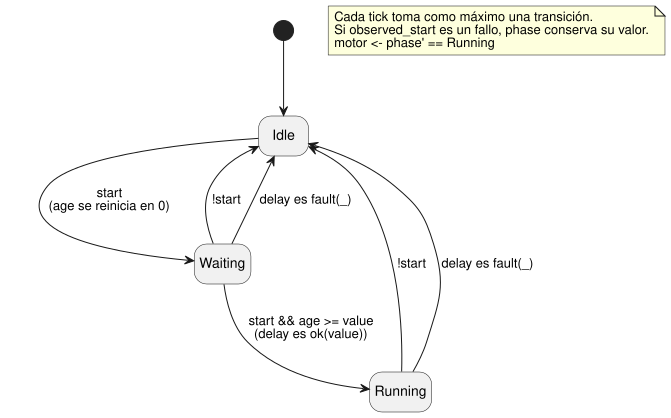

La tabla sigue una ejecución. “Etapa leída” y “age leída” son los valores que lee
el tick; “Etapa siguiente” es lo que consolida.

| Tiempo lógico | start | Etapa leída | age leída | Etapa siguiente | motor |
|---|---|---|---|---|---|
| 0ms | false | Idle | 0ms | Idle | false |
| 1000ms | true | Idle | 1000ms | Waiting | false |
| 2999ms | true | Waiting | 1999ms | Waiting | false |
| 3000ms | true | Waiting | 2000ms | Running | true |
| 4000ms | false | Running | 1000ms | Idle | false |

La espera no empieza en el instante en que el botón cambió físicamente. Empieza
en el tick que lee el cambio y pasa a `Waiting`. Por eso los dos segundos se
cuentan desde 1000ms y el motor se enciende a los 3000ms.

### Acelerar una simulación cambia cómo avanza el tiempo

Ejecutar una simulación a diez veces la velocidad no convierte el `2s` del código
fuente en `200ms`. En su lugar, el simulador hace avanzar el tiempo lógico más
rápido que el tiempo real. Si cada tick tiene el mismo tiempo lógico y las mismas
entradas, el resultado debe ser el mismo a cualquier velocidad.

Los límites deben compartirse entre plataformas: el tiempo usado para los
cálculos de temporizadores, el conjunto de entradas DI que se leen juntas y las
salidas RO finales.

- Las compilaciones nativas y WASM ejecutan expresiones, estado, temporizadores y
  restricciones en el mismo núcleo de Rust.
- El host suministra las entradas, el tiempo lógico y las oportunidades de
  escaneo.
- Los drivers reales de E/S del dispositivo son un límite aparte.

Las API concretas de tramas y de drivers son contratos del host. No añada
ramificaciones por plataforma a este código fuente.

El simulador actual de la CLI proporciona E/S virtual. Muestra las entradas y las
intenciones solicitada y segura.

- No tiene un modelo de planta que derive automáticamente niveles de tanque o
  valores de sensores a partir de la intención de la bomba.
- Se admite un modelo de planta de temperatura de invernadero configurado
  explícitamente. Aun así, su aplicación virtual y su retroalimentación no son
  evidencia de un dispositivo físico.
- El modo por tubería (piped) avanza solo con escaneos explícitos. Una TTY
  interactiva suministra el tiempo de pared real transcurrido.
- Las programaciones, los sensores y los intervalos certificados necesitan las
  capacidades de host correspondientes.

Para las rutas de ejecución y los comandos de reproducción, consulte
[Arquitectura de autoría y simulación virtual](LLM-TOOLCHAIN-ARCHITECTURE.es.md).

**Pequeño experimento:** mueva el tick posterior a 2999ms a 3500ms. El motor se
enciende en ese tick, no a los 3000ms. La condición del temporizador es de dos
segundos, pero la observación y la transición ocurren solo en los instantes de
tick.

<a id="ch07"></a>
## 7. Arrancar a horas programadas

“Regar a las 06:00” y “regar durante cinco minutos” tratan ambos sobre el tiempo,
pero leen relojes distintos:

- **06:00** necesita hora civil: un calendario y una zona horaria.
- **Cinco minutos** necesita tiempo transcurrido monotónico, contado desde el
  evento de inicio.

En E09, imagine que ha llegado el evento de las 06:00 y que después se atrasa el
reloj de pared. Prediga el resultado: el riego de cinco minutos no debería verse
alterado. Esa predicción explica por qué el código fuente detalla el manejo del
DST, las brechas del reloj, el fallo del proveedor (provider) y el respaldo.

### E09 — Regar cinco minutos a dos horas cada día

```ghost
// E09
control ScheduledPulse {
  schedule starts: DailySlots<15min> {
    timezone = "Asia/Seoul";
    selected = [06:00, 18:45];
    dst_missing = skip;
    dst_repeated = first;
    basis = pulse;
    when = true;
    clock = trusted_only;
    gap = skip_after(60s);
    recovery = baseline;
    fallback = skip;
  }
  let run_time = 5min;
  type Phase = Idle | Watering;
  state phase: Phase = Idle;
  timer age = elapsed(phase);
  output valve, pump: Bool;

  phase' = case phase {
    Idle => if starts.due then Watering else Idle;
    Watering => if age >= run_time then Idle else Watering;
  };

  valve <- phase' in {Watering};
  pump <- phase' == Watering;
  require pump => valve;
}
```

`DailySlots<15min>` elige horas de una cuadrícula de 15 minutos dentro de cada
fecha local. Un valor fuera de la cuadrícula, como 06:07, se rechaza; no se
redondea. `starts.due` es una proyección: indica si llegó una ocurrencia de
inicio en este tick. La admisión y la evidencia de ocurrencias omitidas o
desconocidas se conservan como observaciones separadas.

La declaración hace explícito cada supuesto sobre el reloj: base de pulso, solo
reloj confiable, un límite de brecha de 60 segundos, recuperación `baseline` y
respaldo `skip`. Así, una revisión posterior no puede suponer en silencio que el
reloj era perfecto.

El diagrama muestra dónde se usa cada reloj. El reloj de calendario solo decide
*cuándo* empieza el riego; únicamente el reloj monotónico decide *cuándo
termina*.

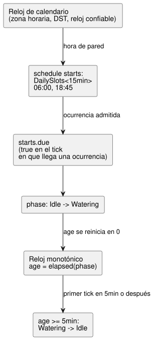

| Evento | Etapa anterior | Etapa siguiente | pump |
|---|---|---|---|
| Evento de inicio seleccionado | Idle | Watering | true |
| Han transcurrido menos de cinco minutos | Watering | Watering | true |
| Primer tick con al menos cinco minutos transcurridos | Watering | Idle | false |

`in {Watering}` comprueba la pertenencia a un conjunto. Cuando varios estados
cumplen la condición, enumere valores del mismo tipo, como en
`phase' in {Opening, Watering, Closing}`.

Este código fuente no tiene cola. Si llega otro evento de inicio mientras la fase
ya es `Watering`, no se almacena. La identidad de las ocurrencias de la
programación, la supresión de duplicados, el manejo de ocurrencias omitidas y la
evidencia de reproducción (replay) siguen el contrato de la Referencia §3.5. No
invente su propio mecanismo de recuperación para ocurrencias superpuestas u
omitidas de otras programaciones.

**Pregunta de lectura:** ¿la rama `Watering` lee otro evento de inicio y cambia
su hora de fin? (Las dos horas seleccionadas están separadas por más de cinco
minutos). Responda leyendo la rama. No se trata de un escenario de ejecución que
inyecte una entrada `starts.due` oculta en el simulador público.

### Hora de calendario y eventos naturales

La hora de calendario, las programaciones y el tiempo transcurrido monotónico son
tipos distintos de entrada. Las fechas y horas son literales etiquetados. Las
programaciones recurrentes usan una declaración `schedule` específica de cada
tipo. Para la notación exacta de `DailySlots`, `Periodic`, `cron5`, el contexto
solar, lunar y de mareas, las zonas horarias, la recuperación de brechas y el
respaldo obligatorio, consulte la [Referencia §3](reference/03-time-and-schedules.es.md).

El amanecer y el atardecer, las predicciones de mareas, los calendarios y los
datos de reloj dependen de contratos externos de proveedor o de driver. El código
fuente nombra el evento de referencia y el respaldo. No esconda datos de
predicción dentro de un único Bool, y no suponga que la hora es siempre
confiable. Lea las políticas definidas en la Referencia y suministre las
capacidades de entorno necesarias mediante vinculaciones (bindings).

<a id="ch08"></a>
## 8. Valores de sensores y calidad

Use la [tabla de consulta de magnitud a tipo](#quantity-type-lookup) para elegir
el tipo de entrada. Por ejemplo, una medición en grados Celsius usa el tipo
`Temperature` y un valor como `30°C`.

Suponga que la lectura de humedad va `29%, 31%, 29%`. Si la decisión sigue un
único umbral, la solicitud de agua se enciende y se apaga al mismo ritmo. Ahora
aparece un único `90%`. ¿Se mojó de repente el suelo, o una lectura dio un pico?
Y si el sensor se desconecta después de su última lectura, ¿durante cuánto tiempo
se puede seguir confiando en ese número?

Son tres preguntas distintas, y E10 responde a cada una por separado:

1. Comprueba la calidad de cada medición.
2. Toma la mediana de los valores recientes.
3. Usa umbrales distintos para encender y para apagar.
4. Por último, comprueba si el usuario ha habilitado el riego.

Mientras lee, siga el valor bruto, el valor filtrado, la decisión y la salida
solicitada, línea por línea. Verá que el código es más largo **para que no se
mezclen preguntas distintas**.

Los porcentajes de humedad y los umbrales de 30 %/35 % son valores lógicos de
ilustración. No son recomendaciones agronómicas para ningún suelo, cultivo ni
calibración de sensor. Este capítulo verifica una **solicitud** de agua; el flujo
real de agua necesita evidencia aparte del dispositivo y de la
retroalimentación.

### Valores de entrada y valores medidos

El `input level: Percent` anterior declaraba un valor que el host suministra para
el cálculo actual. Un sensor real tiene algo más que un valor. Puede no estar
listo todavía, estar desconectado o conservar una medición obsoleta (stale). Por
eso, cada vez que lee un `input`, también se ocupa de si se obtuvo un valor sano.

### E10 — Decidir el suministro de agua a partir de valores de humedad fluctuantes

```ghost
// E10
control MoistureControl {
  state displayed_pump: Bool = false;
  displayed_pump' = if enabled_good && !enabled then false else if enabled_good then enabled && need_water else displayed_pump;
  // Source-local display memory is initialized here; faults remain producer unknown.
  state remembered_enabled: Bool = false;
  let enabled_good = case observed_enabled { ok(_) => true; fault(_) => false; };
  let enabled = case observed_enabled { ok(value) => value; fault(_) => remembered_enabled; };
  remembered_enabled' = enabled;
  input observed_enabled: Bool;
  input moisture: Percent {
    sample = 1s;
    valid = 0% .. 100%;
    filter = median(3);
    stale_after = 3s;
    recover_after = 1 samples;
  }
  signal dry = hysteresis(moisture,
    on_below: 30%, off_above: 35%, initial: false);
  let need_water = case dry {
    ok(value) => value;
    fault(_) => false;
  };

  output pump: Bool;
  pump <- displayed_pump';
}
```

El diagrama sigue una muestra a través de E10, desde el host hasta la solicitud
de la bomba.

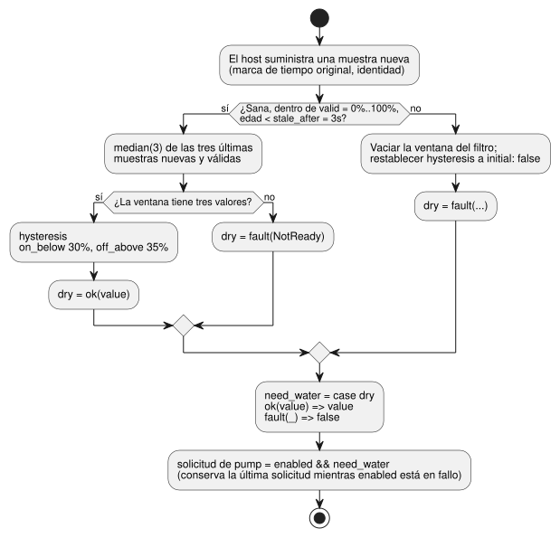

`sample = 1s` registra el intervalo de medición previsto. No crea un hilo que lea
el sensor ni inventa una nueva observación cada segundo. El host suministra las
muestras, cada una con su marca de tiempo original y su identidad. `valid` define
el rango de valores sanos; el filtro acepta solo muestras nuevas y válidas dentro
de ese rango. Leer la misma muestra en varios ticks no llena la ventana ni hace
más reciente su marca de tiempo.

`median(3)` elige el valor central de los tres últimos valores válidos. Al
ordenar `29%, 90%, 28%` se obtiene `28%, 29%, 90%`, de modo que el resultado es
`29%`. Un único valor grande no significa de inmediato suelo húmedo. Con solo dos
valores todavía no hay valor central: las dos primeras muestras dan `NotReady`, y
la rama de fallo de este ejemplo mantiene apagada la solicitud de agua.

`hysteresis` usa umbrales distintos para encender y para apagar. Para mediciones
sanas:

| Valor filtrado | Decisión de `dry` |
|---|---|
| por debajo de 30 % | se enciende (`true`) |
| por encima de 35 % | se apaga (`false`) |
| de 30 % a 35 %, incluidos exactamente 30 % o 35 % | conserva la decisión anterior |

Así, un valor que oscila alrededor del 30 % no conmuta la salida en cada lectura.

Entre `30%` y `35%`, un número no produce una conclusión nueva. Es **la banda que
conserva la conclusión anterior**. El mismo `33%` mantiene el riego encendido si
el suelo ya se había considerado seco, pero no inicia el riego desde el estado
inicial. Esta pequeña diferencia añade memoria a una comparación con umbral.

Ahora fije `enabled=true` y suministre en orden las muestras brutas siguientes.
Cada una es una observación nueva y sana, separada un segundo de la anterior.
Tape la tabla y prediga primero qué fila apaga la solicitud.

| Nueva muestra bruta | Mediana de las tres últimas | Resultado de `dry` | `pump` solicitado |
|---|---|---|---|
| `31%` | Ventana incompleta | `fault(NotReady)` | `false` |
| `29%` | Ventana incompleta | `fault(NotReady)` | `false` |
| `90%` | `31%` | `ok(false)` | `false` |
| `28%` | `29%` | `ok(true)` | `true` |
| `30%` | `30%` | `ok(true)` | `true` |
| `34%` | `30%` | `ok(true)` | `true` |
| `36%` | `34%` | `ok(true)` | `true` |
| `38%` | `36%` | `ok(false)` | `false` |

La solicitud sigue encendida en la fila en que el valor bruto llega a `36%`,
porque el valor filtrado es solo `34%`. Solo cuando llega `38%` la ventana
`34%, 36%, 38%` tiene una mediana de `36%`. Eso está por encima del 35 %, así que
la decisión se apaga. Si se compara directamente un valor bruto con la salida, el
resultado parece extraño; siga los valores intermedios y el motivo queda claro.

A continuación, deje de suministrar muestras nuevas. Cuando la edad medida desde
la marca de tiempo original de la última muestra llega exactamente a 3 segundos,
el resultado pasa a ser `Stale`. Compare 2999ms y 3000ms para ver el límite.
Reevaluar o reenviar la misma muestra no prolonga ese plazo.

Un fallo no es un valor de humedad normal. Cuando se produce un fallo, la ventana
del filtro se vacía y la histéresis vuelve a `initial: false`. Cuando vuelven
muestras sanas, no suponga que `recover_after = 1 samples` por sí solo permite
una recuperación inmediata: este filtro también necesita **tres muestras nuevas
válidas** para su mediana. Si el valor filtrado recuperado es `33%`, la antigua
decisión `true` no regresa; se mantiene la decisión inicial `false`.

`ok(value)` da un nombre a un resultado sano. El `_` de `fault(_)` significa que
este cálculo no usa el valor de error concreto. Incluso cuando se elige `false`
como valor sustituto, la información de calidad original permanece en el
registro de ejecución.

Aquí, `ok` y `fault` son patrones de `case`. El lenguaje actual también
proporciona:

- los constructores `ok(...)` y `fault(...)` para el tipo integrado
  `Result<T, E>`, cuyos tipos de fallo pertenecen al compilador;
- las transformaciones estáticas `map`, `and_then` y `recover`.

No los confunda con ADT de error definidos por el usuario ni con funciones de
orden superior generales. Consulte la [Referencia §2.5](reference/02-types-expressions-state.es.md#25-resultados-de-sensores-y-flujo-explícito-de-errores).

### E14 — Un sensor opcional

```ghost
// E14
control OptionalMoisture {
  input moisture?: Percent;
  output request: Bool;
  adapt moisture_policy {
    strategy WithMoisture priority 100 match (moisture: sensor<Percent>) {
      request <- case moisture {
        ok(value) => value < 30%;
        fault(_) => false;
      };
    }
    strategy Baseline priority 0 match always {
      request <- false;
    }
  }
}
```

`?` es información de la declaración: marca el sensor como una capacidad
(capability) de instalación opcional.

- **Instalado y sano:** `WithMoisture` compara el valor.
- **Instalado pero en fallo:** `WithMoisture` solicita `false`.
- **No instalado:** `Baseline` solicita `false`.

`?` por sí solo no genera una estrategia de respaldo; `Baseline` la escribe usted
mismo. Para las reglas detalladas, consulte la [Referencia §4.5–4.6](reference/04-sensors-constraints-control.es.md#45-sensores-opcionales-y-capacidades).

E14 toma caminos distintos para “no hay sensor instalado” y “el sensor instalado
ha fallado”. Sin el sensor, selecciona `Baseline`. Con un sensor instalado cuyo
valor no puede leerse, sigue la rama de fallo dentro de `WithMoisture`. Ambas
solicitudes son `false`, pero por motivos distintos. La misma salida no implica
la misma evidencia de ejecución.

**Cambie una sola cosa:** mientras E10 produce `ok(true)`, desactive solo
`enabled`. La decisión no cambia; solo se detiene la solicitud de la bomba.
Vuelva a habilitarlo y la solicitud regresa solo mientras la calidad siga siendo
sana. Como la decisión y el permiso están separados, no hace falta inventar un
nuevo estado del sensor para una operación del usuario.

Prediga también qué ocurre si iguala los dos umbrales. La `hysteresis` actual
exige `on_below < off_above`, así que esta modificación debería producir un
diagnóstico en lugar de una ejecución sana. En un gráfico, muestre juntos los
valores bruto y filtrado, y compruebe por separado la calidad y la solicitud. E10
no tiene `require` ni `mutex`, así que aquí la salida segura es igual a la
solicitada. Aun así, esa igualdad no confirma que el agua se esté bombeando
físicamente.

<a id="ch09"></a>
## 9. Leer las expresiones con precisión

Cuanto más corta parece una expresión, más fácilmente le aplicamos reglas de un
lenguaje que ya conocemos. Por eso, en lugar de una lista gramatical para
memorizar, este capítulo usa pequeños contraejemplos. Para la división, las
condicionales y `case`, elija un valor normal y un fallo, y prediga cada
resultado. La notación canónica de E11 es la promesa de que la misma forma
significa lo mismo en las revisiones y en las búsquedas.

### E12 — Números y operadores

```ghost
// E12
control NumbersAndOperators {
  state displayed_sum: Number = 0;
  displayed_sum' = if a_good && b_good then a + b else displayed_sum;
  state displayed_difference: Number = 0;
  displayed_difference' = if a_good && b_good then a - b else displayed_difference;
  state displayed_product: Number = 0;
  displayed_product' = if a_good && b_good then a * b else displayed_product;
  state displayed_quotient: Number = 0;
  displayed_quotient' = if a_good && b_good then a / b else displayed_quotient;
  state displayed_negative: Number = 0;
  displayed_negative' = if a_good then -a else displayed_negative;
  state displayed_equal: Bool = false;
  displayed_equal' = if a_good && b_good then a == b else displayed_equal;
  state displayed_different: Bool = false;
  displayed_different' = if a_good && b_good then a != b else displayed_different;
  state displayed_less: Bool = false;
  displayed_less' = if a_good && b_good then a < b else displayed_less;
  state displayed_at_most: Bool = false;
  displayed_at_most' = if a_good && b_good then a <= b else displayed_at_most;
  state displayed_greater: Bool = false;
  displayed_greater' = if a_good && b_good then a > b else displayed_greater;
  state displayed_at_least: Bool = false;
  displayed_at_least' = if a_good && b_good then a >= b else displayed_at_least;
  // Source-local display memory is initialized here; faults remain producer unknown.
  state remembered_a: Number = 0;
  let a_good = case observed_a { ok(_) => true; fault(_) => false; };
  let a = case observed_a { ok(value) => value; fault(_) => remembered_a; };
  remembered_a' = a;
  state remembered_b: Number = 0;
  let b_good = case observed_b { ok(_) => true; fault(_) => false; };
  let b = case observed_b { ok(value) => value; fault(_) => remembered_b; };
  remembered_b' = b;
  input observed_a: Number;
  input observed_b: Number;
  output sum, difference, product, quotient, negative: Number;
  output equal, different, less, at_most, greater, at_least: Bool;

  sum <- displayed_sum';
  difference <- displayed_difference';
  product <- displayed_product';
  quotient <- displayed_quotient';
  negative <- displayed_negative';
  equal <- displayed_equal';
  different <- displayed_different';
  less <- displayed_less';
  at_most <- displayed_at_most';
  greater <- displayed_greater';
  at_least <- displayed_at_least';
}
```

Con `a=6` y `b=2`, las salidas numéricas son, en orden, `8, 4, 12, 3, -6`. Las
salidas Bool son `false, true, false, false, true, true`. Las salidas Number
también pueden observarse lógicamente, pero no pueden asignarse directamente a
puertos de relé Bool.

Precedencia de operadores, de mayor a menor:

| Nivel | Notación |
|---|---|
| 1 | Paréntesis, llamadas a funciones, referencias a miembros y al estado siguiente |
| 2 | `!` y `-` unarios |
| 3 | `*`, `/` |
| 4 | `+`, `-` |
| 5 | `in {…}` |
| 6 | `==`, `!=`, `<`, `<=`, `>`, `>=` |
| 7 | `&&` |
| 8 | `||` |

Los operadores binarios de la misma precedencia se agrupan por la izquierda:
`6 - 2 - 1` significa `(6 - 2) - 1`. Para que una condición compleja sea más
fácil de leer, divídala con paréntesis o con cálculos `let` con nombre.

`=>` no es un operador aritmético ni lógico ordinario. Conecta los dos lados de
una restricción de salida y une un patrón de `case` con su rama. No se puede
poner dentro de una expresión ordinaria.

### E13 — Tener condicionales frente a omitir el cálculo

`if`, `&&` y `||` se evalúan de forma determinista de izquierda a derecha, con
cortocircuito. Un fallo en tiempo de ejecución en una rama no seleccionada nunca
ocurre, pero aun así todas las ramas se comprueban estáticamente en cuanto a
tipos. Por ejemplo:

```ghost
// E13
control SafeDivision {
  state displayed_result: Number = 0;
  displayed_result' = if a_good && b_good then if zero then 0 else a / denominator else displayed_result;
  // Source-local display memory is initialized here; faults remain producer unknown.
  state remembered_a: Number = 0;
  let a_good = case observed_a { ok(_) => true; fault(_) => false; };
  let a = case observed_a { ok(value) => value; fault(_) => remembered_a; };
  remembered_a' = a;
  state remembered_b: Number = 0;
  let b_good = case observed_b { ok(_) => true; fault(_) => false; };
  let b = case observed_b { ok(value) => value; fault(_) => remembered_b; };
  remembered_b' = b;
  input observed_a: Number;
  input observed_b: Number;
  let zero = b == 0;
  let denominator = if zero then 1 else b;
  output result: Number;

  result <- displayed_result';
}
```

Con `a=6, b=2`, el resultado es `3`. Con `a=6, b=0`, es `0`. Lo importante es
que la división nunca se evalúa en la rama del cero. Aun así, `0` es la política
de este programa, no la respuesta universal del lenguaje. Si su dominio debe
distinguir el cero de un fallo, conservar el error es la opción más honesta.

### E11 — Usar solo la notación canónica

Los programas nuevos usan estas formas:

- `fn`
- `type Mode = Off | On;`
- `running' = ...;`
- `if c then a else b`

`purefn`, la sintaxis `enum`, `next running`, `input.start`, `state.running` e `ifthenelse(...)` no son alias permitidos. Si los encuentra en documentos antiguos, siga las notas de migración de la [Referencia §1.6](reference/01-source-and-syntax.es.md#16-notación-representativa-alias-de-referencia-y-alternativas-históricas).

<a id="ch10"></a>
## 10. Detener, cambiar y comparar

La pregunta más inquietante después de cambiar código de control es: “¿Cambió
solo lo que pretendía?”. No la responda por intuición. Alimente ambas revisiones
con las mismas entradas en los mismos tiempos lógicos. El primer tick en que
difieren muestra cómo un cambio en una expresión se propaga al estado, a la
intención y a las restricciones. Este hábito de comparar es también la base para
entender, más adelante en el libro, el reemplazo de importaciones y la
reproducción (replay).

Las dos expresiones siguientes se parecen tanto que el cambio podría pasar por
“ordenar los paréntesis”. Tomando como base el latch (retención) con prioridad
de paro de E03, ejecute ambas versiones con el mismo registro de entradas.

```text
Original A: running' = !stop && (start || running);
Modificada B: running' = start || (!stop && running);
```

Con `start=true` y `stop=true`, A produce `false` y B produce `true`. Mover los
paréntesis y la posición de `start` cambia sutilmente qué entrada gana cuando
ambas llegan a la vez.

| running anterior | start | stop | Siguiente valor de A | Siguiente valor de B |
|---|---|---|---|---|
| false | true | false | true | true |
| true | false | false | true | true |
| true | true | true | false | true |
| true | false | true | false | false |

### Secuencia del experimento de comparación

1. Conserve el código fuente original y las entradas y el tiempo lógico de cada
   tick.
2. Decida el estado en el punto donde empieza la comparación. Para comparar desde
   el principio, arranque cada programa desde su propio estado inicial.
3. Cree la versión modificada conservando la original.
4. Alimente ambos programas con el mismo registro de entradas en los mismos
   instantes.
5. Compare lado a lado el estado, la intención de salida, las decisiones de las
   restricciones y las salidas finales.

Si también cambió la estructura del estado, la regla para migrar los puntos de
control (checkpoints) existentes a la nueva estructura forma parte del cambio.
Hasta que esa regla esté definida, reproduzca ambos programas desde sus estados
iniciales. Solo con el mismo punto de partida y las mismas entradas se puede
afirmar que la primera diferencia proviene del cambio de código. Por eso el
primer experimento de comparación del libro usa la reproducción desde el estado
inicial.

### ¿Qué valores deberían aparecer junto al código fuente?

Cuando revise una traza o diseñe una vista de observación, compare estos valores
con el código fuente:

- para el tick seleccionado: `start`, el `running` anterior y el `running'`
  siguiente;
- para `pump`: las condiciones de las que depende;
- cuando una restricción cambió una salida: el valor candidato y el valor final.

Esta es una orientación para el diseño de la observación y de la pantalla. No
afirma que el lector actual ya tenga una interfaz de selección de código fuente o
de rastreo de dependencias.

Una pantalla de observación debería responder a cuatro preguntas:

- ¿A partir de qué entradas y de qué estado anterior se calculó este valor?
- ¿Cuáles son el estado siguiente y la intención de salida?
- ¿Qué restricción lo permitió o lo bloqueó?
- ¿En qué tick difieren por primera vez la versión original y la modificada?

Los valores observables y los tipos de evidencia siguen la [Referencia §5](reference/05-settings-and-observation.es.md). Una pantalla debe preservar el significado del descriptor que presenta.

<a id="ch11"></a>
## 11. Archivos y programas literarios

Meses después de un fallo, quien lo investiga necesita algo más que el código:
necesita saber *por qué* se escribió una condición. E15 conserva ese razonamiento en
el mismo documento que la fuente ejecutable, en lugar de comprimirlo en comentarios.

De ello se derivan dos reglas:

- Cambiar un párrafo de prosa cambia la revisión del documento. Solo los bloques
  `ghost` tienen significado de ejecución.
- Guarde y verifique el propio documento `.ghost.md`. No copie sus bloques en un
  segundo archivo fuente.

### Un archivo y un control

Un documento ejecutable tiene exactamente un `control` raíz. Gracias a ello, ninguna
convención de nombres de archivo ni de despliegue tiene que adivinar qué control
arranca.

Para reutilizar otro documento, se fijan la revisión y el resumen criptográfico
(digest) de una definición `.ghost.md` completa mediante un `import` en el ámbito del
documento. Después se compone con `instance` y `connect`. Las importaciones con
comodín y una segunda raíz se rechazan por el mismo motivo: la identidad que usted
revisó debe coincidir con la estructura que realmente se ejecuta.

La regla de raíz única es el esqueleto de una definición ejecutable. Cuando se
componen varias definiciones importadas como instancias, garantiza que la raíz nunca
sea ambigua.

### E15 — Escribir la explicación y el código en el mismo documento

Imagine que guarda todo el contenido siguiente como `follow-switch.ghost.md`.

El documento citado es el canónico, por lo que conserva su prosa en coreano y su
identidad de fuente exacta. En español:

- el encabezado significa «Salida que sigue a la entrada»;
- el primer párrafo dice «Declara los valores del interruptor y del LED»;
- el párrafo entre los bloques de código dice «La salida sigue el valor del
  interruptor en cada tick».

Este texto en español solo traduce la explicación. No crea una segunda fuente
canónica que pueda editarse de forma independiente.

````markdown
# 입력을 따라가는 출력

스위치와 LED의 값을 선언한다.

```ghost
// E15
control LiterateSwitch {
  // Source-local display memory is initialized here; faults remain producer unknown.
  state remembered_switch_on: Bool = false;
  let switch_on_good = case observed_switch_on { ok(_) => true; fault(_) => false; };
  let switch_on = case observed_switch_on { ok(value) => value; fault(_) => remembered_switch_on; };
  remembered_switch_on' = switch_on;
  input observed_switch_on: Bool;
  output lamp: Bool;
```

출력은 매 tick 스위치의 값을 따른다.

```ghost
  lamp <- switch_on;
}
```
````

El compilador une, en el orden del documento, exactamente los bloques de código
`ghost` de nivel superior. En el ejemplo, un único `control` simplemente se reparte
entre dos bloques; esto no crea dos programas. Los párrafos explicativos nunca se
ejecutan, y las ubicaciones de los errores remiten al documento original.

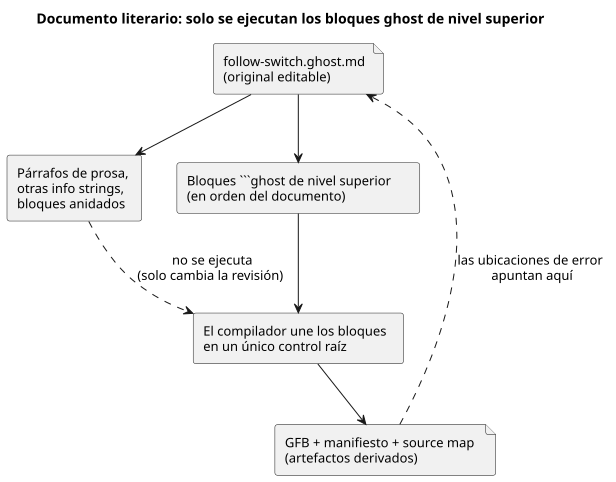

El diagrama muestra lo que lee el compilador: la prosa cambia la revisión pero no el
programa, y los diagnósticos se asignan de vuelta al original `.ghost.md`.

**No** son código ejecutable: los párrafos ordinarios, los bloques de código con otras
info strings y los bloques delimitados anidados dentro de listas o citas. Las reglas
exactas de extracción están en
[Referencia §1.1](reference/01-source-and-syntax.es.md#11-por-qué-un-solo-documento-es-la-fuente).

### Archivos y composición de programas

Los archivos no quedan relacionados solo por compartir un directorio. `import` nombra
una identidad de fuente inmutable. `instance` y `connect` exponen puertos lógicos
tipados.

Cuando el original cambia, usted revisa una nueva revisión; la composición nunca
adopta el cambio en silencio. Ese es el mínimo necesario para respaldar la afirmación
«la composición de hoy usa el componente que revisamos ayer».

Mantenga separados dos tipos de evidencia:

- El compilador verifica los contratos de las importaciones fijadas, las instancias y
  los puertos.
- La ejecución en runtime es una evidencia distinta. Los cierres de fuente fijos de
  E22 y E31 también se ejecutan en el runtime Worker/WASM del navegador. Esa evidencia
  no se extiende a composiciones ni perfiles de instalación arbitrarios.

Para un ejercicio con un solo control, guarde el documento completo como en E15.
Después verifíquelo y compílelo desde la raíz del repositorio del lenguaje:

```sh
node tools/ghostc.mjs --check follow-switch.ghost.md
node tools/ghostc.mjs follow-switch.ghost.md build/follow-switch.gfb
```

Estos comandos requieren tener instaladas las dependencias de Node. El GFB, el
manifiesto y el source map son artefactos derivados; el archivo `.ghost.md` sigue
siendo el original editable. No compile este libro completo como un único documento
ejecutable.

<a id="ch12"></a>
## 12. Un dispositivo, varios controles

El riego y la ventilación pueden funcionar correctamente cada uno por su cuenta y, aun
así, entrar en conflicto cuando comparten una bomba o un presupuesto de potencia. Este
capítulo no pega archivos entre sí. En su lugar, fija revisiones importadas y expone
las relaciones mediante instancias y puertos tipados.

Antes de reemplazar un componente, anote qué puertos y qué contratos de recursos deben
permanecer iguales. La verdadera ventaja de la composición no es solo la reutilización:
le permite demostrar qué cambió y qué se mantuvo igual.

Cada definición tiene una raíz. Una composición crea instancias de controles
importados y conecta sus puertos lógicos, de modo que cada flecha tiene un tipo y un
origen que se pueden inspeccionar.

Las conexiones por sí solas no pueden resolver un conflicto cuando dos instancias
quieren el mismo recurso físico. La identidad del recurso y su contrato deben ser
explícitos. La intención de salida también se mantiene distinta de la confirmación
física.

```text
revisión de la definición → import → instance + connect tipado
                          → composición semántica → runtime vinculado
```

Use `adapt`, las comprobaciones de capacidad (capability), las restricciones comunes,
los recursos compartidos, la reproducción (replay) y el reemplazo en caliente solo en
los lugares previstos, con sus tipos y contratos definidos. Las reglas de sintaxis y
del DAG semántico están en
[Referencia §6](reference/06-composition-and-replay.es.md). Las responsabilidades de
los dispositivos, los drivers/renderizadores y las vinculaciones están en
[Referencia §8](reference/08-language-runtime-and-device-boundaries.es.md). No suponga
que un `control` ordinario contiene algún lenguaje de políticas aparte y arbitrario.

<a id="ch13"></a>
## 13. Funciones y operaciones integradas

Este es el capítulo en el que un nombre de función conocido resulta más peligroso.
Antes de adivinar qué hace una llamada, marque tres cosas:

- ¿Devuelve un `Result`?
- ¿Recuerda muestras?
- ¿Necesita un reloj externo o un proveedor de eventos naturales?

Una llamada puede ser un cálculo de valor, una señal con estado, un descriptor de
programación horaria o una política del host, y cada tipo deja una evidencia observable
distinta. Trate el catálogo siguiente como un mapa para practicar esas preguntas, no
como una lista de nombres para memorizar.

Una **función integrada** (builtin) es una operación que el compilador ya conoce. Un
`fn` es un cálculo que usted mismo declara, como la función de E07. Un nombre conocido
no convierte algo en función integrada: no existen funciones de expresión generales
`abs`, `min`, `max`, `clamp`, `sqrt`, `pow` ni `round`. Cuando el lenguaje permite el
cálculo, declare usted mismo un `fn` adecuado.

Contraste los nombres de llamada y las firmas de este capítulo con la Referencia del
lenguaje actual y con el registro del compilador. El capítulo cubre las **52 grafías
invocables principales** y las **3 grafías adicionales de política del host**. Las
tablas separan las llamadas ordinarias, los constructores de declaración y las
transformaciones restringidas. Las firmas son fragmentos; las pruebas enlazadas
contienen ejemplos completos. No trate los fragmentos como documentos fuente
adicionales e independientes.

Lea cada fila de tabla con las mismas preguntas, en este orden:

1. ¿Dónde se permite la operación?
2. ¿Cuáles son sus tipos de entrada y de resultado?
3. ¿Recuerda muestras o estado?
4. ¿Requiere un reloj o un proveedor?
5. ¿Puede devolver un fallo?

Una compilación correcta puede producir solo un descriptor verificado, no un control
ejecutable, así que «compiló» no significa «funciona en campo». Incluso un control
ejecutable necesita las entradas de runtime y las vinculaciones indicadas. Ninguna de
estas operaciones demuestra por sí sola un efecto físico en la salida.

### 13.1 Números y construcción explícita de Result

Use una conversión cuando su intención sea cambiar la representación numérica. `Int`
es un entero exacto de 32 bits con signo; `Number` es de coma flotante. Cada conversión
toma exactamente un argumento posicional. Por ejemplo:

- `int_floor(-1.2)` es -2, mientras que `int_trunc(-1.2)` es -1.
- Con redondeo al par más cercano, un valor intermedio como 2.5 se redondea a 2, y 3.5
  se redondea a 4.

| Función integrada | Firma y propósito | Contexto, límites y ejemplo |
|---|---|---|
| `number` | `number(x: Int) -> Number`: cambia la representación explícitamente | Expresión ordinaria, sin estado. [Ejemplos de enteros](../tests/int-compiler.test.mjs). |
| `int_exact` | `int_exact(x: Number) -> Int`: exige un valor entero | Rechaza valores fraccionarios o fuera de rango. [Conversiones](../tests/dynamic-int-conversions.test.mjs). |
| `int_floor` | `int_floor(x: Number) -> Int`: redondea hacia menos infinito | El valor convertido debe caber en Int. [Conversiones](../tests/dynamic-int-conversions.test.mjs). |
| `int_ceil` | `int_ceil(x: Number) -> Int`: redondea hacia más infinito | El valor convertido debe caber en Int. [Conversiones](../tests/dynamic-int-conversions.test.mjs). |
| `int_trunc` | `int_trunc(x: Number) -> Int`: descarta la fracción hacia cero | El valor convertido debe caber en Int. [Conversiones](../tests/dynamic-int-conversions.test.mjs). |
| `int_nearest_even` | `int_nearest_even(x: Number) -> Int`: entero más cercano, empates al par | El valor convertido debe caber en Int. [Conversiones](../tests/dynamic-int-conversions.test.mjs). |
| `ok` | `ok(value: T) -> Result<T,E>`: construye un éxito | Un tipo Result esperado determina T y la E propiedad del compilador. [Ejemplos de Result](../tests/result-control.test.mjs). |
| `fault` | `fault(reason: E) -> Result<T,E>`: construye un fallo | Requiere un tipo Result esperado; conserva el motivo tipado y el origen en la fuente. [Ejemplos de Result](../tests/result-control.test.mjs). |
| `rate` | `rate(delta: Q-difference, time: Duration) -> Rate<Q>`: construye una tasa de comparación | Contexto Rate esperado; tiempo positivo; Temperature usa TemperatureDelta. La diferencia canónica se divide entre segundos. [Ejemplos de Rate](../tests/window-control.test.mjs). |

Una conversión de constante no válida hace fallar la compilación. Un error numérico
dinámico impide que la evaluación termine correctamente; no es un `Result` de sensor,
así que `recover` no puede capturarlo.

`Rate<Q>` solo existe dentro de expresiones. Para comparar una tasa, use una señal
`window_rate` y un umbral `rate`. `Rate<Q>` no es un tipo de almacenamiento general para
config/state/input/output.
Fuente: [llamadas de expresión](../tools/control.mjs), [contrato de enteros](EXACT-INTEGER-CONTRACT.es.md).

### 13.2 Conserve la calidad hasta elegir una respuesta

Una lectura de sensor fallida no es un cero normal. Una cadena (pipeline) de `Result`
transporta un valor o su error, y E10 muestra el manejo explícito de fallos. Escriba
las cadenas así:

- `result |> map(transform)`
- `result |> and_then(transform)`
- `result |> recover(default)`

`>>` combina transformaciones estáticas. Son transformaciones conocidas por el
compilador, no funciones arbitrarias de primera clase.

| Función integrada | Firma y propósito | Contexto, límites y ejemplo |
|---|---|---|
| `map` | `map(T -> U)`: Result<T,E> -> Result<U,E> | fn unario con nombre o `below(limit)`; U no debe ser Result. Conserva el fallo. [Cadenas](../tests/result-control.test.mjs). |
| `and_then` | `and_then(T -> Result<U,E>)`: Result<T,E> -> Result<U,E> | fn unario con nombre; se exige la misma E. Un fallo existente omite la transformación. [Cadenas](../tests/result-control.test.mjs). |
| `recover` | `recover(default: T)`: Result<T,E> -> T | Respaldo explícito del mismo tipo; registra el fallo y su origen en la traza. `recover(false)` es una decisión del autor. [Procedencia](../tests/result-provenance.test.mjs). |
| `below` | `below(limit: T)`: transforma T -> Bool con `<` estricto | Solo como transformación de map. Numérico ordenado, Rate, DateTime o TimeOfDay; límite del mismo tipo. and_then(below(...)) se rechaza porque Bool no es Result. [Cadenas](../tests/result-control.test.mjs). |

Fuente: [reducción de transformaciones estáticas](../tools/control.mjs). Recuperar un valor no hace que la medición original sea fiable.
Para el sensor Percent de E10, el fragmento `moisture |> map(below(30%)) |> recover(false)` pide false cuando la lectura falla. Este cálculo de umbral no tiene memoria de histéresis; §13.3 la añade.

### 13.3 Filtre las muestras y luego use histéresis para retener una decisión

Un **filtro** suaviza los valores medidos. La **histéresis** recuerda una decisión Bool
a lo largo de una banda de valores. Resuelven problemas distintos, y puede usarlos
juntos.

Para usar un filtro, declare un sensor numérico y seleccione un filtro con
`filter = ...`. Los filtros consumen muestras físicas nuevas y válidas; los escaneos
repetidos de la misma muestra no añaden peso. Por ejemplo, `filter = median(3);` de E10
usa tres muestras reales, mientras que `filter = ema(alpha: 0.25);` da a cada muestra
nueva una cuarta parte del peso de la actualización.

| Función integrada | Firma y propósito | Contexto, límites y ejemplo |
|---|---|---|
| `median` | `median(n)`: valor central de las últimas n muestras válidas | Solo como filtro de sensor; entero impar constante 1..31. Una ventana parcial es NotReady. [Filtros](../tests/signals-wasm.test.mjs). |
| `moving_average` | `moving_average(n)`: media aritmética de las últimas n muestras válidas | Solo como filtro de sensor; entero constante 1..31. Una ventana parcial es NotReady. [Filtros](../tests/signals-wasm.test.mjs). |
| `ema` | `ema(alpha: Number)`: pondera la muestra nueva y el valor anterior | Solo como filtro de sensor; constante finita 0 < alpha <= 1. Se inicializa con la primera muestra válida; las reglas de recuperación siguen aplicándose. [Filtros](../tests/signals-wasm.test.mjs). |
| `hysteresis` | `hysteresis(sensor, on_below: T, off_above: T, initial: Bool) -> Result<Bool,SensorFault>` | Declaración de señal; sensor numérico directo; umbrales constantes del mismo T con on_below < off_above. [Límites y fallos de la histéresis](../tests/signals-wasm.test.mjs). |

Considere el control de humedad de E10: `signal dry = hysteresis(moisture, on_below: 30%, off_above: 35%, initial: false);`.

- Por debajo del 30%, dry pasa a true.
- Por encima del 35%, dry pasa a false.
- Todo valor dentro de la **banda cerrada [30%,35%]**, incluidas ambas igualdades,
  conserva el Bool anterior mientras la calidad sea buena.

Esta banda evita que pequeñas fluctuaciones hagan oscilar la decisión de un lado a
otro.

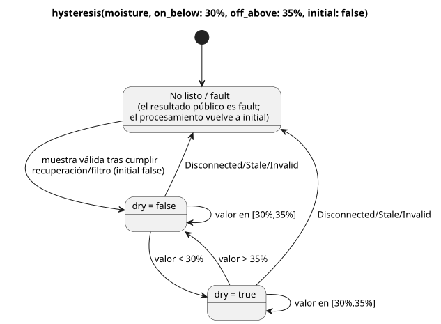

El diagrama muestra las dos decisiones retenidas, las transiciones estrictas y la ruta
de fallo que reinicia el procesamiento a `initial`.

La secuencia siguiente enumera lecturas filtradas válidas después de alcanzar la
disponibilidad, no muestras en bruto antes del filtro.

| Humedad filtrada válida | Valor dry retenido | Motivo |
|---|---|---|
| 30% tras el arranque | false | La igualdad conserva el false inicial. |
| 35% | false | La igualdad superior también conserva false. |
| 29% | true | Estrictamente por debajo del umbral inferior. |
| 30% | true | La igualdad inferior conserva true. |
| 33% | true | Dentro de la banda. |
| 35% | true | La igualdad superior conserva true. |
| 36% | false | Estrictamente por encima del umbral superior. |

`initial` es el valor retenido de partida. No es un permiso para ignorar una muestra
ausente:

- Antes de la disponibilidad, o tras Disconnected/Stale/Invalid, el resultado público es
  un fallo.
- El procesamiento se reinicia a `initial`, y las muestras válidas deben volver a cumplir
  los requisitos de recuperación y de filtro.
- Por eso, una muestra recuperada dentro de la banda parte de `initial`; no continúa la
  decisión anterior al fallo.
- Aunque `initial` sea true, un Result fallido nunca se convierte en `ok(true)`. E10 elige
  la respuesta de su salida con `case`.

El [acondicionador en Rust](../crates/ghostflow-core/src/signals.rs) usa comparaciones estrictas y reinicia el procesamiento de la histéresis ante fallos. La prueba WASM enlazada contiene “retains either prior state exactly at both thresholds” y ejemplos de fallo/recuperación. Este capítulo describe esos contratos; editar la documentación no crea una nueva prueba de hardware.

### 13.4 El tiempo, las muestras y los eventos son evidencias distintas

Declare estas operaciones con `signal name = constructor(...);`. Un temporizador
monotónico que cuenta escaneos no demuestra que una condición física se mantuviera
verdadera *entre* escaneos. Cuando la continuidad importa, use evidencia certificada.

Para un sensor Temperature declarado, `signal recent = hold_last(temperature, for_at_most: 2min, quality: measured);` limita durante cuánto tiempo puede reutilizarse su última muestra válida. Antes de que una salida pueda usarla, sigue necesitando una respuesta explícita al Result.

| Función integrada | Firma y propósito | Contexto, límites y ejemplo |
|---|---|---|
| `debounce` | `debounce(source, stable_for: Duration, initial: T) -> T or Result<T,E>`: acepta un candidato estable | Bool o enum finita; duración constante positiva e initial constante del mismo tipo. Los cambios del candidato reinician su antigüedad; los fallos reinician. Las fuentes de muestras conservan su linaje; los valores simples usan escaneos. [Debounce](../tests/debounce-control.test.mjs). |
| `true_for` | `true_for(BoolSensor, duration: Duration, quality: measured) -> Result<Bool,SensorFault>`: demuestra true continuo | Sensor Bool declarado directo, duración constante positiva. Intervalos certificados por el driver; false o una calidad no admisible reinician. El límite que alcanza la duración es true. [Fuente certificada](../tests/fixtures/true-for-certified.ghost.md). |
| `after_event` | `after_event(Event, BoolSensor, window: Duration, quality: measured)`: retiene evidencia por evento | Ventana constante positiva; se requieren identidades de evento y muestras del predicado. El predicado se evalúa en [eventTime,eventTime+window). La señal en sí no es escalar. [Fuente de eventos](../tests/fixtures/after-event-evidence.ghost.md). |
| `after_event_any` | `after_event_any(signal) -> Result<Bool,SensorFault>`: proyecta el resultado existencial por eventos | Una señal after_event. Un true decisivo puede establecer any; si no, las identidades no resueltas y los fallos siguen siendo relevantes. [Ejemplos de proyección](../tests/after-event-control.test.mjs). |
| `after_event_all` | `after_event_all(signal) -> Result<Bool,SensorFault>`: proyecta el resultado universal por eventos | Una señal after_event. Un false decisivo puede establecer all=false; los conjuntos vacíos o pendientes sin evidencia decisiva dan NotReady, no un permiso automático. [Ejemplos de proyección](../tests/after-event-control.test.mjs). |
| `window_average` | `window_average(source, over: Duration, quality: measured, max_age: Duration)` | Result<numeric/physical,SensorFault> con linaje de muestras físicas. Devuelve la misma carga útil, salvo Int -> Number. [Ventanas](../tests/window-control.test.mjs). |
| `window_min` | `window_min(source, over: Duration, quality: measured, max_age: Duration)` | Mismas cargas útiles admisibles que average; Result del mínimo, mismo tipo de carga útil. [Ventanas](../tests/window-control.test.mjs). |
| `window_max` | `window_max(source, over: Duration, quality: measured, max_age: Duration)` | Mismas cargas útiles admisibles que average; Result del máximo, mismo tipo de carga útil. [Ventanas](../tests/window-control.test.mjs). |
| `window_rate` | `window_rate(source, over: Duration, quality: measured, max_age: Duration) -> Result<Rate<Q>,SensorFault>` | Magnitud física lineal admitida; observaciones más antigua y más reciente en instantes distintos. La diferencia de temperatura usa delta K. Number/Int/Percent, RelativeHumidity, CO2 y Acidity no se aceptan como entradas. [Ejemplos de Rate](../tests/window-control.test.mjs). |
| `hold_last` | `hold_last(source, for_at_most: Duration, quality: measured) -> Result<T,SensorFault>`: reutiliza temporalmente una muestra válida | Se requiere linaje físico; duración constante positiva. Conserva la marca de tiempo real, la antigüedad retenida y el fallo enmascarado; nunca la renueva por reevaluación. [Ejemplos de retención](../tests/hold-last-control.test.mjs). |
| `elapsed` | `elapsed(state) -> Duration`: antigüedad desde un cambio de estado | Solo en la declaración de temporizador; estado declarado, reloj monotónico explícito; se reinicia con el cambio. [E08](#ch06). |
| `continuous_true` | `continuous_true(BoolExpression) -> Duration`: antigüedad de las observaciones de escaneo continuamente verdaderas | Solo en la declaración de temporizador; parte de cero en el primer escaneo true y se reinicia con false. No certifica el intervalo no observado. [Ejemplos de temporizador](../tests/compiler.test.mjs). |

Reglas de las ventanas:

- `over` y `max_age` son Durations constantes positivas.
- Una ventana usa las observaciones admisibles reales en **(now-over,now]**, sin
  interpolación.
- Si no hay observaciones, o si la observación más reciente tiene una antigüedad
  **>= max_age**, el resultado es NotReady.
- Se conserva un fallo actual de la fuente.
- Una tasa necesita observaciones en dos instantes distintos.
- La composición de ventanas conserva la procedencia del agregado y de las muestras.
  Los escaneos en los que solo avanza el reloj no fabrican observaciones nuevas.

Un programa que usa after_event solo a través de las proyecciones any/all puede
compilarse a un control ejecutable con vinculaciones de runtime de eventos. Un
after_event sin proyectar, o combinado con condiciones naturales, puede producir un
descriptor temporal `executable:false`. `after_event_for` se trata más abajo, entre los
nombres no admitidos.
Fuente: [reducción de señales/temporizadores](../tools/control.mjs), [Referencia temporal](reference/04-sensors-constraints-control.es.md).

### 13.5 Hechos naturales y constructores de políticas de programación horaria

Un proveedor suministra observaciones o predicciones; el programa decide qué permiten.
Las tres llamadas ordinarias siguientes devuelven su incertidumbre explícitamente como
un `Result`.

| Función integrada | Firma y propósito | Contexto, límites y ejemplo |
|---|---|---|
| `local_day_is` | ``local_day_is(day`mon..fri`, timezone: "Asia/Seoul") -> Result<Bool,ClockFault>`` | Comprueba el día de la semana de la fecha local fiable actual. Maneje explícitamente los fallos de reloj antes de permitir un nuevo inicio. [Ejemplo de tres zonas](../tests/monitoring-plan.test.mjs). |
| `calendar_is` | ``calendar_is(calendar, day`workday` or day`offday` or day`holiday`) -> Result<Bool,CalendarFault>`` | WorkCalendar o HolidayCalendar tipado con una vinculación UTC explícita en GFB18. Los hechos ausentes, fuera de cobertura, vencidos o con reloj no fiable conservan un fallo; manéjelo explícitamente antes de negar el Bool correcto. [Límites de calendario ejecutados](../tests/reference-calendar-boundary.test.mjs). |
| `tide_is` | ``tide_is(provider, tide`spring` or tide`neap`) -> Result<Bool,TemporalContextFault>`` | Proveedor TidePredictions declarado. Una predicción ausente u obsoleta, o un contexto de reloj ausente u obsoleto, es un fallo. [Condiciones naturales](../tests/natural-condition-contract.test.mjs). |
| `moon_is` | ``moon_is(provider, moon`phase`) -> Result<Bool,TemporalContextFault>`` | Proveedor LunarEphemeris; fases: new, waxing_crescent, first_quarter, waxing_gibbous, full, waning_gibbous, last_quarter, waning_crescent. [Condiciones naturales](../tests/natural-condition-contract.test.mjs). |

Los literales etiquetados de estas firmas son fragmentos de notación. Estas llamadas necesitan hechos del runtime o del proveedor, por lo que un `fn` puro no puede capturar un calendario ni un proveedor globales.

Los constructores siguientes solo son válidos en campos de programación horaria. No devuelven valores que pueda almacenar en expresiones ordinarias. Todas las Durations aquí son constantes positivas.
Por ejemplo, `gap = skip_after(10min);` declara una política de brecha. Para Tide, `basis = run(5min, within(10min));` permite la admisión dentro de los diez minutos posteriores a la hora planificada y luego funciona durante cinco minutos a partir de la admisión.

| Función integrada | Firma y propósito | Contexto, límites y ejemplo |
|---|---|---|
| `instant` | `instant(DateTime)`: ancla Periodic absoluta | DateTime constante; el segmento ejecutable actual usa preserve_anchor y pulse. [Periodic](../tests/periodic-cron-policy.test.mjs). |
| `civil` | `civil(Date, TimeOfDay)`: ancla Periodic civil | Fecha/hora constante; contrato de descriptor verificado, fuera del segmento de bytecode Periodic actual. [Periodic](../tests/periodic-cron-policy.test.mjs). |
| `skip_after` | `skip_after(Duration)`: acota la brecha de observación aceptable | Campo gap de la programación horaria; las brechas mayores usan una política explícita de skip/baseline. [Políticas](../tests/periodic-cron-policy.test.mjs). |
| `range` | `range(Duration)`: intervalo planificado | Basis de la programación horaria; la no superposición debe poder demostrarse y cancel_when debe ser explícito. Los rangos UTC fijos tienen un segmento de ejecución acotado; los rangos civiles generales siguen en el ámbito de descriptor. [Contrato de Range](../tests/schedule-descriptor-artifact.test.mjs). |
| `run` | `run(Duration, within(Duration))`: ejecución Tide desde la admisión | Basis de Tide; la primera Duration es la duración de la ejecución. La admisión debe ocurrir dentro del intervalo de gracia. [Tide](../tests/natural-schedule-contract.test.mjs). |
| `window` | `window(Duration)`: intervalo de admisión At de un solo disparo | El primer escaneo elegible en un intervalo At semiabierto fijo emite `.due`. `.open` es el nivel de la condición actual y no reinicia una ocurrencia admitida u omitida. [At Window](../tests/reference-foundations-temporal.test.mjs). |
| `within` | `within(Duration)`: gracia de admisión de Tide | Solo como segundo argumento de run de Tide; [planned,planned+grace), con el final exacto excluido. No alarga la duración de la ejecución. [Tide](../tests/natural-schedule-contract.test.mjs). |
| `hold_trusted` | `hold_trusted(Duration, terminal: skip)`: retención acotada de hora fiable | Campo clock de Solar/Tide; constante positiva; se requieren evidencia fiable previa y continuidad de ejecución/tiempo. El vencimiento exacto omite. E36. [Ejecución](../tests/programming-natural-examples.test.mjs). |
| `fixed_time` | `fixed_time(TimeOfDay literal, terminal: skip)`: respaldo a hora fija | Solo como fallback de Solar; literal TimeOfDay constante y terminal skip explícito. No lo traslade a Tide. E36/E101. [Ejecución](../tests/programming-natural-examples.test.mjs). |

Las programaciones horarias ejecutables actuales usan recuperación baseline. Las combinaciones admitidas son:

- Relojes Solar y Tide: `trusted_only`, o `hold_trusted` con una Duration constante positiva y `terminal: skip`.
- Fallback de Solar: `fixed_time(TimeOfDay, terminal: skip)`. El fallback de Tide es `skip`.
- Daily/slots/Cron usan pulse; Periodic requiere instant+preserve_anchor; Tide usa run+within.
- `range` UTC fijo tiene su propio segmento de ejecución acotado. Esto no hace ejecutable cualquier descriptor civil.

Consulte E36–E37 más abajo y las [comprobaciones de fallback](../tests/natural-fallback-compiler.test.mjs).
Fuente: [reducción de programaciones horarias y selección de segmentos](../tools/control.mjs), [Referencia de tiempo](reference/03-time-and-schedules.es.md).

### 13.6 Contabilice el uso antes de conceder más

Una cuenta registra evidencia. No predice el uso a partir de una animación ni de una
salida solicitada. Los comprobantes aplicados son distintos de la intención solicitada,
y la contabilización de uso duradera necesita un libro mayor (ledger) y vinculaciones
de recursos verificadas.

Para un recurso vinculado `pump`, el fragmento de declaración `account pumping = on_time(pump, stage: applied, persistence: durable);` elige la evidencia aplicada. Los ejemplos de contabilización enlazados también declaran el recurso y las políticas de límite.

| Función integrada | Firma y propósito | Contexto, límites y ejemplo |
|---|---|---|
| `on_time` | `on_time(resource, stage: applied, persistence: durable)`: cuenta de Duration | Declaración account; el segmento ejecutable acotado solo acepta durable/applied. Las alternativas requested/safe/confirmed pueden verificarse, pero no son esta vinculación ejecutable. [Contabilización](../tests/accounting-syntax.test.mjs). |
| `count_events` | `count_events(Event, over: local_day("zone"), persistence: durable)`: cuenta de eventos | Declaración account; .count devuelve Result<Int,AccountingFault>. El segmento ejecutable requiere durable/local_day; las identidades de evento duplicadas no cuentan dos veces. [Contabilización](../tests/accounting-syntax.test.mjs). |
| `used` | `used(account, rolling(Duration))`: consulta la Duration contabilizada | Solo en la posición de límite de una restricción de contabilización. El límite ejecutable usa <=, cota/reserva positiva y on_unknown=block. [Límites](../tests/accounting-syntax.test.mjs). |
| `rolling` | `rolling(Duration)`: base de contabilización retrospectiva | Duración constante positiva; rolling de count_events es del ámbito de descriptor/verificación, fuera del segmento ejecutable de conteo de eventos. [Límites](../tests/accounting-syntax.test.mjs). |
| `local_day` | `local_day("timezone")`: base de contabilización por día civil | Zona horaria literal no vacía; se requieren reloj, calendario y libro mayor. No es una ventana móvil fija de 24 horas. [Contabilización](../tests/accounting-syntax.test.mjs). |
| `count_on` | `count_on({resources}) -> Int`: cuenta los recursos candidatos en true | Restricciones de recursos con nombre, no expresiones ordinarias. Conjunto finito de recursos Bool distintos; vacío -> 0. Se requiere vinculación de política del host. [Restricciones con nombre](../tests/named-constraints.test.mjs). |
| `any_on` | `any_on({resources}) -> Bool`: comprueba los recursos candidatos | Mismo contexto restringido; vacío -> false. La etapa de evaluación la declara la restricción. [Restricciones con nombre](../tests/named-constraints.test.mjs). |

Una política de recursos con nombre independiente se convierte en un artefacto de política del host, no en un control ordinario de la VM. Fuente: [restricciones de contabilización/recursos](../tools/control.mjs).

### 13.7 Los constructores PID pertenecen a un objetivo

Un controlador calcula objetivos solicitados, y las restricciones posteriores pueden
limitarlos. Estos constructores fijan las ganancias y la política de reinicio; no son
funciones generales de álgebra de unidades.

La vinculación nativa actual es un sensor Temperature, un objetivo config Temperature y
un `ContinuousActuator<Percent>`, con un mínimo de salida del 0%. Otros tipos de
controlador pueden llevar metadatos que requieren vinculación, pero un `pi` u `on_off`
analizado sintácticamente no demuestra que haya un controlador en funcionamiento.

| Función integrada | Firma y propósito | Contexto, límites y ejemplo |
|---|---|---|
| `proportional_gain` | `proportional_gain(output: Percent, error: TemperatureDelta)`: ganancia P | Campo kp del PID; constantes, output >=0, error >0; output/error. [Ejemplos de controlador](../tests/gfb7-pid-contract.test.mjs). |
| `integral_gain` | `integral_gain(output: Percent, error: TemperatureDelta, time: Duration)`: ganancia I | ki del PID; mismas cotas más time >0; output/error/segundos. [Ejemplos de controlador](../tests/gfb7-pid-contract.test.mjs). |
| `derivative_gain` | `derivative_gain(output: Percent, error: TemperatureDelta, time: Duration)`: ganancia D | kd del PID; mismas cotas más time >0; output*segundos/error. [Ejemplos de controlador](../tests/gfb7-pid-contract.test.mjs). |
| `reset` | `reset(output: Percent)`: objetivo explícito de reinicio | Campo restart del PID; constante dentro del rango de salida del objetivo. La primera muestra aceptada inicializa el seguimiento; no es una llamada arbitraria de reinicio de estado. [Ejemplos de controlador](../tests/gfb7-pid-contract.test.mjs). |

Una ganancia cuya salida es cero desactiva ese término. El periodo debe ser positivo, y
late_after >= period. Las políticas explícitas de dirección, bias, anti-windup,
deshabilitación/transferencia, fallo y reinicio gobiernan el ciclo de vida del
controlador; las mediciones obsoletas o ausentes nunca se aceptan en silencio. Consulte
la [reducción de controladores](../tools/control.mjs) y la [Referencia de control continuo](reference/04-sensors-constraints-control.es.md).
Por ejemplo, `kp = proportional_gain(output: 2%, error: 1Δ°C);` declara dos puntos porcentuales de salida por cada grado de error de temperatura. `restart = reset(output: 0%);` elige explícitamente el primer objetivo seguido.

### 13.8 La gramática separada de políticas del host

El adaptador `ghostrules` verifica una gramática acotada de políticas de estación. Las
formas que allí parecen llamadas son formas contextuales; no añaden funciones a las
expresiones ordinarias de control. Las [reglas de estación](../examples/station-rules.ghost.es.md) existentes y las [pruebas de restricciones](../tests/constraints.test.mjs) muestran políticas completas.

| Función integrada | Firma y propósito | Contexto, límites y ejemplo |
|---|---|---|
| `stopped` | `stopped(station)`: exige que la estación esté detenida | Solo en condiciones de política allow enter/apply con su modo especificado. Estado de la estación en el host, no prueba física del motor. [Reglas](../examples/station-rules.ghost.es.md). |
| `pump_capacity` | `pump_capacity(pump)`: solicita una comprobación de capacidad | Solo en cláusulas de política require ... == Pass o check. Artefacto de política del host; no es una expresión numérica de capacidad. [Reglas](../examples/station-rules.ghost.es.md). |
| `day` | `day("timezone")`: día civil para un límite diario | Solo `limit on_time(pump) <= Duration per day("zone")`; zona horaria IANA válida, no vacía, <=128 caracteres. [Reglas](../examples/station-rules.ghost.es.md). |

En esta gramática, `count_on(pump.valves)`, `any_on(pump.valves)` y `on_time(pump)` son formas restringidas cuya forma de argumentos difiere de §13.6. Producen cláusulas de política max-valves, pump-needs-valve y de límite diario. No traslade estas grafías a expresiones `let` arbitrarias. Las palabras clave `exclusive`, `allow`, `require`, `limit`, `once` y `check` introducen cláusulas; `warn` se rechaza.
Fuente: [analizador de políticas del host](../tools/constraints.mjs).

### 13.9 Sintaxis adyacente y alternativas no disponibles

Los elementos siguientes son útiles junto a las funciones integradas, pero **no son funciones invocables**.

| Sintaxis | Significado y límite actual |
|---|---|
| Daily, DailySlots<15min>, Periodic, Cron, Solar, Tide | Tipos de declaración de programación horaria. La ejecución de DailySlots usa una cuadrícula fija de 15 minutos; Cron tiene cinco campos validados. |
| pulse; literales etiquetados time/date/datetime/cron5/day/sun/tide/moon | Valor de política y notación tipada. ``sun`rise` ``/``sun`set` `` no son llamadas sunrise()/sunset(). |
| TimeSlots<grid,capacity> | Tipo config: cuadrícula positiva que divide 24h, capacidad positiva, lista TimeOfDay finita, única y alineada. No existe la llamada TimeSlots(...). |
| `Result<T,E>`; `Rate<Q>` | Resultado tipado y tasa solo de expresión. E es propiedad del compilador; una carga útil Result anidada se rechaza. |
| schedule.due; schedule.active; schedule.missed | Proyecciones Bool; .missed requiere una proyección expuesta. Una ocurrencia activa no es una salida aplicada. No hay llamadas a métodos. |
| eventAccount.count | Proyección Result<Int,AccountingFault>; solo en cuentas count_events. |
| resource.on/position/valves | Extremos contextuales de recurso/política, no métodos genéricos. |
| sample, valid, filter, stale_after, recover_after, samples | Campos/notación de la declaración de sensor. En particular, stale_after no es una llamada de expresión. |
| on_below, off_above, initial; min, max, step, access, label | Argumentos con nombre o campos config, no funciones. |
| if/case/in; >> y \|>; fn/type/state/config/timer/signal | Sintaxis, operadores y declaraciones. Los cualificados input.name/state.name/next.name son alias eliminados. |

Las [reglas del analizador y de miembros/tipos](../tools/control.mjs) definen dónde pueden aparecer. Los tipos y las unidades completos están en el [capítulo 2 de la Referencia](reference/02-types-expressions-state.es.md).

La tabla siguiente enumera grafías que puede encontrar en la Referencia o en notas de
diseño y que el compilador actual **no** admite como llamadas.

| Grafía seleccionada/de referencia | Estado actual; no afirme que se ejecuta |
|---|---|
| after_event_for(signal, EventId) | La Referencia describe una proyección por identidad, pero el compilador actual no tiene despachador para esta llamada; función desconocida. Use las any/all admitidas solo cuando su significado coincida con la intención. |
| window(Duration) schedule basis | Alternativa de diseño, no es un basis aceptado actualmente. Es distinto de las señales admitidas window_average/min/max/rate. |
| run(Duration, on_time) | Alternativa de diseño; el run de Tide admitido requiere within(Duration). |
| range(Duration); civil(Date,TimeOfDay) | Contratos de descriptor verificados, como se explicó antes; no son segmentos de bytecode actuales. |
| PID checkpoint; degraded Name | Alternativas de diseño seleccionadas que no admiten las políticas nativas actuales de fallo/reinicio del PID. |
| ifthenelse, purefn, enum, next | Alias eliminados. Use las formas canónicas if ... then ... else, fn, type y el estado con prima. |

Ver un nombre en un diagnóstico no es evidencia de que esté admitido. Por eso la tabla
separa las alternativas de diseño de las llamadas actuales. Verifique la ruta del
compilador y el tipo de artefacto. La [comprobación de cobertura del capítulo](../tests/programming-builtins.test.mjs)
mantiene ambos idiomas alineados con el despacho de invocables del compilador; no juzga
la utilidad física.

<a id="ch14"></a>
## 14. Unidades de temperatura y control por VPD del aire

25°C y 77°F describen el mismo aire con números distintos. A la inversa, el mismo número
25 con otra unidad puede describir una condición completamente diferente.

Pruebe dos predicciones en este capítulo:

- Introduzca la misma temperatura física en E16–E18 y prediga que los tres calefactores
  toman la misma decisión.
- En los ejemplos de VPD, cambie solo la temperatura o solo la humedad, y observe qué
  demanda cambia primero.

Mantener la conversión de unidades separada de la política de control le permite
resolver los errores de cálculo y los desacuerdos de política en lugares distintos.

### Una temperatura física, tres unidades de origen

Un sensor Temperature conserva su tipo físico tanto si su unidad de origen o de
visualización es Celsius, Fahrenheit o Kelvin. En runtime, la representación canónica
es el kelvin.

Los tres ejemplos de calefactor expresan una regla física en tres unidades de
visualización:

- por debajo de 18°C, solicitar ON;
- por encima de 22°C, solicitar OFF;
- en cualquiera de los límites o dentro de la banda, mantener la decisión válida
  anterior.

Lea la tabla siguiente por filas para comprobar que la conversión conserva cada límite.

La calidad viaja con el cálculo:

- Antes de la primera muestra, el sensor está NotReady.
- Entre entregas, la última muestra válida sigue siendo utilizable hasta que su
  antigüedad es >= 3s; entonces pasa a Stale.
- Un fallo inhibe la solicitud del calefactor y reinicia la histéresis a `initial`
  false.
- Con `median(1)`, estos ejemplos se recuperan tras una nueva muestra válida.

«Se vio un número antes» y «el número es fiable ahora» son afirmaciones distintas.

| Límite físico | Celsius | Fahrenheit | Kelvin |
|---|---|---|---|
| Umbral inferior del calefactor | 18°C | 64.4°F | 291.15K |
| Umbral superior del calefactor | 22°C | 71.6°F | 295.15K |
| Rango válido del calefactor | −40–50°C | −40–122°F | 233.15–323.15K |

La conversión de literales es exacta antes del redondeo binary64. No introduzca un
número como 64.4 directamente como muestra canónica de runtime: 64.4°F significa
291.15K. Las vinculaciones del driver identifican la unidad y la magnitud que
suministran. Consulte [tipos físicos](reference/02-types-expressions-state.es.md) e [histéresis](#ch13).

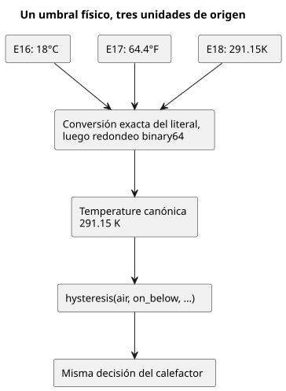

El diagrama sigue el umbral inferior: cada ejemplo lo escribe en una unidad distinta,
pero los tres llegan al mismo valor en kelvin y, por tanto, a la misma decisión.

### E16 — Calefactor en Celsius

```ghost
// E16
control CelsiusHeater {
  input air: Temperature {
    sample = 1s;
    valid = -40°C .. 50°C;
    filter = median(1);
    stale_after = 3s;
    recover_after = 1 samples;
  }
  signal cold = hysteresis(air,
    on_below: 18°C, off_above: 22°C, initial: false);
  output heater: Bool;
  heater <- cold |> recover(false);
}
```

### E17 — Calefactor en Fahrenheit

```ghost
// E17
control FahrenheitHeater {
  input air: Temperature {
    sample = 1s;
    valid = -40°F .. 122°F;
    filter = median(1);
    stale_after = 3s;
    recover_after = 1 samples;
  }
  signal cold = hysteresis(air,
    on_below: 64.4°F, off_above: 71.6°F, initial: false);
  output heater: Bool;
  heater <- cold |> recover(false);
}
```

### E18 — Calefactor en Kelvin

```ghost
// E18
control KelvinHeater {
  input air: Temperature {
    sample = 1s;
    valid = 233.15K .. 323.15K;
    filter = median(1);
    stale_after = 3s;
    recover_after = 1 samples;
  }
  signal cold = hysteresis(air,
    on_below: 291.15K, off_above: 295.15K, initial: false);
  output heater: Bool;
  heater <- cold |> recover(false);
}
```

<a id="hot-greenhouse-fan"></a>
### E38 — Encender el ventilador cuando sube la temperatura

Cambia la temperatura del invernadero virtual a `28°C → 30°C → 28°C → 26°C`. El ventilador pasa de `apagado → encendido → encendido → apagado`. Se enciende por encima de `29°C` y se apaga por debajo de `27°C`. En los dos umbrales mantiene el estado anterior.

`cool` conserva el estado de frío. Si la lectura es válida, el ventilador usa el valor inverso. En este ejemplo, el ventilador se apaga cuando la lectura caduca tras tres segundos sin una muestra nueva.

```ghost
// E38
control GreenhouseVentilation {
  input air: Temperature {
    sample = 1s;
    valid = -40°C .. 50°C;
    stale_after = 3s;
  }
  signal cool = hysteresis(air,
    on_below: 27°C, off_above: 29°C, initial: true);
  output fan: Bool;
  fan <- case cool { ok(value) => !value; fault(_) => false; };
}
```

### VPD del aire a partir de la temperatura y la humedad relativa

El **VPD del aire** (déficit de presión de vapor) es la presión de vapor de saturación
menos la presión de vapor real del aire. Para una temperatura del aire T en °C y una
humedad relativa del aire RH simultáneas, use `0.6108 * exp(17.27*T/(T+237.3)) * (1-RH/100)` kPa.

- La relación de saturación y la definición de humedad relativa proceden de [FAO-56, capítulo 3, ecuaciones 10–11](https://www.fao.org/4/x0490e/x0490e07.htm).
- Este es un cálculo instantáneo del aire, no la estimación diaria de evapotranspiración de la FAO.
- El VPD de la hoja también depende de la temperatura de la hoja; aquí no se calcula.

GhostFlow no tiene una función integrada exp, así que cada ejemplo completo escribe
`exp_0_3_1` como un fn puro ordinario: un polinomio de Taylor fijo de orden 14,
evaluado en forma de Horner.

- El dominio declarado del sensor de aire es **0–50°C**, por lo que el exponente se
  mantiene en **0–3.006**, dentro del dominio de 0–3.1 indicado para la función.
- Fuera de ese rango de temperatura, el sensor devuelve Invalid y la fórmula no se
  evalúa. No extrapole la aproximación.
- La [comprobación numérica independiente](../tests/programming-climate.test.mjs)
  compara los valores reales del runtime con Math.exp del host en una cuadrícula de
  0.1°C y en los límites de humedad, exigiendo un error absoluto <= **0.001 kPa**.
  Verifica los tres originales en lugar de copiar su polinomio en una implementación
  de valores esperados.

La aritmética tipada de `air_vpd` es explícita:

- `(t - 0°C) / 1Δ°C` convierte la temperatura en un Number simple en Celsius.
- `rh / 100%RH` normaliza la humedad tipada a una proporción, según [el contrato de proporción de RH](reference/02-types-expressions-state.es.md).
- La multiplicación final por `0.6108kPaVPD` da al resultado el tipo VaporPressureDeficit.

RelativeHumidity es la humedad del aire. No es el Percent de humedad del suelo que se
usa en E10.

La luz se tipa como **PPFD**, en `umol/m2/s` (µmol·m⁻²·s⁻¹). El PPFD cuenta los fotones
relevantes para la fotosíntesis. El lux es la iluminancia ponderada según la visión
humana, y no existe una conversión universal de lux a PPFD, así que use un sensor o
una vinculación de PPFD verificados. En estos ejemplos, la luz solo **condiciona la
elegibilidad de la salida**; nunca cambia el VPD calculado para una T/RH fijas.

### Tres políticas didácticas independientes

Los umbrales son una intención de fuente ilustrativa, no recomendaciones universales
para cultivos. Tenga presentes estos límites:

- Una demanda de humidificador no demuestra que la humedad aumente.
- La ventilación depende de las condiciones exteriores.
- Una demanda de riego no es una estimación del agua del suelo ni una secuencia de
  bomba.

Estos ejemplos no contienen ningún modelo físico de invernadero. La instalación es
responsable de la vinculación del actuador, de su idoneidad y de la verificación del
efecto físico.

| Ejemplo | ON | OFF | Condición de luz |
|---|---|---|---|
| E19 demanda de humidificación | VPD > 1.2 kPa | VPD < 1.0 kPa | PPFD >= 200 µmol·m⁻²·s⁻¹ |
| E20 demanda de ventilación | VPD < 0.4 kPa | VPD > 0.6 kPa | PPFD >= 200 µmol·m⁻²·s⁻¹ |
| E21 demanda de riego | VPD > 1.0 kPa | VPD < 0.8 kPa | PPFD >= 300 µmol·m⁻²·s⁻¹ |

Un Result calculado no es un sensor declarado, así que el constructor `hysteresis`,
exclusivo para sensores, no puede consumirlo. En su lugar, cada ejemplo usa un `state`
Bool explícito que expresa la misma intención estricta de ON / OFF / banda muerta.

Cómo responden los ejemplos a los fallos y a la luz:

- Un fallo de temperatura o de RH anula la demanda.
- La noche, o un fallo de luz, inhibe la salida, mientras que la demanda climática
  puede seguir recordada.
- Un fallo de luz inhibe la salida sin invalidar un cálculo de T/RH que siga siendo
  válido.
- La recuperación usa la evidencia válida actual. No se introduce ningún temporizador
  ni modo automático adicional.

`air_vpd_value = 0` ante un fallo climático es solo un marcador de visualización
explícito. **Léalo junto con vpd_valid**: false no significa un VPD medido de cero.

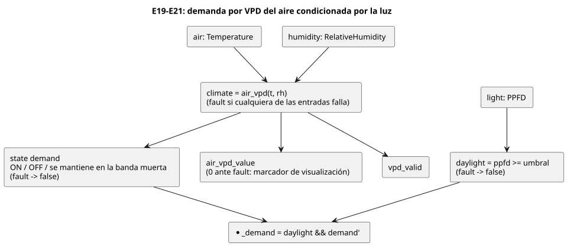

El diagrama muestra la estructura común de E19–E21. Entre los tres ejemplos solo
difieren los umbrales ON/OFF y la condición de PPFD.

### E19 — Demanda de humidificación por VPD alto

<!-- ghostflow:anchor id=GF-INT-PIG-E19-HYSTERESIS kind=intent status=confirmed origin=ai -->
> Mantener la demanda anterior entre los dos umbrales de VPD para evitar cambios rápidos; borrar la demanda si falla la muestra climática.

```ghost
// E19
fn exp_0_3_1(x: Number) -> Number {
  1 + x / 1 * (1 + x / 2 * (1 + x / 3 * (1 + x / 4 * (1 + x / 5 * (1 + x / 6 * (1 + x / 7 * (1 + x / 8 * (1 + x / 9 * (1 + x / 10 * (1 + x / 11 * (1 + x / 12 * (1 + x / 13 * (1 + x / 14 * (1))))))))))))))
}
fn air_vpd(t: Temperature, rh: RelativeHumidity) -> VaporPressureDeficit {
  0.6108kPaVPD * exp_0_3_1(
    17.27 * ((t - 0°C) / 1Δ°C) / (((t - 0°C) / 1Δ°C) + 237.3)
  ) * (1 - rh / 100%RH)
}
control HumidificationDemand {
  input air: Temperature {
    sample = 1s; valid = 0°C .. 50°C;
    filter = median(1); stale_after = 3s; recover_after = 1 samples;
  }
  input humidity: RelativeHumidity {
    sample = 1s; valid = 0%RH .. 100%RH;
    filter = median(1); stale_after = 3s; recover_after = 1 samples;
  }
  input light: PPFD {
    sample = 1s; valid = 0umol/m2/s .. 3000umol/m2/s;
    filter = median(1); stale_after = 3s; recover_after = 1 samples;
  }
  let climate: Result<VaporPressureDeficit, SensorFault> = case air {
    ok(t) => case humidity {
      ok(rh) => ok(air_vpd(t, rh));
      fault(reason) => fault(reason);
    };
    fault(reason) => fault(reason);
  };
  let daylight = case light {
    ok(ppfd) => ppfd >= 200umol/m2/s;
    fault(_) => false;
  };
  // ghostflow:link id=GF-INT-PIG-E19-HYSTERESIS relation=implements
  state demand: Bool = false;
  demand' = case climate {
    ok(value) => if value > 1.2kPaVPD then true
      else if value < 1.0kPaVPD then false else demand;
    fault(_) => false;
  };
  output air_vpd_value: VaporPressureDeficit;
  output vpd_valid, humidify_demand: Bool;
  air_vpd_value <- climate |> recover(0kPaVPD);
  vpd_valid <- case climate { ok(_) => true; fault(_) => false; };
  humidify_demand <- daylight && demand';
}
```

### E20 — Demanda de ventilación por VPD bajo

<!-- ghostflow:anchor id=GF-INT-PIG-E20-HYSTERESIS kind=intent status=confirmed origin=ai -->
> Mantener la demanda anterior entre los dos umbrales de VPD para evitar cambios rápidos; borrar la demanda si falla la muestra climática.

```ghost
// E20
fn exp_0_3_1(x: Number) -> Number {
  1 + x / 1 * (1 + x / 2 * (1 + x / 3 * (1 + x / 4 * (1 + x / 5 * (1 + x / 6 * (1 + x / 7 * (1 + x / 8 * (1 + x / 9 * (1 + x / 10 * (1 + x / 11 * (1 + x / 12 * (1 + x / 13 * (1 + x / 14 * (1))))))))))))))
}
fn air_vpd(t: Temperature, rh: RelativeHumidity) -> VaporPressureDeficit {
  0.6108kPaVPD * exp_0_3_1(
    17.27 * ((t - 0°C) / 1Δ°C) / (((t - 0°C) / 1Δ°C) + 237.3)
  ) * (1 - rh / 100%RH)
}
control VentilationDemand {
  input air: Temperature {
    sample = 1s; valid = 0°C .. 50°C;
    filter = median(1); stale_after = 3s; recover_after = 1 samples;
  }
  input humidity: RelativeHumidity {
    sample = 1s; valid = 0%RH .. 100%RH;
    filter = median(1); stale_after = 3s; recover_after = 1 samples;
  }
  input light: PPFD {
    sample = 1s; valid = 0umol/m2/s .. 3000umol/m2/s;
    filter = median(1); stale_after = 3s; recover_after = 1 samples;
  }
  let climate: Result<VaporPressureDeficit, SensorFault> = case air {
    ok(t) => case humidity {
      ok(rh) => ok(air_vpd(t, rh));
      fault(reason) => fault(reason);
    };
    fault(reason) => fault(reason);
  };
  let daylight = case light {
    ok(ppfd) => ppfd >= 200umol/m2/s;
    fault(_) => false;
  };
  // ghostflow:link id=GF-INT-PIG-E20-HYSTERESIS relation=implements
  state demand: Bool = false;
  demand' = case climate {
    ok(value) => if value < 0.4kPaVPD then true
      else if value > 0.6kPaVPD then false else demand;
    fault(_) => false;
  };
  output air_vpd_value: VaporPressureDeficit;
  output vpd_valid, ventilate_demand: Bool;
  air_vpd_value <- climate |> recover(0kPaVPD);
  vpd_valid <- case climate { ok(_) => true; fault(_) => false; };
  ventilate_demand <- daylight && demand';
}
```

### E21 — Demanda de riego por VPD y luz

<!-- ghostflow:anchor id=GF-INT-PIG-E21-HYSTERESIS kind=intent status=confirmed origin=ai -->
> Mantener la demanda anterior entre los dos umbrales de VPD para evitar cambios rápidos; borrar la demanda si falla la muestra climática.

```ghost
// E21
fn exp_0_3_1(x: Number) -> Number {
  1 + x / 1 * (1 + x / 2 * (1 + x / 3 * (1 + x / 4 * (1 + x / 5 * (1 + x / 6 * (1 + x / 7 * (1 + x / 8 * (1 + x / 9 * (1 + x / 10 * (1 + x / 11 * (1 + x / 12 * (1 + x / 13 * (1 + x / 14 * (1))))))))))))))
}
fn air_vpd(t: Temperature, rh: RelativeHumidity) -> VaporPressureDeficit {
  0.6108kPaVPD * exp_0_3_1(
    17.27 * ((t - 0°C) / 1Δ°C) / (((t - 0°C) / 1Δ°C) + 237.3)
  ) * (1 - rh / 100%RH)
}
control IrrigationDemand {
  input air: Temperature {
    sample = 1s; valid = 0°C .. 50°C;
    filter = median(1); stale_after = 3s; recover_after = 1 samples;
  }
  input humidity: RelativeHumidity {
    sample = 1s; valid = 0%RH .. 100%RH;
    filter = median(1); stale_after = 3s; recover_after = 1 samples;
  }
  input light: PPFD {
    sample = 1s; valid = 0umol/m2/s .. 3000umol/m2/s;
    filter = median(1); stale_after = 3s; recover_after = 1 samples;
  }
  let climate: Result<VaporPressureDeficit, SensorFault> = case air {
    ok(t) => case humidity {
      ok(rh) => ok(air_vpd(t, rh));
      fault(reason) => fault(reason);
    };
    fault(reason) => fault(reason);
  };
  let daylight = case light {
    ok(ppfd) => ppfd >= 300umol/m2/s;
    fault(_) => false;
  };
  // ghostflow:link id=GF-INT-PIG-E21-HYSTERESIS relation=implements
  state demand: Bool = false;
  demand' = case climate {
    ok(value) => if value > 1.0kPaVPD then true
      else if value < 0.8kPaVPD then false else demand;
    fault(_) => false;
  };
  output air_vpd_value: VaporPressureDeficit;
  output vpd_valid, irrigation_demand: Bool;
  air_vpd_value <- climate |> recover(0kPaVPD);
  vpd_valid <- case climate { ok(_) => true; fault(_) => false; };
  irrigation_demand <- daylight && demand';
}
```

### E22 — Ejecutar juntos dos controles VPD existentes mediante importaciones

E22 no copia la fuente de E19 ni de E20. En su lugar, importa documentos `.ghost.md`
completos generados a partir de esas dos secciones originales, cada uno fijado por una
revisión exacta y un SHA-256.

- Un único paquete de muestras en bruto para `air`, `humidity` y `light` se distribuye a
  ambas instancias.
- Cada instancia conserva su propio acondicionador de sensores y su propio estado
  `demand`.
- La raíz expone ambas demandas.
- La observación común del VPD procede de `air_vpd_value` y `vpd_valid` de la instancia
  `high`, calculados a partir de las mismas entradas.

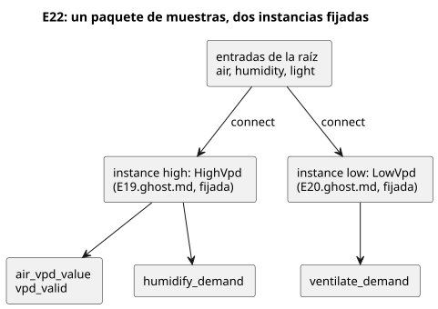

```ghost
// E22
import HighVpd from "./E19.ghost.md"
  revision "041dbfb015b692b9dd9a7879e06b2925462a61fe"
  sha256 "e6006e3dbbe4db7ec058a9e5f152cfe927ca524cf081b1747b66d5b61e0de932";
import LowVpd from "./E20.ghost.md"
  revision "041dbfb015b692b9dd9a7879e06b2925462a61fe"
  sha256 "0c33afee76307db1affcadd5ea7e43260dc6f866fec9afeadb4254358baa5b60";
control CombinedVpdDemands {
  input air: Temperature {
    sample = 1s; valid = 0°C .. 50°C;
    filter = median(1); stale_after = 3s; recover_after = 1 samples;
  }
  input humidity: RelativeHumidity {
    sample = 1s; valid = 0%RH .. 100%RH;
    filter = median(1); stale_after = 3s; recover_after = 1 samples;
  }
  input light: PPFD {
    sample = 1s; valid = 0umol/m2/s .. 3000umol/m2/s;
    filter = median(1); stale_after = 3s; recover_after = 1 samples;
  }
  output air_vpd_value: VaporPressureDeficit;
  output vpd_valid, humidify_demand, ventilate_demand: Bool;
  instance high: HighVpd;
  instance low: LowVpd;
  connect high.air <- air;
  connect high.humidity <- humidity;
  connect high.light <- light;
  connect low.air <- air;
  connect low.humidity <- humidity;
  connect low.light <- light;
  connect air_vpd_value <- high.air_vpd_value;
  connect vpd_valid <- high.vpd_valid;
  connect humidify_demand <- high.humidify_demand;
  connect ventilate_demand <- low.ventilate_demand;
}
```

### Ejecutar, observar y cambiar una entrada

Compile cada bloque de E16–E21 por separado como un documento .ghost.md completo, como en E15. Compile E22 junto con el cierre de fuentes generado `examples/programming-book-imports`.

Para verificar el compilador y los escaneos reales de ghostsim/WASM, ejecute `node --test tests/programming-climate.test.mjs tests/programming-book-simulation.test.mjs tests/programming-book-import-package.test.mjs`. Los artefactos nativos y WASM deben tener una procedencia de compilación coincidente; [Verificación](VERIFICATION.es.md) describe los requisitos previos de compilación. La prueba escribe artefactos de escenario desechables y nunca acciona hardware.

De forma predeterminada, el lector en línea usa un **perfil diario sintético de 24 horas** coordinado, construido sobre la fuente de sensores dependiente del tiempo presentada con E10:

- La temperatura, la RH y el PPFD cambian linealmente entre los puntos de la tabla siguiente, y el perfil se repite de forma continua.
- La temperatura nunca disminuye entre las 06 y las 18, y la luz es exactamente cero entre las 18 y las 06.
- Cada intervalo de muestreo declarado suministra nueva evidencia tipada de sensor. El programa WASM real calcula el VPD y la demanda de control.

Esta es una trayectoria de entrada ilustrativa, no un modelo de invernadero ni la retroalimentación de un actuador.

| Hora simulada | Aire °C | RH % | PPFD µmol·m⁻²·s⁻¹ | Qué observar |
|---|---|---|---|---|
| 00 | 18 | 90 | 0 | Calefactor inicialmente OFF; demandas condicionadas por la luz en OFF |
| 03 | 17 | 92 | 0 | Calefactor ON |
| 06 | 16 | 94 | 0 | Amanecer; calefactor ON |
| 09 | 22 | 85 | 500 | Ventilación por VPD bajo ON; el calefactor retiene ON exactamente a 22°C |
| 12 | 28 | 60 | 1000 | Demandas de humidificación y riego ON; calefactor/ventilación OFF |
| 15 | 31 | 45 | 650 | Las demandas por VPD alto siguen en ON |
| 18 | 31 | 60 | 0 | Atardecer; demandas condicionadas por la luz en OFF |
| 21 | 23 | 80 | 0 | Enfriamiento nocturno; calefactor todavía OFF |
| 24 | 18 | 90 | 0 | Límite del bucle continuo; el calefactor pasa a ON solo por debajo de 18°C |

Ejecute cada ejemplo desde las 00:00 simuladas. E16–E21 usan de forma predeterminada una velocidad de 1000× y un gráfico de tiempos de 24 horas; compare las horas 09, 12, 15 y 18.

- El rendimiento real en tiempo de reloj de pared depende del equipo.
- La velocidad solo cambia cuánto tiempo simulado transcurre por cada segundo de reloj de pared. No cambia los umbrales ni el perfil diario.
- La pausa congela el tiempo de simulación.
- El calefactor en ON a las 09 se apaga en cuanto la temperatura sube estrictamente por encima de 22°C.
- Son programas independientes, así que no se implica ningún enclavamiento entre el calefactor y la ventilación.
- La selección de unidad cambia las unidades de entrada y de visualización sin cambiar los valores físicos: 17°C = 62.6°F = 290.15K. E16–E18 deben tomar decisiones idénticas a lo largo del día.

Los modos de valor constante y de paquete único manual siguen siendo útiles para experimentos individuales en los límites. Son fuentes opcionales de depuración; no sustituyen la observación de cómo cambian las decisiones a lo largo del día.

Para probar Stale, use el modo de paquete único o detenga la entrega de muestras y, después, avance el tiempo de simulación hasta el límite declarado de 3s. Las muestras repetidas de una fuente constante son evidencia fresca, por lo que no deberían volverse obsoletas. Para demostrar Disconnected, elija esa calidad de muestra; un fallo recién entregado sigue siendo un fallo. No simule una desconexión reutilizando un paquete Good antiguo como si fuera fresco.

Experimentos sugeridos:

- **Calefactor:** observe 18 → 17 → 18 → 22 → 23°C y, después, un fallo del sensor y su recuperación.
- **Cada controlador de VPD:** mantenga la temperatura en 25°C y cambie la RH para cruzar sus umbrales; después cambie solo el PPFD. Compare la demanda requested/safe, air_vpd_value y vpd_valid.
- **Fallos:** pruebe muestras ausentes, Invalid, Disconnected y obsoletas. Cada fallo relevante debe inhibir la salida de inmediato.
- **Relación numérica:** cambie T y RH a la vez.

No interprete una demanda lógica, un escaneo correcto o un actuador virtual como un efecto físico confirmado.

<a id="ch15"></a>
## 15. Magnitudes físicas con nombre y unidades

Un número que se puede calcular no es necesariamente un número con significado. El
caudal multiplicado por el tiempo da un volumen. Sumar una tensión a un caudal también
produce un número, pero la pregunta en sí es errónea. Antes de ejecutar E33, prediga el
resultado: las conversiones entre unidades de una misma magnitud funcionan, y las
mezclas de magnitudes distintas generan un diagnóstico. Cuando el compilador rechaza
una expresión así, no le está estorbando. Ha detectado un malentendido de campo antes
de la ejecución.

Este capítulo no trata `Duration` (Capítulo 6) ni las fechas y horas (Capítulo 7).
Trata las 17 magnitudes físicas con nombre, como la temperatura, la presión y la luz,
cuyas unidades cambian lo que significa un valor de control. Mantenga estos valores en
sus propios tipos en lugar de convertirlos a `Number` sin unidad. Así el compilador
puede impedirle comparar lecturas de dos sensores no relacionados que por casualidad
contienen números parecidos. `Rate<Q>` es un tipo exclusivo de expresiones que se
deriva sobre una ventana de tiempo. No es una entrada aparte del catálogo de
magnitudes, por lo que se trata en el Capítulo 13.

### Cada magnitud física tiene su propio tipo

Los literales siguientes son grafías válidas para cada tipo.
La [Referencia §2.9](reference/02-types-expressions-state.es.md)
enumera todos los sufijos de unidad aceptados y la unidad canónica de cada tipo. Cuando
una expresión usa unidades distintas del mismo tipo, GhostFlow las convierte a la
unidad canónica. La conversión nunca cambia el tipo de la magnitud.

| Tipo con nombre | Ejemplo de literal | Significado |
|---|---|---|
| `Temperature` | `25°C`, `77°F`, `298.15K` | Temperatura absoluta |
| `TemperatureDelta` | `5Δ°C`, `9Δ°F` | Diferencia de temperatura |
| `RelativeHumidity` | `70%RH` | Humedad relativa |
| `Pressure` | `100kPa` | Presión |
| `VaporPressureDeficit` | `1kPaVPD` | Diferencia entre la presión de vapor de saturación y la real |
| `CO2Concentration` | `800ppm` | Fracción molar de dióxido de carbono |
| `FlowRate` | `5L/min` | Caudal volumétrico |
| `Volume` | `20L` | Volumen |
| `Length` | `35cm` | Longitud |
| `Irradiance` | `300W/m2` | Potencia radiante por unidad de área |
| `PPFD` | `600umol/m2/s` | Flujo de fotones fotosintéticos por unidad de área y tiempo |
| `Energy` | `1kWh` | Energía |
| `Power` | `150W` | Potencia |
| `ElectricalCurrent` | `800mA` | Corriente eléctrica |
| `Voltage` | `24V` | Tensión |
| `Conductivity` | `1.5mS/cm` | Conductividad eléctrica |
| `Acidity` | `6.5pH` | Medida de acidez |

El diagrama siguiente resume la idea de este capítulo. Una unidad es solo una grafía:
todo literal de temperatura se convierte en el mismo tipo `Temperature`. Las magnitudes
que suenan parecidas, como las dos mediciones de luz, siguen siendo tipos distintos.

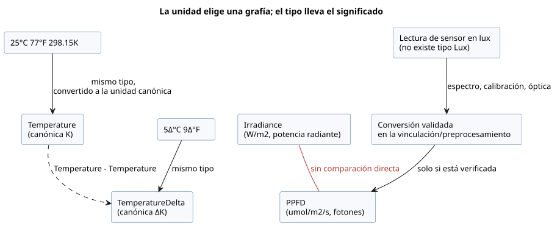

### Las unidades de una misma magnitud se pueden combinar

`25°C` y `77°F` usan números y grafías de unidad distintos, pero ambos son
`Temperature`. Por eso, un valor de sensor de ese tipo se puede comparar con
cualquiera de los dos límites. Del mismo modo, `5Δ°C` y `9Δ°F` son la misma diferencia
de temperatura.

Una temperatura absoluta y una diferencia de temperatura son tipos distintos:

- Restar una temperatura de otra produce un `TemperatureDelta`.
- Sumar una diferencia a una temperatura, o restársela, produce un `Temperature`.
- Sumar dos temperaturas absolutas es un error.

GhostFlow no realiza álgebra dimensional arbitraria. El conjunto de operaciones es
cerrado:

- Se pueden comparar valores del mismo tipo.
- Se pueden sumar y restar valores de la misma magnitud lineal.
- Una magnitud se puede multiplicar o dividir por un escalar numérico.
- Los productos y cocientes entre magnitudes distintas se limitan a las relaciones
  definidas: `FlowRate * Duration -> Volume`, `Power * Duration -> Energy` y
  `Voltage * ElectricalCurrent -> Power`, más las divisiones correspondientes
  (`Volume / Duration` da `FlowRate`; `Energy / Duration` da `Power`).

Todo lo demás es un error. Eso incluye combinaciones no definidas, como
`Pressure + Length`, y la conversión implícita a `Number` sin unidad. La Referencia §2.9
enumera las pocas reglas adicionales, por ejemplo para `RelativeHumidity`,
`CO2Concentration` y `Acidity`.

| Expresión válida | Resultado | Ejemplo de mezcla no válida |
|---|---|---|
| `room < 25°C && room < 77°F` | Comparaciones de temperatura | `room + room` — sumar temperaturas absolutas |
| `change >= 5Δ°C && change >= 9Δ°F` | Comparaciones de diferencia de temperatura | `room > change` — comparar una temperatura con una diferencia |
| `flow * 1min` | `Volume` | `flow + 20L` — sumar caudal y volumen |
| `voltage * current` | `Power` | `pressure > vpd` — comparar presión y VPD |
| `power * 1h` | `Energy` | `irradiance > ppfd` — comparar magnitudes de luz distintas |

### Mantenga separadas las unidades de luz de los sensores

Los sensores de invernadero pueden informar mediciones de luz con nombres parecidos en
unidades distintas:

- `Irradiance`, en `W/m2`, es la potencia radiante que llega a un área.
- `PPFD`, en `umol/m2/s`, cuenta los fotones de la banda que impulsa la fotosíntesis.

Son tipos físicos distintos. No se pueden comparar directamente ni usar uno como umbral
del otro. Sin una conversión validada que tenga en cuenta el espectro de la luz, no
existe un factor de conversión general entre ellos.

El catálogo de magnitudes actual no tiene un tipo `Lux`. No conecte el valor de un
sensor de lux como si fuera PPFD simplemente cambiándole el nombre. El lux mide la
iluminancia ponderada por la sensibilidad del ojo humano. Una conversión fiable tiene
que considerar el espectro de la fuente de luz, la calibración del sensor y la óptica.
Declare esa conversión en la vinculación (binding) del sensor o en un límite de
preprocesamiento validado, y haga que el tipo resultante coincida con la unidad real.
Cuando los sensores miden magnitudes distintas, declárelos por separado para que se
pueda comprobar el tipo de cada entrada.

### E33 — Comprobar unidades y magnitudes mezcladas en un solo control

Este ejemplo usa todas las magnitudes físicas con nombre del catálogo admitido. Las
relaciones permitidas, como temperatura y diferencia de temperatura, caudal y volumen,
o tensión y corriente, muestran sus tipos de resultado. El sensor de irradiancia
radiante y el sensor de PPFD se declaran como tipos distintos.

```ghost
// E33
control PhysicalQuantityUnits {
  state displayed_temperature_ok: Bool = false;
  displayed_temperature_ok' = if air_good then air >= 25°C && air >= 77°F else displayed_temperature_ok;
  state displayed_change_ok: Bool = false;
  displayed_change_ok' = if temperature_change_good then temperature_change >= 5Δ°C && temperature_change >= 9Δ°F else displayed_change_ok;
  state displayed_humidity_ok: Bool = false;
  displayed_humidity_ok' = if humidity_good then humidity >= 70%RH else displayed_humidity_ok;
  state displayed_pressure_ok: Bool = false;
  displayed_pressure_ok' = if pressure_good then pressure >= 100kPa else displayed_pressure_ok;
  state displayed_vpd_ok: Bool = false;
  displayed_vpd_ok' = if vpd_good then vpd >= 1kPaVPD else displayed_vpd_ok;
  state displayed_co2_ok: Bool = false;
  displayed_co2_ok' = if co2_good then co2 >= 800ppm else displayed_co2_ok;
  state displayed_volume_ok: Bool = false;
  displayed_volume_ok' = if tank_volume_good then tank_volume >= 20L else displayed_volume_ok;
  state displayed_length_ok: Bool = false;
  displayed_length_ok' = if pipe_length_good then pipe_length >= 35cm else displayed_length_ok;
  state displayed_energy_ok: Bool = false;
  displayed_energy_ok' = if stored_energy_good then stored_energy >= 1kWh else displayed_energy_ok;
  state displayed_power_ok: Bool = false;
  displayed_power_ok' = if rated_power_good then rated_power >= 150W else displayed_power_ok;
  state displayed_current_ok: Bool = false;
  displayed_current_ok' = if current_good then current >= 800mA else displayed_current_ok;
  state displayed_voltage_ok: Bool = false;
  displayed_voltage_ok' = if voltage_good then voltage >= 24V else displayed_voltage_ok;
  state displayed_conductivity_ok: Bool = false;
  displayed_conductivity_ok' = if conductivity_good then conductivity >= 1.5mS/cm else displayed_conductivity_ok;
  state displayed_acidity_ok: Bool = false;
  displayed_acidity_ok' = if acidity_good then acidity <= 6.5pH else displayed_acidity_ok;
  state displayed_pumped_volume: Volume = 0L;
  displayed_pumped_volume' = if flow_good then flow * 1min else displayed_pumped_volume;
  state displayed_motor_power: Power = 0W;
  displayed_motor_power' = if current_good && voltage_good then motor_load else displayed_motor_power;
  state displayed_hourly_energy: Energy = 0Wh;
  displayed_hourly_energy' = if current_good && voltage_good then motor_load * 1h else displayed_hourly_energy;
  // Source-local display memory is initialized here; faults remain producer unknown.
  state remembered_air: Temperature = 0°C;
  let air_good = case observed_air { ok(_) => true; fault(_) => false; };
  let air = case observed_air { ok(value) => value; fault(_) => remembered_air; };
  remembered_air' = air;
  state remembered_temperature_change: TemperatureDelta = 0Δ°C;
  let temperature_change_good = case observed_temperature_change { ok(_) => true; fault(_) => false; };
  let temperature_change = case observed_temperature_change { ok(value) => value; fault(_) => remembered_temperature_change; };
  remembered_temperature_change' = temperature_change;
  state remembered_humidity: RelativeHumidity = 0%RH;
  let humidity_good = case observed_humidity { ok(_) => true; fault(_) => false; };
  let humidity = case observed_humidity { ok(value) => value; fault(_) => remembered_humidity; };
  remembered_humidity' = humidity;
  state remembered_pressure: Pressure = 0kPa;
  let pressure_good = case observed_pressure { ok(_) => true; fault(_) => false; };
  let pressure = case observed_pressure { ok(value) => value; fault(_) => remembered_pressure; };
  remembered_pressure' = pressure;
  state remembered_vpd: VaporPressureDeficit = 0kPaVPD;
  let vpd_good = case observed_vpd { ok(_) => true; fault(_) => false; };
  let vpd = case observed_vpd { ok(value) => value; fault(_) => remembered_vpd; };
  remembered_vpd' = vpd;
  state remembered_co2: CO2Concentration = 0ppm;
  let co2_good = case observed_co2 { ok(_) => true; fault(_) => false; };
  let co2 = case observed_co2 { ok(value) => value; fault(_) => remembered_co2; };
  remembered_co2' = co2;
  state remembered_flow: FlowRate = 0L/min;
  let flow_good = case observed_flow { ok(_) => true; fault(_) => false; };
  let flow = case observed_flow { ok(value) => value; fault(_) => remembered_flow; };
  remembered_flow' = flow;
  state remembered_tank_volume: Volume = 0L;
  let tank_volume_good = case observed_tank_volume { ok(_) => true; fault(_) => false; };
  let tank_volume = case observed_tank_volume { ok(value) => value; fault(_) => remembered_tank_volume; };
  remembered_tank_volume' = tank_volume;
  state remembered_pipe_length: Length = 0m;
  let pipe_length_good = case observed_pipe_length { ok(_) => true; fault(_) => false; };
  let pipe_length = case observed_pipe_length { ok(value) => value; fault(_) => remembered_pipe_length; };
  remembered_pipe_length' = pipe_length;
  state remembered_stored_energy: Energy = 0Wh;
  let stored_energy_good = case observed_stored_energy { ok(_) => true; fault(_) => false; };
  let stored_energy = case observed_stored_energy { ok(value) => value; fault(_) => remembered_stored_energy; };
  remembered_stored_energy' = stored_energy;
  state remembered_rated_power: Power = 0W;
  let rated_power_good = case observed_rated_power { ok(_) => true; fault(_) => false; };
  let rated_power = case observed_rated_power { ok(value) => value; fault(_) => remembered_rated_power; };
  remembered_rated_power' = rated_power;
  state remembered_current: ElectricalCurrent = 0A;
  let current_good = case observed_current { ok(_) => true; fault(_) => false; };
  let current = case observed_current { ok(value) => value; fault(_) => remembered_current; };
  remembered_current' = current;
  state remembered_voltage: Voltage = 0V;
  let voltage_good = case observed_voltage { ok(_) => true; fault(_) => false; };
  let voltage = case observed_voltage { ok(value) => value; fault(_) => remembered_voltage; };
  remembered_voltage' = voltage;
  state remembered_conductivity: Conductivity = 0mS/cm;
  let conductivity_good = case observed_conductivity { ok(_) => true; fault(_) => false; };
  let conductivity = case observed_conductivity { ok(value) => value; fault(_) => remembered_conductivity; };
  remembered_conductivity' = conductivity;
  state remembered_acidity: Acidity = 0pH;
  let acidity_good = case observed_acidity { ok(_) => true; fault(_) => false; };
  let acidity = case observed_acidity { ok(value) => value; fault(_) => remembered_acidity; };
  remembered_acidity' = acidity;
  input observed_air: Temperature;
  input observed_temperature_change: TemperatureDelta;
  input observed_humidity: RelativeHumidity;
  input observed_pressure: Pressure;
  input observed_vpd: VaporPressureDeficit;
  input observed_co2: CO2Concentration;
  input observed_flow: FlowRate;
  input observed_tank_volume: Volume;
  input observed_pipe_length: Length;
  input irradiance: Irradiance {
    sample = 1s; valid = 0W/m2 .. 1500W/m2;
    filter = median(1); stale_after = 3s; recover_after = 1 samples;
  }
  input ppfd: PPFD {
    sample = 1s; valid = 0umol/m2/s .. 3000umol/m2/s;
    filter = median(1); stale_after = 3s; recover_after = 1 samples;
  }
  input observed_stored_energy: Energy;
  input observed_rated_power: Power;
  input observed_current: ElectricalCurrent;
  input observed_voltage: Voltage;
  input observed_conductivity: Conductivity;
  input observed_acidity: Acidity;

  output temperature_ok, change_ok, humidity_ok, pressure_ok, vpd_ok: Bool;
  output co2_ok, volume_ok, length_ok, irradiance_ok, ppfd_ok: Bool;
  output energy_ok, power_ok, current_ok, voltage_ok, conductivity_ok, acidity_ok: Bool;
  output pumped_volume: Volume;
  output motor_power: Power;
  output hourly_energy: Energy;

  let motor_load = voltage * current;
  temperature_ok <- displayed_temperature_ok';
  change_ok <- displayed_change_ok';
  humidity_ok <- displayed_humidity_ok';
  pressure_ok <- displayed_pressure_ok';
  vpd_ok <- displayed_vpd_ok';
  co2_ok <- displayed_co2_ok';
  volume_ok <- displayed_volume_ok';
  length_ok <- displayed_length_ok';
  irradiance_ok <- case irradiance { ok(value) => value >= 300W/m2; fault(_) => false; };
  ppfd_ok <- case ppfd { ok(value) => value >= 600umol/m2/s; fault(_) => false; };
  energy_ok <- displayed_energy_ok';
  power_ok <- displayed_power_ok';
  current_ok <- displayed_current_ok';
  voltage_ok <- displayed_voltage_ok';
  conductivity_ok <- displayed_conductivity_ok';
  acidity_ok <- displayed_acidity_ok';
  pumped_volume <- displayed_pumped_volume';
  motor_power <- displayed_motor_power';
  hourly_energy <- displayed_hourly_energy';
}
```

Cada una de las expresiones siguientes se rechaza, porque los tipos de los operandos
difieren o la operación no está definida: `pressure > vpd`, `irradiance > ppfd`,
`humidity > 70%`, `air + air` y `flow + tank_volume`.

Antes de silenciar un diagnóstico así con una conversión, pregúntese si la pregunta
física tiene sentido:

- Si solo difiere la unidad de visualización de una misma magnitud, una conversión
  permitida lo resuelve.
- Si difiere la propia magnitud, como en las mediciones de luz, la conversión necesita
  su propia fuente verificada y su propia precisión.

Las comprobaciones de tipos no sustituyen la calibración de los sensores ni los
límites de operación de los equipos. Lo que sí hacen es precisar las preguntas para
esas comprobaciones.

<a id="appendix-a"></a>
## Apéndice A. Guía de la especificación

Use este apéndice cuando el texto principal ya haya presentado un concepto y necesite
conocer su límite exacto. No hace falta memorizarlo. Trátelo como un índice que lleva
una declaración que le interesa hasta su regla en la Referencia, su fundamento
("por qué") y sus diagnósticos.

La tabla enlaza los capítulos de aprendizaje con la sintaxis normativa. No sustituye
la gramática completa ni una lista de compatibilidad de la implementación.

| Tema | Referencia del lenguaje |
|---|---|
| `.ghost.md`, extracción de bloques, anclas, nombres, esqueletos de declaraciones | [Capítulo 1](reference/01-source-and-syntax.es.md) |
| Tipos, enteros, Result, expresiones, funciones, ticks, estado | [Capítulo 2](reference/02-types-expressions-state.es.md) |
| Duration, tiempo, temporizadores, programaciones, solar/lunar/marea | [Capítulo 3](reference/03-time-and-schedules.es.md) |
| Calidad de sensores, filtros, capacidades, restricciones, recursos | [Capítulo 4](reference/04-sensors-constraints-control.es.md) |
| Ajustes tipados, actualizaciones en vivo, descriptores de observación | [Capítulo 5](reference/05-settings-and-observation.es.md) |
| Import, instance, connect, macro, reproducción, reemplazo | [Capítulo 6](reference/06-composition-and-replay.es.md) |
| Errores, incertidumbre, índice de sintaxis | [Capítulo 7](reference/07-semantic-rules-and-index.es.md) |
| Responsabilidades del lenguaje, el runtime, el Driver, la vinculación y la UI | [Capítulo 8](reference/08-language-runtime-and-device-boundaries.es.md) |
| Ejemplos de codificación frecuentes | [Preguntas frecuentes de codificación en GhostFlow](language_faq.es.md) |

<a id="appendix-b"></a>
## Apéndice B. Aprender a través de los errores

Un buen diagnóstico no se queda en "esto está mal". Le dice qué promesa se incumplió.
E90–E102 no son ejemplos que haya que corregir hasta que pasen. Son experimentos cuyo
resultado esperado es el fallo: prediga dónde señalará el diagnóstico y por qué, y
luego compruébelo. Mantenga un solo error por programa a la vez, para que el límite
que protege el compilador siga viéndose con claridad.

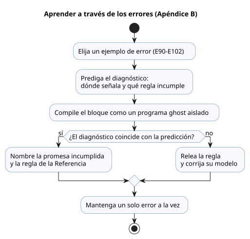

Estos breves ejemplos de error ponen a prueba reglas de la Referencia. Lea cada uno por
separado.

`ghost-error` es una etiqueta de presentación que marca los ejemplos de error en esta
guía. Los bloques de ejecución reales de `.ghost.md` usan exactamente `ghost`. No
ponga el código de error siguiente en un programa ejecutable.

### E90 — Falta el punto y coma

```ghost-error
control MissingSemicolon {
  input start: Bool
  output pump: Bool;
  pump <- start;
}
```

Un salto de línea no termina una declaración. Cada declaración necesita un `;` al
final.

### E91 — Comparar tipos distintos

```ghost-error
control MixedTypes {
  let level: Number = 0;
  output pump: Bool;
  pump <- level < 30%;
}
```

`Number` y `Percent` nunca se convierten implícitamente el uno en el otro.

### E92 — Dependencia del estado siguiente

```ghost-error
control NextDependency {
  state a: Bool = false;
  state b: Bool = false;
  output lamp: Bool;
  a' = !a;
  b' = a';
  lamp <- b';
}
```

Dentro de un tick, toda expresión de estado siguiente lee la instantánea del estado
anterior. No puede encadenar lecturas a través del valor siguiente de otro estado.

### E93 — Dos controles raíz

```ghost-error
control First { output lamp: Bool; lamp <- false; }
control Second { output lamp: Bool; lamp <- true; }
```

Un programa tiene exactamente un control raíz, que es el que se ejecuta. Para reutilizar
varios controles, use import, instance y connect del Capítulo 6 de la Referencia.

### E94 — Superar el rango de enteros mutables

```ghost-error
control OutOfRange {
  let count = 2147483648;
  output lamp: Bool;
  lamp <- false;
}
```

Un literal `Int` debe caber en el rango de 32 bits con signo. Consulte la
[Referencia §2.3](reference/02-types-expressions-state.es.md)
para los rangos de enteros y las conversiones.

### E95 — Falta un caso del enum

```ghost-error
control MissingCase {
  type Mode = Off | On;
  state mode: Mode = Off;
  output lamp: Bool;
  lamp <- case mode { Off => false; };
}
```

Un `case` debe tratar todos los miembros de la enumeración (enum).

### E96 — Conexión de salida duplicada

```ghost-error
control DuplicateOutput {
  output lamp: Bool;
  lamp <- false;
  lamp <- true;
}
```

Una salida admite exactamente una conexión. Una sentencia posterior no sobrescribe una
conexión anterior.

### E97 — Result de sensor no tratado

```ghost-error
control BareSensor {
  input moisture: Percent;
  output pump: Bool;
  pump <- moisture < 30%;
}
```

Un sensor es un Result, no su contenido, así que no lo compare directamente. Use `case`
o una transformación explícita de Result de la Referencia §2.5.

<a id="appendix-c"></a>
## Apéndice C. Reglas de mantenimiento del documento

Los ejemplos de este libro son a la vez fragmentos didácticos y contratos comprobados.
Al editar la prosa, conserve las anclas, los ID de los ejemplos, los bloques canónicos
y la correspondencia entre traducciones. Así, los lectores y las pruebas de regresión
siguen apuntando al mismo ejemplo. Mantenga la fuente separada de sus proyecciones,
para que la prosa nueva nunca cree un segundo original ejecutable.

Un ejemplo didáctico sobre un entorno cambiante no puede demostrar su intención con una
sola entrada constante y válida. Mantenga puntos de comprobación independientes antes
del encendido, en el límite de encendido, a lo largo de la banda en la que la salida se
mantiene y en el límite de apagado. Una traza diaria se suma a los escaneos de fallo y
de límite estricto; no los sustituye.

La Referencia del lenguaje es normativa. Siga estas reglas al mantener esta guía:

- Si encuentra aquí un conflicto o un ejemplo que falta, revise la sección
  correspondiente de la Referencia antes de corregir la guía.
- Un cambio de sintaxis o de semántica actualiza primero la sintaxis, las reglas, los
  fundamentos y los ejemplos de la Referencia. Después se sincronizan el recorrido de
  aprendizaje y el código de esta guía.
- Enlace a los documentos de evidencia los límites de implementación que los lectores
  necesitan conocer. Mantenga en esos documentos los datos que cambian, como el
  progreso, el número de pruebas, los hashes de artefactos y las listas de placas
  admitidas.
- Reutilice `tests/docs-runnable-examples.test.mjs` para las comprobaciones de los
  ejemplos con el compilador.
- Después de modificar el libro, ejecute `npm run generate:pc01` para actualizar la
  procedencia derivada. No altere la evidencia histórica de reproducción ni de
  benchmarks.

<a id="appendix-d"></a>
## Apéndice D. Ejemplos por perfil de lector

El mismo programa de GhostFlow plantea primeras preguntas distintas a lectores
distintos. Un desarrollador de PLC empieza por los enclavamientos, un desarrollador web
por el modelo de observación y un desarrollador de firmware por el límite de la
vinculación. E23–E32 ofrecen esas distintas entradas, y todas vuelven a la misma
distinción entre requested/safe/applied/confirmed. Empiece por el perfil más cercano al
suyo. Después, relea la misma traza con la pregunta de otro perfil en mente.

Los diez programas muestran qué preguntas aportan distintos oficios a una misma traza.
Cada uno es un programa independiente y ejecutable, así que elija el que le interese y
cambie el orden de sus entradas. Un desarrollador de PLC quizá busque primero la
condición que bloqueó la salida; un desarrollador web, la evidencia que debe mostrar; y
un desarrollador de firmware, el límite entre un valor lógico y un pin. El resultado es
evidencia lógica. Las placas, los Drivers, el cableado y las comprobaciones de campo
siguen siendo responsables de los contactos, las válvulas y los motores reales.

### E23 — Desarrolladores de PLC: rastrear un fallo desde su causa hasta la salida

> “Se acabó adivinar por qué se detuvo el sistema.”

Cuando una cinta transportadora se detiene inesperadamente, la primera pregunta no es
"¿vuelvo a pulsar Start?", sino "¿qué condición la detuvo?". En cualquier escaneo en el
que la entrada de atasco indique un atasco (`jam_clear=false`), este programa anula el
estado de marcha y memoriza el fallo. Una vez eliminada la causa, pulsar reset borra el
fallo, pero la cinta no vuelve a arrancar hasta que el operador suelta Start y lo pulsa
de nuevo.

Pruébelo:

1. Ejecute un escaneo con `start=true`, `jam_clear=false` y `reset=false`.
   `fault_latched` y `fault_lamp` se activan; `running` y `conveyor` se desactivan.
2. Elimine el atasco y pulse reset. Solo se borra la memoria del fallo; el
   accionamiento sigue detenido.

Puede seguir, directamente en el código fuente, qué entradas y estados usó cada
decisión de salida. El significado eléctrico del detector de atascos y el circuito de
parada de emergencia siguen necesitando su propio diseño.

```ghost
// E23
control TraceableConveyor {
  // Source-local display memory is initialized here; faults remain producer unknown.
  state remembered_start: Bool = false;
  let start_good = case observed_start { ok(_) => true; fault(_) => false; };
  let start = case observed_start { ok(value) => value; fault(_) => remembered_start; };
  remembered_start' = start;
  state remembered_stop: Bool = false;
  let stop_good = case observed_stop { ok(_) => true; fault(_) => false; };
  let stop = case observed_stop { ok(value) => value; fault(_) => remembered_stop; };
  remembered_stop' = stop;
  state remembered_jam_clear: Bool = false;
  let jam_clear_good = case observed_jam_clear { ok(_) => true; fault(_) => false; };
  let jam_clear = case observed_jam_clear { ok(value) => value; fault(_) => remembered_jam_clear; };
  remembered_jam_clear' = jam_clear;
  state remembered_reset: Bool = false;
  let reset_good = case observed_reset { ok(_) => true; fault(_) => false; };
  let reset = case observed_reset { ok(value) => value; fault(_) => remembered_reset; };
  remembered_reset' = reset;
  input observed_start: Bool;
  input observed_stop: Bool;
  input observed_jam_clear: Bool;
  input observed_reset: Bool;
  state running: Bool = false;
  state fault_latched: Bool = false;
  state start_armed: Bool = true;
  let fault_next = (fault_latched && !reset) || !jam_clear;

  fault_latched' = if jam_clear_good && !jam_clear then true else if start_good && stop_good && jam_clear_good && reset_good then (fault_next) else fault_latched;
  start_armed' = if stop_good && stop then false else if jam_clear_good && !jam_clear then false else if start_good && stop_good && jam_clear_good && reset_good then (!fault_next && !start) else start_armed;
  running' = if stop_good && stop then false else if jam_clear_good && !jam_clear then false else if start_good && stop_good && jam_clear_good && reset_good then (!stop && jam_clear && !fault_latched && (running || (start_armed && start))) else running;

  output conveyor, fault_lamp: Bool;
  conveyor <- running';
  fault_lamp <- fault_latched';
}
```

### E24 — Desarrolladores web: separar el objetivo de la pantalla de la retroalimentación del dispositivo

> “Ahora, programe el mundo más allá de la pantalla.”

Hacer clic en "abrir" en un panel no es lo mismo que la válvula alcance su posición de
apertura. Los desarrolladores web ya separan una solicitud de la respuesta del
servidor, pero las interfaces de dispositivos suelen reducir ambas al mismo icono verde.
Aquí `target_open` recuerda el estado ordenado, y la entrada de final de carrera se
muestra como una señal de confirmación aparte.

Active `open_request` durante un escaneo y la orden permanece activa. El indicador de
"en movimiento" sigue encendido hasta que `open_limit` pasa a ser verdadero. Una
solicitud de cierre tiene prioridad sobre una de apertura. La interfaz puede mostrar el
objetivo, la orden de salida y la retroalimentación física como tres valores separados.
Que la señal de final de carrera refleje con exactitud la posición real es tarea de la
instalación y del diagnóstico del dispositivo.

```ghost
// E24
control ValvePanelState {
  state displayed_open_confirmed: Bool = false;
  displayed_open_confirmed' = if open_limit_good && !open_limit then false else if open_limit_good then open_limit else displayed_open_confirmed;
  // Source-local display memory is initialized here; faults remain producer unknown.
  state remembered_open_request: Bool = false;
  let open_request_good = case observed_open_request { ok(_) => true; fault(_) => false; };
  let open_request = case observed_open_request { ok(value) => value; fault(_) => remembered_open_request; };
  remembered_open_request' = open_request;
  state remembered_close_request: Bool = false;
  let close_request_good = case observed_close_request { ok(_) => true; fault(_) => false; };
  let close_request = case observed_close_request { ok(value) => value; fault(_) => remembered_close_request; };
  remembered_close_request' = close_request;
  state remembered_stop: Bool = false;
  let stop_good = case observed_stop { ok(_) => true; fault(_) => false; };
  let stop = case observed_stop { ok(value) => value; fault(_) => remembered_stop; };
  remembered_stop' = stop;
  state remembered_open_limit: Bool = false;
  let open_limit_good = case observed_open_limit { ok(_) => true; fault(_) => false; };
  let open_limit = case observed_open_limit { ok(value) => value; fault(_) => remembered_open_limit; };
  remembered_open_limit' = open_limit;
  input observed_open_request: Bool;
  input observed_close_request: Bool;
  input observed_stop: Bool;
  input observed_open_limit: Bool;
  state target_open: Bool = false;

  target_open' = if close_request_good && close_request then false else if stop_good && stop then false else if open_request_good && close_request_good && stop_good && open_limit_good then (!stop && !close_request && (open_request || target_open)) else target_open;

  output open_command, close_command, moving_open, open_confirmed: Bool;
  open_command <- !stop && target_open';
  close_command <- !stop && !target_open';
  moving_open <- !stop && target_open' && !open_limit;
  open_confirmed <- displayed_open_confirmed';
  require !(open_command && close_command);
}
```

### E25 — Desarrolladores de firmware: detectar órdenes de sentido contradictorias antes de grabar

> “Ejecute la lógica antes de energizar un relé.”

Las solicitudes de giro directo e inverso pueden ser verdaderas en el mismo escaneo,
por culpa de los botones, de paquetes de red o de rebotes de contacto. Este ejemplo no
elige una de forma arbitraria; desactiva ambas órdenes de accionamiento. En PIG,
alterne entre una solicitud normal, la pérdida del permiso de parada y una solicitud
contradictoria, e inspeccione cada salida antes de llevar la lógica a una placa.

Este es un primer paso para leer la prioridad lógica antes de cargar el firmware. La
exclusión mutua por software, por sí sola, no puede impedir que ambos contactores se
cierren a la vez ni detener un motor que gira por inercia. El equipo necesita
enclavamientos eléctricos y mecánicos adecuados y protecciones independientes. Los
equipos que requieren un retardo antes de invertir el giro también necesitan estado y
retroalimentación explícitos.

```ghost
// E25
control DirectionRequestGate {
  state displayed_forward_command: Bool = false;
  displayed_forward_command' = if forward_request_good && !forward_request then false else if reverse_request_good && reverse_request then false else if stop_ok_good && !stop_ok then false else if forward_request_good && reverse_request_good && stop_ok_good then stop_ok && forward_request && !reverse_request else displayed_forward_command;
  state displayed_reverse_command: Bool = false;
  displayed_reverse_command' = if forward_request_good && forward_request then false else if reverse_request_good && !reverse_request then false else if stop_ok_good && !stop_ok then false else if forward_request_good && reverse_request_good && stop_ok_good then stop_ok && reverse_request && !forward_request else displayed_reverse_command;
  state displayed_conflict: Bool = false;
  displayed_conflict' = if forward_request_good && !forward_request then false else if reverse_request_good && !reverse_request then false else if forward_request_good && reverse_request_good then forward_request && reverse_request else displayed_conflict;
  // Source-local display memory is initialized here; faults remain producer unknown.
  state remembered_stop_ok: Bool = false;
  let stop_ok_good = case observed_stop_ok { ok(_) => true; fault(_) => false; };
  let stop_ok = case observed_stop_ok { ok(value) => value; fault(_) => remembered_stop_ok; };
  remembered_stop_ok' = stop_ok;
  state remembered_forward_request: Bool = false;
  let forward_request_good = case observed_forward_request { ok(_) => true; fault(_) => false; };
  let forward_request = case observed_forward_request { ok(value) => value; fault(_) => remembered_forward_request; };
  remembered_forward_request' = forward_request;
  state remembered_reverse_request: Bool = false;
  let reverse_request_good = case observed_reverse_request { ok(_) => true; fault(_) => false; };
  let reverse_request = case observed_reverse_request { ok(value) => value; fault(_) => remembered_reverse_request; };
  remembered_reverse_request' = reverse_request;
  input observed_stop_ok: Bool;
  input observed_forward_request: Bool;
  input observed_reverse_request: Bool;
  output forward_command, reverse_command, conflict: Bool;

  forward_command <- displayed_forward_command';
  reverse_command <- displayed_reverse_command';
  conflict <- displayed_conflict';
  require !(forward_command && reverse_command);
}
```

### E26 — Desarrolladores de IA: mantener una intención revisable junto a las reglas generadas

> “Aunque lo escriba una IA, la razón del comportamiento debe permanecer.”

Que un programa de control generado compile no demuestra por ello lo que se pretendía.
Los revisores necesitan un único documento que vincule tres cosas: los supuestos de
campo, la regla que los codifica y las secuencias de entrada que vale la pena simular.
Un archivo `.ghost.md` mantiene la prosa y el código ejecutable en una sola fuente, y el
compilador lee sus bloques `ghost` de nivel superior junto con su ubicación original.

La regla siguiente solicita la bomba solo cuando la ventana de riego está abierta, el
suelo necesita agua y la fuente de agua está lista. En un proyecto real, anote en la
prosa los supuestos que hizo la IA, como la polaridad de los sensores, y las decisiones
de campo pendientes. Después, una persona responsable los confirma y registra el
resultado como una revisión de la fuente. El formato del documento no puede garantizar
que la IA acierte, pero evita que el objeto de la revisión quede oculto dentro del
código generado.

```ghost
// E26
control ReviewedWateringRule {
  state displayed_pump_request: Bool = false;
  displayed_pump_request' = if soil_needs_water_good && !soil_needs_water then false else if source_ready_good && !source_ready then false else if watering_window_good && !watering_window then false else if soil_needs_water_good && source_ready_good && watering_window_good then watering_window && soil_needs_water && source_ready else displayed_pump_request;
  // Source-local display memory is initialized here; faults remain producer unknown.
  state remembered_watering_window: Bool = false;
  let watering_window_good = case observed_watering_window { ok(_) => true; fault(_) => false; };
  let watering_window = case observed_watering_window { ok(value) => value; fault(_) => remembered_watering_window; };
  remembered_watering_window' = watering_window;
  state remembered_soil_needs_water: Bool = false;
  let soil_needs_water_good = case observed_soil_needs_water { ok(_) => true; fault(_) => false; };
  let soil_needs_water = case observed_soil_needs_water { ok(value) => value; fault(_) => remembered_soil_needs_water; };
  remembered_soil_needs_water' = soil_needs_water;
  state remembered_source_ready: Bool = false;
  let source_ready_good = case observed_source_ready { ok(_) => true; fault(_) => false; };
  let source_ready = case observed_source_ready { ok(value) => value; fault(_) => remembered_source_ready; };
  remembered_source_ready' = source_ready;
  input observed_watering_window: Bool;
  input observed_soil_needs_water: Bool;
  input observed_source_ready: Bool;
  output pump_request: Bool;

  pump_request <- displayed_pump_request';
}
```

### E27 — Fabricantes de ESP32 y de placas controladoras: vincular el número de E/S con usos reales

> “Dele a una buena placa más formas de ser útil.”

Una hoja de datos que enumera ocho entradas y ocho salidas sigue dejando a los clientes
adivinando qué podrían construir. Este ejemplo vincula una luz de cultivo, un
ventilador de circulación, una bomba de drenaje y una salida de aviso con condiciones de
operación. Un fabricante de placas puede publicarlo como ejemplo de producto con roles
lógicos que los clientes asignan a su propia placa.

Los nombres de las salidas describen roles de dispositivo, no números de GPIO. La
vinculación de la placa, el driver de entrada y el renderizador de salida deciden qué
canal acciona `grow_light` y qué sensor alimenta cada entrada. Por eso, un fabricante no
tiene que prometer que una misma fuente funcione automáticamente en todas las placas.
En cambio, puede distribuir el ejemplo junto con un mapa de cableado verificado para
cada placa.

```ghost
// E27
control BoardShowcase {
  state displayed_grow_light: Bool = false;
  displayed_grow_light' = if enabled_good && !enabled then false else if light_schedule_good && !light_schedule then false else if enabled_good && light_schedule_good then enabled && light_schedule else displayed_grow_light;
  state displayed_circulation_fan: Bool = false;
  displayed_circulation_fan' = if enabled_good && !enabled then false else if ventilation_request_good && !ventilation_request then false else if enabled_good && ventilation_request_good then enabled && ventilation_request else displayed_circulation_fan;
  state displayed_drain_pump: Bool = false;
  displayed_drain_pump' = if drain_path_ready_good && !drain_path_ready then false else if drain_request_good && !drain_request then false else if enabled_good && !enabled then false else if drain_path_ready_good && drain_request_good && enabled_good then enabled && drain_request && drain_path_ready else displayed_drain_pump;
  state displayed_warning: Bool = false;
  displayed_warning' = if drain_path_ready_good && drain_path_ready then false else if drain_request_good && !drain_request then false else if drain_path_ready_good && drain_request_good then drain_request && !drain_path_ready else displayed_warning;
  // Source-local display memory is initialized here; faults remain producer unknown.
  state remembered_enabled: Bool = false;
  let enabled_good = case observed_enabled { ok(_) => true; fault(_) => false; };
  let enabled = case observed_enabled { ok(value) => value; fault(_) => remembered_enabled; };
  remembered_enabled' = enabled;
  state remembered_light_schedule: Bool = false;
  let light_schedule_good = case observed_light_schedule { ok(_) => true; fault(_) => false; };
  let light_schedule = case observed_light_schedule { ok(value) => value; fault(_) => remembered_light_schedule; };
  remembered_light_schedule' = light_schedule;
  state remembered_ventilation_request: Bool = false;
  let ventilation_request_good = case observed_ventilation_request { ok(_) => true; fault(_) => false; };
  let ventilation_request = case observed_ventilation_request { ok(value) => value; fault(_) => remembered_ventilation_request; };
  remembered_ventilation_request' = ventilation_request;
  state remembered_drain_request: Bool = false;
  let drain_request_good = case observed_drain_request { ok(_) => true; fault(_) => false; };
  let drain_request = case observed_drain_request { ok(value) => value; fault(_) => remembered_drain_request; };
  remembered_drain_request' = drain_request;
  state remembered_drain_path_ready: Bool = false;
  let drain_path_ready_good = case observed_drain_path_ready { ok(_) => true; fault(_) => false; };
  let drain_path_ready = case observed_drain_path_ready { ok(value) => value; fault(_) => remembered_drain_path_ready; };
  remembered_drain_path_ready' = drain_path_ready;
  input observed_enabled: Bool;
  input observed_light_schedule: Bool;
  input observed_ventilation_request: Bool;
  input observed_drain_request: Bool;
  input observed_drain_path_ready: Bool;
  output grow_light, circulation_fan, drain_pump, warning: Bool;

  grow_light <- displayed_grow_light';
  circulation_fan <- displayed_circulation_fan';
  drain_pump <- displayed_drain_pump';
  warning <- displayed_warning';
}
```

### E28 — Constructores de tableros e integradores: esperar la confirmación de la válvula antes de solicitar la bomba

> “Entregue la razón del comportamiento junto con el equipo.”

La puesta en marcha suele dejar al descubierto la diferencia entre "ordenamos abrir la
válvula" y "el final de carrera de apertura respondió". Tratarlas como una sola
condición puede solicitar la bomba antes de que se confirme el estado de las tuberías.
Este ejemplo recuerda la solicitud de llenado, pero retiene la salida de la bomba hasta
que llega la retroalimentación de apertura.

Pruébelo:

1. Active `fill_request` con `valve_open_limit=false`. Solo se activa la orden de la
   válvula.
2. Ponga el final de carrera en verdadero. La solicitud de la bomba se activa en el
   escaneo siguiente.
3. Una parada o una entrada de fuente llena borra el estado y detiene ambas salidas.

El instalador todavía debe añadir la polaridad del final de carrera, un tiempo límite
para la válvula y la recuperación tras una parada, según el contrato de la instalación.

```ghost
// E28
control ConfirmedValveFill {
  // Source-local display memory is initialized here; faults remain producer unknown.
  state remembered_fill_request: Bool = false;
  let fill_request_good = case observed_fill_request { ok(_) => true; fault(_) => false; };
  let fill_request = case observed_fill_request { ok(value) => value; fault(_) => remembered_fill_request; };
  remembered_fill_request' = fill_request;
  state remembered_stop_ok: Bool = false;
  let stop_ok_good = case observed_stop_ok { ok(_) => true; fault(_) => false; };
  let stop_ok = case observed_stop_ok { ok(value) => value; fault(_) => remembered_stop_ok; };
  remembered_stop_ok' = stop_ok;
  state remembered_valve_open_limit: Bool = false;
  let valve_open_limit_good = case observed_valve_open_limit { ok(_) => true; fault(_) => false; };
  let valve_open_limit = case observed_valve_open_limit { ok(value) => value; fault(_) => remembered_valve_open_limit; };
  remembered_valve_open_limit' = valve_open_limit;
  state remembered_source_full: Bool = false;
  let source_full_good = case observed_source_full { ok(_) => true; fault(_) => false; };
  let source_full = case observed_source_full { ok(value) => value; fault(_) => remembered_source_full; };
  remembered_source_full' = source_full;
  input observed_fill_request: Bool;
  input observed_stop_ok: Bool;
  input observed_valve_open_limit: Bool;
  input observed_source_full: Bool;
  state filling: Bool = false;

  filling' = if stop_ok_good && !stop_ok then false else if source_full_good && source_full then false else if fill_request_good && stop_ok_good && valve_open_limit_good && source_full_good then (stop_ok && !source_full && (fill_request || filling)) else filling;

  output valve_open_command, pump_command: Bool;
  valve_open_command <- filling';
  pump_command <- filling' && valve_open_limit;
  require pump_command => valve_open_command;
}
```

### E29 — Equipos de mantenimiento: dejar una pista que distinga la espera del fallo

> “Deje un rastro de reparación que sobreviva al autor original.”

Quien hereda una máquina necesita ver tanto la solicitud como la retroalimentación para
responder "¿por qué no ha arrancado todavía la bomba?". Mientras este controlador espera
a que se abra la válvula, mantiene la bomba apagada y activa `waiting_for_valve`. Cuando
llega el final de carrera, el indicador de espera se apaga y aparece la orden de la
bomba. Perder el permiso de parada borra ambas salidas y el indicador de espera.

Este indicador no juzga si el tiempo de recorrido de la válvula es normal. La interfaz y
los registros deberían distinguir "en espera" de un fallo por tiempo límite. Las notas
de traspaso deberían registrar el canal, la polaridad y el método de inspección de la
entrada de final de carrera. El objetivo es que el siguiente responsable de
mantenimiento sepa qué entrada revisar primero sin tener que localizar al autor
original.

```ghost
// E29
control ValveWaitDiagnosis {
  state displayed_valve_open_command: Bool = false;
  displayed_valve_open_command' = if fill_request_good && !fill_request then false else if stop_ok_good && !stop_ok then false else if fill_request_good && stop_ok_good then fill_request && stop_ok else displayed_valve_open_command;
  state displayed_pump_command: Bool = false;
  displayed_pump_command' = if fill_request_good && !fill_request then false else if stop_ok_good && !stop_ok then false else if valve_open_limit_good && !valve_open_limit then false else if fill_request_good && stop_ok_good && valve_open_limit_good then fill_request && stop_ok && valve_open_limit else displayed_pump_command;
  state displayed_waiting_for_valve: Bool = false;
  displayed_waiting_for_valve' = if fill_request_good && !fill_request then false else if stop_ok_good && !stop_ok then false else if valve_open_limit_good && valve_open_limit then false else if fill_request_good && stop_ok_good && valve_open_limit_good then fill_request && stop_ok && !valve_open_limit else displayed_waiting_for_valve;
  // Source-local display memory is initialized here; faults remain producer unknown.
  state remembered_fill_request: Bool = false;
  let fill_request_good = case observed_fill_request { ok(_) => true; fault(_) => false; };
  let fill_request = case observed_fill_request { ok(value) => value; fault(_) => remembered_fill_request; };
  remembered_fill_request' = fill_request;
  state remembered_stop_ok: Bool = false;
  let stop_ok_good = case observed_stop_ok { ok(_) => true; fault(_) => false; };
  let stop_ok = case observed_stop_ok { ok(value) => value; fault(_) => remembered_stop_ok; };
  remembered_stop_ok' = stop_ok;
  state remembered_valve_open_limit: Bool = false;
  let valve_open_limit_good = case observed_valve_open_limit { ok(_) => true; fault(_) => false; };
  let valve_open_limit = case observed_valve_open_limit { ok(value) => value; fault(_) => remembered_valve_open_limit; };
  remembered_valve_open_limit' = valve_open_limit;
  input observed_fill_request: Bool;
  input observed_stop_ok: Bool;
  input observed_valve_open_limit: Bool;
  output valve_open_command, pump_command, waiting_for_valve: Bool;

  valve_open_command <- displayed_valve_open_command';
  pump_command <- displayed_pump_command';
  waiting_for_valve <- displayed_waiting_for_valve';
}
```

### E30 — Agricultores y operadores: elegir cuándo regar y dejar que el controlador lo repita

> “El agricultor decide. La máquina repite.”

Una política de riego es más que una lectura de humedad. Las decisiones del agricultor
sobre el cultivo y el trabajo aparecen aquí como `enabled` y `watering_window`. El
controlador solicita agua solo cuando el suelo está seco dentro de esa ventana elegida y
la fuente está lista. Si la fuente no está lista, muestra ese motivo al operador.

`watering_window` no es un valor predeterminado oculto que sustituya al calendario, al
clima o al plan de trabajo. Es una entrada que el entorno de ejecución suministra según
una programación que eligió el agricultor. El agricultor puede cambiar la ventana o la
regla de sequedad y dejar que el controlador repita la misma decisión. La ubicación y
calibración de los sensores, el volumen de riego y los umbrales específicos de cada
cultivo se siguen decidiendo en el campo.

```ghost
// E30
control FarmerDirectedWatering {
  state displayed_pump_request: Bool = false;
  displayed_pump_request' = if enabled_good && !enabled then false else if soil_needs_water_good && !soil_needs_water then false else if source_ready_good && !source_ready then false else if watering_window_good && !watering_window then false else if enabled_good && soil_needs_water_good && source_ready_good && watering_window_good then enabled && watering_window && soil_needs_water && source_ready else displayed_pump_request;
  state displayed_source_attention: Bool = false;
  displayed_source_attention' = if enabled_good && !enabled then false else if soil_needs_water_good && !soil_needs_water then false else if source_ready_good && source_ready then false else if watering_window_good && !watering_window then false else if enabled_good && soil_needs_water_good && source_ready_good && watering_window_good then enabled && watering_window && soil_needs_water && !source_ready else displayed_source_attention;
  // Source-local display memory is initialized here; faults remain producer unknown.
  state remembered_enabled: Bool = false;
  let enabled_good = case observed_enabled { ok(_) => true; fault(_) => false; };
  let enabled = case observed_enabled { ok(value) => value; fault(_) => remembered_enabled; };
  remembered_enabled' = enabled;
  state remembered_watering_window: Bool = false;
  let watering_window_good = case observed_watering_window { ok(_) => true; fault(_) => false; };
  let watering_window = case observed_watering_window { ok(value) => value; fault(_) => remembered_watering_window; };
  remembered_watering_window' = watering_window;
  state remembered_soil_needs_water: Bool = false;
  let soil_needs_water_good = case observed_soil_needs_water { ok(_) => true; fault(_) => false; };
  let soil_needs_water = case observed_soil_needs_water { ok(value) => value; fault(_) => remembered_soil_needs_water; };
  remembered_soil_needs_water' = soil_needs_water;
  state remembered_source_ready: Bool = false;
  let source_ready_good = case observed_source_ready { ok(_) => true; fault(_) => false; };
  let source_ready = case observed_source_ready { ok(value) => value; fault(_) => remembered_source_ready; };
  remembered_source_ready' = source_ready;
  input observed_enabled: Bool;
  input observed_watering_window: Bool;
  input observed_soil_needs_water: Bool;
  input observed_source_ready: Bool;
  output pump_request, source_attention: Bool;

  pump_request <- displayed_pump_request';
  source_attention <- displayed_source_attention';
}
```

### E31 — Makers y estudiantes de automatización: combinar los ejemplos de riego y ventilación

> “Hay muchos ejemplos. ¿Cuesta combinarlos?”

Este ejemplo importa el programa de riego E21 y el programa de ventilación E20 en lugar
de copiarlos. El control raíz conecta las mismas entradas de aire, humedad y luz a
ambos programas, mientras que cada programa conserva su propio procesamiento de
sensores y su estado interno. Sus salidas se exponen por separado como
`irrigation_demand` y `ventilate_demand`.

Ambas demandas pueden ser verdaderas al mismo tiempo. Antes de conectarlas a una
alimentación compartida o a una salida compartida, decida qué combinaciones se
permiten y cuál tiene prioridad. Cada importación fija la revisión y el hash del
original. Antes de cargar el programa combinado en una placa, compruebe también sus
requisitos de memoria y de cómputo.

```ghost
// E31
import Irrigation from "./E21.ghost.md"
  revision "041dbfb015b692b9dd9a7879e06b2925462a61fe"
  sha256 "d4102e8f521f49e965e76fff7c1dff74a393c83349cb8592c436f699bbce485d";
import Ventilation from "./E20.ghost.md"
  revision "041dbfb015b692b9dd9a7879e06b2925462a61fe"
  sha256 "0c33afee76307db1affcadd5ea7e43260dc6f866fec9afeadb4254358baa5b60";
control CombinedGreenhouseDemands {
  input air: Temperature {
    sample = 1s; valid = 0°C .. 50°C;
    filter = median(1); stale_after = 3s; recover_after = 1 samples;
  }
  input humidity: RelativeHumidity {
    sample = 1s; valid = 0%RH .. 100%RH;
    filter = median(1); stale_after = 3s; recover_after = 1 samples;
  }
  input light: PPFD {
    sample = 1s; valid = 0umol/m2/s .. 3000umol/m2/s;
    filter = median(1); stale_after = 3s; recover_after = 1 samples;
  }
  output irrigation_demand, ventilate_demand: Bool;
  instance watering: Irrigation;
  instance fan: Ventilation;
  connect watering.air <- air;
  connect watering.humidity <- humidity;
  connect watering.light <- light;
  connect fan.air <- air;
  connect fan.humidity <- humidity;
  connect fan.light <- light;
  connect irrigation_demand <- watering.irrigation_demand;
  connect ventilate_demand <- fan.ventilate_demand;
}
```

### E32 — Usuarios de código abierto: ser dueño de la regla de control antes que del hardware

> “El control debería sobrevivir a la empresa.”

Aunque cambie el fabricante de un dispositivo o un servicio en línea, los usuarios
deberían poder leer y conservar la regla de control que aprobaron. Este ejemplo
independiente recibe la humedad del suelo y su umbral como entradas y explicita la
comparación en el código fuente. Una pantalla de suscripción o una cuenta remota no se
convierte en el original privado de la decisión de control.

Conserve el archivo `.ghost.md` junto con la Referencia del lenguaje y la revisión del
compilador, y conservará el material necesario para revisar y regenerar el programa.
Ejecutarlo en otra placa sigue dependiendo del runtime compatible y de las vinculaciones
de E/S de esa placa. Ser dueño del programa no garantiza la portabilidad, pero mantiene
la intención de control fuera de un binario que solo un proveedor puede leer.

```ghost
// E32
control OwnedWateringRule {
  state displayed_pump_request: Bool = false;
  displayed_pump_request' = if soil_moisture_good && threshold_good then soil_moisture < threshold else displayed_pump_request;
  // Source-local display memory is initialized here; faults remain producer unknown.
  state remembered_soil_moisture: Percent = 0%;
  let soil_moisture_good = case observed_soil_moisture { ok(_) => true; fault(_) => false; };
  let soil_moisture = case observed_soil_moisture { ok(value) => value; fault(_) => remembered_soil_moisture; };
  remembered_soil_moisture' = soil_moisture;
  state remembered_threshold: Percent = 0%;
  let threshold_good = case observed_threshold { ok(_) => true; fault(_) => false; };
  let threshold = case observed_threshold { ok(value) => value; fault(_) => remembered_threshold; };
  remembered_threshold' = threshold;
  input observed_soil_moisture: Percent;
  input observed_threshold: Percent;
  output pump_request: Bool;
  pump_request <- displayed_pump_request';
}
```

No hace falta leer los diez ejemplos. Siga uno desde sus entradas hasta su intención de
salida y luego busque la misma distinción de evidencias en el ejemplo de otro perfil.
Lo que GhostFlow pretende dejar no es tanto la afirmación de que un dispositivo se
movió, sino las razones que permiten a la siguiente persona revisar la decisión y darle
continuidad.

## Recuentos exactos y tiempo natural: ejemplos ejecutables de R14–R17

Este último grupo avanzado trata límites que no se pueden redondear como "casi lo
mismo":

- Los recuentos de escaneos necesitan un `Int` exacto.
- El tiempo absoluto necesita un `DateTime` con desfase.
- El amanecer y la marea necesitan evidencia de un proveedor, además de un respaldo
  (fallback).

E34–E37 se ejecutan actualmente en un perfil de host aparte, no en el gabinete del
navegador. Que no se abran en el navegador no significa que el lenguaje carezca de
ellos. La forma de estudiar este grupo es fijar la evidencia de entrada y comparar los
resultados justo antes, exactamente en y justo después de cada límite.

Los cuatro ejemplos parecen distintos, pero plantean una sola pregunta: ¿qué evidencia
exacta permite afirmar que se cruzó un límite? E34 usa un recuento de escaneos, E35 un
instante UTC, E36 una ocurrencia de amanecer y E37 una ocurrencia de marea.
La [Referencia 02](reference/02-types-expressions-state.es.md) y la
[Referencia 03](reference/03-time-and-schedules.es.md) definen las reglas. La tabla
dirige cada decisión a una evidencia que se puede volver a ejecutar.

| Elemento | Decisión adoptada y trabajo | Evidencia de ejecución |
|---|---|---|
| R14 recuentos exactos | #22/#24/#25: Int i32 comprobado, conversión explícita, rechazo de ticks con desbordamiento | E34/E98, [comprobaciones de enteros](../tests/int-compiler.test.mjs), [división y límites](../tests/int-division-identity.test.mjs) |
| R15 tiempo absoluto | #27: DateTime con desfase, instante UTC exacto, desplazamientos con Duration | E35/E99, [ejecución de DateTime](../tests/date-time-control.test.mjs) |
| R16 programaciones de calendario/naturales | #28 y #401/#403: pulso Solar, Tide run/within, identidad del proveedor y de la ocurrencia | E36/E37, [programaciones naturales](../tests/natural-schedule-contract.test.mjs), [paridad de escaneo Solar](../tests/solar-scanframe-native-wasm.test.mjs) |
| R17 política de tiempo incierto | #29: hold_trusted acotado, fixed_time de Solar, skip terminal explícito | E36/E100–E102, [compilación del respaldo](../tests/natural-fallback-compiler.test.mjs), [ejecución del respaldo](../tests/natural-fallback-runtime.test.mjs) |

E34–E37 son programas independientes para los que el compilador actual emite bytecode
ejecutable. La evidencia de entrada que necesita cada uno explica por qué se ejecutan
en un host aparte y no en el gabinete del navegador. Los ejemplos de error que siguen
son lo contrario: son programas completos que solo tienen éxito cuando el compilador
los rechaza. Ejecute cada bloque por separado.

- Las [comprobaciones de compilación del documento](../tests/docs-runnable-examples.test.mjs)
  verifican que ambos idiomas contienen el mismo código fuente y que cada error produce
  el diagnóstico previsto.
- Las [comprobaciones de ejecución del libro](../tests/programming-natural-examples.test.mjs)
  ponen a prueba el comportamiento en el host de E34–E37.

Ninguno de los dos tipos de comprobación abarca el despliegue en un Device ni la
confirmación de una salida física.

### E34 — Contar exactamente los escaneos verdaderos

Cada escaneo correcto con `add=true` suma uno. Esto cuenta escaneos, no flancos
ascendentes, así que mantener `add` en verdadero incrementa el recuento en cada
escaneo. La salida lee `count'`, el valor después de la actualización en paralelo.
Sumar en el máximo de `Int` rechaza el tick con `integer-overflow`, y no se consolidan
ni el nuevo estado ni la intención de salida. El desbordamiento nunca se oculta con
vuelta al inicio (wrapping) ni con saturación.

```ghost
// E34
control ExactScanCount {
  // Source-local display memory is initialized here; faults remain producer unknown.
  state remembered_add: Bool = false;
  let add_good = case observed_add { ok(_) => true; fault(_) => false; };
  let add = case observed_add { ok(value) => value; fault(_) => remembered_add; };
  remembered_add' = add;
  input observed_add: Bool;
  state count: Int = 0;
  output total: Int;
  count' = if add_good then (if add then count + 1 else count) else count;
  total <- count';
}
```

### E35 — Comparar una ventana absoluta con desfases explícitos

La grafía local 06:30+09:00 y 21:30Z del día anterior nombran el mismo instante UTC.
`now` es un `DateTime` tipado que suministra el entorno; la expresión no adivina qué
significa un número ni si se puede confiar en el reloj. La ventana incluye su inicio y
excluye su fin. `5min` es una `Duration` fija; nunca significa un mes de calendario ni
un cambio de zona horaria. Una entrada `DateTime` o un resultado desplazado fuera del
dominio admitido se rechaza, sin ninguna actualización parcial del estado.

```ghost
// E35
control AbsoluteWindow {
  state displayed_in_window: Bool = false;
  displayed_in_window' = if now_good then now >= start && now < end else displayed_in_window;
  state displayed_same_instant: Bool = false;
  displayed_same_instant' = if true then start == datetime`2026-09-29T21:30:00Z` else displayed_same_instant;
  // Source-local display memory is initialized here; faults remain producer unknown.
  state remembered_now: DateTime = datetime`1970-01-01T00:00:00Z`;
  let now_good = case observed_now { ok(_) => true; fault(_) => false; };
  let now = case observed_now { ok(value) => value; fault(_) => remembered_now; };
  remembered_now' = now;
  input observed_now: DateTime;
  output in_window, same_instant: Bool;
  let start = datetime`2026-09-30T06:30:00+09:00`;
  let end = start + 5min;
  in_window <- displayed_in_window';
  same_instant <- displayed_same_instant';
}
```

### E36 — Pulsos al amanecer con reloj acotado y respaldo de hora fija

Cuando `enabled` es verdadero, el control solicita un pulso de arranque en la
ocurrencia situada treinta minutos después del amanecer. `start` no es un estado que
permanezca activo todo el día, y no añade ninguna duración de ejecución. El entorno
suministra un reloj de confianza y la evidencia de la ubicación y del cálculo Solar.

Política de reloj, `hold_trusted`:

- Dentro de la misma continuidad de ejecución/tiempo (run/time), prolonga sobre tiempo
  monotónico una instantánea de reloj de confianza recibida previamente, durante menos
  de dos minutos.
- Sin esa evidencia de confianza previa, o exactamente en el límite de dos minutos,
  omite (skip).
- El tiempo retenido nunca se registra como tiempo de reloj de pared de confianza.

Política de respaldo, `fixed_time`:

- Cuando el evento Solar no está disponible, el control usa la alternativa explícita de
  las 06:30 UTC.
- Este respaldo sigue necesitando un reloj de confianza válido o un reloj retenido
  acotado.
- Un tiempo no disponible nunca se convierte en cero ni en "ahora"; la política
  terminal es skip.

La primera observación, y la recuperación de la línea base tras una brecha grande,
nunca inician retroactivamente ocurrencias pasadas. La evidencia de la programación
registra por separado los motivos de admisión, de desconocido y de respaldo.

```ghost
// E36
control SolarFallbackStart {
  state displayed_start: Bool = false;
  displayed_start' = if true then dawn.due else displayed_start;
  // Source-local display memory is initialized here; faults remain producer unknown.
  state remembered_enabled: Bool = false;
  let enabled_good = case observed_enabled { ok(_) => true; fault(_) => false; };
  let enabled = case observed_enabled { ok(value) => value; fault(_) => remembered_enabled; };
  remembered_enabled' = enabled;
  input observed_enabled: Bool;
  schedule dawn: Solar {
    timezone = "UTC";
    latitude = 37;
    longitude = 127;
    at = sun`rise + 30min`;
    basis = pulse;
    when = enabled_good && enabled;
    clock = hold_trusted(2min, terminal: skip);
    gap = skip_after(60s);
    recovery = baseline;
    fallback = fixed_time(time`06:30`, terminal: skip);
  }
  output start: Bool;
  start <- displayed_start';
}
```

### E37 — Admitir antes de la pleamar y luego ejecutar sobre tiempo monotónico

La hora planificada es treinta minutos antes de la pleamar, según la predicción del
proveedor `harbor_tides`. Cuando las predicciones son válidas y recientes, el reloj es
de confianza y `allowed=true`, el control admite una ejecución dentro de
[planned, planned+10min). El fin exacto de la ventana queda excluido. La ejecución dura
cinco minutos desde la admisión, así que una admisión tardía no la alarga. `stop=true`
cancela la ejecución mediante `cancel_when`. Una vez admitida una ejecución, esta
continúa sobre tiempo monotónico aunque las nuevas admisiones dejen de estar
disponibles, sujeta a la cancelación y a las reglas de continuidad de ejecución/tiempo
(run/time).

El diagrama de tiempos muestra un ejemplo en el que la admisión se produce cuatro
minutos después de la hora planificada: la ejecución sigue durando exactamente cinco
minutos, y la ventana de admisión se cierra en planned+10min.

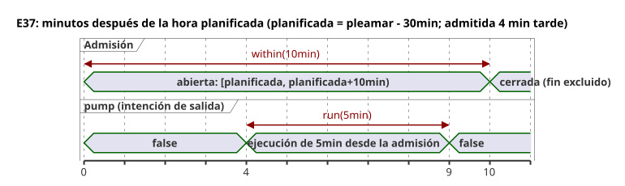

Las predicciones ausentes u obsoletas, o un reloj Unknown, no admiten nuevas
ejecuciones. `fallback=skip` no demuestra un comportamiento físico a prueba de fallos
ni inventa predicciones. `pump` es intención de salida, distinta de los hechos físicos
safe, applied y confirmed. La estación, la revisión y la ocurrencia del proveedor, así
como las instantáneas del reloj, son entradas del entorno. El código no contiene
direcciones ni credenciales de la instalación.

```ghost
// E37
control TideRun {
  state displayed_pump: Bool = false;
  displayed_pump' = if true then high.active else displayed_pump;
  // Source-local display memory is initialized here; faults remain producer unknown.
  state remembered_allowed: Bool = false;
  let allowed_good = case observed_allowed { ok(_) => true; fault(_) => false; };
  let allowed = case observed_allowed { ok(value) => value; fault(_) => remembered_allowed; };
  remembered_allowed' = allowed;
  state remembered_stop: Bool = false;
  let stop_good = case observed_stop { ok(_) => true; fault(_) => false; };
  let stop = case observed_stop { ok(value) => value; fault(_) => remembered_stop; };
  remembered_stop' = stop;
  input observed_allowed: Bool;
  input observed_stop: Bool;
  provider harbor_tides: TidePredictions;
  schedule high: Tide {
    source = harbor_tides;
    timezone = "UTC";
    at = tide`high - 30min`;
    basis = run(5min, within(10min));
    when = allowed_good && allowed;
    cancel_when = stop_good && stop;
    clock = trusted_only;
    gap = skip_after(60s);
    recovery = baseline;
    fallback = skip;
  }
  output pump: Bool;
  pump <- displayed_pump';
}
```

### E98 — Rechazar la mezcla implícita de Int y Number

Aquí `count` es un `Int` y `measurement` es un `Number`, y el compilador rechaza el
código. Si pretende un cálculo aproximado, escriba `number(count)` explícitamente. Para
convertir a un recuento exacto, elija `int_exact` o una conversión de redondeo
explícita, junto con su política de errores.

```ghost-error
control MixedCount {
  let count: Int = 1;
  let measurement: Number = 1.5;
  output total: Number;
  total <- count + measurement;
}
```

### E99 — Rechazar un DateTime sin desfase

Una hora local por sí sola no identifica un instante UTC. Escriba `Z` o un desfase
numérico; GhostFlow nunca adivina una zona IANA.

```ghost-error
control MissingOffset {
  output ready: Bool;
  ready <- datetime`2026-09-30T06:30:00` < datetime`2026-09-30T07:00:00Z`;
}
```

### E100 — Mantener explícito el respaldo de Solar

Lo que ocurre cuando faltan datos forma parte del contrato de la fuente. Una
programación sin su respaldo obligatorio no produce bytecode. Si omitir es la política
que desea, escriba `fallback = skip;`.

```ghost-error
control MissingSolarFallback {
  schedule dawn: Solar {
    timezone = "UTC"; latitude = 37; longitude = 127; at = sun`rise`;
    basis = pulse; when = true; clock = trusted_only;
    gap = skip_after(60s); recovery = baseline;
  }
  output start: Bool;
  start <- dawn.due;
}
```

### E101 — Mantener el respaldo de hora fija de Solar fuera de Tide

La ruta de ejecución actual de `fixed_time` es solo para Solar. El respaldo de Tide es
`skip`; una hora fija nunca se trata como una ocurrencia de una predicción de pleamar.

```ghost-error
control UnsupportedTideFallback {
  provider predictions: TidePredictions;
  schedule high: Tide {
    source = predictions; timezone = "UTC"; at = tide`high`;
    basis = run(5min, within(10min)); when = true; cancel_when = false;
    clock = trusted_only; gap = skip_after(60s); recovery = baseline;
    fallback = fixed_time(time`06:30`, terminal: skip);
  }
  output pump: Bool;
  pump <- high.active;
}
```

### E102 — Especificar el final de la retención del reloj

`hold_trusted(2min)` por sí solo ocultaría lo que ocurre cuando vence la retención. La
única política terminal explícita admitida actualmente es `terminal: skip`.

```ghost-error
control MissingHoldTerminal {
  schedule dawn: Solar {
    timezone = "UTC"; latitude = 37; longitude = 127; at = sun`rise`;
    basis = pulse; when = true; clock = hold_trusted(2min);
    gap = skip_after(60s); recovery = baseline; fallback = skip;
  }
  output start: Bool;
  start <- dawn.due;
}
```
