<!-- translation-source: docs/ProgrammingInGhostflow.en.md -->
[英語の原文](ProgrammingInGhostflow.en.md)

# GhostFlowでのプログラミング

**2026-10-05の外部入力改訂に関する注記。**品質情報を伴う宣言には、現在`input`を使います。既存の条件付け（conditioning）と明示的な`Result`のfault分岐は、ソースに書かれたポリシーとしてそのまま残ります。以前の`sensor`の抜粋は`tests/fixtures/history/issue531/`に保管されています。インポートされたソースリビジョンには、それ自体を個別に検証したソースクロージャが必要です。

これまで単純な観測を読んでいた例は、現在`observed_*`という生成元（producer）チャネルを宣言し、その`Result`を明示的に処理します。本書全体を通じて、関連するいくつかの規則が適用されます。

- `remembered_*`と`displayed_*`の状態は、ソースの中でメモリを初期化します。その初期値は、生成元が正常な`false`やゼロを供給したことを主張するものではありません。
- 不明な観測は、すでに確立されたメモリを保持します。新たにガードされた遷移を許可することはできません。
- 現時点で正常なSTOPや、取り消された許可が優先されます。既存の最大運転時間はそのまま期限切れになります。
- 取得品質は、物理的なボタンや機器が故障したことを主張するものではありません。

これらは明示的な、説明のための改訂です。保持されている正常なデータセットは元の論理フィールド名を維持し、明示的なテストアダプタがそれらを接続します。

機器の振る舞いをコードとして書き、実行して理解する

**改訂版・英語版からの翻訳・Language Reference準拠**

## 始める前に

スイッチを押したらランプが点く、決まった時刻に水を流す、水位が下がったらポンプを止める、といったことを実現したいとします。

一つひとつの作業は単純です。しかし条件が積み重なり、複数の機器が連携して動くようになると、何がいつ点き、なぜ止まるのかが見えにくくなります。

GhostFlowは、こうした条件と動作をコードとして書くための言語です。GhostFlowプログラムは、センサの値やユーザーの操作に応じて状態がどのように変わるか、そして機器にどの動作を要求するかを記述します。

本書では、プログラムを書く前に文法を暗記することは求めません。代わりに、次の3つのステップを繰り返します。

1. 結果を予測する。
2. 1か所だけ変更する。
3. 結果が変わるtickを見つける。

**tick**（論理判断の単位）とは、制御プログラムの1回の評価のことです。詳しくは[第1章](#ch01)で説明します。まずは1つのスイッチから始めますが、すぐに実際の設備で生じる問いに行き着きます。

- STARTとSTOPが同時に届いたら、どちらが勝つのか。
- センサがチャタリングしたり、値が古く（stale）なったりしたとき、何をまだ信頼できるのか。
- 画面上のONは、機器が物理的にオンになったことを意味するのか。

正解を出すことよりも、証拠を残すことのほうが大切です。各例について、入力と前状態を書き留めてください。次に、次状態と要求意図・安全意図を予測します。**要求意図**（requested intent）は、プログラムが求める出力です。**安全意図**（safe intent）は、その出力に安全条件を適用した後のものです。最後に、予測と実行結果を比較します。予測と実行結果が異なるとき、その違いこそが学ぶ価値のある概念です。

次の図は、1回のtickが何を読み取り何を生み出すか、つまり各実行の前に何を書き留めればよいかを示しています。

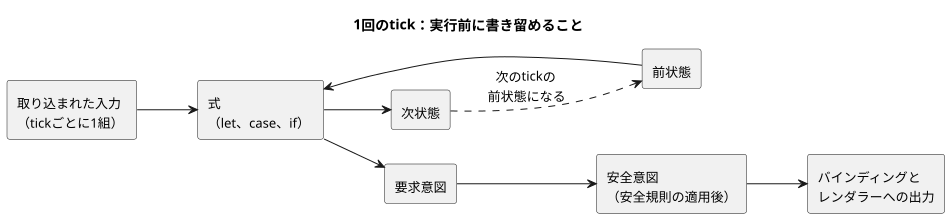

あるtickの次状態は、その次のtickの前状態になります。`state`を持たないプログラム（E01など）には、読み取る前状態がないだけです。

正確な構文と振る舞いの規則については、[Language Reference](LANGUAGE-REFERENCE.ja.md)を参照してください。本ガイドは例を通じて教え、Referenceは言語を定義します。両者が食い違う場合はReferenceに従ってください。構文が変わるときは、まずReferenceが更新され、その後で本ガイドの例がそれに合わせられます。

コードを書いているときに生じる疑問については、[GhostFlowコーディングFAQ](language_faq.ja.md)も参照してください。

### 例を読む前に

本ガイドに例があるからといって、その機能が今日すぐ物理ボードで動かせる状態にあるという意味ではありません。

コードがコンパイルできること、実行環境がその機能をサポートしていること、実機が意図どおりに動くこと。この3つは、それぞれ個別に検証する必要があります。本ガイドは、現行の仕様のもとでコードをどう書き、どう読むかを説明します。すべての機能が実装済みである、あるいはボードへの展開の準備ができている、と主張するものではありません。

この版が主張するのは、次の事項だけです。

- ソースが現行のLanguage Referenceに従っているかどうか
- 現行のコンパイラと論理実行パスが何を検査するか
- 公開リーダーでどの演習を開けるか

特定のボード、配線ハーネス、センサ、アクチュエータでの物理的な検証は主張しません。実装範囲と証拠は、常に現在のチェックアウトの[実装](IMPLEMENTATION.ja.md)ドキュメント、[機能の成熟度と実行可能な証拠](REFERENCE-FEATURE-STATUS.ja.md)、およびテストによって定義されます。

公開リーダーのカタログでは、例は次のように分類されています。

| 例 | 検査される場所 |
|---|---|
| E11を除くE01–E33、PC-01–PC-10、tutorial/03–04 | 必要なブラウザのケイパビリティが受け入れられれば、リーダー上で実行されます。 |
| E11 | 実行可能な制御ではなく、正準表記を説明するものです。 |
| E34–E37 | コンパイルはできますが、現行のブラウザキャビネットは`Int`、`DateTime`、新しい自然現象イベントのホスト事実を受け入れられないため、別のホストプロファイルで検査されます。 |
| `station-rules` | 別のホスト上で動くポリシー文法です。 |
| E90–E102 | 実行の成功ではなく、期待される診断を検査します。 |

これらの分類は、**どこでどの証拠を確認できるか**を示すものです。機能の価値の順位を示すものではありません。

### 例の読み方

**各例は単独で実行してください。**すべての`ghost`の例は独立したプログラムです。本書の例をすべて1つのファイルにまとめて一緒に実行しないでください。

**説明はプログラムドキュメントの一部です。**実際のプログラムは`.ghost.md`ドキュメントとして書かれます。1つのプログラムのコードが複数のトップレベルの`ghost`ブロックに分かれている場合は、それらのブロックを上から順に1つの制御プログラムとして読んでください。ブロックの間の段落、つまりプログラムがなぜそのように振る舞うべきかという理由も、ソースドキュメントに残ります。

**コードの出力と機器の振る舞いを区別してください。**本書でいう**出力**とは、機器に動作を要求するためにプログラムが計算する値です。「ポンプをオンにする」という値を生成しても、それだけで実際のポンプがオンになるわけではありません。さらに2つの要素が必要です。値をGPIOピンやリレーに結び付ける**バインディング**と、それをハードウェアに適用する**出力レンダラー**です。センサから値を読み取るのは**入力ドライバ**の役割です。

正確な表記については、[Referenceの宣言と表記の索引](reference/07-semantic-rules-and-index.ja.md)を参照してください。言語がなぜこのように設計されているかは[設計思想](LANGUAGE-REFERENCE.ja.md)で説明しています。言語、実行環境、機器がそれぞれ何に責任を持つかは[Reference第8章](reference/08-language-runtime-and-device-boundaries.ja.md)で説明しています。

### 例はどのように検査されるか

[例の実行検査](../tests/programming-book-simulation.test.mjs)は、元の例をコンパイルし、指定した入力とテスト時刻で実行します。そのうえで、状態がどう変化したか、どの出力が要求されたか（要求意図）、安全条件の後にどの出力が残るか（安全意図）を検査します。

例ごとに必要な入力と実行環境が異なるため、検査の内容もさまざまです。

- E11を除くE01–E33の制御は、公開リーダーが選択する実行プロファイルで検査されます。
- E02とE08は、設定結果（`Result`）とコンテキストの事実を受け取ります。E09は、暦とクロック時刻に基づくスケジュール情報である、常用（civil）スケジュールの事実を受け取ります。
- E10、E14、tutorial/03は、センササンプルと必要なケイパビリティを受け取ります。
- PC-01–PC-10とtutorial/03–04も、必要なケイパビリティが受け入れられればブラウザで実行されます。
- E34–E37と`station-rules`は、前述の別のホストプロファイルを使います。

一般的な入力と状態の例では、共有Rustコアの論理的な結果を検査します。ブラウザリーダーは、WASMパスを通じて同じ意味を表示します。どちらのパスも、入力、状態、要求意図・安全意図、診断を観測します。どちらのパスも、物理的な機器の効果を立証するものではありません。

tutorial/04は、既存の`ControlRuntime`/`DailySlots` WASMホストでスケジュールイベントと順序出力を検査します。station-rulesは、`ghostrules`でポリシーをコンパイルしてバインドし、WASMの`GhostFlowStation`で出力の許可と`Stop`を検査します。これら2つの上級例は、`ghostsim` CLIパスとは別に検査されます。

E11は表記を説明するものです。E90–E102は意図的に不正なコードを含み、コンパイラが期待どおりのエラーを報告することを検査します。図やプログラム合成の説明は実行されません。ソースを変更する実験は、元の例とは別に検査されます。

例の検査を自分で実行するには、Nodeの依存関係と、同じリビジョンからビルドしたネイティブ/WASM成果物が必要です。そのうえで`node --test tests/programming-book-simulation.test.mjs`を実行します。完全なビルドと検証の手順は[検証](VERIFICATION.ja.md)を参照してください。

`tests/docs-runnable-examples.test.mjs`のコンパイラ検査は、ランタイムをビルドしなくても実行できます。

第14章には、温度センサと気候センサを扱うE16–E22があります。第15章と上級例E23–E37では、物理量、観測、厳密な数え上げ、自然時間をさらに掘り下げます。制御計算とインポートパッケージの証拠は、`tests/programming-book-simulation.test.mjs`、`tests/programming-climate.test.mjs`、`tests/programming-book-import-package.test.mjs`に分かれています。

これらの手順はすべて、プログラムのロジックと計算を検査するものです。実際のセンサや機器が意図どおりに動くかどうかは、別途検証しなければなりません。

## 目次

### PLCからGhostFlowへ — 実践から始める

この10段階の実践コースは、ボタンとランプから始まります。続いてSTART/STOP、モーター、インターロック、リミット、タイマー、水位、Manual/Auto運転、シーケンス制御、故障からの復旧を扱います。

各段階では、まず機器がどう振る舞うべきかを考えます。次に、その振る舞いをGhostFlowのコードでどう表現するかを確認します。

### トピック別に見る

1. [1つのスイッチと1つの出力](#ch01)
2. [名前、値、型、式](#ch02) · [物理量から型を引く表](#quantity-type-lookup)
3. [状態を記憶するとはどういうことか](#ch03)
4. [出力意図と最終出力](#ch04)
5. [関数で計算を分ける](#ch05)
6. [時間を待つ制御](#ch06)
7. [予定した時刻に始める](#ch07)
8. [センサの値と品質](#ch08)
9. [式を正確に読む](#ch09)
10. [止める、変える、比べる](#ch10)
11. [ファイルと文芸的プログラム](#ch11)
12. [1つの機器、複数の制御](#ch12)
13. [組み込み関数と演算](#ch13)
14. [温度の単位と空気VPD制御](#ch14)
15. [名前付きの物理量と単位](#ch15)

付録：[A. 仕様ガイド](#appendix-a) · [B. エラーから学ぶ](#appendix-b) · [C. ドキュメント保守のルール](#appendix-c) · [D. 読者別の例](#appendix-d)


<a id="ch01"></a>
## 1. 1つのスイッチと1つの出力

機器制御を学び始めたばかりのころは、入力をそのまま出力に配線するだけなら、なぜ言語が必要なのかと疑問に思うかもしれません。その単純さこそが出発点です。

E01を実行する前に、スイッチが`false → true → false`と変わる3回のtickについて、ランプの値を書き留めてください。結果が予測と一致したら、次に問うべきは値そのものではなく、**その値がどの境界から来たか**です。物理的な接点、正規化された入力、論理的な出力、実際のリレーを区別できるようになれば、本書のより複雑なプログラムもすべて同じように読めるようになります。

### E01 — 入力を出力に接続する

最初のプログラムは、スイッチがオンのときにLEDを点灯し、スイッチがオフのときに消灯します。

```ghost
// E01
// Explicit quality-input revision: acquisition faults request lamp OFF.
control FollowSwitch {
  input switch_on: Bool;
  output lamp: Bool;

  lamp <- switch_on |> recover(false);
}
```

この改訂版の例は、外部入力を`Result<Bool, SensorFault>`として読み取ります。つまり、プログラムはtickごとに、正常な値か故障（fault）のどちらかを受け取ります。

- 正常な`false`または`true`は、下の表のとおりに振る舞います。
- 故障（NotReady、Disconnected、Stale、Invalid）のときは、明示的にランプのOFFを要求します。その`false`を供給するのが`|> recover(false)`です。

故障時にOFFを要求するのは、この例で確定したポリシーです。言語の既定値ではなく、物理的な接点がOFFであることの証拠でもありません。入力の故障とその来歴は引き続き記録されます。このスイッチ追従の例には、STARTボタンも運転中のメモリもありません。以前のE01のソースは[旧コードの記録](historical/2026-10-05-input-531-book-excerpts.ja.md)に保存されています。

`control FollowSwitch`は、この判断に名前と境界を与えます。境界の外から入ってくる値が`input`、計算が外へ送り出す値が`output`です。両者の間に、隠れた配線や機器の選択はありません。

`lamp <- switch_on |> recover(false)`は、矢印の向きに沿って「このtickのランプの要求は`switch_on`から来た」と読みます。`Bool`の値が2つだけでも、出力がどこから来たかを説明できます。これが本章の最初の小さな成果です。

| 入力`switch_on` | 出力`lamp` |
|---|---|
| `false` | `false` |
| `true` | `true` |

この表は、起こりうる2つの瞬間を示しています。離す → 押す → 離す、は3つ目の値ではありません。時間とともに2つの行の間を行き来する**遷移シナリオ**です。表とシナリオを分けておくと、「今の値は何か」と「どうやってここに至ったか」を混同せずに済みます。

次のタイムラインは、そのようなシナリオをtickごとに再生し、さらに観測が故障になるtickを1つ加えたものです。

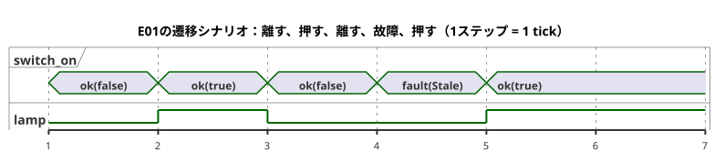

故障のtickでランプがOFFなのは、スイッチが離されたからではなく、この例が`recover(false)`を選んでいるからです。

### 接点、PLC入力、GhostFlow入力を区別する

リレー回路では、a接点（NO、ノーマルオープン）とb接点（NC、ノーマルクローズ）は、常時と押下時とで導通のしかたが異なります。PLCはその電気的な状態をデジタル入力（DI）で読み取ります。そして配線と入力モジュールの極性を考慮して、その状態をプログラム上の意味に正規化します。GhostFlowの`switch_on`は、すでに正規化された論理入力です。したがって、この例の境界は次のようになります。

| 層 | NO | NC | GhostFlowに渡される値 |
|---|---|---|---|
| 常時 | 接点は非導通 | 接点は導通 | `switch_on = false` |
| 押下時 | 接点は導通 | 接点は非導通 | `switch_on = true` |

b接点のせいで生の信号が反転して見える場合、それは入力の正規化の問題です。b接点だからといって、それだけでプログラムに`!`を加えるという意味にはなりません。正規化は配線/入力モジュールの境界で指定し、Boolのペイロードが`false`または`true`である正常な観測をGhostFlowに渡してください。観測の品質と同一性は保持してください。伝達経路が壊れている場合は故障であり、決して正常な`false`に変えてはなりません。

まとめると、次のとおりです。

- **リレー**は物理的な接点経路を作ります。
- **PLC**は、それらの入力をDIとラダーロジックまたはファンクションブロックで処理します。
- **GhostFlow**は、正規化された意味のある入力を、宣言された出力の計算に接続します。

本書の例が説明するのは論理的な計算です。実際の接点、電気配線、PLCの入力モジュール、機器の出力の検証は、バインディングとレンダラーの契約の役割です。

次の図は、E01の信号を接点からリレーまでたどったものです。GhostFlowのコードは中央の部分だけです。

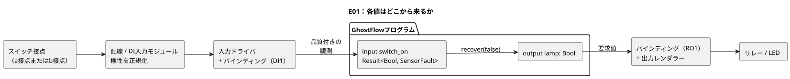

### 実行を読む単位：tick

1回の制御評価を**tick**と呼びます。1回のtickの中のすべての式は、一度だけ取り込まれた同じ入力の組を参照します。計算の途中でスイッチが変化し、式ごとに異なる物理的な瞬間を読む、といった状況を想像しないでください。新しい入力の組は、次のtickが始まるときに届きます。

E01にはメモリがないため、同じ入力の観測からは常に同じ出力が得られます。正常な入力のトレースで、`switch_on`と`lamp`が初めて食い違うtickが見つかったとします。その場合は、この式を疑う前に、入力の正規化、バインディング、ドライバを調べてください。第3章では`state`を加えます。それ以降は、過去が異なれば、同じ現在の入力から異なる結果が得られることがあります。

`switch_on`をDI1に、`lamp`をRO1に結び付ける情報は、プログラムの外にあるマッピングです。名前によってハードウェアのポートが自動的に選ばれることはありません。だからこそ、同じ計算を仮想のスイッチとLEDにも、実機のI/Oにも接続できるのです。

### 変えてみよう

接続を`lamp <- case switch_on { ok(value) => !value; fault(_) => false; };`に変えてみてください。実行する前に、新しい表を紙に書いてください。`!`はtrueとfalseを反転させるので、出力のセルは両方とも変わるはずです。

結果を確認したら、元に戻してください。今度は入力の名前だけを変えます。振る舞いは変わりませんが、読み手がプログラムをどう解釈するかは変わります。これが、計算の変更と説明の変更を見分ける最初の練習です。

<a id="ch02"></a>
## 2. 名前、値、型、式

現場での間違いの多くは、計算が難しいからではなく、ある人は`30`を30パーセントと読み、別の人は30秒と読むことから起こります。本章では、名前と型を、そうした誤解を早い段階で捕まえる道具として扱います。

E02を実行する前に、29%、30%、31%のときに期待される行を書き留めてください。次に、`<`だけを`<=`に変えます。境界の行がちょうど1つだけ変われば、型と小さな式がどれほど判断を絞り込むかがわかります。

### 文を区切る表記

現行の構文では、宣言と式の定義は`;`で終わります。コンパイラは改行から文の終わりを推測することはないので、長い式を複数行に分けても意味は変わりません。`{ }`はスコープを作り、インデントは人が構造を把握しやすくするためだけのものです。関数の最後の式など、セミコロンを省略できる数少ない位置は付録Aにまとめています。

名前は英字またはアンダースコアで始まり、その後に英字、数字、アンダースコアを続けることができます。名前は大文字と小文字を区別するので、`start`と`Start`は別の名前です。予約語や内部用の`__gf_`接頭辞を名前に使わないでください。識別子は現在ASCIIのみなので、ほかの言語（たとえば日本語）での説明は`//`コメントか文芸的ソースの本文に書いてください。

### 基本的な値と型

| 型 | 例 | 意味 |
|---|---|---|
| `Bool` | `true`, `false` | 真または偽 |
| `Int` | `120`, `-2` | 厳密な符号付き32ビット整数 |
| `Number` | `3`, `0.5`, `-2` | 一般的な数値。内部ではf64で表現されます |
| `Percent` | `30%` | 百分率の値。リテラル/入力の範囲は0–100です |
| `Duration` | `250ms`, `2s`, `5min`, `1h` | ミリ秒分解能の、負でない時間の長さ |

`Int`、`Number`、`Percent`、`Duration`は似て見えるかもしれませんが、それぞれ異なる問いに答えるものです。`Percent`を`Number`と直接比較することはできません。この規則によって、30%が、たまたま値が30である測定値のふりをこっそりすることを防げます。厳密な個数や繰り返し回数には`Int`を、測定値のような近似的な値には`Number`を使います。厳密な範囲と変換は[Reference §2.1–2.3](reference/02-types-expressions-state.ja.md)に従います。

数値型が期待されていない場合、整数のリテラルは`Int`になり、小数点や指数を含むリテラルは`Number`になります。すでに`Number`である文脈では、`3`は最初からNumberとして読まれます。

`Duration`リテラルは、負でない整数の後に単位`ms`、`s`、`min`、`h`のいずれかを続けたものです。0.5秒は`500ms`と書きます。詳しい範囲と演算は[Reference §3.1](reference/03-time-and-schedules.ja.md)に従います。

`"Asia/Seoul"`はタイムゾーンの設定に、`06:00`はスケジュールの設定に使います。一般的な文字列や時刻値の構文と混同しないでください。

### 厳密な個数と近似的な測定値

果物の数や繰り返し回数のように数え上げる値は、厳密な整数でなければなりません。たとえば`120 + 1`は、きっちり`121`でなければなりません。一方、`24.3`という温度のような実数の測定値は、センサとドメインが定める許容誤差の範囲内で近似的であってかまいません。

GhostFlowは、厳密な個数を符号付き32ビットの`Int`で表します。範囲外の値や不正な変換が、黙って折り返したり丸められたりすることはありません。代わりに、診断か明示的な実行時の故障になります。実数の測定値には`Number`を使います。詳しくは[Reference §2.3](reference/02-types-expressions-state.ja.md)を参照してください。

日付と時刻は、`date`、`time`、`datetime`のタグ付きリテラルで書きます。DateTimeにはタイムゾーンのオフセットが必要です。暦上の日付/時刻と、単調な経過時間とは意味が異なります。[Reference §3.1](reference/03-time-and-schedules.ja.md)に従ってください。

温度、流量、電圧のように、単位が制御の判断に影響する値は、一般的な`Number`とは区別してください。たとえば`Temperature`の`25°C`、`FlowRate`の`5L/min`、`Voltage`の`24V`には、決まった物理量の型と単位があります。使用できる単位、変換、演算は[Reference §2.9](reference/02-types-expressions-state.ja.md)に従います。`Rate<Q>`は時間窓の計算のための式専用の型であり、一般的な入力、出力、状態の型ではありません。単位の混在や物理量どうしの演算の例は[第15章](#ch15)で紹介します。

<a id="quantity-type-lookup"></a>
### 測定値に合う型を探す

摂氏で測定する場合でも、型名は`Temperature`です。`Celsius`や`Fahrenheit`という名前の型を宣言しないでください。代わりに値に単位を付けます。`input air: Temperature;`と宣言し、しきい値は`30°C`と書きます。`30°C`、`86°F`、`303.15K`は同じ絶対温度を表します。単位の変換と温度制御については[第14章](#ch14)で続けて説明します。

| 測定するもの | 宣言の型 | 値の例 | 入力の宣言 |
| --- | --- | --- | --- |
| 絶対温度 | `Temperature` | `30°C` | `input air: Temperature;` |
| 温度差 | `TemperatureDelta` | `5Δ°C` | `input rise: TemperatureDelta;` |
| 相対湿度 | `RelativeHumidity` | `70%RH` | `input humidity: RelativeHumidity;` |
| タンクの水位などの百分率 | `Percent` | `70%` | `input level: Percent;` |
| 二酸化炭素濃度 | `CO2Concentration` | `800ppm` | `input co2: CO2Concentration;` |
| 流量 | `FlowRate` | `5L/min` | `input flow: FlowRate;` |
| 圧力 | `Pressure` | `1.2kPa` | `input pressure: Pressure;` |
| 飽差 | `VaporPressureDeficit` | `1.2kPaVPD` | `input vpd: VaporPressureDeficit;` |
| 光合成光量子束密度 | `PPFD` | `500umol/m2/s` | `input light: PPFD;` |
| 電圧 | `Voltage` | `24V` | `input supply: Voltage;` |
| 経過時間 | `Duration` | `5s` | `input delay: Duration;` |

似た値に注意してください。`70%RH`と`70%`は型が異なり、`1.2kPaVPD`と`1.2kPa`も同様です。絶対温度と温度差も別々の型です。

入力は品質を伴う`Result`値として読み取られます。値を取り出したり比較したりする前に、正常の分岐と故障の分岐を明示的に処理してください。この表が故障時のフォールバックや制御ポリシーを選んでくれるわけではありません。単位と演算の完全な規則は[Reference §2.9](reference/02-types-expressions-state.ja.md)に従います。

### E02 — 入力、設定、計算に別々の名前を付ける

水位が設定値を下回ったら、給水の出力をオンにします。

```ghost
// E02
control ThresholdControl {
  state displayed_pump: Bool = false;
  displayed_pump' = if level_good then low else displayed_pump;
  // Source-local display memory is initialized here; faults remain producer unknown.
  state remembered_level: Percent = 0%;
  let level_good = case observed_level { ok(_) => true; fault(_) => false; };
  let level = case observed_level { ok(value) => value; fault(_) => remembered_level; };
  remembered_level' = level;
  input observed_level: Percent;
  config threshold: Percent = 30%;
  let low = case threshold {
    ok(value) => level < value;
    fault(_) => false;
  };

  output pump: Bool;
  pump <- displayed_pump';
}
```

このプログラムは、3種類の値に別々の名前を付けています。

| 名前 | 種類 | 内容 |
|---|---|---|
| `observed_level` / `level` | 入力の観測 | `observed_level`はtickごとに届きます。`level`はその正常な値、または観測が故障のときは最後に記憶した値です。 |
| `threshold` | 設定 | 調整できるように`config`として公開されています。 |
| `low` | 計算 | このtickにおける`level`と`threshold`の比較です。保存される状態ではありません。 |

3つに別々の名前があるので、トレースは個別の問いに答えられます。水位は下がったのか。設定は変わったのか。比較結果は変わったのか。

さらにいくつかの詳細があります。

- ソース上の既定値を変更すると、新しいドキュメントリビジョンが作られます。運用中は、`access = operator`で公開されている場合に限り、型付きのアトミックなライブイベントを通じて設定を変更できます。メタデータの契約は[Reference §5](reference/05-settings-and-observation.ja.md)に従います。
- `config threshold: Percent`を読むと`Result<Percent, SettingsFault>`が得られます。初期値は`ok(30%)`です。後の観測がエラーになっても、設定が自動的に既定値に復旧することはありません。
- `threshold`が故障のとき、この例は`low = false`を選びます。これは言語全体のフォールバックではなく、物理的なフェイルセーフの保証でもありません。
- `observed_level`が故障のときは`level_good`がfalseになるので、`displayed_pump'`は前の値を保ち、`pump`も保持されます。観測が不明な間、この例はこうして確立されたメモリを保持します。`state`と`'`（次状態）の表記は[第3章](#ch03)で説明します。
- `let`は計算に名前を付けるものであり、保存されるメモリではありません。

水位としきい値がどちらも正常な場合、判断は次のようになります。

| `level` | 正常な`threshold`のペイロード | `low` / `pump` |
|---|---|---|
| `29%` | `30%` | `true` |
| `30%` | `30%` | `false` |
| `31%` | `30%` | `false` |

`low`の定義を出力接続の下に移動しても、計算は変わりません。コンパイラは、値を上から下へ上書きするのではなく、依存関係をたどるからです。そのため、コードを移動するだけの編集と、判断を変える編集とを分けておくことができます。2つの`let`定義が互いに相手の結果を先に必要とする場合は、循環になります。どちらの定義も出発点を与えないため、コンパイラはそのような循環を拒否します。

**小さな実験：** `<`を`<=`に変えると、表のどの1行が変わるでしょうか。

<a id="ch03"></a>
## 3. 状態を記憶するということ

オペレーターが START から手を離した後も運転を続けなければならないポンプは、
現在の入力だけでは制御できません。プログラムは START が押されたことを記憶して
おく必要があります。逆の問題も同じくらい重要です。STOP の後、まだ押されたままの
START ボタンでポンプがすぐに再起動してはなりません。そのため本章の演習では、
次の二つの問いを一緒に考えます。

- プログラムは何を記憶しなければならないか。
- どの出来事の後に、何を忘れなければならないか。

各表では次状態の列を隠し、読む前に予想してください。オプションの PC ルート
（PC-02〜PC-10）では、この小さな記憶が、モーター、方向転換、水位、モード切替、
シーケンス、故障からの復旧へと発展していきます。

### E03 — 停止優先の自己保持

目標：START を短く押して離してもポンプが運転を続け、STOP を押すと停止すること。
このパターンを*自己保持*（ラッチ）と呼びます。

```ghost
// E03
// Explicit quality-input revision: protective faults stop; recovery needs healthy START release/repress.
control LatchingPump {
  input start, stop: Bool;
  state running: Bool = false;
  state restart_blocked: Bool = false;
  output valve, pump: Bool;

  let start_good = case start { ok(_) => true; fault(_) => false; };
  let stop_good = case stop { ok(_) => true; fault(_) => false; };
  let start_requested = start |> recover(false);
  let stop_requested = stop |> recover(true);
  let acquisition_fault = !start_good || !stop_good;
  restart_blocked' = if acquisition_fault then true
    else if !start_requested then false else restart_blocked;
  running' = !stop_requested && (running || (start_requested && !restart_blocked));
  valve <- running';
  pump <- running';

  require pump => valve;
}
```

このソースは、品質（`ok` または `fault`）を伴う入力のための、明示的な新しい
リビジョンです。正常時の二つの振る舞い、つまり自己保持と停止優先はそのまま
維持します。そのうえで、取得故障に対する方針を追加しています。

- START の fault は新たな起動を防ぎます（`recover(false)` は START を離された
  ものとして扱います）。
- 運転中の状態は、STOP が正常で、かつ離されている間だけ継続します。
- STOP の fault は運転の記憶をクリアし、ポンプ/バルブの OFF を要求します
  （`recover(true)` は STOP を押されたものとして扱います）。
- どちらかの入力に fault が起きると `restart_blocked` が設定されます。fault による
  停止の後は、START を押し続けても運転は再開できません。プログラムはまず、両方の
  入力が正常な状態で START が離されたことを観測する必要があり、そのうえで新たに
  押されたときに起動します。
- 起動時にすでに押されている正常な START は、元の正常時の振る舞いと同じく、
  すぐに起動します。

この方針は既存の START 回路に適用するものです。ランプや自動コントローラに START
ボタンを追加するための規則ではありません。出力を実際の設備に適用するには、別途
レンダラーの証拠が必要です。以前の E03 のソースは
[以前のコードの記録](historical/2026-10-05-input-531-book-excerpts.ja.md)に保存されています。

次の図は、同じ方針を状態として表したものです。各矢印が 1 tick に相当します。

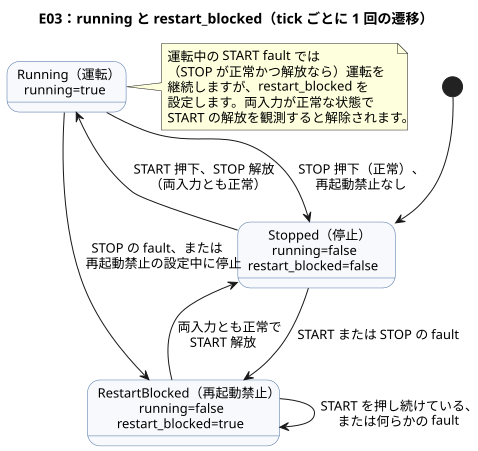

`running` は tick の開始時点で記憶されている値です。`running'` は現在の入力から
計算される次の値です。アポストロフィは **prime**（プライム）と読みます。二つの
名前によって、「STOP が観測される前の運転状態」と「STOP を処理した後に確定する
状態」という二つの時点を区別できます。

式を声に出して読んでみましょう。「停止が押されておらず、かつ起動が押されているか
すでに運転中であれば、運転を続ける。」この文が現場の要求と違うなら、括弧を並べ替える
前に要求そのものを直してください。両方のボタンが押されると `!stop_requested` が
false になるため、停止が勝ちます。この同時入力の 1 行によって、「停止優先」という
言葉が観測可能な振る舞いになります。

| tick | start | stop | 前の `running` | 次の `running'` | pump |
|---|---|---|---|---|---|
| 1 | false | false | false | false | false |
| 2 | true | false | false | true | true |
| 3 | false | false | true | true | true |
| 4 | true | true | true | false | false |
| 5 | false | false | false | false | false |

同じ表をタイミング図にしたものです。`running` が `running'` からちょうど 1 tick
遅れていることに注目してください。ある tick の次の値が、次の tick の前の値になります。

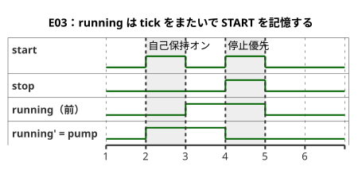

出力は `running'` を読むので、ポンプは START を観測したのと同じ tick でオンになります。
1 行を `pump <- running;` に変えると、出力は古い状態を読むため、1 tick 遅れてオンに
なります。同じ入力で両方のバージョンを実行し、最初に差が出る tick を見つけてください。
振る舞いが変わったのは、ソース中で文がどこにあるかではなく、**その値がどの時点に
属するか**によるものです。

### PC-02 — 新たな起動を待つ START / STOP

PC-02〜PC-10 は、現場の課題を扱うオプションのルートです。必須の文法学習の順序では
ありません。

| レッスン | テーマ |
|---|---|
| PC-02–03 | 再起動とモーターの許可 |
| PC-04–05 | 方向と位置 |
| PC-06–08 | 時間、水位、モード |
| PC-09–10 | シーケンス全体と復旧 |

どのレッスンも前のレッスンを置き換えません。それぞれ前の例を残したまま、新しい
課題を一つ加えます。

E03 の基本的な自己保持は変わりません。PC-02 は
[別の文芸的原本](../examples/curriculum/pc-02-start-stop.ghost.md)にあります。
`stop_ok`、`armed`、`running`、`start_event` を追加して、停止優先と再起動禁止を
表現します。START を押したまま STOP から回路が復帰しても、それは新たな起動イベント
ではないため、出力はオフのままです。START を離してもう一度押すと、`running'` と
ポンプ/バルブの出力がオンになります。PC-02 は E03 を置き換えるものではありません。
実際の接点とリレーの振る舞いは、別の設置契約のもとで検証してください。

### PC-03 — モーター電磁接触器のコマンドと過負荷の許可

PC-03 の[正本の文芸的原本](../examples/curriculum/pc-03-motor-contactor.ghost.md)は、
PC-02 の新たな起動イベントと自己保持を、モーター制御コマンドにつなげます。
`stop_ok` と `overload_ok` は正規化された許可入力です。b接点の配線と極性は電気側
またはデバイスのアダプタが定義し、このプログラムは Bool の意味だけを読みます。

主要な式は次のとおりです。

- `permit = stop_ok && overload_ok`
- `start_event = armed && start`
- `running' = permit && (start_event || running)`
- `armed' = permit && !start`
- `motor_contactor <- running'`

`motor_contactor` は MC（電磁接触器）コイルに対する一つの論理コマンドです。
フィードバックではなく、MC の主接点が閉じたこと、モーターに電源が供給されたこと、
モーターが回っていることを証明するものではありません。二つの回路は分けて読んで
ください。

- **主回路：** ブレーカ、MC 主接点、過負荷リレー、モーター。
- **制御回路：** 制御電源、STOP、過負荷保護接点、START/MC 補助接点による自己保持
  回路、MC コイル。

ソフトウェアのコマンドは、独立した電気的保護の代わりにはなりません。アラーム、
故障のラッチ/リセット、タイマー、センサのフィードバック、ハードウェアの動作は、
このカリキュラム/学習シナリオの範囲外です。

この例では、要求意図（`requested`）と安全な結果（`safe`）を分けています。リレー、
MC、モーターからの物理的な証拠は、言語の出力意図には含まれません。

### PC-04 — 正転/逆転の方向転換インターロック

PC-04 は[正本の文芸的原本](../examples/curriculum/pc-04-direction-interlock.ghost.md)
から実行します。
[E06 — 両方向を同時に要求する](#e06--両方向を同時に要求する)
は基本例として残ります。`mutex` は、両方の出力が候補になったときに両方をブロック
します。PC-04 はこの制約を写すだけではありません。論理的な正転・逆転の運転状態と、
方向転換の間の停止待ちを定義します。

入力：

- `forward_start`、`reverse_start`：モーメンタリの起動入力。
- `stop_ok`、`overload_ok`：正規化された許可入力。正常なときに true。

状態は `Stopped | Forward | Reverse | WaitForward | WaitReverse` で、プログラムは
`start_armed=false` で始まります。規則は次のとおりです。

- 両方の起動が同時に来たら停止します。優先順位をでっち上げてはなりません。
- 運転中に反対方向が新たに押されると、まず Wait 状態に移り、両方の電磁接触器
  コマンドを直ちにオフにします。
- 反対方向は、設定された `reversal_wait = 2s` の後にのみオンになります。
- 待機中に新たな方向要求で目標が変わったら、対応する Wait 状態に移り、待ち時間を
  最初からやり直します。古い目標を保持したまま、オペレーターの新たな要求に反して
  起動しては決してなりません。

`forward_contactor` と `reverse_contactor` は、電磁接触器コイルに対する論理コマンド
にすぎません。`mutex` はソフトウェア上の最後の防御であり、実際の設備には電気的・
機械的なインターロックも必要です。2 秒が経過しても、モーターが物理的に停止した
ことは証明されません。ゼロ速度のフィードバックは、別の入力とドライバの契約で表現
してください。

### PC-05 — リミットフィードバックによるバルブ端位置の確認

PC-05 は[正本の文芸的原本](../examples/curriculum/pc-05-limit-feedback.ghost.md)
から実行します。E06 と PC-04 を残したうえで参照します。`Phase`、`elapsed(phase)`、
次状態、出力接続を使って、コマンドと「動作が完了した」という観測を分けます。

入力：

- モーメンタリの要求 `open_request`/`close_request`
- 端位置の観測 `open_limit`/`close_limit`
- 許可 `stop_ok`/`overload_ok`

プログラムは `Stopped` で始まり、初期位置をでっち上げません。停止中に観測されて
いたリミットが消えた場合、過去の状態だけを信用することはしません。両方のリミットが
同時に true になると `SensorConflict` になり、両方の出力がオフになります。反対方向の
新たな要求は目標リミットより優先されます。両方のコイルコマンドをオフにし、2 秒の
境界でのみ動作を再開します。

`Opening`/`Closing` が端位置に到達しない場合は、タイムアウトと故障の方針で扱います。
コマンドと端位置の観測は別々の値です。アクチュエータを物理的に止めるのは、
ドライバと安全回路の役割です。

### PC-06 — オンディレイ、オフディレイ、最大運転時間を分けて読む

PC-06 の[正本の文芸的原本](../examples/curriculum/pc-06-timer-patterns.ghost.md)は、
それぞれ独自の状態を持つ三つのタイマーの意味を示します。

| 入力 | 振る舞い |
|---|---|
| `on_delay_request` | 要求が 2 秒間続いた後にオンになる |
| `off_delay_request` | 要求がなくなった後もさらに 3 秒間オンのままになる |
| `limited_request` | 10 秒でオフになり、要求が解除されるまで再起動できない |

この三つの入力は持続的な運転要求であり、モーメンタリのボタンイベントではありません。

これらの意味を一つの共有タイマーにまとめないことで、オフディレイが知らないうちに
最大運転時間を延ばしてしまうことを防げます。`stop_ok=false` はオフディレイさえ
無視して、三つの出力すべてを直ちにオフにします。各境界の直前、境界ちょうど、直後の
瞬間、そして取り消しと再要求を、同じ論理 tick の規則で評価してください。壁時計の
速さと論理時間の意味を混同してはなりません。

### PC-07 — 二つの水位スイッチの間で状態を記憶する

PC-07 の[正本の文芸的原本](../examples/curriculum/pc-07-tank-hysteresis.ghost.md)は、
デジタルの 2 点水位制御を扱います。`low_level_reached` と `high_level_reached` は、
水がそれぞれの物理スイッチに達したことを表す正規化された観測です。

- 下側スイッチより下で `Filling` を開始します。
- 下側と上側のスイッチの間では、現在の状態を保持します。
- 上側スイッチで停止します。
- 水位が中間から始まった場合はオンにしません。それ以前に低水位のイベントが
  なかったからです。

下側スイッチが false なのに上側スイッチが true になるのは物理的な順序に矛盾するため、
`SensorConflict` で出力はオフになります。矛盾が解消したスキャンでは、まず `Idle` に
戻り、その後に通常の評価が再開します。共通の停止/保護や故障のラッチ/リセットを、
この水位の概念に混ぜないでください。それらは PC-08 と PC-10 で組み合わせます。
[tutorial/03](../examples/tutorial/03-moisture.ghost.ja.md) の連続センサによる
中央値/品質/ヒステリシスの例は、別のレッスンとして残ります。

### PC-08 — 手動と自動の間で出力の所有権を切り替える

PC-08 の[正本の文芸的原本](../examples/curriculum/pc-08-manual-auto.ghost.md)は、
PC-03 の手動起動/自己保持と PC-07 の自動要求を一つのポンプにつなげます。

| `manual_mode_request` | `auto_mode_request` | モード |
|---|---|---|
| false | false | `Off` |
| true | false | `Manual` |
| false | true | `Auto` |
| true | true | `ModeConflict` |

ポンプのコマンドは、競合時、`Off` のとき、モード変更のスキャンでは常にオフです。

`manual_start` はモーメンタリの起動イベントで、`auto_demand` は持続的な自動要求です。
共有の `request_armed` は、安定したモードで選択中の要求が false であることを先に
観測した後でのみ、新たな true を起動イベントとして受け付けます。そのため、運転中に
モードを変えたり、停止/過負荷の許可が復帰したりしても、すでにオンになっている要求で
再起動することはありません。Auto 中に要求がなくなると、運転は直ちに停止します。
[station-rules.ghost.md](../examples/station-rules.ghost.ja.md) と
[tutorial/04](../examples/tutorial/04-extra-valves.ghost.ja.md) は、複数の制御と
共有リソースの調停を扱う発展的な教材として残ります。

この例では、モードの競合を明示的な状態と出力式で扱います。コイルが閉じたことや
ポンプの回転には、別途デバイスによる確認が必要です。

### PC-09 — 開いたことを確認してからポンプをオンにする

PC-09 の[正本の文芸的原本](../examples/curriculum/pc-09-sequential-water-supply.ghost.md)は、
シーケンス `Idle → Opening → Settling → Watering → PumpStopping → Closing → Idle`
を定義します。バルブを開く出力が有効になっていることと、バルブが物理的に開位置に
達したという観測を分けています。

- ポンプがオンになる前に、`open_limit` が 2 秒間確認され続けなければなりません。
- 5 分間の灌水が終わるスキャンでは、まずポンプがオフになります。
- 閉じる側の電磁接触器は、次の論理スキャンからオンになります。これにより、別の
  遅延をでっち上げることなく出力の順序が保証されます。

開位置のフィードバックが消えた場合、両方のリミットが同時にオンになった場合、
または停止/過負荷の許可がなくなった場合、すべての出力がオフになります。原因が
解消しただけではシーケンスは再起動しません。閉位置と離された START を観測し、
そのうえで新たな START が必要です。開閉の無応答タイムアウト、故障のラッチ、
アラーム、リセット、故障ごとの安全な復旧は PC-10 の役割です。

tutorial/02 の時間だけによるシーケンスと、tutorial/04 の制御をまたぐ共有ポンプの
調停は、教える内容が異なるため、そのまま残ります。この例では、論理コマンド、
バルブの動き、ポンプの回転、流量の観測をそれぞれ別の契約として扱います。

### PC-10 — 故障原因を記録して安全に復旧する

PC-10 の[正本の文芸的原本](../examples/curriculum/pc-10-fault-alarm-reset.ghost.md)は、
PC-09 のシーケンス運転に故障原因、アラーム、リセットを追加します。その文書の
GhostFlow ブロックが唯一の実行可能な原本です。以下の説明や、そこから抽出した
コードが、別に編集できる原本になることはありません。PC-01〜PC-09 はそれぞれの
学習目標を保ち、このレッスンでは故障の検出と復旧だけを追加します。

安全評価の優先順位は `EmergencyStop > Overload > ValveDriveUnavailable >
SensorConflict > FeedbackLost > OpenTimeout/CloseTimeout > LowSourceWater` です。
一つのスキャンで複数の原因が起きた場合、この順序で最初のものが `FaultCause` として
ラッチされます。その後のライブ入力の変化で上書きされることはありません。非常停止
では、外部のハードワイヤードの安全回路がエネルギーを遮断しなければなりません。
GhostFlow の観測入力とアラームは、その物理的な遮断や実際の設備の振る舞いを保証
しません。

通常の `STOP` は故障ではありません。`stop_ok == false` のとき、すべての動作出力と
アラームは直ちにオフになり、シーケンスは `Idle` に戻り、自動では再起動しません。
故障は RESET を離して押し直す手順によってのみ解除されます。

1. ラッチされた原因と、現在のすべての故障条件が解消していること。
2. `known_closed` が確認されていること。
3. RESET を一度離し、再び押すこと。

二次的なライブ故障が残っていると RESET はブロックされます。RESET は `Idle` に
戻すだけで、START の代わりにはなりません。再び運転するには、離された START を
観測し、そのうえで新たな `START` が必要です。

`LowSourceWater` は秩序立った閉動作を行う例外で、開いたバルブが確認されていて、
閉じる駆動の許可がある場合に限られます。`FaultPumpStopping` では、まず 1 論理
スキャンの間ポンプがオフになり、その後 `FaultClosing` がバルブを閉じるよう要求
します。それ以外の故障や安全条件はすべて、直ちに全出力をオフにする故障になります。
開と閉のタイムアウトはそれぞれ 10 秒です。境界ちょうどでは、目標リミットの観測が
タイムアウトより優先されます。

この例では、意味上の DI（デジタル入力の意味）と物理的な配線を混同しません。最初の
制御盤にある既存の意味 — `START`、`STOP`、`MODE`、タンクの上限/下限、開/閉リミット、
過負荷 — は 8 点の DI を使います。`RESET`、非常停止の観測、水源の低水位、バルブ駆動
OK を分けると、意味は合計 12 個になります。したがって 8DI の設置では、外部の安全
回路での集約、認証されたホストコマンド、または DI の拡張といった、現場ごとの選択が
必要です。意味を黙って統合したり省略したりしては決してなりません。

現在の `require` 構文が表現するのは Bool の**出力間の関係**だけです。入力の安全条件と
故障の優先順位は、`phase` の遷移と出力式で指定してください。したがって、`require`
だけで入力の安全方針全体が表現されていると読んではなりません。

この例では、論理的な意図とフィードバック入力を分けています。Web UI、MCU への
アップロード、電磁接触器によるエネルギー遮断、バルブの動き、ポンプの回転の物理的な
受け入れは、言語のセマンティクスだけでは確立されません。

### E04 — 複数の状態が一緒に変わる

```ghost
// E04
control TwoStates {
  state a: Bool = true;
  state b: Bool = false;
  output out_a, out_b: Bool;

  a' = b;
  b' = a;
  out_a <- a';
  out_b <- b';
}
```

最初の tick の後、`a=false`、`b=true` になります。2 回目の後は、再び `a=true`、
`b=false` になります。両方の式が同じ前状態を読むため、値が入れ替わります。これを、
上から下へ代入が行われて先に `a` が上書きされる、と読まないでください。

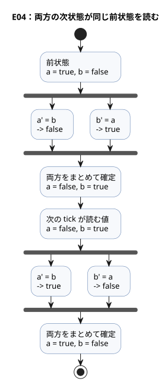

現在、次状態の参照は出力式でのみ許可されています。`b' = a';` のように、状態遷移の
中で別の状態の次の値を使うコードは拒否されます。複数の遷移で同じ計算が必要な場合は、
`let` で名前を付けて共有してください。

**設計上の理由：** 前状態と次状態を明示的に書くことで、すべての状態が一度に更新される
間も「この評価の根拠」が保たれます。この区別が、タイミングの比較や、ソースの横に
表示される値の土台になります。

ユーザーはこの選択について [#149](https://github.com/callin2/ghostflow-language/issues/149)
で説明しています。React/ObservableHQ からの影響は次の点です。制御はイベントの流れの
中で評価され、明示的な次状態を返します。ユーザーの教育上の前提は、再帰やループの
形をした制御は電気技術者にとって追いにくいかもしれない、というものでした。E04 は
時間の境界を具体的にします。前の `a` と `b` を読み、`a'` と `b'` を記述し、その後
両方を確定します。これは読みやすさの目標であり、電気技術者についての一般的な判断では
ありません。コードでは、E04 に示した ASCII のアポストロフィ（`'`）を使ってください。
その会話で使われたバッククォートや、その後のアシスタントの提案によって、構文、
タイムトラベル、因果説明の機能が追加されるわけではありません。実行規則は
[リファレンス §2.8](reference/02-types-expressions-state.ja.md#28-tickと状態スナップショット)
にあります。

成功した tick は次の順序で処理されます。この tick の入力スナップショットと前状態から
次状態の候補を計算し、次に要求意図と安全意図を計算し、その後、状態と意図の記録を
アトミックに確定します。選択された式で実行時の故障が起きると、その tick は拒否され、
部分的な更新は行われません。出力制約によるブロックは、このような評価の失敗とは
異なります。成功した tick の状態の確定を取り消すことはありません。

<a id="ch04"></a>
## 4. 出力意図と最終出力

画面にはポンプが ON と表示されているのに、水が流れていません。一つの Boolean では
これを説明できません。コードが ON を要求したのかもしれませんし、制約がそれを
ブロックしたのかもしれません。レンダラーが適用しなかったのかもしれませんし、
フィードバックがまだそれを確認していないのかもしれません。E05 で `request=true`、
`valve_ready=false` に設定し、要求意図と安全意図がどこで分かれるかを予想してください。
これらの段階を知れば、「なぜオンにならなかったのか」は当て推量ではなく、どの証拠が
欠けているかという問いになります。

本章では四つの用語を使います。

| 用語 | 意味 |
|---|---|
| **要求意図（requested）** | `<-` 接続が求めるもの |
| **安全意図（safe）** | 出力制約を通過した後の要求意図。本章では「最終出力」と呼ぶ |
| **適用済み（applied）** | レンダラーがコマンドを適用したという証拠 |
| **確認済み（confirmed）** | リミットスイッチやエンコーダなどによる、別のフィードバックの証拠 |

安全意図が true であっても、リレーが切り替わったことやポンプが運転したことは確立
されません。safe=true のトレースから「ポンプが運転した」と結論づけると、まだ確認が
必要な境界を飛ばしてしまいます。
[リファレンス §4.7](reference/04-sensors-constraints-control.ja.md#47-requestedsafeappliedconfirmed)
と[物理的なドライバとデバイスの境界](LLM-TOOLCHAIN-ARCHITECTURE.md#physical-driver-and-device-boundary)
を合わせて読んでください。

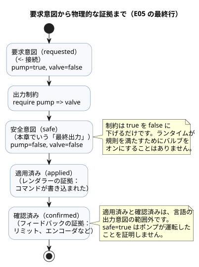

### E05 — オンにする要求と許可された出力

「ポンプをオンにしてほしい」という計算と、「ポンプをオンにしてよい」という判断は
異なることがあります。今回は、二つの値をわざと異ならせてみましょう。

```ghost
// E05
control PumpPermission {
  state displayed_pump: Bool = false;
  displayed_pump' = if request_good && !request then false else if request_good then request else displayed_pump;
  state displayed_valve: Bool = false;
  displayed_valve' = if valve_ready_good && !valve_ready then false else if valve_ready_good then valve_ready else displayed_valve;
  // Source-local display memory is initialized here; faults remain producer unknown.
  state remembered_request: Bool = false;
  let request_good = case observed_request { ok(_) => true; fault(_) => false; };
  let request = case observed_request { ok(value) => value; fault(_) => remembered_request; };
  remembered_request' = request;
  state remembered_valve_ready: Bool = false;
  let valve_ready_good = case observed_valve_ready { ok(_) => true; fault(_) => false; };
  let valve_ready = case observed_valve_ready { ok(value) => value; fault(_) => remembered_valve_ready; };
  remembered_valve_ready' = valve_ready;
  input observed_request: Bool;
  input observed_valve_ready: Bool;
  output pump, valve: Bool;

  pump <- displayed_pump';
  valve <- displayed_valve';
  require pump => valve;
}
```

`output` 宣言より前の行のほとんどは、品質を伴う入力 `observed_request` と
`observed_valve_ready` を読む処理です。正常な（`ok`）値のとき、派生した名前
`request` と `valve_ready` は入力に従います。`fault` のときは最後に記憶した値を保ち、
表示状態は前の値を保持します。レッスンの本題は最後の 3 行にあります。

| request | valve_ready | 候補 pump / valve | 最終 pump / valve |
|---|---|---|---|
| false | false | false / false | false / false |
| true | true | true / true | true / true |
| true | false | true / false | false / false |

最後の行がこの例の目的です。`<-` によるポンプの要求は true ですが、`require` によって
ポンプの安全意図は false になります。`pump => valve` は「ポンプが要求されるなら、
バルブもすでに要求されていなければならない」という意味です。ランタイムが規則を満たす
ために、こっそりバルブをオンにすることはありません。トレースにはどの要求が放棄された
かが記録されるため、保守的な結果を説明しやすくなります。

```text
request ─────────────→ pump の意図 ──┐
                                    ├─ require チェック ─→ 最終 pump
valve_ready ─────────→ valve の意図 ─┘
```

ここで `valve_ready` は、入力 `observed_valve_ready` から派生した名前にすぎません。
どのセンサや計算がその入力を供給するかは、入力のマッピングが説明します。完全な説明
には、「なぜ出力が true なのか」と「入力がどこから来たのか」の両方が必要です。

### E06 — 両方向を同時に要求する

```ghost
// E06
control DirectionInterlock {
  state displayed_forward: Bool = false;
  displayed_forward' = if forward_button_good && !forward_button then false else if forward_button_good then forward_button else displayed_forward;
  state displayed_reverse: Bool = false;
  displayed_reverse' = if reverse_button_good && !reverse_button then false else if reverse_button_good then reverse_button else displayed_reverse;
  // Source-local display memory is initialized here; faults remain producer unknown.
  state remembered_forward_button: Bool = false;
  let forward_button_good = case observed_forward_button { ok(_) => true; fault(_) => false; };
  let forward_button = case observed_forward_button { ok(value) => value; fault(_) => remembered_forward_button; };
  remembered_forward_button' = forward_button;
  state remembered_reverse_button: Bool = false;
  let reverse_button_good = case observed_reverse_button { ok(_) => true; fault(_) => false; };
  let reverse_button = case observed_reverse_button { ok(value) => value; fault(_) => remembered_reverse_button; };
  remembered_reverse_button' = reverse_button;
  input observed_forward_button: Bool;
  input observed_reverse_button: Bool;
  output forward, reverse: Bool;

  forward <- displayed_forward';
  reverse <- displayed_reverse';
  mutex(forward, reverse);
}
```

両方の入力が true なら、両方の出力が false になります。先に書かれた出力も、先に押された
ボタンも、自動的に優先されることはありません。`require !(forward && reverse);` でも、
これらの出力に対する同時要求をブロックできます。

制約が連結されている場合、ランタイムは各ブロック結果をフィードバックしながら、変化が
なくなるまで制約を繰り返し適用します。たとえば、別の制約がバルブをオフにすると、
そのバルブを必要とするポンプもオフになります。現在のローカルな Bool 制約は、true の
出力を false に下げるだけです。任意の論理式を満たす組み合わせを自動的に探索する言語
機能ではありません。

制約によって出力をブロックしても、`state` が自動的に元に戻るわけではありません。
プログラムを停止状態に移すべきなら、その遷移もプログラムの中で表現してください。

**小さな実験：** E03 を `pump <- start;` に変えて、Start を離してみましょう。
`running` が true のままである理由と、`pump` がオフになる理由を、それぞれ分けて説明
できますか。

### 名前付きローカルグループと共有リソース包絡

E05 と E06 は、自分自身の制御の出力を制約します。同じ規則を
`constraints LocalRules { require pump => valve; }` のような名前付きローカルグループに
入れても、スコープも Bool 制約の意味も変わりません。制約は、目標が動ける許可された
領域を定義します。必須条件はすべて AND で結合されます。優先度や、オプションの
非ブロッキングな分析によって、必須条件が解除されることは決してありません。

共有リソースについては、
[完全なバインド済み実行の例](../examples/bound-resource-execution.ghost.ja.md)
に進んでください。`constraints SharedRules for station` をチェックするだけでは、保護
された出力は実行されません。`compileSourceSync` が出力するチェック済みディスクリプタ
は、さらに明示的な `compileBoundResourceControl` ステップによって、正確なソース/
アーティファクトの同一性、安定 ID、モード/出力のマッピングにバインドされる必要が
あります。結果として得られるアーティファクトは、実際の Rust/WASM のスキャン中に、
サポートされるすべての自動・手動・フォールバックの経路を同じガードでチェックします。
これは、出力が公開された後にホストが追加する JavaScript のフィルタではありません。

この例では、実行中に関係が破られると、作成者が定めた安全ベクトル、つまりポンプ OFF、
バルブ ON になります。受け入れ（アドミッション）と復旧の規則は次のとおりです。

- 起動前の違反は、新たな受け入れを拒否します。
- 競合する新規要求は、既存の保持者の受け入れを奪うことも、隠れたキューに入ることも
  ありません。
- 正常な条件だけではトリップは解除されません。
- 排他グループでは、中立の観測の後に新たな要求が必要です。
- require のみのグループでは、requested = 作成者が定めた安全値となった後に、新たな
  要求が必要です。
- 連結されたグループは、一つのスキャンでまとめて復旧します。
- 正常に評価された拒否は通常の状態を確定します。バインディング/VM のエラーは、状態、
  ガード、トレースをロールバックします。

これは、すべての出力が明示的にマッピングされた、一つの Bool GFB1 v1/v3 制御の論理的な
実行です。設置の権限主体は書き込み元のレジストリを共有し、同じ安定 ID に対する二つ目の
アクティブな書き込み元を拒否します。設置レジストリが分かれていると、物理的な排他は
保証されません。任意の PID、コンテキスト、共有方針のインポートによる合成、協調的な
複数 VM の調停、物理的に安全な順序制御には、それぞれ別の境界があります。E05/E06 の
既存の結果やリプレイ記録を、この新しい例のものに置き換えないでください。
[リファレンス §4.8](reference/04-sensors-constraints-control.ja.md#48-制約の共通表記と演算)
と[制約の契約](CONSTRAINTS.ja.md#共有-bool-の実行)では、ソース、バインディング、
受け入れ、安全な出力の証拠を区別しています。

<a id="ch05"></a>
## 5. 関数で計算を分ける

ラッチの式を何か所にもコピーすると、いつか一つのコピーだけ停止優先が違ってしまいます。
関数は行数を減らすためというより、一つの判断に名前を付けて、一度でレビューできるように
するためのものです。E07 では、まず `hold` と `permitted` を別々に計算し、それから
組み合わせます。`enabled` をオフにしてからオンに戻すと、START なしで制御が再開するか
どうかを予想してください。その答えから、関数が状態を隠し持たないことがわかります。

### E07 — 自己保持の計算を関数に取り出す

```ghost
// E07
fn hold(start: Bool, stop: Bool, previous: Bool) -> Bool {
  !stop && (start || previous)
}

control FunctionLatch {
  // Source-local display memory is initialized here; faults remain producer unknown.
  state remembered_start: Bool = false;
  let start_good = case observed_start { ok(_) => true; fault(_) => false; };
  let start = case observed_start { ok(value) => value; fault(_) => remembered_start; };
  remembered_start' = start;
  state remembered_stop: Bool = false;
  let stop_good = case observed_stop { ok(_) => true; fault(_) => false; };
  let stop = case observed_stop { ok(value) => value; fault(_) => remembered_stop; };
  remembered_stop' = stop;
  state remembered_enabled: Bool = false;
  let enabled_good = case observed_enabled { ok(_) => true; fault(_) => false; };
  let enabled = case observed_enabled { ok(value) => value; fault(_) => remembered_enabled; };
  remembered_enabled' = enabled;
  input observed_start: Bool;
  input observed_stop: Bool;
  input observed_enabled: Bool;
  state running: Bool = false;
  output pump: Bool;

  fn permitted(request: Bool, allow: Bool) -> Bool {
    request && allow
  }

  running' = if stop_good && stop then false else if enabled_good && !enabled then false else if start_good && stop_good && enabled_good then (permitted(hold(start, stop, running), enabled)) else running;
  pump <- running';
}
```

`fn` の後のパラメータは、判断に必要な証拠を一か所に集めます。`-> Bool` は、どのような
種類の結果を約束するかを示します。最後の式が結果になるので、別の `return` はありません。
`hold(start, stop, running)` を読むだけで、その判断には現在の START、現在の STOP、
そして前の運転状態が必要だとわかります。

`enabled=false` のとき、`permitted` は false を返し、次状態はオフになります。`enabled`
が再び true になっても運転は再開しません。記憶されている状態がすでに false だからです。
関数は引数だけから計算し、独自の記憶を隠し持ちません。

現在の関数は、外部の入力、状態、設定を直接読みません。それらはパラメータとして受け
取ります。必要な値が呼び出し箇所に現れるので、依存関係が読みやすくなります。たとえば、
`hold` の中でグローバルな `running` を直接読むことは拒否されます。

関数はコンパイル時に静的に展開されます。再帰呼び出しや循環呼び出しは拒否されます。
一定時間ブロックする実行フローや、非公開の可変状態を関数の中に作らないでください。
記憶は `state` で、時間は次章のタイマーで表現してください。

**小さな実験：** `permitted(hold(...), enabled)` で、`enabled` が false になってから再び
true になった場合、Start なしで運転は再開するでしょうか。E03 の状態表を拡張して
確かめてください。

<a id="ch06"></a>
## 6. 時間を待つ制御

「2 秒後にオンにする」は、「2 秒間動作を止める」という意味ではありません。コントローラは待っている間も STOP を読み続け、ほかの制御も計算し続けなければなりません。そのため E08 では、待機を目に見える形にします。`Waiting` 状態と、その状態での経過時間です。

先に進む前に、待機開始から 1999ms、2000ms、2001ms の時点での次状態を書き出してください。次に、途中で START が離された場合に待機がどうなるかを予想してください。この章で最も重要な発見は、この 2 つの違いです。時間は連続して流れますが、判断は tick でしか起こりません。

### E08 — 入力が 2 秒間続いたらオンにする

```ghost
// E08
control DelayedStart {
  // Source-local display memory is initialized here; faults remain producer unknown.
  state remembered_start: Bool = false;
  let start_good = case observed_start { ok(_) => true; fault(_) => false; };
  let start = case observed_start { ok(value) => value; fault(_) => remembered_start; };
  remembered_start' = start;
  input observed_start: Bool;
  config delay: Duration = 2s;
  type Phase = Idle | Waiting | Running;
  state phase: Phase = Idle;
  timer age = elapsed(phase);
  output motor: Bool;

  phase' = if start_good then (case delay {
    ok(value) => case phase {
      Idle => if start then Waiting else Idle;
      Waiting =>
        if !start then Idle
        else if age >= value then Running else Waiting;
      Running => if start then Running else Idle;
    };
    fault(_) => Idle;
  }) else phase;

  motor <- phase' == Running;
}
```

`type Phase = ...` は、待機の制御が区別すべき 3 つの状況にそれぞれ名前を付けます。Bool が 1 つだけだと、「まだ開始していない」と「待機中」がどちらも同じ「オフ」という値の中に隠れてしまいます。`case phase` は現在の段階に対応する式を 1 つ選び、そこから次の段階を計算します。すべてのケースを書かなければならないので、後から段階を追加すると、どの判断が抜けているかをコンパイラが教えてくれます。

`delay` は `Result<Duration, SettingsFault>` です。時間をそのペイロードと比較するのは、`ok(value)` 分岐の中だけにしてください。

- **設定の故障：** この例では保留中の待機を取り消して `Idle` に移るため、出力意図はオフになります。
- **復旧：** 有効な設定と `start=true` が再び読み取られると、新しい待機が始まります。
- **`2s`：** これは初期の `ok` ペイロードであり、エラー時のフォールバックではありません。

これはこの例のポリシーです。言語や Driver の既定動作ではなく、物理的なフェイルセーフの保証でもありません。

`elapsed(phase)` は、**`phase` が最後に変化を確定してからの経過時間**です。0 となるのは、`Idle` を `Waiting` に変える tick の確定時点です。START が来る前の Idle の時間は 2 秒に数えられません。START を離してから再び押した場合、古い待機が新しい待機につなぎ合わされることはありません。

遷移は条件が真になる最初の tick で起こり、1 つの tick で複数の段階を飛び越えることはありません。

次の状態遷移図はこれらの規則をまとめたものです。すべての矢印は tick で評価され、tick と tick の間には何も起こりません。

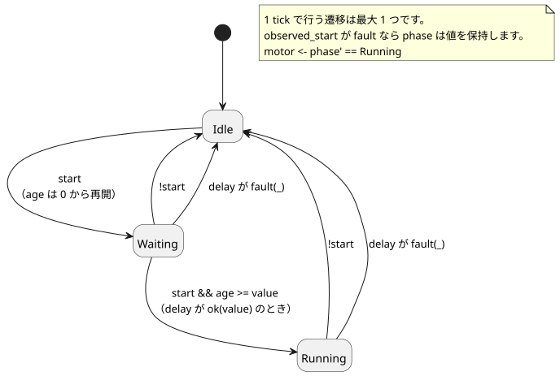

次の表は 1 回の実行を追跡したものです。「読み取った段階」と「読み取った age」はその tick が読む値で、「次の段階」はその tick が確定する値です。

| 論理時間 | start | 読み取った段階 | 読み取った age | 次の段階 | motor |
|---|---|---|---|---|---|
| 0ms | false | Idle | 0ms | Idle | false |
| 1000ms | true | Idle | 1000ms | Waiting | false |
| 2999ms | true | Waiting | 1999ms | Waiting | false |
| 3000ms | true | Waiting | 2000ms | Running | true |
| 4000ms | false | Running | 1000ms | Idle | false |

待機は、ボタンが物理的に変化した瞬間には始まりません。その変化を読み取って `Waiting` に移る tick で始まります。そのため 2 秒は 1000ms から数えられ、モーターは 3000ms でオンになります。

### シミュレーションの高速化は時間の進め方を変える

シミュレーションを 10 倍速で実行しても、ソースの `2s` が `200ms` になるわけではありません。代わりに、シミュレータが論理時間を実時間より速く進めます。各 tick の論理時間と入力が同じであれば、どの速度でも結果は同じでなければなりません。

境界はプラットフォーム間で共有されなければなりません。タイマー計算に使う時間、まとめて読み取る DI 入力の集合、最終的な RO 出力です。

- ネイティブビルドと WASM ビルドは、式、状態、タイマー、制約を同じ Rust コアで実行します。
- ホストは、入力、論理時間、スキャンの機会を供給します。
- 実際の Device I/O Driver は別の境界です。

具体的なフレームと Driver の API はホストの契約です。このソースにプラットフォームごとの分岐を加えてはなりません。

現在の CLI シミュレータは仮想 I/O を提供します。入力と、要求意図および安全意図を表示します。

- ポンプの意図からタンクの水位やセンサ値を自動的に導出するプラントモデルはありません。
- 明示的に設定した温室温度のプラントモデルはサポートされています。ただし、その仮想的な適用とフィードバックも、物理デバイスからの証拠ではありません。
- パイプモードでは、明示的なスキャンのときだけ時間が進みます。対話型 TTY では、実際の壁時計の経過時間が供給されます。
- スケジュール、センサ、認証済みの区間には、それぞれに対応するホストのケイパビリティが必要です。

実行経路と再現コマンドについては、[オーサリングと仮想シミュレーションのアーキテクチャ](LLM-TOOLCHAIN-ARCHITECTURE.ja.md)を参照してください。

**小さな実験：** 2999ms の次の tick を 3500ms に移してみてください。モーターは 3000ms ではなく、その tick でオンになります。タイマーの条件は 2 秒ですが、観測と遷移は tick の時刻にしか起こりません。

<a id="ch07"></a>
## 7. 予定時刻に開始する

「06:00 に灌水する」と「5 分間灌水する」はどちらも時間の話ですが、読むクロックが異なります。

- **06:00** には暦時間、つまりカレンダーとタイムゾーンが必要です。
- **5 分間** には、開始イベントから数える単調な経過時間が必要です。

E09 で、06:00 のイベントが到来した後に壁時計が過去に戻されたと想像してください。結果を予想しましょう。5 分間の動作は乱されないはずです。この予想こそ、ソースが DST の扱い、クロックのギャップ、プロバイダの故障、フォールバックを明記する理由です。

### E09 — 毎日 2 回、5 分間動かす

```ghost
// E09
control ScheduledPulse {
  schedule starts: DailySlots<15min> {
    timezone = "Asia/Seoul";
    selected = [06:00, 18:45];
    dst_missing = skip;
    dst_repeated = first;
    basis = pulse;
    when = true;
    clock = trusted_only;
    gap = skip_after(60s);
    recovery = baseline;
    fallback = skip;
  }
  let run_time = 5min;
  type Phase = Idle | Watering;
  state phase: Phase = Idle;
  timer age = elapsed(phase);
  output valve, pump: Bool;

  phase' = case phase {
    Idle => if starts.due then Watering else Idle;
    Watering => if age >= run_time then Idle else Watering;
  };

  valve <- phase' in {Watering};
  pump <- phase' == Watering;
  require pump => valve;
}
```

`DailySlots<15min>` は、各ローカル日付の中で 15 分刻みのグリッドから時刻を選びます。06:07 のようにグリッドから外れた値は、丸められるのではなく拒否されます。`starts.due` は射影で、この tick で開始の発生が到来したかどうかを示します。受け入れ（アドミッション）と、取りこぼし／不明の証拠は、別々の観測として保持されます。

この宣言は、クロックに関するすべての前提を明示しています。pulse 基準、信頼できるクロックのみ、60 秒のギャップ上限、baseline 復旧、skip フォールバックです。こうしておけば、後のレビューでクロックが完璧だったと暗黙に仮定されることはありません。

次の図は、それぞれのクロックがどこで使われるかを示します。暦時計は灌水を*いつ開始するか*だけを決め、*いつ停止するか*は単調クロックだけが決めます。

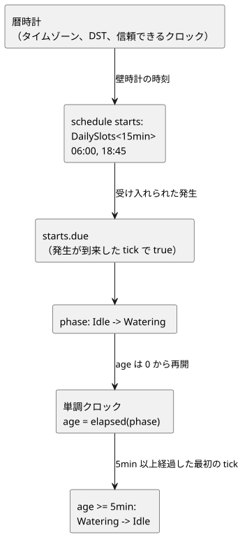

| イベント | 前の段階 | 次の段階 | pump |
|---|---|---|---|
| 選択された開始イベント | Idle | Watering | true |
| 経過時間が 5 分未満 | Watering | Watering | true |
| 経過時間が 5 分以上になった最初の tick | Watering | Idle | false |

`in {Watering}` は集合への所属を判定します。複数の状態が該当する場合は、`phase' in {Opening, Watering, Closing}` のように同じ型の値を列挙します。

このソースにはキューがありません。段階がすでに `Watering` のときに別の開始イベントが到来しても、それは保存されません。スケジュールの発生の同一性、重複抑止、取りこぼした発生の扱い、リプレイの証拠は、リファレンス §3.5 の契約に従います。ほかのスケジュールで重なった発生や取りこぼした発生に対して、独自の追い上げ処理を考案してはなりません。

**読解問題：** `Watering` 分岐は別の開始イベントを読み取って終了時刻を変えるでしょうか（選択された 2 つの時刻は 5 分以上離れています）。分岐を読んで答えてください。これは、公開シミュレータに隠れた `starts.due` 入力を注入する実行シナリオではありません。

### 暦時間と自然現象

暦時間、スケジュール、単調な経過時間は、それぞれ種類の異なる入力です。日付と時刻はタグ付きリテラルです。繰り返しのスケジュールには、型ごとの `schedule` 宣言を使います。`DailySlots`、`Periodic`、`cron5`、太陽・月・潮汐のコンテキスト、タイムゾーン、ギャップ復旧、必須のフォールバックの正確な記法は、[リファレンス §3](reference/03-time-and-schedules.ja.md)を参照してください。

日の出と日の入り、潮汐の予測、カレンダー、クロックデータは、いずれも外部のプロバイダ／Driver の契約に依存します。ソースは基準となるイベントとフォールバックに名前を付けます。予測データを 1 つの Bool の中に隠してはならず、時刻が常に信頼できると仮定してもなりません。リファレンスで定義されたポリシーを読み、必要な環境ケイパビリティはバインディングを通じて供給してください。

<a id="ch08"></a>
## 8. センサ値と品質

入力の型は、[物理量から型を選ぶ早見表](#quantity-type-lookup)を使って選びます。たとえば、摂氏の測定値には `Temperature` 型と `30°C` のような値を使います。

土壌水分の測定値が `29%, 31%, 29%` と推移したとします。判断が 1 つのしきい値に従うなら、給水の要求もそれに合わせてオンとオフを繰り返します。そこに `90%` が 1 回だけ現れました。土が急に湿ったのでしょうか、それとも 1 回の測定値が跳ねただけでしょうか。さらに、最後の測定値の後でセンサが断線したら、その数値をいつまで信頼できるでしょうか。

これらは 3 つの異なる問いであり、E10 はそれぞれに別々に答えます。

1. 各測定値の品質を確認します。
2. 直近の値の中央値を取ります。
3. オンにするときとオフにするときで別々のしきい値を使います。
4. 最後に、ユーザーが灌水を有効にしているかを確認します。

読みながら、生の値、フィルタ後の値、判断、要求される出力を 1 行ずつ追ってください。コードが長くなっているのは、**異なる問いを混ぜないため**であることがわかるはずです。

土壌水分のパーセンテージと 30%/35% のしきい値は、説明用の論理値です。特定の土壌、作物、センサ校正に対する農業上の推奨値ではありません。この章で検証するのは給水の**要求**です。実際に水が流れることには、別途デバイスとフィードバックの証拠が必要です。

### 入力値と測定値

先に出てきた `input level: Percent` は、ホストが現在の計算のために供給する値を宣言していました。実際のセンサには値以外のものもあります。まだ準備ができていないこともあれば、断線していることも、古い測定値を保持していることもあります。そのため `input` を読むときは常に、正常な値が得られたかどうかもあわせて扱います。

### E10 — 変動する土壌水分値から給水を判断する

```ghost
// E10
control MoistureControl {
  state displayed_pump: Bool = false;
  displayed_pump' = if enabled_good && !enabled then false else if enabled_good then enabled && need_water else displayed_pump;
  // Source-local display memory is initialized here; faults remain producer unknown.
  state remembered_enabled: Bool = false;
  let enabled_good = case observed_enabled { ok(_) => true; fault(_) => false; };
  let enabled = case observed_enabled { ok(value) => value; fault(_) => remembered_enabled; };
  remembered_enabled' = enabled;
  input observed_enabled: Bool;
  input moisture: Percent {
    sample = 1s;
    valid = 0% .. 100%;
    filter = median(3);
    stale_after = 3s;
    recover_after = 1 samples;
  }
  signal dry = hysteresis(moisture,
    on_below: 30%, off_above: 35%, initial: false);
  let need_water = case dry {
    ok(value) => value;
    fault(_) => false;
  };

  output pump: Bool;
  pump <- displayed_pump';
}
```

次の図は、1 つのサンプルが E10 の中をホストからポンプの要求まで進む流れを示します。

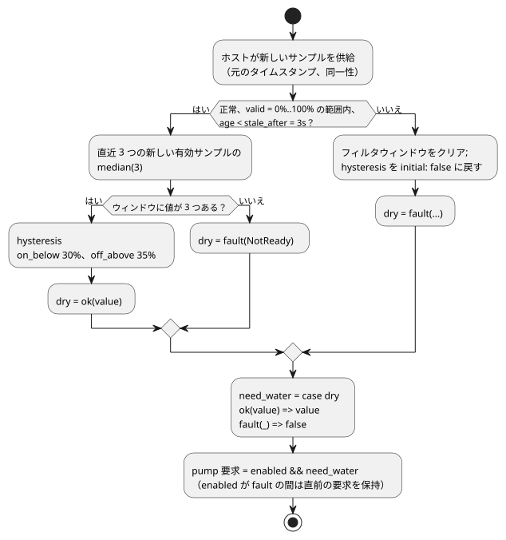

`sample = 1s` は意図した測定間隔を記録するものです。センサを読むスレッドを作るわけでも、毎秒新しい観測をこしらえるわけでもありません。サンプルはホストが供給し、それぞれに元のタイムスタンプと同一性が付いています。`valid` は正常な値の範囲を定義し、フィルタはその範囲内にある新しい有効なサンプルだけを受け付けます。同じサンプルを複数の tick で読んでも、ウィンドウが埋まることも、そのタイムスタンプが新しくなることもありません。

`median(3)` は、直近 3 つの有効な値の中央を選びます。`29%, 90%, 28%` を並べ替えると `28%, 29%, 90%` となり、結果は `29%` です。1 つの大きな値がすぐに湿った土を意味することはありません。値が 2 つしかないうちは中央がまだありません。最初の 2 つのサンプルでは `NotReady` となり、この例の fault 分岐が給水の要求をオフに保ちます。

`hysteresis` は、オンとオフに別々のしきい値を使います。正常な測定値については次のとおりです。

| フィルタ後の値 | `dry` の判断 |
|---|---|
| 30% 未満 | オンになる（`true`） |
| 35% 超 | オフになる（`false`） |
| 30% から 35%（ちょうど 30% や 35% を含む） | 直前の判断を保持する |

そのため、30% 付近で揺れる値によって、測定のたびに出力が切り替わることはありません。

`30%` と `35%` の間では、数値は新しい結論を生みません。そこは**直前の結論を保持する帯域**です。同じ `33%` でも、土がすでに乾いていると判断されていれば灌水はオンのままですが、初期状態から灌水を始めることはありません。この小さな違いが、しきい値の比較に記憶を加えます。

では `enabled=true` にして、次の生サンプルを順に供給してください。どれも 1 秒間隔の、新しく正常な観測です。表を隠して、どの行で要求がオフになるかを先に予想してください。

| 新しい生サンプル | 直近 3 つの中央値 | `dry` の結果 | 要求される `pump` |
|---|---|---|---|
| `31%` | ウィンドウ未充足 | `fault(NotReady)` | `false` |
| `29%` | ウィンドウ未充足 | `fault(NotReady)` | `false` |
| `90%` | `31%` | `ok(false)` | `false` |
| `28%` | `29%` | `ok(true)` | `true` |
| `30%` | `30%` | `ok(true)` | `true` |
| `34%` | `30%` | `ok(true)` | `true` |
| `36%` | `34%` | `ok(true)` | `true` |
| `38%` | `36%` | `ok(false)` | `false` |

生の値が `36%` に達した行でも要求はまだオンです。フィルタ後の値が `34%` にすぎないからです。`38%` が届いて初めて、ウィンドウ `34%, 36%, 38%` の中央値が `36%` になります。これは 35% を超えるので、判断はオフになります。生の値を出力と直接比べると結果は奇妙に見えますが、中間の値を追えば理由ははっきりします。

次に、新しいサンプルの供給を止めます。最後のサンプルの元のタイムスタンプから測った経過時間がちょうど 3 秒に達すると、結果は `Stale` になります。2999ms と 3000ms を比べて境界を確認してください。同じサンプルを再評価したり再送したりしても、その期限は延びません。

故障は通常の土壌水分値ではありません。故障が起きると、フィルタのウィンドウはクリアされ、ヒステリシスは `initial: false` に戻ります。正常なサンプルが戻ってきたとき、`recover_after = 1 samples` だけで即座に復旧できると考えてはなりません。このフィルタは中央値のために**新しい有効なサンプルを 3 つ**必要とします。復旧後のフィルタ値が `33%` であれば、古い `true` の判断は戻らず、初期の `false` の判断のままです。

`ok(value)` は正常な結果に名前を付けます。`fault(_)` の `_` は、この計算が具体的なエラー値を使わないことを意味します。代替値として `false` を選んだ場合でも、元の品質情報は実行記録に残ります。

ここでの `ok` と `fault` は `case` のパターンです。現在の言語にはほかに次のものもあります。

- 組み込みの `Result<T, E>` のための `ok(...)` と `fault(...)` コンストラクタ（その故障型はコンパイラが所有します）
- 静的な `map`、`and_then`、`recover` 変換

これらを、ユーザー定義のエラー ADT や汎用の高階関数と混同しないでください。[リファレンス §2.5](reference/02-types-expressions-state.ja.md)を参照してください。

### E14 — オプションのセンサ

```ghost
// E14
control OptionalMoisture {
  input moisture?: Percent;
  output request: Bool;
  adapt moisture_policy {
    strategy WithMoisture priority 100 match (moisture: sensor<Percent>) {
      request <- case moisture {
        ok(value) => value < 30%;
        fault(_) => false;
      };
    }
    strategy Baseline priority 0 match always {
      request <- false;
    }
  }
}
```

`?` は宣言の情報であり、そのセンサがオプションの設置ケイパビリティであることを示します。

- **設置済みで正常：** `WithMoisture` が値を比較します。
- **設置済みだが故障：** `WithMoisture` が `false` を要求します。
- **未設置：** `Baseline` が `false` を要求します。

`?` だけではフォールバック戦略は生成されません。`Baseline` は自分で書きます。詳しい規則は[リファレンス §4.5–4.6](reference/04-sensors-constraints-control.ja.md)を参照してください。

E14 は、「センサが設置されていない」場合と「設置されたセンサが故障した」場合とで異なる経路をたどります。センサがなければ `Baseline` を選択します。設置されたセンサの値が読めなければ、`WithMoisture` の中の fault 分岐に従います。どちらの要求も `false` ですが、理由は異なります。出力が同じでも、実行の証拠が同じとは限りません。

**1 つだけ変えてみる：** E10 が `ok(true)` を出している間に、`enabled` だけをオフにしてください。判断は変わらず、ポンプの要求だけが止まります。再び有効にすると、品質がまだ正常である間だけ要求が戻ります。判断と許可が分かれているので、ユーザー操作のために新しいセンサ状態を考案する必要はありません。

2 つのしきい値を等しくしたらどうなるかも予想してください。現在の `hysteresis` は `on_below < off_above` を要求するので、この編集は正常な実行ではなく診断を生むはずです。チャートでは生の値とフィルタ後の値を一緒に表示し、品質と要求は別々に確認してください。E10 には `require` も `mutex` もないので、ここでは安全な出力は要求された出力と等しくなります。それでも、その一致は水が物理的に汲み上げられていることを確認するものではありません。

<a id="ch09"></a>
## 9. 式を正確に読む

式が短く見えるほど、私たちはすでに知っている言語の規則を持ち込みがちです。そこでこの章では、暗記用の文法一覧の代わりに小さな反例を使います。除算、条件式、`case` について、正常な値と故障を 1 つずつ選び、それぞれの結果を予想してください。E11 の正準表記は、同じ形が、レビューでも検索でも同じ意味を持つという約束です。

### E12 — 数値と演算子

```ghost
// E12
control NumbersAndOperators {
  state displayed_sum: Number = 0;
  displayed_sum' = if a_good && b_good then a + b else displayed_sum;
  state displayed_difference: Number = 0;
  displayed_difference' = if a_good && b_good then a - b else displayed_difference;
  state displayed_product: Number = 0;
  displayed_product' = if a_good && b_good then a * b else displayed_product;
  state displayed_quotient: Number = 0;
  displayed_quotient' = if a_good && b_good then a / b else displayed_quotient;
  state displayed_negative: Number = 0;
  displayed_negative' = if a_good then -a else displayed_negative;
  state displayed_equal: Bool = false;
  displayed_equal' = if a_good && b_good then a == b else displayed_equal;
  state displayed_different: Bool = false;
  displayed_different' = if a_good && b_good then a != b else displayed_different;
  state displayed_less: Bool = false;
  displayed_less' = if a_good && b_good then a < b else displayed_less;
  state displayed_at_most: Bool = false;
  displayed_at_most' = if a_good && b_good then a <= b else displayed_at_most;
  state displayed_greater: Bool = false;
  displayed_greater' = if a_good && b_good then a > b else displayed_greater;
  state displayed_at_least: Bool = false;
  displayed_at_least' = if a_good && b_good then a >= b else displayed_at_least;
  // Source-local display memory is initialized here; faults remain producer unknown.
  state remembered_a: Number = 0;
  let a_good = case observed_a { ok(_) => true; fault(_) => false; };
  let a = case observed_a { ok(value) => value; fault(_) => remembered_a; };
  remembered_a' = a;
  state remembered_b: Number = 0;
  let b_good = case observed_b { ok(_) => true; fault(_) => false; };
  let b = case observed_b { ok(value) => value; fault(_) => remembered_b; };
  remembered_b' = b;
  input observed_a: Number;
  input observed_b: Number;
  output sum, difference, product, quotient, negative: Number;
  output equal, different, less, at_most, greater, at_least: Bool;

  sum <- displayed_sum';
  difference <- displayed_difference';
  product <- displayed_product';
  quotient <- displayed_quotient';
  negative <- displayed_negative';
  equal <- displayed_equal';
  different <- displayed_different';
  less <- displayed_less';
  at_most <- displayed_at_most';
  greater <- displayed_greater';
  at_least <- displayed_at_least';
}
```

`a=6`、`b=2` のとき、数値出力は順に `8, 4, 12, 3, -6` です。Bool 出力は `false, true, false, false, true, true` です。Number 出力も論理的には観測できますが、Bool のリレーポートに直接マッピングすることはできません。

演算子の優先順位（強いものから弱いものへ）：

| 順位 | 表記 |
|---|---|
| 1 | 括弧、関数呼び出し、メンバー／次状態の参照 |
| 2 | 単項 `!`、`-` |
| 3 | `*`、`/` |
| 4 | `+`、`-` |
| 5 | `in {…}` |
| 6 | `==`、`!=`、`<`、`<=`、`>`、`>=` |
| 7 | `&&` |
| 8 | `||` |

同じ優先順位の二項演算子は左から結合します。`6 - 2 - 1` は `(6 - 2) - 1` を意味します。複雑な条件を読みやすくするには、括弧や名前付きの `let` 計算で分割してください。

`=>` は通常の算術演算子でも論理演算子でもありません。出力制約の両辺をつなぎ、`case` のパターンをその分岐に結び付けます。通常の式の中に置くことはできません。

### E13 — 条件式があることと計算を省くこと

`if`、`&&`、`||` は、短絡評価を伴って左から右へ決定的に評価されます。選択されなかった分岐での実行時の故障は決して起こりませんが、すべての分岐は静的に型検査されます。たとえば次のとおりです。

```ghost
// E13
control SafeDivision {
  state displayed_result: Number = 0;
  displayed_result' = if a_good && b_good then if zero then 0 else a / denominator else displayed_result;
  // Source-local display memory is initialized here; faults remain producer unknown.
  state remembered_a: Number = 0;
  let a_good = case observed_a { ok(_) => true; fault(_) => false; };
  let a = case observed_a { ok(value) => value; fault(_) => remembered_a; };
  remembered_a' = a;
  state remembered_b: Number = 0;
  let b_good = case observed_b { ok(_) => true; fault(_) => false; };
  let b = case observed_b { ok(value) => value; fault(_) => remembered_b; };
  remembered_b' = b;
  input observed_a: Number;
  input observed_b: Number;
  let zero = b == 0;
  let denominator = if zero then 1 else b;
  output result: Number;

  result <- displayed_result';
}
```

`a=6, b=2` のとき結果は `3` です。`a=6, b=0` のときは `0` です。重要なのは、ゼロの分岐では除算が一度も評価されないことです。ただし、`0` はこのプログラムのポリシーであり、言語の普遍的な答えではありません。ドメイン上ゼロと故障を区別しなければならないのであれば、エラーを保持するほうが誠実な選択です。

### E11 — 正準表記だけを使う

新しいプログラムでは次の形を使います。

- `fn`
- `type Mode = Off | On;`
- `running' = ...;`
- `if c then a else b`

`purefn`、`enum` 構文、`next running`、`input.start`、`state.running`、`ifthenelse(...)` は許可された別名ではありません。古い文書でこれらを見かけたら、[リファレンス §1.6](reference/01-source-and-syntax.ja.md)の移行に関する注記に従ってください。

<a id="ch10"></a>
## 10. 止める、変える、比べる

制御コードを変更した後で最も気がかりなのは、「意図したものだけが変わったのか」という問いです。これに感覚で答えてはなりません。2 つのリビジョンに、同じ論理時間で同じ入力を与えてください。両者が最初に食い違う tick を見れば、1 つの式の変更が状態、意図、制約へどのように広がるかがわかります。この比較の習慣は、本書の後半でインポートの置き換えやリプレイを理解するための基礎にもなります。

次の 2 つの式はとてもよく似ているので、変更が「括弧の整理」として見過ごされかねません。E03 の停止優先ラッチを基準にして、両方のバージョンを同じ入力記録で実行してください。

```text
元の A：running' = !stop && (start || running);
変更後の B：running' = start || (!stop && running);
```

`start=true` かつ `stop=true` のとき、A は `false` を、B は `true` を生成します。括弧と `start` の位置を少し動かしただけで、両方が同時に来たときにどちらの入力が勝つかが変わります。

| 前の running | start | stop | A の次の値 | B の次の値 |
|---|---|---|---|---|
| false | true | false | true | true |
| true | false | false | true | true |
| true | true | true | false | true |
| true | false | true | false | false |

### 比較実験の手順

1. 元のソースと、各 tick の入力および論理時間を保存します。
2. 比較を始める時点の状態を決めます。最初から比較する場合は、各プログラムをそれぞれの初期状態から開始します。
3. 元のソースを残したまま、変更版を作成します。
4. 両方のプログラムに、同じ時刻に同じ入力記録を与えます。
5. 状態、出力意図、制約の判断、最終出力を並べて比較します。

状態の構造も変えた場合は、既存のチェックポイントを新しい構造へ移行する規則も変更の一部です。その規則が定義されるまでは、両方のプログラムを初期状態からリプレイしてください。開始点が同じで入力も同じであって初めて、最初の差異がコードの変更から生じたと言えます。だからこそ、本書の最初の比較実験では初期状態からのリプレイを使います。

### ソースの横にはどの値を表示すべきか

トレースをレビューするときや観測ビューを設計するときは、次の値をソースと見比べてください。

- 選択した tick について：`start`、前の `running`、次の `running'`
- `pump` について：それが依存する条件
- 制約が出力を変えた場合：候補値と最終値

これは観測と画面設計のためのガイダンスです。現在のリーダーにソース選択や依存関係追跡の UI がすでにあると主張するものではありません。

観測画面は次の 4 つの問いに答えるべきです。

- この値は、どの入力と前状態から計算されたか。
- 次状態と出力意図は何か。
- どの制約がそれを許可またはブロックしたか。
- 元のバージョンと変更版は、どの tick で最初に食い違うか。

観測可能な値と証拠の種類は[リファレンス §5](reference/05-settings-and-observation.ja.md)に従います。画面は、提示するディスクリプタの意味を保たなければなりません。

<a id="ch11"></a>
## 11. ファイルと文芸的プログラム

故障から数か月後、それを調査する人にはコード以上のものが必要です。ある条件が*なぜ*
書かれたのかを知る必要があるのです。E15 は、その理由をコメントに押し込むのではなく、
実行可能なソースと同じドキュメントの中に残します。

ここから2つのルールが導かれます。

- 説明の段落を変更すると、ドキュメントのリビジョンが変わります。実行上の意味を持つのは
  `ghost` ブロックだけです。
- `.ghost.md` ドキュメントそのものを保存してチェックしてください。そのブロックを
  2つ目のソースファイルにコピーしてはなりません。

### 1つのファイルに1つの control

実行可能なドキュメントには、ルートの `control` がちょうど1つだけあります。そのため、
どの control から開始するかをファイル名や配置の慣例から推測する必要はありません。

別のドキュメントを再利用するには、ドキュメントスコープの `import` で、完全な `.ghost.md`
定義のリビジョンとダイジェストを固定します。そのうえで `instance` と `connect` で合成します。
ワイルドカード import や2つ目のルートが拒否されるのも同じ理由です。レビューした同一性
（identity）は、実際に実行される構造と一致しなければなりません。

単一ルートのルールは、実行可能な定義の骨格です。インポートした複数の定義をインスタンスとして
合成しても、ルートが曖昧になることは決してないと保証します。

### E15 — 説明とコードを同じドキュメントに書く

以下の内容全体を `follow-switch.ghost.md` として保存すると考えてください。

引用したドキュメントは正本なので、韓国語の説明文と正確なソースの同一性をそのまま保持して
います。日本語に訳すと次のとおりです。

- 見出しは「入力に追従する出力」という意味です。
- 最初の段落は「スイッチと LED の値を宣言する」と述べています。
- コードブロックの間の段落は「出力は毎 tick スイッチの値に追従する」と述べています。

この日本語は説明を訳しただけです。独立して編集できる2つ目の正本ソースを作るものではありません。

````markdown
# 입력을 따라가는 출력

스위치와 LED의 값을 선언한다.

```ghost
// E15
control LiterateSwitch {
  // Source-local display memory is initialized here; faults remain producer unknown.
  state remembered_switch_on: Bool = false;
  let switch_on_good = case observed_switch_on { ok(_) => true; fault(_) => false; };
  let switch_on = case observed_switch_on { ok(value) => value; fault(_) => remembered_switch_on; };
  remembered_switch_on' = switch_on;
  input observed_switch_on: Bool;
  output lamp: Bool;
```

출력은 매 tick 스위치의 값을 따른다.

```ghost
  lamp <- switch_on;
}
```
````

コンパイラは、トップレベルの `ghost` コードブロックそのものをドキュメント順に結合します。
この例では、1つの `control` が2つのブロックに分かれているだけで、2つのプログラムが
できるわけではありません。説明の段落は決して実行されず、エラー位置は元のドキュメントを
指します。

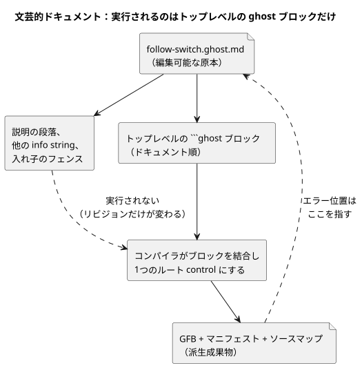

この図は、コンパイラが読むものを示しています。説明文はリビジョンを変えますがプログラムは
変えず、診断は `.ghost.md` の原本に対応付けられます。

次のものは実行可能なコード**ではありません**。通常の段落、他の info string を持つ
コードブロック、そしてリストや引用の中の入れ子のフェンスです。正確な抽出ルールは
[リファレンス §1.1](reference/01-source-and-syntax.ja.md) にあります。

### ファイルとプログラムの合成

同じディレクトリにあるというだけで、ファイル同士が関係を持つことはありません。`import` は
不変のソースの同一性を指定し、`instance` と `connect` は型付きの論理ポートを公開します。

原本が変更されたら、新しいリビジョンをレビューします。合成がその変更を黙って取り込むことは
決してありません。これが「今日の合成は、昨日レビューしたコンポーネントを使っている」という
主張を裏付けるために最低限必要なことです。

2種類の証拠は区別しておいてください。

- コンパイラは、固定された import、インスタンス、ポートの契約をチェックします。
- ランタイムでの実行は別の証拠です。E22 と E31 の固定されたソースクロージャは、
  ブラウザの Worker/WASM ランタイムでも実行されます。ただしその証拠は、任意の合成や
  設置プロファイルにまでは及びません。

単一 control の練習では、E15 のようにドキュメント全体を保存します。そのうえで、言語
リポジトリのルートからチェックとコンパイルを行います。

```sh
node tools/ghostc.mjs --check follow-switch.ghost.md
node tools/ghostc.mjs follow-switch.ghost.md build/follow-switch.gfb
```

これらのコマンドには Node の依存関係がインストールされている必要があります。GFB、
マニフェスト、ソースマップは派生成果物であり、編集可能な原本は `.ghost.md` ファイルの
ままです。この本全体を1つの実行可能ドキュメントとしてコンパイルしてはなりません。

<a id="ch12"></a>
## 12. 1つのデバイス、複数の control

灌水と換気は、それぞれ単独では正しく動いても、1台のポンプや1つの電力予算を共有すると
衝突することがあります。この章ではファイルを貼り合わせることはしません。代わりに、
インポートしたリビジョンを固定し、インスタンスと型付きポートを通して関係を明示します。

コンポーネントを置き換える前に、どのポートとリソース契約が変わってはならないかを書き出して
ください。合成の本当の価値は再利用だけではありません。何が変わり、何が変わらなかったかを
証明できることにあります。

各定義にはルートが1つあります。合成は、インポートした control のインスタンスを作り、
その論理ポートを接続します。そのため、すべての矢印に、確認できる型と出どころがあります。

2つのインスタンスが同じ物理リソースを求める場合、接続だけでは衝突を解決できません。
リソースの同一性とその契約を明示しなければなりません。また、出力意図は物理的な確認とは
区別されたままです。

```text
definition revision → import → instance + typed connect
                   → semantic composition → bound runtime
```

`adapt`、ケイパビリティのチェック、共通の制約、共有リソース、リプレイ、ホット置換は、
定められた場所で、定義された型と契約に従ってのみ使ってください。構文と意味 DAG のルールは
[リファレンス §6](reference/06-composition-and-replay.ja.md) にあります。デバイス、
ドライバ/レンダラー、バインディングの責務は
[リファレンス §8](reference/08-language-runtime-and-device-boundaries.ja.md) にあります。
通常の `control` の中に、何か別の任意のポリシー言語が含まれていると考えてはなりません。

<a id="ch13"></a>
## 13. 組み込み関数と演算

見慣れた関数名がいちばん危険なのがこの章です。呼び出しが何をするかを推測する前に、
次の3点を確認してください。

- `Result` を返すか。
- サンプルを記憶するか。
- 外部クロックや自然現象のプロバイダが必要か。

呼び出しは、値の計算、状態を持つ信号、スケジュールのディスクリプタ、ホストポリシーの
いずれかであり、それぞれが残す観測可能な証拠は異なります。以下のカタログは、名前を暗記する
ためのリストではなく、これらの問いを練習するための地図として扱ってください。

**builtin**（組み込み）は、コンパイラがあらかじめ知っている演算です。`fn` は、E07 の関数の
ように自分で宣言する計算です。名前が見慣れているからといって builtin になるわけではありません。
汎用の `abs`、`min`、`max`、`clamp`、`sqrt`、`pow`、`round` といった式関数はありません。
言語がその計算を許す場合は、適切な `fn` を自分で宣言してください。

この章の呼び出し名とシグネチャは、現在の言語リファレンスとコンパイラのレジストリと照らし
合わせて読んでください。この章は **52 個の主要な呼び出し可能な綴り**と、**3 個の追加の
ホストポリシーの綴り**をすべて扱います。表は、通常の呼び出し、宣言のコンストラクタ、制限付きの
変換を区別しています。シグネチャは断片であり、完全な例はリンク先のテストにあります。断片を
独立した追加のソースドキュメントとして扱わないでください。

表の各行は、同じ問いを次の順序で読んでください。

1. その演算はどこで許可されるか。
2. 入力と結果の型は何か。
3. サンプルや状態を記憶するか。
4. クロックやプロバイダを必要とするか。
5. 故障を返すことがあるか。

コンパイルが成功しても、生成されるのはチェック済みのディスクリプタだけで、実行可能な制御では
ないことがあります。したがって「コンパイルできた」は「現場で動く」という意味ではありません。
実行可能な制御であっても、記載されたランタイム入力とバインディングが必要です。これらの演算は
どれも、それ単独では物理的な出力の効果を証明しません。

### 13.1 数値と明示的な Result の構築

数値の表現を変えるつもりのときに変換を使います。`Int` は厳密な符号付き 32 ビット整数で、
`Number` は浮動小数点数です。各変換は位置引数をちょうど1つ取ります。例を挙げます。

- `int_floor(-1.2)` は -2 ですが、`int_trunc(-1.2)` は -1 です。
- 偶数への丸め（nearest-even）では、2.5 のようなちょうど中間の値は 2 に、3.5 は 4 に丸められます。

| Builtin | シグネチャと目的 | コンテキスト、境界、例 |
|---|---|---|
| `number` | `number(x: Int) -> Number`：表現を明示的に変える | 通常の式、状態なし。[整数の例](../tests/int-compiler.test.mjs)。 |
| `int_exact` | `int_exact(x: Number) -> Int`：整数値であることを要求する | 小数部のある値や範囲外の値は拒否する。[変換](../tests/dynamic-int-conversions.test.mjs)。 |
| `int_floor` | `int_floor(x: Number) -> Int`：負の無限大方向に丸める | 変換後の値は Int に収まらなければならない。[変換](../tests/dynamic-int-conversions.test.mjs)。 |
| `int_ceil` | `int_ceil(x: Number) -> Int`：正の無限大方向に丸める | 変換後の値は Int に収まらなければならない。[変換](../tests/dynamic-int-conversions.test.mjs)。 |
| `int_trunc` | `int_trunc(x: Number) -> Int`：ゼロ方向に小数部を切り捨てる | 変換後の値は Int に収まらなければならない。[変換](../tests/dynamic-int-conversions.test.mjs)。 |
| `int_nearest_even` | `int_nearest_even(x: Number) -> Int`：最も近い整数、中間は偶数へ | 変換後の値は Int に収まらなければならない。[変換](../tests/dynamic-int-conversions.test.mjs)。 |
| `ok` | `ok(value: T) -> Result<T,E>`：成功を構築する | 期待される Result 型が T とコンパイラ所有の E を決める。[Result の例](../tests/result-control.test.mjs)。 |
| `fault` | `fault(reason: E) -> Result<T,E>`：失敗を構築する | 期待される Result 型が必要。型付きの理由とソース上の出どころを保持する。[Result の例](../tests/result-control.test.mjs)。 |
| `rate` | `rate(delta: Q-difference, time: Duration) -> Rate<Q>`：比較用の変化率を作る | Rate が期待されるコンテキスト。time は正。Temperature では TemperatureDelta を使う。正準の差分を秒で割る。[Rate の例](../tests/window-control.test.mjs)。 |

定数の変換が不正であれば、コンパイルは失敗します。動的な数値エラーは評価の成功を妨げます。
これはセンサの `Result` ではないので、`recover` で捕捉することはできません。

`Rate<Q>` は式の中にだけ存在します。変化率を比較するには、`window_rate` 信号と `rate` の
しきい値を使います。`Rate<Q>` は config/state/input/output の汎用の格納型ではありません。
出典：[式の呼び出し](../tools/control.mjs)、[整数の契約](EXACT-INTEGER-CONTRACT.ja.md)。

### 13.2 応答を選ぶまで品質を保持する

センサの読み取りの失敗は、通常のゼロではありません。`Result` パイプラインは値かそのエラーの
どちらかを運び、E10 は失敗の明示的な扱い方を示しています。パイプラインは次のように書きます。

- `result |> map(transform)`
- `result |> and_then(transform)`
- `result |> recover(default)`

`>>` は静的な変換を結合します。これらはコンパイラが知っている変換であり、任意の第一級関数では
ありません。

| Builtin | シグネチャと目的 | コンテキスト、境界、例 |
|---|---|---|
| `map` | `map(T -> U)`：Result<T,E> -> Result<U,E> | 単項の名前付き fn または `below(limit)`。U は Result であってはならない。失敗は保持される。[パイプライン](../tests/result-control.test.mjs)。 |
| `and_then` | `and_then(T -> Result<U,E>)`：Result<T,E> -> Result<U,E> | 単項の名前付き fn。同じ E が必要。既存の失敗は変換を素通りする。[パイプライン](../tests/result-control.test.mjs)。 |
| `recover` | `recover(default: T)`：Result<T,E> -> T | 明示的な同じ型のフォールバック。故障と出どころをトレースに記録する。`recover(false)` は作者の判断である。[来歴](../tests/result-provenance.test.mjs)。 |
| `below` | `below(limit: T)`：厳密な `<` を使って T -> Bool に変換する | map の変換としてのみ使える。順序のある数値、Rate、DateTime、TimeOfDay。limit は同じ型。Bool は Result ではないので and_then(below(...)) は拒否される。[パイプライン](../tests/result-control.test.mjs)。 |

出典：[静的変換の lowering](../tools/control.mjs)。値を復旧しても、元の測定が信頼できるものになるわけではありません。
E10 の Percent センサでは、断片 `moisture |> map(below(30%)) |> recover(false)` は、読み取りが故障したときに false を求めます。このしきい値計算にはヒステリシスの記憶がありません。それは §13.3 で追加します。

### 13.3 サンプルをフィルタし、ヒステリシスで判断を保持する

**フィルタ**は測定値を平滑化します。**ヒステリシス**は、値の帯域にわたって Bool の判断を
記憶します。両者は異なる問題を解決するもので、組み合わせて使うこともできます。

フィルタを使うには、数値センサを宣言し、`filter = ...` でフィルタを1つ選びます。フィルタは
新しく有効な物理サンプルを消費します。同じサンプルを繰り返しスキャンしても重みは増えません。
たとえば E10 の `filter = median(3);` は実際のサンプルを3つ使い、
`filter = ema(alpha: 0.25);` は新しいサンプルそれぞれに更新の重みの4分の1を与えます。

| Builtin | シグネチャと目的 | コンテキスト、境界、例 |
|---|---|---|
| `median` | `median(n)`：直近 n 個の有効なサンプルの中央値 | センサのフィルタ専用。1..31 の奇数の定数整数。ウィンドウが埋まるまでは NotReady。[フィルタ](../tests/signals-wasm.test.mjs)。 |
| `moving_average` | `moving_average(n)`：直近 n 個の有効なサンプルの算術平均 | センサのフィルタ専用。1..31 の定数整数。ウィンドウが埋まるまでは NotReady。[フィルタ](../tests/signals-wasm.test.mjs)。 |
| `ema` | `ema(alpha: Number)`：新しいサンプルと前回の値の重み付け | センサのフィルタ専用。0 < alpha <= 1 の有限の定数。最初の有効なサンプルで初期化し、復旧ルールは引き続き適用される。[フィルタ](../tests/signals-wasm.test.mjs)。 |
| `hysteresis` | `hysteresis(sensor, on_below: T, off_above: T, initial: Bool) -> Result<Bool,SensorFault>` | 信号の宣言。直接の数値センサ。同じ T の定数しきい値で on_below < off_above。[ヒステリシスの境界と故障](../tests/signals-wasm.test.mjs)。 |

E10 の水分制御を考えてみます：`signal dry = hysteresis(moisture, on_below: 30%, off_above: 35%, initial: false);`。

- 30% を下回ると、dry は true になります。
- 35% を上回ると、dry は false になります。
- 両端の等号を含む**閉区間 [30%,35%]** 内のすべての値では、品質が良好である限り、
  直前の Bool が保持されます。

この帯域によって、小さな変動で判断が行ったり来たりすることを防ぎます。

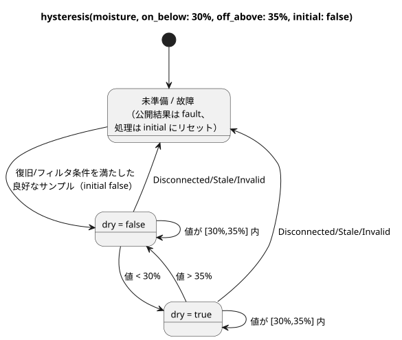

この図は、保持される2つの判断、厳密な遷移、そして処理を `initial` にリセットする故障の
経路を示しています。

次の系列は、準備完了後の良好なフィルタ済みの読み取り値を並べたものであり、フィルタ前の生の
サンプルではありません。

| 良好なフィルタ済みの水分 | 保持される dry の値 | 理由 |
|---|---|---|
| 起動後 30% | false | 等号では初期値 false を保持する。 |
| 35% | false | 上限の等号でも false を保持する。 |
| 29% | true | 下限しきい値を厳密に下回る。 |
| 30% | true | 下限の等号では true を保持する。 |
| 33% | true | 帯域の内側。 |
| 35% | true | 上限の等号では true を保持する。 |
| 36% | false | 上限しきい値を厳密に上回る。 |

`initial` は保持される値の初期値です。欠落したサンプルを無視してよいという許可ではありません。

- 準備完了前、または Disconnected/Stale/Invalid の後は、公開される結果は故障です。
- 処理は `initial` にリセットされ、良好なサンプルが再び復旧とフィルタの要件を満たす必要が
  あります。
- そのため、復旧後に帯域内のサンプルが来ても `initial` から始まります。故障前の判断を
  引き継ぐことはありません。
- `initial` が true であっても、失敗した Result が `ok(true)` になることは決してありません。
  E10 は `case` で出力の応答を選びます。

[Rust のコンディショナ](../crates/ghostflow-core/src/signals.rs)は厳密な比較を使い、故障時にヒステリシスの処理をリセットします。リンク先の WASM テストには「retains either prior state exactly at both thresholds」と故障/復旧の例が含まれています。この章はそれらの契約を説明するものであり、ドキュメントを編集しても新しいハードウェアテストが生まれるわけではありません。

### 13.4 時間、サンプル、イベントは別々の証拠

これらの演算は `signal name = constructor(...);` で宣言します。スキャンを数える単調タイマーは、
物理的な条件がスキャンと*スキャンの間*も true のままだったことを証明しません。連続性が重要な
場合は、認証された証拠を使ってください。

宣言済みの Temperature センサに対して、`signal recent = hold_last(temperature, for_at_most: 2min, quality: measured);` は最後の良好なサンプルを再利用できる期間を制限します。出力でそれを使う前には、やはり明示的な Result の応答が必要です。

| Builtin | シグネチャと目的 | コンテキスト、境界、例 |
|---|---|---|
| `debounce` | `debounce(source, stable_for: Duration, initial: T) -> T or Result<T,E>`：安定した候補を受け入れる | Bool または有限の列挙型。正の定数の継続時間と、型の一致する定数の initial。候補が変わるとその経過時間は再スタートし、故障でリセットされる。サンプルのソースは系譜を保持し、プレーンな値はスキャンを使う。[Debounce](../tests/debounce-control.test.mjs)。 |
| `true_for` | `true_for(BoolSensor, duration: Duration, quality: measured) -> Result<Bool,SensorFault>`：連続して true であることを証明する | 直接宣言された Bool センサ、正の定数の継続時間。ドライバが認証した区間を使う。false や受け入れられない品質でリセットされる。継続時間にちょうど達した境界は true。[認証されたソース](../tests/fixtures/true-for-certified.ghost.md)。 |
| `after_event` | `after_event(Event, BoolSensor, window: Duration, quality: measured)`：イベントごとの証拠を保持する | 正の定数のウィンドウ。イベントの同一性と述語のサンプルが必要。述語は [eventTime,eventTime+window) で判定される。信号そのものはスカラーではない。[イベントのソース](../tests/fixtures/after-event-evidence.ghost.md)。 |
| `after_event_any` | `after_event_any(signal) -> Result<Bool,SensorFault>`：存在量化のイベント結果を射影する | after_event 信号を1つ取る。決定的な true があれば any が成立し得る。そうでなければ未解決の同一性や故障が引き続き関係する。[射影の例](../tests/after-event-control.test.mjs)。 |
| `after_event_all` | `after_event_all(signal) -> Result<Bool,SensorFault>`：全称量化のイベント結果を射影する | after_event 信号を1つ取る。決定的な false があれば all=false が成立し得る。決定的な証拠のない空/保留中の集合は NotReady となり、自動的な許可にはならない。[射影の例](../tests/after-event-control.test.mjs)。 |
| `window_average` | `window_average(source, over: Duration, quality: measured, max_age: Duration)` | 物理サンプルの系譜を持つ Result<numeric/physical,SensorFault>。同じペイロードを返すが、Int -> Number となる。[ウィンドウ](../tests/window-control.test.mjs)。 |
| `window_min` | `window_min(source, over: Duration, quality: measured, max_age: Duration)` | average と同じペイロードを受け付ける。最小値の Result を返し、ペイロード型は同じ。[ウィンドウ](../tests/window-control.test.mjs)。 |
| `window_max` | `window_max(source, over: Duration, quality: measured, max_age: Duration)` | average と同じペイロードを受け付ける。最大値の Result を返し、ペイロード型は同じ。[ウィンドウ](../tests/window-control.test.mjs)。 |
| `window_rate` | `window_rate(source, over: Duration, quality: measured, max_age: Duration) -> Result<Rate<Q>,SensorFault>` | サポートされる線形の物理量。最も古い観測と最も新しい観測が異なる時刻にあること。温度差はデルタ K を使う。Number/Int/Percent、RelativeHumidity、CO2、Acidity は入力として受け付けない。[Rate の例](../tests/window-control.test.mjs)。 |
| `hold_last` | `hold_last(source, for_at_most: Duration, quality: measured) -> Result<T,SensorFault>`：良好なサンプルを一時的に再利用する | 物理的な系譜が必要。正の定数の継続時間。実際のタイムスタンプ、保持している経過時間、マスクした故障を保持する。再評価によって鮮度が更新されることは決してない。[Hold の例](../tests/hold-last-control.test.mjs)。 |
| `elapsed` | `elapsed(state) -> Duration`：状態変化からの経過時間 | タイマーの宣言専用。宣言済みの state、明示的な単調クロック。変化でリセットされる。[E08](#ch06)。 |
| `continuous_true` | `continuous_true(BoolExpression) -> Duration`：スキャン観測が連続して true である経過時間 | タイマーの宣言専用。最初に true となったスキャンでゼロから始まり、false でリセットされる。観測されていない区間を認証するものではない。[タイマーの例](../tests/compiler.test.mjs)。 |

ウィンドウのルール：

- `over` と `max_age` は正の定数の Duration です。
- ウィンドウは、**(now-over,now]** 内の実際の受け入れ可能な観測を、補間せずに使います。
- 観測がない場合、または最新の観測の経過時間が **>= max_age** の場合は NotReady になります。
- 現在のソースの故障は保持されます。
- 変化率には、異なる2つの時刻の観測が必要です。
- ウィンドウの合成は、集計とサンプルの来歴を保持します。クロックが進むだけのスキャンが新しい
  観測をでっち上げることはありません。

after_event を any/all の射影を通してのみ使うプログラムは、イベントランタイムのバインディングを
伴う実行可能な制御にコンパイルできます。射影されていない after_event や、自然条件と組み合わせた
after_event は、`executable:false` の時間的ディスクリプタを生成することがあります。
`after_event_for` は、後述のサポートされていない名前の中で扱います。
出典：[signal/timer の lowering](../tools/control.mjs)、[時間的証拠のリファレンス](reference/04-sensors-constraints-control.ja.md)。

### 13.5 自然の事実とスケジュールポリシーのコンストラクタ

プロバイダは観測や予測を提供し、それによって何を許可するかはプログラムが決めます。次の3つの
通常の呼び出しは、その不確実性を `Result` として明示的に返します。

| Builtin | シグネチャと目的 | コンテキスト、境界、例 |
|---|---|---|
| `local_day_is` | ``local_day_is(day`mon..fri`, timezone: "Asia/Seoul") -> Result<Bool,ClockFault>`` | 信頼できる現在の現地日付の曜日を判定します。新たな開始を許可する条件に使う前に、クロックの障害を明示的に処理します。 [平日の3区画の例](../tests/monitoring-plan.test.mjs). |
| `calendar_is` | ``calendar_is(calendar, day`workday` or day`offday` or day`holiday`) -> Result<Bool,CalendarFault>`` | GFB18 で明示的な UTC バインディングを持つ、型付きの WorkCalendar または HolidayCalendar。欠落、対象期間外、期限切れ、信頼できないクロックの事実は故障を保持する。成功した Bool を否定する前に、故障を明示的に扱うこと。[実行済みのカレンダー境界](../tests/reference-calendar-boundary.test.mjs)。 |
| `tide_is` | ``tide_is(provider, tide`spring` or tide`neap`) -> Result<Bool,TemporalContextFault>`` | 宣言済みの TidePredictions プロバイダ。予測やクロックのコンテキストが欠落している、または古い場合は故障となる。[自然条件](../tests/natural-condition-contract.test.mjs)。 |
| `moon_is` | ``moon_is(provider, moon`phase`) -> Result<Bool,TemporalContextFault>`` | LunarEphemeris プロバイダ。月相は new, waxing_crescent, first_quarter, waxing_gibbous, full, waning_gibbous, last_quarter, waning_crescent。[自然条件](../tests/natural-condition-contract.test.mjs)。 |

これらのシグネチャ内のタグ付きリテラルは表記上の断片です。これらの呼び出しにはランタイム/プロバイダの事実が必要なので、純粋な `fn` がグローバルなカレンダーやプロバイダを取り込むことはできません。

次のコンストラクタはスケジュールのフィールドでのみ有効です。通常の式に格納できる値を返すものではありません。ここでの Duration はすべて正の定数です。
たとえば `gap = skip_after(10min);` はギャップのポリシーを宣言します。Tide では、`basis = run(5min, within(10min));` は予定時刻から10分以内の受け入れ（admission）を許可し、受け入れた時点から5分間実行します。

| Builtin | シグネチャと目的 | コンテキスト、境界、例 |
|---|---|---|
| `instant` | `instant(DateTime)`：絶対時刻による Periodic のアンカー | 定数の DateTime。現在の実行可能スライスは preserve_anchor と pulse を使う。[Periodic](../tests/periodic-cron-policy.test.mjs)。 |
| `civil` | `civil(Date, TimeOfDay)`：常用時による Periodic のアンカー | 定数の日付/時刻。チェック済みのディスクリプタの契約であり、現在の Periodic バイトコードスライスの対象外。[Periodic](../tests/periodic-cron-policy.test.mjs)。 |
| `skip_after` | `skip_after(Duration)`：許容できる観測ギャップを制限する | スケジュールの gap フィールド。より大きなギャップには明示的な skip/baseline ポリシーを使う。[ポリシー](../tests/periodic-cron-policy.test.mjs)。 |
| `range` | `range(Duration)`：予定区間 | スケジュールの basis。非重複が証明可能であり、cancel_when が明示されていること。固定 UTC の range には範囲を限った実行スライスがあるが、一般の常用時の range はディスクリプタの範囲にとどまる。[Range の契約](../tests/schedule-descriptor-artifact.test.mjs)。 |
| `run` | `run(Duration, within(Duration))`：受け入れ時点からの Tide の実行 | Tide の basis。最初の Duration は実行時間。受け入れは猶予区間内で起きなければならない。[Tide](../tests/natural-schedule-contract.test.mjs)。 |
| `window` | `window(Duration)`：1回限りの At の受け入れ区間 | 固定された At の半開区間で最初に適格となったスキャンが `.due` を出す。`.open` は現在の条件レベルであり、受け入れ済みまたは取りこぼしの発生を再スタートさせない。[At Window](../tests/reference-foundations-temporal.test.mjs)。 |
| `within` | `within(Duration)`：Tide の受け入れ猶予 | Tide の run の第2引数としてのみ使える。[planned,planned+grace) で、終端ちょうどは含まない。実行時間を延ばすものではない。[Tide](../tests/natural-schedule-contract.test.mjs)。 |
| `hold_trusted` | `hold_trusted(Duration, terminal: skip)`：範囲を限った信頼済み時刻の保持 | Solar/Tide の clock フィールド。正の定数。以前の信頼済みの証拠と、実行/時刻の連続性が必要。期限ちょうどでスキップする。E36。[実行](../tests/programming-natural-examples.test.mjs)。 |
| `fixed_time` | `fixed_time(TimeOfDay literal, terminal: skip)`：固定時刻のフォールバック | Solar の fallback 専用。定数の TimeOfDay リテラルと明示的な terminal skip。Tide に流用してはならない。E36/E101。[実行](../tests/programming-natural-examples.test.mjs)。 |

現在の実行可能なスケジュールは baseline の recovery を使います。サポートされる組み合わせは次のとおりです。

- Solar と Tide の clock：`trusted_only`、または正の定数の Duration と `terminal: skip` を伴う `hold_trusted`。
- Solar の fallback：`fixed_time(TimeOfDay, terminal: skip)`。Tide の fallback は `skip`。
- Daily/slots/Cron は pulse を使い、Periodic は instant+preserve_anchor を必要とし、Tide は run+within を使います。
- 固定 UTC の `range` には独自の範囲を限った実行スライスがあります。だからといって、すべての常用時のディスクリプタが実行可能になるわけではありません。

後述の E36–E37 と [fallback のチェック](../tests/natural-fallback-compiler.test.mjs)を参照してください。
出典：[スケジュールの lowering とスライスの選択](../tools/control.mjs)、[時間に関するリファレンス](reference/03-time-and-schedules.ja.md)。

### 13.6 さらに許可する前に使用量を計上する

account は証拠を記録します。アニメーションや要求された出力から使用量を予測するものでは
ありません。適用済み（applied）の受領記録は要求意図（requested）とは異なり、永続的な
使用量計上には台帳と検証済みのリソースバインディングが必要です。

バインドされたリソース `pump` に対して、宣言の断片 `account pumping = on_time(pump, stage: applied, persistence: durable);` は適用済みの証拠を選びます。リンク先の使用量計上の例では、リソースと上限のポリシーも宣言しています。

| Builtin | シグネチャと目的 | コンテキスト、境界、例 |
|---|---|---|
| `on_time` | `on_time(resource, stage: applied, persistence: durable)`：Duration の account | account の宣言。範囲を限った実行可能スライスは durable/applied のみを受け付ける。requested/safe/confirmed の選択肢はチェックできるが、この実行可能なバインディングではない。[使用量計上](../tests/accounting-syntax.test.mjs)。 |
| `count_events` | `count_events(Event, over: local_day("zone"), persistence: durable)`：イベントの account | account の宣言。.count は Result<Int,AccountingFault> を返す。実行可能スライスには durable/local_day が必要。重複したイベントの同一性は二重に数えない。[使用量計上](../tests/accounting-syntax.test.mjs)。 |
| `used` | `used(account, rolling(Duration))`：計上された Duration を調べる | 使用量計上の制約の上限位置でのみ使える。実行可能な上限は <=、正の上限値/予備、on_unknown=block を使う。[上限](../tests/accounting-syntax.test.mjs)。 |
| `rolling` | `rolling(Duration)`：直近の区間による計上の基準 | 正の定数の継続時間。count_events の rolling はディスクリプタ/チェックの範囲であり、実行可能なイベントカウントのスライスの対象外。[上限](../tests/accounting-syntax.test.mjs)。 |
| `local_day` | `local_day("timezone")`：常用日による計上の基準 | 空でないリテラルのタイムゾーン。クロック/カレンダー/台帳が必要。固定の24時間ローリングウィンドウではない。[使用量計上](../tests/accounting-syntax.test.mjs)。 |
| `count_on` | `count_on({resources}) -> Int`：true である候補リソースを数える | 名前付きのリソース制約でのみ使え、通常の式では使えない。有限で互いに異なる Bool リソースの集合。空なら 0。ホストポリシーのバインディングが必要。[名前付き制約](../tests/named-constraints.test.mjs)。 |
| `any_on` | `any_on({resources}) -> Bool`：候補リソースを判定する | 同じ制限付きのコンテキスト。空なら false。評価段階は制約が宣言する。[名前付き制約](../tests/named-constraints.test.mjs)。 |

単独の名前付きリソースポリシーは、通常の VM 制御ではなく、ホストポリシーの成果物になります。出典：[使用量計上/リソースの制約](../tools/control.mjs)。

### 13.7 PID のコンストラクタは制御目標に属する

コントローラは要求される目標値を計算し、後段の制約がそれを制限することがあります。これらの
コンストラクタはゲインと再起動ポリシーを設定するものであり、汎用の単位代数の関数ではありません。

現在のネイティブのバインディングは、Temperature センサ、Temperature の config 目標値、そして
出力の最小値が 0% の `ContinuousActuator<Percent>` です。他の種類のコントローラも
バインディングを必要とするメタデータを持つことはできますが、`pi` や `on_off` がパースされた
からといって、コントローラが動作していることの証明にはなりません。

| Builtin | シグネチャと目的 | コンテキスト、境界、例 |
|---|---|---|
| `proportional_gain` | `proportional_gain(output: Percent, error: TemperatureDelta)`：P ゲイン | PID の kp フィールド。定数で、output >=0、error >0。output/error。[コントローラの例](../tests/gfb7-pid-contract.test.mjs)。 |
| `integral_gain` | `integral_gain(output: Percent, error: TemperatureDelta, time: Duration)`：I ゲイン | PID の ki。同じ範囲に加えて time >0。output/error/seconds。[コントローラの例](../tests/gfb7-pid-contract.test.mjs)。 |
| `derivative_gain` | `derivative_gain(output: Percent, error: TemperatureDelta, time: Duration)`：D ゲイン | PID の kd。同じ範囲に加えて time >0。output*seconds/error。[コントローラの例](../tests/gfb7-pid-contract.test.mjs)。 |
| `reset` | `reset(output: Percent)`：明示的な再起動時の目標値 | PID の restart フィールド。制御目標の出力範囲内の定数。最初に受け入れたサンプルで追従を初期化する。任意の状態をリセットする呼び出しではない。[コントローラの例](../tests/gfb7-pid-contract.test.mjs)。 |

出力がゼロのゲインは、その項を無効にします。周期は正でなければならず、late_after >= period
です。明示的な方向、バイアス、アンチワインドアップ、無効化/切り替え、故障、再起動の各ポリシーが
コントローラのライフサイクルを決めます。古い測定値や欠落した測定値が黙って受け入れられることは
決してありません。[コントローラの lowering](../tools/control.mjs) と [連続制御のリファレンス](reference/04-sensors-constraints-control.ja.md) を参照してください。
たとえば `kp = proportional_gain(output: 2%, error: 1Δ°C);` は、温度誤差 1 度あたり出力 2 パーセントポイントを宣言します。`restart = reset(output: 0%);` は、最初に追従する目標値を明示的に選びます。

### 13.8 独立したホストポリシーの文法

`ghostrules` アダプタは、範囲の狭いステーションポリシーの文法をチェックします。そこで呼び出しの
ように見える形は文脈上の形式であり、通常の control の式に関数を追加するものではありません。
既存の[ステーションルール](../examples/station-rules.ghost.md)と[制約のテスト](../tests/constraints.test.mjs)に完全なポリシーがあります。

| Builtin | シグネチャと目的 | コンテキスト、境界、例 |
|---|---|---|
| `stopped` | `stopped(station)`：ステーションの停止を要求する | 指定されたモードを持つ allow enter/apply のポリシー条件でのみ使える。ホスト上のステーションの状態であり、モーターが物理的に止まっていることの証明ではない。[ルール](../examples/station-rules.ghost.md)。 |
| `pump_capacity` | `pump_capacity(pump)`：容量チェックを要求する | require ... == Pass または check のポリシー句でのみ使える。ホストポリシーの成果物であり、数値の容量を表す式ではない。[ルール](../examples/station-rules.ghost.md)。 |
| `day` | `day("timezone")`：1日の上限のための常用日 | `limit on_time(pump) <= Duration per day("zone")` でのみ使える。有効な IANA タイムゾーンで、空でなく 128 文字以下。[ルール](../examples/station-rules.ghost.md)。 |

この文法では、`count_on(pump.valves)`、`any_on(pump.valves)`、`on_time(pump)` は、引数の形が §13.6 とは異なる制限付きの形式です。これらは max-valves、pump-needs-valve、daily-limit のポリシー句を生成します。これらの綴りを任意の `let` 式に移してはなりません。キーワード `exclusive`、`allow`、`require`、`limit`、`once`、`check` は句を導入します。`warn` は拒否されます。
出典：[ホストポリシーのパーサ](../tools/constraints.mjs)。

### 13.9 隣接する構文と利用できない代替案

次の項目は builtin と合わせて知っておくと役に立ちますが、**呼び出し可能な関数ではありません**。

| 構文 | 意味と現在の境界 |
|---|---|
| Daily, DailySlots<15min>, Periodic, Cron, Solar, Tide | スケジュール宣言の型。DailySlots の実行は固定の15分グリッドを使う。Cron は検証済みの5つのフィールドを持つ。 |
| pulse; time/date/datetime/cron5/day/sun/tide/moon tagged literals | ポリシーの値と型付きの表記。``sun`rise` ``/``sun`set` `` は sunrise()/sunset() の呼び出しではない。 |
| TimeSlots<grid,capacity> | config の型：24h を割り切る正のグリッド、正の容量、整列した一意の TimeOfDay の有限リスト。TimeSlots(...) という呼び出しはない。 |
| `Result<T,E>`; `Rate<Q>` | 型付きの結果と、式専用の変化率。E はコンパイラが所有する。入れ子の Result ペイロードは拒否される。 |
| schedule.due; schedule.active; schedule.missed | Bool の射影。.missed には公開された射影が必要。アクティブな発生は適用済みの出力ではない。メソッド呼び出しはない。 |
| eventAccount.count | Result<Int,AccountingFault> の射影。count_events の account のみ。 |
| resource.on/position/valves | 文脈上のリソース/ポリシーのエンドポイントであり、汎用のメソッドではない。 |
| sample, valid, filter, stale_after, recover_after, samples | センサ宣言のフィールド/表記。特に stale_after は式の呼び出しではない。 |
| on_below, off_above, initial; min, max, step, access, label | 名前付き引数または config のフィールドであり、関数ではない。 |
| if/case/in; >> and \|>; fn/type/state/config/timer/signal | 構文、演算子、宣言。修飾付きの input.name/state.name/next.name は削除された別名である。 |

これらが現れてよい場所は、[パーサとメンバー/型のルール](../tools/control.mjs)が定めています。完全な型と単位は[リファレンス第2章](reference/02-types-expressions-state.ja.md)にあります。

次の表は、リファレンスや設計メモで目にすることがあっても、現在のコンパイラが呼び出しとして
**サポートしていない**綴りの一覧です。

| 選択された/リファレンス上の綴り | 現在の状態。実行できると主張してはならない |
|---|---|
| after_event_for(signal, EventId) | リファレンスは同一性ごとの射影を説明しているが、現在のコンパイラには呼び出しのディスパッチャがなく、未知の関数となる。意味が意図と一致する場合に限り、サポートされている any/all を使う。 |
| window(Duration) schedule basis | 設計上の代替案であり、現在受け付けられる basis ではない。サポートされている window_average/min/max/rate 信号とは別物である。 |
| run(Duration, on_time) | 設計上の代替案。サポートされている Tide の run には within(Duration) が必要。 |
| range(Duration); civil(Date,TimeOfDay) | 上で説明したとおりチェック済みのディスクリプタの契約であり、現在のバイトコードスライスではない。 |
| PID checkpoint; degraded Name | 選択された設計上の代替案だが、現在のネイティブ PID の故障/再起動ポリシーではサポートされていない。 |
| ifthenelse, purefn, enum, next | 削除された別名。正準の if ... then ... else、fn、type、プライム付きの state を使う。 |

診断の中に名前が現れたからといって、それがサポートされている証拠にはなりません。だからこそ、
この表は設計上の代替案と現在の呼び出しを分けています。コンパイラの経路と成果物の種類を確認して
ください。[章のカバレッジチェック](../tests/programming-builtins.test.mjs)は、両言語の内容を
コンパイラの呼び出しディスパッチと揃えておくためのものであり、物理的な有用性を判断するものでは
ありません。

<a id="ch14"></a>
## 14. 温度の単位と空気 VPD 制御

25°C と 77°F は、同じ空気を異なる数値で表しています。逆に、同じ 25 という数値でも、単位が
違えばまったく異なる状態を表すことがあります。

この章では、2つの予測を試してください。

- 同じ物理温度を E16–E18 に与え、3つのヒーターがすべて同じ判断をすると予測します。
- VPD の例では、温度だけ、または湿度だけを変えて、どの要求が先に変わるかを観察します。

単位変換を制御ポリシーから切り離しておくと、計算の誤りとポリシーの不一致をそれぞれ別の場所で
解決できます。

### 1つの物理温度、3つのソース単位

Temperature センサは、ソース/表示単位が摂氏、華氏、ケルビンのどれであっても物理的な型を
保持します。ランタイムでの正準表現はケルビンです。

3つのヒーターの例は、1つの物理的なルールを3つの表示単位で表しています。

- 18°C を下回ったら ON を要求する。
- 22°C を上回ったら OFF を要求する。
- どちらかの境界ちょうど、または帯域の内側では、直前の良好な判断を保持する。

下の表を行ごとに見て、変換によってそれぞれの境界が保たれていることを確認してください。

品質は計算と一緒に伝わります。

- 最初のサンプルが届く前、センサは NotReady です。
- 配信と配信の間は、最後の良好なサンプルが、経過時間が >= 3s になるまで使えます。その後は
  Stale になります。
- 故障はヒーターの要求を抑止し、ヒステリシスを `initial` の false にリセットします。
- `median(1)` を使っているので、これらの例は新しい良好なサンプル1つで復旧します。

「以前にその数値を見た」と「その数値は今信頼できる」は別の主張です。

| 物理的な境界 | 摂氏 | 華氏 | ケルビン |
|---|---|---|---|
| ヒーターの下限しきい値 | 18°C | 64.4°F | 291.15K |
| ヒーターの上限しきい値 | 22°C | 71.6°F | 295.15K |
| ヒーターの有効範囲 | −40–50°C | −40–122°F | 233.15–323.15K |

リテラルの変換は binary64 の丸めの前までは厳密です。64.4 のような数値を正準のランタイム
サンプルとして直接与えてはなりません。64.4°F は 291.15K を意味します。ドライバの
バインディングは、供給する単位と物理量を識別します。[物理型](reference/02-types-expressions-state.ja.md)と[ヒステリシス](#ch13)を参照してください。

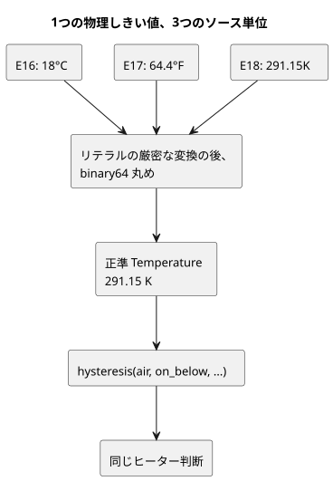

この図は下限しきい値をたどっています。各例はそれを異なる単位で表記していますが、3つとも
同じケルビン値に到達するので、同じ判断になります。

### E16 — 摂氏のヒーター

```ghost
// E16
control CelsiusHeater {
  input air: Temperature {
    sample = 1s;
    valid = -40°C .. 50°C;
    filter = median(1);
    stale_after = 3s;
    recover_after = 1 samples;
  }
  signal cold = hysteresis(air,
    on_below: 18°C, off_above: 22°C, initial: false);
  output heater: Bool;
  heater <- cold |> recover(false);
}
```

### E17 — 華氏のヒーター

```ghost
// E17
control FahrenheitHeater {
  input air: Temperature {
    sample = 1s;
    valid = -40°F .. 122°F;
    filter = median(1);
    stale_after = 3s;
    recover_after = 1 samples;
  }
  signal cold = hysteresis(air,
    on_below: 64.4°F, off_above: 71.6°F, initial: false);
  output heater: Bool;
  heater <- cold |> recover(false);
}
```

### E18 — ケルビンのヒーター

```ghost
// E18
control KelvinHeater {
  input air: Temperature {
    sample = 1s;
    valid = 233.15K .. 323.15K;
    filter = median(1);
    stale_after = 3s;
    recover_after = 1 samples;
  }
  signal cold = hysteresis(air,
    on_below: 291.15K, off_above: 295.15K, initial: false);
  output heater: Bool;
  heater <- cold |> recover(false);
}
```

### 温度と相対湿度から求める空気 VPD

**空気 VPD**（vapour pressure deficit、飽差）は、飽和水蒸気圧から空気の実際の水蒸気圧を
引いたものです。同時刻の気温 T（°C）と空気の相対湿度 RH に対して、
`0.6108 * exp(17.27*T/(T+237.3)) * (1-RH/100)` kPa を使います。

- 飽和の関係式と相対湿度の定義は [FAO-56 第3章、式 10–11](https://www.fao.org/4/x0490e/x0490e07.htm) によります。
- これは瞬時の空気の計算であり、FAO の日蒸発散量の推定ではありません。
- 葉の VPD は葉温にも依存するため、ここでは計算しません。

GhostFlow には exp の builtin がないので、各完全な例は `exp_0_3_1` を通常の純粋な fn として
自分で書いています。これは固定の14次のテイラー多項式を Horner 形式で評価するものです。

- 宣言された気温センサの範囲は **0–50°C** なので、指数は **0–3.006** に収まり、関数が
  明示している 0–3.1 の範囲内にあります。
- その温度範囲の外ではセンサが Invalid を返し、式は評価されません。近似を外挿してはなりません。
- [独立した数値チェック](../tests/programming-climate.test.mjs)は、0.1°C 刻みのグリッドと
  湿度の境界で、実際のランタイムの値をホストの Math.exp と比較し、絶対誤差が
  **0.001 kPa** 以下であることを要求します。多項式を期待値の実装にコピーするのではなく、
  3つの原本すべてをチェックします。

`air_vpd` の型付きの算術は明示的です。

- `(t - 0°C) / 1Δ°C` は温度を摂氏のプレーンな Number に変換します。
- `rh / 100%RH` は型付きの湿度を比率に正規化します。これは [RH の比率の契約](reference/02-types-expressions-state.ja.md)に従っています。
- 最後に `0.6108kPaVPD` を掛けることで、結果は VaporPressureDeficit 型になります。

RelativeHumidity は空気の湿度です。E10 で使った土壌水分の Percent ではありません。

光は **PPFD** として `umol/m2/s`（µmol·m⁻²·s⁻¹）で型付けされます。PPFD は光合成に関係する
光子を数えます。ルクスは人間の視覚で重み付けした照度であり、ルクスから PPFD への普遍的な
変換はないので、検証済みの PPFD センサ/バインディングを使ってください。これらの例では、光は
**出力の適格性を制限するだけ**であり、T/RH が一定なら計算される VPD を変えることは決して
ありません。

### 3つの独立した教材用ポリシー

しきい値はソースの意図を示すための例であり、作物に普遍的に推奨される値ではありません。
次の限界を念頭に置いてください。

- 加湿器の要求は、湿度が上がることを証明しません。
- 換気は屋外の条件に依存します。
- 灌水の要求は、土壌水分の推定でもポンプのシーケンスでもありません。

これらの例には温室の物理モデルは含まれていません。アクチュエータのバインディング、その適合性、
物理的な効果の検証は設備側の責任です。

| 例 | ON | OFF | 光による制限 |
|---|---|---|---|
| E19 加湿要求 | VPD > 1.2 kPa | VPD < 1.0 kPa | PPFD >= 200 µmol·m⁻²·s⁻¹ |
| E20 換気要求 | VPD < 0.4 kPa | VPD > 0.6 kPa | PPFD >= 200 µmol·m⁻²·s⁻¹ |
| E21 灌水要求 | VPD > 1.0 kPa | VPD < 0.8 kPa | PPFD >= 300 µmol·m⁻²·s⁻¹ |

計算された Result は宣言されたセンサではないので、センサ専用の `hysteresis` コンストラクタは
それを扱えません。代わりに各例は明示的な Bool の `state` を使い、同じ厳密な ON / OFF / 不感帯の
意図を表しています。

各例が故障と光にどう応答するか：

- 温度または RH の故障は要求をクリアします。
- 夜間、または光の故障は出力を抑止しますが、気候に基づく要求は記憶されたままのことがあります。
- 光の故障は、まだ良好な T/RH の計算を無効にすることなく出力を抑止します。
- 復旧には現在の良好な証拠を使います。タイマーや追加の自動モードは導入しません。

気候の故障時の `air_vpd_value = 0` は、明示的な表示用の仮値にすぎません。
**vpd_valid と合わせて読んでください**。false は、測定された VPD がゼロという意味ではありません。

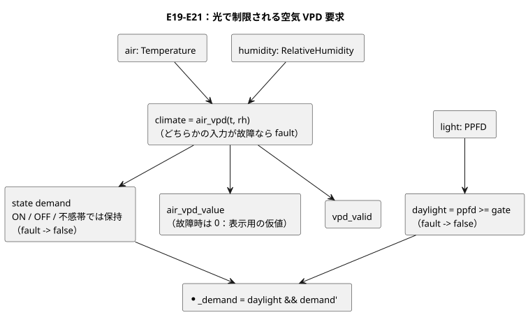

この図は E19–E21 に共通する構造を示しています。3つの例で異なるのは ON/OFF のしきい値と
PPFD による制限だけです。

### E19 — 高 VPD 時の加湿要求

<!-- ghostflow:anchor id=GF-INT-PIG-E19-HYSTERESIS kind=intent status=confirmed origin=ai -->
> VPDの2つのしきい値の間では急な切り替わりを防ぐため前の需要を維持し、気候サンプルに異常があれば需要を解除する。

```ghost
// E19
fn exp_0_3_1(x: Number) -> Number {
  1 + x / 1 * (1 + x / 2 * (1 + x / 3 * (1 + x / 4 * (1 + x / 5 * (1 + x / 6 * (1 + x / 7 * (1 + x / 8 * (1 + x / 9 * (1 + x / 10 * (1 + x / 11 * (1 + x / 12 * (1 + x / 13 * (1 + x / 14 * (1))))))))))))))
}
fn air_vpd(t: Temperature, rh: RelativeHumidity) -> VaporPressureDeficit {
  0.6108kPaVPD * exp_0_3_1(
    17.27 * ((t - 0°C) / 1Δ°C) / (((t - 0°C) / 1Δ°C) + 237.3)
  ) * (1 - rh / 100%RH)
}
control HumidificationDemand {
  input air: Temperature {
    sample = 1s; valid = 0°C .. 50°C;
    filter = median(1); stale_after = 3s; recover_after = 1 samples;
  }
  input humidity: RelativeHumidity {
    sample = 1s; valid = 0%RH .. 100%RH;
    filter = median(1); stale_after = 3s; recover_after = 1 samples;
  }
  input light: PPFD {
    sample = 1s; valid = 0umol/m2/s .. 3000umol/m2/s;
    filter = median(1); stale_after = 3s; recover_after = 1 samples;
  }
  let climate: Result<VaporPressureDeficit, SensorFault> = case air {
    ok(t) => case humidity {
      ok(rh) => ok(air_vpd(t, rh));
      fault(reason) => fault(reason);
    };
    fault(reason) => fault(reason);
  };
  let daylight = case light {
    ok(ppfd) => ppfd >= 200umol/m2/s;
    fault(_) => false;
  };
  // ghostflow:link id=GF-INT-PIG-E19-HYSTERESIS relation=implements
  state demand: Bool = false;
  demand' = case climate {
    ok(value) => if value > 1.2kPaVPD then true
      else if value < 1.0kPaVPD then false else demand;
    fault(_) => false;
  };
  output air_vpd_value: VaporPressureDeficit;
  output vpd_valid, humidify_demand: Bool;
  air_vpd_value <- climate |> recover(0kPaVPD);
  vpd_valid <- case climate { ok(_) => true; fault(_) => false; };
  humidify_demand <- daylight && demand';
}
```

### E20 — 低 VPD 時の換気要求

<!-- ghostflow:anchor id=GF-INT-PIG-E20-HYSTERESIS kind=intent status=confirmed origin=ai -->
> VPDの2つのしきい値の間では急な切り替わりを防ぐため前の需要を維持し、気候サンプルに異常があれば需要を解除する。

```ghost
// E20
fn exp_0_3_1(x: Number) -> Number {
  1 + x / 1 * (1 + x / 2 * (1 + x / 3 * (1 + x / 4 * (1 + x / 5 * (1 + x / 6 * (1 + x / 7 * (1 + x / 8 * (1 + x / 9 * (1 + x / 10 * (1 + x / 11 * (1 + x / 12 * (1 + x / 13 * (1 + x / 14 * (1))))))))))))))
}
fn air_vpd(t: Temperature, rh: RelativeHumidity) -> VaporPressureDeficit {
  0.6108kPaVPD * exp_0_3_1(
    17.27 * ((t - 0°C) / 1Δ°C) / (((t - 0°C) / 1Δ°C) + 237.3)
  ) * (1 - rh / 100%RH)
}
control VentilationDemand {
  input air: Temperature {
    sample = 1s; valid = 0°C .. 50°C;
    filter = median(1); stale_after = 3s; recover_after = 1 samples;
  }
  input humidity: RelativeHumidity {
    sample = 1s; valid = 0%RH .. 100%RH;
    filter = median(1); stale_after = 3s; recover_after = 1 samples;
  }
  input light: PPFD {
    sample = 1s; valid = 0umol/m2/s .. 3000umol/m2/s;
    filter = median(1); stale_after = 3s; recover_after = 1 samples;
  }
  let climate: Result<VaporPressureDeficit, SensorFault> = case air {
    ok(t) => case humidity {
      ok(rh) => ok(air_vpd(t, rh));
      fault(reason) => fault(reason);
    };
    fault(reason) => fault(reason);
  };
  let daylight = case light {
    ok(ppfd) => ppfd >= 200umol/m2/s;
    fault(_) => false;
  };
  // ghostflow:link id=GF-INT-PIG-E20-HYSTERESIS relation=implements
  state demand: Bool = false;
  demand' = case climate {
    ok(value) => if value < 0.4kPaVPD then true
      else if value > 0.6kPaVPD then false else demand;
    fault(_) => false;
  };
  output air_vpd_value: VaporPressureDeficit;
  output vpd_valid, ventilate_demand: Bool;
  air_vpd_value <- climate |> recover(0kPaVPD);
  vpd_valid <- case climate { ok(_) => true; fault(_) => false; };
  ventilate_demand <- daylight && demand';
}
```

### E21 — VPD と光による灌水要求

<!-- ghostflow:anchor id=GF-INT-PIG-E21-HYSTERESIS kind=intent status=confirmed origin=ai -->
> VPDの2つのしきい値の間では急な切り替わりを防ぐため前の需要を維持し、気候サンプルに異常があれば需要を解除する。

```ghost
// E21
fn exp_0_3_1(x: Number) -> Number {
  1 + x / 1 * (1 + x / 2 * (1 + x / 3 * (1 + x / 4 * (1 + x / 5 * (1 + x / 6 * (1 + x / 7 * (1 + x / 8 * (1 + x / 9 * (1 + x / 10 * (1 + x / 11 * (1 + x / 12 * (1 + x / 13 * (1 + x / 14 * (1))))))))))))))
}
fn air_vpd(t: Temperature, rh: RelativeHumidity) -> VaporPressureDeficit {
  0.6108kPaVPD * exp_0_3_1(
    17.27 * ((t - 0°C) / 1Δ°C) / (((t - 0°C) / 1Δ°C) + 237.3)
  ) * (1 - rh / 100%RH)
}
control IrrigationDemand {
  input air: Temperature {
    sample = 1s; valid = 0°C .. 50°C;
    filter = median(1); stale_after = 3s; recover_after = 1 samples;
  }
  input humidity: RelativeHumidity {
    sample = 1s; valid = 0%RH .. 100%RH;
    filter = median(1); stale_after = 3s; recover_after = 1 samples;
  }
  input light: PPFD {
    sample = 1s; valid = 0umol/m2/s .. 3000umol/m2/s;
    filter = median(1); stale_after = 3s; recover_after = 1 samples;
  }
  let climate: Result<VaporPressureDeficit, SensorFault> = case air {
    ok(t) => case humidity {
      ok(rh) => ok(air_vpd(t, rh));
      fault(reason) => fault(reason);
    };
    fault(reason) => fault(reason);
  };
  let daylight = case light {
    ok(ppfd) => ppfd >= 300umol/m2/s;
    fault(_) => false;
  };
  // ghostflow:link id=GF-INT-PIG-E21-HYSTERESIS relation=implements
  state demand: Bool = false;
  demand' = case climate {
    ok(value) => if value > 1.0kPaVPD then true
      else if value < 0.8kPaVPD then false else demand;
    fault(_) => false;
  };
  output air_vpd_value: VaporPressureDeficit;
  output vpd_valid, irrigation_demand: Bool;
  air_vpd_value <- climate |> recover(0kPaVPD);
  vpd_valid <- case climate { ok(_) => true; fault(_) => false; };
  irrigation_demand <- daylight && demand';
}
```

### E22 — 既存の2つの VPD control を import で一緒に動かす

E22 は E19 や E20 のソースをコピーしません。代わりに、その2つの元の節から生成された完全な
`.ghost.md` ドキュメントをインポートし、それぞれを正確なリビジョンと SHA-256 で固定します。

- `air`、`humidity`、`light` の1つの生のサンプルパケットが両方のインスタンスに分配されます。
- 各インスタンスは独自のセンサコンディショナと独自の `demand` 状態を持ちます。
- ルートは両方の要求を公開します。
- 共通の VPD の観測値は、同じ入力から計算された `high` インスタンスの `air_vpd_value` と
  `vpd_valid` から取ります。

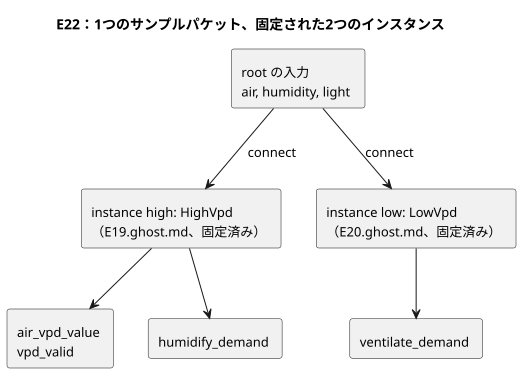

```ghost
// E22
import HighVpd from "./E19.ghost.md"
  revision "041dbfb015b692b9dd9a7879e06b2925462a61fe"
  sha256 "e6006e3dbbe4db7ec058a9e5f152cfe927ca524cf081b1747b66d5b61e0de932";
import LowVpd from "./E20.ghost.md"
  revision "041dbfb015b692b9dd9a7879e06b2925462a61fe"
  sha256 "0c33afee76307db1affcadd5ea7e43260dc6f866fec9afeadb4254358baa5b60";
control CombinedVpdDemands {
  input air: Temperature {
    sample = 1s; valid = 0°C .. 50°C;
    filter = median(1); stale_after = 3s; recover_after = 1 samples;
  }
  input humidity: RelativeHumidity {
    sample = 1s; valid = 0%RH .. 100%RH;
    filter = median(1); stale_after = 3s; recover_after = 1 samples;
  }
  input light: PPFD {
    sample = 1s; valid = 0umol/m2/s .. 3000umol/m2/s;
    filter = median(1); stale_after = 3s; recover_after = 1 samples;
  }
  output air_vpd_value: VaporPressureDeficit;
  output vpd_valid, humidify_demand, ventilate_demand: Bool;
  instance high: HighVpd;
  instance low: LowVpd;
  connect high.air <- air;
  connect high.humidity <- humidity;
  connect high.light <- light;
  connect low.air <- air;
  connect low.humidity <- humidity;
  connect low.light <- light;
  connect air_vpd_value <- high.air_vpd_value;
  connect vpd_valid <- high.vpd_valid;
  connect humidify_demand <- high.humidify_demand;
  connect ventilate_demand <- low.ventilate_demand;
}
```

### 実行し、観察し、入力を1つ変える

E16–E21 の各フェンスは、E15 と同様に、それぞれ完全な .ghost.md ドキュメントとして個別にコンパイルします。E22 は、生成された `examples/programming-book-imports` のソースクロージャと一緒にコンパイルします。

コンパイラと実際の ghostsim/WASM のスキャンをチェックするには、`node --test tests/programming-climate.test.mjs tests/programming-book-simulation.test.mjs tests/programming-book-import-package.test.mjs` を実行します。ネイティブと WASM の成果物は、ビルドの来歴が一致していなければなりません。ビルドの前提条件は[検証](VERIFICATION.ja.md)で説明しています。このテストは使い捨てのシナリオ成果物を書き出すだけで、ハードウェアを駆動することは決してありません。

オンラインリーダーは、既定で協調した **24時間の合成された日周プロファイル**を使います。これは E10 で導入した時間依存のセンサソースの上に構築されています。

- 温度、RH、PPFD は下表の節点の間で線形に変化し、プロファイルは途切れることなく繰り返されます。
- 06–18 の間に温度が下がることはなく、18–06 の間の光はちょうどゼロです。
- 宣言されたサンプル間隔ごとに、新しい型付きのセンサの証拠が供給されます。VPD と制御の要求を計算するのは実際の WASM プログラムです。

これは説明用の入力の軌跡であり、温室モデルでもアクチュエータのフィードバックでもありません。

| シミュレーション上の時刻 | 気温 °C | RH % | PPFD µmol·m⁻²·s⁻¹ | 観察点 |
|---|---|---|---|---|
| 00 | 18 | 90 | 0 | 初期状態でヒーター OFF、光で制限される要求は OFF |
| 03 | 17 | 92 | 0 | ヒーター ON |
| 06 | 16 | 94 | 0 | 日の出、ヒーター ON |
| 09 | 22 | 85 | 500 | 低 VPD の換気 ON、ちょうど 22°C なのでヒーターは ON を保持 |
| 12 | 28 | 60 | 1000 | 加湿と灌水の要求 ON、ヒーター/換気は OFF |
| 15 | 31 | 45 | 650 | 高 VPD の要求は ON のまま |
| 18 | 31 | 60 | 0 | 日の入り、光で制限される要求は OFF |
| 21 | 23 | 80 | 0 | 夜間の冷却、ヒーターはまだ OFF |
| 24 | 18 | 90 | 0 | 連続ループの境界、ヒーターは 18°C を下回って初めて ON になる |

各例はシミュレーション上の 00:00 から実行してください。E16–E21 の既定は 1000 倍速と24時間のタイミングチャートです。09、12、15、18 時を比較してください。

- 実際の壁時計あたりの処理量はコンピュータに依存します。
- 速度が変えるのは、壁時計の1秒あたりに進むシミュレーション時間の量だけです。しきい値や日周プロファイルは変わりません。
- 一時停止するとシミュレーション時間が止まります。
- 09 時に ON のヒーターは、温度が 22°C を厳密に上回った時点で OFF になります。
- これらは独立したプログラムなので、ヒーターと換気の間のインターロックは想定されていません。
- 単位の選択は物理値を変えずに入力/表示の単位を変えます：17°C = 62.6°F = 290.15K。E16–E18 は1日を通して同一の判断をしなければなりません。

一定値モードと手動の単一パケットモードは、個々の境界の実験に引き続き役立ちます。これらは任意のデバッグ用ソースであり、1日を通して判断がどう変わるかを観察することの代わりにはなりません。

Stale を試すには、単一パケットモードを使うかサンプルの配信を止め、シミュレーション時間を宣言された 3s の境界まで進めます。一定値のソースから繰り返し届くサンプルは新しい証拠なので、stale にはならないはずです。Disconnected を示すには、そのサンプル品質を選びます。新たに配信された失敗も失敗です。古い Good のパケットを新しいものであるかのように再利用して、断線をシミュレートしてはなりません。

実験の例：

- **ヒーター：** 18 → 17 → 18 → 22 → 23°C と変化させ、続いてセンサの故障と復旧を観察します。
- **各 VPD コントローラ：** 温度を 25°C に固定して RH を変え、しきい値をまたがせます。次に PPFD だけを変えます。requested/safe の要求、air_vpd_value、vpd_valid を比較します。
- **故障：** 欠落、Invalid、Disconnected、stale のサンプルを試します。関係する故障はいずれも直ちに出力を抑止しなければなりません。
- **数値の関係：** T と RH を同時に変えます。

論理的な要求、成功したスキャン、仮想アクチュエータを、物理的に確認された効果と解釈してはなりません。

<a id="ch15"></a>
## 15. 名前付き物理量と単位

計算できる数値が、意味のある数値だとは限りません。流量に時間を掛けると体積になります。電圧に流量を足しても数値は得られますが、問いそのものが間違っています。E33 を実行する前に、結果を予測してください。同じ量の単位どうしの換算は成功し、異なる量の混在は診断されます。コンパイラがこのような式を拒否するのは、邪魔をしているのではありません。現場での誤解を実行前に捉えているのです。

この章では `Duration`（第 6 章）や日付と時刻（第 7 章）は扱いません。扱うのは、温度、圧力、光など、単位によって制御値の意味が変わる 17 個の名前付き物理量です。これらの値は単位のない `Number` に変換せず、それぞれの型のまま保持してください。そうすれば、たまたま似た数値を持つ無関係な 2 つのセンサの読み値を比較しようとしたときに、コンパイラが止めてくれます。`Rate<Q>` は時間窓にわたって導出される式専用の型です。物理量カタログの独立した項目ではないため、第 13 章で扱います。

### 物理量ごとに固有の型がある

次の表のリテラルは、それぞれの型の正しい書き方です。[Reference §2.9](reference/02-types-expressions-state.ja.md) には、受け付けられるすべての単位接尾辞と各型の正準単位が載っています。式の中で同じ型の異なる単位が使われると、GhostFlow はそれらを正準単位に換算します。換算によって物理量の型が変わることはありません。

| 名前付き型 | リテラルの例 | 意味 |
|---|---|---|
| `Temperature` | `25°C`, `77°F`, `298.15K` | 絶対温度 |
| `TemperatureDelta` | `5Δ°C`, `9Δ°F` | 温度差 |
| `RelativeHumidity` | `70%RH` | 相対湿度 |
| `Pressure` | `100kPa` | 圧力 |
| `VaporPressureDeficit` | `1kPaVPD` | 飽和水蒸気圧と実際の水蒸気圧の差 |
| `CO2Concentration` | `800ppm` | 二酸化炭素のモル分率 |
| `FlowRate` | `5L/min` | 体積流量 |
| `Volume` | `20L` | 体積 |
| `Length` | `35cm` | 長さ |
| `Irradiance` | `300W/m2` | 単位面積あたりの放射パワー |
| `PPFD` | `600umol/m2/s` | 単位面積・単位時間あたりの光合成光量子束 |
| `Energy` | `1kWh` | エネルギー |
| `Power` | `150W` | 電力 |
| `ElectricalCurrent` | `800mA` | 電流 |
| `Voltage` | `24V` | 電圧 |
| `Conductivity` | `1.5mS/cm` | 電気伝導度 |
| `Acidity` | `6.5pH` | 酸性度の尺度 |

次の図は、この章の考え方をまとめたものです。単位は表記にすぎず、温度リテラルはすべて同じ `Temperature` 型になります。2 種類の光の測定値のように名前が似た量でも、型は別々のままです。

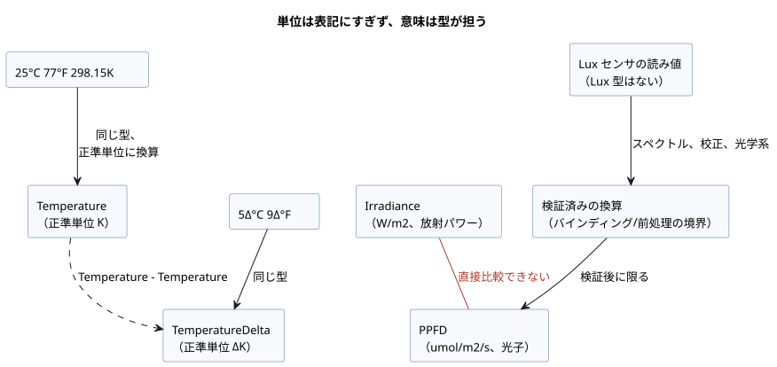

### 同じ量の単位は組み合わせられる

`25°C` と `77°F` は数値も単位の表記も異なりますが、どちらも `Temperature` です。したがって、この型のセンサ値はどちらの境界値とも比較できます。`5Δ°C` と `9Δ°F` も同様に、同じ温度差です。

絶対温度と温度差は別の型です。

- ある温度から別の温度を引くと `TemperatureDelta` になります。
- 温度に温度差を足したり引いたりすると `Temperature` になります。
- 2 つの絶対温度を足すとエラーになります。

GhostFlow は任意の次元代数を行いません。演算の集合は閉じています。

- 同じ型の値どうしは比較できます。
- 同じ線形量の値どうしは加算・減算できます。
- 物理量には数値スカラーを掛けたり、数値スカラーで割ったりできます。
- 異なる量どうしの積と商は、定義済みの関係に限られます。`FlowRate * Duration -> Volume`、`Power * Duration -> Energy`、`Voltage * ElectricalCurrent -> Power` と、それに対応する除算（`Volume / Duration` は `FlowRate`、`Energy / Duration` は `Power`）です。

それ以外はすべてエラーです。これには `Pressure + Length` のような未定義の組み合わせや、単位のない `Number` への暗黙の変換も含まれます。`RelativeHumidity`、`CO2Concentration`、`Acidity` などに関するいくつかの追加規則は Reference §2.9 に載っています。

| 有効な式 | 結果 | 無効な混在の例 |
|---|---|---|
| `room < 25°C && room < 77°F` | 温度の比較 | `room + room` — 絶対温度どうしの加算 |
| `change >= 5Δ°C && change >= 9Δ°F` | 温度差の比較 | `room > change` — 温度と温度差の比較 |
| `flow * 1min` | `Volume` | `flow + 20L` — 流量と体積の加算 |
| `voltage * current` | `Power` | `pressure > vpd` — 圧力と VPD の比較 |
| `power * 1h` | `Energy` | `irradiance > ppfd` — 異なる光の量の比較 |

### センサの光の単位を区別する

温室のセンサは、名前の似た光の測定値を異なる単位で報告することがあります。

- `Irradiance`（`W/m2`）は、ある面に届く放射パワーです。
- `PPFD`（`umol/m2/s`）は、光合成を駆動する波長帯の光子の数を数えます。

これらは異なる物理型です。直接比較することも、一方をもう一方のしきい値として使うこともできません。光のスペクトルを考慮した検証済みの換算がない限り、両者の間に一般的な換算係数は存在しません。

現在の物理量カタログには `Lux` 型がありません。lux センサの値を、名前を付け替えて PPFD であるかのように接続してはなりません。lux は人間の目の感度で重み付けした照度を測ります。信頼できる換算には、光源のスペクトル、センサの校正、光学系を考慮する必要があります。その換算はセンサのバインディングか検証済みの前処理の境界で明示し、得られる型を実際の単位に一致させてください。センサが異なる量を測る場合は、各入力の型を検査できるように、それらを別々に宣言してください。

### E33 — 1 つの control で単位と物理量の混在を検査する

この例は、サポートされているカタログのすべての名前付き物理量を使います。温度と温度差、流量と体積、電圧と電流のような許可された関係では、その結果の型がわかります。放射照度センサと PPFD センサは別々の型として宣言されています。

```ghost
// E33
control PhysicalQuantityUnits {
  state displayed_temperature_ok: Bool = false;
  displayed_temperature_ok' = if air_good then air >= 25°C && air >= 77°F else displayed_temperature_ok;
  state displayed_change_ok: Bool = false;
  displayed_change_ok' = if temperature_change_good then temperature_change >= 5Δ°C && temperature_change >= 9Δ°F else displayed_change_ok;
  state displayed_humidity_ok: Bool = false;
  displayed_humidity_ok' = if humidity_good then humidity >= 70%RH else displayed_humidity_ok;
  state displayed_pressure_ok: Bool = false;
  displayed_pressure_ok' = if pressure_good then pressure >= 100kPa else displayed_pressure_ok;
  state displayed_vpd_ok: Bool = false;
  displayed_vpd_ok' = if vpd_good then vpd >= 1kPaVPD else displayed_vpd_ok;
  state displayed_co2_ok: Bool = false;
  displayed_co2_ok' = if co2_good then co2 >= 800ppm else displayed_co2_ok;
  state displayed_volume_ok: Bool = false;
  displayed_volume_ok' = if tank_volume_good then tank_volume >= 20L else displayed_volume_ok;
  state displayed_length_ok: Bool = false;
  displayed_length_ok' = if pipe_length_good then pipe_length >= 35cm else displayed_length_ok;
  state displayed_energy_ok: Bool = false;
  displayed_energy_ok' = if stored_energy_good then stored_energy >= 1kWh else displayed_energy_ok;
  state displayed_power_ok: Bool = false;
  displayed_power_ok' = if rated_power_good then rated_power >= 150W else displayed_power_ok;
  state displayed_current_ok: Bool = false;
  displayed_current_ok' = if current_good then current >= 800mA else displayed_current_ok;
  state displayed_voltage_ok: Bool = false;
  displayed_voltage_ok' = if voltage_good then voltage >= 24V else displayed_voltage_ok;
  state displayed_conductivity_ok: Bool = false;
  displayed_conductivity_ok' = if conductivity_good then conductivity >= 1.5mS/cm else displayed_conductivity_ok;
  state displayed_acidity_ok: Bool = false;
  displayed_acidity_ok' = if acidity_good then acidity <= 6.5pH else displayed_acidity_ok;
  state displayed_pumped_volume: Volume = 0L;
  displayed_pumped_volume' = if flow_good then flow * 1min else displayed_pumped_volume;
  state displayed_motor_power: Power = 0W;
  displayed_motor_power' = if current_good && voltage_good then motor_load else displayed_motor_power;
  state displayed_hourly_energy: Energy = 0Wh;
  displayed_hourly_energy' = if current_good && voltage_good then motor_load * 1h else displayed_hourly_energy;
  // Source-local display memory is initialized here; faults remain producer unknown.
  state remembered_air: Temperature = 0°C;
  let air_good = case observed_air { ok(_) => true; fault(_) => false; };
  let air = case observed_air { ok(value) => value; fault(_) => remembered_air; };
  remembered_air' = air;
  state remembered_temperature_change: TemperatureDelta = 0Δ°C;
  let temperature_change_good = case observed_temperature_change { ok(_) => true; fault(_) => false; };
  let temperature_change = case observed_temperature_change { ok(value) => value; fault(_) => remembered_temperature_change; };
  remembered_temperature_change' = temperature_change;
  state remembered_humidity: RelativeHumidity = 0%RH;
  let humidity_good = case observed_humidity { ok(_) => true; fault(_) => false; };
  let humidity = case observed_humidity { ok(value) => value; fault(_) => remembered_humidity; };
  remembered_humidity' = humidity;
  state remembered_pressure: Pressure = 0kPa;
  let pressure_good = case observed_pressure { ok(_) => true; fault(_) => false; };
  let pressure = case observed_pressure { ok(value) => value; fault(_) => remembered_pressure; };
  remembered_pressure' = pressure;
  state remembered_vpd: VaporPressureDeficit = 0kPaVPD;
  let vpd_good = case observed_vpd { ok(_) => true; fault(_) => false; };
  let vpd = case observed_vpd { ok(value) => value; fault(_) => remembered_vpd; };
  remembered_vpd' = vpd;
  state remembered_co2: CO2Concentration = 0ppm;
  let co2_good = case observed_co2 { ok(_) => true; fault(_) => false; };
  let co2 = case observed_co2 { ok(value) => value; fault(_) => remembered_co2; };
  remembered_co2' = co2;
  state remembered_flow: FlowRate = 0L/min;
  let flow_good = case observed_flow { ok(_) => true; fault(_) => false; };
  let flow = case observed_flow { ok(value) => value; fault(_) => remembered_flow; };
  remembered_flow' = flow;
  state remembered_tank_volume: Volume = 0L;
  let tank_volume_good = case observed_tank_volume { ok(_) => true; fault(_) => false; };
  let tank_volume = case observed_tank_volume { ok(value) => value; fault(_) => remembered_tank_volume; };
  remembered_tank_volume' = tank_volume;
  state remembered_pipe_length: Length = 0m;
  let pipe_length_good = case observed_pipe_length { ok(_) => true; fault(_) => false; };
  let pipe_length = case observed_pipe_length { ok(value) => value; fault(_) => remembered_pipe_length; };
  remembered_pipe_length' = pipe_length;
  state remembered_stored_energy: Energy = 0Wh;
  let stored_energy_good = case observed_stored_energy { ok(_) => true; fault(_) => false; };
  let stored_energy = case observed_stored_energy { ok(value) => value; fault(_) => remembered_stored_energy; };
  remembered_stored_energy' = stored_energy;
  state remembered_rated_power: Power = 0W;
  let rated_power_good = case observed_rated_power { ok(_) => true; fault(_) => false; };
  let rated_power = case observed_rated_power { ok(value) => value; fault(_) => remembered_rated_power; };
  remembered_rated_power' = rated_power;
  state remembered_current: ElectricalCurrent = 0A;
  let current_good = case observed_current { ok(_) => true; fault(_) => false; };
  let current = case observed_current { ok(value) => value; fault(_) => remembered_current; };
  remembered_current' = current;
  state remembered_voltage: Voltage = 0V;
  let voltage_good = case observed_voltage { ok(_) => true; fault(_) => false; };
  let voltage = case observed_voltage { ok(value) => value; fault(_) => remembered_voltage; };
  remembered_voltage' = voltage;
  state remembered_conductivity: Conductivity = 0mS/cm;
  let conductivity_good = case observed_conductivity { ok(_) => true; fault(_) => false; };
  let conductivity = case observed_conductivity { ok(value) => value; fault(_) => remembered_conductivity; };
  remembered_conductivity' = conductivity;
  state remembered_acidity: Acidity = 0pH;
  let acidity_good = case observed_acidity { ok(_) => true; fault(_) => false; };
  let acidity = case observed_acidity { ok(value) => value; fault(_) => remembered_acidity; };
  remembered_acidity' = acidity;
  input observed_air: Temperature;
  input observed_temperature_change: TemperatureDelta;
  input observed_humidity: RelativeHumidity;
  input observed_pressure: Pressure;
  input observed_vpd: VaporPressureDeficit;
  input observed_co2: CO2Concentration;
  input observed_flow: FlowRate;
  input observed_tank_volume: Volume;
  input observed_pipe_length: Length;
  input irradiance: Irradiance {
    sample = 1s; valid = 0W/m2 .. 1500W/m2;
    filter = median(1); stale_after = 3s; recover_after = 1 samples;
  }
  input ppfd: PPFD {
    sample = 1s; valid = 0umol/m2/s .. 3000umol/m2/s;
    filter = median(1); stale_after = 3s; recover_after = 1 samples;
  }
  input observed_stored_energy: Energy;
  input observed_rated_power: Power;
  input observed_current: ElectricalCurrent;
  input observed_voltage: Voltage;
  input observed_conductivity: Conductivity;
  input observed_acidity: Acidity;

  output temperature_ok, change_ok, humidity_ok, pressure_ok, vpd_ok: Bool;
  output co2_ok, volume_ok, length_ok, irradiance_ok, ppfd_ok: Bool;
  output energy_ok, power_ok, current_ok, voltage_ok, conductivity_ok, acidity_ok: Bool;
  output pumped_volume: Volume;
  output motor_power: Power;
  output hourly_energy: Energy;

  let motor_load = voltage * current;
  temperature_ok <- displayed_temperature_ok';
  change_ok <- displayed_change_ok';
  humidity_ok <- displayed_humidity_ok';
  pressure_ok <- displayed_pressure_ok';
  vpd_ok <- displayed_vpd_ok';
  co2_ok <- displayed_co2_ok';
  volume_ok <- displayed_volume_ok';
  length_ok <- displayed_length_ok';
  irradiance_ok <- case irradiance { ok(value) => value >= 300W/m2; fault(_) => false; };
  ppfd_ok <- case ppfd { ok(value) => value >= 600umol/m2/s; fault(_) => false; };
  energy_ok <- displayed_energy_ok';
  power_ok <- displayed_power_ok';
  current_ok <- displayed_current_ok';
  voltage_ok <- displayed_voltage_ok';
  conductivity_ok <- displayed_conductivity_ok';
  acidity_ok <- displayed_acidity_ok';
  pumped_volume <- displayed_pumped_volume';
  motor_power <- displayed_motor_power';
  hourly_energy <- displayed_hourly_energy';
}
```

次の式はいずれも、オペランドの型が異なるか演算が未定義であるため、拒否されます。`pressure > vpd`、`irradiance > ppfd`、`humidity > 70%`、`air + air`、`flow + tank_volume`。

このような診断を換算で黙らせる前に、その物理的な問いが意味をなすかを確かめてください。

- 1 つの量の表示単位だけが異なるなら、許可された換算で対応できます。
- 光の測定値のように量そのものが異なるなら、その換算には独自の検証済みの根拠と精度が必要です。

型検査はセンサの校正や機器の動作限界を置き換えるものではありません。ただし、それらの確認で問うべきことを明確にします。

<a id="appendix-a"></a>
## 付録 A. 仕様ガイド

この付録は、本文で概念を紹介した後に、その正確な境界を知りたいときに使ってください。暗記する必要はありません。気になる宣言を、その Reference の規則、根拠（「Why」）、診断へと導く索引として扱ってください。

この表は学習用の章から規範的な構文を指し示すものです。完全な文法や実装のサポート一覧を置き換えるものではありません。

| トピック | 言語リファレンス |
|---|---|
| `.ghost.md`、フェンスの抽出、アンカー、名前、宣言の骨格 | [第 1 章](reference/01-source-and-syntax.ja.md) |
| 型、整数、Result、式、関数、tick、状態 | [第 2 章](reference/02-types-expressions-state.ja.md) |
| Duration、時刻、タイマー、スケジュール、太陽/月/潮汐 | [第 3 章](reference/03-time-and-schedules.ja.md) |
| センサの品質、フィルタ、ケイパビリティ、制約、リソース | [第 4 章](reference/04-sensors-constraints-control.ja.md) |
| 型付き config、ライブ更新、観測ディスクリプタ | [第 5 章](reference/05-settings-and-observation.ja.md) |
| import、instance、connect、マクロ、リプレイ、置換 | [第 6 章](reference/06-composition-and-replay.ja.md) |
| エラー、不確実性、構文索引 | [第 7 章](reference/07-semantic-rules-and-index.ja.md) |
| 言語/ランタイム/ドライバ/バインディング/UI の責務 | [第 8 章](reference/08-language-runtime-and-device-boundaries.ja.md) |
| よくあるコーディング例 | [GhostFlow コーディング FAQ](language_faq.ja.md) |

<a id="appendix-b"></a>
## 付録 B. エラーから学ぶ

よい診断は「これは間違っている」で終わりません。どの約束が破られたのかを教えてくれます。E90–E102 は、通るまで直すための例ではありません。失敗することが期待される実験です。診断がどこを指し、なぜそうなるのかを予測してから確かめてください。プログラムに残すエラーは一度に 1 つだけにして、コンパイラが守っている境界がはっきり見えるようにしてください。

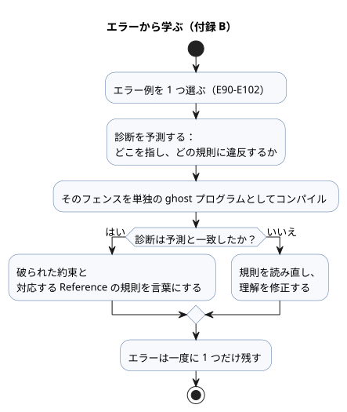

これらの短いエラー例は Reference の規則を確かめるものです。それぞれ単独で読んでください。

`ghost-error` は、このガイドでエラー例を示すための表示用タグです。実際の `.ghost.md` の実行フェンスは、正確に `ghost` を使います。以下のエラーコードを実行可能なプログラムに入れないでください。

### E90 — セミコロンの欠落

```ghost-error
control MissingSemicolon {
  input start: Bool
  output pump: Bool;
  pump <- start;
}
```

改行は宣言を終わらせません。各宣言の後には `;` が必要です。

### E91 — 異なる型の比較

```ghost-error
control MixedTypes {
  let level: Number = 0;
  output pump: Bool;
  pump <- level < 30%;
}
```

`Number` と `Percent` が暗黙のうちに相互変換されることは決してありません。

### E92 — 次状態への依存

```ghost-error
control NextDependency {
  state a: Bool = false;
  state b: Bool = false;
  output lamp: Bool;
  a' = !a;
  b' = a';
  lamp <- b';
}
```

1 つの tick の中では、すべての次状態の式が前状態のスナップショットを読みます。別の状態の次の値を介して読み取りを連鎖させることはできません。

### E93 — 2 つのルート control

```ghost-error
control First { output lamp: Bool; lamp <- false; }
control Second { output lamp: Bool; lamp <- true; }
```

プログラムにはルート control がちょうど 1 つあり、それが実行されます。複数の control を再利用するには、Reference 第 6 章の import、instance、connect を使ってください。

### E94 — 可変整数の範囲超過

```ghost-error
control OutOfRange {
  let count = 2147483648;
  output lamp: Bool;
  lamp <- false;
}
```

`Int` リテラルは符号付き 32 ビットの範囲に収まらなければなりません。整数の範囲と変換については [Reference §2.3](reference/02-types-expressions-state.ja.md) を参照してください。

### E95 — enum の case の欠落

```ghost-error
control MissingCase {
  type Mode = Off | On;
  state mode: Mode = Off;
  output lamp: Bool;
  lamp <- case mode { Off => false; };
}
```

`case` は enum のすべてのメンバーを扱わなければなりません。

### E96 — 出力接続の重複

```ghost-error
control DuplicateOutput {
  output lamp: Bool;
  lamp <- false;
  lamp <- true;
}
```

出力が受け取る接続はちょうど 1 つです。後の文が前の接続を上書きすることはありません。

### E97 — 処理されていないセンサの Result

```ghost-error
control BareSensor {
  input moisture: Percent;
  output pump: Bool;
  pump <- moisture < 30%;
}
```

センサはペイロードそのものではなく Result なので、直接比較しないでください。`case` か、Reference §2.5 の明示的な Result 変換を使ってください。

<a id="appendix-c"></a>
## 付録 C. ドキュメントの保守規則

この本の例は、教材の断片であると同時に検査済みの契約でもあります。本文を編集するときは、アンカー、例の ID、正準フェンス、翻訳間の対応を保ってください。そうすれば、読者も回帰テストも同じ例を指し続けます。ソースとその投影を区別し、新しい本文が 2 つ目の実行可能な原本を生み出さないようにしてください。

変化する環境を扱う教材の例は、一定で有効な 1 つの入力だけでは意図を証明できません。ON の前、ON の境界、出力が保持される帯域の途中、OFF の境界で、それぞれ独立したチェックポイントを保ってください。1 日分のトレースは故障や厳密な境界のスキャンに追加されるものであり、それらを置き換えるものではありません。

言語リファレンスは規範です。このガイドを保守するときは、次の規則に従ってください。

- ここで矛盾や欠けている例を見つけたら、ガイドを修正する前に、該当する Reference の節を確認してください。
- 構文や意味論の変更は、まず Reference の構文、規則、理由、例を更新します。その後で、このガイドの学習経路とコードを同期させてください。
- 学習者が知る必要のある実装上の境界は、証拠となるドキュメントにリンクしてください。進捗、テスト数、成果物のハッシュ、サポートボード一覧など、変化する事実はそれらのドキュメントに置いてください。
- 例のコンパイラ検査には `tests/docs-runnable-examples.test.mjs` を再利用してください。
- 本を変更した後は、`npm run generate:pc01` を実行して派生した来歴を更新してください。過去のリプレイやベンチマークの証拠は変更しないでください。

<a id="appendix-d"></a>
## 付録 D. 読者別の例

同じ GhostFlow プログラムでも、読者によって最初に浮かぶ問いは異なります。PLC 開発者はインターロックから、Web 開発者は観測モデルから、ファームウェア開発者はバインディングの境界から入ります。E23–E32 はそれぞれの入口を用意しており、どれも同じ requested/safe/applied/confirmed の区別に戻ってきます。自分に最も近い役割から始めてください。その後で、同じトレースを別の役割の問いを念頭に置いて読み直してください。

10 個のプログラムは、職種によって 1 つのトレースに持ち込む問いがどう異なるかを示します。それぞれが独立した実行可能なプログラムなので、興味のあるものを選んで入力の順序を変えてみてください。PLC 開発者はまず出力をブロックした条件を、Web 開発者は表示すべき証拠を、ファームウェア開発者は論理値とピンの境界を探すかもしれません。得られるのは論理的な証拠です。実際の接点、バルブ、モーターについては、引き続きボード、ドライバ、配線、現場での確認が責任を負います。

### E23 — PLC 開発者向け：故障を原因から出力までたどる

> 「システムが止まった理由を、もう推測しなくていい。」

コンベヤが予期せず停止したとき、最初に問うべきは「もう一度 Start を押すべきか」ではなく、「どの条件が止めたのか」です。詰まり入力が詰まりを報告するスキャン（`jam_clear=false`）では、このプログラムは運転状態を解除し、故障を記憶します。原因が取り除かれた後に reset を押すと故障はクリアされますが、オペレーターが Start を離してもう一度押すまで、コンベヤは再始動しません。

試してみましょう。

1. `start=true`、`jam_clear=false`、`reset=false` で 1 スキャン実行します。`fault_latched` と `fault_lamp` がオンになり、`running` と `conveyor` がオフになります。
2. 詰まりを取り除いてから reset を押します。故障の記憶だけがクリアされ、駆動は停止したままです。

各出力の判断がどの入力と状態を使ったかを、ソースの中で直接たどることができます。詰まり検出器の電気的な意味や非常停止回路は、引き続き独自の設計が必要です。

```ghost
// E23
control TraceableConveyor {
  // Source-local display memory is initialized here; faults remain producer unknown.
  state remembered_start: Bool = false;
  let start_good = case observed_start { ok(_) => true; fault(_) => false; };
  let start = case observed_start { ok(value) => value; fault(_) => remembered_start; };
  remembered_start' = start;
  state remembered_stop: Bool = false;
  let stop_good = case observed_stop { ok(_) => true; fault(_) => false; };
  let stop = case observed_stop { ok(value) => value; fault(_) => remembered_stop; };
  remembered_stop' = stop;
  state remembered_jam_clear: Bool = false;
  let jam_clear_good = case observed_jam_clear { ok(_) => true; fault(_) => false; };
  let jam_clear = case observed_jam_clear { ok(value) => value; fault(_) => remembered_jam_clear; };
  remembered_jam_clear' = jam_clear;
  state remembered_reset: Bool = false;
  let reset_good = case observed_reset { ok(_) => true; fault(_) => false; };
  let reset = case observed_reset { ok(value) => value; fault(_) => remembered_reset; };
  remembered_reset' = reset;
  input observed_start: Bool;
  input observed_stop: Bool;
  input observed_jam_clear: Bool;
  input observed_reset: Bool;
  state running: Bool = false;
  state fault_latched: Bool = false;
  state start_armed: Bool = true;
  let fault_next = (fault_latched && !reset) || !jam_clear;

  fault_latched' = if jam_clear_good && !jam_clear then true else if start_good && stop_good && jam_clear_good && reset_good then (fault_next) else fault_latched;
  start_armed' = if stop_good && stop then false else if jam_clear_good && !jam_clear then false else if start_good && stop_good && jam_clear_good && reset_good then (!fault_next && !start) else start_armed;
  running' = if stop_good && stop then false else if jam_clear_good && !jam_clear then false else if start_good && stop_good && jam_clear_good && reset_good then (!stop && jam_clear && !fault_latched && (running || (start_armed && start))) else running;

  output conveyor, fault_lamp: Bool;
  conveyor <- running';
  fault_lamp <- fault_latched';
}
```

### E24 — Web 開発者向け：画面上の目標とデバイスのフィードバックを分ける

> 「さあ、画面の向こうの世界をプログラムしよう。」

ダッシュボードで「開く」をクリックすることは、バルブが開位置に達することと同じではありません。Web 開発者はすでにリクエストとサーバーの応答を分けて扱っていますが、デバイスのインターフェースでは両方が同じ緑のアイコンにまとめられがちです。ここでは `target_open` が指令された状態を記憶し、リミット入力は別の確認信号として表示されます。

`open_request` を 1 スキャンだけ立てると、指令はアクティブなままになります。「動作中」の表示は `open_limit` が true になるまでオンのままです。閉リクエストは開リクエストより優先されます。インターフェースは、目標、出力指令、物理的なフィードバックを 3 つの別々の値として表示できます。リミット信号が実際の位置を正確に反映しているかどうかは、設置とデバイス診断の役割です。

```ghost
// E24
control ValvePanelState {
  state displayed_open_confirmed: Bool = false;
  displayed_open_confirmed' = if open_limit_good && !open_limit then false else if open_limit_good then open_limit else displayed_open_confirmed;
  // Source-local display memory is initialized here; faults remain producer unknown.
  state remembered_open_request: Bool = false;
  let open_request_good = case observed_open_request { ok(_) => true; fault(_) => false; };
  let open_request = case observed_open_request { ok(value) => value; fault(_) => remembered_open_request; };
  remembered_open_request' = open_request;
  state remembered_close_request: Bool = false;
  let close_request_good = case observed_close_request { ok(_) => true; fault(_) => false; };
  let close_request = case observed_close_request { ok(value) => value; fault(_) => remembered_close_request; };
  remembered_close_request' = close_request;
  state remembered_stop: Bool = false;
  let stop_good = case observed_stop { ok(_) => true; fault(_) => false; };
  let stop = case observed_stop { ok(value) => value; fault(_) => remembered_stop; };
  remembered_stop' = stop;
  state remembered_open_limit: Bool = false;
  let open_limit_good = case observed_open_limit { ok(_) => true; fault(_) => false; };
  let open_limit = case observed_open_limit { ok(value) => value; fault(_) => remembered_open_limit; };
  remembered_open_limit' = open_limit;
  input observed_open_request: Bool;
  input observed_close_request: Bool;
  input observed_stop: Bool;
  input observed_open_limit: Bool;
  state target_open: Bool = false;

  target_open' = if close_request_good && close_request then false else if stop_good && stop then false else if open_request_good && close_request_good && stop_good && open_limit_good then (!stop && !close_request && (open_request || target_open)) else target_open;

  output open_command, close_command, moving_open, open_confirmed: Bool;
  open_command <- !stop && target_open';
  close_command <- !stop && !target_open';
  moving_open <- !stop && target_open' && !open_limit;
  open_confirmed <- displayed_open_confirmed';
  require !(open_command && close_command);
}
```

### E25 — ファームウェア開発者向け：書き込み前に方向指令の競合を捉える

> 「リレーに通電する前に、ロジックを動かそう。」

正転と逆転のリクエストは、ボタン、ネットワークパケット、接点のチャタリングによって、同じスキャンで両方 true になることがあります。この例はどちらか一方を恣意的に選ぶのではなく、両方の駆動指令をオフにします。PIG では、通常のリクエスト、停止許可の喪失、競合するリクエストを交互に与え、ロジックをボードに載せる前に各出力を確認してください。

これは、ファームウェアをアップロードする前に論理的な優先順位を読み取るための第一歩です。ソフトウェアによる相互排他だけでは、両方の電磁接触器が同時に閉じることを防げず、惰性で回るモーターを止めることもできません。機器には適切な電気的・機械的インターロックと独立した保護が必要です。逆転の前に遅延が必要な機器には、明示的な状態とフィードバックも必要です。

```ghost
// E25
control DirectionRequestGate {
  state displayed_forward_command: Bool = false;
  displayed_forward_command' = if forward_request_good && !forward_request then false else if reverse_request_good && reverse_request then false else if stop_ok_good && !stop_ok then false else if forward_request_good && reverse_request_good && stop_ok_good then stop_ok && forward_request && !reverse_request else displayed_forward_command;
  state displayed_reverse_command: Bool = false;
  displayed_reverse_command' = if forward_request_good && forward_request then false else if reverse_request_good && !reverse_request then false else if stop_ok_good && !stop_ok then false else if forward_request_good && reverse_request_good && stop_ok_good then stop_ok && reverse_request && !forward_request else displayed_reverse_command;
  state displayed_conflict: Bool = false;
  displayed_conflict' = if forward_request_good && !forward_request then false else if reverse_request_good && !reverse_request then false else if forward_request_good && reverse_request_good then forward_request && reverse_request else displayed_conflict;
  // Source-local display memory is initialized here; faults remain producer unknown.
  state remembered_stop_ok: Bool = false;
  let stop_ok_good = case observed_stop_ok { ok(_) => true; fault(_) => false; };
  let stop_ok = case observed_stop_ok { ok(value) => value; fault(_) => remembered_stop_ok; };
  remembered_stop_ok' = stop_ok;
  state remembered_forward_request: Bool = false;
  let forward_request_good = case observed_forward_request { ok(_) => true; fault(_) => false; };
  let forward_request = case observed_forward_request { ok(value) => value; fault(_) => remembered_forward_request; };
  remembered_forward_request' = forward_request;
  state remembered_reverse_request: Bool = false;
  let reverse_request_good = case observed_reverse_request { ok(_) => true; fault(_) => false; };
  let reverse_request = case observed_reverse_request { ok(value) => value; fault(_) => remembered_reverse_request; };
  remembered_reverse_request' = reverse_request;
  input observed_stop_ok: Bool;
  input observed_forward_request: Bool;
  input observed_reverse_request: Bool;
  output forward_command, reverse_command, conflict: Bool;

  forward_command <- displayed_forward_command';
  reverse_command <- displayed_reverse_command';
  conflict <- displayed_conflict';
  require !(forward_command && reverse_command);
}
```

### E26 — AI 開発者向け：生成されたルールの横にレビュー可能な意図を残す

> 「AI が書いたとしても、振る舞いの理由は残さなければならない。」

生成された制御プログラムがコンパイルできたからといって、意図したことが示されたわけではありません。レビュー担当者には、現場の前提、それを表現するルール、シミュレーションする価値のある入力シーケンスという 3 つを結び付ける 1 つのドキュメントが必要です。`.ghost.md` ファイルは本文と実行可能なコードを 1 つのソースにまとめ、コンパイラはトップレベルの `ghost` フェンスを元の位置とともに読み取ります。

以下のルールは、灌水の時間帯が開いていて、土壌が水を必要としていて、水源の準備ができているときに限り、ポンプを要求します。実際のプロジェクトでは、センサの極性など AI が置いた前提や、未決定の現場判断を本文に書き留めてください。その後、責任者がそれらを確認し、結果をソースのリビジョンとして記録します。ドキュメント形式は AI が正しいことを保証できませんが、レビュー対象が生成コードの中に隠れることを防ぎます。

```ghost
// E26
control ReviewedWateringRule {
  state displayed_pump_request: Bool = false;
  displayed_pump_request' = if soil_needs_water_good && !soil_needs_water then false else if source_ready_good && !source_ready then false else if watering_window_good && !watering_window then false else if soil_needs_water_good && source_ready_good && watering_window_good then watering_window && soil_needs_water && source_ready else displayed_pump_request;
  // Source-local display memory is initialized here; faults remain producer unknown.
  state remembered_watering_window: Bool = false;
  let watering_window_good = case observed_watering_window { ok(_) => true; fault(_) => false; };
  let watering_window = case observed_watering_window { ok(value) => value; fault(_) => remembered_watering_window; };
  remembered_watering_window' = watering_window;
  state remembered_soil_needs_water: Bool = false;
  let soil_needs_water_good = case observed_soil_needs_water { ok(_) => true; fault(_) => false; };
  let soil_needs_water = case observed_soil_needs_water { ok(value) => value; fault(_) => remembered_soil_needs_water; };
  remembered_soil_needs_water' = soil_needs_water;
  state remembered_source_ready: Bool = false;
  let source_ready_good = case observed_source_ready { ok(_) => true; fault(_) => false; };
  let source_ready = case observed_source_ready { ok(value) => value; fault(_) => remembered_source_ready; };
  remembered_source_ready' = source_ready;
  input observed_watering_window: Bool;
  input observed_soil_needs_water: Bool;
  input observed_source_ready: Bool;
  output pump_request: Bool;

  pump_request <- displayed_pump_request';
}
```

### E27 — ESP32 やコントローラボードのメーカー向け：I/O 点数を実際の用途に結び付ける

> 「よいボードに、もっと多くの使い道を。」

入力 8 点、出力 8 点と記載したデータシートだけでは、顧客は何を作れるのかを推測するしかありません。この例は、育成ライト、循環ファン、排水ポンプ、警告出力を運転条件に結び付けます。ボードメーカーはこれを、顧客が自分のボードに割り当てる論理的な役割の製品例として公開できます。

出力名は GPIO 番号ではなくデバイスの役割を表します。どのチャネルが `grow_light` を駆動し、どのセンサが各入力を供給するかは、ボードのバインディング、入力ドライバ、出力レンダラーが決めます。したがってメーカーは、1 つのソースがすべてのボードで自動的に動作すると約束する必要がありません。代わりに、ボードごとに検証した配線マップと一緒に例を提供できます。

```ghost
// E27
control BoardShowcase {
  state displayed_grow_light: Bool = false;
  displayed_grow_light' = if enabled_good && !enabled then false else if light_schedule_good && !light_schedule then false else if enabled_good && light_schedule_good then enabled && light_schedule else displayed_grow_light;
  state displayed_circulation_fan: Bool = false;
  displayed_circulation_fan' = if enabled_good && !enabled then false else if ventilation_request_good && !ventilation_request then false else if enabled_good && ventilation_request_good then enabled && ventilation_request else displayed_circulation_fan;
  state displayed_drain_pump: Bool = false;
  displayed_drain_pump' = if drain_path_ready_good && !drain_path_ready then false else if drain_request_good && !drain_request then false else if enabled_good && !enabled then false else if drain_path_ready_good && drain_request_good && enabled_good then enabled && drain_request && drain_path_ready else displayed_drain_pump;
  state displayed_warning: Bool = false;
  displayed_warning' = if drain_path_ready_good && drain_path_ready then false else if drain_request_good && !drain_request then false else if drain_path_ready_good && drain_request_good then drain_request && !drain_path_ready else displayed_warning;
  // Source-local display memory is initialized here; faults remain producer unknown.
  state remembered_enabled: Bool = false;
  let enabled_good = case observed_enabled { ok(_) => true; fault(_) => false; };
  let enabled = case observed_enabled { ok(value) => value; fault(_) => remembered_enabled; };
  remembered_enabled' = enabled;
  state remembered_light_schedule: Bool = false;
  let light_schedule_good = case observed_light_schedule { ok(_) => true; fault(_) => false; };
  let light_schedule = case observed_light_schedule { ok(value) => value; fault(_) => remembered_light_schedule; };
  remembered_light_schedule' = light_schedule;
  state remembered_ventilation_request: Bool = false;
  let ventilation_request_good = case observed_ventilation_request { ok(_) => true; fault(_) => false; };
  let ventilation_request = case observed_ventilation_request { ok(value) => value; fault(_) => remembered_ventilation_request; };
  remembered_ventilation_request' = ventilation_request;
  state remembered_drain_request: Bool = false;
  let drain_request_good = case observed_drain_request { ok(_) => true; fault(_) => false; };
  let drain_request = case observed_drain_request { ok(value) => value; fault(_) => remembered_drain_request; };
  remembered_drain_request' = drain_request;
  state remembered_drain_path_ready: Bool = false;
  let drain_path_ready_good = case observed_drain_path_ready { ok(_) => true; fault(_) => false; };
  let drain_path_ready = case observed_drain_path_ready { ok(value) => value; fault(_) => remembered_drain_path_ready; };
  remembered_drain_path_ready' = drain_path_ready;
  input observed_enabled: Bool;
  input observed_light_schedule: Bool;
  input observed_ventilation_request: Bool;
  input observed_drain_request: Bool;
  input observed_drain_path_ready: Bool;
  output grow_light, circulation_fan, drain_pump, warning: Bool;

  grow_light <- displayed_grow_light';
  circulation_fan <- displayed_circulation_fan';
  drain_pump <- displayed_drain_pump';
  warning <- displayed_warning';
}
```

### E28 — 盤メーカーとインテグレーター向け：ポンプを要求する前にバルブの確認を待つ

> 「設備と一緒に、振る舞いの理由も届けよう。」

試運転では、「バルブを開くよう指令した」ことと「開リミットスイッチが報告した」ことの違いがよく表面化します。両者を 1 つの条件として扱うと、配管の状態が確認される前にポンプを要求してしまうおそれがあります。この例は充填リクエストを記憶しますが、開のフィードバックが届くまでポンプ出力を保留します。

試してみましょう。

1. `valve_open_limit=false` のまま `fill_request` を立てます。バルブ指令だけがオンになります。
2. リミットを true にします。次のスキャンでポンプのリクエストがオンになります。
3. 停止または水源満水の入力で状態がクリアされ、両方の出力が停止します。

設置者は、現場の契約に従って、リミットの極性、バルブのタイムアウト、停止後の復旧を引き続き追加しなければなりません。

```ghost
// E28
control ConfirmedValveFill {
  // Source-local display memory is initialized here; faults remain producer unknown.
  state remembered_fill_request: Bool = false;
  let fill_request_good = case observed_fill_request { ok(_) => true; fault(_) => false; };
  let fill_request = case observed_fill_request { ok(value) => value; fault(_) => remembered_fill_request; };
  remembered_fill_request' = fill_request;
  state remembered_stop_ok: Bool = false;
  let stop_ok_good = case observed_stop_ok { ok(_) => true; fault(_) => false; };
  let stop_ok = case observed_stop_ok { ok(value) => value; fault(_) => remembered_stop_ok; };
  remembered_stop_ok' = stop_ok;
  state remembered_valve_open_limit: Bool = false;
  let valve_open_limit_good = case observed_valve_open_limit { ok(_) => true; fault(_) => false; };
  let valve_open_limit = case observed_valve_open_limit { ok(value) => value; fault(_) => remembered_valve_open_limit; };
  remembered_valve_open_limit' = valve_open_limit;
  state remembered_source_full: Bool = false;
  let source_full_good = case observed_source_full { ok(_) => true; fault(_) => false; };
  let source_full = case observed_source_full { ok(value) => value; fault(_) => remembered_source_full; };
  remembered_source_full' = source_full;
  input observed_fill_request: Bool;
  input observed_stop_ok: Bool;
  input observed_valve_open_limit: Bool;
  input observed_source_full: Bool;
  state filling: Bool = false;

  filling' = if stop_ok_good && !stop_ok then false else if source_full_good && source_full then false else if fill_request_good && stop_ok_good && valve_open_limit_good && source_full_good then (stop_ok && !source_full && (fill_request || filling)) else filling;

  output valve_open_command, pump_command: Bool;
  valve_open_command <- filling';
  pump_command <- filling' && valve_open_limit;
  require pump_command => valve_open_command;
}
```

### E29 — 保守チーム向け：待機と故障を区別する手がかりを残す

> 「最初の作者がいなくなっても残る修理の手がかりを。」

機械を引き継いだ人が「なぜポンプがまだ起動しないのか」に答えるには、リクエストとフィードバックの両方が見える必要があります。このコントローラは、バルブが開くのを待つ間ポンプをオフに保ち、`waiting_for_valve` をオンにします。リミットが届くと、待機表示がオフになり、ポンプ指令が現れます。停止許可を失うと、両方の出力と待機表示がクリアされます。

この表示は、バルブの動作時間が正常かどうかを判定しません。インターフェースとログでは、「待機中」をタイムアウト故障と区別すべきです。引き継ぎメモには、リミット入力のチャネル、極性、点検方法を記録すべきです。目標は、次の保守担当者が最初の作者を探さなくても、どの入力を最初に確認すべきかわかるようにすることです。

```ghost
// E29
control ValveWaitDiagnosis {
  state displayed_valve_open_command: Bool = false;
  displayed_valve_open_command' = if fill_request_good && !fill_request then false else if stop_ok_good && !stop_ok then false else if fill_request_good && stop_ok_good then fill_request && stop_ok else displayed_valve_open_command;
  state displayed_pump_command: Bool = false;
  displayed_pump_command' = if fill_request_good && !fill_request then false else if stop_ok_good && !stop_ok then false else if valve_open_limit_good && !valve_open_limit then false else if fill_request_good && stop_ok_good && valve_open_limit_good then fill_request && stop_ok && valve_open_limit else displayed_pump_command;
  state displayed_waiting_for_valve: Bool = false;
  displayed_waiting_for_valve' = if fill_request_good && !fill_request then false else if stop_ok_good && !stop_ok then false else if valve_open_limit_good && valve_open_limit then false else if fill_request_good && stop_ok_good && valve_open_limit_good then fill_request && stop_ok && !valve_open_limit else displayed_waiting_for_valve;
  // Source-local display memory is initialized here; faults remain producer unknown.
  state remembered_fill_request: Bool = false;
  let fill_request_good = case observed_fill_request { ok(_) => true; fault(_) => false; };
  let fill_request = case observed_fill_request { ok(value) => value; fault(_) => remembered_fill_request; };
  remembered_fill_request' = fill_request;
  state remembered_stop_ok: Bool = false;
  let stop_ok_good = case observed_stop_ok { ok(_) => true; fault(_) => false; };
  let stop_ok = case observed_stop_ok { ok(value) => value; fault(_) => remembered_stop_ok; };
  remembered_stop_ok' = stop_ok;
  state remembered_valve_open_limit: Bool = false;
  let valve_open_limit_good = case observed_valve_open_limit { ok(_) => true; fault(_) => false; };
  let valve_open_limit = case observed_valve_open_limit { ok(value) => value; fault(_) => remembered_valve_open_limit; };
  remembered_valve_open_limit' = valve_open_limit;
  input observed_fill_request: Bool;
  input observed_stop_ok: Bool;
  input observed_valve_open_limit: Bool;
  output valve_open_command, pump_command, waiting_for_valve: Bool;

  valve_open_command <- displayed_valve_open_command';
  pump_command <- displayed_pump_command';
  waiting_for_valve <- displayed_waiting_for_valve';
}
```

### E30 — 農家とオペレーター向け：いつ灌水するかを選び、繰り返しはコントローラに任せる

> 「決めるのは農家、繰り返すのは機械。」

灌水の方針は、1 つの水分の読み値だけで決まるものではありません。作物と作業に関する農家の判断は、ここでは `enabled` と `watering_window` として現れます。コントローラは、選ばれた時間帯の中で土壌が乾いていて水源の準備ができているときにだけ水を要求します。水源の準備ができていなければ、その理由をオペレーターに示します。

`watering_window` は、カレンダー、天気、作業計画の代わりをする隠れた既定値ではありません。農家が選んだスケジュールに従って実行環境が供給する入力です。農家は時間帯や乾燥の基準を変更し、同じ判断をコントローラに繰り返させることができます。センサの配置と校正、灌水量、作物ごとのしきい値は、引き続き現場で決めます。

```ghost
// E30
control FarmerDirectedWatering {
  state displayed_pump_request: Bool = false;
  displayed_pump_request' = if enabled_good && !enabled then false else if soil_needs_water_good && !soil_needs_water then false else if source_ready_good && !source_ready then false else if watering_window_good && !watering_window then false else if enabled_good && soil_needs_water_good && source_ready_good && watering_window_good then enabled && watering_window && soil_needs_water && source_ready else displayed_pump_request;
  state displayed_source_attention: Bool = false;
  displayed_source_attention' = if enabled_good && !enabled then false else if soil_needs_water_good && !soil_needs_water then false else if source_ready_good && source_ready then false else if watering_window_good && !watering_window then false else if enabled_good && soil_needs_water_good && source_ready_good && watering_window_good then enabled && watering_window && soil_needs_water && !source_ready else displayed_source_attention;
  // Source-local display memory is initialized here; faults remain producer unknown.
  state remembered_enabled: Bool = false;
  let enabled_good = case observed_enabled { ok(_) => true; fault(_) => false; };
  let enabled = case observed_enabled { ok(value) => value; fault(_) => remembered_enabled; };
  remembered_enabled' = enabled;
  state remembered_watering_window: Bool = false;
  let watering_window_good = case observed_watering_window { ok(_) => true; fault(_) => false; };
  let watering_window = case observed_watering_window { ok(value) => value; fault(_) => remembered_watering_window; };
  remembered_watering_window' = watering_window;
  state remembered_soil_needs_water: Bool = false;
  let soil_needs_water_good = case observed_soil_needs_water { ok(_) => true; fault(_) => false; };
  let soil_needs_water = case observed_soil_needs_water { ok(value) => value; fault(_) => remembered_soil_needs_water; };
  remembered_soil_needs_water' = soil_needs_water;
  state remembered_source_ready: Bool = false;
  let source_ready_good = case observed_source_ready { ok(_) => true; fault(_) => false; };
  let source_ready = case observed_source_ready { ok(value) => value; fault(_) => remembered_source_ready; };
  remembered_source_ready' = source_ready;
  input observed_enabled: Bool;
  input observed_watering_window: Bool;
  input observed_soil_needs_water: Bool;
  input observed_source_ready: Bool;
  output pump_request, source_attention: Bool;

  pump_request <- displayed_pump_request';
  source_attention <- displayed_source_attention';
}
```

### E31 — メイカーと自動化の学習者向け：灌水と換気の例を組み合わせる

> 「例はたくさんある。でも組み合わせるのは難しい？」

この例は、灌水プログラム E21 と換気プログラム E20 をコピーするのではなくインポートします。ルート control は同じ気温、湿度、光の入力を両方のプログラムに接続し、各プログラムは独自のセンサ処理と内部状態を保ちます。それぞれの出力は `irrigation_demand` と `ventilate_demand` として別々に公開されます。

両方の要求が同時に true になることもあります。共有電源や共有出力に接続する前に、どの組み合わせを許可し、どちらを優先するかを決めてください。各インポートは元のリビジョンとハッシュを固定します。組み合わせたプログラムをボードに載せる前に、メモリと計算量の要件も確認してください。

```ghost
// E31
import Irrigation from "./E21.ghost.md"
  revision "041dbfb015b692b9dd9a7879e06b2925462a61fe"
  sha256 "d4102e8f521f49e965e76fff7c1dff74a393c83349cb8592c436f699bbce485d";
import Ventilation from "./E20.ghost.md"
  revision "041dbfb015b692b9dd9a7879e06b2925462a61fe"
  sha256 "0c33afee76307db1affcadd5ea7e43260dc6f866fec9afeadb4254358baa5b60";
control CombinedGreenhouseDemands {
  input air: Temperature {
    sample = 1s; valid = 0°C .. 50°C;
    filter = median(1); stale_after = 3s; recover_after = 1 samples;
  }
  input humidity: RelativeHumidity {
    sample = 1s; valid = 0%RH .. 100%RH;
    filter = median(1); stale_after = 3s; recover_after = 1 samples;
  }
  input light: PPFD {
    sample = 1s; valid = 0umol/m2/s .. 3000umol/m2/s;
    filter = median(1); stale_after = 3s; recover_after = 1 samples;
  }
  output irrigation_demand, ventilate_demand: Bool;
  instance watering: Irrigation;
  instance fan: Ventilation;
  connect watering.air <- air;
  connect watering.humidity <- humidity;
  connect watering.light <- light;
  connect fan.air <- air;
  connect fan.humidity <- humidity;
  connect fan.light <- light;
  connect irrigation_demand <- watering.irrigation_demand;
  connect ventilate_demand <- fan.ventilate_demand;
}
```

### E32 — オープンソースのユーザー向け：ハードウェアより先に制御ルールを所有する

> 「制御は会社より長く生き残るべきだ。」

デバイスのベンダーやオンラインサービスが変わっても、ユーザーは自分が承認した制御ルールを読み、保持できるべきです。この単独の例は、土壌水分とそのしきい値を入力として受け取り、比較をソースの中で明示します。サブスクリプションの画面やリモートアカウントが、制御判断の非公開の原本になることはありません。

`.ghost.md` ファイルを言語リファレンスとコンパイラのリビジョンと一緒に保管すれば、プログラムをレビューして再生成するための材料を保持できます。別のボードで実行できるかどうかは、引き続きそのボードがサポートするランタイムと I/O バインディングに依存します。プログラムを所有しても移植性は保証されませんが、制御の意図を、特定の 1 社しか読めないバイナリの中に閉じ込めずに済みます。

```ghost
// E32
control OwnedWateringRule {
  state displayed_pump_request: Bool = false;
  displayed_pump_request' = if soil_moisture_good && threshold_good then soil_moisture < threshold else displayed_pump_request;
  // Source-local display memory is initialized here; faults remain producer unknown.
  state remembered_soil_moisture: Percent = 0%;
  let soil_moisture_good = case observed_soil_moisture { ok(_) => true; fault(_) => false; };
  let soil_moisture = case observed_soil_moisture { ok(value) => value; fault(_) => remembered_soil_moisture; };
  remembered_soil_moisture' = soil_moisture;
  state remembered_threshold: Percent = 0%;
  let threshold_good = case observed_threshold { ok(_) => true; fault(_) => false; };
  let threshold = case observed_threshold { ok(value) => value; fault(_) => remembered_threshold; };
  remembered_threshold' = threshold;
  input observed_soil_moisture: Percent;
  input observed_threshold: Percent;
  output pump_request: Bool;
  pump_request <- displayed_pump_request';
}
```

10 個の例をすべて読む必要はありません。1 つを入力から出力意図までたどり、その後、別の役割の例で同じ証拠の区別を探してください。GhostFlow が残そうとしているのは、デバイスが動いたという主張よりも、次の人が判断をレビューして引き継げるようにする理由です。

## 厳密な計数と自然時間：実行可能な R14–R17 の例

この最後の発展的なグループでは、「だいたい合っている」で丸めることのできない境界を扱います。

- スキャン回数には厳密な `Int` が必要です。
- 絶対時刻にはオフセット付きの `DateTime` が必要です。
- 日の出と潮汐には、プロバイダからの証拠とフォールバックが必要です。

E34–E37 は現在、ブラウザのキャビネットではなく、別のホストプロファイルで実行されます。ブラウザで開けないからといって、言語にその機能がないわけではありません。このグループを学ぶには、入力の証拠を固定し、各境界の直前、ちょうどその時点、直後の結果を比較してください。

4 つの例は見た目こそ異なりますが、問いは 1 つです。どのような厳密な証拠があれば、境界を越えたと言えるのか。E34 はスキャン回数、E35 は UTC の時点、E36 は日の出のオカレンス（発生）、E37 は潮汐のオカレンスを使います。[Reference 02](reference/02-types-expressions-state.ja.md) と [Reference 03](reference/03-time-and-schedules.ja.md) が規則を定めています。次の表は、各判断を再実行できる証拠へと導きます。

| 項目 | 採用した判断と作業 | 実行の証拠 |
|---|---|---|
| R14 厳密な計数 | #22/#24/#25：検査付き i32 Int、明示的な変換、オーバーフローする tick の拒否 | E34/E98、[整数の検査](../tests/int-compiler.test.mjs)、[除算と境界](../tests/int-division-identity.test.mjs) |
| R15 絶対時刻 | #27：オフセット付き DateTime、厳密な UTC の時点、Duration によるずらし | E35/E99、[DateTime の実行](../tests/date-time-control.test.mjs) |
| R16 暦/自然のスケジュール | #28 と #401/#403：Solar の pulse、Tide の run/within、プロバイダとオカレンスの同一性 | E36/E37、[自然のスケジュール](../tests/natural-schedule-contract.test.mjs)、[Solar のスキャンパリティ](../tests/solar-scanframe-native-wasm.test.mjs) |
| R17 不確実な時刻の方針 | #29：有界の hold_trusted、Solar の fixed_time、明示的な終端の skip | E36/E100–E102、[フォールバックのコンパイル](../tests/natural-fallback-compiler.test.mjs)、[フォールバックの実行](../tests/natural-fallback-runtime.test.mjs) |

E34–E37 は、現在のコンパイラが実行可能なバイトコードを出力する単独のプログラムです。それぞれが必要とする入力の証拠が、ブラウザのキャビネットではなく別のホストで実行される理由を説明しています。この後のエラー例はその逆で、コンパイラが拒否したときにだけ成功する完全なプログラムです。各フェンスは別々に実行してください。

- [ドキュメントのコンパイル検査](../tests/docs-runnable-examples.test.mjs)は、両言語が同一のソースを含み、各エラーが意図した診断を出すことを検証します。
- [本の実行検査](../tests/programming-natural-examples.test.mjs)は、E34–E37 のホストでの振る舞いを確かめます。

どちらの検査も、デバイスへのデプロイや物理的な出力の確認までは対象にしていません。

### E34 — true のスキャンを厳密に数える

`add=true` で成功したスキャンごとに 1 を加えます。これは立ち上がりエッジではなくスキャンを数えるので、`add` を true のまま保つと、スキャンのたびにカウントが増えます。出力は並列更新後の値である `count'` を読みます。`Int` の最大値で加算すると、その tick は `integer-overflow` で拒否され、新しい状態も出力意図も確定されません。オーバーフローがラップアラウンドや飽和によって隠されることは決してありません。

```ghost
// E34
control ExactScanCount {
  // Source-local display memory is initialized here; faults remain producer unknown.
  state remembered_add: Bool = false;
  let add_good = case observed_add { ok(_) => true; fault(_) => false; };
  let add = case observed_add { ok(value) => value; fault(_) => remembered_add; };
  remembered_add' = add;
  input observed_add: Bool;
  state count: Int = 0;
  output total: Int;
  count' = if add_good then (if add then count + 1 else count) else count;
  total <- count';
}
```

### E35 — 明示的なオフセットで絶対時刻の窓を比較する

ローカル表記の 06:30+09:00 と前日の 21:30Z は、同じ UTC の時点を表します。`now` は環境が供給する型付きの `DateTime` です。式は、数値の意味や時計を信頼できるかどうかを推測しません。窓は始端を含み、終端を含みません。`5min` は固定の `Duration` であり、暦の月やタイムゾーンの変更を意味することは決してありません。サポートされる範囲外の `DateTime` 入力やずらした結果は、状態を部分的に更新することなく拒否されます。

```ghost
// E35
control AbsoluteWindow {
  state displayed_in_window: Bool = false;
  displayed_in_window' = if now_good then now >= start && now < end else displayed_in_window;
  state displayed_same_instant: Bool = false;
  displayed_same_instant' = if true then start == datetime`2026-09-29T21:30:00Z` else displayed_same_instant;
  // Source-local display memory is initialized here; faults remain producer unknown.
  state remembered_now: DateTime = datetime`1970-01-01T00:00:00Z`;
  let now_good = case observed_now { ok(_) => true; fault(_) => false; };
  let now = case observed_now { ok(value) => value; fault(_) => remembered_now; };
  remembered_now' = now;
  input observed_now: DateTime;
  output in_window, same_instant: Bool;
  let start = datetime`2026-09-30T06:30:00+09:00`;
  let end = start + 5min;
  in_window <- displayed_in_window';
  same_instant <- displayed_same_instant';
}
```

### E36 — 有界の時計保持と固定時刻フォールバックを伴う日の出パルス

`enabled` が true のとき、この control は日の出の 30 分後のオカレンスで開始パルスを要求します。`start` は一日中オンのままになる状態ではなく、運転時間も加えません。環境は、信頼できる時計と、位置および Solar 計算の証拠を供給します。

時計の方針、`hold_trusted`：

- 同じ run/時間の連続性の中では、以前に受け取った信頼できる時計のスナップショットを、単調時間の上で 2 分未満だけ延長します。
- そのような以前の信頼できる証拠がない場合、またはちょうど 2 分の境界では、skip します。
- 保持された時刻が、信頼できる壁時計の時刻として記録されることは決してありません。

フォールバックの方針、`fixed_time`：

- Solar イベントが利用できないとき、この control は 06:30 UTC という明示的な代替を使います。
- このフォールバックにも、有効な信頼できる時計か、有界の保持された時計が必要です。
- 利用できない時刻がゼロや「現在」になることは決してありません。終端の方針は skip です。

最初の観測や、大きなギャップの後のベースライン復旧では、過去のオカレンスをさかのぼって開始することは決してありません。スケジュールの証拠は、受け入れ、不明、フォールバックの理由を別々に記録します。

```ghost
// E36
control SolarFallbackStart {
  state displayed_start: Bool = false;
  displayed_start' = if true then dawn.due else displayed_start;
  // Source-local display memory is initialized here; faults remain producer unknown.
  state remembered_enabled: Bool = false;
  let enabled_good = case observed_enabled { ok(_) => true; fault(_) => false; };
  let enabled = case observed_enabled { ok(value) => value; fault(_) => remembered_enabled; };
  remembered_enabled' = enabled;
  input observed_enabled: Bool;
  schedule dawn: Solar {
    timezone = "UTC";
    latitude = 37;
    longitude = 127;
    at = sun`rise + 30min`;
    basis = pulse;
    when = enabled_good && enabled;
    clock = hold_trusted(2min, terminal: skip);
    gap = skip_after(60s);
    recovery = baseline;
    fallback = fixed_time(time`06:30`, terminal: skip);
  }
  output start: Bool;
  start <- displayed_start';
}
```

### E37 — 満潮の前に受け入れ、その後は単調時間で運転する

予定時刻は、プロバイダ `harbor_tides` が予測する満潮の 30 分前です。予測が有効かつ新しく、時計が信頼でき、`allowed=true` であるとき、この control は [planned, planned+10min) の中で 1 回の運転を受け入れます。窓のちょうど終端は含まれません。運転は受け入れから 5 分間続くので、遅れて受け入れても運転は延長されません。`stop=true` は `cancel_when` を通じて運転を取り消します。いったん運転が受け入れられると、新たな受け入れが利用できなくなっても、取り消しと run/時間の連続性の規則に従いつつ、単調時間の上で運転を続けます。

タイミング図は、予定時刻の 4 分後に受け入れが起きる 1 つの例を示しています。運転はそれでもちょうど 5 分間続き、受け入れの窓は planned+10min で閉じます。

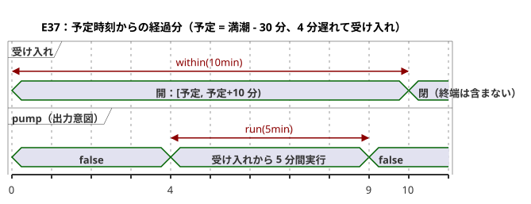

予測が欠落しているか古い場合、または時計が Unknown の場合は、新しい運転を受け入れません。`fallback=skip` は、物理的なフェイルセーフの振る舞いを証明するものでも、予測を作り出すものでもありません。`pump` は出力意図であり、safe、applied、confirmed という物理的な事実とは区別されます。プロバイダの観測所、リビジョン、オカレンス、そして時計のスナップショットは環境からの入力です。コードにはアドレスや設備の認証情報は含まれていません。

```ghost
// E37
control TideRun {
  state displayed_pump: Bool = false;
  displayed_pump' = if true then high.active else displayed_pump;
  // Source-local display memory is initialized here; faults remain producer unknown.
  state remembered_allowed: Bool = false;
  let allowed_good = case observed_allowed { ok(_) => true; fault(_) => false; };
  let allowed = case observed_allowed { ok(value) => value; fault(_) => remembered_allowed; };
  remembered_allowed' = allowed;
  state remembered_stop: Bool = false;
  let stop_good = case observed_stop { ok(_) => true; fault(_) => false; };
  let stop = case observed_stop { ok(value) => value; fault(_) => remembered_stop; };
  remembered_stop' = stop;
  input observed_allowed: Bool;
  input observed_stop: Bool;
  provider harbor_tides: TidePredictions;
  schedule high: Tide {
    source = harbor_tides;
    timezone = "UTC";
    at = tide`high - 30min`;
    basis = run(5min, within(10min));
    when = allowed_good && allowed;
    cancel_when = stop_good && stop;
    clock = trusted_only;
    gap = skip_after(60s);
    recovery = baseline;
    fallback = skip;
  }
  output pump: Bool;
  pump <- displayed_pump';
}
```

### E98 — Int と Number の暗黙の混在を拒否する

ここでは `count` が `Int`、`measurement` が `Number` であり、コンパイラはこのコードを拒否します。近似計算を意図しているなら、`number(count)` と明示的に書いてください。厳密な計数に変換するには、`int_exact` または明示的な丸め変換を、そのエラー方針とともに選んでください。

```ghost-error
control MixedCount {
  let count: Int = 1;
  let measurement: Number = 1.5;
  output total: Number;
  total <- count + measurement;
}
```

### E99 — オフセットのない DateTime を拒否する

ローカル時刻だけでは UTC の時点は特定できません。`Z` か数値のオフセットを書いてください。GhostFlow が IANA タイムゾーンを推測することは決してありません。

```ghost-error
control MissingOffset {
  output ready: Bool;
  ready <- datetime`2026-09-30T06:30:00` < datetime`2026-09-30T07:00:00Z`;
}
```

### E100 — Solar のフォールバックを明示する

データが欠けたときに何が起きるかは、ソースの契約の一部です。必須のフォールバックがないスケジュールからはバイトコードが生成されません。skip が望む方針であれば、`fallback = skip;` と書いてください。

```ghost-error
control MissingSolarFallback {
  schedule dawn: Solar {
    timezone = "UTC"; latitude = 37; longitude = 127; at = sun`rise`;
    basis = pulse; when = true; clock = trusted_only;
    gap = skip_after(60s); recovery = baseline;
  }
  output start: Bool;
  start <- dawn.due;
}
```

### E101 — Solar の固定時刻フォールバックを Tide に持ち込まない

現在の `fixed_time` の実行経路は Solar 専用です。Tide のフォールバックは `skip` です。固定時刻が満潮予測のオカレンスとして扱われることは決してありません。

```ghost-error
control UnsupportedTideFallback {
  provider predictions: TidePredictions;
  schedule high: Tide {
    source = predictions; timezone = "UTC"; at = tide`high`;
    basis = run(5min, within(10min)); when = true; cancel_when = false;
    clock = trusted_only; gap = skip_after(60s); recovery = baseline;
    fallback = fixed_time(time`06:30`, terminal: skip);
  }
  output pump: Bool;
  pump <- high.active;
}
```

### E102 — 時計保持の終わりを指定する

`hold_trusted(2min)` だけでは、保持が切れたときに何が起きるかが隠れてしまいます。現在サポートされている明示的な終端の方針は `terminal: skip` だけです。

```ghost-error
control MissingHoldTerminal {
  schedule dawn: Solar {
    timezone = "UTC"; latitude = 37; longitude = 127; at = sun`rise`;
    basis = pulse; when = true; clock = hold_trusted(2min);
    gap = skip_after(60s); recovery = baseline; fallback = skip;
  }
  output start: Bool;
  start <- dawn.due;
}
```
