<!-- translation-source: docs/ProgrammingInGhostflow.en.md -->
[영문 원문](ProgrammingInGhostflow.en.md)

# Programming in GhostFlow

**2026-10-05 외부 입력 개정에 대한 안내.** 품질 정보를 갖는 선언은 이제 `input`을 사용합니다. 기존 조건화와 명시적인 `Result` 고장 분기는 소스에 작성된 정책으로 그대로 유지됩니다. 이전 `sensor` 발췌는 `tests/fixtures/history/issue531/`에 보존되어 있습니다. 가져온(import) 소스 개정에는 별도로 검증한 자체 소스 묶음(source closure)이 필요합니다.

예전에 평범한 관측값을 읽던 예제는 이제 `observed_*` 생산자 채널을 선언하고 그 `Result`를 명시적으로 처리합니다. 이와 관련된 몇 가지 규칙이 책 전체에 적용됩니다.

- `remembered_*`와 `displayed_*` 상태는 소스 안에서 기억을 초기화합니다. 그 초기값은 생산자가 정상적인 `false`나 0을 제공했다고 주장하지 않습니다.
- 알 수 없는 관측은 이미 확립된 기억을 유지합니다. 그러나 품질로 보호된 새 전이를 허가할 수는 없습니다.
- 현재 정상인 STOP이나 해제된 허가가 우선합니다. 이미 시작된 최대 운전 시간도 그대로 만료됩니다.
- 취득 품질은 물리적인 버튼이나 장비가 고장 났다고 주장하지 않습니다.

이는 명시적인 학습용 개정입니다. 보존한 정상 데이터셋은 원래의 논리 필드 이름을 그대로 유지하며, 명시적인 테스트 어댑터가 둘을 연결합니다.

장치의 동작을 코드로 적고, 실행해 보며 이해하기

**개정판 · 한국어 번역 · Language Reference 기준**

## 시작하기 전에

스위치를 누르면 램프가 켜지고, 정해진 시각이 되면 물을 주고, 물이 부족하면 펌프가 멈추게 하고 싶다고 해 봅시다.

하나씩 보면 단순한 일입니다. 하지만 조건이 늘어나고 여러 장치가 함께 움직이기 시작하면, 무엇이 언제 켜지고 왜 멈추는지 알아보기 어려워집니다.

GhostFlow는 이런 조건과 동작을 코드로 적는 언어입니다. GhostFlow 프로그램은 센서값이나 사용자 조작에 따라 상태가 어떻게 바뀌는지, 그리고 장치에 어떤 동작을 요청하는지를 기술합니다.

이 책은 문법을 모두 외운 뒤에 프로그램을 쓰라고 요구하지 않습니다. 대신 다음 세 단계를 반복합니다.

1. 결과를 예측합니다.
2. 한 가지만 바꿉니다.
3. 결과가 달라지는 tick을 찾습니다.

**tick**은 제어 프로그램을 한 번 평가하는 단위이며, [1장](#ch01)에서 자세히 설명합니다. 스위치 하나에서 시작하지만, 곧 실제 현장에서 만나는 질문으로 넘어갑니다.

- START와 STOP이 함께 들어오면 누가 이길까요?
- 센서 값이 흔들리거나 오래되면(stale) 무엇을 여전히 믿을 수 있을까요?
- 화면의 ON은 장치가 실제로 켜졌다는 뜻일까요?

답을 맞히는 것보다 근거를 남기는 것이 더 중요합니다. 각 예제에서 입력과 이전 상태를 적으세요. 그런 다음 다음 상태와 요청 의도·안전 의도를 예측합니다. **요청 의도(requested intent)**는 프로그램이 요청하는 출력입니다. **안전 의도(safe intent)**는 그 출력에 안전 조건을 적용한 결과입니다. 마지막으로 예측과 실행 결과를 비교합니다. 예측과 실행 결과가 다르다면, 그 차이가 바로 배울 개념입니다.

아래 그림은 한 tick이 무엇을 읽고 무엇을 만들어 내는지, 즉 실행 전에 무엇을 적어 두어야 하는지를 보여 줍니다.

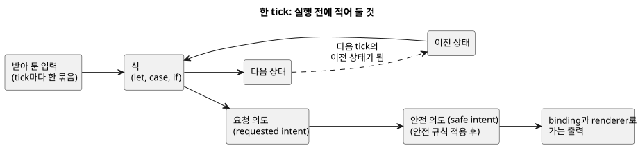

한 tick의 다음 상태는 그다음 tick의 이전 상태가 됩니다. E01처럼 `state`가 없는 프로그램은 읽을 이전 상태가 없을 뿐입니다.

정확한 문법과 동작 규칙은 [Language Reference](LANGUAGE-REFERENCE.md)를 보세요. 이 안내서는 예제로 가르치고, Reference는 언어를 정의합니다. 두 문서가 서로 다르면 Reference를 따르세요. 문법이 바뀌면 Reference를 먼저 고치고, 그다음 이 안내서의 예제를 그에 맞춥니다.

코드를 작성하다가 생기는 질문은 [GhostFlow Coding FAQ](language_faq.md)도 함께 참고하세요.

### 예제를 읽기 전에 알아둘 점

이 안내서에 예제가 있다고 해서, 그 기능을 지금 바로 실제 보드에서 실행할 수 있다는 뜻은 아닙니다.

코드가 컴파일되는지, 실행 환경이 그 기능을 지원하는지, 실제 장치가 의도대로 동작하는지는 각각 따로 확인해야 합니다. 이 안내서는 현재 명세에 따라 코드를 어떻게 쓰고 읽는지 설명합니다. 모든 기능이 구현되었거나 보드 배포 준비가 끝났다고 주장하지 않습니다.

이 개정판이 주장하는 것은 정확히 다음까지이며, 그 이상은 아닙니다.

- 소스가 현재 Language Reference를 따르는지
- 현재 컴파일러와 논리 실행 경로가 무엇을 검사하는지
- 공개 reader에서 어떤 실습을 열 수 있는지

특정 보드, 배선, 센서, 액추에이터에서 물리 동작을 검증했다고 주장하지 않습니다. 구현 범위와 근거는 항상 현재 checkout의 [Implementation](IMPLEMENTATION.ko.md) 문서, [기능별 성숙도와 실행 근거](REFERENCE-FEATURE-STATUS.md), 그리고 테스트가 정합니다.

공개 reader catalog에서 예제는 다음과 같이 나뉩니다.

| 예제 | 확인하는 곳 |
|---|---|
| E11을 제외한 E01–E33, PC-01–PC-10, tutorial/03–04 | 필요한 browser capability가 승인되면 reader에서 실행합니다. |
| E11 | 실행 control이 아니라 canonical 표기를 설명합니다. |
| E34–E37 | 컴파일되지만 현재 browser cabinet이 `Int`, `DateTime`, 새 자연 사건 host facts를 받아들이지 못하므로 별도 host 프로필에서 검사합니다. |
| `station-rules` | 별도 host에서 실행되는 정책 문법입니다. |
| E90–E102 | 성공 실행이 아니라 예상 진단을 확인합니다. |

이 구분은 **어디에서 어떤 근거를 볼 수 있는지**를 알려 줍니다. 기능의 가치 순위를 매기는 것이 아닙니다.

### 예제는 이렇게 읽어주세요

**예제는 하나씩 따로 실행하세요.** 각 `ghost` 예제는 독립된 프로그램입니다. 책의 예제를 모두 한 파일에 이어 붙여 함께 실행하지 마세요.

**설명도 프로그램 문서의 일부입니다.** 실제 프로그램은 `.ghost.md` 문서로 작성합니다. 한 프로그램의 코드를 여러 최상위 `ghost` 블록으로 나눠 적었다면, 그 블록들을 위에서 아래로 읽어 하나의 제어 프로그램으로 봅니다. 블록 사이의 문단, 즉 프로그램이 왜 그렇게 동작해야 하는지에 대한 설명도 소스 문서에 함께 남습니다.

**코드의 출력과 장치의 동작을 구분하세요.** 이 책에서 *출력*은 장치에 어떤 동작을 요청하기 위해 프로그램이 계산한 값입니다. "펌프를 켜라"는 값을 만들었다고 해서 실제 펌프가 저절로 켜지지는 않습니다. 두 가지가 더 필요합니다. 그 값을 GPIO 핀이나 릴레이에 연결하는 **binding**과, 그 값을 하드웨어에 적용하는 **출력 renderer**입니다. 센서에서 값을 읽어 오는 일은 **입력 driver**가 맡습니다.

정확한 표기는 [Reference 선언과 표기 찾아보기](reference/07-semantic-rules-and-index.md#75-선언과-표기-찾아보기)를 보세요. 언어를 왜 이렇게 설계했는지는 [설계 철학](LANGUAGE-REFERENCE.md#설계-철학)에서 설명합니다. 언어, 실행 환경, 장치가 각각 무엇을 책임지는지는 [Reference 8장](reference/08-language-runtime-and-device-boundaries.md#83-faq-전체-책임표)에 정리되어 있습니다.

### 예제는 어떻게 확인하나요?

[예제 실행 검사](../tests/programming-book-simulation.test.mjs)는 원본 예제를 컴파일하고, 정해진 입력과 시험용 시각으로 실행합니다. 그런 다음 상태가 어떻게 바뀌었는지, 어떤 출력을 요청했는지(요청 의도), 안전 조건을 적용한 뒤 어떤 출력이 남았는지(안전 의도)를 확인합니다.

예제마다 필요한 입력과 실행 환경이 달라서 검사 방법도 다릅니다.

- E11을 제외한 E01–E33의 control은 공개 reader가 선택한 실행 profile에서 검사합니다.
- E02와 E08은 설정 결과(`Result`)와 맥락 정보(context facts)를 받습니다. E09는 civil schedule facts, 즉 달력과 시각을 기준으로 한 일정 정보를 받습니다.
- E10, E14, tutorial/03은 센서 샘플과 필요한 capability를 받습니다.
- PC-01–PC-10과 tutorial/03–04도 필요한 capability가 승인되면 browser에서 실행합니다.
- E34–E37과 `station-rules`는 앞에서 설명한 별도 host 프로필을 사용합니다.

일반적인 입력·상태 예제는 공유 Rust 핵심의 논리 결과를 검사합니다. browser reader는 같은 의미를 WASM 경로로 보여 줍니다. 두 경로 모두 입력, 상태, 요청 의도·안전 의도, 진단을 관찰합니다. 어느 경로도 물리 장치 효과를 확인하지는 않습니다.

tutorial/04는 기존 `ControlRuntime`/`DailySlots` WASM host에서 일정 이벤트와 순차 출력을 확인합니다. station-rules는 `ghostrules`로 정책을 컴파일해 연결한 뒤, WASM `GhostFlowStation`에서 출력 허가와 `Stop`을 확인합니다. 이 두 심화 예제는 `ghostsim` CLI 경로와 따로 검사합니다.

E11은 표기를 설명합니다. E90–E102는 일부러 잘못된 코드를 담고 있으며, 컴파일러가 예상한 오류를 보고하는지 확인합니다. 그림과 프로그램 합성에 관한 설명은 실행하지 않습니다. 소스를 바꿔 보는 실험은 원본과 따로 검사합니다.

예제 검사를 직접 실행하려면 Node 의존성과 같은 revision에서 빌드한 네이티브/WASM 산출물이 필요합니다. 그런 다음 `node --test tests/programming-book-simulation.test.mjs`를 실행하세요. 전체 빌드와 검증 순서는 [Verification](VERIFICATION.ko.md)을 참고하세요.

`tests/docs-runnable-examples.test.mjs`의 컴파일러 검사는 런타임을 빌드하지 않아도 실행됩니다.

14장에는 온도와 기후 센서를 다루는 E16–E22가 있습니다. 15장과 심화 예제 E23–E37은 물리량, 관찰, 정확한 계수, 자연 시각을 더 깊이 다룹니다. 제어 계산과 import package의 근거는 `tests/programming-book-simulation.test.mjs`, `tests/programming-climate.test.mjs`, `tests/programming-book-import-package.test.mjs`에 나뉘어 있습니다.

이 모든 단계는 프로그램의 논리와 계산을 확인합니다. 실제 센서와 장치가 의도대로 동작하는지는 별도로 검증해야 합니다.

## 목차

### PLC에서 GhostFlow로 — 실습부터 시작하기

버튼과 램프에서 시작하는 10단계 실습 과정입니다. 이어서 START/STOP, 모터, 인터록, 리미트, 타이머, 수위, 수동/자동 운전, 순차제어, 고장 복구를 다룹니다.

각 단계에서는 먼저 장치가 어떻게 동작해야 하는지 생각해 보세요. 그런 다음 그 동작을 GhostFlow 코드로 어떻게 표현하는지 확인합니다.

### 주제별로 살펴보기

1. [스위치 하나와 출력 하나](#ch01)
2. [이름, 값, 타입, 표현식](#ch02) · [측정값에서 타입 찾기](#quantity-type-lookup)
3. [상태를 기억한다는 것](#ch03)
4. [출력 의도와 최종 출력](#ch04)
5. [함수로 계산을 나누기](#ch05)
6. [시간을 기다리는 제어](#ch06)
7. [시각에 맞추어 시작하기](#ch07)
8. [센서의 값과 품질](#ch08)
9. [식을 정확하게 읽기](#ch09)
10. [멈추고, 바꾸고, 비교하기](#ch10)
11. [파일과 literate 프로그램](#ch11)
12. [하나의 장치, 여러 control](#ch12)
13. [내장함수와 내장 연산](#ch13)
14. [온도 단위와 공기 VPD 제어](#ch14)
15. [이름 있는 물리량과 단위](#ch15)

부록: [A. 명세 길잡이](#appendix-a) · [B. 오류로 배우기](#appendix-b) · [C. 문서 유지 규칙](#appendix-c) · [D. 관심그룹별 예제](#appendix-d)


<a id="ch01"></a>
## 1. 스위치 하나와 출력 하나

장치 제어를 처음 배우면, 입력을 그대로 출력에 연결하는데 왜 언어가 필요한지 궁금할 수 있습니다. 이 단순함이 출발점입니다.

E01을 실행하기 전에, 스위치가 `false → true → false`로 바뀌는 세 tick의 램프 값을 적어 보세요. 결과가 예측과 같다면, 다음 질문은 값이 아니라 **그 값이 어느 경계에서 왔는가**입니다. 물리 접점, 정규화된 입력, 논리 출력, 실제 릴레이를 구분할 수 있게 되면, 이 책의 더 복잡한 프로그램도 모두 같은 방법으로 읽을 수 있습니다.

### E01 — 입력을 출력에 연결하기

첫 프로그램은 스위치가 켜지면 LED를 켜고, 스위치가 꺼지면 LED를 끕니다.

```ghost
// E01
// Explicit quality-input revision: acquisition faults request lamp OFF.
control FollowSwitch {
  input switch_on: Bool;
  output lamp: Bool;

  lamp <- switch_on |> recover(false);
}
```

이 개정 예제는 외부 입력을 `Result<Bool, SensorFault>`로 읽습니다. 즉 프로그램은 tick마다 정상 값 또는 fault(고장) 중 하나를 받습니다.

- 정상 `false`나 `true`는 아래 표와 똑같이 동작합니다.
- fault(NotReady, Disconnected, Stale, Invalid)에서는 명시적으로 lamp OFF를 요청합니다. 이때 `false`를 공급하는 것이 `|> recover(false)`입니다.

fault에서 OFF를 요청하는 것은 이 예제에서 확정한 정책입니다. 언어 기본값이 아니며, 물리 접점이 OFF라는 근거도 아닙니다. 입력 fault와 그 provenance(출처 기록)는 그대로 기록됩니다. 이 스위치 추종 예제에는 START 버튼이나 운전 기억을 추가하지 않습니다. 이전 E01 소스는 [개정 전 코드 기록](historical/2026-10-05-input-531-book-excerpts.ko.md)에 보존되어 있습니다.

`control FollowSwitch`는 이 판단에 이름과 경계를 부여합니다. 경계 밖에서 들어오는 값은 `input`이고, 계산이 바깥으로 내보내는 값은 `output`입니다. 둘 사이에 숨은 배선이나 장치 선택은 없습니다.

`lamp <- switch_on |> recover(false)`를 화살표 방향대로 읽으면 "이번 tick의 lamp 요청은 `switch_on`에서 왔다"가 됩니다. `Bool` 값 두 개만으로도 출력이 어디에서 왔는지 설명할 수 있습니다. 이것이 이 장의 첫 번째 작은 성과입니다.

| 입력 `switch_on` | 출력 `lamp` |
|---|---|
| `false` | `false` |
| `true` | `true` |

이 표는 가능한 두 순간을 보여 줍니다. 해제 → 누름 → 해제는 세 번째 값이 아닙니다. 시간에 따라 두 행을 오가는 **전이 시나리오**입니다. 표와 시나리오를 구분하면 "지금 값은 무엇인가?"와 "어떻게 여기까지 왔는가?"를 섞지 않게 됩니다.

아래 타임라인은 이런 시나리오를 tick 단위로 재생하고, 관측이 fault인 tick 하나를 덧붙입니다.

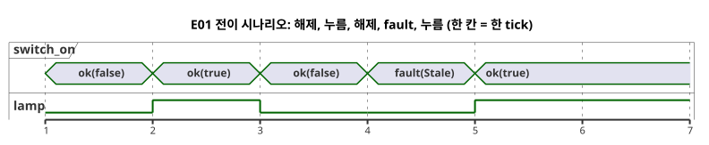

fault tick에서 램프가 OFF인 것은 스위치를 놓았기 때문이 아니라, 이 예제가 `recover(false)`를 선택했기 때문입니다.

### 접점, PLC 입력, GhostFlow 입력을 나누어 읽기

릴레이 회로에서 NO(평상시 열림) 접점과 NC(평상시 닫힘) 접점은 쉬고 있을 때와 눌렸을 때 도통 상태가 서로 다릅니다. PLC는 그 전기 상태를 디지털 입력(DI)으로 읽습니다. 그리고 배선과 입력 모듈의 극성을 반영해 그 상태를 프로그램이 쓰는 의미로 정규화합니다. GhostFlow의 `switch_on`은 이미 정규화된 논리 입력입니다. 따라서 이 예제의 경계는 다음과 같습니다.

| 층위 | NO | NC | GhostFlow에 전달하는 값 |
|---|---|---|---|
| 쉬는 상태 | 접점 비연속 | 접점 연속 | `switch_on = false` |
| 누른 상태 | 접점 연속 | 접점 비연속 | `switch_on = true` |

NC 접점 때문에 raw 신호가 반대로 보인다면, 그것은 입력 정규화의 문제입니다. 접점이 NC라는 사실만으로 프로그램에 `!`를 붙인다는 뜻은 아닙니다. 정규화는 배선·입력 모듈 경계에서 명시하고, GhostFlow에는 Bool payload가 `false` 또는 `true`인 정상 observation을 전달하세요. observation의 품질과 identity는 보존해야 합니다. 끊어진 전달 경로는 fault이며, 절대 정상 `false`로 바꾸어서는 안 됩니다.

정리하면 다음과 같습니다.

- **릴레이**는 물리적인 접점 경로를 만듭니다.
- **PLC**는 DI와 래더 로직 또는 기능 블록으로 그 입력을 처리합니다.
- **GhostFlow**는 정규화된 의미 입력을 선언된 출력 계산에 연결합니다.

이 책의 예제는 논리 계산을 설명합니다. 실제 접점, 전기 배선, PLC 입력 모듈, 장치 출력의 검증은 binding과 renderer 계약의 범위입니다.

아래 그림은 E01 신호를 접점에서 릴레이까지 따라갑니다. 가운데 부분만 GhostFlow 코드입니다.

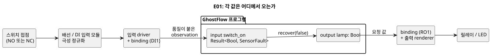

### 실행을 읽는 단위: tick

한 번의 제어 평가를 **tick**이라고 부릅니다. 한 tick의 모든 식은 한 번 받아 둔 같은 입력 묶음을 봅니다. 계산 도중에 스위치가 바뀌어 식마다 서로 다른 물리적 순간을 읽는다고 상상하지 마세요. 새 입력 묶음은 다음 tick이 시작될 때 들어옵니다.

E01에는 기억이 없으므로, 같은 입력 observation은 언제나 같은 출력을 만듭니다. 정상 입력의 실행 기록(trace)에서 `switch_on`과 `lamp`가 처음으로 달라지는 tick이 있다고 해 봅시다. 그렇다면 이 식을 의심하기 전에 입력 정규화, binding, Driver를 먼저 살펴보세요. 3장에서는 `state`를 추가합니다. 그 뒤로는 과거가 달랐다면 같은 현재 입력에서도 다른 결과가 나올 수 있습니다.

`switch_on`을 DI1에, `lamp`를 RO1에 연결하는 정보는 프로그램 바깥의 매핑입니다. 이름이 하드웨어 포트를 자동으로 고르지는 않습니다. 그래서 같은 계산을 가상 스위치·LED에 연결할 수도 있고, 실제 장치 I/O에 연결할 수도 있습니다.

### 바꾸어 보기

연결식을 `lamp <- case switch_on { ok(value) => !value; fault(_) => false; };`로 바꿔 보세요. 실행하기 전에 새 표를 종이에 그려 보세요. `!`는 참과 거짓을 뒤집으므로 두 출력 칸이 모두 바뀌어야 합니다.

결과를 확인한 뒤에는 원래대로 돌려놓으세요. 이번에는 입력 이름만 바꿔 봅니다. 동작은 그대로지만, 읽는 사람이 프로그램을 해석하는 방식은 달라집니다. 계산 변경과 설명 변경을 구별하는 첫 번째 연습입니다.

<a id="ch02"></a>
## 2. 이름, 값, 타입, 표현식

현장의 실수는 계산이 어려워서라기보다, 한 사람은 `30`을 30퍼센트로 읽고 다른 사람은 30초로 읽어서 생기는 경우가 많습니다. 이 장에서 이름과 타입은 그런 오해를 일찍 잡아내는 도구입니다.

E02를 실행하기 전에 29%, 30%, 31%에 대해 예상되는 행을 적어 보세요. 그런 다음 `<`만 `<=`로 바꿉니다. 정확히 한 경계 행만 바뀐다면, 타입과 작은 식이 판단을 얼마나 좁혀 주는지 알 수 있습니다.

### 문장을 구분하는 표기

현재 문법에서 선언과 식 정의는 `;`로 끝납니다. 컴파일러는 줄바꿈을 보고 문장이 끝났다고 추측하지 않으므로, 긴 식을 여러 줄로 나눠도 의미가 바뀌지 않습니다. `{ }`는 범위(scope)를 만들고, 들여쓰기는 사람이 구조를 보기 쉽게 도울 뿐입니다. 함수의 마지막 식처럼 세미콜론을 생략할 수 있는 몇몇 자리는 부록 A에 정리되어 있습니다.

이름은 영문자나 밑줄로 시작하며, 뒤에 영문자, 숫자, 밑줄을 이어 쓸 수 있습니다. 이름은 대소문자를 구별하므로 `start`와 `Start`는 서로 다른 이름입니다. 예약어와 내부용 `__gf_` 접두사는 이름으로 쓰지 마세요. 현재 식별자는 ASCII만 허용하므로, 한국어 같은 다른 언어의 설명은 `//` 주석이나 literate 본문에 적으세요.

### 기본 값과 타입

| 타입 | 예 | 의미 |
|---|---|---|
| `Bool` | `true`, `false` | 참 또는 거짓 |
| `Int` | `120`, `-2` | signed 32-bit 정확한 정수 |
| `Number` | `3`, `0.5`, `-2` | 일반 수치. 내부 표현은 f64 |
| `Percent` | `30%` | 백분율 값. 리터럴·입력 범위는 0–100 |
| `Duration` | `250ms`, `2s`, `5min`, `1h` | 밀리초 해상도의 음수가 아닌 시간 길이 |

`Int`, `Number`, `Percent`, `Duration`은 겉모양이 비슷해 보여도 각각 다른 질문에 답합니다. `Percent`는 `Number`와 직접 비교할 수 없습니다. 이 규칙은 30%가 값이 우연히 30인 측정값인 척하는 것을 막아 줍니다. 정확한 개수와 횟수에는 `Int`를, 측정값 같은 근사 값에는 `Number`를 쓰세요. 정확한 범위와 변환은 [Reference §2.1–2.3](reference/02-types-expressions-state.md#21-값-종류)을 따릅니다.

기대하는 수치 타입이 없으면, 정수 모양 리터럴은 `Int`이고 소수점이나 지수가 있는 리터럴은 `Number`입니다. 이미 `Number`로 정해진 문맥에서는 `3`을 처음부터 Number로 읽습니다.

`Duration` 리터럴은 음수가 아닌 정수 뒤에 단위 `ms`, `s`, `min`, `h` 중 하나를 붙입니다. 반 초는 `500ms`로 씁니다. 자세한 범위와 연산은 [Reference §3.1](reference/03-time-and-schedules.md#31-시간값과-시계-영역)을 따릅니다.

`"Asia/Seoul"`은 시간대 설정에서, `06:00`은 일정 설정에서 사용합니다. 일반 문자열이나 시각 값의 문법과 혼동하지 마세요.

### 정확한 계수와 근사 측정

열매 수나 반복 횟수처럼 세는 값은 정확한 정수여야 합니다. 예를 들어 `120 + 1`은 정확히 `121`이어야 합니다. 반면 온도 `24.3` 같은 측정 실수는 센서와 도메인이 정한 허용 오차 안에서 근삿값이어도 됩니다.

GhostFlow는 정확한 계수를 signed 32-bit `Int`로 표현합니다. 범위를 벗어난 값과 잘못된 변환은 절대 조용히 wrap되거나 반올림되지 않습니다. 대신 진단이나 명시적인 runtime fault가 됩니다. 측정 실수에는 `Number`를 사용하세요. 자세한 내용은 [Reference §2.3](reference/02-types-expressions-state.md#23-정확한-정수-설계)을 보세요.

날짜와 시각은 `date`, `time`, `datetime` tagged literal로 씁니다. DateTime에는 시간대 offset이 필요합니다. 달력 날짜·시각과 단조 경과 시간은 서로 다른 의미입니다. [Reference §3.1](reference/03-time-and-schedules.md#31-시간값과-시계-영역)을 따르세요.

온도, 유량, 전압처럼 단위가 제어 판단에 영향을 주는 값은 일반 `Number`와 구분하세요. 예를 들어 `Temperature`의 `25°C`, `FlowRate`의 `5L/min`, `Voltage`의 `24V`는 고정된 물리량 타입과 단위를 가집니다. 허용 단위, 변환, 연산은 [Reference §2.9](reference/02-types-expressions-state.md#29-물리량과-단위)를 따릅니다. `Rate<Q>`는 시간창 계산을 위한 식 전용 타입이며, 일반 input/output/state 타입이 아닙니다. 단위를 섞어 쓰는 예와 물리량 사이의 연산은 [15장](#ch15)에서 다룹니다.

<a id="quantity-type-lookup"></a>
### 측정하려는 값에서 타입 찾기

섭씨로 측정하더라도 타입 이름은 `Temperature`입니다. `Celsius`나 `Fahrenheit`라는 타입을 선언하지 마세요. 단위는 값에 붙입니다. `input air: Temperature;`로 선언하고 기준값은 `30°C`처럼 씁니다. `30°C`, `86°F`, `303.15K`는 같은 절대 온도를 나타냅니다. [14장](#ch14)에서 단위 변환과 온도 제어를 이어서 다룹니다.

| 측정하는 값 | 선언 타입 | 값 예시 | 입력 선언 |
| --- | --- | --- | --- |
| 절대 온도 | `Temperature` | `30°C` | `input air: Temperature;` |
| 온도 차이 | `TemperatureDelta` | `5Δ°C` | `input rise: TemperatureDelta;` |
| 상대 습도 | `RelativeHumidity` | `70%RH` | `input humidity: RelativeHumidity;` |
| 수위 등 백분율 | `Percent` | `70%` | `input level: Percent;` |
| 이산화탄소 농도 | `CO2Concentration` | `800ppm` | `input co2: CO2Concentration;` |
| 유량 | `FlowRate` | `5L/min` | `input flow: FlowRate;` |
| 압력 | `Pressure` | `1.2kPa` | `input pressure: Pressure;` |
| 수증기압차 | `VaporPressureDeficit` | `1.2kPaVPD` | `input vpd: VaporPressureDeficit;` |
| 광합성 광자속 밀도 | `PPFD` | `500umol/m2/s` | `input light: PPFD;` |
| 전압 | `Voltage` | `24V` | `input supply: Voltage;` |
| 경과 시간 | `Duration` | `5s` | `input delay: Duration;` |

비슷해 보이는 값에 주의하세요. `70%RH`와 `70%`는 타입이 다르고, `1.2kPaVPD`와 `1.2kPa`도 타입이 다릅니다. 절대 온도와 온도 차이도 서로 다른 타입입니다.

입력은 품질을 담은 `Result` 값으로 읽습니다. 값을 꺼내거나 비교하기 전에 정상 분기와 고장 분기를 명시적으로 처리하세요. 이 표는 fault 시 대체값이나 제어 정책을 대신 정해 주지 않습니다. 전체 단위와 연산 규칙은 [Reference §2.9](reference/02-types-expressions-state.md#29-물리량과-단위)를 따릅니다.

### E02 — 입력, 설정, 계산에 각각 이름 붙이기

수위가 설정값보다 낮으면 급수 출력을 켭니다.

```ghost
// E02
control ThresholdControl {
  state displayed_pump: Bool = false;
  displayed_pump' = if level_good then low else displayed_pump;
  // Source-local display memory is initialized here; faults remain producer unknown.
  state remembered_level: Percent = 0%;
  let level_good = case observed_level { ok(_) => true; fault(_) => false; };
  let level = case observed_level { ok(value) => value; fault(_) => remembered_level; };
  remembered_level' = level;
  input observed_level: Percent;
  config threshold: Percent = 30%;
  let low = case threshold {
    ok(value) => level < value;
    fault(_) => false;
  };

  output pump: Bool;
  pump <- displayed_pump';
}
```

이 프로그램은 세 종류의 값에 각각 이름을 붙입니다.

| 이름 | 종류 | 무엇인가 |
|---|---|---|
| `observed_level` / `level` | 입력 관측 | `observed_level`은 tick마다 들어옵니다. `level`은 그 정상 값이며, 관측이 fault이면 마지막으로 기억한 값입니다. |
| `threshold` | 설정 | 조절할 수 있도록 `config`로 드러낸 값입니다. |
| `low` | 계산 | 이번 tick에서 `level`과 `threshold`를 비교한 결과입니다. 저장된 상태가 아닙니다. |

세 값에 서로 다른 이름이 있으므로, trace에서 "물이 낮아졌나? 설정이 바뀌었나? 비교 결과가 바뀌었나?"를 따로 물을 수 있습니다.

몇 가지를 더 짚어 보겠습니다.

- 소스에서 기본값을 바꾸면 새 문서 revision이 됩니다. 운영 중에는 `access = operator`로 공개한 설정에 한해 typed atomic live event로 값을 바꿀 수 있습니다. 메타데이터 계약은 [Reference §5](reference/05-settings-and-observation.md#51-config-선언)를 따릅니다.
- `config threshold: Percent`를 읽으면 `Result<Percent, SettingsFault>`가 나옵니다. 최초 값은 `ok(30%)`입니다. 이후 observation이 오류가 되더라도 설정이 기본값으로 자동 복구되지 않습니다.
- `threshold`가 fault이면 이 예제는 `low = false`를 선택합니다. 이는 언어 전체의 fallback이 아니며, 물리적인 페일세이프 보장도 아닙니다.
- `observed_level`이 fault이면 `level_good`이 false이므로 `displayed_pump'`는 이전 값을 유지하고 `pump`도 그대로 유지됩니다. 이것이 관측을 알 수 없는 동안 이미 확립된 기억을 지키는 이 예제의 방식입니다. `state`와 `'`(다음 상태) 표기는 [3장](#ch03)에서 설명합니다.
- `let`은 계산에 이름을 붙이는 것이며, 저장해 두는 메모리가 아닙니다.

수위와 설정이 모두 정상일 때 판단은 다음과 같습니다.

| `level` | `threshold`의 정상 payload | `low` / `pump` |
|---|---|---|
| `29%` | `30%` | `true` |
| `30%` | `30%` | `false` |
| `31%` | `30%` | `false` |

`low`의 정의를 출력 연결보다 아래로 옮겨도 계산은 같습니다. 컴파일러는 위에서 아래로 값을 덮어쓰는 대신 의존 관계를 따라갑니다. 그래서 코드 위치만 옮기는 편집과 판단을 바꾸는 편집을 따로 구분할 수 있습니다. 두 `let` 정의가 서로의 결과를 먼저 필요로 하면 순환이 됩니다. 어느 쪽도 시작점을 제공하지 못하므로 컴파일러는 이런 순환을 거부합니다.

**작은 실험:** `<`를 `<=`로 바꾸면 표의 어느 행 하나가 바뀔까요?

<a id="ch03"></a>
## 3. 상태를 기억한다는 것

작업자가 START에서 손을 뗀 뒤에도 펌프가 계속 돌아야 한다면, 현재 입력만으로는
제어할 수 없습니다. 프로그램은 START가 눌렸었다는 사실을 기억해야 합니다. 반대
문제도 똑같이 중요합니다. STOP 뒤에 START가 아직 눌려 있다고 해서 펌프가 곧바로
다시 켜지면 안 됩니다. 그래서 이 장의 실습은 두 질문을 함께 다룹니다.

- 프로그램은 무엇을 기억해야 하는가?
- 어떤 사건 뒤에는 무엇을 잊어야 하는가?

각 표에서 다음 상태 열을 가리고, 읽기 전에 먼저 예측해 보세요. 선택 과정인 PC 경로
(PC-02~PC-10)는 이 작은 기억을 모터, 방향전환, 수위, 모드 전환, 순차 운전, 고장
복구로 확장합니다.

### E03 — 정지 우선 자기유지

목표: START를 잠깐 눌렀다 떼어도 펌프가 계속 운전하고, STOP을 누르면 멈추게 합니다.
이 패턴을 *자기유지*(래치)라고 부릅니다.

```ghost
// E03
// Explicit quality-input revision: protective faults stop; recovery needs healthy START release/repress.
control LatchingPump {
  input start, stop: Bool;
  state running: Bool = false;
  state restart_blocked: Bool = false;
  output valve, pump: Bool;

  let start_good = case start { ok(_) => true; fault(_) => false; };
  let stop_good = case stop { ok(_) => true; fault(_) => false; };
  let start_requested = start |> recover(false);
  let stop_requested = stop |> recover(true);
  let acquisition_fault = !start_good || !stop_good;
  restart_blocked' = if acquisition_fault then true
    else if !start_requested then false else restart_blocked;
  running' = !stop_requested && (running || (start_requested && !restart_blocked));
  valve <- running';
  pump <- running';

  require pump => valve;
}
```

이 소스는 품질(`ok` 또는 `fault`)을 함께 전달하는 입력을 위한 명시적 새
revision입니다. 정상 입력일 때의 두 동작, 곧 자기유지와 정지 우선은 그대로 보존합니다.
여기에 취득 fault에 대한 정책을 더합니다.

- START fault는 새 시작을 막습니다(`recover(false)`가 START를 해제된 것으로 취급).
- 이미 운전 중이면 STOP이 정상이고 해제된 동안만 운전을 이어 갑니다.
- STOP fault는 운전 기억을 지우고 pump/valve OFF를 요청합니다(`recover(true)`가
  STOP을 눌린 것으로 취급).
- 어느 입력이든 fault가 나면 `restart_blocked`가 설정됩니다. fault로 정지한 뒤에는
  START를 계속 누르고 있어도 다시 운전하지 않습니다. 프로그램은 먼저 두 입력이 모두
  정상인 상태에서 START 해제를 관측해야 하고, 그 뒤 새로 눌러야 시작합니다.
- 처음부터 정상 START가 눌려 있으면 기존 정상 동작처럼 즉시 시작합니다.

이 정책은 기존 START 회로에 적용합니다. 램프나 자동 제어기에 START 버튼을 추가하라는
규칙이 아닙니다. 출력을 실제 장비에 적용하려면 별도의 renderer 증거가 필요합니다.
이전 E03 원문은 [개정 전 코드 기록](historical/2026-10-05-input-531-book-excerpts.ko.md)에
보존합니다.

아래 그림은 같은 정책을 상태로 보여 줍니다. 화살표 하나가 tick 하나입니다.

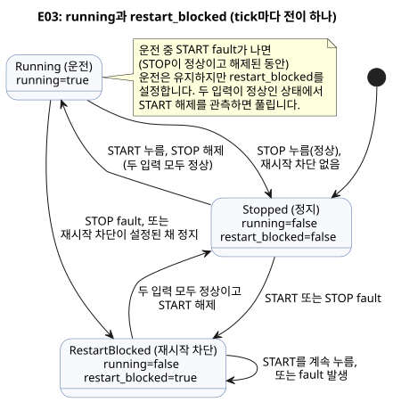

`running`은 tick 시작 시점에 기억하고 있던 값이고, `running'`은 현재 입력으로 계산한
다음 값입니다. 끝의 작은따옴표는 **prime**이라고 읽습니다. 두 이름이 두 시점을 나눠
줍니다. “STOP을 관측하기 전의 운전 상태”와 “STOP을 처리한 뒤 확정할 상태”가 섞이지
않습니다.

식을 소리 내어 읽어 봅시다. “정지가 눌리지 않았고, 시작이 눌렸거나 이미 운전 중이었다면
계속 운전한다.” 이 문장이 현장의 요구와 다르면 괄호를 옮기기 전에 요구부터 고쳐야
합니다. 두 버튼이 함께 눌리면 `!stop_requested`가 거짓이므로 정지가 이깁니다. 이 동시
입력 한 행이 ‘정지 우선’이라는 말을 관찰 가능한 동작으로 바꿉니다.

| tick | start | stop | 이전 `running` | 다음 `running'` | pump |
|---|---|---|---|---|---|
| 1 | false | false | false | false | false |
| 2 | true | false | false | true | true |
| 3 | false | false | true | true | true |
| 4 | true | true | true | false | false |
| 5 | false | false | false | false | false |

같은 표를 타이밍 그림으로 그렸습니다. `running`이 `running'`보다 정확히 한 tick 늦는
것을 보세요. 한 tick의 다음 값이 다음 tick의 이전 값이 됩니다.

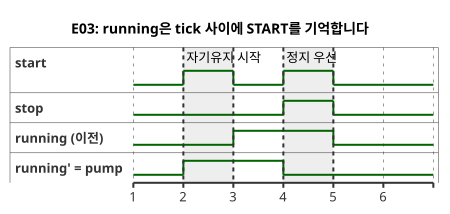

출력은 `running'`을 읽으므로 START를 관측한 바로 그 tick에 펌프가 켜집니다. 한 줄을
`pump <- running;`으로 바꾸면 출력이 이전 상태를 읽어 한 tick 늦게 켜집니다. 두
버전을 같은 입력으로 실행해 처음 달라지는 tick을 찾아보세요. 동작이 바뀐 이유는
문장이 소스의 어디에 있느냐가 아니라 **값이 어느 시점에 속하느냐**입니다.

### PC-02 — 새 시작을 기다리는 START / STOP

PC-02부터 PC-10까지는 선택 가능한 현장 문제 경로입니다. 반드시 따라야 하는 문법
순서가 아닙니다.

| 과 | 주제 |
|---|---|
| PC-02–03 | 재시작과 모터 허가 |
| PC-04–05 | 방향과 위치 |
| PC-06–08 | 시간, 수위, 모드 |
| PC-09–10 | 전체 순서와 복구 |

어떤 과도 앞의 과를 대체하지 않습니다. 각 과는 앞 예제를 그대로 두고 새 부담을 하나
더합니다.

E03의 기본 자기유지는 그대로 보존합니다. PC-02는
[별도 literate 원본](../examples/curriculum/pc-02-start-stop.ghost.md)에 있습니다.
`stop_ok`, `armed`, `running`, `start_event`를 추가해 정지 우선과 재시작 억제를
표현합니다. STOP에서 복귀할 때 START가 계속 눌려 있으면 새 시작 사건이 아니므로 출력은
꺼진 채로 남습니다. START를 놓았다가 다시 누르면 그때 `running'`과 펌프·밸브 출력이
켜집니다. PC-02는 E03을 대체하지 않습니다. 실제 접점과 릴레이 동작은 별도의 설치
계약으로 확인하세요.

### PC-03 — 모터 접촉기 명령과 과부하 허가

PC-03의 [canonical literate 원본](../examples/curriculum/pc-03-motor-contactor.ghost.md)은
PC-02의 새 시작 사건과 자기유지를 모터 제어 명령에 연결합니다. `stop_ok`와
`overload_ok`는 정규화된 허가 입력입니다. NC 접점의 배선과 극성은 전기·장치 어댑터가
정하며, 이 프로그램은 Bool 의미만 읽습니다.

핵심 식은 다음과 같습니다.

- `permit = stop_ok && overload_ok`
- `start_event = armed && start`
- `running' = permit && (start_event || running)`
- `armed' = permit && !start`
- `motor_contactor <- running'`

`motor_contactor`는 MC(전자 접촉기) 코일에 대한 논리 명령 하나입니다. 피드백이
아니며, MC 주접점이 닫혔다는 것, 모터에 전원이 들어갔다는 것, 모터가 회전한다는 것을
증명하지 않습니다. 두 회로는 나누어 읽어야 합니다.

- **주회로:** 차단기, MC 주접점, 과부하 계전기, 모터.
- **제어회로:** 제어전원, STOP, 과부하 보호접점, START/MC 보조접점 자기유지 분기,
  MC 코일.

소프트웨어 명령은 독립적인 전기적 보호를 대체하지 않습니다. 알람, fault latch/reset,
타이머, 센서 피드백, 하드웨어 동작은 이 curriculum/learning scenario의 범위 밖입니다.

이 예제는 `requested` intent와 `safe` 결과를 구분합니다. 릴레이·MC·모터의 물리적
증거는 언어의 출력 intent에 포함되지 않습니다.

### PC-04 — 정회전·역회전 방향전환 인터록

PC-04는 [canonical literate 원본](../examples/curriculum/pc-04-direction-interlock.ghost.md)에서
실행합니다. [E06 — 두 방향을 동시에 요청하면](#e06--두-방향을-동시에-요청하면)은 기본
예제로 그대로 둡니다. 두 출력이 동시에 후보가 되면 `mutex`가 양쪽을 막는 예제입니다.
PC-04는 그 제약을 복사하는 데서 그치지 않습니다. 정회전·역회전의 논리적 운전 상태와,
방향전환 사이의 정지 대기를 정의합니다.

입력:

- `forward_start`, `reverse_start`: momentary 시작 입력.
- `stop_ok`, `overload_ok`: 정상일 때 참인 정규화 허가 입력.

상태는 `Stopped | Forward | Reverse | WaitForward | WaitReverse`이고, 프로그램은
`start_armed=false`에서 시작합니다. 규칙은 다음과 같습니다.

- 두 시작 입력이 함께 들어오면 정지합니다. 우선권을 지어내지 않습니다.
- 운전 중 반대 방향을 새로 누르면 먼저 Wait 상태로 옮겨 두 접촉기 명령을 즉시
  끕니다.
- 반대 방향은 설정된 `reversal_wait = 2s`가 지난 뒤에만 켜집니다.
- 대기 중 새 방향 요청으로 목표가 바뀌면 그에 맞는 Wait 상태로 옮기고 대기를 다시
  시작합니다. 이전 목표를 남겨 두었다가 작업자의 새 요청과 반대로 기동해서는 절대
  안 됩니다.

`forward_contactor`와 `reverse_contactor`는 접촉기 코일에 보내는 논리 명령일
뿐입니다. `mutex`는 소프트웨어 backstop이며, 실제 설비에는 전기적·기계적 인터록도
필요합니다. 2초가 지났다는 사실이 모터가 실제로 멈췄다는 증거는 아닙니다.
zero-speed 피드백은 별도의 입력과 Driver 계약으로 표현하세요.

### PC-05 — 리미트 피드백으로 밸브 끝 위치를 확인하기

PC-05는 [canonical literate 원본](../examples/curriculum/pc-05-limit-feedback.ghost.md)에서
실행합니다. E06과 PC-04를 보존하고 참조합니다. `Phase`, `elapsed(phase)`, 다음 상태,
출력 연결을 사용해 명령과 동작 완료 관측을 구분합니다.

입력:

- momentary 요청 `open_request`/`close_request`;
- 끝 위치 관측 `open_limit`/`close_limit`;
- 허가 `stop_ok`/`overload_ok`.

프로그램은 `Stopped`에서 시작하며 초기 위치를 지어내지 않습니다. 정지 중에 관측하던
limit이 사라지면 과거 상태만 믿지 않습니다. 양쪽 limit이 동시에 참이면
`SensorConflict`로 가고 양쪽 출력이 꺼집니다. 반대 방향의 새 요청은 목표 limit보다
우선합니다. 양쪽 코일 명령을 끈 뒤 2초 경계에서만 이동을 재개합니다.

`Opening`/`Closing`이 끝 위치에 도달하지 못하면 timeout과 fault 정책이 처리합니다.
명령과 끝 위치 관측은 서로 다른 값입니다. 구동기를 물리적으로 멈추는 일은 Driver와
safety chain의 책임입니다.

### PC-06 — ON-delay, OFF-delay, 최대 운전을 따로 읽기

PC-06의 [canonical literate 원본](../examples/curriculum/pc-06-timer-patterns.ghost.md)은
세 가지 타이머 의미를 각각 독립된 상태로 보여 줍니다.

| 입력 | 동작 |
|---|---|
| `on_delay_request` | 요구가 2초 동안 유지되면 켜집니다 |
| `off_delay_request` | 요구가 사라진 뒤에도 3초 더 켜져 있습니다 |
| `limited_request` | 10초가 되면 꺼지고, 요구를 놓기 전에는 다시 시작하지 않습니다 |

세 입력은 momentary 버튼 사건이 아니라 유지되는 운전 요구입니다.

세 의미를 하나의 공유 타이머에 섞지 않으므로 OFF-delay가 최대 운전시간을 몰래 늘리지
않습니다. `stop_ok=false`는 OFF-delay까지 건너뛰어 세 출력을 즉시 끕니다. 각 경계의
직전·정확히 그 순간·직후, 그리고 취소와 재요청을 같은 논리 tick 규칙으로 판단하세요.
벽시계 속도와 논리 시간의 의미를 혼동하지 마세요.

### PC-07 — 두 수위 스위치 사이를 상태로 기억하기

PC-07의 [canonical literate 원본](../examples/curriculum/pc-07-tank-hysteresis.ghost.md)은
디지털 두 점 수위제어를 다룹니다. `low_level_reached`와 `high_level_reached`는 물이 각
물리 스위치에 도달했다는 정규화 관측입니다.

- 하한 스위치 아래에서 `Filling`을 시작합니다.
- 하한과 상한 스위치 사이에서는 현재 상태를 유지합니다.
- 상한 스위치에서 멈춥니다.
- 처음부터 중간 수위라면 켜지 않습니다. 앞선 저수위 사건이 없었기 때문입니다.

하한이 거짓인데 상한이 참이면 물리적 순서와 모순되므로 `SensorConflict`에서 출력이
꺼집니다. 충돌이 해소된 scan은 먼저 `Idle`로 돌아가고, 그 뒤 정상 평가를 재개합니다.
공통 정지·보호나 fault latch/reset을 이 수위 개념에 섞지 마세요. PC-08과 PC-10이
그것들을 결합합니다. [tutorial/03](../examples/tutorial/03-moisture.ghost.md)의 연속
센서 median·quality·hysteresis 예제는 별개의 과로 남겨 둡니다.

### PC-08 — 수동·자동의 출력 소유권을 바꾸기

PC-08의 [canonical literate 원본](../examples/curriculum/pc-08-manual-auto.ghost.md)은
PC-03의 수동 시작·자기유지와 PC-07의 자동 수요를 하나의 펌프에 연결합니다.

| `manual_mode_request` | `auto_mode_request` | 모드 |
|---|---|---|
| false | false | `Off` |
| true | false | `Manual` |
| false | true | `Auto` |
| true | true | `ModeConflict` |

충돌일 때, `Off`일 때, 모드가 바뀌는 scan에서는 펌프 명령이 항상 꺼집니다.

`manual_start`는 momentary 시작 사건이고 `auto_demand`는 유지되는 자동 요구입니다.
공통 `request_armed`는 안정된 모드에서 선택된 요구가 거짓인 것을 먼저 관측한 뒤에만
새 참을 시작 사건으로 인정합니다. 따라서 운전 중 모드를 바꾸거나 정지·과부하 허가가
복구되어도 이미 켜져 있던 요구로 재기동하지 않습니다. Auto 운전 중 요구가 사라지면
즉시 정지합니다. [station-rules.ghost.md](../examples/station-rules.ghost.md)와
[tutorial/04](../examples/tutorial/04-extra-valves.ghost.md)는 여러 control과 공유 자원
중재를 다루는 심화 자료로 남겨 둡니다.

이 예제는 모드 충돌을 명시적인 상태와 출력 식으로 처리합니다. 코일이 닫혔는지나
펌프가 회전하는지는 별도의 장치 확인이 필요합니다.

### PC-09 — 열린 것을 확인한 뒤 펌프를 켜기

PC-09의 [canonical literate 원본](../examples/curriculum/pc-09-sequential-water-supply.ghost.md)은
`Idle → Opening → Settling → Watering → PumpStopping → Closing → Idle` 순서를
정의합니다. 밸브 열림 출력이 켜졌다는 사실과 밸브가 실제로 열린 위치에 도달했다는
관측을 구분합니다.

- `open_limit`가 2초 동안 계속 확인되어야 펌프가 켜집니다.
- 5분 관수가 끝나는 scan에서는 펌프를 먼저 끕니다.
- 닫힘 접촉기는 다음 논리 scan부터 켜집니다. 이렇게 하면 지연을 따로 지어내지 않고도
  출력 순서가 보장됩니다.

열린 위치 피드백이 사라지거나, 두 limit가 동시에 켜지거나, 정지·과부하 허가가
사라지면 모든 출력이 꺼집니다. 원인이 사라졌다는 이유만으로 순서가 다시 시작되지
않습니다. 닫힌 위치와 해제된 START를 관측한 뒤 새 START가 있어야 합니다. 열림·닫힘
무응답 timeout, fault latch, 알람, reset, 고장별 안전 복구는 PC-10의 몫입니다.

tutorial/02의 시간만으로 이어지는 순서와 tutorial/04의 여러 control 간 공유 펌프
중재는 가르치는 내용이 다르므로 그대로 둡니다. 이 예제는 논리 명령, 밸브 이동, 펌프
회전, 유량 관측을 서로 다른 계약으로 다룹니다.

### PC-10 — 고장 원인을 붙잡고 안전하게 복구하기

PC-10의 [canonical literate 원본](../examples/curriculum/pc-10-fault-alarm-reset.ghost.md)은
PC-09의 순차 운전에 fault cause, 알람, reset을 추가합니다. 그 문서의 GhostFlow 블록이
유일한 실행 원본입니다. 아래 설명이나 거기서 추출한 코드가 따로 편집 가능한 원본이
되지는 않습니다. PC-01~PC-09는 각자의 학습 목표를 유지하며, 이 과는 고장 검출과
복구만 더합니다.

안전 판단 우선순위는 `EmergencyStop > Overload > ValveDriveUnavailable >
SensorConflict > FeedbackLost > OpenTimeout/CloseTimeout > LowSourceWater`입니다.
한 scan에서 여러 원인이 생기면 이 순서의 첫 원인을 `FaultCause`로 latch합니다.
이후의 live input 변화가 그 원인을 덮어쓰지 않습니다. 비상정지 때는 외부 hardwired
safety chain이 에너지를 차단해야 합니다. GhostFlow의 관측 입력과 알람은 그 물리적
차단이나 실제 장비 동작을 보증하지 않습니다.

정상 `STOP`은 고장이 아닙니다. `stop_ok == false`이면 모든 motion output과 알람이 즉시
꺼지고, 순서는 `Idle`로 돌아가며, 자동으로 재시작하지 않습니다. fault는 RESET
release/repress 절차로만 해제됩니다.

1. latch된 원인과 현재의 모든 fault 조건이 해제되었습니다.
2. `known_closed`가 확인되었습니다.
3. RESET을 한 번 놓았다가 다시 누릅니다.

secondary live fault가 남아 있으면 RESET이 차단됩니다. RESET은 `Idle`로 돌아갈 뿐 START를
대신하지 않습니다. 다시 운전하려면 해제된 START를 관측한 뒤 새 `START`가 있어야 합니다.

`LowSourceWater`는 orderly close를 수행하는 예외이며, 열린 밸브가 확인되고 닫힘 구동
허가가 있을 때만 그렇습니다. `FaultPumpStopping`에서 한 논리 scan 동안 펌프를 먼저 끄고,
그다음 `FaultClosing`에서 밸브 닫힘을 요청합니다. 그 밖의 모든 고장·안전 조건은 즉시
all-off fault가 됩니다. 열림/닫힘 timeout은 각각 10초입니다. 정확히 경계에 이르면 목표
limit 관측이 timeout보다 우선합니다.

이 예제는 semantic DI(디지털 입력의 의미)를 물리 배선과 혼동하지 않습니다. 첫 제어함의
기존 의미 — `START`, `STOP`, `MODE`, 탱크 상·하한, open/close limit, overload — 는
8 DI를 씁니다. `RESET`, E-stop 관측, source-water-low, valve-drive-ok를 분리하면 의미가
모두 12개가 됩니다. 따라서 8DI 설치에서는 외부 safety-chain 집계, 인증된 host command,
DI 확장 가운데 설치별 선택이 필요합니다. 의미를 조용히 합치거나 생략해서는 절대 안
됩니다.

현재 `require` 문법은 Bool **출력 관계**만 표현합니다. 입력 안전 조건과 fault 우선순위는
`phase` 전이와 출력 식에 명시하세요. 그러므로 `require`만으로 입력 안전 정책 전체를
표현한다고 읽어서는 안 됩니다.

이 예제는 논리 intent와 피드백 입력을 구분합니다. 언어 의미만으로는 Web UI, MCU upload,
접촉기 에너지 차단, 밸브 이동, 펌프 회전의 물리적 수용(physical acceptance)이 성립하지
않습니다.

### E04 — 여러 상태는 함께 바뀐다

```ghost
// E04
control TwoStates {
  state a: Bool = true;
  state b: Bool = false;
  output out_a, out_b: Bool;

  a' = b;
  b' = a;
  out_a <- a';
  out_b <- b';
}
```

첫 tick 뒤에는 `a=false`, `b=true`가 됩니다. 둘째 tick 뒤에는 다시 `a=true`,
`b=false`가 됩니다. 두 식이 같은 이전 상태를 읽으므로 값이 서로 바뀝니다. 위에서
아래로 실행하며 `a`를 먼저 덮어쓰는 대입문으로 읽으면 안 됩니다.

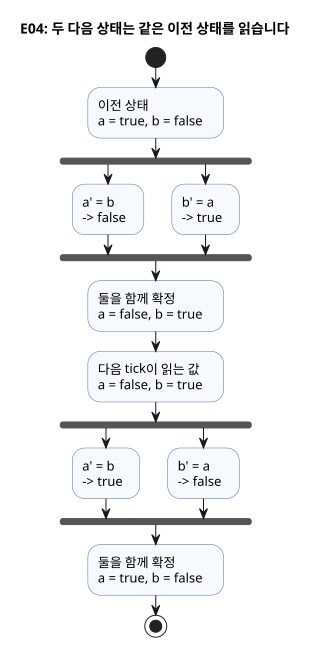

현재 다음 상태 참조는 출력 식에서만 허용합니다. `b' = a';`처럼 다른 상태의 다음 값을
상태 전이에 쓰는 코드는 거부됩니다. 여러 전이에 같은 계산이 필요하면 `let`으로 이름을
붙여 공유하세요.

**설계 이유:** 이전 상태와 다음 상태를 명시하면, 모든 상태를 한꺼번에 갱신하면서도
“이번 판단의 근거”를 보존할 수 있습니다. 이 구분이 타이밍 비교와 소스 옆에 표시하는
값의 기준이 됩니다.

사용자는 [#149](https://github.com/callin2/ghostflow-language/issues/149)에서 이 선택을
설명했습니다. React/ObservableHQ에서 받은 영향은 이것입니다. 제어를 event stream 안에서
평가하고 next state를 명시적으로 반환합니다. recursive 또는 loop 형태의 제어가 전기
기술자에게 추적하기 어려울 수 있다는 것은 사용자의 교육적 전제였습니다. E04는 시간
경계를 구체적으로 보여 줍니다. 이전 `a`와 `b`를 읽고, `a'`와 `b'`를 기술한 뒤, 둘을
함께 확정합니다. 이는 가독성의 목표이지 전기 기술자 전체에 대한 일반적 판단이 아닙니다.
코드에서는 E04처럼 ASCII apostrophe(`'`)를 씁니다. 그 대화에서 쓴 backtick이나 뒤이은
assistant 제안이 문법, time-travel, 인과 설명 기능을 추가하지는 않습니다. 실행 규칙은
[Reference §2.8](reference/02-types-expressions-state.md#28-tick과-상태-snapshot)에
있습니다.

성공한 tick은 다음 순서로 동작합니다. 이번 tick의 입력 snapshot과 이전 상태에서 후보
다음 상태를 계산하고, 요청 의도와 안전 의도를 계산한 뒤, 상태와 의도 기록을 원자적으로
확정합니다. 선택된 식에서 runtime fault가 나면 부분 갱신 없이 tick을 거부합니다. 출력
제약의 차단은 이런 평가 실패와 다릅니다. 성공한 tick의 상태 확정을 취소하지 않습니다.

<a id="ch04"></a>
## 4. 출력 의도와 최종 출력

화면에는 펌프가 ON인데 물은 나오지 않습니다. Bool 하나로는 이 상황을 설명할 수
없습니다. 코드가 ON을 요청했을 수도, 제약이 막았을 수도, renderer가 적용하지 못했을
수도, 피드백이 아직 확인해 주지 않았을 수도 있습니다. E05에서 `request=true`,
`valve_ready=false`를 넣고 요청 의도와 안전 의도가 어디서 갈라지는지 예측해 보세요.
이 단계들을 알면 “왜 안 켜졌지?”는 추측이 아니라 어떤 증거가 빠졌는지 묻는 질문이
됩니다.

이 장은 네 용어를 씁니다.

| 용어 | 의미 |
|---|---|
| **요청 의도 (requested intent)** | `<-` 연결이 요청하는 것 |
| **안전 의도 (safe intent)** | 출력 제약을 거친 뒤의 요청 의도. 이 장에서는 «최종 출력»이라고 부릅니다 |
| **적용됨 (applied)** | renderer가 명령을 적용했다는 증거 |
| **확인됨 (confirmed)** | limit switch나 encoder 같은 별도의 피드백 증거 |

안전 의도가 참이라고 해서 릴레이가 전환되었거나 펌프가 돌았다는 것이 성립하지는
않습니다. safe=true인 trace만 보고 “펌프가 돌았다”고 결론 내리면 아직 확인해야 할
경계를 건너뛴 것입니다. [Reference §4.7](reference/04-sensors-constraints-control.md#47-requested-safe-applied-confirmed)과
[물리 Driver와 Device 경계](LLM-TOOLCHAIN-ARCHITECTURE.md#physical-driver-and-device-boundary)를
함께 읽으세요.

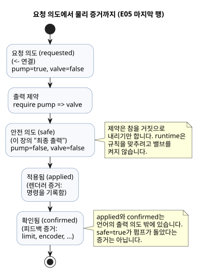

### E05 — 켜 달라는 요청과 허용되는 출력

“펌프를 켜 달라”는 계산과 “펌프를 켜도 된다”는 판정은 다를 수 있습니다. 이번에는
두 값을 일부러 다르게 만들어 봅시다.

```ghost
// E05
control PumpPermission {
  state displayed_pump: Bool = false;
  displayed_pump' = if request_good && !request then false else if request_good then request else displayed_pump;
  state displayed_valve: Bool = false;
  displayed_valve' = if valve_ready_good && !valve_ready then false else if valve_ready_good then valve_ready else displayed_valve;
  // Source-local display memory is initialized here; faults remain producer unknown.
  state remembered_request: Bool = false;
  let request_good = case observed_request { ok(_) => true; fault(_) => false; };
  let request = case observed_request { ok(value) => value; fault(_) => remembered_request; };
  remembered_request' = request;
  state remembered_valve_ready: Bool = false;
  let valve_ready_good = case observed_valve_ready { ok(_) => true; fault(_) => false; };
  let valve_ready = case observed_valve_ready { ok(value) => value; fault(_) => remembered_valve_ready; };
  remembered_valve_ready' = valve_ready;
  input observed_request: Bool;
  input observed_valve_ready: Bool;
  output pump, valve: Bool;

  pump <- displayed_pump';
  valve <- displayed_valve';
  require pump => valve;
}
```

`output` 선언 앞의 줄 대부분은 품질을 함께 전달하는 입력 `observed_request`와
`observed_valve_ready`를 읽습니다. 정상(`ok`) 값이면 파생 이름 `request`와
`valve_ready`가 입력을 따릅니다. `fault`이면 마지막으로 기억한 값을 유지하고, 표시
상태도 이전 값을 유지합니다. 이 예제의 핵심은 마지막 세 줄입니다.

| request | valve_ready | 후보 pump / valve | 최종 pump / valve |
|---|---|---|---|
| false | false | false / false | false / false |
| true | true | true / true | true / true |
| true | false | true / false | false / false |

마지막 행이 이 예제의 이유입니다. `<-`가 만든 펌프 요청은 참인데, `require`가 펌프의
안전 의도를 거짓으로 만듭니다. `pump => valve`는 “펌프가 요청된다면 밸브도 이미 요청되어
있어야 한다”는 뜻입니다. runtime은 규칙을 맞추려고 밸브를 몰래 켜지 않습니다. 어떤
요청을 포기했는지 trace에 남으므로 보수적인 결과를 설명하기 쉽습니다.

```text
request ─────────────→ pump 의도 ──┐
                                  ├─ require 검사 ─→ 최종 pump
valve_ready ─────────→ valve 의도 ─┘
```

여기서 `valve_ready`는 입력 `observed_valve_ready`에서 파생한 이름일 뿐입니다. 그 입력을
어떤 센서나 계산이 공급하는지는 입력 매핑이 설명합니다. 완전한 설명에는 “출력이 참인
이유”와 “입력이 어디서 왔는가”가 모두 필요합니다.

### E06 — 두 방향을 동시에 요청하면

```ghost
// E06
control DirectionInterlock {
  state displayed_forward: Bool = false;
  displayed_forward' = if forward_button_good && !forward_button then false else if forward_button_good then forward_button else displayed_forward;
  state displayed_reverse: Bool = false;
  displayed_reverse' = if reverse_button_good && !reverse_button then false else if reverse_button_good then reverse_button else displayed_reverse;
  // Source-local display memory is initialized here; faults remain producer unknown.
  state remembered_forward_button: Bool = false;
  let forward_button_good = case observed_forward_button { ok(_) => true; fault(_) => false; };
  let forward_button = case observed_forward_button { ok(value) => value; fault(_) => remembered_forward_button; };
  remembered_forward_button' = forward_button;
  state remembered_reverse_button: Bool = false;
  let reverse_button_good = case observed_reverse_button { ok(_) => true; fault(_) => false; };
  let reverse_button = case observed_reverse_button { ok(value) => value; fault(_) => remembered_reverse_button; };
  remembered_reverse_button' = reverse_button;
  input observed_forward_button: Bool;
  input observed_reverse_button: Bool;
  output forward, reverse: Bool;

  forward <- displayed_forward';
  reverse <- displayed_reverse';
  mutex(forward, reverse);
}
```

두 입력이 모두 참이면 두 출력 모두 거짓이 됩니다. 먼저 쓴 출력이나 먼저 누른 버튼에
자동으로 우선권을 주지 않습니다. `require !(forward && reverse);`도 이 두 출력의 동시
요청을 막습니다.

제약들이 연결되어 있으면 runtime은 차단 결과를 다시 반영하며 더 이상 바뀌지 않을
때까지 제약을 반복 적용합니다. 예를 들어 다른 제약 때문에 밸브가 꺼지면, 그 밸브를
요구하는 펌프도 꺼집니다. 현재 지역 Bool 제약은 참인 출력을 거짓으로 내리기만 합니다.
임의의 논리식을 만족하는 조합을 자동으로 찾는 언어 기능이 아닙니다.

제약이 출력을 막았다고 해서 `state`가 자동으로 되돌아가지는 않습니다. 프로그램이 정지
상태로 옮겨 가야 한다면 그 전이도 프로그램에 표현하세요.

**작은 실험:** E03을 `pump <- start;`로 바꾸고 시작 버튼을 떼 보세요.
`running`이 참으로 남는 이유와 `pump`가 꺼지는 이유를 따로 설명할 수 있나요?

### 이름 있는 지역 묶음과 공유 자원의 허용 범위

E05와 E06은 자기 control의 출력을 제약합니다. 같은 규칙을
`constraints LocalRules { require pump => valve; }`처럼 이름 있는 지역 묶음에 넣어도
범위와 Bool 제약 의미는 같습니다. 제약은 목표가 움직일 수 있는 허용 영역을 정하며,
모든 필수 조건은 AND로 결합됩니다. 우선순위나 선택적인 비차단 분석이 필수 조건을
해제하는 일은 결코 없습니다.

공유 자원은 [완전한 bound 실행 예제](../examples/bound-resource-execution.ghost.ko.md)로
이어 읽으세요. `constraints SharedRules for station`을 검사하는 것만으로는 보호 출력이
실행되지 않습니다. `compileSourceSync`가 만든 checked descriptor를 정확한 source/artifact
identity, 안정 ID, mode/output mapping에 결속하는 명시적 `compileBoundResourceControl`
단계도 필요합니다. 그렇게 만든 artifact는 실제 Rust/WASM scan에서 지원되는 자동·수동·
fallback 경로를 모두 같은 guard로 검사합니다. host가 출력을 내보낸 뒤 덧붙이는
JavaScript filter가 아닙니다.

그 예제에서 실행 중 관계를 위반하면 작성된 safe vector인 pump OFF, valve ON이 됩니다.
admission과 복구 규칙은 다음과 같습니다.

- 시작 전 위반은 새 admission을 거부합니다.
- 충돌한 newcomer는 기존 admission을 빼앗지도, 숨은 대기열에 들어가지도 않습니다.
- 조건이 정상으로 돌아왔다는 것만으로 trip이 풀리지 않습니다.
- exclusive group은 neutral 관측 뒤 새 claim이 필요합니다.
- require-only group은 requested = authored safe 관측 뒤 새 요청이 필요합니다.
- 연결된 group은 한 scan에서 함께 복구합니다.
- 정상 평가된 denial은 ordinary state를 commit하고, binding/VM 오류는 state, guard,
  trace를 rollback합니다.

이것은 모든 출력을 명시적으로 mapping한 Bool GFB1 v1/v3 control 하나의 논리 실행입니다.
설치 authority는 writer registry를 공유하며, 같은 안정 ID에 대한 두 번째 활성 writer를
거부합니다. 별도의 설치 registry가 물리적 배타성을 인증하지는 않습니다. 임의 PID,
context, shared-policy import composition, 여러 VM의 협력 중재, 물리적 안전 순서는 각각
별도의 경계입니다. E05·E06의 기존 결과와 재현 기록을 이 새 예제의 결과로 바꾸지 마세요.
[Reference §4.8](reference/04-sensors-constraints-control.md#48-공통-constraints-표기와-연산)과
[제약 계약](CONSTRAINTS.md#공유-bool-실행)은 source, binding, admission, safe-output 증거를
구분합니다.

<a id="ch05"></a>
## 5. 함수로 계산을 나누기

자기유지 식을 여러 곳에 복사하면, 언젠가 그중 하나만 정지 우선순위가 달라지는 날이
옵니다. 함수는 줄 수를 줄이는 장치라기보다 한 판단에 이름을 붙여 한 번만 검토하게
하는 도구입니다. E07에서 먼저 `hold`와 `permitted`를 따로 계산한 뒤 합쳐 보세요.
`enabled`를 껐다 켰을 때 START 없이 다시 운전하는지 예측해 보세요. 답을 보면 함수가
상태를 숨기지 않는다는 사실이 드러납니다.

### E07 — 자기유지 계산을 함수로 꺼내기

```ghost
// E07
fn hold(start: Bool, stop: Bool, previous: Bool) -> Bool {
  !stop && (start || previous)
}

control FunctionLatch {
  // Source-local display memory is initialized here; faults remain producer unknown.
  state remembered_start: Bool = false;
  let start_good = case observed_start { ok(_) => true; fault(_) => false; };
  let start = case observed_start { ok(value) => value; fault(_) => remembered_start; };
  remembered_start' = start;
  state remembered_stop: Bool = false;
  let stop_good = case observed_stop { ok(_) => true; fault(_) => false; };
  let stop = case observed_stop { ok(value) => value; fault(_) => remembered_stop; };
  remembered_stop' = stop;
  state remembered_enabled: Bool = false;
  let enabled_good = case observed_enabled { ok(_) => true; fault(_) => false; };
  let enabled = case observed_enabled { ok(value) => value; fault(_) => remembered_enabled; };
  remembered_enabled' = enabled;
  input observed_start: Bool;
  input observed_stop: Bool;
  input observed_enabled: Bool;
  state running: Bool = false;
  output pump: Bool;

  fn permitted(request: Bool, allow: Bool) -> Bool {
    request && allow
  }

  running' = if stop_good && stop then false else if enabled_good && !enabled then false else if start_good && stop_good && enabled_good then (permitted(hold(start, stop, running), enabled)) else running;
  pump <- running';
}
```

`fn` 뒤의 매개변수는 이 판단에 필요한 근거를 한자리에 모아 보여 줍니다. `-> Bool`은
어떤 종류의 결과를 약속하는지 밝힙니다. 마지막 식이 결과이므로 별도의 `return`은
없습니다. `hold(start, stop, running)`만 읽어도 이 판단에 현재 START, 현재 STOP, 이전
운전 상태가 필요하다는 것을 알 수 있습니다.

`enabled=false`이면 `permitted`가 거짓을 돌려주어 다음 상태가 꺼집니다. `enabled`가 다시
참이 되어도 운전은 재개되지 않습니다. 기억된 상태가 이미 거짓이기 때문입니다. 함수는
인수만으로 계산하며 자기만의 기억을 숨기지 않습니다.

현재 함수는 바깥의 입력, 상태, 설정값을 직접 읽지 않고 매개변수로 받습니다. 필요한
값이 호출부에 드러나므로 의존 관계를 읽기 쉽습니다. 예를 들어 `hold` 안에서 전역
`running`을 직접 읽으면 거부됩니다.

함수는 컴파일 때 정적으로 펼쳐집니다. 재귀 호출과 순환 호출은 거부됩니다. 함수 안에
일정 시간 동안 멈추는 실행 흐름이나 자기만의 가변 상태를 만들지 마세요. 기억은
`state`로, 시간은 다음 장의 타이머로 표현하세요.

**작은 실험:** `permitted(hold(...), enabled)`에서 `enabled`가 거짓이 되었다가 다시
참이 되면 Start 없이 운전이 재개될까요? E03의 상태 표를 확장해 보세요.

<a id="ch06"></a>
## 6. 시간을 기다리는 제어

“2초 뒤에 켜기”는 “2초 동안 실행을 멈추기”라는 뜻이 아닙니다. 제어기는 기다리는
동안에도 STOP을 계속 읽고 다른 제어도 계속 계산해야 해요. 그래서 E08은 기다림을
`Waiting` 상태와 그 상태에서 흐른 시간으로 드러냅니다.

읽기 전에 대기 1999ms, 2000ms, 2001ms에서의 다음 상태를 먼저 적어 보세요. 그리고
대기 도중 START를 놓으면 그 대기가 어떻게 되는지도 예측해 보세요. 이 장의 핵심
발견은 이 둘의 차이입니다. 시간은 연속해서 흐르지만, 판단은 tick에서만 일어납니다.

### E08 — 입력이 2초 유지되면 켜기

```ghost
// E08
control DelayedStart {
  // Source-local display memory is initialized here; faults remain producer unknown.
  state remembered_start: Bool = false;
  let start_good = case observed_start { ok(_) => true; fault(_) => false; };
  let start = case observed_start { ok(value) => value; fault(_) => remembered_start; };
  remembered_start' = start;
  input observed_start: Bool;
  config delay: Duration = 2s;
  type Phase = Idle | Waiting | Running;
  state phase: Phase = Idle;
  timer age = elapsed(phase);
  output motor: Bool;

  phase' = if start_good then (case delay {
    ok(value) => case phase {
      Idle => if start then Waiting else Idle;
      Waiting =>
        if !start then Idle
        else if age >= value then Running else Waiting;
      Running => if start then Running else Idle;
    };
    fault(_) => Idle;
  }) else phase;

  motor <- phase' == Running;
}
```

`type Phase = ...`는 대기 과정에서 구별해야 할 세 상황에 각각 이름을 붙입니다.
Bool 하나만 쓰면 “아직 시작하지 않음”과 “기다리는 중”이 같은 “꺼짐” 값 속에 함께
숨어 버립니다. `case phase`는 현재 단계에 해당하는 식 하나를 골라 다음 단계를
계산합니다. 모든 경우를 빠짐없이 적어야 하므로, 나중에 단계를 추가하면 빠진 판단을
compiler가 알려 줍니다.

`delay`는 `Result<Duration, SettingsFault>`입니다. 시간은 `ok(value)` 분기 안에서만
그 payload와 비교합니다.

- **config fault:** 이 예제는 진행 중인 대기를 취소하고 `Idle`로 전이합니다. 따라서
  출력 의도는 꺼집니다.
- **복구:** 유효한 config와 `start=true`를 다시 읽으면 새 대기를 시작합니다.
- **`2s`:** 최초 `ok`의 payload이며, 오류 때 쓰는 fallback이 아닙니다.

이것은 이 예제의 정책입니다. 언어나 Driver의 기본 정책이 아니며, 물리적인 fail-safe
보장도 아닙니다.

`elapsed(phase)`는 **`phase`가 마지막으로 변경을 확정한 이후 흐른 시간**입니다.
`Idle`이 `Waiting`으로 바뀐 tick의 확정 시점이 0입니다. START가 들어오기 전의 유휴
시간은 2초 대기에 포함되지 않습니다. START를 놓았다가 다시 누르면 이전 대기를 새
대기에 이어 붙이지 않습니다.

전이는 조건이 참인 첫 tick에서 일어나며, 한 tick에 여러 단계를 건너뛰지 않습니다.

아래 상태도는 이 규칙들을 한데 모은 것입니다. 모든 화살표는 tick에서 평가되며,
tick과 tick 사이에는 아무 일도 일어나지 않습니다.

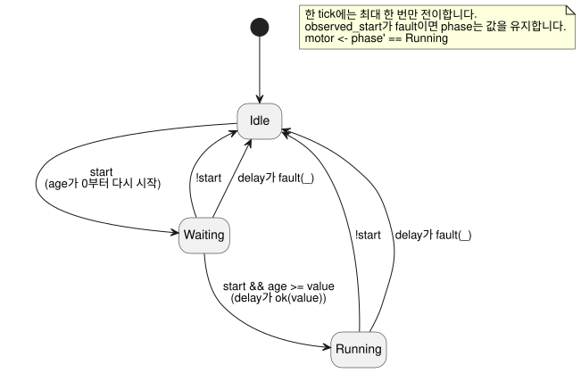

아래 표는 한 번의 실행을 따라갑니다. “읽는 단계”와 “읽는 age”는 tick이 읽는 값이고,
“다음 단계”는 그 tick이 확정하는 값입니다.

| 논리 시각 | start | 읽는 단계 | 읽는 age | 다음 단계 | motor |
|---|---|---|---|---|---|
| 0ms | false | Idle | 0ms | Idle | false |
| 1000ms | true | Idle | 1000ms | Waiting | false |
| 2999ms | true | Waiting | 1999ms | Waiting | false |
| 3000ms | true | Waiting | 2000ms | Running | true |
| 4000ms | false | Running | 1000ms | Idle | false |

대기는 버튼이 물리적으로 바뀐 순간에 시작하지 않습니다. 그 변화를 읽고 `Waiting`으로
전이한 tick에서 시작합니다. 그래서 2초를 1000ms부터 세고, 모터는 3000ms에 켜집니다.

### 가속은 시간을 바꾸는 일

시뮬레이션을 10배속으로 실행해도 소스의 `2s`가 `200ms`로 바뀌지는 않습니다. 대신
시뮬레이터가 논리 시각을 실제 시간보다 빠르게 진행시킵니다. 각 tick의 논리 시각과
입력이 같다면, 배속과 상관없이 결과도 같아야 합니다.

타이머 계산에 쓰는 시각, 함께 읽는 DI 입력 묶음, 최종 RO 출력이라는 경계는 플랫폼
사이에서 공통이어야 합니다.

- native와 WASM 빌드는 같은 Rust core에서 식, 상태, 타이머, 제약을 실행합니다.
- 호스트는 입력, 논리 시각, scan 기회를 공급합니다.
- 실제 Device I/O Driver는 별도의 경계입니다.

프레임과 Driver의 구체적인 API는 호스트 계약입니다. 이 소스에 플랫폼 분기를 넣지
마세요.

현재 CLI 시뮬레이터는 가상 I/O를 제공합니다. 입력과 requested·safe 의도를 보여 줍니다.

- 펌프 의도로부터 탱크 수위나 센서값을 자동으로 만들어 내는 plant model은 없습니다.
- 명시적으로 구성한 온실 온도 plant model은 지원합니다. 다만 그 가상 적용과
  feedback도 물리 장치에서 나온 근거는 아닙니다.
- piped mode는 명시한 scan에서만 진행합니다. interactive TTY는 실제로 흐른 벽시계
  시간을 공급합니다.
- 일정, 센서, 인증된 interval에는 그에 맞는 호스트 capability가 필요합니다.

실행 경로와 재현 명령은
[작성과 가상 시뮬레이션 아키텍처](LLM-TOOLCHAIN-ARCHITECTURE.ko.md)의 “공개 경로 재현”
절을 참고하세요.

**작은 실험:** 2999ms 다음 tick을 3500ms로 옮겨 보세요. 모터는 3000ms가 아니라 그
tick에서 켜집니다. 타이머 조건은 2초이지만, 관찰과 전이는 tick 시각에서만 일어납니다.

<a id="ch07"></a>
## 7. 시각에 맞추어 시작하기

“06:00에 급수”와 “5분 동안 급수”는 모두 시간 이야기지만, 서로 다른 시계를 읽습니다.

- **06:00**에는 달력과 시간대가 있는 civil 시각이 필요합니다.
- **5분**에는 시작 사건부터 세는 단조 경과시간이 필요합니다.

E09에서 06:00 사건이 온 뒤에 벽시계가 뒤로 돌아갔다고 상상해 보세요. 결과를
예측하면, 5분 운전은 흔들리지 않아야 합니다. 이 예측이 소스에 DST 처리, 시계 공백,
provider 실패, fallback을 명시하는 이유를 설명해 줍니다.

### E09 — 하루의 두 시각에 5분 운전하기

```ghost
// E09
control ScheduledPulse {
  schedule starts: DailySlots<15min> {
    timezone = "Asia/Seoul";
    selected = [06:00, 18:45];
    dst_missing = skip;
    dst_repeated = first;
    basis = pulse;
    when = true;
    clock = trusted_only;
    gap = skip_after(60s);
    recovery = baseline;
    fallback = skip;
  }
  let run_time = 5min;
  type Phase = Idle | Watering;
  state phase: Phase = Idle;
  timer age = elapsed(phase);
  output valve, pump: Bool;

  phase' = case phase {
    Idle => if starts.due then Watering else Idle;
    Watering => if age >= run_time then Idle else Watering;
  };

  valve <- phase' in {Watering};
  pump <- phase' == Watering;
  require pump => valve;
}
```

`DailySlots<15min>`은 각 지역 날짜 안의 15분 격자에서 시각을 고릅니다. 06:07처럼
격자 밖의 값은 반올림하지 않고 거부합니다. `starts.due`는 projection입니다. 이번
tick에 시작 발생이 도착했는지를 알려 줍니다. admission(수용)과 missed/unknown 근거는
별도의 observation으로 남습니다.

선언은 시계에 대한 가정을 모두 명시합니다. pulse basis, 신뢰된 시계만 사용, 60초
gap 한도, baseline recovery, skip fallback입니다. 그래야 나중에 검토할 때 “시계가
완벽했다”고 슬쩍 가정할 수 없습니다.

아래 그림은 각 시계가 어디에 쓰이는지 보여 줍니다. civil 시계는 급수를 *언제
시작할지*만 정하고, *언제 멈출지*는 단조 시계만 정합니다.

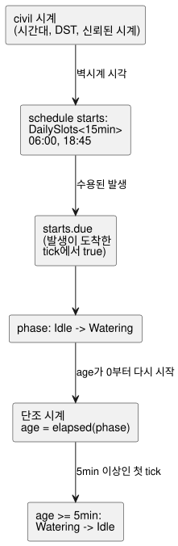

| 사건 | 이전 단계 | 다음 단계 | pump |
|---|---|---|---|
| 선택된 시작 사건 | Idle | Watering | true |
| 5분 미만 경과 | Watering | Watering | true |
| 5분 이상 경과한 첫 tick | Watering | Idle | false |

`in {Watering}`은 집합에 포함되는지를 검사합니다. 해당하는 상태가 여러 개라면
`phase' in {Opening, Watering, Closing}`처럼 같은 타입의 값들을 나열하세요.

이 소스에는 대기열이 없습니다. 단계가 이미 `Watering`일 때 다른 시작 사건이 와도
저장하지 않습니다. 일정 발생의 identity, 중복 억제, 놓친 발생 처리, replay evidence는
Reference §3.5의 계약을 따릅니다. 다른 일정에서 온 겹치거나 놓친 발생에 대해 임의로
catch-up을 만들지 마세요.

**독해 질문:** `Watering` 분기가 다른 시작 사건을 읽어 종료 시각을 바꿀까요? (선택된
두 시각은 5분보다 멀리 떨어져 있습니다.) 분기를 읽어서 답하세요. 이것은 public
simulator에 숨겨진 `starts.due` 입력을 주입하는 실행 시나리오가 아닙니다.

### 달력 시각과 자연 사건

달력 시각, 일정, 단조 경과시간은 서로 다른 종류의 입력입니다. 날짜와 시각은 tagged
literal입니다. 반복 일정은 타입별 `schedule` 선언을 사용합니다. `DailySlots`,
`Periodic`, `cron5`, solar·lunar·tide context, 시간대, gap recovery, 필수 fallback의
정확한 표기는 [Reference §3](reference/03-time-and-schedules.md)을 참고하세요.

일출·일몰, 조석 예측, 달력, 시계 데이터는 모두 외부 provider/Driver 계약에
의존합니다. 소스는 기준 사건과 fallback에 이름을 붙입니다. 예측 데이터를 Bool 하나
속에 숨기지 말고, 시각을 항상 신뢰할 수 있다고 가정하지도 마세요. Reference에 정의된
정책을 읽고, 필요한 환경 capability는 binding으로 공급하세요.

<a id="ch08"></a>
## 8. 센서의 값과 품질

[측정값에서 타입 찾기](#quantity-type-lookup) 표로 입력 타입을 고르세요.
예를 들어 섭씨 측정은 `Temperature` 타입과 `30°C` 같은 값을 사용합니다.

수분값이 `29%, 31%, 29%`로 오르내린다고 해 봅시다. 판단이 경계 하나만 따른다면 급수
요청도 함께 켜졌다 꺼졌다 합니다. 이번에는 `90%`라는 값 하나가 끼어듭니다. 흙이
갑자기 젖은 걸까요, 아니면 측정값 하나가 튄 걸까요? 그리고 마지막 측정 뒤에 센서가
끊겼다면, 그 숫자를 언제까지 믿을 수 있을까요?

이것은 서로 다른 세 질문이며, E10은 각각을 따로 답합니다.

1. 각 측정의 품질을 확인합니다.
2. 최근 값들의 중앙값을 고릅니다.
3. 켜는 경계와 끄는 경계를 따로 사용합니다.
4. 마지막으로 사용자가 급수를 허용했는지 확인합니다.

읽으면서 원시값, 필터값, 판단, 출력 요청을 한 줄씩 따라가 보세요. 코드가 길어진
이유가 **서로 다른 질문을 섞지 않기 위해서**임을 알 수 있습니다.

수분 백분율과 30%·35% 경계는 학습용 논리 값입니다. 어떤 토양, 작물, 센서 보정에도
적용되는 농업 권장값이 아닙니다. 이 장에서 확인하는 것은 급수 **요청**이며, 실제 물의
흐름은 별도의 장치와 피드백 근거로 확인해야 합니다.

### 입력값과 측정값

앞에서 본 `input level: Percent`는 호스트가 이번 계산에 쓸 값을 공급한다는
선언이었습니다. 실제 센서에는 값만 있는 것이 아닙니다. 아직 준비되지 않았을 수도,
연결이 끊겼을 수도, 오래된 측정을 들고 있을 수도 있습니다. 그래서 `input`을 읽을
때마다 정상값을 얻었는지도 함께 처리합니다.

### E10 — 흔들리는 수분값으로 급수 판단하기

```ghost
// E10
control MoistureControl {
  state displayed_pump: Bool = false;
  displayed_pump' = if enabled_good && !enabled then false else if enabled_good then enabled && need_water else displayed_pump;
  // Source-local display memory is initialized here; faults remain producer unknown.
  state remembered_enabled: Bool = false;
  let enabled_good = case observed_enabled { ok(_) => true; fault(_) => false; };
  let enabled = case observed_enabled { ok(value) => value; fault(_) => remembered_enabled; };
  remembered_enabled' = enabled;
  input observed_enabled: Bool;
  input moisture: Percent {
    sample = 1s;
    valid = 0% .. 100%;
    filter = median(3);
    stale_after = 3s;
    recover_after = 1 samples;
  }
  signal dry = hysteresis(moisture,
    on_below: 30%, off_above: 35%, initial: false);
  let need_water = case dry {
    ok(value) => value;
    fault(_) => false;
  };

  output pump: Bool;
  pump <- displayed_pump';
}
```

아래 그림은 샘플 하나가 호스트에서 펌프 요청까지 E10을 거쳐 가는 길을 따라갑니다.

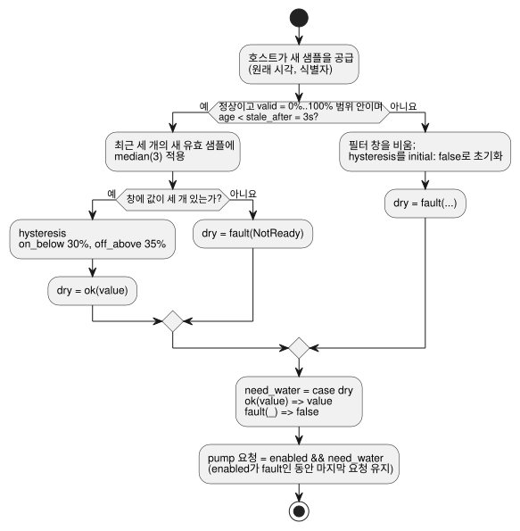

`sample = 1s`는 의도한 측정 간격을 기록합니다. 센서를 읽는 스레드를 만들지 않으며,
매초 새 관측을 지어내지도 않습니다. 호스트가 원래 시각과 식별자가 붙은 샘플을
공급합니다. `valid`는 정상값의 범위를 정하며, 필터는 이 범위 안의 새 유효 샘플만
받아들입니다. 같은 샘플을 여러 tick에서 다시 읽어도 창이 채워지지 않고, 그 샘플의
시각이 새로워지지도 않습니다.

`median(3)`은 최근 세 유효 값 가운데 중간 값을 고릅니다. `29%, 90%, 28%`를 정렬하면
`28%, 29%, 90%`이므로 결과는 `29%`입니다. 큰 값 하나가 곧바로 “흙이 젖었다”는 뜻이
되지는 않습니다. 값이 두 개뿐이면 아직 가운데가 없습니다. 처음 두 샘플은 `NotReady`를
내고, 이 예제의 fault 분기가 급수 요청을 꺼 둡니다.

`hysteresis`는 켜는 경계와 끄는 경계를 따로 씁니다. 정상 측정에 대해서는 다음과
같습니다.

| 필터값 | `dry` 판단 |
|---|---|
| 30% 미만 | 켜짐 (`true`) |
| 35% 초과 | 꺼짐 (`false`) |
| 30%~35% (정확히 30% 또는 35% 포함) | 이전 판단 유지 |

그래서 30% 부근에서 흔들리는 값이 측정할 때마다 출력을 뒤집지 않습니다.

`30%`와 `35%` 사이에서는 숫자가 새 결론을 만들지 않습니다. 이 구간은 **이전 결론을
유지하는 띠**입니다. 같은 `33%`라도 흙이 이미 건조하다고 판단된 뒤라면 급수를
유지하지만, 초기 상태에서는 급수를 시작하지 않습니다. 이 작은 차이가 임계값 비교에
기억을 더해 줍니다.

이제 `enabled=true`로 두고 아래 원시 샘플을 순서대로 공급해 봅시다. 각 샘플은 1초
간격의 새로운 정상 관측입니다. 표를 가리고, 어느 행에서 요청이 꺼질지 먼저 예측해
보세요.

| 새 원시 샘플 | 최근 세 값의 중앙값 | `dry` 결과 | 요청 `pump` |
|---|---|---|---|
| `31%` | 창 부족 | `fault(NotReady)` | `false` |
| `29%` | 창 부족 | `fault(NotReady)` | `false` |
| `90%` | `31%` | `ok(false)` | `false` |
| `28%` | `29%` | `ok(true)` | `true` |
| `30%` | `30%` | `ok(true)` | `true` |
| `34%` | `30%` | `ok(true)` | `true` |
| `36%` | `34%` | `ok(true)` | `true` |
| `38%` | `36%` | `ok(false)` | `false` |

원시값이 `36%`에 이른 행에서도 요청은 여전히 켜져 있습니다. 필터값이 아직 `34%`이기
때문입니다. `38%`가 들어와야 창 `34%, 36%, 38%`의 중앙값이 `36%`가 됩니다. 이 값은
35%를 넘으므로 판단이 꺼집니다. 원시값을 출력과 직접 비교하면 결과가 이상해 보이지만,
중간 값을 따라가면 이유가 분명해집니다.

다음으로 새 샘플 공급을 멈춰 보세요. 마지막 샘플의 원래 시각부터 잰 age가 정확히
3초가 되면 결과는 `Stale`이 됩니다. 2999ms와 3000ms를 비교하면 경계가 보입니다. 같은
샘플을 재평가하거나 재전송해도 이 기한은 늘어나지 않습니다.

fault는 정상 수분값이 아닙니다. fault가 생기면 필터 창을 비우고 hysteresis도
`initial: false`로 돌아갑니다. 정상 샘플이 다시 오더라도 `recover_after = 1 samples`만
보고 바로 복구된다고 생각하면 안 됩니다. 이 필터는 중앙값을 위해 **새 유효 샘플 세
개**도 필요합니다. 복구된 필터값이 `33%`라면 이전의 `true` 판단은 돌아오지 않고, 초기
판단 `false`가 유지됩니다.

`ok(value)`는 정상 결과에 이름을 붙입니다. `fault(_)`의 `_`는 이 계산이 오류의 구체적인
값을 사용하지 않는다는 뜻입니다. 대체값으로 `false`를 선택해도 원래의 품질 정보는 실행
기록에 남습니다.

여기서 `ok`와 `fault`는 `case` 패턴입니다. 현재 언어에는 다음도 있습니다.

- compiler가 소유하는 fault 타입을 가진 내장 `Result<T, E>`의 `ok(...)`·`fault(...)`
  생성자
- 정적 `map`, `and_then`, `recover` 변환

이것들을 사용자 정의 오류 ADT나 일반 고차 함수와 혼동하지 마세요.
[Reference §2.5](reference/02-types-expressions-state.md#25-sensor-결과와-명시적-오류-흐름)를 참고하세요.

### E14 — 선택적인 센서

```ghost
// E14
control OptionalMoisture {
  input moisture?: Percent;
  output request: Bool;
  adapt moisture_policy {
    strategy WithMoisture priority 100 match (moisture: sensor<Percent>) {
      request <- case moisture {
        ok(value) => value < 30%;
        fault(_) => false;
      };
    }
    strategy Baseline priority 0 match always {
      request <- false;
    }
  }
}
```

`?`는 선언 정보입니다. 센서가 선택적인 설치 capability임을 표시합니다.

- **설치되어 있고 정상:** `WithMoisture`가 값을 비교합니다.
- **설치되어 있지만 fault:** `WithMoisture`가 `false`를 요청합니다.
- **설치되지 않음:** `Baseline`이 `false`를 요청합니다.

`?`만으로는 대체 전략이 생성되지 않습니다. `Baseline`은 직접 작성해야 합니다.
자세한 규칙은 [Reference §4.5–4.6](reference/04-sensors-constraints-control.md#45-선택-sensor와-capability)을 참고하세요.

E14는 “센서가 설치되지 않음”과 “설치된 센서가 고장남”에 서로 다른 경로를 탑니다.
센서가 없으면 `Baseline`을 선택합니다. 센서가 설치되어 있지만 값을 읽을 수 없으면
`WithMoisture` 안의 fault 분기를 따릅니다. 두 요청 모두 `false`지만 이유는 다릅니다.
출력이 같다고 해서 실행 근거도 같은 것은 아닙니다.

**한 가지만 바꾸어 보기:** E10이 `ok(true)`를 내는 동안 `enabled`만 꺼 보세요. 판단은
그대로이고 펌프 요청만 멈춥니다. 다시 허용하면, 품질이 여전히 정상일 때에만 요청이
돌아옵니다. 판단과 허용을 나누어 두었기 때문에, 사용자 조작을 위해 센서 상태를 새로
지어낼 필요가 없습니다.

두 경계를 같게 만들면 어떻게 될지도 예측해 보세요. 현재 `hysteresis`는
`on_below < off_above`를 요구하므로, 이 수정은 정상 실행 대신 진단을 내야 합니다.
차트에서는 원시값과 필터값을 함께 보여 주고, 품질과 요청은 따로 확인하세요. E10에는
`require`나 `mutex`가 없으므로 여기서는 safe 출력이 requested 출력과 같습니다. 그래도
그 일치가 물이 실제로 퍼 올려지고 있음을 확인해 주지는 않습니다.

<a id="ch09"></a>
## 9. 식을 정확하게 읽기

식이 짧아 보일수록 우리는 이미 아는 언어의 규칙을 쉽게 끌어옵니다. 그래서 이 장은
외울 문법 목록 대신 작은 반례를 사용합니다. 나눗셈, 조건식, `case`에서 정상값 하나와
fault 하나를 골라 각각의 결과를 예측해 보세요. E11의 대표 표기는 검토와 검색에서 같은
모양이 같은 뜻을 갖게 하는 약속입니다.

### E12 — 수치와 연산자

```ghost
// E12
control NumbersAndOperators {
  state displayed_sum: Number = 0;
  displayed_sum' = if a_good && b_good then a + b else displayed_sum;
  state displayed_difference: Number = 0;
  displayed_difference' = if a_good && b_good then a - b else displayed_difference;
  state displayed_product: Number = 0;
  displayed_product' = if a_good && b_good then a * b else displayed_product;
  state displayed_quotient: Number = 0;
  displayed_quotient' = if a_good && b_good then a / b else displayed_quotient;
  state displayed_negative: Number = 0;
  displayed_negative' = if a_good then -a else displayed_negative;
  state displayed_equal: Bool = false;
  displayed_equal' = if a_good && b_good then a == b else displayed_equal;
  state displayed_different: Bool = false;
  displayed_different' = if a_good && b_good then a != b else displayed_different;
  state displayed_less: Bool = false;
  displayed_less' = if a_good && b_good then a < b else displayed_less;
  state displayed_at_most: Bool = false;
  displayed_at_most' = if a_good && b_good then a <= b else displayed_at_most;
  state displayed_greater: Bool = false;
  displayed_greater' = if a_good && b_good then a > b else displayed_greater;
  state displayed_at_least: Bool = false;
  displayed_at_least' = if a_good && b_good then a >= b else displayed_at_least;
  // Source-local display memory is initialized here; faults remain producer unknown.
  state remembered_a: Number = 0;
  let a_good = case observed_a { ok(_) => true; fault(_) => false; };
  let a = case observed_a { ok(value) => value; fault(_) => remembered_a; };
  remembered_a' = a;
  state remembered_b: Number = 0;
  let b_good = case observed_b { ok(_) => true; fault(_) => false; };
  let b = case observed_b { ok(value) => value; fault(_) => remembered_b; };
  remembered_b' = b;
  input observed_a: Number;
  input observed_b: Number;
  output sum, difference, product, quotient, negative: Number;
  output equal, different, less, at_most, greater, at_least: Bool;

  sum <- displayed_sum';
  difference <- displayed_difference';
  product <- displayed_product';
  quotient <- displayed_quotient';
  negative <- displayed_negative';
  equal <- displayed_equal';
  different <- displayed_different';
  less <- displayed_less';
  at_most <- displayed_at_most';
  greater <- displayed_greater';
  at_least <- displayed_at_least';
}
```

`a=6`, `b=2`일 때 수치 출력은 순서대로 `8, 4, 12, 3, -6`입니다. Bool 출력은
`false, true, false, false, true, true`입니다. Number 출력도 논리적으로 관찰할 수는
있지만, Bool 릴레이 포트에 직접 매핑할 수는 없습니다.

연산자 우선순위는 강한 것부터 다음과 같습니다.

| 순위 | 표기 |
|---|---|
| 1 | 괄호, 함수 호출, 멤버·다음 상태 참조 |
| 2 | 단항 `!`, `-` |
| 3 | `*`, `/` |
| 4 | `+`, `-` |
| 5 | `in {…}` |
| 6 | `==`, `!=`, `<`, `<=`, `>`, `>=` |
| 7 | `&&` |
| 8 | `||` |

우선순위가 같은 이항 연산자는 왼쪽부터 묶입니다. `6 - 2 - 1`은 `(6 - 2) - 1`을
뜻합니다. 복잡한 조건을 읽기 쉽게 하려면 괄호나 이름 있는 `let` 계산으로 나누세요.

`=>`는 일반적인 산술·논리 연산자가 아닙니다. 출력 제약의 양쪽을 잇고, `case` 패턴을
그 분기와 연결합니다. 일반 식 안에는 넣을 수 없습니다.

### E13 — 조건식이 있다는 것과 계산을 생략한다는 것

`if`, `&&`, `||`는 왼쪽에서 오른쪽으로 결정적으로, 단락(short-circuit) 방식으로
평가됩니다. 선택되지 않은 분기의 runtime fault는 결코 발생하지 않지만, 모든 분기는
여전히 정적으로 타입 검사를 받습니다. 예를 들면 다음과 같습니다.

```ghost
// E13
control SafeDivision {
  state displayed_result: Number = 0;
  displayed_result' = if a_good && b_good then if zero then 0 else a / denominator else displayed_result;
  // Source-local display memory is initialized here; faults remain producer unknown.
  state remembered_a: Number = 0;
  let a_good = case observed_a { ok(_) => true; fault(_) => false; };
  let a = case observed_a { ok(value) => value; fault(_) => remembered_a; };
  remembered_a' = a;
  state remembered_b: Number = 0;
  let b_good = case observed_b { ok(_) => true; fault(_) => false; };
  let b = case observed_b { ok(value) => value; fault(_) => remembered_b; };
  remembered_b' = b;
  input observed_a: Number;
  input observed_b: Number;
  let zero = b == 0;
  let denominator = if zero then 1 else b;
  output result: Number;

  result <- displayed_result';
}
```

`a=6, b=2`이면 결과는 `3`입니다. `a=6, b=0`이면 `0`입니다. 중요한 점은 0인 분기에서
나눗셈이 아예 평가되지 않는다는 것입니다. 다만 `0`은 언어의 보편적인 정답이 아니라 이
프로그램의 정책입니다. 도메인에서 0과 fault를 구분해야 한다면, 오류를 보존하는 편이
더 정직한 선택입니다.

### E11 — 대표 표기만 사용하기

새 프로그램은 다음 형태를 사용합니다.

- `fn`
- `type Mode = Off | On;`
- `running' = ...;`
- `if c then a else b`

`purefn`, `enum` 구문, `next running`, `input.start`, `state.running`, `ifthenelse(...)`는 허용되는 alias가 아닙니다. 옛 문서에서 이런 표기를 보면 [Reference §1.6](reference/01-source-and-syntax.md#16-대표-표기-참고-별칭과-역사적-대안)의 migration 설명을 따르세요.

<a id="ch10"></a>
## 10. 멈추고, 바꾸고, 비교하기

제어 코드를 고친 뒤 가장 불안한 질문은 “내가 의도한 것만 바뀌었나?”입니다. 느낌으로
답하지 마세요. 두 revision에 같은 논리 시각에 같은 입력을 공급하세요. 둘이 처음
달라지는 tick을 보면, 식 하나의 변경이 상태, 의도, 제약으로 어떻게 번지는지 알 수
있습니다. 이 비교 습관은 이 책 뒤에서 import 교체와 replay를 이해하는 기반이기도
합니다.

아래 두 식은 너무 비슷해서 변경이 “괄호 정리” 정도로 넘어가기 쉽습니다. E03의 정지
우선 자기유지를 기준으로, 두 버전을 같은 입력 기록에 대해 실행해 봅시다.

```text
원본 A: running' = !stop && (start || running);
수정 B: running' = start || (!stop && running);
```

`start=true`, `stop=true`이면 A는 `false`, B는 `true`를 만듭니다. 괄호와 `start`의
위치를 조금 옮긴 것만으로, 두 입력이 동시에 들어올 때 어느 쪽이 이기는지가 바뀝니다.

| 이전 running | start | stop | A의 다음 값 | B의 다음 값 |
|---|---|---|---|---|
| false | true | false | true | true |
| true | false | false | true | true |
| true | true | true | false | true |
| true | false | true | false | false |

### 비교 실험 순서

1. 원본 소스와 tick별 입력·논리 시각을 보존합니다.
2. 비교를 시작하는 시점의 상태를 정합니다. 처음부터 비교한다면 각 프로그램을 자신의
   초기 상태에서 시작합니다.
3. 원본을 유지한 채 수정본을 만듭니다.
4. 두 프로그램에 같은 입력 기록을 같은 시각에 공급합니다.
5. 상태, 출력 의도, 제약 판정, 최종 출력을 나란히 비교합니다.

상태 구조까지 바꾸었다면, 기존 checkpoint를 새 구조로 옮기는 규칙도 변경의 일부입니다.
그 규칙이 정해지기 전까지는 두 프로그램을 각자의 초기 상태부터 재생하세요. 시작점과
입력이 같아야만 최초의 차이가 코드 변경에서 왔다고 말할 수 있습니다. 이 책의 첫 비교
실험이 초기 상태부터의 재생(replay)을 사용하는 이유도 여기에 있습니다.

### 소스 옆에 어떤 값을 보여주면 좋을까

trace를 검토하거나 관찰 화면을 설계할 때는 다음 값을 소스와 대조하세요.

- 선택한 tick의 `start`, 이전 `running`, 다음 `running'`
- `pump`에 대해서는 그 값이 의존하는 조건
- 제약이 출력을 바꾸었다면 후보값과 최종값

이것은 관찰 방법과 화면 설계를 위한 길잡이입니다. 현재 reader에 소스 선택이나 의존
추적 UI가 이미 있다는 주장은 아닙니다.

관찰 화면은 다음 네 질문에 답해야 합니다.

- 이 값은 어떤 입력과 이전 상태에서 계산되었는가?
- 다음 상태와 출력 의도는 무엇인가?
- 어느 제약이 허용하거나 차단했는가?
- 원본과 수정본이 처음 달라지는 tick은 어디인가?

관찰 가능한 값과 evidence 종류는 [Reference §5](reference/05-settings-and-observation.md)를 따릅니다. 화면은 자신이 보여 주는 descriptor의 의미를 보존해야 합니다.

<a id="ch11"></a>
## 11. 파일과 literate 프로그램

몇 달 뒤 고장 원인을 조사하는 사람에게는 코드만으로는 부족합니다. 그 조건을 *왜* 넣었는지도
알아야 합니다. E15는 그 이유를 주석의 여백으로 밀어 넣지 않고, 실행 소스와 같은 문서에
둡니다.

여기서 두 가지 규칙이 나옵니다.

- 설명 문단을 바꾸면 문서의 revision이 바뀝니다. 실행 의미를 만드는 것은 `ghost`
  블록뿐입니다.
- `.ghost.md` 문서 자체를 저장하고 검사합니다. 블록을 두 번째 소스 파일로 따로
  복사하지 않습니다.

### 하나의 파일과 하나의 control

실행 문서의 root `control`은 정확히 하나입니다. 그래서 어느 control이 시작되는지를
파일 이름이나 배치 관례로 추측할 필요가 없습니다.

다른 문서를 재사용하려면 문서 범위의 `import`로 완전한 `.ghost.md` definition의
revision과 digest를 고정합니다. 그런 다음 `instance`와 `connect`로 조합합니다.
wildcard import와 두 번째 root를 거부하는 까닭도 같습니다. 검토한 정체성과 실제로
실행되는 구조가 일치해야 하기 때문입니다.

root가 하나라는 규칙은 실행 definition의 뼈대입니다. 가져온 definition 여러 개를
instance로 조합할 때도 이 규칙 덕분에 root가 모호해지지 않습니다.

### E15 — 설명과 코드를 같은 문서에 쓰기

아래 전체 내용을 `follow-switch.ghost.md`로 저장한다고 생각해 보세요.

인용한 문서가 정본이므로 한국어 설명과 정확한 소스 정체성을 그대로 유지합니다. 영어판은
이 문서의 제목(“입력을 따라가는 출력”), 첫 문단(“스위치와 LED의 값을 선언한다”),
코드 블록 사이의 문단(“출력은 매 tick 스위치의 값을 따른다”)을 영어로 옮겨 설명할
뿐이며, 독립적으로 편집할 수 있는 두 번째 정본 소스를 만들지 않습니다.

````markdown
# 입력을 따라가는 출력

스위치와 LED의 값을 선언한다.

```ghost
// E15
control LiterateSwitch {
  // Source-local display memory is initialized here; faults remain producer unknown.
  state remembered_switch_on: Bool = false;
  let switch_on_good = case observed_switch_on { ok(_) => true; fault(_) => false; };
  let switch_on = case observed_switch_on { ok(value) => value; fault(_) => remembered_switch_on; };
  remembered_switch_on' = switch_on;
  input observed_switch_on: Bool;
  output lamp: Bool;
```

출력은 매 tick 스위치의 값을 따른다.

```ghost
  lamp <- switch_on;
}
```
````

컴파일러는 문서 최상위의 정확한 `ghost` 코드 블록들을 문서 순서대로 연결합니다.
위 예제에서는 하나의 `control`이 두 블록에 나뉘어 있을 뿐이며, 두 프로그램이 생기지
않습니다. 설명 문단은 실행되지 않고, 오류 위치는 원본 문서를 가리킵니다.

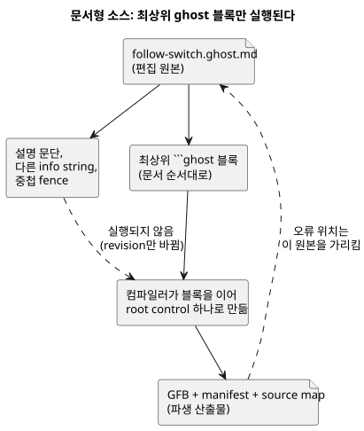

그림은 컴파일러가 무엇을 읽는지 보여 줍니다. 설명 문단은 revision을 바꾸지만 프로그램은
바꾸지 않으며, 진단은 `.ghost.md` 원본으로 되돌아가 연결됩니다.

일반 문단, 다른 info string을 가진 코드 블록, 목록·인용 안의 중첩 fence는 실행 코드가
**아닙니다**. 정확한 추출 규칙은
[Reference §1.1](reference/01-source-and-syntax.md#11-왜-문서-하나가-소스인가)에 있습니다.

### 파일과 program composition

같은 폴더에 파일을 놓았다고 해서 관계가 생기지는 않습니다. `import`는 변경할 수 없는
소스 정체성(immutable source identity)을 가리키고, `instance`와 `connect`는 타입이
있는 논리 포트(typed logical port)를 드러냅니다.

원본이 바뀌면 새 revision으로 검토합니다. 조합이 바뀐 내용을 몰래 집어 드는 일은
없습니다. 이것이 “오늘의 조합은 어제 검토한 부품을 쓴다”는 주장을 뒷받침하는 최소
조건입니다.

두 종류의 증거를 구분하세요.

- 컴파일러는 고정된 import, instance, port의 계약을 검사합니다.
- 런타임 실행은 별도의 증거입니다. E22와 E31의 고정된 source closure는 browser
  Worker/WASM 런타임에서도 실행해 확인합니다. 이 증거를 임의의 조합이나 설치 프로필
  전체로 넓히지는 않습니다.

단일 control 실습에서는 E15처럼 문서 전체를 저장합니다. 그런 다음 language repository
root에서 검사하고 컴파일합니다.

```sh
node tools/ghostc.mjs --check follow-switch.ghost.md
node tools/ghostc.mjs follow-switch.ghost.md build/follow-switch.gfb
```

이 명령에는 Node 의존성이 설치되어 있어야 합니다. GFB, manifest, source map은 파생
산출물이며, 편집 원본은 계속 `.ghost.md` 파일입니다. 이 책 전체를 하나의 실행 문서로
컴파일하지 마세요.

<a id="ch12"></a>
## 12. 하나의 장치, 여러 control

급수와 환기가 각각은 올바르게 동작해도, 펌프 하나나 전력 한도 하나를 함께 쓰면 충돌할
수 있습니다. 이 장은 파일을 이어 붙이지 않습니다. 대신 가져온 revision을 고정하고,
instance와 타입이 있는 port로 관계를 드러냅니다.

부품을 교체하기 전에 어느 port와 resource 계약이 그대로 유지되어야 하는지 적어 두세요.
조합의 진짜 이득은 재사용 자체가 아니라, 무엇이 바뀌었고 무엇이 그대로인지 증명할 수
있다는 데 있습니다.

각 definition에는 root가 하나 있습니다. 조합은 가져온 control의 instance를 만들고 그
논리 port를 연결하므로, 모든 화살표에 확인할 수 있는 타입과 출처가 있습니다.

두 instance가 같은 물리 resource를 원하면 연결만으로는 충돌을 해결할 수 없습니다.
resource 정체성과 그 계약을 명시해야 합니다. 출력 의도와 물리적 확인(confirmation)도
계속 구분합니다.

```text
definition revision → import → instance + typed connect
                   → semantic composition → bound runtime
```

`adapt`, capability 검사, 공통 constraints, 공유 자원, replay, hot replacement는 각자
정해진 위치에서 정해진 타입과 계약으로만 사용합니다. 문법과 의미 DAG 규칙은
[Reference §6](reference/06-composition-and-replay.md)에, 장치·driver/renderer·binding의
책임은 [Reference §8](reference/08-language-runtime-and-device-boundaries.md)에 있습니다.
일반 `control` 안에 별도의 임의 정책 언어가 들어 있다고 가정하지 마세요.

<a id="ch13"></a>
## 13. 내장함수와 내장 연산

익숙한 함수 이름이 가장 위험한 장입니다. 호출이 무엇을 하는지 짐작하기 전에 세 가지를
표시하세요.

- `Result`를 반환하는가?
- 샘플을 기억하는가?
- 외부 시계나 자연 사건 provider가 필요한가?

호출은 값 계산, 상태 있는 signal, schedule descriptor, 호스트 정책 중 하나일 수 있고,
종류마다 남기는 관찰 증거가 다릅니다. 아래 목록은 외울 이름 사전이 아니라 이 질문들을
연습하는 지도로 쓰세요.

**내장 함수(builtin)**는 컴파일러가 이미 아는 연산입니다. `fn`은 E07의 함수처럼 작성자가
직접 선언하는 계산입니다. 익숙한 이름이라고 내장 함수가 되지는 않습니다. 일반 표현식용
`abs`, `min`, `max`, `clamp`, `sqrt`, `pow`, `round` 함수는 없습니다. 언어가 허용하는
계산이라면 알맞은 `fn`을 직접 선언하세요.

이 장의 호출 이름과 시그니처는 현재 Language Reference와 compiler registry를 기준으로
읽습니다. 이 장은 **주요 호출 이름 52개**와 **호스트 정책 전용 이름 3개**를 모두
다룹니다. 표는 일반 호출, 선언 생성자, 제한된 변환을 구분합니다. 시그니처는 단편이며,
링크한 테스트에 완전한 예제가 있습니다. 이 단편들을 별도의 독립 소스 문서로 취급하지
마세요.

표의 각 행은 같은 질문을 같은 순서로 던지며 읽습니다.

1. 어디에서 쓸 수 있는가?
2. 입력 타입과 결과 타입은 무엇인가?
3. 샘플이나 상태를 기억하는가?
4. 시계나 provider가 필요한가?
5. fault를 반환할 수 있는가?

컴파일 성공은 실행 가능한 제어가 아니라 검증된 descriptor만 만들 수도 있습니다. 그러니
“컴파일됨”이 “현장에서 실행됨”을 뜻하지는 않습니다. 실행 가능한 제어라도 명시된 런타임
입력과 binding이 필요합니다. 어떤 연산도 그것만으로 물리적 출력 효과를 증명하지
않습니다.

### 13.1 숫자 변환과 명시적 Result 생성

숫자 표현을 바꾸려는 의도가 있을 때 변환을 씁니다. `Int`는 정확한 부호 있는 32비트
정수이고 `Number`는 부동소수점입니다. 각 변환은 위치 인자를 정확히 하나 받습니다. 예를
들면 다음과 같습니다.

- `int_floor(-1.2)`는 -2이고, `int_trunc(-1.2)`는 -1입니다.
- nearest-even에서는 2.5 같은 중간값이 2로, 3.5는 4로 반올림됩니다.

| 내장 이름 | 시그니처와 목적 | 문맥, 경계와 예제 |
|---|---|---|
| `number` | `number(x: Int) -> Number`: 표현을 명시적으로 바꾸기 | 일반 표현식, 상태 없음. [정수 예제](../tests/int-compiler.test.mjs). |
| `int_exact` | `int_exact(x: Number) -> Int`: 정수인 값만 허용 | 소수이거나 범위 밖인 값을 거부합니다. [변환](../tests/dynamic-int-conversions.test.mjs). |
| `int_floor` | `int_floor(x: Number) -> Int`: 음의 무한대 방향으로 반올림 | 변환값이 Int 범위 안이어야 합니다. [변환](../tests/dynamic-int-conversions.test.mjs). |
| `int_ceil` | `int_ceil(x: Number) -> Int`: 양의 무한대 방향으로 반올림 | 변환값이 Int 범위 안이어야 합니다. [변환](../tests/dynamic-int-conversions.test.mjs). |
| `int_trunc` | `int_trunc(x: Number) -> Int`: 0 방향으로 소수 버림 | 변환값이 Int 범위 안이어야 합니다. [변환](../tests/dynamic-int-conversions.test.mjs). |
| `int_nearest_even` | `int_nearest_even(x: Number) -> Int`: 가장 가까운 정수, 동률이면 짝수 | 변환값이 Int 범위 안이어야 합니다. [변환](../tests/dynamic-int-conversions.test.mjs). |
| `ok` | `ok(value: T) -> Result<T,E>`: 성공 만들기 | 기대 Result 타입이 T와 컴파일러 소유 E를 정합니다. [Result 예제](../tests/result-control.test.mjs). |
| `fault` | `fault(reason: E) -> Result<T,E>`: 실패 만들기 | 기대 Result 타입이 필요합니다. 타입이 있는 이유와 소스 출처를 보존합니다. [Result 예제](../tests/result-control.test.mjs). |
| `rate` | `rate(delta: Q-difference, time: Duration) -> Rate<Q>`: 비교용 변화율 만들기 | 기대 Rate 문맥, 양수 시간. Temperature는 TemperatureDelta를 씁니다. 정규 차이를 초로 나눕니다. [변화율 예제](../tests/window-control.test.mjs). |

잘못된 상수 변환은 컴파일에 실패합니다. 동적 숫자 오류는 평가가 성공하지 못하게 막습니다.
이것은 센서 `Result`가 아니므로 `recover`로 잡을 수 없습니다.

`Rate<Q>`는 표현식 안에서만 존재합니다. 변화율을 비교하려면 `window_rate` signal과
`rate` 임계값을 씁니다. `Rate<Q>`는 config/state/input/output의 일반 저장 타입이
아닙니다.
근거: [표현식 호출](../tools/control.mjs), [정수 계약](EXACT-INTEGER-CONTRACT.ko.md).

### 13.2 대응을 고를 때까지 품질 보존하기

센서의 실패한 읽기는 정상적인 0이 아닙니다. `Result` 파이프라인은 값 또는 그 오류를
전달하며, E10은 실패 처리를 명시적으로 보여 줍니다. 파이프라인은 다음처럼 씁니다.

- `result |> map(transform)`
- `result |> and_then(transform)`
- `result |> recover(default)`

`>>`는 정적 변환을 합성합니다. 이것들은 임의의 일급 함수가 아니라 컴파일러가 아는
변환입니다.

| 내장 이름 | 시그니처와 목적 | 문맥, 경계와 예제 |
|---|---|---|
| `map` | `map(T -> U)`: Result<T,E> -> Result<U,E> | 단항 이름 있는 fn 또는 `below(limit)`; U는 Result일 수 없습니다. 실패를 보존합니다. [파이프라인](../tests/result-control.test.mjs). |
| `and_then` | `and_then(T -> Result<U,E>)`: Result<T,E> -> Result<U,E> | 단항 이름 있는 fn; 같은 E가 필요합니다. 기존 실패는 변환을 건너뜁니다. [파이프라인](../tests/result-control.test.mjs). |
| `recover` | `recover(default: T)`: Result<T,E> -> T | 같은 타입의 명시적 대체값. trace에 fault와 출처를 기록합니다. `recover(false)`는 작성자의 결정입니다. [Provenance](../tests/result-provenance.test.mjs). |
| `below` | `below(limit: T)`: 엄격한 `<`로 T -> Bool 변환 | map 변환으로만 사용합니다. 순서 있는 숫자, Rate, DateTime, TimeOfDay; 같은 타입의 임계값. Bool은 Result가 아니므로 and_then(below(...))는 거부됩니다. [파이프라인](../tests/result-control.test.mjs). |

근거: [정적 변환 lowering](../tools/control.mjs). 값을 복구해도 원래 측정을 신뢰할 수 있게 되지는 않습니다.
E10의 Percent 센서에서 `moisture |> map(below(30%)) |> recover(false)` 단편은 읽기에 fault가 나면 false를 요청합니다. 이 임계값 계산에는 히스테리시스 기억이 없으며, §13.3에서 이를 더합니다.

### 13.3 샘플을 필터링하고 히스테리시스로 판단 유지하기

**필터**는 측정값을 평활화합니다. **히스테리시스**는 값의 구간에 걸쳐 Bool 판단을
기억합니다. 서로 다른 문제를 해결하며, 함께 쓸 수 있습니다.

필터를 쓰려면 숫자 센서를 선언하고 `filter = ...`로 필터 하나를 고릅니다. 필터는 새로운
유효 물리 샘플을 소비합니다. 같은 샘플을 여러 scan에서 반복해 읽어도 가중치가 늘지
않습니다. 예를 들어 E10의 `filter = median(3);`은 실제 샘플 세 개를 쓰고,
`filter = ema(alpha: 0.25);`는 새 샘플마다 갱신 가중치의 4분의 1을 줍니다.

| 내장 이름 | 시그니처와 목적 | 문맥, 경계와 예제 |
|---|---|---|
| `median` | `median(n)`: 최근 n개 유효 샘플의 중앙값 | 센서 filter 전용; 상수 홀수 정수 1..31. 창이 덜 찼으면 NotReady. [필터](../tests/signals-wasm.test.mjs). |
| `moving_average` | `moving_average(n)`: 최근 n개 유효 샘플의 산술평균 | 센서 filter 전용; 상수 정수 1..31. 창이 덜 찼으면 NotReady. [필터](../tests/signals-wasm.test.mjs). |
| `ema` | `ema(alpha: Number)`: 새 샘플과 이전 값의 가중 평균 | 센서 filter 전용; 유한 상수 0 < alpha <= 1. 첫 유효 샘플로 시작하며 복구 규칙은 그대로 적용됩니다. [필터](../tests/signals-wasm.test.mjs). |
| `hysteresis` | `hysteresis(sensor, on_below: T, off_above: T, initial: Bool) -> Result<Bool,SensorFault>` | signal 선언; 직접 선언한 숫자 센서; 같은 T의 상수 임계값, on_below < off_above. [히스테리시스 경계와 fault](../tests/signals-wasm.test.mjs). |

E10의 수분 제어를 보세요. `signal dry = hysteresis(moisture, on_below: 30%, off_above: 35%, initial: false);`.

- 30%보다 낮으면 dry가 true가 됩니다.
- 35%보다 높으면 dry가 false가 됩니다.
- 품질이 좋은 동안에는 **닫힌 구간 [30%,35%]**의 모든 값이, 두 경계와 정확히 같은
  경우까지 포함해 이전 Bool을 유지합니다.

이 구간 덕분에 작은 변동으로 판단이 계속 뒤집히지 않습니다.

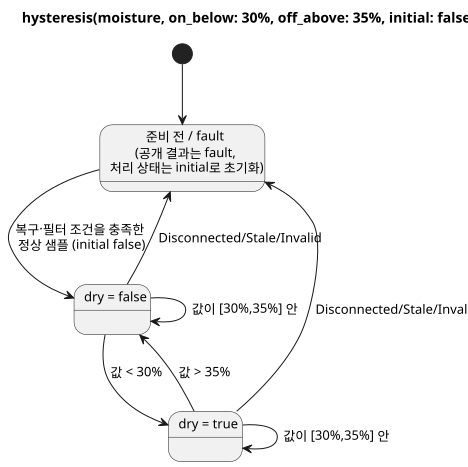

그림은 유지되는 두 판단, 엄격한 전이, 그리고 처리를 `initial`로 초기화하는 fault 경로를
보여 줍니다.

다음 순서는 준비 조건을 충족한 뒤의 품질 좋은 필터 결과입니다. 필터 전의 원시 샘플이
아닙니다.

| 품질 좋은 필터 수분값 | 유지되는 dry | 이유 |
|---|---|---|
| 시작 뒤 30% | false | 같으므로 초기 false 유지. |
| 35% | false | 상한과 같아도 false 유지. |
| 29% | true | 하한보다 엄격히 낮음. |
| 30% | true | 하한과 같아 true 유지. |
| 33% | true | 구간 내부. |
| 35% | true | 상한과 같아 true 유지. |
| 36% | false | 상한보다 엄격히 높음. |

`initial`은 처음에 유지할 값일 뿐, 샘플 누락을 무시해도 된다는 허가가 아닙니다.

- 준비 전이나 Disconnected/Stale/Invalid 뒤에는 공개 결과가 fault입니다.
- 처리 상태는 `initial`로 돌아가고, 정상 샘플도 복구 조건과 필터 조건을 다시 충족해야
  합니다.
- 따라서 복구된 구간 내부 샘플은 `initial`에서 시작하며, fault 이전의 판단을 이어가지
  않습니다.
- `initial`이 true여도 실패한 Result가 `ok(true)`가 되지는 않습니다. E10은 `case`로
  출력 대응을 고릅니다.

[Rust conditioner](../crates/ghostflow-core/src/signals.rs)는 엄격한 비교를 쓰고 fault 때 히스테리시스 처리를 초기화합니다. 링크한 WASM 테스트에 “retains either prior state exactly at both thresholds”와 fault·복구 예제가 있습니다. 이 장은 그 계약을 설명할 뿐이며, 문서를 고친다고 새 하드웨어 시험이 생기지는 않습니다.

### 13.4 시간, 샘플, 사건은 서로 다른 증거다

다음 연산은 `signal name = constructor(...);`로 선언합니다. scan을 세는 단조 타이머는
물리 조건이 scan과 scan *사이에도* 계속 참이었다는 증거가 아닙니다. 연속성이 중요하면
인증된 증거를 쓰세요.

선언된 Temperature 센서에 `signal recent = hold_last(temperature, for_at_most: 2min, quality: measured);`를 쓰면 마지막 정상 샘플을 재사용할 수 있는 시간을 제한합니다. 출력에 쓰려면 여전히 명시적인 Result 대응이 필요합니다.

| 내장 이름 | 시그니처와 목적 | 문맥, 경계와 예제 |
|---|---|---|
| `debounce` | `debounce(source, stable_for: Duration, initial: T) -> T or Result<T,E>`: 안정된 후보 채택 | Bool 또는 유한 enum; 양수 상수 시간과 같은 타입의 상수 initial. 후보가 바뀌면 나이를 다시 세고, fault 때 초기화합니다. 샘플 소스는 lineage를 보존하고 일반 값은 scan을 씁니다. [Debounce](../tests/debounce-control.test.mjs). |
| `true_for` | `true_for(BoolSensor, duration: Duration, quality: measured) -> Result<Bool,SensorFault>`: 연속 참 증명 | 직접 선언한 Bool 센서, 양수 상수 시간. driver가 인증한 구간; false나 부적합 품질이면 초기화. 시간 경계에 도달하면 true. [인증 소스](../tests/fixtures/true-for-certified.ghost.md). |
| `after_event` | `after_event(Event, BoolSensor, window: Duration, quality: measured)`: 사건별 증거 유지 | 양수 상수 창; 사건 식별자와 predicate 샘플이 필요합니다. predicate는 [eventTime,eventTime+window)에서 판단합니다. signal 자체는 스칼라가 아닙니다. [사건 소스](../tests/fixtures/after-event-evidence.ghost.md). |
| `after_event_any` | `after_event_any(signal) -> Result<Bool,SensorFault>`: 하나라도 만족하는 사건 결과 투영 | after_event signal 하나. 결정적 true가 any를 확정할 수 있고, 그렇지 않으면 미결 식별자와 fault가 계속 관련됩니다. [투영 예제](../tests/after-event-control.test.mjs). |
| `after_event_all` | `after_event_all(signal) -> Result<Bool,SensorFault>`: 모든 사건의 결과 투영 | after_event signal 하나. 결정적 false가 all=false를 확정할 수 있습니다. 결정적 증거가 없는 빈 집합·미결 집합은 자동 허용이 아니라 NotReady입니다. [투영 예제](../tests/after-event-control.test.mjs). |
| `window_average` | `window_average(source, over: Duration, quality: measured, max_age: Duration)` | 물리 샘플 lineage가 있는 Result<숫자/물리량,SensorFault>. 같은 payload를 반환하되 Int -> Number. [창](../tests/window-control.test.mjs). |
| `window_min` | `window_min(source, over: Duration, quality: measured, max_age: Duration)` | average와 같은 허용 payload; 같은 payload 타입의 최솟값 Result. [창](../tests/window-control.test.mjs). |
| `window_max` | `window_max(source, over: Duration, quality: measured, max_age: Duration)` | average와 같은 허용 payload; 같은 payload 타입의 최댓값 Result. [창](../tests/window-control.test.mjs). |
| `window_rate` | `window_rate(source, over: Duration, quality: measured, max_age: Duration) -> Result<Rate<Q>,SensorFault>` | 지원하는 선형 물리량; 서로 다른 시각의 가장 이른·늦은 관측. 온도 차이는 delta K를 씁니다. Number/Int/Percent, RelativeHumidity, CO2, Acidity는 입력으로 받지 않습니다. [변화율 예제](../tests/window-control.test.mjs). |
| `hold_last` | `hold_last(source, for_at_most: Duration, quality: measured) -> Result<T,SensorFault>`: 정상 샘플 임시 재사용 | 물리 lineage와 양수 상수 시간이 필요합니다. 실제 timestamp, 유지 나이, 가려진 fault를 보존하며 재평가로 갱신하지 않습니다. [유지 예제](../tests/hold-last-control.test.mjs). |
| `elapsed` | `elapsed(state) -> Duration`: 상태 변경 뒤의 나이 | timer 선언 전용; 선언된 state와 명시적 단조 시계; 변경 때 초기화. [E08](#ch06). |
| `continuous_true` | `continuous_true(BoolExpression) -> Duration`: 연속으로 참인 scan 관측의 나이 | timer 선언 전용; 첫 true scan에서 0으로 시작하고 false 때 초기화. 관측하지 않은 구간을 인증하지 않습니다. [타이머 예제](../tests/compiler.test.mjs). |

창 규칙은 다음과 같습니다.

- `over`와 `max_age`는 양수 상수 Duration입니다.
- 창은 **(now-over,now]** 안의 실제 허용 관측을 쓰며, 보간하지 않습니다.
- 관측이 없거나 가장 새 관측의 나이가 **>= max_age**이면 NotReady입니다.
- 현재 소스의 fault는 보존합니다.
- 변화율에는 서로 다른 두 시각의 관측이 필요합니다.
- 창 합성은 집계 provenance와 샘플 provenance를 보존합니다. 시계만 진행한 scan은 새
  관측을 만들어 내지 않습니다.

after_event를 any/all 투영으로만 쓰는 프로그램은 사건 런타임 binding과 함께 실행 가능한
제어로 컴파일될 수 있습니다. 투영하지 않은 after_event나 자연 조건과 결합한 after_event는
`executable:false` temporal descriptor가 될 수 있습니다. `after_event_for`는 아래의
미지원 이름 목록에서 다룹니다.
근거: [signal/timer lowering](../tools/control.mjs), [시간 증거 Reference](reference/04-sensors-constraints-control.md).

### 13.5 자연 사실과 예약 정책 생성자

provider는 관측이나 예측을 공급하고, 프로그램은 그것이 무엇을 허용하는지 결정합니다.
다음 일반 호출 세 개는 불확실성을 `Result`로 명시적으로 반환합니다.

| 내장 이름 | 시그니처와 목적 | 문맥, 경계와 예제 |
|---|---|---|
| `calendar_is` | ``calendar_is(calendar, day`workday` or day`offday` or day`holiday`) -> Result<Bool,CalendarFault>`` | GFB18의 명시적 UTC binding을 쓰는 typed WorkCalendar 또는 HolidayCalendar. 누락, coverage 밖, 만료, 신뢰할 수 없는 시계의 사실은 fault를 보존합니다. 성공한 Bool을 부정하기 전에 fault를 명시적으로 처리합니다. [실행된 달력 경계](../tests/reference-calendar-boundary.test.mjs). |
| `tide_is` | ``tide_is(provider, tide`spring` or tide`neap`) -> Result<Bool,TemporalContextFault>`` | 선언된 TidePredictions provider. 예측이 없거나 오래되었거나 시계 문맥이 없으면 fault입니다. [자연 조건](../tests/natural-condition-contract.test.mjs). |
| `moon_is` | ``moon_is(provider, moon`phase`) -> Result<Bool,TemporalContextFault>`` | LunarEphemeris provider; 위상: new, waxing_crescent, first_quarter, waxing_gibbous, full, waning_gibbous, last_quarter, waning_crescent. [자연 조건](../tests/natural-condition-contract.test.mjs). |

시그니처 안의 tagged literal은 표기 단편입니다. 이 호출들은 런타임·provider 사실이 필요하므로, 순수 `fn`은 전역 calendar나 provider를 캡처할 수 없습니다.

다음 생성자는 schedule 필드에서만 유효합니다. 일반 표현식에 저장할 수 있는 값을 반환하지 않습니다. 여기의 Duration은 모두 양수 상수입니다.
예를 들어 `gap = skip_after(10min);`은 공백 정책을 선언합니다. Tide의 `basis = run(5min, within(10min));`은 계획 시각부터 10분 안의 admission을 허용하고, admission 시점부터 5분 동안 운전합니다.

| 내장 이름 | 시그니처와 목적 | 문맥, 경계와 예제 |
|---|---|---|
| `instant` | `instant(DateTime)`: Periodic의 절대 anchor | 상수 DateTime; 현재 실행 경로는 preserve_anchor와 pulse를 씁니다. [Periodic](../tests/periodic-cron-policy.test.mjs). |
| `civil` | `civil(Date, TimeOfDay)`: Periodic의 민간시 anchor | 상수 날짜·시각; 검증된 descriptor 계약이며 현재 Periodic bytecode 경로 밖입니다. [Periodic](../tests/periodic-cron-policy.test.mjs). |
| `skip_after` | `skip_after(Duration)`: 허용 관측 공백 제한 | schedule gap 필드; 더 큰 공백에는 명시적 skip/baseline 정책을 씁니다. [정책](../tests/periodic-cron-policy.test.mjs). |
| `range` | `range(Duration)`: 계획된 구간 | schedule basis; 비중첩을 증명할 수 있어야 하고 cancel_when을 명시해야 합니다. 고정 UTC 구간에는 제한된 실행 경로가 있고, 일반 민간시 구간은 descriptor 범위에 머뭅니다. [Range 계약](../tests/schedule-descriptor-artifact.test.mjs). |
| `run` | `run(Duration, within(Duration))`: admission부터 Tide 운전 | Tide basis; 첫 Duration은 운전 길이입니다. admission은 유예 구간 안에서 일어나야 합니다. [Tide](../tests/natural-schedule-contract.test.mjs). |
| `window` | `window(Duration)`: At의 한 번짜리 admission 구간 | 고정 At 반열린 구간에서 처음 자격을 갖춘 scan이 `.due`를 냅니다. `.open`은 현재 조건 수준이며, 이미 admission되었거나 놓친 occurrence를 다시 시작하지 않습니다. [At Window](../tests/reference-foundations-temporal.test.mjs). |
| `within` | `within(Duration)`: Tide admission 유예 | Tide run의 둘째 인자 전용; [planned,planned+grace), 정확한 끝은 제외. 운전 길이를 늘리지 않습니다. [Tide](../tests/natural-schedule-contract.test.mjs). |
| `hold_trusted` | `hold_trusted(Duration, terminal: skip)`: 제한된 신뢰 시각 보류 | Solar/Tide clock 필드; 양수 상수, 이전 신뢰 증거와 run/time 연속성이 필요합니다. 정확한 만료 시점에는 skip합니다. E36. [실행](../tests/programming-natural-examples.test.mjs). |
| `fixed_time` | `fixed_time(TimeOfDay literal, terminal: skip)`: 고정 시각 fallback | Solar fallback 전용; 상수 TimeOfDay literal과 명시적 terminal skip. Tide로 옮기지 않습니다. E36/E101. [실행](../tests/programming-natural-examples.test.mjs). |

현재 실행 예약은 baseline 복구를 사용합니다. 지원하는 조합은 다음과 같습니다.

- Solar와 Tide의 clock: `trusted_only`, 또는 양수 상수 Duration과 `terminal: skip`을 지정한 `hold_trusted`.
- Solar fallback: `fixed_time(TimeOfDay, terminal: skip)`. Tide fallback은 `skip`입니다.
- Daily/slots/Cron은 pulse를 쓰고, Periodic은 instant+preserve_anchor가 필요하며, Tide는 run+within을 씁니다.
- 고정 UTC `range`에는 별도의 제한된 실행 경로가 있습니다. 그렇다고 모든 민간시 descriptor가 실행 가능해지지는 않습니다.

아래 E36–E37과 [fallback 검사](../tests/natural-fallback-compiler.test.mjs)를 참고하세요.
근거: [예약 lowering과 실행 경로 선택](../tools/control.mjs), [시간 Reference](reference/03-time-and-schedules.md).

### 13.6 더 허용하기 전에 사용량 계상하기

account는 증거를 기록합니다. 화면 애니메이션이나 요청된 출력으로 사용량을 예측하지
않습니다. applied receipt는 requested intent와 다르며, durable 계상에는 ledger와 검증된
resource binding이 필요합니다.

binding된 resource `pump`에 대해 선언 단편 `account pumping = on_time(pump, stage: applied, persistence: durable);`는 applied 증거를 고릅니다. 링크한 계상 예제는 resource와 limit 정책도 함께 선언합니다.

| 내장 이름 | 시그니처와 목적 | 문맥, 경계와 예제 |
|---|---|---|
| `on_time` | `on_time(resource, stage: applied, persistence: durable)`: Duration account | account 선언; 제한된 실행 경로는 durable/applied만 받습니다. requested/safe/confirmed 대안은 검사할 수 있지만 이 실행 binding은 아닙니다. [계상](../tests/accounting-syntax.test.mjs). |
| `count_events` | `count_events(Event, over: local_day("zone"), persistence: durable)`: 사건 account | account 선언; .count는 Result<Int,AccountingFault>를 반환합니다. 실행 경로는 durable/local_day가 필요하며, 중복 사건 식별자를 두 번 세지 않습니다. [계상](../tests/accounting-syntax.test.mjs). |
| `used` | `used(account, rolling(Duration))`: 계상된 Duration 조회 | accounting constraint의 limit 위치 전용. 실행 limit은 <=, 양수 bound/reserve, on_unknown=block을 씁니다. [한도](../tests/accounting-syntax.test.mjs). |
| `rolling` | `rolling(Duration)`: 뒤로 이어지는 계상 기준 | 양수 상수 시간; count_events의 rolling은 descriptor/검사 범위이며 사건 수 실행 경로 밖입니다. [한도](../tests/accounting-syntax.test.mjs). |
| `local_day` | `local_day("timezone")`: 민간시 하루 계상 기준 | 비어 있지 않은 literal timezone; 시계·달력·ledger가 필요합니다. 고정 24시간 rolling 창이 아닙니다. [계상](../tests/accounting-syntax.test.mjs). |
| `count_on` | `count_on({resources}) -> Int`: 참인 후보 자원의 수 | 이름 있는 resource 제약 전용이며 일반 표현식이 아닙니다. 유한하고 서로 다른 Bool resource 집합; 빈 집합 -> 0. 호스트 정책 binding이 필요합니다. [이름 있는 제약](../tests/named-constraints.test.mjs). |
| `any_on` | `any_on({resources}) -> Bool`: 후보 자원 검사 | 같은 제한 문맥; 빈 집합 -> false. 평가 단계는 제약이 선언합니다. [이름 있는 제약](../tests/named-constraints.test.mjs). |

독립된 이름 있는 resource 정책은 일반 VM 제어가 아니라 호스트 정책 artifact가 됩니다. 근거: [계상·resource 제약](../tools/control.mjs).

### 13.7 PID 생성자는 objective에 속한다

controller는 요청 목표값을 계산하고, 뒤의 제약이 그 값을 제한할 수 있습니다. 다음
생성자는 gain과 재시작 정책을 정할 뿐, 일반 단위 대수 함수가 아닙니다.

현재 native binding은 Temperature 센서, Temperature config 목표,
`ContinuousActuator<Percent>`이며 출력 하한은 0%입니다. 다른 종류의 controller도 binding이
필요한 메타데이터를 가질 수 있지만, `pi`나 `on_off`가 파싱된다고 controller가 실행 중이라는
증명이 되지는 않습니다.

| 내장 이름 | 시그니처와 목적 | 문맥, 경계와 예제 |
|---|---|---|
| `proportional_gain` | `proportional_gain(output: Percent, error: TemperatureDelta)`: P gain | PID kp 필드; 상수, output >=0, error >0; output/error. [Controller 예제](../tests/gfb7-pid-contract.test.mjs). |
| `integral_gain` | `integral_gain(output: Percent, error: TemperatureDelta, time: Duration)`: I gain | PID ki; 같은 범위에 time >0 추가; output/error/seconds. [Controller 예제](../tests/gfb7-pid-contract.test.mjs). |
| `derivative_gain` | `derivative_gain(output: Percent, error: TemperatureDelta, time: Duration)`: D gain | PID kd; 같은 범위에 time >0 추가; output*seconds/error. [Controller 예제](../tests/gfb7-pid-contract.test.mjs). |
| `reset` | `reset(output: Percent)`: 명시적 재시작 목표 | PID restart 필드; objective 출력 범위 안의 상수. 처음 허용된 샘플이 tracking을 초기화합니다. 임의의 상태 reset 호출이 아닙니다. [Controller 예제](../tests/gfb7-pid-contract.test.mjs). |

output이 0인 gain은 그 항을 끕니다. period는 양수여야 하고 late_after >= period여야
합니다. 명시적 direction, bias, anti-windup, disabled/transfer, fault, restart 정책이
controller의 생명주기를 정합니다. 오래되거나 누락된 측정은 절대 조용히 받아들이지
않습니다. [Controller lowering](../tools/control.mjs)과 [연속 제어 Reference](reference/04-sensors-constraints-control.md)를 참고하세요.
예를 들어 `kp = proportional_gain(output: 2%, error: 1Δ°C);`는 온도 오차 1도당 출력 2퍼센트포인트를 선언합니다. `restart = reset(output: 0%);`는 첫 tracking 목표를 명시적으로 고릅니다.

### 13.8 별도의 호스트 정책 문법

`ghostrules` adapter는 좁은 범위의 station 정책 문법을 검사합니다. 그 안에서 호출처럼
보이는 형식은 문맥 전용 형식이며, 일반 control 표현식에 함수를 추가하지 않습니다. 기존
[station 규칙](../examples/station-rules.ghost.md)과 [제약 테스트](../tests/constraints.test.mjs)에 완전한 정책이 있습니다.

| 내장 이름 | 시그니처와 목적 | 문맥, 경계와 예제 |
|---|---|---|
| `stopped` | `stopped(station)`: 정지한 station 요구 | 지정된 mode와 함께 쓰는 allow enter/apply 정책 조건에서만 사용합니다. 호스트의 station 상태이며 물리적 모터 정지의 증명이 아닙니다. [규칙](../examples/station-rules.ghost.md). |
| `pump_capacity` | `pump_capacity(pump)`: 용량 검사 요청 | require ... == Pass 또는 check 정책 절 전용. 호스트 정책 artifact이며 숫자 용량 표현식이 아닙니다. [규칙](../examples/station-rules.ghost.md). |
| `day` | `day("timezone")`: 일일 한도의 민간시 하루 | `limit on_time(pump) <= Duration per day("zone")` 전용; 유효한 IANA timezone, 비어 있지 않은 128자 이하 문자열. [규칙](../examples/station-rules.ghost.md). |

이 문법의 `count_on(pump.valves)`, `any_on(pump.valves)`, `on_time(pump)`는 §13.6과 인자 모양이 다른 제한 형식입니다. 각각 max-valves, pump-needs-valve, daily-limit 정책 절을 만듭니다. 이 표기를 임의의 `let` 표현식으로 옮기지 마세요. 키워드 `exclusive`, `allow`, `require`, `limit`, `once`, `check`는 절을 시작하며, `warn`은 거부됩니다.
근거: [호스트 정책 parser](../tools/constraints.mjs).

### 13.9 인접 문법과 사용할 수 없는 대안

다음 항목은 내장 연산과 함께 쓰면 유용하지만 **호출 가능한 함수가 아닙니다**.

| 문법 | 의미와 현재 경계 |
|---|---|
| Daily, DailySlots<15min>, Periodic, Cron, Solar, Tide | schedule 선언 타입. DailySlots 실행은 고정 15분 격자를 쓰고, Cron은 검증된 필드 다섯 개를 가집니다. |
| pulse; time/date/datetime/cron5/day/sun/tide/moon tagged literals | 정책 값과 typed 표기. ``sun`rise` ``/``sun`set` ``은 sunrise()/sunset() 호출이 아닙니다. |
| TimeSlots<grid,capacity> | config 타입: 24h를 나누는 양수 grid, 양수 capacity, 유한·고유·격자 정렬된 TimeOfDay 목록. TimeSlots(...) 호출은 없습니다. |
| `Result<T,E>`; `Rate<Q>` | typed 결과와 표현식 전용 변화율. E는 컴파일러 소유이며, 중첩 Result payload는 거부됩니다. |
| schedule.due; schedule.active; schedule.missed | Bool 투영; .missed는 노출된 투영이 필요합니다. active occurrence는 applied output이 아닙니다. 메서드 호출은 없습니다. |
| eventAccount.count | Result<Int,AccountingFault> 투영; count_events account에만 있습니다. |
| resource.on/position/valves | 문맥 전용 resource/정책 endpoint이며 일반 메서드가 아닙니다. |
| sample, valid, filter, stale_after, recover_after, samples | 센서 선언 필드·표기. 특히 stale_after는 표현식 호출이 아닙니다. |
| on_below, off_above, initial; min, max, step, access, label | 이름 있는 인자 또는 config 필드이며 함수가 아닙니다. |
| if/case/in; >> and \|>; fn/type/state/config/timer/signal | 문법, 연산자, 선언. 한정된 input.name/state.name/next.name은 제거된 별칭입니다. |

[Parser와 member/type 규칙](../tools/control.mjs)이 이 항목들이 나타날 수 있는 위치를 정합니다. 전체 타입과 단위는 [Reference 2장](reference/02-types-expressions-state.md)에 있습니다.

다음 표는 Reference나 설계 노트에서 볼 수 있지만, 현재 컴파일러가 호출로 지원하지
**않는** 표기입니다.

| 선택된/Reference 표기 | 현재 상태; 실행을 주장하지 않는다 |
|---|---|
| after_event_for(signal, EventId) | Reference는 식별자별 투영을 설명하지만 현재 컴파일러에는 호출 dispatcher가 없어 unknown function입니다. 의미가 의도와 맞을 때에만 지원되는 any/all을 쓰세요. |
| window(Duration) schedule basis | 설계 대안이며 현재 허용되는 basis가 아닙니다. 지원되는 window_average/min/max/rate signal과는 다릅니다. |
| run(Duration, on_time) | 설계 대안; 지원되는 Tide run에는 within(Duration)이 필요합니다. |
| range(Duration); civil(Date,TimeOfDay) | 위에서 설명한 검증된 descriptor 계약; 현재 bytecode 경로가 아닙니다. |
| PID checkpoint; degraded Name | 현재 native PID fault/restart 정책이 지원하지 않는 선택된 설계 대안입니다. |
| ifthenelse, purefn, enum, next | 제거된 별칭. 대표 표기인 if ... then ... else, fn, type, prime이 붙은 state를 쓰세요. |

진단에 이름이 보였다는 사실은 지원된다는 증거가 아닙니다. 그래서 위 표는 설계 대안과
현재 호출을 나눕니다. 컴파일러 경로와 artifact 종류를 확인하세요.
[장 coverage 검사](../tests/programming-builtins.test.mjs)는 두 언어의 항목을 컴파일러의
호출 dispatch와 맞춰 두지만, 물리적 유용성까지 판단하지는 않습니다.

<a id="ch14"></a>
## 14. 온도 단위와 공기 VPD 제어

25°C와 77°F는 같은 공기를 서로 다른 숫자로 말합니다. 반대로 같은 숫자 25라도 단위가
다르면 전혀 다른 조건일 수 있습니다.

이 장에서는 두 가지를 먼저 예측해 보세요.

- E16–E18에 같은 물리 온도를 넣으면 세 히터가 모두 같은 판단을 내린다고 예측합니다.
- VPD 예제에서 온도만, 또는 습도만 바꾸고 어떤 요구가 먼저 바뀌는지 관찰합니다.

단위 변환과 제어 정책을 분리해 두면 계산 오류와 정책 논쟁을 서로 다른 곳에서 해결할
수 있습니다.

### 같은 물리 온도를 세 단위로 쓰기

Temperature 센서는 소스·표시 단위가 섭씨, 화씨, 켈빈 중 무엇이든 물리 타입을 잃지
않습니다. 런타임의 정규 표현은 켈빈입니다.

세 히터 예제는 하나의 물리 규칙을 세 가지 표시 단위로 표현합니다.

- 18°C보다 낮으면 ON을 요청합니다.
- 22°C보다 높으면 OFF를 요청합니다.
- 경계와 같거나 그 사이에 있으면 이전의 정상 판단을 유지합니다.

아래 표를 가로로 읽으면 변환 뒤에도 각 경계가 그대로인지 검산할 수 있습니다.

품질은 계산과 함께 따라갑니다.

- 첫 샘플 전에는 센서가 NotReady입니다.
- 샘플 전달 사이에는 마지막 정상 샘플을 계속 쓸 수 있지만, 나이가 3초 이상이 되면
  Stale이 됩니다.
- fault는 히터 요청을 억제하고 히스테리시스를 `initial` false로 되돌립니다.
- `median(1)`을 쓰므로 이 예제들은 새 정상 샘플 하나로 복구됩니다.

“전에 숫자를 본 적이 있다”와 “지금 그 숫자를 믿을 수 있다”는 서로 다른 주장입니다.

| 물리 경계 | 섭씨 | 화씨 | 켈빈 |
|---|---|---|---|
| 히터 하한 | 18°C | 64.4°F | 291.15K |
| 히터 상한 | 22°C | 71.6°F | 295.15K |
| 히터 유효 범위 | −40–50°C | −40–122°F | 233.15–323.15K |

literal 변환은 binary64로 반올림하기 전에 정확하게 이루어집니다. 64.4 같은 숫자를 정규
런타임 샘플로 그대로 넣지 마세요. 64.4°F는 291.15K를 뜻합니다. driver binding은 자신이
공급하는 단위와 물리량을 식별합니다. [물리 타입](reference/02-types-expressions-state.md)과 [히스테리시스](#ch13)를 참고하세요.

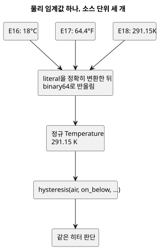

그림은 하한 임계값을 따라갑니다. 예제마다 다른 단위로 쓰지만 셋 모두 같은 켈빈 값에
도달하므로 같은 판단을 내립니다.

### E16 — 섭씨 히터

```ghost
// E16
control CelsiusHeater {
  input air: Temperature {
    sample = 1s;
    valid = -40°C .. 50°C;
    filter = median(1);
    stale_after = 3s;
    recover_after = 1 samples;
  }
  signal cold = hysteresis(air,
    on_below: 18°C, off_above: 22°C, initial: false);
  output heater: Bool;
  heater <- cold |> recover(false);
}
```

### E17 — 화씨 히터

```ghost
// E17
control FahrenheitHeater {
  input air: Temperature {
    sample = 1s;
    valid = -40°F .. 122°F;
    filter = median(1);
    stale_after = 3s;
    recover_after = 1 samples;
  }
  signal cold = hysteresis(air,
    on_below: 64.4°F, off_above: 71.6°F, initial: false);
  output heater: Bool;
  heater <- cold |> recover(false);
}
```

### E18 — 켈빈 히터

```ghost
// E18
control KelvinHeater {
  input air: Temperature {
    sample = 1s;
    valid = 233.15K .. 323.15K;
    filter = median(1);
    stale_after = 3s;
    recover_after = 1 samples;
  }
  signal cold = hysteresis(air,
    on_below: 291.15K, off_above: 295.15K, initial: false);
  output heater: Bool;
  heater <- cold |> recover(false);
}
```

### 온도와 상대습도로 공기 VPD 구하기

**공기 VPD**(vapour pressure deficit, 증기압차)는 포화 수증기압에서 공기의 실제
수증기압을 뺀 값입니다. 같은 시점의 공기 온도 T(°C)와 공기 상대습도 RH로
`0.6108 * exp(17.27*T/(T+237.3)) * (1-RH/100)` kPa를 계산합니다.

- 포화 관계와 상대습도 정의는 [FAO-56 3장 식 10–11](https://www.fao.org/4/x0490e/x0490e07.htm)에 근거합니다.
- 이것은 순간 공기 계산이며, FAO의 일일 증발산 추정이 아닙니다.
- 잎 VPD는 잎 온도에도 좌우되며, 여기서는 계산하지 않습니다.

GhostFlow에는 exp 내장 함수가 없으므로, 각 완전한 예제는 일반 순수 fn `exp_0_3_1`을
직접 작성합니다. 고정된 14차 Taylor 다항식을 Horner 형식으로 평가하는 함수입니다.

- air 센서의 선언 범위는 **0–50°C**이므로 지수는 **0–3.006** 안에 머물며, 함수에
  명시한 0–3.1 범위 안에 있습니다.
- 온도가 이 범위를 벗어나면 센서가 Invalid를 반환하고 수식은 평가되지 않습니다. 근사를
  범위 밖으로 외삽하지 마세요.
- [독립 수치 검사](../tests/programming-climate.test.mjs)는 0.1°C 격자와 습도 경계에서
  실제 런타임 값을 호스트 Math.exp와 비교하며, 절대 오차 **0.001 kPa 이하**를
  요구합니다. 다항식을 예상값 구현에 복사하지 않고 원본 세 개를 모두 확인합니다.

`air_vpd`의 타입 있는 산술은 명시적입니다.

- `(t - 0°C) / 1Δ°C`는 온도를 섭씨 단위의 일반 Number로 바꿉니다.
- `rh / 100%RH`는 [RH 비율 계약](reference/02-types-expressions-state.md)에 따라 타입 있는 습도를 비율로 정규화합니다.
- 마지막에 `0.6108kPaVPD`를 곱해 결과에 VaporPressureDeficit 타입을 줍니다.

RelativeHumidity는 공기 습도입니다. E10에서 쓴 토양 수분 Percent가 아닙니다.

빛은 **PPFD** 타입이며 단위는 `umol/m2/s`(µmol·m⁻²·s⁻¹)입니다. PPFD는 광합성에 관련된
광자 수를 셉니다. lux는 사람의 시각에 맞춰 가중한 조도이고, lux를 PPFD로 바꾸는 보편적인
변환은 없으므로 검증된 PPFD 센서·binding을 쓰세요. 이 예제들에서 빛은 **출력 허용
조건**으로만 쓰이며, 같은 T/RH에서 계산된 VPD를 바꾸지 않습니다.

### 독립된 학습 정책 세 가지

임계값은 예시용 소스 의도이며, 보편적인 작물 권장값이 아닙니다. 다음 한계를 기억하세요.

- 가습 요구가 습도 상승을 증명하지는 않습니다.
- 환기 효과는 외기 조건에 좌우됩니다.
- 관수 요구는 토양 수분 추정도, 펌프 순서도 아닙니다.

이 예제들에는 온실 물리 모델이 없습니다. actuator binding, 그 적합성, 물리 효과의 검증은
설치가 책임집니다.

| 예제 | ON | OFF | 빛 조건 |
|---|---|---|---|
| E19 가습 요구 | VPD > 1.2 kPa | VPD < 1.0 kPa | PPFD >= 200 µmol·m⁻²·s⁻¹ |
| E20 환기 요구 | VPD < 0.4 kPa | VPD > 0.6 kPa | PPFD >= 200 µmol·m⁻²·s⁻¹ |
| E21 관수 요구 | VPD > 1.0 kPa | VPD < 0.8 kPa | PPFD >= 300 µmol·m⁻²·s⁻¹ |

계산한 Result는 선언된 센서가 아니므로 센서 전용 `hysteresis` 생성자에 넣을 수 없습니다.
대신 각 예제는 같은 엄격한 ON / OFF / 유지 구간 의도를 나타내는 명시적 Bool `state`를
씁니다.

예제가 fault와 빛에 대응하는 방식은 다음과 같습니다.

- 온도나 RH fault는 요구를 지웁니다.
- 밤이거나 빛 fault가 있으면 출력을 억제하지만, climate 요구 기억은 유지될 수 있습니다.
- 빛 fault는 출력을 억제할 뿐, 여전히 정상인 T/RH 계산을 무효로 만들지 않습니다.
- 복구는 현재의 정상 증거로 판단합니다. 타이머나 추가 자동 모드는 도입하지 않습니다.

climate fault 때의 `air_vpd_value = 0`은 명시적인 표시용 대체값일 뿐입니다.
**vpd_valid와 함께 읽으세요**. false는 측정된 VPD가 0이라는 뜻이 아닙니다.

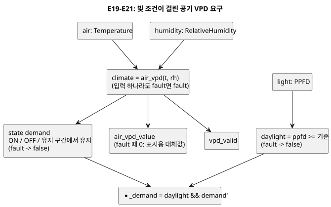

그림은 E19–E21의 공통 구조를 보여 줍니다. 세 예제의 차이는 ON/OFF 임계값과 PPFD
기준뿐입니다.

### E19 — 높은 VPD 가습 요구

<!-- ghostflow:anchor id=GF-INT-PIG-E19-HYSTERESIS kind=intent status=confirmed origin=ai -->
> VPD 두 임계값 사이에서는 빠른 전환을 막기 위해 이전 수요를 유지하고, 기후 샘플에 오류가 있으면 수요를 해제한다.

```ghost
// E19
fn exp_0_3_1(x: Number) -> Number {
  1 + x / 1 * (1 + x / 2 * (1 + x / 3 * (1 + x / 4 * (1 + x / 5 * (1 + x / 6 * (1 + x / 7 * (1 + x / 8 * (1 + x / 9 * (1 + x / 10 * (1 + x / 11 * (1 + x / 12 * (1 + x / 13 * (1 + x / 14 * (1))))))))))))))
}
fn air_vpd(t: Temperature, rh: RelativeHumidity) -> VaporPressureDeficit {
  0.6108kPaVPD * exp_0_3_1(
    17.27 * ((t - 0°C) / 1Δ°C) / (((t - 0°C) / 1Δ°C) + 237.3)
  ) * (1 - rh / 100%RH)
}
control HumidificationDemand {
  input air: Temperature {
    sample = 1s; valid = 0°C .. 50°C;
    filter = median(1); stale_after = 3s; recover_after = 1 samples;
  }
  input humidity: RelativeHumidity {
    sample = 1s; valid = 0%RH .. 100%RH;
    filter = median(1); stale_after = 3s; recover_after = 1 samples;
  }
  input light: PPFD {
    sample = 1s; valid = 0umol/m2/s .. 3000umol/m2/s;
    filter = median(1); stale_after = 3s; recover_after = 1 samples;
  }
  let climate: Result<VaporPressureDeficit, SensorFault> = case air {
    ok(t) => case humidity {
      ok(rh) => ok(air_vpd(t, rh));
      fault(reason) => fault(reason);
    };
    fault(reason) => fault(reason);
  };
  let daylight = case light {
    ok(ppfd) => ppfd >= 200umol/m2/s;
    fault(_) => false;
  };
  // ghostflow:link id=GF-INT-PIG-E19-HYSTERESIS relation=implements
  state demand: Bool = false;
  demand' = case climate {
    ok(value) => if value > 1.2kPaVPD then true
      else if value < 1.0kPaVPD then false else demand;
    fault(_) => false;
  };
  output air_vpd_value: VaporPressureDeficit;
  output vpd_valid, humidify_demand: Bool;
  air_vpd_value <- climate |> recover(0kPaVPD);
  vpd_valid <- case climate { ok(_) => true; fault(_) => false; };
  humidify_demand <- daylight && demand';
}
```

### E20 — 낮은 VPD 환기 요구

<!-- ghostflow:anchor id=GF-INT-PIG-E20-HYSTERESIS kind=intent status=confirmed origin=ai -->
> VPD 두 임계값 사이에서는 빠른 전환을 막기 위해 이전 수요를 유지하고, 기후 샘플에 오류가 있으면 수요를 해제한다.

```ghost
// E20
fn exp_0_3_1(x: Number) -> Number {
  1 + x / 1 * (1 + x / 2 * (1 + x / 3 * (1 + x / 4 * (1 + x / 5 * (1 + x / 6 * (1 + x / 7 * (1 + x / 8 * (1 + x / 9 * (1 + x / 10 * (1 + x / 11 * (1 + x / 12 * (1 + x / 13 * (1 + x / 14 * (1))))))))))))))
}
fn air_vpd(t: Temperature, rh: RelativeHumidity) -> VaporPressureDeficit {
  0.6108kPaVPD * exp_0_3_1(
    17.27 * ((t - 0°C) / 1Δ°C) / (((t - 0°C) / 1Δ°C) + 237.3)
  ) * (1 - rh / 100%RH)
}
control VentilationDemand {
  input air: Temperature {
    sample = 1s; valid = 0°C .. 50°C;
    filter = median(1); stale_after = 3s; recover_after = 1 samples;
  }
  input humidity: RelativeHumidity {
    sample = 1s; valid = 0%RH .. 100%RH;
    filter = median(1); stale_after = 3s; recover_after = 1 samples;
  }
  input light: PPFD {
    sample = 1s; valid = 0umol/m2/s .. 3000umol/m2/s;
    filter = median(1); stale_after = 3s; recover_after = 1 samples;
  }
  let climate: Result<VaporPressureDeficit, SensorFault> = case air {
    ok(t) => case humidity {
      ok(rh) => ok(air_vpd(t, rh));
      fault(reason) => fault(reason);
    };
    fault(reason) => fault(reason);
  };
  let daylight = case light {
    ok(ppfd) => ppfd >= 200umol/m2/s;
    fault(_) => false;
  };
  // ghostflow:link id=GF-INT-PIG-E20-HYSTERESIS relation=implements
  state demand: Bool = false;
  demand' = case climate {
    ok(value) => if value < 0.4kPaVPD then true
      else if value > 0.6kPaVPD then false else demand;
    fault(_) => false;
  };
  output air_vpd_value: VaporPressureDeficit;
  output vpd_valid, ventilate_demand: Bool;
  air_vpd_value <- climate |> recover(0kPaVPD);
  vpd_valid <- case climate { ok(_) => true; fault(_) => false; };
  ventilate_demand <- daylight && demand';
}
```

### E21 — VPD와 빛에 따른 관수 요구

<!-- ghostflow:anchor id=GF-INT-PIG-E21-HYSTERESIS kind=intent status=confirmed origin=ai -->
> VPD 두 임계값 사이에서는 빠른 전환을 막기 위해 이전 수요를 유지하고, 기후 샘플에 오류가 있으면 수요를 해제한다.

```ghost
// E21
fn exp_0_3_1(x: Number) -> Number {
  1 + x / 1 * (1 + x / 2 * (1 + x / 3 * (1 + x / 4 * (1 + x / 5 * (1 + x / 6 * (1 + x / 7 * (1 + x / 8 * (1 + x / 9 * (1 + x / 10 * (1 + x / 11 * (1 + x / 12 * (1 + x / 13 * (1 + x / 14 * (1))))))))))))))
}
fn air_vpd(t: Temperature, rh: RelativeHumidity) -> VaporPressureDeficit {
  0.6108kPaVPD * exp_0_3_1(
    17.27 * ((t - 0°C) / 1Δ°C) / (((t - 0°C) / 1Δ°C) + 237.3)
  ) * (1 - rh / 100%RH)
}
control IrrigationDemand {
  input air: Temperature {
    sample = 1s; valid = 0°C .. 50°C;
    filter = median(1); stale_after = 3s; recover_after = 1 samples;
  }
  input humidity: RelativeHumidity {
    sample = 1s; valid = 0%RH .. 100%RH;
    filter = median(1); stale_after = 3s; recover_after = 1 samples;
  }
  input light: PPFD {
    sample = 1s; valid = 0umol/m2/s .. 3000umol/m2/s;
    filter = median(1); stale_after = 3s; recover_after = 1 samples;
  }
  let climate: Result<VaporPressureDeficit, SensorFault> = case air {
    ok(t) => case humidity {
      ok(rh) => ok(air_vpd(t, rh));
      fault(reason) => fault(reason);
    };
    fault(reason) => fault(reason);
  };
  let daylight = case light {
    ok(ppfd) => ppfd >= 300umol/m2/s;
    fault(_) => false;
  };
  // ghostflow:link id=GF-INT-PIG-E21-HYSTERESIS relation=implements
  state demand: Bool = false;
  demand' = case climate {
    ok(value) => if value > 1.0kPaVPD then true
      else if value < 0.8kPaVPD then false else demand;
    fault(_) => false;
  };
  output air_vpd_value: VaporPressureDeficit;
  output vpd_valid, irrigation_demand: Bool;
  air_vpd_value <- climate |> recover(0kPaVPD);
  vpd_valid <- case climate { ok(_) => true; fault(_) => false; };
  irrigation_demand <- daylight && demand';
}
```

### E22 — 기존 VPD 제어 두 개를 import로 함께 실행하기

E22는 E19와 E20의 원문을 복사하지 않는다. 두 원본 section에서 생성한 완전한
`.ghost.md` 문서를 정확한 revision과 SHA-256으로 고정해 import한다. `air`,
`humidity`, `light`의 한 raw sample packet은 두 instance에 함께 전달되지만, 각
instance의 sensor conditioner와 `demand` state는 독립적이다. root는 두 demand를
모두 공개하고, 같은 입력에서 계산한 공통 VPD 관측은 `high` instance의
`air_vpd_value`와 `vpd_valid`를 공개한다.

```ghost
// E22
import HighVpd from "./E19.ghost.md"
  revision "5e709162753c0aba38d426c1c4e0722edfb04d7b"
  sha256 "c53372f31c0bfb9b8cf52930c5d9ef02dd36cf7478345410bbc5fb53258fc5c7";
import LowVpd from "./E20.ghost.md"
  revision "5e709162753c0aba38d426c1c4e0722edfb04d7b"
  sha256 "af696ac6774f459726853f0a2c65a689b42c7e37c69dd8165f68bb3dab1cbea8";
control CombinedVpdDemands {
  input air: Temperature {
    sample = 1s; valid = 0°C .. 50°C;
    filter = median(1); stale_after = 3s; recover_after = 1 samples;
  }
  input humidity: RelativeHumidity {
    sample = 1s; valid = 0%RH .. 100%RH;
    filter = median(1); stale_after = 3s; recover_after = 1 samples;
  }
  input light: PPFD {
    sample = 1s; valid = 0umol/m2/s .. 3000umol/m2/s;
    filter = median(1); stale_after = 3s; recover_after = 1 samples;
  }
  output air_vpd_value: VaporPressureDeficit;
  output vpd_valid, humidify_demand, ventilate_demand: Bool;
  instance high: HighVpd;
  instance low: LowVpd;
  connect high.air <- air;
  connect high.humidity <- humidity;
  connect high.light <- light;
  connect low.air <- air;
  connect low.humidity <- humidity;
  connect low.light <- light;
  connect air_vpd_value <- high.air_vpd_value;
  connect vpd_valid <- high.vpd_valid;
  connect humidify_demand <- high.humidify_demand;
  connect ventilate_demand <- low.ventilate_demand;
}
```

### 실행하고 입력 하나를 바꾸며 관찰하기

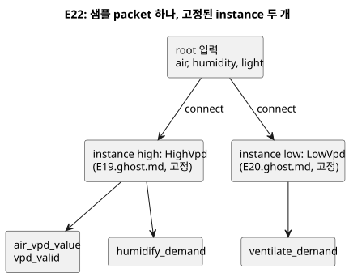

위 그림은 E22의 구조를 요약합니다. 한 입력 packet이 두 instance로 함께 전달되고, 공통
VPD 관측은 `high` instance에서, 두 요구는 각 instance에서 나옵니다.

E16–E21의 각 fence는 E15처럼 완전한 .ghost.md 문서로 따로 컴파일합니다. E22는 생성된 `examples/programming-book-imports` source closure와 함께 컴파일합니다.

컴파일러와 실제 ghostsim/WASM scan을 확인하려면 `node --test tests/programming-climate.test.mjs tests/programming-book-simulation.test.mjs tests/programming-book-import-package.test.mjs`를 실행합니다. native artifact와 WASM artifact의 build provenance가 일치해야 하며, build 전제 조건은 [검증](VERIFICATION.ko.md)에 있습니다. 테스트는 버려도 되는 scenario artifact를 쓰며 하드웨어를 구동하지 않습니다.

온라인 reader는 기본적으로 E10에서 소개한 시간 의존 센서 소스를 바탕으로, 서로 맞물린 **24시간 합성 일변화 프로필**을 씁니다.

- 온도, RH, PPFD는 아래 표의 지점 사이를 선형으로 변하며, 프로필은 끊김 없이 반복됩니다.
- 06–18에는 온도가 내려가지 않고, 18–06에는 빛이 정확히 0입니다.
- 선언된 샘플 간격마다 새로운 타입 있는 센서 증거를 공급합니다. VPD와 제어 요구는 실제 WASM 프로그램이 계산합니다.

이것은 학습용 입력 궤적이며, 온실 모델이나 actuator 피드백이 아닙니다.

| simulation 시각 | 기온 °C | RH % | PPFD µmol·m⁻²·s⁻¹ | 관찰 |
|---|---|---|---|---|
| 00 | 18 | 90 | 0 | 초기 히터 OFF; 빛 조건 요구 OFF |
| 03 | 17 | 92 | 0 | 히터 ON |
| 06 | 16 | 94 | 0 | 일출; 히터 ON |
| 09 | 22 | 85 | 500 | 낮은 VPD 환기 ON; 정확히 22°C에서 히터 ON 유지 |
| 12 | 28 | 60 | 1000 | 가습·관수 요구 ON; 히터·환기 OFF |
| 15 | 31 | 45 | 650 | 높은 VPD 요구 ON 유지 |
| 18 | 31 | 60 | 0 | 일몰; 빛 조건 요구 OFF |
| 21 | 23 | 80 | 0 | 야간 냉각; 히터는 아직 OFF |
| 24 | 18 | 90 | 0 | 연속 반복 경계; 히터는 18°C 미만에서만 ON |

각 예제를 simulation 00:00부터 실행하세요. E16–E21의 기본값은 1000× 배속과 24시간 timing chart입니다. 09·12·15·18시를 비교해 보세요.

- 실제 시간당 처리량은 컴퓨터에 따라 다릅니다.
- 배속은 실제 1초마다 흐르는 simulation 시간만 바꿉니다. 임계값과 일변화 프로필은 바꾸지 않습니다.
- Pause는 simulation 시간을 멈춥니다.
- 09시에 ON이었던 히터는 온도가 22°C를 엄격히 넘으면 꺼집니다.
- 이 예제들은 독립된 프로그램이므로 히터와 환기 사이의 인터록을 뜻하지 않습니다.
- 단위 선택은 물리값을 바꾸지 않고 입력·표시 단위만 바꿉니다. 17°C = 62.6°F = 290.15K입니다. E16–E18은 하루 내내 같은 판단을 내려야 합니다.

일정값 모드와 수동 단일 packet 모드는 개별 경계 실험에 여전히 유용합니다. 선택적인 디버깅 소스일 뿐이며, 하루 동안 판단이 어떻게 바뀌는지 관찰하는 일을 대신하지 않습니다.

Stale을 시험하려면 단일 packet 모드를 쓰거나 샘플 공급을 멈춘 뒤, simulation 시간을 선언된 3s 경계까지 진행합니다. 일정값 소스가 반복해 내는 샘플은 새 증거이므로 stale이 되지 않아야 합니다. Disconnected를 보여 주려면 해당 샘플 품질을 고르세요. 새로 전달된 실패도 여전히 실패입니다. 오래된 Good packet을 새 샘플처럼 재사용해서 단절을 흉내 내지 마세요.

권장 실험은 다음과 같습니다.

- **히터:** 18 → 17 → 18 → 22 → 23°C를 관찰한 뒤, 센서 fault와 복구를 관찰합니다.
- **각 VPD controller:** 온도를 25°C에 고정하고 RH를 바꿔 임계값을 넘긴 다음, PPFD만 바꿉니다. requested/safe 요구, air_vpd_value, vpd_valid를 비교합니다.
- **fault:** 누락, Invalid, Disconnected, stale 샘플을 시험합니다. 관련된 fault는 모두 즉시 출력을 억제해야 합니다.
- **수치 관계:** T와 RH를 함께 바꿔 봅니다.

논리 요구, 성공한 scan, 가상 actuator를 물리적으로 확인된 효과로 해석하지 마세요.

<a id="ch15"></a>
## 15. 이름 있는 물리량과 단위

숫자가 계산된다고 해서 그 숫자가 의미를 갖는 것은 아닙니다. 유량에 시간을 곱하면
부피가 됩니다. 전압에 유량을 더해도 숫자는 나오지만, 질문 자체가 잘못됐습니다. E33을
실행하기 전에 결과를 예측해 보세요. 같은 물리량의 단위 변환은 성공하고, 서로 다른
물리량의 혼합은 진단됩니다. 컴파일러가 이런 식을 거부하는 것은 방해가 아닙니다. 현장의
오해를 실행 전에 잡아낸 것입니다.

이 장은 `Duration`(6장)이나 날짜·시각(7장)을 다루지 않습니다. 온도, 압력, 광량처럼
단위가 제어 값의 의미를 바꾸는 17개 이름 있는 물리량을 다룹니다. 이런 값은 단위 없는
`Number`로 바꾸지 말고 각자의 타입으로 유지하세요. 그러면 우연히 비슷한 숫자를 가진
서로 무관한 두 센서의 측정값을 비교하는 실수를 컴파일러가 막아 줍니다. `Rate<Q>`는
시간창에서 파생되는 식 전용 타입입니다. 물리량 catalog의 별도 항목이 아니므로 13장에서
다룹니다.

### 물리량마다 구분되는 타입

아래 리터럴은 각 타입의 유효한 표기 예입니다.
[Reference §2.9](reference/02-types-expressions-state.md#29-물리량과-단위)에는
허용되는 모든 단위 접미사와 각 타입의 정규 단위가 나열되어 있습니다. 한 식에서 같은
타입의 서로 다른 단위를 쓰면 GhostFlow가 정규 단위로 변환합니다. 이 변환은 물리량의
타입을 바꾸지 않습니다.

| 이름 있는 타입 | 리터럴 예 | 무엇을 나타내나 |
|---|---|---|
| `Temperature` | `25°C`, `77°F`, `298.15K` | 절대 온도 |
| `TemperatureDelta` | `5Δ°C`, `9Δ°F` | 온도 차이 |
| `RelativeHumidity` | `70%RH` | 상대습도 |
| `Pressure` | `100kPa` | 압력 |
| `VaporPressureDeficit` | `1kPaVPD` | 포화 수증기압과 실제 수증기압의 차이 |
| `CO2Concentration` | `800ppm` | 이산화탄소 몰분율 |
| `FlowRate` | `5L/min` | 체적 유량 |
| `Volume` | `20L` | 체적 |
| `Length` | `35cm` | 길이 |
| `Irradiance` | `300W/m2` | 면적당 복사 출력 |
| `PPFD` | `600umol/m2/s` | 광합성 유효 광자의 면적·시간당 흐름 |
| `Energy` | `1kWh` | 에너지 |
| `Power` | `150W` | 전력 |
| `ElectricalCurrent` | `800mA` | 전류 |
| `Voltage` | `24V` | 전압 |
| `Conductivity` | `1.5mS/cm` | 전기 전도도 |
| `Acidity` | `6.5pH` | 산도 지표 |

아래 그림은 이 장의 핵심을 요약합니다. 단위는 표기일 뿐이어서 모든 온도 리터럴은 같은
`Temperature` 타입이 됩니다. 두 가지 광량 측정값처럼 비슷하게 들리는 물리량은 별개의
타입으로 남습니다.

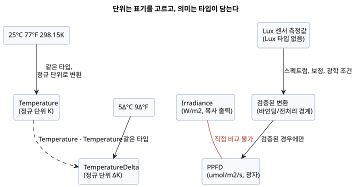

### 같은 물리량의 단위는 함께 쓸 수 있다

`25°C`와 `77°F`는 숫자와 단위 표기가 다르지만 둘 다 `Temperature`입니다. 따라서 이
타입의 센서 값은 어느 쪽 경계와도 비교할 수 있습니다. `5Δ°C`와 `9Δ°F`도 마찬가지로
같은 온도 차이입니다.

절대 온도와 온도 차이는 서로 다른 타입입니다.

- 온도에서 온도를 빼면 `TemperatureDelta`가 됩니다.
- 온도에 차이를 더하거나 빼면 `Temperature`가 됩니다.
- 두 절대 온도를 더하는 것은 오류입니다.

GhostFlow는 임의의 차원 대수를 수행하지 않습니다. 허용되는 연산은 닫힌 집합입니다.

- 같은 타입의 값끼리 비교할 수 있습니다.
- 같은 선형 물리량끼리 더하고 뺄 수 있습니다.
- 물리량에 수치 스칼라를 곱하거나 나눌 수 있습니다.
- 서로 다른 물리량 사이의 곱과 몫은 정해진 관계로만 제한됩니다.
  `FlowRate * Duration -> Volume`, `Power * Duration -> Energy`,
  `Voltage * ElectricalCurrent -> Power`와 이에 대응하는 나눗셈
  (`Volume / Duration`은 `FlowRate`, `Energy / Duration`은 `Power`)입니다.

그 밖의 모든 것은 오류입니다. `Pressure + Length`처럼 정의되지 않은 조합과 단위 없는
`Number`로의 암묵 변환도 여기에 포함됩니다. `RelativeHumidity`, `CO2Concentration`,
`Acidity` 등에 적용되는 몇 가지 추가 규칙은 Reference §2.9에 있습니다.

| 가능한 식 | 결과 | 불가능한 혼합 예 |
|---|---|---|
| `room < 25°C && room < 77°F` | 온도 비교 | `room + room` — 절대 온도끼리 더하기 |
| `change >= 5Δ°C && change >= 9Δ°F` | 온도 차 비교 | `room > change` — 절대 온도와 차이 비교 |
| `flow * 1min` | `Volume` | `flow + 20L` — 유량과 체적 더하기 |
| `voltage * current` | `Power` | `pressure > vpd` — 압력과 VPD 비교 |
| `power * 1h` | `Energy` | `irradiance > ppfd` — 서로 다른 광량 타입 비교 |

### 센서의 광량 단위를 혼동하지 않기

온실 센서는 이름이 비슷한 빛 측정값을 서로 다른 단위로 낼 수 있습니다.

- `Irradiance`(`W/m2`)는 면적에 도달하는 복사 출력입니다.
- `PPFD`(`umol/m2/s`)는 광합성을 일으키는 파장대의 광자 수를 셉니다.

두 값은 물리적 타입이 다릅니다. 직접 비교하거나 한쪽을 다른 쪽의 임계값으로 쓸 수
없습니다. 빛의 스펙트럼을 고려한 검증된 변환 없이는 둘 사이에 일반적인 환산 계수도
없습니다.

현재 물리량 catalog에는 `Lux` 타입이 없습니다. lux 센서 값을 이름만 바꿔 PPFD인 것처럼
연결해서는 안 됩니다. lux는 사람 눈의 감도로 가중한 조도를 측정합니다. 믿을 수 있는
변환을 하려면 광원의 스펙트럼, 센서 보정, 광학 조건을 반영해야 합니다. 그 변환은 센서
바인딩이나 검증된 전처리 경계에서 명시하고, 결과 타입을 실제 단위와 맞추세요. 센서가
서로 다른 물리량을 측정한다면 각 입력의 타입을 확인할 수 있도록 따로 선언하세요.

### E33 — 서로 다른 단위와 물리량을 한 제어에서 확인하기

이 예제는 지원 catalog의 모든 이름 있는 물리량을 사용합니다. 온도와 온도 차, 유량과
체적, 전압과 전류처럼 허용된 관계는 결과 타입까지 드러냅니다. 복사 조도 센서와 PPFD
센서는 별도 타입으로 선언합니다.

```ghost
// E33
control PhysicalQuantityUnits {
  state displayed_temperature_ok: Bool = false;
  displayed_temperature_ok' = if air_good then air >= 25°C && air >= 77°F else displayed_temperature_ok;
  state displayed_change_ok: Bool = false;
  displayed_change_ok' = if temperature_change_good then temperature_change >= 5Δ°C && temperature_change >= 9Δ°F else displayed_change_ok;
  state displayed_humidity_ok: Bool = false;
  displayed_humidity_ok' = if humidity_good then humidity >= 70%RH else displayed_humidity_ok;
  state displayed_pressure_ok: Bool = false;
  displayed_pressure_ok' = if pressure_good then pressure >= 100kPa else displayed_pressure_ok;
  state displayed_vpd_ok: Bool = false;
  displayed_vpd_ok' = if vpd_good then vpd >= 1kPaVPD else displayed_vpd_ok;
  state displayed_co2_ok: Bool = false;
  displayed_co2_ok' = if co2_good then co2 >= 800ppm else displayed_co2_ok;
  state displayed_volume_ok: Bool = false;
  displayed_volume_ok' = if tank_volume_good then tank_volume >= 20L else displayed_volume_ok;
  state displayed_length_ok: Bool = false;
  displayed_length_ok' = if pipe_length_good then pipe_length >= 35cm else displayed_length_ok;
  state displayed_energy_ok: Bool = false;
  displayed_energy_ok' = if stored_energy_good then stored_energy >= 1kWh else displayed_energy_ok;
  state displayed_power_ok: Bool = false;
  displayed_power_ok' = if rated_power_good then rated_power >= 150W else displayed_power_ok;
  state displayed_current_ok: Bool = false;
  displayed_current_ok' = if current_good then current >= 800mA else displayed_current_ok;
  state displayed_voltage_ok: Bool = false;
  displayed_voltage_ok' = if voltage_good then voltage >= 24V else displayed_voltage_ok;
  state displayed_conductivity_ok: Bool = false;
  displayed_conductivity_ok' = if conductivity_good then conductivity >= 1.5mS/cm else displayed_conductivity_ok;
  state displayed_acidity_ok: Bool = false;
  displayed_acidity_ok' = if acidity_good then acidity <= 6.5pH else displayed_acidity_ok;
  state displayed_pumped_volume: Volume = 0L;
  displayed_pumped_volume' = if flow_good then flow * 1min else displayed_pumped_volume;
  state displayed_motor_power: Power = 0W;
  displayed_motor_power' = if current_good && voltage_good then motor_load else displayed_motor_power;
  state displayed_hourly_energy: Energy = 0Wh;
  displayed_hourly_energy' = if current_good && voltage_good then motor_load * 1h else displayed_hourly_energy;
  // Source-local display memory is initialized here; faults remain producer unknown.
  state remembered_air: Temperature = 0°C;
  let air_good = case observed_air { ok(_) => true; fault(_) => false; };
  let air = case observed_air { ok(value) => value; fault(_) => remembered_air; };
  remembered_air' = air;
  state remembered_temperature_change: TemperatureDelta = 0Δ°C;
  let temperature_change_good = case observed_temperature_change { ok(_) => true; fault(_) => false; };
  let temperature_change = case observed_temperature_change { ok(value) => value; fault(_) => remembered_temperature_change; };
  remembered_temperature_change' = temperature_change;
  state remembered_humidity: RelativeHumidity = 0%RH;
  let humidity_good = case observed_humidity { ok(_) => true; fault(_) => false; };
  let humidity = case observed_humidity { ok(value) => value; fault(_) => remembered_humidity; };
  remembered_humidity' = humidity;
  state remembered_pressure: Pressure = 0kPa;
  let pressure_good = case observed_pressure { ok(_) => true; fault(_) => false; };
  let pressure = case observed_pressure { ok(value) => value; fault(_) => remembered_pressure; };
  remembered_pressure' = pressure;
  state remembered_vpd: VaporPressureDeficit = 0kPaVPD;
  let vpd_good = case observed_vpd { ok(_) => true; fault(_) => false; };
  let vpd = case observed_vpd { ok(value) => value; fault(_) => remembered_vpd; };
  remembered_vpd' = vpd;
  state remembered_co2: CO2Concentration = 0ppm;
  let co2_good = case observed_co2 { ok(_) => true; fault(_) => false; };
  let co2 = case observed_co2 { ok(value) => value; fault(_) => remembered_co2; };
  remembered_co2' = co2;
  state remembered_flow: FlowRate = 0L/min;
  let flow_good = case observed_flow { ok(_) => true; fault(_) => false; };
  let flow = case observed_flow { ok(value) => value; fault(_) => remembered_flow; };
  remembered_flow' = flow;
  state remembered_tank_volume: Volume = 0L;
  let tank_volume_good = case observed_tank_volume { ok(_) => true; fault(_) => false; };
  let tank_volume = case observed_tank_volume { ok(value) => value; fault(_) => remembered_tank_volume; };
  remembered_tank_volume' = tank_volume;
  state remembered_pipe_length: Length = 0m;
  let pipe_length_good = case observed_pipe_length { ok(_) => true; fault(_) => false; };
  let pipe_length = case observed_pipe_length { ok(value) => value; fault(_) => remembered_pipe_length; };
  remembered_pipe_length' = pipe_length;
  state remembered_stored_energy: Energy = 0Wh;
  let stored_energy_good = case observed_stored_energy { ok(_) => true; fault(_) => false; };
  let stored_energy = case observed_stored_energy { ok(value) => value; fault(_) => remembered_stored_energy; };
  remembered_stored_energy' = stored_energy;
  state remembered_rated_power: Power = 0W;
  let rated_power_good = case observed_rated_power { ok(_) => true; fault(_) => false; };
  let rated_power = case observed_rated_power { ok(value) => value; fault(_) => remembered_rated_power; };
  remembered_rated_power' = rated_power;
  state remembered_current: ElectricalCurrent = 0A;
  let current_good = case observed_current { ok(_) => true; fault(_) => false; };
  let current = case observed_current { ok(value) => value; fault(_) => remembered_current; };
  remembered_current' = current;
  state remembered_voltage: Voltage = 0V;
  let voltage_good = case observed_voltage { ok(_) => true; fault(_) => false; };
  let voltage = case observed_voltage { ok(value) => value; fault(_) => remembered_voltage; };
  remembered_voltage' = voltage;
  state remembered_conductivity: Conductivity = 0mS/cm;
  let conductivity_good = case observed_conductivity { ok(_) => true; fault(_) => false; };
  let conductivity = case observed_conductivity { ok(value) => value; fault(_) => remembered_conductivity; };
  remembered_conductivity' = conductivity;
  state remembered_acidity: Acidity = 0pH;
  let acidity_good = case observed_acidity { ok(_) => true; fault(_) => false; };
  let acidity = case observed_acidity { ok(value) => value; fault(_) => remembered_acidity; };
  remembered_acidity' = acidity;
  input observed_air: Temperature;
  input observed_temperature_change: TemperatureDelta;
  input observed_humidity: RelativeHumidity;
  input observed_pressure: Pressure;
  input observed_vpd: VaporPressureDeficit;
  input observed_co2: CO2Concentration;
  input observed_flow: FlowRate;
  input observed_tank_volume: Volume;
  input observed_pipe_length: Length;
  input irradiance: Irradiance {
    sample = 1s; valid = 0W/m2 .. 1500W/m2;
    filter = median(1); stale_after = 3s; recover_after = 1 samples;
  }
  input ppfd: PPFD {
    sample = 1s; valid = 0umol/m2/s .. 3000umol/m2/s;
    filter = median(1); stale_after = 3s; recover_after = 1 samples;
  }
  input observed_stored_energy: Energy;
  input observed_rated_power: Power;
  input observed_current: ElectricalCurrent;
  input observed_voltage: Voltage;
  input observed_conductivity: Conductivity;
  input observed_acidity: Acidity;

  output temperature_ok, change_ok, humidity_ok, pressure_ok, vpd_ok: Bool;
  output co2_ok, volume_ok, length_ok, irradiance_ok, ppfd_ok: Bool;
  output energy_ok, power_ok, current_ok, voltage_ok, conductivity_ok, acidity_ok: Bool;
  output pumped_volume: Volume;
  output motor_power: Power;
  output hourly_energy: Energy;

  let motor_load = voltage * current;
  temperature_ok <- displayed_temperature_ok';
  change_ok <- displayed_change_ok';
  humidity_ok <- displayed_humidity_ok';
  pressure_ok <- displayed_pressure_ok';
  vpd_ok <- displayed_vpd_ok';
  co2_ok <- displayed_co2_ok';
  volume_ok <- displayed_volume_ok';
  length_ok <- displayed_length_ok';
  irradiance_ok <- case irradiance { ok(value) => value >= 300W/m2; fault(_) => false; };
  ppfd_ok <- case ppfd { ok(value) => value >= 600umol/m2/s; fault(_) => false; };
  energy_ok <- displayed_energy_ok';
  power_ok <- displayed_power_ok';
  current_ok <- displayed_current_ok';
  voltage_ok <- displayed_voltage_ok';
  conductivity_ok <- displayed_conductivity_ok';
  acidity_ok <- displayed_acidity_ok';
  pumped_volume <- displayed_pumped_volume';
  motor_power <- displayed_motor_power';
  hourly_energy <- displayed_hourly_energy';
}
```

다음 식은 피연산자 타입이 다르거나 연산이 정의되지 않아 모두 거부됩니다.
`pressure > vpd`, `irradiance > ppfd`, `humidity > 70%`, `air + air`,
`flow + tank_volume`.

이런 진단을 변환으로 없애기 전에, 그 물리적 질문이 성립하는지부터 확인하세요.

- 한 물리량의 표시 단위만 다르다면 허용된 변환으로 처리됩니다.
- 광량 측정값처럼 물리량 자체가 다르다면, 그 변환에는 별도로 검증된 출처와 정확도가
  필요합니다.

타입 검사는 센서 보정이나 장비 운전 한계를 대신하지 않습니다. 다만 그 검증에서 던질
질문을 정확하게 만들어 줍니다.

<a id="appendix-a"></a>
## 부록 A. 명세 길잡이

본문에서 한 개념을 만난 뒤 그 정확한 경계가 필요해졌을 때 이 부록을 사용하세요. 외울
필요는 없습니다. 궁금한 선언을 Reference의 규칙, 이유(Why), 진단으로 안내하는 색인으로
삼으면 됩니다.

이 표는 학습 장에서 규범 문법으로 가는 길잡이입니다. 전체 문법이나 구현 지원 목록을
대신하지 않습니다.

| 주제 | Language Reference |
|---|---|
| `.ghost.md`, fence 추출, anchor, 이름, 선언 골격 | [1장](reference/01-source-and-syntax.md) |
| 타입, 정수, Result, 식, 함수, tick, 상태 | [2장](reference/02-types-expressions-state.md) |
| Duration, 시각, 타이머, 예약, solar·lunar·tide | [3장](reference/03-time-and-schedules.md) |
| 센서 품질, 필터, capability, 제약, 자원 | [4장](reference/04-sensors-constraints-control.md) |
| 타입 있는 config, live 갱신, 관찰 descriptor | [5장](reference/05-settings-and-observation.md) |
| import, instance, connect, macro, 재생, 교체 | [6장](reference/06-composition-and-replay.md) |
| 오류, 불확실성, 문법 색인 | [7장](reference/07-semantic-rules-and-index.md) |
| 언어·런타임·Driver·바인딩·UI의 책임 | [8장](reference/08-language-runtime-and-device-boundaries.md) |
| 자주 묻는 코딩 사례 | [GhostFlow Coding FAQ](language_faq.md) |

<a id="appendix-b"></a>
## 부록 B. 오류로 배우기

좋은 진단은 “틀렸다”에서 끝나지 않고 어느 약속이 깨졌는지 알려 줍니다. E90–E102는
통과할 때까지 고치는 예제가 아닙니다. 실패가 예상 결과인 실험입니다. 진단이 어디를
가리킬지, 왜 그런지 예측한 뒤 확인하세요. 프로그램에는 한 번에 한 오류만 남겨 두어야
컴파일러가 지키는 경계가 선명하게 보입니다.

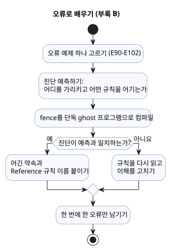

아래의 짧은 오류 예제는 Reference 규칙을 연습합니다. 각 예제는 독립적으로 읽으세요.

`ghost-error`는 이 안내서에서 오류 예제를 표시하는 표기용 태그입니다. 실제 `.ghost.md`
실행 fence는 정확히 `ghost`를 사용합니다. 아래 오류 코드를 실행 프로그램에 넣지 마세요.

### E90 — 세미콜론 누락

```ghost-error
control MissingSemicolon {
  input start: Bool
  output pump: Bool;
  pump <- start;
}
```

줄바꿈은 선언을 끝내지 않습니다. 선언마다 뒤에 `;`가 필요합니다.

### E91 — 타입이 다른 비교

```ghost-error
control MixedTypes {
  let level: Number = 0;
  output pump: Bool;
  pump <- level < 30%;
}
```

`Number`와 `Percent`는 절대 서로 암묵 변환되지 않습니다.

### E92 — 다음 상태 의존성

```ghost-error
control NextDependency {
  state a: Bool = false;
  state b: Bool = false;
  output lamp: Bool;
  a' = !a;
  b' = a';
  lamp <- b';
}
```

한 tick 안에서 모든 다음 상태 식은 이전 상태의 snapshot을 읽습니다. 다른 상태의 다음
값을 거쳐 연쇄적으로 읽을 수 없습니다.

### E93 — 두 root control

```ghost-error
control First { output lamp: Bool; lamp <- false; }
control Second { output lamp: Bool; lamp <- true; }
```

프로그램에는 실행되는 root control이 정확히 하나 있습니다. 여러 control을 재사용하려면
Reference 6장의 import, instance, connect를 사용하세요.

### E94 — 가변 정수 범위 초과

```ghost-error
control OutOfRange {
  let count = 2147483648;
  output lamp: Bool;
  lamp <- false;
}
```

`Int` 리터럴은 부호 있는 32비트 범위 안에 들어가야 합니다. 정수 범위와 변환은
[Reference §2.3](reference/02-types-expressions-state.md#23-정확한-정수-설계)을
참조하세요.

### E95 — 빠진 enum case

```ghost-error
control MissingCase {
  type Mode = Off | On;
  state mode: Mode = Off;
  output lamp: Bool;
  lamp <- case mode { Off => false; };
}
```

`case`는 enum의 모든 멤버를 처리해야 합니다.

### E96 — 중복 출력 연결

```ghost-error
control DuplicateOutput {
  output lamp: Bool;
  lamp <- false;
  lamp <- true;
}
```

출력은 정확히 하나의 연결을 받습니다. 뒤의 문장이 앞의 연결을 덮어쓰지 않습니다.

### E97 — sensor Result 미처리

```ghost-error
control BareSensor {
  input moisture: Percent;
  output pump: Bool;
  pump <- moisture < 30%;
}
```

센서는 payload가 아니라 Result이므로 직접 비교하지 마세요. `case`나 Reference §2.5의
명시적 Result 변환을 사용하세요.

<a id="appendix-c"></a>
## 부록 C. 문서 유지 규칙

이 책의 예제는 설명용 조각이면서 동시에 검사되는 계약입니다. 문장을 다듬을 때는 anchor,
예제 ID, 정본 fence, 번역 간 대응을 보존하세요. 그래야 독자와 회귀 테스트가 계속 같은
예제를 가리킵니다. 원본과 그 projection을 구분해서, 새 설명이 두 번째 실행 원본을
만들지 않게 하세요.

변하는 환경을 가르치는 예제는 일정한 유효 입력 하나로 의도를 증명할 수 없습니다. 켜지기
전, 켜지는 경계, 출력이 유지되는 구간, 꺼지는 경계에 독립적인 checkpoint를 두세요.
일변화 trace는 fault scan과 엄격한 경계 scan을 보완할 뿐 대신하지 않습니다.

Language Reference가 규범입니다. 이 안내서를 유지할 때 다음 규칙을 따르세요.

- 여기서 상충이나 빠진 예제를 발견하면, 안내서를 고치기 전에 해당 Reference 절을 먼저
  확인합니다.
- 문법이나 의미가 바뀌면 먼저 Reference의 문법, 규칙, 이유, 예제를 갱신합니다. 그다음
  이 안내서의 학습 경로와 코드를 동기화합니다.
- 학습자에게 필요한 구현 경계는 근거 문서에 연결합니다. 진행률, 테스트 수, 산출물 해시,
  지원 보드 목록처럼 변하는 사실은 그 문서에서 관리합니다.
- 예제의 컴파일러 검사에는 `tests/docs-runnable-examples.test.mjs`를 재사용합니다.
- 책을 바꾼 뒤에는 `npm run generate:pc01`을 실행해 파생 provenance를 갱신합니다. 과거
  replay와 benchmark 증거는 고치지 않습니다.

<a id="appendix-d"></a>
## 부록 D. 관심그룹별 예제

같은 GhostFlow 프로그램이라도 독자마다 처음 던지는 질문이 다릅니다. PLC 개발자는
인터록에서, 웹 개발자는 관찰 모델에서, 펌웨어 개발자는 바인딩 경계에서 시작합니다.
E23–E32는 이렇게 서로 다른 입구를 제공하지만, 모두 같은 requested/safe/applied/confirmed
구분으로 돌아옵니다. 자신의 역할에 가장 가까운 예제부터 시작하세요. 그다음 다른 역할의
질문을 품고 같은 trace를 다시 읽어 보세요.

열 개의 프로그램은 서로 다른 직무가 하나의 trace에 어떤 질문을 가져오는지 보여 줍니다.
각각이 독립적으로 실행되는 프로그램이므로 관심 있는 하나를 골라 입력 순서를 바꿔 보세요.
PLC 개발자는 출력을 막은 조건을, 웹 개발자는 표시할 증거를, 펌웨어 개발자는 논리 값과
핀 사이의 경계를 먼저 찾을 것입니다. 결과는 논리적 증거입니다. 실제 접점, 밸브, 모터는
보드, Driver, 배선, 현장 확인이 책임집니다.

### E23 — PLC 개발자: 고장 원인에서 출력까지 한 번에 따라가기

> “왜 멈췄는지, 다시 추리하지 않도록.”

컨베이어가 갑자기 멈추면 첫 질문은 “시작을 다시 눌러 볼까?”가 아니라
“어떤 조건이 멈췄나?”입니다. 이 프로그램은 jam 입력이 막힘을 보고하는(`jam_clear=false`) 모든 scan에서 운전
상태를 내리고 고장을 기억합니다. 원인이 사라진 뒤 reset을 누르면 고장이 해제되지만,
운영자가 Start를 놓았다가 다시 누르기 전까지 컨베이어는 재시작하지 않습니다.

해 보기:

1. `start=true`, `jam_clear=false`, `reset=false`로 한 scan을 실행합니다.
   `fault_latched`와 `fault_lamp`가 켜지고 `running`과 `conveyor`가 꺼집니다.
2. jam을 해소한 뒤 reset을 누릅니다. 고장 기억만 해제되고 구동은 정지 상태로 남습니다.

각 출력 판단에 어떤 입력과 상태가 쓰였는지 소스에서 바로 따라갈 수 있습니다. jam 검출기의
전기적 의미와 비상정지 회로는 여전히 별도로 설계해야 합니다.

```ghost
// E23
control TraceableConveyor {
  // Source-local display memory is initialized here; faults remain producer unknown.
  state remembered_start: Bool = false;
  let start_good = case observed_start { ok(_) => true; fault(_) => false; };
  let start = case observed_start { ok(value) => value; fault(_) => remembered_start; };
  remembered_start' = start;
  state remembered_stop: Bool = false;
  let stop_good = case observed_stop { ok(_) => true; fault(_) => false; };
  let stop = case observed_stop { ok(value) => value; fault(_) => remembered_stop; };
  remembered_stop' = stop;
  state remembered_jam_clear: Bool = false;
  let jam_clear_good = case observed_jam_clear { ok(_) => true; fault(_) => false; };
  let jam_clear = case observed_jam_clear { ok(value) => value; fault(_) => remembered_jam_clear; };
  remembered_jam_clear' = jam_clear;
  state remembered_reset: Bool = false;
  let reset_good = case observed_reset { ok(_) => true; fault(_) => false; };
  let reset = case observed_reset { ok(value) => value; fault(_) => remembered_reset; };
  remembered_reset' = reset;
  input observed_start: Bool;
  input observed_stop: Bool;
  input observed_jam_clear: Bool;
  input observed_reset: Bool;
  state running: Bool = false;
  state fault_latched: Bool = false;
  state start_armed: Bool = true;
  let fault_next = (fault_latched && !reset) || !jam_clear;

  fault_latched' = if jam_clear_good && !jam_clear then true else if start_good && stop_good && jam_clear_good && reset_good then (fault_next) else fault_latched;
  start_armed' = if stop_good && stop then false else if jam_clear_good && !jam_clear then false else if start_good && stop_good && jam_clear_good && reset_good then (!fault_next && !start) else start_armed;
  running' = if stop_good && stop then false else if jam_clear_good && !jam_clear then false else if start_good && stop_good && jam_clear_good && reset_good then (!stop && jam_clear && !fault_latched && (running || (start_armed && start))) else running;

  output conveyor, fault_lamp: Bool;
  conveyor <- running';
  fault_lamp <- fault_latched';
}
```

### E24 — 웹 개발자: 화면의 목표와 장치 피드백을 분리하기

> “이제, 화면 밖의 세상을 프로그래밍하세요.”

대시보드에서 “열기”를 누르는 것은 밸브가 열린 위치에 도달하는 것과 같지 않습니다. 웹
개발자는 이미 요청과 서버 응답을 분리해 다루지만, 장치 화면에서는 둘이 같은 초록색
아이콘으로 뭉개지기 쉽습니다. 여기서는 `target_open`이 명령된 상태를 기억하고, limit
입력은 별도의 확인 신호로 보여 줍니다.

`open_request`를 한 scan 동안 주면 명령이 계속 유지됩니다. “이동 중” 표시는
`open_limit`가 참이 될 때까지 켜져 있습니다. 닫기 요청은 열기 요청보다 우선합니다. 화면은
목표, 출력 명령, 물리 피드백을 세 개의 별도 값으로 렌더링할 수 있습니다. limit 신호가
실제 위치를 정확히 반영하는지는 설치와 장치 진단이 맡을 일입니다.

```ghost
// E24
control ValvePanelState {
  state displayed_open_confirmed: Bool = false;
  displayed_open_confirmed' = if open_limit_good && !open_limit then false else if open_limit_good then open_limit else displayed_open_confirmed;
  // Source-local display memory is initialized here; faults remain producer unknown.
  state remembered_open_request: Bool = false;
  let open_request_good = case observed_open_request { ok(_) => true; fault(_) => false; };
  let open_request = case observed_open_request { ok(value) => value; fault(_) => remembered_open_request; };
  remembered_open_request' = open_request;
  state remembered_close_request: Bool = false;
  let close_request_good = case observed_close_request { ok(_) => true; fault(_) => false; };
  let close_request = case observed_close_request { ok(value) => value; fault(_) => remembered_close_request; };
  remembered_close_request' = close_request;
  state remembered_stop: Bool = false;
  let stop_good = case observed_stop { ok(_) => true; fault(_) => false; };
  let stop = case observed_stop { ok(value) => value; fault(_) => remembered_stop; };
  remembered_stop' = stop;
  state remembered_open_limit: Bool = false;
  let open_limit_good = case observed_open_limit { ok(_) => true; fault(_) => false; };
  let open_limit = case observed_open_limit { ok(value) => value; fault(_) => remembered_open_limit; };
  remembered_open_limit' = open_limit;
  input observed_open_request: Bool;
  input observed_close_request: Bool;
  input observed_stop: Bool;
  input observed_open_limit: Bool;
  state target_open: Bool = false;

  target_open' = if close_request_good && close_request then false else if stop_good && stop then false else if open_request_good && close_request_good && stop_good && open_limit_good then (!stop && !close_request && (open_request || target_open)) else target_open;

  output open_command, close_command, moving_open, open_confirmed: Bool;
  open_command <- !stop && target_open';
  close_command <- !stop && !target_open';
  moving_open <- !stop && target_open' && !open_limit;
  open_confirmed <- displayed_open_confirmed';
  require !(open_command && close_command);
}
```

### E25 — 펌웨어 개발자: 겹친 방향 명령을 보드에 올리기 전에 잡기

> “릴레이를 켜기 전에, 로직부터 돌려보세요.”

버튼, 네트워크 패킷, 접점 바운스 때문에 정회전 요청과 역회전 요청이 같은 scan에서 모두
참이 될 수 있습니다. 이 예제는 어느 한쪽을 임의로 고르지 않고 두 구동 명령을 모두
끕니다. PIG에서 정상 요청, 정지 허가 상실, 충돌 요청을 번갈아 주면서, 로직을 보드에
올리기 전에 각 출력을 살펴보세요.

이것은 펌웨어 업로드 전에 논리 우선순위를 읽는 첫 단계입니다. 소프트웨어 상호 배제만으로는
두 접촉기가 동시에 닫히는 것을 막을 수 없고, 관성으로 도는 모터를 멈출 수도 없습니다.
장비에는 적절한 전기·기계 인터록과 독립 보호가 필요합니다. 역전 전에 지연이 필요한
장비에는 명시적인 상태와 피드백도 필요합니다.

```ghost
// E25
control DirectionRequestGate {
  state displayed_forward_command: Bool = false;
  displayed_forward_command' = if forward_request_good && !forward_request then false else if reverse_request_good && reverse_request then false else if stop_ok_good && !stop_ok then false else if forward_request_good && reverse_request_good && stop_ok_good then stop_ok && forward_request && !reverse_request else displayed_forward_command;
  state displayed_reverse_command: Bool = false;
  displayed_reverse_command' = if forward_request_good && forward_request then false else if reverse_request_good && !reverse_request then false else if stop_ok_good && !stop_ok then false else if forward_request_good && reverse_request_good && stop_ok_good then stop_ok && reverse_request && !forward_request else displayed_reverse_command;
  state displayed_conflict: Bool = false;
  displayed_conflict' = if forward_request_good && !forward_request then false else if reverse_request_good && !reverse_request then false else if forward_request_good && reverse_request_good then forward_request && reverse_request else displayed_conflict;
  // Source-local display memory is initialized here; faults remain producer unknown.
  state remembered_stop_ok: Bool = false;
  let stop_ok_good = case observed_stop_ok { ok(_) => true; fault(_) => false; };
  let stop_ok = case observed_stop_ok { ok(value) => value; fault(_) => remembered_stop_ok; };
  remembered_stop_ok' = stop_ok;
  state remembered_forward_request: Bool = false;
  let forward_request_good = case observed_forward_request { ok(_) => true; fault(_) => false; };
  let forward_request = case observed_forward_request { ok(value) => value; fault(_) => remembered_forward_request; };
  remembered_forward_request' = forward_request;
  state remembered_reverse_request: Bool = false;
  let reverse_request_good = case observed_reverse_request { ok(_) => true; fault(_) => false; };
  let reverse_request = case observed_reverse_request { ok(value) => value; fault(_) => remembered_reverse_request; };
  remembered_reverse_request' = reverse_request;
  input observed_stop_ok: Bool;
  input observed_forward_request: Bool;
  input observed_reverse_request: Bool;
  output forward_command, reverse_command, conflict: Bool;

  forward_command <- displayed_forward_command';
  reverse_command <- displayed_reverse_command';
  conflict <- displayed_conflict';
  require !(forward_command && reverse_command);
}
```

### E26 — AI 개발자: 생성된 규칙 옆에 검토할 의도를 남기기

> “AI가 작성해도, 동작의 이유는 남아야 하니까.”

생성된 제어 프로그램이 컴파일된다고 해서 무엇을 의도했는지까지 보여 준 것은 아닙니다.
리뷰어에게는 세 가지를 잇는 하나의 문서가 필요합니다. 현장 전제, 그 전제를 담은 규칙,
시뮬레이션해 볼 만한 입력 순서입니다. `.ghost.md` 파일은 설명과 실행 코드를 하나의
원본에 담고, 컴파일러는 최상위 `ghost` fence를 원래 위치 정보와 함께 읽습니다.

아래 규칙은 급수 시간대가 열려 있고, 토양에 물이 필요하며, 급수원이 준비되었을 때만
펌프를 요청합니다. 실제 프로젝트에서는 센서 극성처럼 AI가 세운 가정과 아직 정하지 않은
현장 결정을 설명에 적어 두세요. 그러면 담당자가 확인하고 그 결과를 소스 revision으로
기록합니다. 문서 형식이 AI의 정확성을 보증할 수는 없지만, 검토 대상이 생성된 코드 안에
숨지 않게 합니다.

```ghost
// E26
control ReviewedWateringRule {
  state displayed_pump_request: Bool = false;
  displayed_pump_request' = if soil_needs_water_good && !soil_needs_water then false else if source_ready_good && !source_ready then false else if watering_window_good && !watering_window then false else if soil_needs_water_good && source_ready_good && watering_window_good then watering_window && soil_needs_water && source_ready else displayed_pump_request;
  // Source-local display memory is initialized here; faults remain producer unknown.
  state remembered_watering_window: Bool = false;
  let watering_window_good = case observed_watering_window { ok(_) => true; fault(_) => false; };
  let watering_window = case observed_watering_window { ok(value) => value; fault(_) => remembered_watering_window; };
  remembered_watering_window' = watering_window;
  state remembered_soil_needs_water: Bool = false;
  let soil_needs_water_good = case observed_soil_needs_water { ok(_) => true; fault(_) => false; };
  let soil_needs_water = case observed_soil_needs_water { ok(value) => value; fault(_) => remembered_soil_needs_water; };
  remembered_soil_needs_water' = soil_needs_water;
  state remembered_source_ready: Bool = false;
  let source_ready_good = case observed_source_ready { ok(_) => true; fault(_) => false; };
  let source_ready = case observed_source_ready { ok(value) => value; fault(_) => remembered_source_ready; };
  remembered_source_ready' = source_ready;
  input observed_watering_window: Bool;
  input observed_soil_needs_water: Bool;
  input observed_source_ready: Bool;
  output pump_request: Bool;

  pump_request <- displayed_pump_request';
}
```

### E27 — ESP32·제어보드 제조사: I/O 목록에 실제 용도를 연결하기

> “좋은 보드에, 쓰임새를 더하세요.”

입력 8개와 출력 8개를 나열한 데이터시트만으로는 고객이 무엇을 만들 수 있을지 짐작해야
합니다. 이 예제는 생장등, 순환팬, 배수 펌프, 경고 출력을 운영 조건에 연결합니다. 보드
제조사는 이를 제품 예제로 공개해, 고객이 자기 보드에 대응시킬 논리 역할을 보여 줄 수
있습니다.

출력 이름은 GPIO 번호가 아니라 장치 역할을 나타냅니다. 어느 채널이 `grow_light`를
구동하고 어떤 센서가 각 입력을 공급할지는 보드 바인딩, 입력 Driver, 출력 렌더러가
결정합니다. 따라서 제조사는 소스 하나가 모든 보드에서 자동으로 동작한다고 약속할 필요가
없습니다. 대신 보드별로 검증한 배선표와 함께 예제를 제공할 수 있습니다.

```ghost
// E27
control BoardShowcase {
  state displayed_grow_light: Bool = false;
  displayed_grow_light' = if enabled_good && !enabled then false else if light_schedule_good && !light_schedule then false else if enabled_good && light_schedule_good then enabled && light_schedule else displayed_grow_light;
  state displayed_circulation_fan: Bool = false;
  displayed_circulation_fan' = if enabled_good && !enabled then false else if ventilation_request_good && !ventilation_request then false else if enabled_good && ventilation_request_good then enabled && ventilation_request else displayed_circulation_fan;
  state displayed_drain_pump: Bool = false;
  displayed_drain_pump' = if drain_path_ready_good && !drain_path_ready then false else if drain_request_good && !drain_request then false else if enabled_good && !enabled then false else if drain_path_ready_good && drain_request_good && enabled_good then enabled && drain_request && drain_path_ready else displayed_drain_pump;
  state displayed_warning: Bool = false;
  displayed_warning' = if drain_path_ready_good && drain_path_ready then false else if drain_request_good && !drain_request then false else if drain_path_ready_good && drain_request_good then drain_request && !drain_path_ready else displayed_warning;
  // Source-local display memory is initialized here; faults remain producer unknown.
  state remembered_enabled: Bool = false;
  let enabled_good = case observed_enabled { ok(_) => true; fault(_) => false; };
  let enabled = case observed_enabled { ok(value) => value; fault(_) => remembered_enabled; };
  remembered_enabled' = enabled;
  state remembered_light_schedule: Bool = false;
  let light_schedule_good = case observed_light_schedule { ok(_) => true; fault(_) => false; };
  let light_schedule = case observed_light_schedule { ok(value) => value; fault(_) => remembered_light_schedule; };
  remembered_light_schedule' = light_schedule;
  state remembered_ventilation_request: Bool = false;
  let ventilation_request_good = case observed_ventilation_request { ok(_) => true; fault(_) => false; };
  let ventilation_request = case observed_ventilation_request { ok(value) => value; fault(_) => remembered_ventilation_request; };
  remembered_ventilation_request' = ventilation_request;
  state remembered_drain_request: Bool = false;
  let drain_request_good = case observed_drain_request { ok(_) => true; fault(_) => false; };
  let drain_request = case observed_drain_request { ok(value) => value; fault(_) => remembered_drain_request; };
  remembered_drain_request' = drain_request;
  state remembered_drain_path_ready: Bool = false;
  let drain_path_ready_good = case observed_drain_path_ready { ok(_) => true; fault(_) => false; };
  let drain_path_ready = case observed_drain_path_ready { ok(value) => value; fault(_) => remembered_drain_path_ready; };
  remembered_drain_path_ready' = drain_path_ready;
  input observed_enabled: Bool;
  input observed_light_schedule: Bool;
  input observed_ventilation_request: Bool;
  input observed_drain_request: Bool;
  input observed_drain_path_ready: Bool;
  output grow_light, circulation_fan, drain_pump, warning: Bool;

  grow_light <- displayed_grow_light';
  circulation_fan <- displayed_circulation_fan';
  drain_pump <- displayed_drain_pump';
  warning <- displayed_warning';
}
```

### E28 — 제어반·설비 통합업체: 밸브 확인 뒤에 펌프를 요청하기

> “설비와 함께, 동작의 이유도 납품하세요.”

시운전에서는 “밸브를 열라고 명령했다”와 “열림 리미트 스위치가 보고했다” 사이의 차이가
자주 드러납니다. 둘을 하나의 조건으로 다루면 배관 상태가 확인되기 전에 펌프를 요청할 수
있습니다. 이 예제는 충전 요청을 기억하되, 열림 피드백이 도착할 때까지 펌프 출력을 보류합니다.

해 보기:

1. `valve_open_limit=false` 상태에서 `fill_request`를 줍니다. 밸브 명령만 켜집니다.
2. limit를 참으로 바꿉니다. 다음 scan에서 펌프 요청이 켜집니다.
3. 정지 또는 source-full 입력은 상태를 지우고 두 출력을 모두 멈춥니다.

설치자는 여전히 limit 극성, 밸브 timeout, 정지 후 복구를 현장 계약에 맞게 더해야 합니다.

```ghost
// E28
control ConfirmedValveFill {
  // Source-local display memory is initialized here; faults remain producer unknown.
  state remembered_fill_request: Bool = false;
  let fill_request_good = case observed_fill_request { ok(_) => true; fault(_) => false; };
  let fill_request = case observed_fill_request { ok(value) => value; fault(_) => remembered_fill_request; };
  remembered_fill_request' = fill_request;
  state remembered_stop_ok: Bool = false;
  let stop_ok_good = case observed_stop_ok { ok(_) => true; fault(_) => false; };
  let stop_ok = case observed_stop_ok { ok(value) => value; fault(_) => remembered_stop_ok; };
  remembered_stop_ok' = stop_ok;
  state remembered_valve_open_limit: Bool = false;
  let valve_open_limit_good = case observed_valve_open_limit { ok(_) => true; fault(_) => false; };
  let valve_open_limit = case observed_valve_open_limit { ok(value) => value; fault(_) => remembered_valve_open_limit; };
  remembered_valve_open_limit' = valve_open_limit;
  state remembered_source_full: Bool = false;
  let source_full_good = case observed_source_full { ok(_) => true; fault(_) => false; };
  let source_full = case observed_source_full { ok(value) => value; fault(_) => remembered_source_full; };
  remembered_source_full' = source_full;
  input observed_fill_request: Bool;
  input observed_stop_ok: Bool;
  input observed_valve_open_limit: Bool;
  input observed_source_full: Bool;
  state filling: Bool = false;

  filling' = if stop_ok_good && !stop_ok then false else if source_full_good && source_full then false else if fill_request_good && stop_ok_good && valve_open_limit_good && source_full_good then (stop_ok && !source_full && (fill_request || filling)) else filling;

  output valve_open_command, pump_command: Bool;
  valve_open_command <- filling';
  pump_command <- filling' && valve_open_limit;
  require pump_command => valve_open_command;
}
```

### E29 — 유지보수 담당자: 기다림과 고장을 구별할 단서를 남기기

> “만든 사람이 없어도, 고칠 실마리는 남도록.”

기계를 넘겨받은 사람이 “펌프가 왜 아직 안 돌지?”에 답하려면 요청과 피드백을 모두 볼 수
있어야 합니다. 이 제어는 밸브가 열리기를 기다리는 동안 펌프를 끈 채로 두고
`waiting_for_valve`를 켭니다. limit가 들어오면 대기 표시가 꺼지고 펌프 명령이 나타납니다.
정지 허가를 잃으면 두 출력과 대기 표시가 모두 해제됩니다.

이 표시는 밸브 이동 시간이 정상인지 판단하지 않습니다. 화면과 기록에서는 “대기 중”을
timeout 고장과 구분해야 합니다. 인수인계 문서에는 limit 입력의 채널, 극성, 점검 방법을
적어 두어야 합니다. 목표는 다음 유지보수 담당자가 원래 작성자를 찾지 않고도 어느 입력부터
확인할지 아는 것입니다.

```ghost
// E29
control ValveWaitDiagnosis {
  state displayed_valve_open_command: Bool = false;
  displayed_valve_open_command' = if fill_request_good && !fill_request then false else if stop_ok_good && !stop_ok then false else if fill_request_good && stop_ok_good then fill_request && stop_ok else displayed_valve_open_command;
  state displayed_pump_command: Bool = false;
  displayed_pump_command' = if fill_request_good && !fill_request then false else if stop_ok_good && !stop_ok then false else if valve_open_limit_good && !valve_open_limit then false else if fill_request_good && stop_ok_good && valve_open_limit_good then fill_request && stop_ok && valve_open_limit else displayed_pump_command;
  state displayed_waiting_for_valve: Bool = false;
  displayed_waiting_for_valve' = if fill_request_good && !fill_request then false else if stop_ok_good && !stop_ok then false else if valve_open_limit_good && valve_open_limit then false else if fill_request_good && stop_ok_good && valve_open_limit_good then fill_request && stop_ok && !valve_open_limit else displayed_waiting_for_valve;
  // Source-local display memory is initialized here; faults remain producer unknown.
  state remembered_fill_request: Bool = false;
  let fill_request_good = case observed_fill_request { ok(_) => true; fault(_) => false; };
  let fill_request = case observed_fill_request { ok(value) => value; fault(_) => remembered_fill_request; };
  remembered_fill_request' = fill_request;
  state remembered_stop_ok: Bool = false;
  let stop_ok_good = case observed_stop_ok { ok(_) => true; fault(_) => false; };
  let stop_ok = case observed_stop_ok { ok(value) => value; fault(_) => remembered_stop_ok; };
  remembered_stop_ok' = stop_ok;
  state remembered_valve_open_limit: Bool = false;
  let valve_open_limit_good = case observed_valve_open_limit { ok(_) => true; fault(_) => false; };
  let valve_open_limit = case observed_valve_open_limit { ok(value) => value; fault(_) => remembered_valve_open_limit; };
  remembered_valve_open_limit' = valve_open_limit;
  input observed_fill_request: Bool;
  input observed_stop_ok: Bool;
  input observed_valve_open_limit: Bool;
  output valve_open_command, pump_command, waiting_for_valve: Bool;

  valve_open_command <- displayed_valve_open_command';
  pump_command <- displayed_pump_command';
  waiting_for_valve <- displayed_waiting_for_valve';
}
```

### E30 — 농부·현장 운영자: 물 줄 때는 농부가 정하고 반복은 기계에 맡기기

> “판단은 농부가. 반복은 기계가.”

관수 정책은 수분 측정값 하나로 끝나지 않습니다. 작물과 작업에 대한 농부의 판단은 여기서
`enabled`와 `watering_window`로 나타납니다. 제어는 농부가 고른 시간대 안에서 토양이
건조하고 급수원이 준비되었을 때만 물을 요청합니다. 급수원이 준비되지 않았다면 운영자에게
그 이유를 보여 줍니다.

`watering_window`는 달력, 날씨, 작업 계획을 대신하는 숨은 기본값이 아닙니다. 농부가 고른
일정에 따라 실행 환경이 공급하는 입력입니다. 농부는 시간대나 건조 기준을 바꾸고, 같은
판단의 반복은 제어에 맡길 수 있습니다. 센서 배치와 보정, 관수량, 작물별 임계값은 여전히
현장에서 정합니다.

```ghost
// E30
control FarmerDirectedWatering {
  state displayed_pump_request: Bool = false;
  displayed_pump_request' = if enabled_good && !enabled then false else if soil_needs_water_good && !soil_needs_water then false else if source_ready_good && !source_ready then false else if watering_window_good && !watering_window then false else if enabled_good && soil_needs_water_good && source_ready_good && watering_window_good then enabled && watering_window && soil_needs_water && source_ready else displayed_pump_request;
  state displayed_source_attention: Bool = false;
  displayed_source_attention' = if enabled_good && !enabled then false else if soil_needs_water_good && !soil_needs_water then false else if source_ready_good && source_ready then false else if watering_window_good && !watering_window then false else if enabled_good && soil_needs_water_good && source_ready_good && watering_window_good then enabled && watering_window && soil_needs_water && !source_ready else displayed_source_attention;
  // Source-local display memory is initialized here; faults remain producer unknown.
  state remembered_enabled: Bool = false;
  let enabled_good = case observed_enabled { ok(_) => true; fault(_) => false; };
  let enabled = case observed_enabled { ok(value) => value; fault(_) => remembered_enabled; };
  remembered_enabled' = enabled;
  state remembered_watering_window: Bool = false;
  let watering_window_good = case observed_watering_window { ok(_) => true; fault(_) => false; };
  let watering_window = case observed_watering_window { ok(value) => value; fault(_) => remembered_watering_window; };
  remembered_watering_window' = watering_window;
  state remembered_soil_needs_water: Bool = false;
  let soil_needs_water_good = case observed_soil_needs_water { ok(_) => true; fault(_) => false; };
  let soil_needs_water = case observed_soil_needs_water { ok(value) => value; fault(_) => remembered_soil_needs_water; };
  remembered_soil_needs_water' = soil_needs_water;
  state remembered_source_ready: Bool = false;
  let source_ready_good = case observed_source_ready { ok(_) => true; fault(_) => false; };
  let source_ready = case observed_source_ready { ok(value) => value; fault(_) => remembered_source_ready; };
  remembered_source_ready' = source_ready;
  input observed_enabled: Bool;
  input observed_watering_window: Bool;
  input observed_soil_needs_water: Bool;
  input observed_source_ready: Bool;
  output pump_request, source_attention: Bool;

  pump_request <- displayed_pump_request';
  source_attention <- displayed_source_attention';
}
```

### E31 — 메이커·자동화 입문자: 관수와 환풍기 예제를 가져와 함께 쓰기

> “예제는 많은데, 합치기는 어려웠죠?”

이 예제는 관수 프로그램 E21과 환기 프로그램 E20을 복사하지 않고 import합니다. root
control은 같은 공기 온도, 습도, 빛 입력을 두 프로그램에 연결하고, 각 프로그램은 자신의
센서 처리와 내부 상태를 그대로 유지합니다. 두 출력은 `irrigation_demand`와
`ventilate_demand`로 따로 공개됩니다.

두 요구는 동시에 참일 수 있습니다. 공유 전원이나 공유 출력에 연결하기 전에 어떤 조합을
허용하고 무엇을 우선할지 정하세요. 각 import는 원본 revision과 해시를 고정합니다. 조합한
프로그램을 보드에 올리기 전에는 메모리와 연산 요구량도 확인하세요.

```ghost
// E31
import Irrigation from "./E21.ghost.md"
  revision "5e709162753c0aba38d426c1c4e0722edfb04d7b"
  sha256 "b87dcf69b53e993b8e82f901870f7470c047ea7b0e46f8308361e606c38b2a87";
import Ventilation from "./E20.ghost.md"
  revision "5e709162753c0aba38d426c1c4e0722edfb04d7b"
  sha256 "af696ac6774f459726853f0a2c65a689b42c7e37c69dd8165f68bb3dab1cbea8";
control CombinedGreenhouseDemands {
  input air: Temperature {
    sample = 1s; valid = 0°C .. 50°C;
    filter = median(1); stale_after = 3s; recover_after = 1 samples;
  }
  input humidity: RelativeHumidity {
    sample = 1s; valid = 0%RH .. 100%RH;
    filter = median(1); stale_after = 3s; recover_after = 1 samples;
  }
  input light: PPFD {
    sample = 1s; valid = 0umol/m2/s .. 3000umol/m2/s;
    filter = median(1); stale_after = 3s; recover_after = 1 samples;
  }
  output irrigation_demand, ventilate_demand: Bool;
  instance watering: Irrigation;
  instance fan: Ventilation;
  connect watering.air <- air;
  connect watering.humidity <- humidity;
  connect watering.light <- light;
  connect fan.air <- air;
  connect fan.humidity <- humidity;
  connect fan.light <- light;
  connect irrigation_demand <- watering.irrigation_demand;
  connect ventilate_demand <- fan.ventilate_demand;
}
```

### E32 — 오픈소스 사용자: 장비보다 먼저 자기 제어 규칙을 보유하기

> “회사가 사라져도, 제어는 남아야 하니까.”

장비 공급자나 온라인 서비스가 바뀌더라도 사용자는 자신이 승인한 제어 규칙을 읽고 보관할
수 있어야 합니다. 이 독립 예제는 토양 수분과 그 임계값을 입력으로 받고, 비교 규칙을
소스에 그대로 드러냅니다. 구독 화면이나 원격 계정이 제어 판단의 비공개 원본이 되지
않습니다.

`.ghost.md` 파일을 Language Reference, 컴파일러 revision과 함께 보관하면 프로그램을
검토하고 다시 생성하는 데 필요한 자료가 남습니다. 다른 보드에서 실행하는 것은 여전히 그
보드가 지원하는 런타임과 I/O 바인딩에 달려 있습니다. 프로그램을 소유한다고 이식성이
보장되지는 않지만, 제어 의도가 한 공급자만 읽을 수 있는 바이너리에 갇히지 않게 합니다.

```ghost
// E32
control OwnedWateringRule {
  state displayed_pump_request: Bool = false;
  displayed_pump_request' = if soil_moisture_good && threshold_good then soil_moisture < threshold else displayed_pump_request;
  // Source-local display memory is initialized here; faults remain producer unknown.
  state remembered_soil_moisture: Percent = 0%;
  let soil_moisture_good = case observed_soil_moisture { ok(_) => true; fault(_) => false; };
  let soil_moisture = case observed_soil_moisture { ok(value) => value; fault(_) => remembered_soil_moisture; };
  remembered_soil_moisture' = soil_moisture;
  state remembered_threshold: Percent = 0%;
  let threshold_good = case observed_threshold { ok(_) => true; fault(_) => false; };
  let threshold = case observed_threshold { ok(value) => value; fault(_) => remembered_threshold; };
  remembered_threshold' = threshold;
  input observed_soil_moisture: Percent;
  input observed_threshold: Percent;
  output pump_request: Bool;
  pump_request <- displayed_pump_request';
}
```

열 개의 예제를 모두 읽을 필요는 없습니다. 하나를 입력에서 출력 의도까지 따라간 뒤, 다른
역할의 예제에서 같은 증거 구분을 찾아보세요. GhostFlow가 남기려는 것은 장치가 움직였다는
주장보다, 다음 사람이 그 판단을 검토하고 이어갈 수 있게 해 주는 이유입니다.

## 정확한 수와 자연 시각: R14–R17 실행 예제

마지막 심화 묶음은 “대략 맞으면 된다”로 넘길 수 없는 경계를 다룹니다.

- scan 횟수에는 정확한 `Int`가 필요합니다.
- 절대 시각에는 offset이 있는 `DateTime`이 필요합니다.
- 일출과 조석에는 provider의 근거와 fallback이 필요합니다.

E34–E37은 현재 browser cabinet이 아닌 별도 host 프로필에서 실행됩니다. browser에서 열리지
않는다고 언어에 없는 기능이라는 뜻은 아닙니다. 이 묶음은 입력 증거를 고정하고, 각 경계의
직전·정확히 그 시점·직후의 결과를 비교하며 공부합니다.

네 예제는 서로 달라 보이지만 하나의 질문을 던집니다. 경계를 넘었다고 말할 수 있는 정확한
증거는 무엇인가? E34는 scan 수, E35는 UTC instant, E36은 일출 발생, E37은 조석 발생을
사용합니다. 규칙은 [Reference 02](reference/02-types-expressions-state.md)와
[Reference 03](reference/03-time-and-schedules.md)이 정의합니다. 아래 표는 각 결정을 다시
실행해 볼 수 있는 증거로 안내합니다.

| 항목 | 채택된 결정과 작업 | 실행 증거 |
|---|---|---|
| R14 정확한 수 | #22/#24/#25: checked i32 Int, 명시적 변환, overflow 시 tick 거절 | E34/E98, [정수 검사](../tests/int-compiler.test.mjs), [나눗셈·경계](../tests/int-division-identity.test.mjs) |
| R15 절대 시각 | #27: offset 있는 DateTime, 정확한 UTC instant, Duration 이동 | E35/E99, [DateTime 실행](../tests/date-time-control.test.mjs) |
| R16 달력·자연 예약 | #28 및 #401/#403: Solar pulse, Tide run/within, provider·occurrence 식별 | E36/E37, [자연 예약](../tests/natural-schedule-contract.test.mjs), [Solar scan parity](../tests/solar-scanframe-native-wasm.test.mjs) |
| R17 불확실 시각 정책 | #29: 제한된 hold_trusted, Solar fixed_time, 명시적 terminal skip | E36/E100–E102, [fallback 컴파일](../tests/natural-fallback-compiler.test.mjs), [fallback 실행](../tests/natural-fallback-runtime.test.mjs) |

E34–E37은 현재 컴파일러가 실행 가능한 bytecode를 내보내는 독립 프로그램입니다. 각 예제에
필요한 입력 증거를 보면 browser cabinet이 아닌 별도 host에서 실행되는 이유를 알 수
있습니다. 뒤따르는 오류 예제는 반대입니다. 컴파일러가 거부해야만 성공하는 완전한
프로그램입니다. 각 fence를 따로 실행하세요.

- [문서 컴파일 검사](../tests/docs-runnable-examples.test.mjs)는 두 언어에 같은 소스가
  들어 있는지, 각 오류가 의도한 진단을 내는지 확인합니다.
- [책 실행 검사](../tests/programming-natural-examples.test.mjs)는 E34–E37의 host 동작을
  실행합니다.

어느 검사도 Device 배포나 물리 출력 확인까지 확장되지 않습니다.

### E34 — 참인 scan의 수를 정확히 세기

`add=true`인 성공한 scan마다 1을 더합니다. 상승 에지가 아니라 scan을 세므로, `add`를 참으로
유지하면 scan마다 수가 증가합니다. 출력은 병렬 갱신 후의 값인 `count'`를 읽습니다. `Int`
최대값에서 더하면 `integer-overflow`로 tick이 거절되고, 새 상태도 출력 의도도 확정되지
않습니다. overflow는 wrap이나 포화로 절대 숨겨지지 않습니다.

```ghost
// E34
control ExactScanCount {
  // Source-local display memory is initialized here; faults remain producer unknown.
  state remembered_add: Bool = false;
  let add_good = case observed_add { ok(_) => true; fault(_) => false; };
  let add = case observed_add { ok(value) => value; fault(_) => remembered_add; };
  remembered_add' = add;
  input observed_add: Bool;
  state count: Int = 0;
  output total: Int;
  count' = if add_good then (if add then count + 1 else count) else count;
  total <- count';
}
```

### E35 — offset 있는 절대 시각 구간 비교하기

현지 표기 06:30+09:00과 전날 21:30Z는 같은 UTC instant를 가리킵니다. `now`는 환경이
공급하는 타입 있는 `DateTime`입니다. 식은 숫자가 무엇을 뜻하는지, 시계를 믿을 수 있는지
추측하지 않습니다. 구간은 시작을 포함하고 끝을 제외합니다. `5min`은 고정된 `Duration`이며
달력의 한 달이나 시간대 변경을 뜻하지 않습니다. 지원 도메인 밖의 `DateTime` 입력이나 이동
결과는 부분 상태 갱신 없이 거절됩니다.

```ghost
// E35
control AbsoluteWindow {
  state displayed_in_window: Bool = false;
  displayed_in_window' = if now_good then now >= start && now < end else displayed_in_window;
  state displayed_same_instant: Bool = false;
  displayed_same_instant' = if true then start == datetime`2026-09-29T21:30:00Z` else displayed_same_instant;
  // Source-local display memory is initialized here; faults remain producer unknown.
  state remembered_now: DateTime = datetime`1970-01-01T00:00:00Z`;
  let now_good = case observed_now { ok(_) => true; fault(_) => false; };
  let now = case observed_now { ok(value) => value; fault(_) => remembered_now; };
  remembered_now' = now;
  input observed_now: DateTime;
  output in_window, same_instant: Bool;
  let start = datetime`2026-09-30T06:30:00+09:00`;
  let end = start + 5min;
  in_window <- displayed_in_window';
  same_instant <- displayed_same_instant';
}
```

### E36 — 일출 pulse와 제한된 시계·고정 시각 fallback

`enabled`가 참이면 제어는 일출 30분 뒤의 발생에서 시작 pulse를 요청합니다. `start`는 하루
종일 켜져 있는 상태가 아니며, 운전 지속 시간을 더하지 않습니다. 신뢰할 수 있는 시계와
위치·Solar 계산의 근거는 환경이 공급합니다.

시계 정책 `hold_trusted`:

- 같은 run/time 연속성 안에서, 이전에 받은 신뢰 시계 snapshot을 단조 시간으로 2분 미만
  동안 연장합니다.
- 그런 이전 신뢰 근거가 없거나 정확히 2분 경계에 도달하면 skip합니다.
- 보류된 시각은 절대 신뢰된 벽시계 시각으로 기록되지 않습니다.

fallback 정책 `fixed_time`:

- Solar 사건을 사용할 수 없으면 제어는 UTC 06:30이라는 명시적 대안을 사용합니다.
- 이 fallback에도 유효한 신뢰 시계나 제한된 보류 시계가 필요합니다.
- 사용할 수 없는 시각은 절대 0이나 “지금”이 되지 않습니다. terminal 정책은 skip입니다.

첫 관측이나 큰 공백 뒤의 baseline 복구는 지난 발생을 소급해 시작하지 않습니다. 예약 증거는
admission, unknown, fallback 이유를 따로 기록합니다.

```ghost
// E36
control SolarFallbackStart {
  state displayed_start: Bool = false;
  displayed_start' = if true then dawn.due else displayed_start;
  // Source-local display memory is initialized here; faults remain producer unknown.
  state remembered_enabled: Bool = false;
  let enabled_good = case observed_enabled { ok(_) => true; fault(_) => false; };
  let enabled = case observed_enabled { ok(value) => value; fault(_) => remembered_enabled; };
  remembered_enabled' = enabled;
  input observed_enabled: Bool;
  schedule dawn: Solar {
    timezone = "UTC";
    latitude = 37;
    longitude = 127;
    at = sun`rise + 30min`;
    basis = pulse;
    when = enabled_good && enabled;
    clock = hold_trusted(2min, terminal: skip);
    gap = skip_after(60s);
    recovery = baseline;
    fallback = fixed_time(time`06:30`, terminal: skip);
  }
  output start: Bool;
  start <- displayed_start';
}
```

### E37 — 만조 전의 승인 유예와 단조 시계 운전

계획 시각은 provider `harbor_tides`가 예측한 만조의 30분 전입니다. 예측이 유효하고 신선하며,
시계를 신뢰할 수 있고, `allowed=true`이면 제어는 [계획, 계획+10분) 안에서 한 번의 운전을
admission합니다. 구간의 정확한 끝은 제외됩니다. 운전은 admission 시점부터 5분 동안
지속되므로 늦게 admission되어도 길어지지 않습니다. `stop=true`이면 `cancel_when`을 통해
운전이 취소됩니다. 한 번 admission된 운전은 새 admission을 할 수 없게 되더라도 단조 시간으로
계속되며, 취소 조건과 run/time 연속성 규칙을 따릅니다.

아래 타이밍 그림은 계획 시각보다 4분 늦게 admission된 한 가지 예를 보여 줍니다. 운전은
그래도 정확히 5분 동안 지속되고, admission 구간은 계획+10분에 닫힙니다.

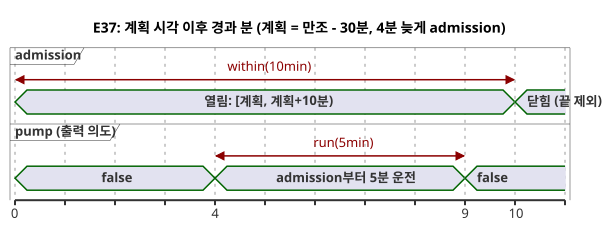

예측이 없거나 오래되었거나 시계가 Unknown이면 새 운전을 admission하지 않습니다.
`fallback=skip`은 물리적 페일세이프 동작을 증명하지도, 예측을 지어내지도 않습니다.
`pump`는 출력 의도이며 safe, applied, confirmed라는 물리적 사실과 구별됩니다. provider의
station, revision, occurrence와 시계 snapshot은 환경 입력입니다. 코드에는 주소나 설치
credential이 들어 있지 않습니다.

```ghost
// E37
control TideRun {
  state displayed_pump: Bool = false;
  displayed_pump' = if true then high.active else displayed_pump;
  // Source-local display memory is initialized here; faults remain producer unknown.
  state remembered_allowed: Bool = false;
  let allowed_good = case observed_allowed { ok(_) => true; fault(_) => false; };
  let allowed = case observed_allowed { ok(value) => value; fault(_) => remembered_allowed; };
  remembered_allowed' = allowed;
  state remembered_stop: Bool = false;
  let stop_good = case observed_stop { ok(_) => true; fault(_) => false; };
  let stop = case observed_stop { ok(value) => value; fault(_) => remembered_stop; };
  remembered_stop' = stop;
  input observed_allowed: Bool;
  input observed_stop: Bool;
  provider harbor_tides: TidePredictions;
  schedule high: Tide {
    source = harbor_tides;
    timezone = "UTC";
    at = tide`high - 30min`;
    basis = run(5min, within(10min));
    when = allowed_good && allowed;
    cancel_when = stop_good && stop;
    clock = trusted_only;
    gap = skip_after(60s);
    recovery = baseline;
    fallback = skip;
  }
  output pump: Bool;
  pump <- displayed_pump';
}
```

### E98 — Int와 Number를 암묵적으로 섞지 않기

여기서 `count`는 `Int`이고 `measurement`는 `Number`이므로 컴파일러가 코드를 거부합니다.
근사 계산을 의도했다면 `number(count)`를 명시하세요. 정확한 수로 변환하려면 `int_exact`나
명시적인 반올림 변환을 그 오류 정책과 함께 선택하세요.

```ghost-error
control MixedCount {
  let count: Int = 1;
  let measurement: Number = 1.5;
  output total: Number;
  total <- count + measurement;
}
```

### E99 — offset 없는 DateTime을 거절하기

현지 시각만으로는 UTC instant를 특정할 수 없습니다. `Z`나 숫자 offset을 쓰세요.
GhostFlow는 IANA 시간대를 절대 추측하지 않습니다.

```ghost-error
control MissingOffset {
  output ready: Bool;
  ready <- datetime`2026-09-30T06:30:00` < datetime`2026-09-30T07:00:00Z`;
}
```

### E100 — Solar의 fallback을 생략하지 않기

자료가 없을 때 무엇을 할지도 소스 계약의 일부입니다. 필수 fallback이 없는 예약은
bytecode를 만들지 않습니다. 원하는 정책이 skip이라면 `fallback = skip;`을 쓰세요.

```ghost-error
control MissingSolarFallback {
  schedule dawn: Solar {
    timezone = "UTC"; latitude = 37; longitude = 127; at = sun`rise`;
    basis = pulse; when = true; clock = trusted_only;
    gap = skip_after(60s); recovery = baseline;
  }
  output start: Bool;
  start <- dawn.due;
}
```

### E101 — Solar 고정 시각 fallback을 Tide로 옮기지 않기

현재 `fixed_time` 실행 경로는 Solar 전용입니다. Tide의 fallback은 `skip`이며, 고정 시각을
만조 예측의 발생으로 취급하지 않습니다.

```ghost-error
control UnsupportedTideFallback {
  provider predictions: TidePredictions;
  schedule high: Tide {
    source = predictions; timezone = "UTC"; at = tide`high`;
    basis = run(5min, within(10min)); when = true; cancel_when = false;
    clock = trusted_only; gap = skip_after(60s); recovery = baseline;
    fallback = fixed_time(time`06:30`, terminal: skip);
  }
  output pump: Bool;
  pump <- high.active;
}
```

### E102 — 보류 종료 정책을 반드시 쓰기

`hold_trusted(2min)`만 쓰면 보류가 만료될 때 무슨 일이 일어나는지 숨겨집니다. 현재 지원되는
유일한 명시적 terminal 정책은 `terminal: skip`입니다.

```ghost-error
control MissingHoldTerminal {
  schedule dawn: Solar {
    timezone = "UTC"; latitude = 37; longitude = 127; at = sun`rise`;
    basis = pulse; when = true; clock = hold_trusted(2min);
    gap = skip_after(60s); recovery = baseline; fallback = skip;
  }
  output start: Bool;
  start <- dawn.due;
}
```
